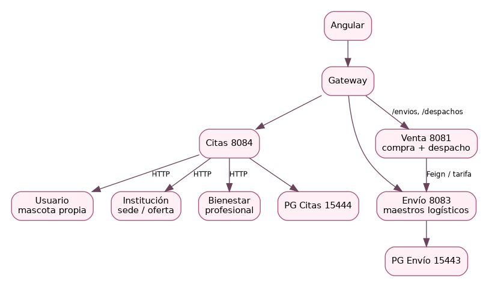
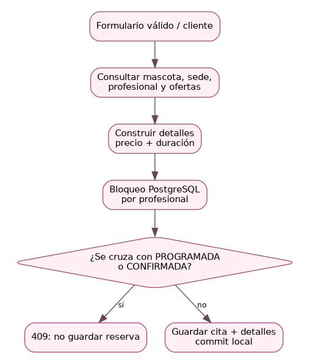
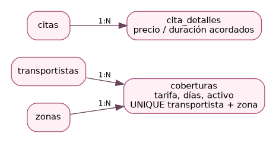

# 1. Cómo estudiar y qué te corresponde

Esta guía describe el código de la versión indicada, no funcionalidades futuras. Lee primero los capítulos de explicación; usa el índice y Ctrl+F para localizar una clase. El anexo reproduce el código de tus dominios y sus pantallas. Las líneas y enlaces corresponden al commit analizado.

Estado vigente: los pagos de compra son simulados. TRANSFERENCIA representa un rechazo didáctico; seleccionar YAPE no realiza un depósito real. Mercado Pago todavía no está conectado. Las suscripciones guardan períodos e importes, pero no realizan cobros bancarios.

En VS Code abre la carpeta raíz Garritas-Store. Presiona Ctrl+P y pega una ruta completa. Ctrl+G lleva a una línea; Ctrl+Shift+F busca un nombre en todo el proyecto. En el PDF puedes pulsar las rutas para abrir GitHub en la línea citada.

Defender no consiste en memorizar todas las líneas. Debes seguir una operación desde Angular hasta la base, identificar sus reglas y explicar qué sucede si falla. Diferencia lo que implementaste personalmente de lo que integraste con el equipo o con ayuda.

Idea | Explicación sencilla
Microservicio | Aplicación independiente con responsabilidad, puerto y base propios. No equivale a una pestaña Angular.
Maestro / no transaccional | Administra datos de referencia. Puede usar transacciones SQL locales; la etiqueta académica no significa ausencia de @Transactional.
Transaccional | Opera un proceso de negocio con datos que deben quedar coherentes: reserva, contratación o compra.
Relación N:M | Cada elemento de ambos lados puede asociarse a varios del otro. Se materializa con una tabla de unión; puede tener entidad propia.
Relación 1:N | Una cabecera o propietario tiene varios detalles o elementos.
Referencia remota | Un ID de otra base, validado por API; no una FK entre PostgreSQL de servicios distintos.

# 2. Cómo leer una clase Java sin perderte

Elemento | Qué decir al mostrarlo
package e import | Ubican la clase e incorporan los tipos utilizados; no realizan una llamada remota por existir.
@SpringBootApplication / main | Arranca el contexto y registra componentes del paquete. @Import añade configuración común.
@RestController / Mapping | Declaran rutas y verbos HTTP. El controlador recibe, valida y delega.
@Service / constructor | Concentra reglas. @RequiredArgsConstructor genera el constructor para inyectar campos final.
Repository | Interfaz Spring Data; su implementación se genera al iniciar. Las consultas y bloqueos son parte de la consistencia.
@Entity, @Table, @Id | Mapean clase, tabla e identidad local. Flyway crea el esquema real.
DTO / mapper | El contrato HTTP no es la entidad. El mapper traduce campos entre ambos.
@Transactional | Define commit/rollback de una base local. No convierte llamadas HTTP o Kafka en una única transacción global.
@Valid y constraints | Validan entradas; las reglas que cruzan recursos se comprueban en servicios.
signal / computed / subscribe | Angular almacena estado, deriva valores y recibe respuestas HTTP asíncronas.
Ejemplo verbal: “Este controlador recibe el Request; @Valid comprueba sus campos; el servicio aplica reglas; el repositorio escribe; el mapper devuelve un Response. La autorización se comprueba también antes de llegar al controlador”.


# 2.1. Diccionario de campos para explicar el código

Campo o tipo | Cómo interpretarlo
id / Long | Identificador numérico de una fila local. No es la contraseña ni el sub de Keycloak.
subject / idCliente | Identidad del JWT: String. Permite comprobar quién posee el recurso.
idMascota, idSede, idProducto, prestacionId | Referencia a otro registro. Mira la migración para saber si es FK local o un ID remoto validado por API.
BigDecimal / NUMERIC | Importes exactos en el backend/base. El total del navegador es una vista previa, no la autoridad.
activo | Disponibilidad o baja lógica. Puede depender también del estado de los padres.
estado | Etapa del proceso; no se cambia libremente a cualquier cadena. Las transiciones están en el servicio/consumidor.
Instant / fechaInicio / fechaFin | Momento y vigencia. El navegador puede mostrar la zona local; la API no debe confundir fecha con texto visual.
version / @Version | Control optimista para detectar modificaciones concurrentes de la misma entidad. No es la versión del proyecto Maven.
idempotencyKey | Identifica una operación reintentada; se conserva para repetir la misma petición y cambia para una operación nueva.
eventId | Identifica un evento para Inbox. Una repetición semántica puede tener otro eventId y requiere además unicidad de negocio.
traceId / X-Trace-ID | Correlación para diagnóstico entre logs; no sustituye autenticación ni deduplicación.
Request / Response / record | Datos que acepta o devuelve la API. Un record no es automáticamente una tabla.
Al explicar una colección, indica qué guarda y cómo se relaciona: categorias, roles, detalles o periodos. “Es una lista” describe el tipo; “son las prestaciones acordadas de esta cita” explica el negocio.


# 3. Tu mapa: Citas y Envío

Servicio | Responsabilidad | Defensa principal
Citas · 8084 / PG 15444 | Reserva de atención para una mascota, profesional, sede y prestaciones. | Transaccional: cabecera/detalles, reglas de agenda, propiedad e importes históricos.
Envío · 8083 / PG 15443 | Transportistas, zonas y coberturas con tarifa/plazo. | Maestro logístico; N:M transportista/zona mediante Cobertura.
Despacho en Venta · 8081 | Seguimiento operativo del envío ya cobrado en una compra. | Es una conexión con el módulo de Nikol; no atribuir su persistencia a la base de Envío.



# 4. Citas: del formulario a la reserva

El cliente selecciona mascota propia, sede, profesional, servicios o paquete y un horario futuro. Angular calcula una vista previa; el servidor vuelve a obtener precios y duración de Institución. No confía en un total escrito por el navegador.

services/garritas-citas-ms/src/main/java/pe/edu/upeu/garritas/citas/controller/CitaController.java:14

La API expone listar, obtener, crear, confirmar, atender y cancelar. No tiene edición libre ni borrado físico de citas.

```
  13  @RestController
  14  @RequestMapping("/api/v1/citas")
  15  @RequiredArgsConstructor
  16  public class CitaController {
  17
  18      private final CitaService citaService;
  19
  20      @GetMapping
  21      public List<CitaResponse> listar() {
  22          return citaService.listar();
  23      }
  24
  25      @GetMapping("/{id}")
  26      public CitaResponse obtener(@PathVariable Long id) {
  27          return citaService.obtener(id);
  28      }
  29
  30      @PostMapping
  31      @ResponseStatus(HttpStatus.CREATED)
  32      public CitaResponse crear(@Valid @RequestBody CitaRequest request) {
  33          return citaService.crear(request);
  34      }
  35
  36      @PostMapping("/{id}/confirmar")
  37      public CitaResponse confirmar(@PathVariable Long id) {
  38          return citaService.confirmar(id);
  39      }
  40
  41      @PostMapping("/{id}/atender")
  42      public CitaResponse atender(@PathVariable Long id) {
  43          return citaService.atender(id);
  44      }
  45
  46      @PostMapping("/{id}/cancelar")
```

services/garritas-citas-ms/src/main/java/pe/edu/upeu/garritas/citas/dto/CitaRequest.java:10

Validación de IDs positivos, fecha futura, prestaciones no vacías y motivo. La entrada no pide un total confiable del navegador.

```
   9  @Setter
  10  public class CitaRequest {
  11    @NotEmpty
  12    @Size(max = 8)
  13    private java.util.List<@NotNull @Positive Long> prestacionIds;
  14
  15    @NotNull @Positive private Long idMascota;
  16    @NotNull @Positive private Long idSede;
  17    @NotNull @Positive private Long profesionalId;
  18    @NotNull @Future private Instant fechaHora;
  19
  20    @NotBlank
  21    @Size(max = 255)
  22    private String motivo;
  23  }
```

services/garritas-citas-ms/src/main/java/pe/edu/upeu/garritas/citas/mapper/CitaMapper.java:10

El mapper establece los campos iniciales; identifica cómo toma idCliente y estado programado.

```
   9  @Component
  10  public class CitaMapper {
  11
  12    public Cita toEntity(CitaRequest request) {
  13      return Cita.builder()
  14          .idCliente(pe.edu.upeu.garritas.common.CurrentUser.subject())
  15          .profesionalId(request.getProfesionalId())
  16          .idMascota(request.getIdMascota())
  17          .idSede(request.getIdSede())
  18          .fechaHora(request.getFechaHora())
  19          .motivo(request.getMotivo())
  20          .estado(EstadoCita.PROGRAMADA)
  21          .build();
  22    }
  23
  24    public CitaResponse toResponse(Cita cita) {
  25      return CitaResponse.builder()
  26          .id(cita.getId())
```

services/garritas-citas-ms/src/main/java/pe/edu/upeu/garritas/citas/service/CitaService.java:38

La operación empieza comprobando intervalos y consultando referencias; sigue hasta la persistencia de cabecera y detalles.

```
  37
  38    public CitaResponse crear(CitaRequest r) {
  39      if (r.getFechaHora().getEpochSecond() % 1800 != 0 || r.getFechaHora().getNano() != 0)
  40        throw new ResponseStatusException(
  41            HttpStatus.BAD_REQUEST, "Selecciona un horario en intervalos de 30 minutos");
  42      Reference mascota =
  43          services.get(
  44              "garritas-usuario-ms",
  45              "/api/v1/usuarios/me/mascotas/" + r.getIdMascota(),
  46              Reference.class);
  47      Reference sede =
  48          services.get("garritas-institucion-ms", "/api/v1/sedes/" + r.getIdSede(), Reference.class);
  49      Reference profesional =
  50          services.get(
  51              "garritas-bienestar-ms",
  52              "/api/v1/especialistas/" + r.getProfesionalId(),
  53              Reference.class);
  54      if (!Boolean.TRUE.equals(sede.activo())
  55          || !Boolean.TRUE.equals(profesional.activo())
  56          || (profesional.sedeId() != null && !profesional.sedeId().equals(r.getIdSede())))
  57        throw new ResponseStatusException(
  58            HttpStatus.CONFLICT, "Sede o profesional no disponible para esta cita");
  59      OfertaReferencia[] ofertas =
  60          services.get(
  61              "garritas-institucion-ms",
  62              "/api/v1/sedes/" + r.getIdSede() + "/prestaciones",
```

Para explicar un POST: CitaController.crear recibe @Valid CitaRequest → CitaService.crear comprueba reglas y referencias → Cita/DetalleCita modelan los datos → CitaRepository.saveAndFlush guarda → CitaMapper produce el Response que Angular muestra.


# 5. Citas: conexiones exactas y autorización

Destino | Qué obtiene | Por qué importa
Usuario: /usuarios/me/mascotas/{id} | Mascota del autenticado. | No basta que exista: debe pertenecer al cliente. La llamada propaga su token.
Institución: /sedes/{id} | Sede y estado activo. | Evita reservar en una sede no disponible.
Bienestar: /especialistas/{id} | Profesional, estado y sede asignada. | Rechaza profesional inactivo o de otra sede cuando tiene sede específica.
Institución: /sedes/{id}/prestaciones | Oferta, precio, duración y componentes del paquete. | Evita aceptar servicios no ofrecidos en esa sede o precios manipulados.
services/garritas-citas-ms/src/main/java/pe/edu/upeu/garritas/citas/service/CitaService.java:21

Cliente HTTP común inyectado. No es un @FeignClient propio de Citas.

```
  20    private final CitaMapper mapper;
  21    private final ServiceClient services;
  22    private final org.springframework.jdbc.core.JdbcTemplate jdbc;
  23
  24    public List<CitaResponse> listar() {
  25      return (CurrentUser.admin()
  26              ? repository.findAll()
```

infra/garritas-common/src/main/java/pe/edu/upeu/garritas/common/ServiceClient.java:1

Lee cómo resuelve el nombre, propaga JWT y correlación y convierte fallos remotos en error controlado.

```
   1  package pe.edu.upeu.garritas.common;
   2
   3  import org.slf4j.MDC;
   4  import org.springframework.http.HttpStatus;
   5  import org.springframework.security.core.context.SecurityContextHolder;
   6  import org.springframework.security.oauth2.server.resource.authentication.JwtAuthenticationToken;
   7  import org.springframework.web.client.HttpClientErrorException;
   8  import org.springframework.web.client.RestClient;
   9  import org.springframework.web.client.RestClientException;
  10  import org.springframework.web.server.ResponseStatusException;
  11
  12  /** Bounded, read-only inter-service calls through Eureka, preserving caller identity. */
  13  public class ServiceClient {
  14    private final RestClient client;
  15    private final org.springframework.cloud.client.loadbalancer.LoadBalancerClient loadBalancer;
  16
  17    public ServiceClient(
  18        RestClient client,
  19        org.springframework.cloud.client.loadbalancer.LoadBalancerClient loadBalancer) {
  20      this.client = client;
  21      this.loadBalancer = loadBalancer;
  22    }
  23
  24    public <T> T get(String service, String path, Class<T> type) {
  25      try {
  26        var instance = loadBalancer.choose(service);
  27        if (instance == null)
  28          throw new ResponseStatusException(
  29              HttpStatus.SERVICE_UNAVAILABLE,
```

services/garritas-citas-ms/src/main/java/pe/edu/upeu/garritas/citas/service/CitaService.java:160

Después de recuperar la cita verifica al propietario mediante sub. ADMIN puede gestionar según las rutas protegidas.

```
 159
 160    private Cita owned(Long id) {
 161      Cita c =
 162          repository
 163              .findById(id)
 164              .orElseThrow(
 165                  () -> new ResponseStatusException(HttpStatus.NOT_FOUND, "Cita no encontrada"));
 166      CurrentUser.requireOwner(c.getIdCliente());
 167      return c;
 168    }
 169  }
```

Si un servicio de referencia no responde, Citas no debe inventar mascota, precio o profesional. La creación se rechaza de forma controlada; los cambios locales no quedan confirmados. Eso es validación/resiliencia y rollback local, no compensación de una Saga de citas.


# 6. Citas: detalle, precio histórico y paquetes

services/garritas-citas-ms/src/main/java/pe/edu/upeu/garritas/citas/entity/Cita.java:25

Relación 1:N: una cita guarda varios detalles. Cascade permite persistir el agregado.

```
  24
  25    @OneToMany(mappedBy = "cita", cascade = CascadeType.ALL)
  26    @OrderBy("id ASC")
  27    @Builder.Default
  28    private java.util.List<DetalleCita> detalles = new java.util.ArrayList<>();
  29
  30    @Column(name = "id_profesional")
  31    private Long profesionalId;
  32
  33    @Column(name = "nombre_mascota", length = 100)
  34    private String nombreMascota;
  35
  36    @Column(name = "nombre_sede", length = 100)
  37    private String nombreSede;
```

services/garritas-citas-ms/src/main/java/pe/edu/upeu/garritas/citas/entity/DetalleCita.java:1

Cada detalle conserva prestación remota, nombre, precio, duración y componentes acordados.

```
   1  package pe.edu.upeu.garritas.citas.entity;
   2
   3  import jakarta.persistence.*;
   4  import java.math.BigDecimal;
   5  import lombok.*;
   6
   7  @Entity
   8  @Table(name = "cita_detalles")
   9  @Getter
  10  @Setter
  11  @NoArgsConstructor
  12  public class DetalleCita {
  13    @Id
  14    @GeneratedValue(strategy = GenerationType.IDENTITY)
  15    private Long id;
  16
  17    @ManyToOne(fetch = FetchType.LAZY, optional = false)
  18    @JoinColumn(name = "id_cita")
  19    private Cita cita;
  20
  21    @Column(name = "id_prestacion", nullable = false)
  22    private Long prestacionId;
  23
  24    @Column(length = 1000)
  25    private String componentes;
```

services/garritas-citas-ms/src/main/java/pe/edu/upeu/garritas/citas/service/CitaService.java:64

Evita IDs repetidos y comprueba la oferta activa. Después expande componentes efectivos de paquetes.

```
  63              OfertaReferencia[].class);
  64      var ids = new LinkedHashSet<>(r.getPrestacionIds());
  65      if (ids.size() != r.getPrestacionIds().size())
  66        throw new ResponseStatusException(
  67            HttpStatus.BAD_REQUEST, "No repitas prestaciones en la cita");
  68      Cita c = mapper.toEntity(r);
  69      int duracion = 0;
  70      var incluidos = new HashSet<Long>();
  71      for (Long id : ids) {
  72        var oferta =
  73            Arrays.stream(ofertas)
  74                .filter(o -> o.prestacionId().equals(id) && Boolean.TRUE.equals(o.activo()))
  75                .findFirst()
  76                .orElseThrow(
  77                    () ->
  78                        new ResponseStatusException(
  79                            HttpStatus.CONFLICT, "La prestación no está disponible en esa sede"));
  80        var componentes =
  81            oferta.componentes() == null
  82                ? java.util.List.<OfertaReferencia.Componente>of()
  83                : oferta.componentes();
  84        var efectivos =
  85            componentes.isEmpty()
  86                ? java.util.List.of(id)
  87                : componentes.stream().map(OfertaReferencia.Componente::id).toList();
  88        for (Long efectivo : efectivos)
  89          if (!incluidos.add(efectivo))
  90            throw new ResponseStatusException(
  91                HttpStatus.BAD_REQUEST,
```

Ejemplo: baño cuesta 30 y corte 20, pero el paquete cuesta 45 y dura 60 minutos. Si eliges el paquete, el detalle conserva 45 y sus componentes. No se permite añadir de nuevo el baño incluido: repetidos() en Angular ayuda al usuario y el backend lo verifica otra vez.

Cita → detalles es 1:N. El id de prestación corresponde a Institución, pero no existe una relación JPA @ManyToMany entre dos bases. Para cumplir la N:M de tu pareja de servicios, la evidencia más clara está en Envío: Transportista ↔ Zona a través de Cobertura.


# 7. Citas: concurrencia y por qué sí es transaccional



services/garritas-citas-ms/src/main/java/pe/edu/upeu/garritas/citas/service/CitaService.java:116

Bloqueo transaccional por profesional, seguido de comparación de intervalos de inicio/fin.

```
 115      // Serialize reservations per professional, including overlaps beyond the first 30-min block.
 116      jdbc.queryForObject("SELECT pg_advisory_xact_lock(?)", Object.class, r.getProfesionalId());
 117      Integer overlaps =
 118          jdbc.queryForObject(
 119              "SELECT count(*) FROM citas WHERE id_profesional=? AND estado IN"
 120                  + " ('PROGRAMADA','CONFIRMADA') AND fecha_hora < ? AND fecha_hora +"
 121                  + " duracion_minutos * interval '1 minute' > ?",
 122              Integer.class,
 123              r.getProfesionalId(),
 124              java.sql.Timestamp.from(r.getFechaHora().plusSeconds(duracion * 60L)),
 125              java.sql.Timestamp.from(r.getFechaHora()));
 126      if (overlaps != null && overlaps > 0)
 127        throw new ResponseStatusException(
 128            HttpStatus.CONFLICT, "El profesional ya tiene una cita que se cruza con ese horario");
 129      c.setNombreMascota(mascota.nombre());
 130      c.setNombreSede(sede.nombre());
 131      c.setNombreProfesional(profesional.nombre());
 132      return mapper.toResponse(repository.saveAndFlush(c));
 133    }
 134
```

Dos intervalos se cruzan si el inicio existente es anterior al fin nuevo y el fin existente es posterior al inicio nuevo. Por eso no basta comparar si empieza a la misma hora: una atención de 60 minutos también ocupa el segundo bloque de 30.

Se aceptan comienzos alineados a 30 minutos y duración total hasta ocho horas. El DTO exige futuro. Un índice único protege el mismo profesional/hora y la comprobación de intervalos cubre solapamientos más amplios. @Version añade control optimista de cambios de la cita.

La operación es transaccional porque cabecera, detalles, total y duración deben persistir coherentemente. Si guardar un detalle falla, no debe confirmarse una cabecera incompleta. El bloqueo de PostgreSQL se libera al confirmar o revertir la transacción local.


# 8. Citas: estados y operaciones permitidas

Acción | Transición / regla
Crear | PROGRAMADA.
Confirmar | Solo ADMIN: PROGRAMADA → CONFIRMADA; repetir el mismo destino es tolerado por transition.
Atender | Solo ADMIN: CONFIRMADA → ATENDIDA. No se permite saltar desde un estado incompatible.
Cancelar | Propietario/ADMIN según la seguridad. Una cita ATENDIDA no se cancela.
Lectura | Cliente ve las propias; ADMIN puede ver todas.
Eliminar / editar libremente | No son endpoints expuestos. No presentes un CRUD completo si no tiene PUT/DELETE.
services/garritas-citas-ms/src/main/java/pe/edu/upeu/garritas/citas/service/CitaService.java:152

Compara estado esperado y siguiente antes de guardar.

```
 151
 152    private CitaResponse transition(Long id, EstadoCita next, EstadoCita expected) {
 153      Cita c = owned(id);
 154      if (c.getEstado() != expected && c.getEstado() != next)
 155        throw new ResponseStatusException(HttpStatus.CONFLICT, "Transición de cita no permitida");
 156      c.setEstado(next);
 157      return mapper.toResponse(repository.save(c));
 158    }
 159
 160    private Cita owned(Long id) {
 161      Cita c =
 162          repository
 163              .findById(id)
 164              .orElseThrow(
```

services/garritas-citas-ms/src/main/java/pe/edu/upeu/garritas/citas/service/CitaService.java:143

Revisa propietario y estado atendido. Cancelar conserva el historial.

```
 142
 143    public CitaResponse cancelar(Long id) {
 144      Cita c = owned(id);
 145      if (c.getEstado() == EstadoCita.ATENDIDA)
 146        throw new ResponseStatusException(
 147            HttpStatus.CONFLICT, "Una cita atendida no se puede cancelar");
 148      c.setEstado(EstadoCita.CANCELADA);
 149      return mapper.toResponse(repository.save(c));
 150    }
 151
 152    private CitaResponse transition(Long id, EstadoCita next, EstadoCita expected) {
 153      Cita c = owned(id);
```

La cancelación de una cita es una transición local. No la presentes como devolución bancaria ni como compensación de stock: esas operaciones pertenecen a otro proceso.


# 9. Envío: maestros y CRUD real

Envío administra quién transporta, dónde cubre y cuánto cobra. No necesita crear una venta para registrar un transportista o una zona: por eso su responsabilidad académica principal es maestra/no transaccional. Aun así usa transacciones SQL locales para consistencia.

services/garritas-envio-ms/src/main/java/pe/edu/upeu/garritas/envio/controller/LogisticaController.java:13

Todos los endpoints logísticos parten de /api/v1. Identifica GET/POST/PUT/DELETE de transportistas y zonas; cobertura se crea/actualiza mediante PUT.

```
  12  @RestController
  13  @RequestMapping("/api/v1")
  14  @RequiredArgsConstructor
  15  public class LogisticaController {
  16    private final LogisticaService service;
  17
  18    @GetMapping("/transportistas")
  19    public List<TransportistaResponse> transportistas() {
  20      return service.transportistas();
  21    }
  22
  23    @PostMapping("/transportistas")
  24    @ResponseStatus(HttpStatus.CREATED)
  25    public TransportistaResponse crearT(@Valid @RequestBody TransportistaRequest r) {
  26      return service.guardarTransportista(null, r);
  27    }
  28
  29    @PutMapping("/transportistas/{id}")
  30    public TransportistaResponse editarT(
  31        @PathVariable Long id, @Valid @RequestBody TransportistaRequest r) {
  32      return service.guardarTransportista(id, r);
  33    }
  34
  35    @DeleteMapping("/transportistas/{id}")
  36    @ResponseStatus(HttpStatus.NO_CONTENT)
  37    public void borrarT(@PathVariable Long id) {
  38      service.borrarTransportista(id);
  39    }
  40
  41    @GetMapping("/zonas")
```

services/garritas-envio-ms/src/main/java/pe/edu/upeu/garritas/envio/service/LogisticaService.java:38

ID null crea; ID existente actualiza. DTO valida teléfono y otros campos.

```
  37
  38    public TransportistaResponse guardarTransportista(Long id, TransportistaRequest r) {
  39      Transportista t = id == null ? new Transportista() : transportista(id);
  40      t.setNombre(r.nombre().strip());
  41      t.setTelefono(r.telefono());
  42      t.setActivo(r.activo());
  43      return responseTransportista(transportistas.saveAndFlush(t));
  44    }
  45
  46    public ZonaResponse guardarZona(Long id, ZonaRequest r) {
  47      Zona z = id == null ? new Zona() : zona(id);
  48      z.setNombre(r.nombre().strip());
  49      z.setCiudad(r.ciudad().strip());
  50      z.setActivo(r.activo());
  51      return responseZona(zonas.saveAndFlush(z));
  52    }
  53
  54    public void borrarTransportista(Long id) {
  55      transportista(id).setActivo(false);
```

services/garritas-envio-ms/src/main/java/pe/edu/upeu/garritas/envio/service/LogisticaService.java:54

Las bajas son lógicas: desactivar conserva referencias e historial.

```
  53
  54    public void borrarTransportista(Long id) {
  55      transportista(id).setActivo(false);
  56    }
  57
  58    public void borrarZona(Long id) {
  59      zona(id).setActivo(false);
  60    }
  61
  62    public List<CoberturaResponse> coberturas() {
  63      return coberturas.findAll().stream()
  64          .map(this::response)
```

Si el profesor pide un CRUD, muestra los verbos del controlador y el servicio que ejecutan. Explica que DELETE no siempre elimina una fila: aquí cambia activo=false. No confundas “borrar” del botón con un DELETE SQL físico.


# 10. Envío: relación muchos a muchos con atributos



services/garritas-envio-ms/src/main/java/pe/edu/upeu/garritas/envio/entity/Cobertura.java:17

Dos relaciones N:1 materializan una N:M con atributos propios. No es necesario que aparezca literalmente @ManyToMany.

```
  16
  17    @ManyToOne(fetch = FetchType.LAZY, optional = false)
  18    @JoinColumn(name = "id_transportista")
  19    private Transportista transportista;
  20
  21    @ManyToOne(fetch = FetchType.LAZY, optional = false)
  22    @JoinColumn(name = "id_zona")
  23    private Zona zona;
  24
  25    @Column(nullable = false, precision = 10, scale = 2)
  26    private BigDecimal tarifa;
  27
  28    @Column(name = "dias_estimados", nullable = false)
  29    private Integer diasEstimados;
  30
  31    @Column(nullable = false)
  32    private Boolean activo = true;
  33  }
```

services/garritas-envio-ms/src/main/java/pe/edu/upeu/garritas/envio/service/LogisticaService.java:79

Resuelve ambos padres, exige que estén activos cuando se activa la cobertura y busca la pareja antes de crear otra.

```
  78
  79    public CoberturaResponse guardarCobertura(CoberturaRequest r) {
  80      Transportista t = transportista(r.transportistaId());
  81      Zona z = zona(r.zonaId());
  82      if (r.activo() && (!t.getActivo() || !z.getActivo()))
  83        throw error(409, "Activa primero transportista y zona");
  84      Cobertura c =
  85          coberturas.findByTransportistaIdAndZonaId(t.getId(), z.getId()).orElseGet(Cobertura::new);
  86      c.setTransportista(t);
  87      c.setZona(z);
  88      c.setTarifa(r.tarifa());
  89      c.setDiasEstimados(r.diasEstimados());
  90      c.setActivo(r.activo());
  91      return response(coberturas.saveAndFlush(c));
  92    }
  93
  94    public void borrarCobertura(Long id) {
  95      coberturas
  96          .findById(id)
  97          .orElseThrow(() -> error(404, "Cobertura no encontrada"))
  98          .setActivo(false);
  99    }
 100
 101    private Transportista transportista(Long id) {
 102      return transportistas.findById(id).orElseThrow(() -> error(404, "Transportista no encontrado"));
```

services/garritas-envio-ms/src/main/java/pe/edu/upeu/garritas/envio/repository/CoberturaRepository.java:12

La búsqueda por pareja evita duplicados a nivel de negocio; la restricción SQL refuerza el mismo criterio.

```
  11    @EntityGraph(attributePaths = {"transportista", "zona"})
  12    Optional<Cobertura> findByTransportistaIdAndZonaId(Long t, Long z);
  13  }
```

Ejemplo de defensa: Transportista A cubre Miraflores y Arequipa; Miraflores también tiene Transportista B. La cobertura A/Miraflores puede costar 10 y B/Miraflores 15. La tarifa pertenece a la asociación, no solo al transportista ni solo a la zona.

Para comprobarlo en Angular: ADMIN → Logística → crear dos zonas y dos transportistas → asignar coberturas → consultar las combinaciones. Desactivar un padre hace que su cobertura deje de considerarse disponible al cliente.


# 11. Cómo se cobra el envío y dónde vive el despacho

El cliente elige delivery en el carrito. Venta consulta a Envío la cobertura real, compara tarifa cotizada y calcula subtotal + envío. Cuando la Saga confirma el pago, Venta crea un despacho único en su propia base. Un pedido de recojo no genera despacho ni puede recibir delivery gratis después de pagarse.

services/garritas-venta-ms/src/main/java/pe/edu/upeu/garritas/venta/client/LogisticaClient.java:7

Conexión desde Venta al nombre lógico garritas-envio-ms. Es código de otro dominio que consume tu capacidad logística.

```
   6
   7  @FeignClient(name = "garritas-envio-ms")
   8  public interface LogisticaClient {
   9    record Cobertura(Boolean activo, String transportista, BigDecimal tarifa, int diasEstimados) {}
  10
  11    @GetMapping("/api/v1/transportistas/{t}/zonas/{z}")
  12    Cobertura obtener(@PathVariable("t") Long transportista, @PathVariable("z") Long zona);
  13  }
```

services/garritas-venta-ms/src/main/java/pe/edu/upeu/garritas/venta/service/VentaService.java:100

Verifica cobertura y tarifa actual; guarda una copia de condiciones e incluye el cargo en el total.

```
  99      if ("ENVIO".equals(request.getTipoEntrega())) {
 100        var cobertura = logistica.obtener(request.getTransportistaId(), request.getZonaId());
 101        if (!Boolean.TRUE.equals(cobertura.activo())
 102            || cobertura.tarifa() == null
 103            || cobertura.tarifa().signum() < 0
 104            || cobertura.diasEstimados() < 1)
 105          throw new ResponseStatusException(HttpStatus.CONFLICT, "Cobertura no disponible");
 106        if (cobertura.tarifa().compareTo(request.getTarifaCotizada()) != 0)
 107          throw new ResponseStatusException(
 108              HttpStatus.CONFLICT,
 109              "La tarifa de envío cambió. Actualiza las opciones y confirma el nuevo total");
 110        venta.setCostoEnvio(cobertura.tarifa());
 111        venta.setDireccionEntrega(direccion(request));
 112        venta.setZonaId(request.getZonaId());
 113        venta.setTransportistaId(request.getTransportistaId());
 114        venta.setTransportistaNombre(cobertura.transportista());
 115        venta.setDiasEntrega(cobertura.diasEstimados());
 116      }
 117      for (var item : quantities.entrySet()) {
 118        var producto = catalogo.obtener(item.getKey());
 119        if (!Boolean.TRUE.equals(producto.activo()) || producto.stock() < item.getValue())
 120          throw new ResponseStatusException(
 121              HttpStatus.CONFLICT, "Producto inactivo o stock insuficiente: " + item.getKey());
 122        var subtotal = producto.precio().multiply(BigDecimal.valueOf(item.getValue()));
```

services/garritas-venta-ms/src/main/java/pe/edu/upeu/garritas/venta/messaging/VentaEvents.java:53

La creación del despacho está en Venta, en la misma transacción que su avance de estado e Inbox.

```
  52              """
  53              INSERT INTO despachos(id_venta,id_cliente,direccion_entrega,transportista,estado,fecha_entrega_estimada,id_zona,id_transportista,tarifa)
  54              SELECT id,id_cliente,direccion_entrega,transportista_nombre,'PENDIENTE',CURRENT_TIMESTAMP + dias_entrega * interval '1 day',zona_id,transportista_id,costo_envio
  55              FROM ventas WHERE id=? AND tipo_entrega='ENVIO'
  56              ON CONFLICT(id_venta) DO NOTHING
  57              """,
  58              e.ventaId());
  59        }
  60        log.info(
  61            "component=saga ventaId={} eventType={} estado={} changed={}",
```

infra/garritas-config/config-repo/garritas-gateway-dev.yml:21

El alias /envios y /despachos se dirige a Venta; las rutas de transportistas/zonas/coberturas van a Envío.

```
  20              - Path=/api/v1/sedes/**
  21            - id: garritas-envio
  22              uri: lb://garritas-venta-ms
  23              predicates:
  24              - Path=/api/v1/envios/**,/api/v1/despachos/**
  25            - id: garritas-citas
  26              uri: lb://garritas-citas-ms
  27              predicates:
  28              - Path=/api/v1/citas/**
  29            - id: garritas-catalogo-categorias
```

Puede existir una tabla envios histórica en la base de Envío por las primeras migraciones. No es prueba de que la implementación actual la use como despacho operativo. El lanzador conserva y migra históricos mediante uso-rapido/scripts/migrar-despachos.* sin borrar el origen.

Si el profesor pregunta “¿Dónde está tu microservicio Envío?”, abre LogisticaController y LogisticaService en garritas-envio-ms. Después muestra quién consume su tarifa. La pantalla “Envíos” es un seguimiento integrado de otro agregado, no una correspondencia exacta de nombre de pestaña y base.


# 12. Tus pantallas Angular y recorrido del código

Ruta bajo clients/garritas-frontend/src/app | Qué hace
features/citas/citas.component.ts y .html | load carga referencias; loadOfertas obtiene prestaciones; total/duration calculan vista previa; repetidos detecta componentes compartidos; save envía la reserva; action ejecuta transiciones.
features/logistica/logistica.component.ts y .html | Formularios y tablas de transportistas, zonas y cobertura. saveT/saveZ/saveC llaman a los endpoints reales.
features/envios/envios.component.ts y .html | Seguimiento de despachos de Venta. Solo ADMIN marca en tránsito/entregado; cliente observa los suyos.
features/cart/cart-store.ts y cart-panel.* | Selección y cotización de delivery. Los importes definitivos los comprueba Venta.
core/domain-api.ts | Tipos Cita, Cobertura, Transportista, Zona y Envio y llamadas HTTP compartidas.
core/auth.ts e interceptor.ts | Login, roles y JWT para el Gateway.
../styles.css | Tamaños, colores, formularios y tablas. No cambiar una regla de negocio únicamente aquí.
clients/garritas-frontend/src/app/features/citas/citas.component.ts:130

La interfaz valida lo necesario y hace POST /citas. Revisa la respuesta y el error; el servidor vuelve a validar la operación.

```
 129    }
 130    save() {
 131      if (
 132        !this.model.idSede ||
 133        !this.model.idMascota ||
 134        !this.model.profesionalId ||
 135        !this.model.prestacionIds.length
 136      )
 137        return;
 138      const date = new Date(this.model.fechaHora);
 139      if (
 140        !Number.isFinite(date.getTime()) ||
 141        date.getTime() <= Date.now() ||
 142        date.getMinutes() % 30 !== 0
 143      ) {
 144        this.error.set("Elige una fecha futura a las :00 o :30.");
 145        return;
 146      }
 147      if (this.repetidos()) {
 148        this.error.set(
 149          "El paquete ya incluye uno de los servicios seleccionados. Evita repetirlo.",
 150        );
 151        return;
 152      }
 153      if (this.duration() > 480) {
 154        this.error.set("La cita no puede superar ocho horas.");
 155        return;
 156      }
 157      this.send(
```

clients/garritas-frontend/src/app/features/logistica/logistica.component.ts:90

La asociación de transportista/zona se envía como cobertura, no como un despacho.

```
  89    }
  90    saveC() {
  91      this.send(this.api.put("/coberturas", this.c), () => this.load());
  92    }
  93    resetT() {
  94      this.tid = undefined;
  95      this.t = { nombre: "", telefono: "", activo: true };
  96    }
  97    resetZ() {
  98      this.zid = undefined;
```

clients/garritas-frontend/src/app/features/envios/envios.component.html:16

La propia pantalla explica que el envío se cobra durante checkout y aparece automáticamente al pagarse.

```
  15  <p class="notice">
  16    Elige el delivery al confirmar tu carrito. Su tarifa se incluye en el pago y
  17    el envío aparece aquí automáticamente cuando la compra queda pagada. Los
  18    pedidos con recojo no generan envío.
  19  </p>
  20  <div class="grid">
  21    @for (e of envios(); track e.id) {
  22      <article>
  23        <h2>Envío #{{ e.id }}</h2>
  24        <p>Pedido #{{ e.idVenta }}</p>
```


# Seguridad, configuración y diagnóstico que debes conocer

Angular inicia sesión en Keycloak con Authorization Code + PKCE. El JWT vive en memoria. Un interceptor lo agrega a la API del Gateway. Gateway y cada microservicio validan firma, issuer y audiencia; los permisos efectivos proceden de realm_access.roles. El sub es una cadena, no el id numérico de una tabla local.

clients/garritas-frontend/src/app/core/auth.ts:29

Login, renovación y consulta de roles en Angular.

```
  28        onLoad: "check-sso",
  29        pkceMethod: "S256",
  30        checkLoginIframe: false,
  31        responseMode: "query",
  32        redirectUri: location.origin + "/",
  33      });
  34      this.sync();
```

clients/garritas-frontend/src/app/core/interceptor.ts:17

Token solo para la API propia.

```
  16              "X-Trace-ID": crypto.randomUUID(),
  17              ...(token ? { Authorization: "Bearer " + token } : {}),
  18            },
  19          }),
  20        ),
  21      ),
  22    );
```

infra/garritas-common/src/main/java/pe/edu/upeu/garritas/common/SecurityConfiguration.java:11

Rutas públicas, ADMIN y operaciones del propietario.

```
  10  import org.springframework.security.oauth2.server.resource.authentication.JwtAuthenticationConverter;
  11  import org.springframework.security.web.SecurityFilterChain;
  12  import org.springframework.web.cors.*;
  13
  14  @Import({HttpServices.class, DomainErrors.class})
  15  @Configuration(proxyBeanMethods = false)
  16  public class SecurityConfiguration {
```

infra/garritas-common/src/main/java/pe/edu/upeu/garritas/common/CurrentUser.java:18

Comparación entre dueño persistido y sub del autenticado.

```
  17
  18    public static void requireOwner(String owner) {
  19      if (!admin() && !subject().equals(owner))
  20        throw new AccessDeniedException("El recurso pertenece a otro cliente");
  21    }
  22  }
```

infra/garritas-common/src/main/java/pe/edu/upeu/garritas/common/ServiceClient.java:13

Cliente HTTP común con descubrimiento, token, correlación y espera acotada.

```
  12  /** Bounded, read-only inter-service calls through Eureka, preserving caller identity. */
  13  public class ServiceClient {
  14    private final RestClient client;
  15    private final org.springframework.cloud.client.loadbalancer.LoadBalancerClient loadBalancer;
  16
  17    public ServiceClient(
  18        RestClient client,
```

Eureka publica instancias; Gateway distribuye peticiones; Config Server entrega propiedades DEV/PROD. Feign aparece en Venta para Catálogo/Logística. No afirmes que Citas usa Feign: su código utiliza ServiceClient. Un timeout acota una llamada; Circuit Breaker recuerda fallos de varias llamadas y rechaza rápido mientras está abierto.

Herramienta | Cómo usarla en tu defensa
Eureka · 18761 | Mostrar el nombre de tus dos servicios registrado. No demuestra por sí solo su lógica de negocio.
Swagger · puerto del servicio /swagger-ui.html | Mostrar endpoints reales y DTO. Una ruta protegida necesita JWT válido.
Actuator · /actuator/health/readiness | Comprobar disponibilidad configurada; no sustituye una compra/cita real.
Prometheus · 19090 | Consulta up{job="garritas-microservicios"}; /targets ayuda a detectar scrape fallido.
Grafana · 13000 | Dashboard Garritas - Infraestructura: instancias, tráfico, conexiones y logs.
Loki / X-Trace-ID | Correlacionar logs de una operación. No equivale a trazas OpenTelemetry completas.
Kafka UI · 18085 | Observar topic/eventos/grupos cuando el flujo participa realmente en Kafka.
No enseñes tokens privados, contraseñas personales ni credenciales productivas. Los accesos de laboratorio están en el README; cliente/Cliente123! y admin-store/Admin123! sirven solo en DEV si no se modificaron.


# 13. Fallos, Saga y límites que debes distinguir

Situación | Tu respuesta
Dos reservas solapadas | Citas serializa por profesional y rechaza la segunda; no es una compensación.
Institución/Usuario/Bienestar caído | Consulta HTTP controlada; no inventar datos ni confirmar una cita incompleta.
Envío caído al validar checkout | Venta aplica su cliente resiliente y no acepta la compra con tarifa desconocida. El Circuit Breaker está en Venta, no en LogisticaService.
Pago rechaza tras stock reservado | La Saga Venta–Catálogo–Pago devuelve el inventario. Citas/Envío no son consumidores de esa Saga en esta versión.
Pago aprobado con delivery | Venta crea el despacho del envío cobrado; la tarifa ya está incluida.
Cancelar una cita | Transición local; no devuelve dinero de un pago que Citas no implementa.
Frase útil: “Yo aporto la reserva consistente de atención y el maestro de cobertura logística. Esas capacidades se conectan por APIs con otros dominios. No digo que todas mis operaciones sean una Saga: la Saga implementada corresponde a la compra”.


# 14. Guion de demostración y defensa de Deissy

Tiempo | Qué hacer | Qué explicar
0:00–0:45 | ADMIN → Logística: mostrar un transportista con dos zonas y una zona con dos transportistas. | N:M con Cobertura y atributos tarifa/días/activo.
0:45–1:20 | CLIENTE → carrito: elegir zona/transportista y comparar total. | Venta obtiene y valida tarifa en Envío. El navegador no decide el monto final.
1:20–2:15 | CLIENTE → Citas: mascota, sede, profesional y paquete. Guardar y abrir detalle. | Cabecera/detalles, importes históricos, propiedad y validación de referencias.
2:15–3:00 | Intentar cita solapada; mostrar error. Abrir bloqueo y consulta de intervalos en CitaService. | Control concurrente del servidor, transacción local y diferencia con Saga.
Presentación sugerida: “Mis servicios son Citas y Envío. Citas registra una reserva con varios detalles y controla horarios concurrentes por profesional. Envío mantiene transportistas y zonas vinculados mediante coberturas con precio y plazo. La compra utiliza esa tarifa y el despacho se administra dentro de Venta”.

Pregunta probable | Respuesta
¿Por qué Citas sí es transaccional? | La reserva guarda cabecera, detalles, total y duración juntos, con reglas y control de concurrencia.
¿Dónde está tu muchos a muchos? | Cobertura, dos @ManyToOne, búsqueda por pareja y UNIQUE en SQL; lo demuestro con combinaciones en Logística.
¿Una FK une Citas con Usuario? | No. Son bases distintas; se consulta la API y se guardan referencias/snapshots.
¿Citas usa Feign y Circuit Breaker? | Usa ServiceClient con espera acotada; los clientes Feign con Circuit Breaker del ejemplo logístico están en Venta.
¿Por qué una cita a otra hora puede cruzarse? | La duración ocupa un intervalo; comparo inicio y fin, no solo igualdad de hora.
¿Dónde está el envío pagado? | En despachos de Venta. Envío aporta el maestro de cobertura y tarifa.
¿Envío no tiene transacciones? | Sí usa transacciones locales; es maestro por responsabilidad, no por ausencia de SQL transaccional.
¿Está integrado Mercado Pago/Yape real? | No. El pago del laboratorio sigue simulado; no atribuir cobros reales a esta versión.

# Mapa de endpoints: qué operaciones existen de verdad

Las rutas siguientes se extraen de los controladores de tus módulos. En Angular se consumen a través de Gateway en http://localhost:18080. La tabla no sustituye la autorización: las escrituras maestras son ADMIN y las operaciones propias requieren identidad/propiedad, según SecurityConfiguration.


## Citas

Verbo | Ruta | Dónde localizar
GET | /api/v1/citas | CitaController.java:20
GET | /api/v1/citas/{id} | CitaController.java:25
POST | /api/v1/citas | CitaController.java:30
POST | /api/v1/citas/{id}/confirmar | CitaController.java:36
POST | /api/v1/citas/{id}/atender | CitaController.java:41
POST | /api/v1/citas/{id}/cancelar | CitaController.java:46

## Envio

Verbo | Ruta | Dónde localizar
GET | /api/v1/transportistas | LogisticaController.java:18
POST | /api/v1/transportistas | LogisticaController.java:23
PUT | /api/v1/transportistas/{id} | LogisticaController.java:29
DELETE | /api/v1/transportistas/{id} | LogisticaController.java:35
GET | /api/v1/zonas | LogisticaController.java:41
POST | /api/v1/zonas | LogisticaController.java:46
PUT | /api/v1/zonas/{id} | LogisticaController.java:52
DELETE | /api/v1/zonas/{id} | LogisticaController.java:57
GET | /api/v1/coberturas | LogisticaController.java:63
PUT | /api/v1/coberturas | LogisticaController.java:68
DELETE | /api/v1/coberturas/{id} | LogisticaController.java:73
GET | /api/v1/transportistas/{t}/zonas/{z} | LogisticaController.java:79
Citas y suscripciones exponen acciones del negocio, no necesariamente PUT y DELETE genéricos. En cobertura, PUT crea o actualiza la asociación. Los borrados lógicos mantienen historial. No inventes un CRUD uniforme si el dominio requiere estados y reglas.


# Mapa completo: archivos y qué debes explicar

Estas fichas son tu ruta de estudio. Primero localiza la clase, explica su responsabilidad y reconoce sus métodos. Después usa el anexo para leer la implementación completa. El código compartido o de otro dominio se etiqueta como contexto, no como autoría individual.


## Backend Citas


### GarritasCitasMsApplication.java

services/garritas-citas-ms/src/main/java/pe/edu/upeu/garritas/citas/GarritasCitasMsApplication.java:1

Entrada Spring Boot del dominio. main inicia el contexto; revisa @Import para identificar seguridad/comunicación compartida. El nombre de aplicación se obtiene de application.yml y decide qué propiedades recibe de Config.

Métodos para ubicar: main() L18.


### CitaController.java

services/garritas-citas-ms/src/main/java/pe/edu/upeu/garritas/citas/controller/CitaController.java:1

Adaptador HTTP: mappings definen las operaciones reales; recibe DTO con @Valid y delega al servicio. No se deben atribuir endpoints que no aparecen en este archivo; los permisos se completan en SecurityConfiguration.

Métodos para ubicar: listar() L21, obtener() L26, crear() L32, confirmar() L37, atender() L42, cancelar() L47.


### CitaRequest.java

services/garritas-citas-ms/src/main/java/pe/edu/upeu/garritas/citas/dto/CitaRequest.java:1

Contrato de API: Request es entrada y Response salida. Las anotaciones de validación restringen campos; los record también representan contratos inmutables. No confundir DTO con tabla.


### CitaResponse.java

services/garritas-citas-ms/src/main/java/pe/edu/upeu/garritas/citas/dto/CitaResponse.java:1

Contrato de API: Request es entrada y Response salida. Las anotaciones de validación restringen campos; los record también representan contratos inmutables. No confundir DTO con tabla.


### DetalleCitaResponse.java

services/garritas-citas-ms/src/main/java/pe/edu/upeu/garritas/citas/dto/DetalleCitaResponse.java:1

Contrato de API: Request es entrada y Response salida. Las anotaciones de validación restringen campos; los record también representan contratos inmutables. No confundir DTO con tabla.

Métodos para ubicar: DetalleCitaResponse() L5.


### OfertaReferencia.java

services/garritas-citas-ms/src/main/java/pe/edu/upeu/garritas/citas/dto/OfertaReferencia.java:1

Contrato de API: Request es entrada y Response salida. Las anotaciones de validación restringen campos; los record también representan contratos inmutables. No confundir DTO con tabla.

Métodos para ubicar: OfertaReferencia() L5, Componente() L17.


### Cita.java

services/garritas-citas-ms/src/main/java/pe/edu/upeu/garritas/citas/entity/Cita.java:1

Modelo JPA local. Sus campos representan datos persistidos; @ManyToOne/@OneToMany/@ManyToMany declaran relaciones entre tablas de ESTA base. Los IDs de otros servicios son referencias remotas, no claves foráneas distribuidas.


### DetalleCita.java

services/garritas-citas-ms/src/main/java/pe/edu/upeu/garritas/citas/entity/DetalleCita.java:1

Modelo JPA local. Sus campos representan datos persistidos; @ManyToOne/@OneToMany/@ManyToMany declaran relaciones entre tablas de ESTA base. Los IDs de otros servicios son referencias remotas, no claves foráneas distribuidas.


### EstadoCita.java

services/garritas-citas-ms/src/main/java/pe/edu/upeu/garritas/citas/entity/EstadoCita.java:1

Modelo JPA local. Sus campos representan datos persistidos; @ManyToOne/@OneToMany/@ManyToMany declaran relaciones entre tablas de ESTA base. Los IDs de otros servicios son referencias remotas, no claves foráneas distribuidas.


### GlobalExceptionHandler.java

services/garritas-citas-ms/src/main/java/pe/edu/upeu/garritas/citas/exception/GlobalExceptionHandler.java:1

Advice REST del módulo: convierte las excepciones de recurso inexistente, validación u otros casos declarados en respuestas HTTP. Se debe leer junto a DomainErrors y a Spring Security; no controla por sí solo todos los fallos del sistema.

Métodos para ubicar: handleNotFound() L16, handleValidation() L26, handleConflict() L41.


### ResourceNotFoundException.java

services/garritas-citas-ms/src/main/java/pe/edu/upeu/garritas/citas/exception/ResourceNotFoundException.java:1

Excepción de dominio que indica que una búsqueda no encontró el recurso. El manejador de excepciones correspondiente la traduce a una respuesta, evitando devolver una entidad nula.


### CorrelationIdFilter.java

services/garritas-citas-ms/src/main/java/pe/edu/upeu/garritas/citas/filter/CorrelationIdFilter.java:1

Lee o genera X-Trace-ID, lo asocia al MDC del hilo y devuelve la correlación. Permite buscar en los logs una misma operación HTTP; los eventos conservan traceId. No constituye trazado distribuido automático con OpenTelemetry.

Métodos para ubicar: doFilterInternal() L25.


### CitaMapper.java

services/garritas-citas-ms/src/main/java/pe/edu/upeu/garritas/citas/mapper/CitaMapper.java:1

Conversión entre entidad y DTO. Evita exponer el grafo JPA completo. Lee qué campos copia y qué valores iniciales asigna; no sustituye reglas de negocio ni controles de propiedad.

Métodos para ubicar: toEntity() L12, toResponse() L24.


### CitaRepository.java

services/garritas-citas-ms/src/main/java/pe/edu/upeu/garritas/citas/repository/CitaRepository.java:1

Persistencia Spring Data: interfaz de entidad/clave, consultas y bloqueos. Spring genera su implementación; no es necesario escribir una clase implementadora. Leer junto a su entidad y migraciones.


### CitaService.java

services/garritas-citas-ms/src/main/java/pe/edu/upeu/garritas/citas/service/CitaService.java:1

Reserva cita con detalles: consulta mascota propia, sede, profesional y ofertas; evita servicios duplicados, calcula duración/precio, bloquea por profesional y comprueba intervalos solapados. confirmar/atender/cancelar aplican transiciones y propiedad.

Métodos para ubicar: listar() L24, obtener() L34, crear() L38, confirmar() L135, atender() L139, cancelar() L143, transition() L152, owned() L160.


### CitasDetalleIntegrationTests.java

services/garritas-citas-ms/src/test/java/pe/edu/upeu/garritas/citas/CitasDetalleIntegrationTests.java:1

Prueba: identifica preparación, acción y aserciones. Demuestra los escenarios que realmente ejecuta, no todos los fallos posibles del sistema.


### GarritasCitasMsApplicationTests.java

services/garritas-citas-ms/src/test/java/pe/edu/upeu/garritas/citas/GarritasCitasMsApplicationTests.java:1

Prueba: identifica preparación, acción y aserciones. Demuestra los escenarios que realmente ejecuta, no todos los fallos posibles del sistema.


## Backend Envio


### GarritasEnvioMsApplication.java

services/garritas-envio-ms/src/main/java/pe/edu/upeu/garritas/envio/GarritasEnvioMsApplication.java:1

Entrada Spring Boot del dominio. main inicia el contexto; revisa @Import para identificar seguridad/comunicación compartida. El nombre de aplicación se obtiene de application.yml y decide qué propiedades recibe de Config.

Métodos para ubicar: main() L18.


### LogisticaController.java

services/garritas-envio-ms/src/main/java/pe/edu/upeu/garritas/envio/controller/LogisticaController.java:1

Adaptador HTTP: mappings definen las operaciones reales; recibe DTO con @Valid y delega al servicio. No se deben atribuir endpoints que no aparecen en este archivo; los permisos se completan en SecurityConfiguration.

Métodos para ubicar: transportistas() L19, crearT() L25, editarT() L30, borrarT() L37, zonas() L42, crearZ() L48, editarZ() L53, borrarZ() L59, coberturas() L64, guardar() L69, borrarC() L75, cobertura() L80.


### CoberturaRequest.java

services/garritas-envio-ms/src/main/java/pe/edu/upeu/garritas/envio/dto/CoberturaRequest.java:1

Contrato de API: Request es entrada y Response salida. Las anotaciones de validación restringen campos; los record también representan contratos inmutables. No confundir DTO con tabla.

Métodos para ubicar: CoberturaRequest() L6.


### CoberturaResponse.java

services/garritas-envio-ms/src/main/java/pe/edu/upeu/garritas/envio/dto/CoberturaResponse.java:1

Contrato de API: Request es entrada y Response salida. Las anotaciones de validación restringen campos; los record también representan contratos inmutables. No confundir DTO con tabla.

Métodos para ubicar: CoberturaResponse() L5.


### TransportistaRequest.java

services/garritas-envio-ms/src/main/java/pe/edu/upeu/garritas/envio/dto/TransportistaRequest.java:1

Contrato de API: Request es entrada y Response salida. Las anotaciones de validación restringen campos; los record también representan contratos inmutables. No confundir DTO con tabla.

Métodos para ubicar: TransportistaRequest() L5.


### TransportistaResponse.java

services/garritas-envio-ms/src/main/java/pe/edu/upeu/garritas/envio/dto/TransportistaResponse.java:1

Contrato de API: Request es entrada y Response salida. Las anotaciones de validación restringen campos; los record también representan contratos inmutables. No confundir DTO con tabla.

Métodos para ubicar: TransportistaResponse() L3.


### ZonaRequest.java

services/garritas-envio-ms/src/main/java/pe/edu/upeu/garritas/envio/dto/ZonaRequest.java:1

Contrato de API: Request es entrada y Response salida. Las anotaciones de validación restringen campos; los record también representan contratos inmutables. No confundir DTO con tabla.

Métodos para ubicar: ZonaRequest() L5.


### ZonaResponse.java

services/garritas-envio-ms/src/main/java/pe/edu/upeu/garritas/envio/dto/ZonaResponse.java:1

Contrato de API: Request es entrada y Response salida. Las anotaciones de validación restringen campos; los record también representan contratos inmutables. No confundir DTO con tabla.

Métodos para ubicar: ZonaResponse() L3.


### Cobertura.java

services/garritas-envio-ms/src/main/java/pe/edu/upeu/garritas/envio/entity/Cobertura.java:1

Modelo JPA local. Sus campos representan datos persistidos; @ManyToOne/@OneToMany/@ManyToMany declaran relaciones entre tablas de ESTA base. Los IDs de otros servicios son referencias remotas, no claves foráneas distribuidas.


### Transportista.java

services/garritas-envio-ms/src/main/java/pe/edu/upeu/garritas/envio/entity/Transportista.java:1

Modelo JPA local. Sus campos representan datos persistidos; @ManyToOne/@OneToMany/@ManyToMany declaran relaciones entre tablas de ESTA base. Los IDs de otros servicios son referencias remotas, no claves foráneas distribuidas.


### Zona.java

services/garritas-envio-ms/src/main/java/pe/edu/upeu/garritas/envio/entity/Zona.java:1

Modelo JPA local. Sus campos representan datos persistidos; @ManyToOne/@OneToMany/@ManyToMany declaran relaciones entre tablas de ESTA base. Los IDs de otros servicios son referencias remotas, no claves foráneas distribuidas.


### GlobalExceptionHandler.java

services/garritas-envio-ms/src/main/java/pe/edu/upeu/garritas/envio/exception/GlobalExceptionHandler.java:1

Advice REST del módulo: convierte las excepciones de recurso inexistente, validación u otros casos declarados en respuestas HTTP. Se debe leer junto a DomainErrors y a Spring Security; no controla por sí solo todos los fallos del sistema.

Métodos para ubicar: handleNotFound() L16, handleValidation() L26, handleConflict() L41.


### ResourceNotFoundException.java

services/garritas-envio-ms/src/main/java/pe/edu/upeu/garritas/envio/exception/ResourceNotFoundException.java:1

Excepción de dominio que indica que una búsqueda no encontró el recurso. El manejador de excepciones correspondiente la traduce a una respuesta, evitando devolver una entidad nula.


### CorrelationIdFilter.java

services/garritas-envio-ms/src/main/java/pe/edu/upeu/garritas/envio/filter/CorrelationIdFilter.java:1

Lee o genera X-Trace-ID, lo asocia al MDC del hilo y devuelve la correlación. Permite buscar en los logs una misma operación HTTP; los eventos conservan traceId. No constituye trazado distribuido automático con OpenTelemetry.

Métodos para ubicar: doFilterInternal() L25.


### CoberturaRepository.java

services/garritas-envio-ms/src/main/java/pe/edu/upeu/garritas/envio/repository/CoberturaRepository.java:1

Persistencia Spring Data: interfaz de entidad/clave, consultas y bloqueos. Spring genera su implementación; no es necesario escribir una clase implementadora. Leer junto a su entidad y migraciones.


### TransportistaRepository.java

services/garritas-envio-ms/src/main/java/pe/edu/upeu/garritas/envio/repository/TransportistaRepository.java:1

Persistencia Spring Data: interfaz de entidad/clave, consultas y bloqueos. Spring genera su implementación; no es necesario escribir una clase implementadora. Leer junto a su entidad y migraciones.


### ZonaRepository.java

services/garritas-envio-ms/src/main/java/pe/edu/upeu/garritas/envio/repository/ZonaRepository.java:1

Persistencia Spring Data: interfaz de entidad/clave, consultas y bloqueos. Spring genera su implementación; no es necesario escribir una clase implementadora. Leer junto a su entidad y migraciones.


### LogisticaService.java

services/garritas-envio-ms/src/main/java/pe/edu/upeu/garritas/envio/service/LogisticaService.java:1

Maestro logístico: transportistas, zonas y su cobertura N:M. guardarCobertura crea/actualiza la pareja con tarifa y plazo; exige padres activos. Las bajas desactivan. La respuesta solo considera activa la cobertura cuando también lo están sus dos padres.

Métodos para ubicar: transportistas() L22, zonas() L30, guardarTransportista() L38, guardarZona() L46, borrarTransportista() L54, borrarZona() L58, coberturas() L62, cobertura() L69, guardarCobertura() L79, borrarCobertura() L94, transportista() L101, zona() L105, response() L109, error() L121, responseTransportista() L125, responseZona() L129.


### GarritasEnvioMsApplicationTests.java

services/garritas-envio-ms/src/test/java/pe/edu/upeu/garritas/envio/GarritasEnvioMsApplicationTests.java:1

Prueba: identifica preparación, acción y aserciones. Demuestra los escenarios que realmente ejecuta, no todos los fallos posibles del sistema.


### LogisticaIntegrationTests.java

services/garritas-envio-ms/src/test/java/pe/edu/upeu/garritas/envio/LogisticaIntegrationTests.java:1

Prueba: identifica preparación, acción y aserciones. Demuestra los escenarios que realmente ejecuta, no todos los fallos posibles del sistema.


## Base de datos, configuración y frontend

services/garritas-citas-ms/compose-dev.yml:1

Configuración del proceso: puerto, conexión propia, seguridad, descubrimiento y/o métricas según sus claves. No es una clase Java ni una tabla.

services/garritas-citas-ms/pom.xml:1

Dependencias y configuración Maven del módulo: Java 21, starters, JAR común y plugins. La biblioteca común se llama garritas-distributed aunque su carpeta sea garritas-common.

services/garritas-citas-ms/src/main/resources/application.yml:1

Configuración del proceso: puerto, conexión propia, seguridad, descubrimiento y/o métricas según sus claves. No es una clase Java ni una tabla.

services/garritas-citas-ms/src/main/resources/db/migration/V1__create_citas_tables.sql:1

Flyway: V crea/evoluciona una vez en orden; R se repite cuando cambia. Las migraciones posteriores completan el esquema. No deducir el modelo final leyendo solo V1.

services/garritas-citas-ms/src/main/resources/db/migration/V2__citas_identity.sql:1

Flyway: V crea/evoluciona una vez en orden; R se repite cuando cambia. Las migraciones posteriores completan el esquema. No deducir el modelo final leyendo solo V1.

services/garritas-citas-ms/src/main/resources/db/migration/V3__cita_cabecera_detalle.sql:1

Flyway: V crea/evoluciona una vez en orden; R se repite cuando cambia. Las migraciones posteriores completan el esquema. No deducir el modelo final leyendo solo V1.

services/garritas-citas-ms/src/main/resources/db/migration/V4__paquetes_snapshot.sql:1

Flyway: V crea/evoluciona una vez en orden; R se repite cuando cambia. Las migraciones posteriores completan el esquema. No deducir el modelo final leyendo solo V1.

services/garritas-citas-ms/src/main/resources/logback-spring.xml:1

Archivo de soporte de esta capacidad. El listado completo del anexo permite ubicar su uso en el proyecto real.

services/garritas-envio-ms/compose-dev.yml:1

Configuración del proceso: puerto, conexión propia, seguridad, descubrimiento y/o métricas según sus claves. No es una clase Java ni una tabla.

services/garritas-envio-ms/pom.xml:1

Dependencias y configuración Maven del módulo: Java 21, starters, JAR común y plugins. La biblioteca común se llama garritas-distributed aunque su carpeta sea garritas-common.

services/garritas-envio-ms/src/main/resources/application.yml:1

Configuración del proceso: puerto, conexión propia, seguridad, descubrimiento y/o métricas según sus claves. No es una clase Java ni una tabla.

services/garritas-envio-ms/src/main/resources/db/demo/R__logistica_peru.sql:1

Flyway: V crea/evoluciona una vez en orden; R se repite cuando cambia. Las migraciones posteriores completan el esquema. No deducir el modelo final leyendo solo V1.

services/garritas-envio-ms/src/main/resources/db/migration/V1__create_envio_tables.sql:1

Flyway: V crea/evoluciona una vez en orden; R se repite cuando cambia. Las migraciones posteriores completan el esquema. No deducir el modelo final leyendo solo V1.

services/garritas-envio-ms/src/main/resources/db/migration/V2__envio_identity.sql:1

Flyway: V crea/evoluciona una vez en orden; R se repite cuando cambia. Las migraciones posteriores completan el esquema. No deducir el modelo final leyendo solo V1.

services/garritas-envio-ms/src/main/resources/db/migration/V3__maestros_logisticos.sql:1

Flyway: V crea/evoluciona una vez en orden; R se repite cuando cambia. Las migraciones posteriores completan el esquema. No deducir el modelo final leyendo solo V1.

services/garritas-envio-ms/src/main/resources/logback-spring.xml:1

Archivo de soporte de esta capacidad. El listado completo del anexo permite ubicar su uso en el proyecto real.

clients/garritas-frontend/src/app/core/api.ts:1

Código Angular: estado con signals, formularios, llamadas HTTP o componentes reutilizables. La plantilla HTML presenta el estado; la autorización efectiva sigue en el servidor.

Entradas de lógica: productos() L59, categorias() L63, borrarCategoria() L76, ventas() L80, comprobante() L97, pago() L103.

clients/garritas-frontend/src/app/core/auth.ts:1

Código Angular: estado con signals, formularios, llamadas HTTP o componentes reutilizables. La plantilla HTML presenta el estado; la autorización efectiva sigue en el servidor.

Entradas de lógica: sync() L37, login() L43, logout() L47, accountUrl() L51, manageAccount() L55.

clients/garritas-frontend/src/app/core/config.ts:1

Código Angular: estado con signals, formularios, llamadas HTTP o componentes reutilizables. La plantilla HTML presenta el estado; la autorización efectiva sigue en el servidor.

clients/garritas-frontend/src/app/core/domain-api.ts:1

Código Angular: estado con signals, formularios, llamadas HTTP o componentes reutilizables. La plantilla HTML presenta el estado; la autorización efectiva sigue en el servidor.

Entradas de lógica: delete() L132, report() L174.

clients/garritas-frontend/src/app/core/interceptor.ts:1

Código Angular: estado con signals, formularios, llamadas HTTP o componentes reutilizables. La plantilla HTML presenta el estado; la autorización efectiva sigue en el servidor.

clients/garritas-frontend/src/app/features/cart/cart-panel.html:1

Plantilla Angular: campos, tablas, condiciones por rol y eventos que llaman al TypeScript. Cambiar el texto de un botón no cambia el permiso del backend.

clients/garritas-frontend/src/app/features/cart/cart-panel.ts:1

Código Angular: estado con signals, formularios, llamadas HTTP o componentes reutilizables. La plantilla HTML presenta el estado; la autorización efectiva sigue en el servidor.

Entradas de lógica: constructor() L21, refreshShipping() L24, change() L36.

clients/garritas-frontend/src/app/features/cart/cart-store.ts:1

Código Angular: estado con signals, formularios, llamadas HTTP o componentes reutilizables. La plantilla HTML presenta el estado; la autorización efectiva sigue en el servidor.

Entradas de lógica: constructor() L87, reconcile() L91, setSedes() L96, selectSede() L99, remove() L131, clear() L135, setPayment() L143, payload() L150, set() L177, saveDraft() L186, persist() L190, restore() L218.

clients/garritas-frontend/src/app/features/citas/citas.component.html:1

Plantilla Angular: campos, tablas, condiciones por rol y eventos que llaman al TypeScript. Cambiar el texto de un botón no cambia el permiso del backend.

clients/garritas-frontend/src/app/features/citas/citas.component.ts:1

Código Angular: estado con signals, formularios, llamadas HTTP o componentes reutilizables. La plantilla HTML presenta el estado; la autorización efectiva sigue en el servidor.

Entradas de lógica: constructor() L43, load() L48, loadOfertas() L72, changeSede() L94, toggle() L98, selected() L103, repetidos() L108, total() L119, duration() L122, available() L125, save() L130, action() L169.

clients/garritas-frontend/src/app/features/envios/envios.component.html:1

Plantilla Angular: campos, tablas, condiciones por rol y eventos que llaman al TypeScript. Cambiar el texto de un botón no cambia el permiso del backend.

clients/garritas-frontend/src/app/features/envios/envios.component.ts:1

Código Angular: estado con signals, formularios, llamadas HTTP o componentes reutilizables. La plantilla HTML presenta el estado; la autorización efectiva sigue en el servidor.

Entradas de lógica: ngOnInit() L28, load() L32, available() L46, zonas() L52, carriers() L62, cobertura() L65, save() L70, action() L81.

clients/garritas-frontend/src/app/features/logistica/logistica.component.html:1

Plantilla Angular: campos, tablas, condiciones por rol y eventos que llaman al TypeScript. Cambiar el texto de un botón no cambia el permiso del backend.

clients/garritas-frontend/src/app/features/logistica/logistica.component.ts:1

Código Angular: estado con signals, formularios, llamadas HTTP o componentes reutilizables. La plantilla HTML presenta el estado; la autorización efectiva sigue en el servidor.

Entradas de lógica: constructor() L33, load() L37, editT() L51, editZ() L55, editC() L59, saveT() L68, saveZ() L79, saveC() L90, resetT() L93, resetZ() L97, remove() L101.

clients/garritas-frontend/src/styles.css:1

Archivo de soporte de esta capacidad. El listado completo del anexo permite ubicar su uso en el proyecto real.

infra/garritas-common/src/main/java/pe/edu/upeu/garritas/common/CurrentUser.java:1

Obtiene el sub autenticado y el rol ADMIN desde SecurityContextHolder. requireOwner impide que un cliente acceda a un recurso de otro sub; ADMIN puede auditarlo. No recibe la identidad del JSON del navegador.

infra/garritas-common/src/main/java/pe/edu/upeu/garritas/common/DomainErrors.java:1

Traduce excepciones de estado HTTP, validación, integridad y concurrencia a respuestas controladas. Una violación de integridad o conflicto de versión produce 409; no inventa una confirmación de negocio.

infra/garritas-common/src/main/java/pe/edu/upeu/garritas/common/HttpServices.java:1

Registra ServiceClient. Construye un RestClient local con límites de conexión/lectura; no publica un RestClient.Builder global balanceado que pueda interferir con Eureka.

infra/garritas-common/src/main/java/pe/edu/upeu/garritas/common/Reference.java:1

Record de lectura tolerante a campos JSON adicionales. Representa únicamente los campos remotos necesarios, como id, activo, sedeId, estado e idCliente; no replica entidades ni comparte una base.

infra/garritas-common/src/main/java/pe/edu/upeu/garritas/common/SecurityConfiguration.java:1

Declara la cadena de filtros de seguridad, JWT y conversión de roles de realm_access a ROLE_*. Define consultas públicas, rutas del propietario y operaciones exclusivas ADMIN. Se importa tanto en Gateway como en los servicios.

infra/garritas-common/src/main/java/pe/edu/upeu/garritas/common/ServiceClient.java:1

Elige una instancia por nombre mediante LoadBalancerClient, compone su URI y reenvía Bearer JWT y X-Trace-ID. Se usa al verificar mascota, sede, profesional o venta. Si no hay instancia o falla la conexión devuelve 503.

infra/garritas-config/config-repo/garritas-citas-ms-dev.yml:1

Configuración del proceso: puerto, conexión propia, seguridad, descubrimiento y/o métricas según sus claves. No es una clase Java ni una tabla.

infra/garritas-config/config-repo/garritas-citas-ms-prod.yml:1

Configuración del proceso: puerto, conexión propia, seguridad, descubrimiento y/o métricas según sus claves. No es una clase Java ni una tabla.

infra/garritas-config/config-repo/garritas-envio-ms-dev.yml:1

Configuración del proceso: puerto, conexión propia, seguridad, descubrimiento y/o métricas según sus claves. No es una clase Java ni una tabla.

infra/garritas-config/config-repo/garritas-envio-ms-prod.yml:1

Configuración del proceso: puerto, conexión propia, seguridad, descubrimiento y/o métricas según sus claves. No es una clase Java ni una tabla.

infra/garritas-config/config-repo/garritas-gateway-dev.yml:1

Configuración del proceso: puerto, conexión propia, seguridad, descubrimiento y/o métricas según sus claves. No es una clase Java ni una tabla.

services/garritas-venta-ms/src/main/java/pe/edu/upeu/garritas/venta/client/LogisticaClient.java:1

Archivo de soporte de esta capacidad. El listado completo del anexo permite ubicar su uso en el proyecto real.

services/garritas-venta-ms/src/main/java/pe/edu/upeu/garritas/venta/client/LogisticaConsulta.java:1

Archivo de soporte de esta capacidad. El listado completo del anexo permite ubicar su uso en el proyecto real.

services/garritas-venta-ms/src/main/java/pe/edu/upeu/garritas/venta/despacho/service/DespachoService.java:1

Archivo de soporte de esta capacidad. El listado completo del anexo permite ubicar su uso en el proyecto real.

services/garritas-venta-ms/src/main/java/pe/edu/upeu/garritas/venta/messaging/VentaEvents.java:1

Consume resultados de inventario y pago, descarta tipos ajenos, deduplica mediante Inbox y actualiza el estado de la venta según las transiciones permitidas. La compensación solo termina al recibir inventario.liberado.


# Anexo: código completo de tus módulos y conexiones

Contenido literal de la revisión analizada, con números de línea añadidos para estudiar. Las líneas largas se ajustan visualmente al ancho; para copiar un archivo ejecutable usa el original de GitHub y no incluyas la numeración. No se omiten clases ni se sustituyen cuerpos por puntos suspensivos.

Se incluyen todos los Java de src/main y src/test de tus dos dominios, SQL y configuración, las pantallas asignadas y el soporte común pertinente. Los wrappers Maven, dependencias descargadas, binarios y código de otros dominios no necesarios para esta defensa no se imprimen. Esto es una guía de estudio de tu parte, no un ZIP autónomo para reconstruir el proyecto entero.


## garritas-citas-ms


### compose-dev.yml

services/garritas-citas-ms/compose-dev.yml:1

Configuración del proceso: puerto, conexión propia, seguridad, descubrimiento y/o métricas según sus claves. No es una clase Java ni una tabla.

```
   1  name: garritas-citas-dev
   2
   3  services:
   4    postgres-citas-dev:
   5      image: postgres:16-alpine
   6      container_name: garritas-postgres-citas-dev
   7      restart: unless-stopped
   8      environment:
   9        POSTGRES_DB: garritas_citas_db
  10        POSTGRES_USER: garritas
  11        POSTGRES_PASSWORD: garritas
  12      ports:
  13        - "15444:5432"
  14      volumes:
  15        - garritas_citas_dev_data:/var/lib/postgresql/data
  16
  17  volumes:
  18    garritas_citas_dev_data:
```


### pom.xml

services/garritas-citas-ms/pom.xml:1

Dependencias y configuración Maven del módulo: Java 21, starters, JAR común y plugins. La biblioteca común se llama garritas-distributed aunque su carpeta sea garritas-common.

```
   1  <?xml version="1.0" encoding="UTF-8"?>
   2  <project xmlns="http://maven.apache.org/POM/4.0.0" xmlns:xsi="http://www.w3.org/2001/XMLSchema-instance"
   3  	xsi:schemaLocation="http://maven.apache.org/POM/4.0.0 https://maven.apache.org/xsd/maven-4.0.0.xsd">
   4  	<modelVersion>4.0.0</modelVersion>
   5  	<parent>
   6  		<groupId>org.springframework.boot</groupId>
   7  		<artifactId>spring-boot-starter-parent</artifactId>
   8  		<version>4.0.8</version>
   9  		<relativePath/>
  10  	</parent>
  11  	<groupId>pe.edu.upeu</groupId>
  12  	<artifactId>garritas-citas-ms</artifactId>
  13  	<version>0.0.1-SNAPSHOT</version>
  14  	<name>garritas-citas-ms</name>
  15  	<description>Gestion de citas</description>
  16  	<properties>
  17  		<java.version>21</java.version>
  18  		<spring-cloud.version>2025.1.3</spring-cloud.version>
  19  	</properties>
  20  	<dependencies>
  21  <dependency><groupId>pe.edu.upeu</groupId><artifactId>garritas-distributed</artifactId><version>0.0.1-SNAPSHOT</version><exclusions><exclusion><groupId>org.springframework.boot</groupId><artifactId>spring-boot-starter-jdbc</artifactId></exclusion><exclusion><groupId>org.springframework.boot</groupId><artifactId>spring-boot-starter-kafka</artifactId></exclusion></exclusions></dependency>
  22  		<dependency>
  23  			<groupId>org.springframework.cloud</groupId>
  24  			<artifactId>spring-cloud-starter-config</artifactId>
  25  		</dependency>
  26  		<dependency>
  27  			<groupId>org.springframework.cloud</groupId>
  28  			<artifactId>spring-cloud-starter-netflix-eureka-client</artifactId>
  29  		</dependency>
  30  		<dependency>
  31  			<groupId>org.springframework.boot</groupId>
  32  			<artifactId>spring-boot-starter-actuator</artifactId>
  33  		</dependency>
  34  		<dependency>
  35  			<groupId>org.springframework.boot</groupId>
  36  			<artifactId>spring-boot-starter-data-jpa</artifactId>
  37  		</dependency>
  38  		<dependency>
  39  			<groupId>org.springframework.boot</groupId>
  40  			<artifactId>spring-boot-starter-flyway</artifactId>
  41  		</dependency>
  42  		<dependency>
  43  			<groupId>org.springframework.boot</groupId>
  44  			<artifactId>spring-boot-starter-validation</artifactId>
  45  		</dependency>
  46  		<dependency>
  47  			<groupId>org.springframework.boot</groupId>
  48  			<artifactId>spring-boot-starter-webmvc</artifactId>
  49  		</dependency>
  50  		<dependency>
  51  			<groupId>org.flywaydb</groupId>
  52  			<artifactId>flyway-database-postgresql</artifactId>
  53  		</dependency>
  54  		<dependency>
  55  			<groupId>org.springdoc</groupId>
  56  			<artifactId>springdoc-openapi-starter-webmvc-ui</artifactId>
  57  			<version>3.0.2</version>
  58  		</dependency>
  59  		<dependency>
  60  			<groupId>org.springframework.boot</groupId>
  61  			<artifactId>spring-boot-devtools</artifactId>
  62  			<scope>runtime</scope>
  63  			<optional>true</optional>
  64  		</dependency>
  65  		<dependency>
  66  			<groupId>io.micrometer</groupId>
  67  			<artifactId>micrometer-registry-prometheus</artifactId>
  68  			<scope>runtime</scope>
  69  		</dependency>
  70  		<dependency>
  71  			<groupId>org.postgresql</groupId>
  72  			<artifactId>postgresql</artifactId>
  73  			<scope>runtime</scope>
  74  		</dependency>
  75  		<dependency>
  76  			<groupId>org.projectlombok</groupId>
  77  			<artifactId>lombok</artifactId>
  78  			<optional>true</optional>
  79  		</dependency>
  80  		<dependency>
  81  			<groupId>org.springframework.boot</groupId>
  82  			<artifactId>spring-boot-starter-actuator-test</artifactId>
  83  			<scope>test</scope>
  84  		</dependency>
  85  		<dependency>
  86  			<groupId>org.springframework.boot</groupId>
  87  			<artifactId>spring-boot-starter-data-jpa-test</artifactId>
  88  			<scope>test</scope>
  89  		</dependency>
  90  		<dependency>
  91  			<groupId>org.springframework.boot</groupId>
  92  			<artifactId>spring-boot-starter-flyway-test</artifactId>
  93  			<scope>test</scope>
  94  		</dependency>
  95  		<dependency>
  96  			<groupId>org.springframework.boot</groupId>
  97  			<artifactId>spring-boot-starter-validation-test</artifactId>
  98  			<scope>test</scope>
  99  		</dependency>
 100  		<dependency>
 101  			<groupId>org.springframework.boot</groupId>
 102  			<artifactId>spring-boot-starter-webmvc-test</artifactId>
 103  			<scope>test</scope>
 104  		</dependency>
 105  	</dependencies>
 106  	<dependencyManagement>
 107  		<dependencies>
 108  			<dependency>
 109  				<groupId>org.springframework.cloud</groupId>
 110  				<artifactId>spring-cloud-dependencies</artifactId>
 111  				<version>${spring-cloud.version}</version>
 112  				<type>pom</type>
 113  				<scope>import</scope>
 114  			</dependency>
 115  		</dependencies>
 116  	</dependencyManagement>
 117  	<build>
 118  		<plugins>
 119  			<plugin>
 120  				<groupId>org.springframework.boot</groupId>
 121  				<artifactId>spring-boot-maven-plugin</artifactId>
 122  			</plugin>
 123  			<plugin>
 124  				<groupId>org.apache.maven.plugins</groupId>
 125  				<artifactId>maven-compiler-plugin</artifactId>
 126  				<executions>
 127  					<execution>
 128  						<id>default-compile</id>
 129  						<phase>compile</phase>
 130  						<goals><goal>compile</goal></goals>
 131  						<configuration>
 132  							<annotationProcessorPaths>
 133  								<path>
 134  									<groupId>org.projectlombok</groupId>
 135  									<artifactId>lombok</artifactId>
 136  								</path>
 137  							</annotationProcessorPaths>
 138  						</configuration>
 139  					</execution>
 140  					<execution>
 141  						<id>default-testCompile</id>
 142  						<phase>test-compile</phase>
 143  						<goals><goal>testCompile</goal></goals>
 144  						<configuration>
 145  							<annotationProcessorPaths>
 146  								<path>
 147  									<groupId>org.projectlombok</groupId>
 148  									<artifactId>lombok</artifactId>
 149  								</path>
 150  							</annotationProcessorPaths>
 151  						</configuration>
 152  					</execution>
 153  				</executions>
 154  			</plugin>
 155  		</plugins>
 156  	</build>
 157  </project>
```


### GarritasCitasMsApplication.java

services/garritas-citas-ms/src/main/java/pe/edu/upeu/garritas/citas/GarritasCitasMsApplication.java:1

Entrada Spring Boot del dominio. main inicia el contexto; revisa @Import para identificar seguridad/comunicación compartida. El nombre de aplicación se obtiene de application.yml y decide qué propiedades recibe de Config.

```
   1  package pe.edu.upeu.garritas.citas;
   2
   3  import org.springframework.boot.SpringApplication;
   4  import org.springframework.boot.autoconfigure.SpringBootApplication;
   5
   6  @org.springframework.context.annotation.Import(
   7      pe.edu.upeu.garritas.common.SecurityConfiguration.class)
   8  @io.swagger.v3.oas.annotations.OpenAPIDefinition(
   9      security = @io.swagger.v3.oas.annotations.security.SecurityRequirement(name = "bearerAuth"))
  10  @io.swagger.v3.oas.annotations.security.SecurityScheme(
  11      name = "bearerAuth",
  12      type = io.swagger.v3.oas.annotations.enums.SecuritySchemeType.HTTP,
  13      scheme = "bearer",
  14      bearerFormat = "JWT")
  15  @SpringBootApplication
  16  public class GarritasCitasMsApplication {
  17
  18    public static void main(String[] args) {
  19      SpringApplication.run(GarritasCitasMsApplication.class, args);
  20    }
  21  }
```


### CitaController.java

services/garritas-citas-ms/src/main/java/pe/edu/upeu/garritas/citas/controller/CitaController.java:1

Adaptador HTTP: mappings definen las operaciones reales; recibe DTO con @Valid y delega al servicio. No se deben atribuir endpoints que no aparecen en este archivo; los permisos se completan en SecurityConfiguration.

```
   1  package pe.edu.upeu.garritas.citas.controller;
   2
   3  import pe.edu.upeu.garritas.citas.dto.CitaRequest;
   4  import pe.edu.upeu.garritas.citas.dto.CitaResponse;
   5  import pe.edu.upeu.garritas.citas.service.CitaService;
   6  import jakarta.validation.Valid;
   7  import lombok.RequiredArgsConstructor;
   8  import org.springframework.http.HttpStatus;
   9  import org.springframework.web.bind.annotation.*;
  10
  11  import java.util.List;
  12
  13  @RestController
  14  @RequestMapping("/api/v1/citas")
  15  @RequiredArgsConstructor
  16  public class CitaController {
  17
  18      private final CitaService citaService;
  19
  20      @GetMapping
  21      public List<CitaResponse> listar() {
  22          return citaService.listar();
  23      }
  24
  25      @GetMapping("/{id}")
  26      public CitaResponse obtener(@PathVariable Long id) {
  27          return citaService.obtener(id);
  28      }
  29
  30      @PostMapping
  31      @ResponseStatus(HttpStatus.CREATED)
  32      public CitaResponse crear(@Valid @RequestBody CitaRequest request) {
  33          return citaService.crear(request);
  34      }
  35
  36      @PostMapping("/{id}/confirmar")
  37      public CitaResponse confirmar(@PathVariable Long id) {
  38          return citaService.confirmar(id);
  39      }
  40
  41      @PostMapping("/{id}/atender")
  42      public CitaResponse atender(@PathVariable Long id) {
  43          return citaService.atender(id);
  44      }
  45
  46      @PostMapping("/{id}/cancelar")
  47      public CitaResponse cancelar(@PathVariable Long id) {
  48          return citaService.cancelar(id);
  49      }
  50  }
```


### CitaRequest.java

services/garritas-citas-ms/src/main/java/pe/edu/upeu/garritas/citas/dto/CitaRequest.java:1

Contrato de API: Request es entrada y Response salida. Las anotaciones de validación restringen campos; los record también representan contratos inmutables. No confundir DTO con tabla.

```
   1  package pe.edu.upeu.garritas.citas.dto;
   2
   3  import jakarta.validation.constraints.*;
   4  import java.time.Instant;
   5  import lombok.Getter;
   6  import lombok.Setter;
   7
   8  @Getter
   9  @Setter
  10  public class CitaRequest {
  11    @NotEmpty
  12    @Size(max = 8)
  13    private java.util.List<@NotNull @Positive Long> prestacionIds;
  14
  15    @NotNull @Positive private Long idMascota;
  16    @NotNull @Positive private Long idSede;
  17    @NotNull @Positive private Long profesionalId;
  18    @NotNull @Future private Instant fechaHora;
  19
  20    @NotBlank
  21    @Size(max = 255)
  22    private String motivo;
  23  }
```


### CitaResponse.java

services/garritas-citas-ms/src/main/java/pe/edu/upeu/garritas/citas/dto/CitaResponse.java:1

Contrato de API: Request es entrada y Response salida. Las anotaciones de validación restringen campos; los record también representan contratos inmutables. No confundir DTO con tabla.

```
   1  package pe.edu.upeu.garritas.citas.dto;
   2
   3  import java.time.Instant;
   4  import lombok.AllArgsConstructor;
   5  import lombok.Builder;
   6  import lombok.Getter;
   7  import lombok.NoArgsConstructor;
   8  import lombok.Setter;
   9  import pe.edu.upeu.garritas.citas.entity.EstadoCita;
  10
  11  @Getter
  12  @Setter
  13  @Builder
  14  @NoArgsConstructor
  15  @AllArgsConstructor
  16  public class CitaResponse {
  17    private java.math.BigDecimal total;
  18    private Integer duracionMinutos;
  19    private java.util.List<DetalleCitaResponse> detalles;
  20    private Long id;
  21    private Long profesionalId;
  22    private String nombreMascota;
  23    private String nombreSede;
  24    private String nombreProfesional;
  25    private String idCliente;
  26    private Long idMascota;
  27    private Long idSede;
  28    private Instant fechaHora;
  29    private String motivo;
  30    private EstadoCita estado;
  31  }
```


### DetalleCitaResponse.java

services/garritas-citas-ms/src/main/java/pe/edu/upeu/garritas/citas/dto/DetalleCitaResponse.java:1

Contrato de API: Request es entrada y Response salida. Las anotaciones de validación restringen campos; los record también representan contratos inmutables. No confundir DTO con tabla.

```
   1  package pe.edu.upeu.garritas.citas.dto;
   2
   3  import java.math.BigDecimal;
   4
   5  public record DetalleCitaResponse(
   6      Long prestacionId,
   7      String nombre,
   8      BigDecimal precio,
   9      Integer duracionMinutos,
  10      String componentes) {}
```


### OfertaReferencia.java

services/garritas-citas-ms/src/main/java/pe/edu/upeu/garritas/citas/dto/OfertaReferencia.java:1

Contrato de API: Request es entrada y Response salida. Las anotaciones de validación restringen campos; los record también representan contratos inmutables. No confundir DTO con tabla.

```
   1  package pe.edu.upeu.garritas.citas.dto;
   2
   3  import java.math.BigDecimal;
   4
   5  public record OfertaReferencia(
   6      Long prestacionId,
   7      String nombre,
   8      BigDecimal precio,
   9      Integer duracionMinutos,
  10      Boolean activo,
  11      java.util.List<Componente> componentes) {
  12    public OfertaReferencia(
  13        Long id, String nombre, BigDecimal precio, Integer duracion, Boolean activo) {
  14      this(id, nombre, precio, duracion, activo, java.util.List.of());
  15    }
  16
  17    public record Componente(Long id, String nombre) {}
  18  }
```


### Cita.java

services/garritas-citas-ms/src/main/java/pe/edu/upeu/garritas/citas/entity/Cita.java:1

Modelo JPA local. Sus campos representan datos persistidos; @ManyToOne/@OneToMany/@ManyToMany declaran relaciones entre tablas de ESTA base. Los IDs de otros servicios son referencias remotas, no claves foráneas distribuidas.

```
   1  package pe.edu.upeu.garritas.citas.entity;
   2
   3  import jakarta.persistence.*;
   4  import java.time.Instant;
   5  import lombok.*;
   6
   7  @Entity
   8  @Table(name = "citas")
   9  @Getter
  10  @Setter
  11  @Builder
  12  @NoArgsConstructor
  13  @AllArgsConstructor
  14  public class Cita {
  15    @Version private Long version;
  16
  17    @Column(nullable = false, precision = 10, scale = 2)
  18    @Builder.Default
  19    private java.math.BigDecimal total = java.math.BigDecimal.ZERO;
  20
  21    @Column(name = "duracion_minutos", nullable = false)
  22    @Builder.Default
  23    private Integer duracionMinutos = 30;
  24
  25    @OneToMany(mappedBy = "cita", cascade = CascadeType.ALL)
  26    @OrderBy("id ASC")
  27    @Builder.Default
  28    private java.util.List<DetalleCita> detalles = new java.util.ArrayList<>();
  29
  30    @Column(name = "id_profesional")
  31    private Long profesionalId;
  32
  33    @Column(name = "nombre_mascota", length = 100)
  34    private String nombreMascota;
  35
  36    @Column(name = "nombre_sede", length = 100)
  37    private String nombreSede;
  38
  39    @Column(name = "nombre_profesional", length = 100)
  40    private String nombreProfesional;
  41
  42    @Id
  43    @GeneratedValue(strategy = GenerationType.IDENTITY)
  44    private Long id;
  45
  46    @Column(name = "id_cliente", nullable = false)
  47    private String idCliente;
  48
  49    @Column(name = "id_mascota", nullable = false)
  50    private Long idMascota;
  51
  52    @Column(name = "id_sede", nullable = false)
  53    private Long idSede;
  54
  55    @Column(name = "fecha_hora", nullable = false)
  56    private Instant fechaHora;
  57
  58    @Column(name = "motivo", length = 255)
  59    private String motivo;
  60
  61    @Enumerated(EnumType.STRING)
  62    @Column(name = "estado", nullable = false, length = 20)
  63    private EstadoCita estado;
  64  }
```


### DetalleCita.java

services/garritas-citas-ms/src/main/java/pe/edu/upeu/garritas/citas/entity/DetalleCita.java:1

Modelo JPA local. Sus campos representan datos persistidos; @ManyToOne/@OneToMany/@ManyToMany declaran relaciones entre tablas de ESTA base. Los IDs de otros servicios son referencias remotas, no claves foráneas distribuidas.

```
   1  package pe.edu.upeu.garritas.citas.entity;
   2
   3  import jakarta.persistence.*;
   4  import java.math.BigDecimal;
   5  import lombok.*;
   6
   7  @Entity
   8  @Table(name = "cita_detalles")
   9  @Getter
  10  @Setter
  11  @NoArgsConstructor
  12  public class DetalleCita {
  13    @Id
  14    @GeneratedValue(strategy = GenerationType.IDENTITY)
  15    private Long id;
  16
  17    @ManyToOne(fetch = FetchType.LAZY, optional = false)
  18    @JoinColumn(name = "id_cita")
  19    private Cita cita;
  20
  21    @Column(name = "id_prestacion", nullable = false)
  22    private Long prestacionId;
  23
  24    @Column(length = 1000)
  25    private String componentes;
  26
  27    @Column(nullable = false, length = 100)
  28    private String nombre;
  29
  30    @Column(nullable = false, precision = 10, scale = 2)
  31    private BigDecimal precio;
  32
  33    @Column(name = "duracion_minutos", nullable = false)
  34    private Integer duracionMinutos;
  35  }
```


### EstadoCita.java

services/garritas-citas-ms/src/main/java/pe/edu/upeu/garritas/citas/entity/EstadoCita.java:1

Modelo JPA local. Sus campos representan datos persistidos; @ManyToOne/@OneToMany/@ManyToMany declaran relaciones entre tablas de ESTA base. Los IDs de otros servicios son referencias remotas, no claves foráneas distribuidas.

```
   1  package pe.edu.upeu.garritas.citas.entity;
   2
   3  public enum EstadoCita {
   4      PROGRAMADA,
   5      CONFIRMADA,
   6      ATENDIDA,
   7      CANCELADA
   8  }
```


### GlobalExceptionHandler.java

services/garritas-citas-ms/src/main/java/pe/edu/upeu/garritas/citas/exception/GlobalExceptionHandler.java:1

Advice REST del módulo: convierte las excepciones de recurso inexistente, validación u otros casos declarados en respuestas HTTP. Se debe leer junto a DomainErrors y a Spring Security; no controla por sí solo todos los fallos del sistema.

```
   1  package pe.edu.upeu.garritas.citas.exception;
   2
   3  import java.time.Instant;
   4  import java.util.HashMap;
   5  import java.util.Map;
   6  import org.springframework.http.HttpStatus;
   7  import org.springframework.http.ResponseEntity;
   8  import org.springframework.web.bind.MethodArgumentNotValidException;
   9  import org.springframework.web.bind.annotation.ExceptionHandler;
  10  import org.springframework.web.bind.annotation.RestControllerAdvice;
  11
  12  @RestControllerAdvice
  13  public class GlobalExceptionHandler {
  14
  15    @ExceptionHandler(ResourceNotFoundException.class)
  16    public ResponseEntity<Map<String, Object>> handleNotFound(ResourceNotFoundException ex) {
  17      Map<String, Object> body = new HashMap<>();
  18      body.put("timestamp", Instant.now().toString());
  19      body.put("status", HttpStatus.NOT_FOUND.value());
  20      body.put("error", "Not Found");
  21      body.put("message", ex.getMessage());
  22      return ResponseEntity.status(HttpStatus.NOT_FOUND).body(body);
  23    }
  24
  25    @ExceptionHandler(MethodArgumentNotValidException.class)
  26    public ResponseEntity<Map<String, Object>> handleValidation(MethodArgumentNotValidException ex) {
  27      Map<String, Object> body = new HashMap<>();
  28      body.put("timestamp", Instant.now().toString());
  29      body.put("status", HttpStatus.BAD_REQUEST.value());
  30      body.put("error", "Bad Request");
  31      body.put(
  32          "message",
  33          ex.getBindingResult().getFieldErrors().stream()
  34              .map(e -> e.getField() + ": " + e.getDefaultMessage())
  35              .distinct()
  36              .collect(java.util.stream.Collectors.joining("; ")));
  37      return ResponseEntity.status(HttpStatus.BAD_REQUEST).body(body);
  38    }
  39
  40    @ExceptionHandler(org.springframework.dao.DataIntegrityViolationException.class)
  41    public ResponseEntity<Map<String, Object>> handleConflict(
  42        org.springframework.dao.DataIntegrityViolationException ex) {
  43      return ResponseEntity.status(HttpStatus.CONFLICT)
  44          .body(
  45              Map.of(
  46                  "message",
  47                  "El registro ya existe o tiene información relacionada. Revisa los datos antes de"
  48                      + " continuar."));
  49    }
  50  }
```


### ResourceNotFoundException.java

services/garritas-citas-ms/src/main/java/pe/edu/upeu/garritas/citas/exception/ResourceNotFoundException.java:1

Excepción de dominio que indica que una búsqueda no encontró el recurso. El manejador de excepciones correspondiente la traduce a una respuesta, evitando devolver una entidad nula.

```
   1  package pe.edu.upeu.garritas.citas.exception;
   2
   3  public class ResourceNotFoundException extends RuntimeException {
   4      public ResourceNotFoundException(String mensaje) {
   5          super(mensaje);
   6      }
   7  }
```


### CorrelationIdFilter.java

services/garritas-citas-ms/src/main/java/pe/edu/upeu/garritas/citas/filter/CorrelationIdFilter.java:1

Lee o genera X-Trace-ID, lo asocia al MDC del hilo y devuelve la correlación. Permite buscar en los logs una misma operación HTTP; los eventos conservan traceId. No constituye trazado distribuido automático con OpenTelemetry.

```
   1  package pe.edu.upeu.garritas.citas.filter;
   2
   3  import jakarta.servlet.FilterChain;
   4  import jakarta.servlet.ServletException;
   5  import jakarta.servlet.http.HttpServletRequest;
   6  import jakarta.servlet.http.HttpServletResponse;
   7  import java.io.IOException;
   8  import java.util.UUID;
   9  import org.slf4j.MDC;
  10  import org.springframework.stereotype.Component;
  11  import org.springframework.web.filter.OncePerRequestFilter;
  12
  13  @Component
  14  public class CorrelationIdFilter extends OncePerRequestFilter {
  15    @org.springframework.beans.factory.annotation.Value("${spring.application.name}")
  16    private String application;
  17
  18    @org.springframework.beans.factory.annotation.Value("${server.port}")
  19    private int port;
  20
  21    public static final String TRACE_ID_HEADER = "X-Trace-ID";
  22    public static final String MDC_KEY = "traceId";
  23
  24    @Override
  25    protected void doFilterInternal(
  26        HttpServletRequest request, HttpServletResponse response, FilterChain filterChain)
  27        throws ServletException, IOException {
  28      String traceId = request.getHeader(TRACE_ID_HEADER);
  29      if (traceId == null || !traceId.matches("[A-Za-z0-9._-]{1,100}")) {
  30        traceId = UUID.randomUUID().toString();
  31      }
  32      try {
  33        MDC.put(MDC_KEY, traceId);
  34        response.setHeader(TRACE_ID_HEADER, traceId);
  35        response.setHeader("X-Service-Instance", application + ":" + port);
  36        filterChain.doFilter(request, response);
  37      } finally {
  38        MDC.remove(MDC_KEY);
  39      }
  40    }
  41  }
```


### CitaMapper.java

services/garritas-citas-ms/src/main/java/pe/edu/upeu/garritas/citas/mapper/CitaMapper.java:1

Conversión entre entidad y DTO. Evita exponer el grafo JPA completo. Lee qué campos copia y qué valores iniciales asigna; no sustituye reglas de negocio ni controles de propiedad.

```
   1  package pe.edu.upeu.garritas.citas.mapper;
   2
   3  import org.springframework.stereotype.Component;
   4  import pe.edu.upeu.garritas.citas.dto.CitaRequest;
   5  import pe.edu.upeu.garritas.citas.dto.CitaResponse;
   6  import pe.edu.upeu.garritas.citas.entity.Cita;
   7  import pe.edu.upeu.garritas.citas.entity.EstadoCita;
   8
   9  @Component
  10  public class CitaMapper {
  11
  12    public Cita toEntity(CitaRequest request) {
  13      return Cita.builder()
  14          .idCliente(pe.edu.upeu.garritas.common.CurrentUser.subject())
  15          .profesionalId(request.getProfesionalId())
  16          .idMascota(request.getIdMascota())
  17          .idSede(request.getIdSede())
  18          .fechaHora(request.getFechaHora())
  19          .motivo(request.getMotivo())
  20          .estado(EstadoCita.PROGRAMADA)
  21          .build();
  22    }
  23
  24    public CitaResponse toResponse(Cita cita) {
  25      return CitaResponse.builder()
  26          .id(cita.getId())
  27          .total(cita.getTotal())
  28          .duracionMinutos(cita.getDuracionMinutos())
  29          .detalles(
  30              cita.getDetalles().stream()
  31                  .map(
  32                      d ->
  33                          new pe.edu.upeu.garritas.citas.dto.DetalleCitaResponse(
  34                              d.getPrestacionId(),
  35                              d.getNombre(),
  36                              d.getPrecio(),
  37                              d.getDuracionMinutos(),
  38                              d.getComponentes()))
  39                  .toList())
  40          .profesionalId(cita.getProfesionalId())
  41          .nombreMascota(cita.getNombreMascota())
  42          .nombreSede(cita.getNombreSede())
  43          .nombreProfesional(cita.getNombreProfesional())
  44          .idCliente(cita.getIdCliente())
  45          .idMascota(cita.getIdMascota())
  46          .idSede(cita.getIdSede())
  47          .fechaHora(cita.getFechaHora())
  48          .motivo(cita.getMotivo())
  49          .estado(cita.getEstado())
  50          .build();
  51    }
  52  }
```


### CitaRepository.java

services/garritas-citas-ms/src/main/java/pe/edu/upeu/garritas/citas/repository/CitaRepository.java:1

Persistencia Spring Data: interfaz de entidad/clave, consultas y bloqueos. Spring genera su implementación; no es necesario escribir una clase implementadora. Leer junto a su entidad y migraciones.

```
   1  package pe.edu.upeu.garritas.citas.repository;
   2
   3  import java.util.List;
   4  import org.springframework.data.jpa.repository.JpaRepository;
   5  import pe.edu.upeu.garritas.citas.entity.Cita;
   6
   7  public interface CitaRepository extends JpaRepository<Cita, Long> {
   8    java.util.List<Cita> findByIdCliente(String idCliente);
   9
  10    List<Cita> findByIdCliente(Long idCliente);
  11  }
```


### CitaService.java

services/garritas-citas-ms/src/main/java/pe/edu/upeu/garritas/citas/service/CitaService.java:1

Reserva cita con detalles: consulta mascota propia, sede, profesional y ofertas; evita servicios duplicados, calcula duración/precio, bloquea por profesional y comprueba intervalos solapados. confirmar/atender/cancelar aplican transiciones y propiedad.

```
   1  package pe.edu.upeu.garritas.citas.service;
   2
   3  import java.util.*;
   4  import lombok.RequiredArgsConstructor;
   5  import org.springframework.http.HttpStatus;
   6  import org.springframework.stereotype.Service;
   7  import org.springframework.transaction.annotation.Transactional;
   8  import org.springframework.web.server.ResponseStatusException;
   9  import pe.edu.upeu.garritas.citas.dto.*;
  10  import pe.edu.upeu.garritas.citas.entity.*;
  11  import pe.edu.upeu.garritas.citas.mapper.CitaMapper;
  12  import pe.edu.upeu.garritas.citas.repository.CitaRepository;
  13  import pe.edu.upeu.garritas.common.*;
  14
  15  @Service
  16  @RequiredArgsConstructor
  17  @Transactional
  18  public class CitaService {
  19    private final CitaRepository repository;
  20    private final CitaMapper mapper;
  21    private final ServiceClient services;
  22    private final org.springframework.jdbc.core.JdbcTemplate jdbc;
  23
  24    public List<CitaResponse> listar() {
  25      return (CurrentUser.admin()
  26              ? repository.findAll()
  27              : repository.findByIdCliente(CurrentUser.subject()))
  28          .stream()
  29              .sorted(Comparator.comparing(Cita::getFechaHora).reversed())
  30              .map(mapper::toResponse)
  31              .toList();
  32    }
  33
  34    public CitaResponse obtener(Long id) {
  35      return mapper.toResponse(owned(id));
  36    }
  37
  38    public CitaResponse crear(CitaRequest r) {
  39      if (r.getFechaHora().getEpochSecond() % 1800 != 0 || r.getFechaHora().getNano() != 0)
  40        throw new ResponseStatusException(
  41            HttpStatus.BAD_REQUEST, "Selecciona un horario en intervalos de 30 minutos");
  42      Reference mascota =
  43          services.get(
  44              "garritas-usuario-ms",
  45              "/api/v1/usuarios/me/mascotas/" + r.getIdMascota(),
  46              Reference.class);
  47      Reference sede =
  48          services.get("garritas-institucion-ms", "/api/v1/sedes/" + r.getIdSede(), Reference.class);
  49      Reference profesional =
  50          services.get(
  51              "garritas-bienestar-ms",
  52              "/api/v1/especialistas/" + r.getProfesionalId(),
  53              Reference.class);
  54      if (!Boolean.TRUE.equals(sede.activo())
  55          || !Boolean.TRUE.equals(profesional.activo())
  56          || (profesional.sedeId() != null && !profesional.sedeId().equals(r.getIdSede())))
  57        throw new ResponseStatusException(
  58            HttpStatus.CONFLICT, "Sede o profesional no disponible para esta cita");
  59      OfertaReferencia[] ofertas =
  60          services.get(
  61              "garritas-institucion-ms",
  62              "/api/v1/sedes/" + r.getIdSede() + "/prestaciones",
  63              OfertaReferencia[].class);
  64      var ids = new LinkedHashSet<>(r.getPrestacionIds());
  65      if (ids.size() != r.getPrestacionIds().size())
  66        throw new ResponseStatusException(
  67            HttpStatus.BAD_REQUEST, "No repitas prestaciones en la cita");
  68      Cita c = mapper.toEntity(r);
  69      int duracion = 0;
  70      var incluidos = new HashSet<Long>();
  71      for (Long id : ids) {
  72        var oferta =
  73            Arrays.stream(ofertas)
  74                .filter(o -> o.prestacionId().equals(id) && Boolean.TRUE.equals(o.activo()))
  75                .findFirst()
  76                .orElseThrow(
  77                    () ->
  78                        new ResponseStatusException(
  79                            HttpStatus.CONFLICT, "La prestación no está disponible en esa sede"));
  80        var componentes =
  81            oferta.componentes() == null
  82                ? java.util.List.<OfertaReferencia.Componente>of()
  83                : oferta.componentes();
  84        var efectivos =
  85            componentes.isEmpty()
  86                ? java.util.List.of(id)
  87                : componentes.stream().map(OfertaReferencia.Componente::id).toList();
  88        for (Long efectivo : efectivos)
  89          if (!incluidos.add(efectivo))
  90            throw new ResponseStatusException(
  91                HttpStatus.BAD_REQUEST,
  92                "No combines un paquete con servicios que ya incluye, ni paquetes con servicios"
  93                    + " repetidos");
  94        DetalleCita d = new DetalleCita();
  95        d.setComponentes(
  96            componentes.isEmpty()
  97                ? null
  98                : componentes.stream()
  99                    .map(OfertaReferencia.Componente::nombre)
 100                    .collect(java.util.stream.Collectors.joining(", ")));
 101        d.setCita(c);
 102        d.setPrestacionId(id);
 103        d.setNombre(oferta.nombre());
 104        d.setPrecio(oferta.precio());
 105        d.setDuracionMinutos(oferta.duracionMinutos());
 106        c.getDetalles().add(d);
 107        c.setTotal(c.getTotal().add(d.getPrecio()));
 108        duracion += d.getDuracionMinutos();
 109      }
 110      if (duracion > 480)
 111        throw new ResponseStatusException(
 112            HttpStatus.BAD_REQUEST, "La cita no puede superar ocho horas");
 113      c.setDuracionMinutos(duracion);
 114      repository.flush();
 115      // Serialize reservations per professional, including overlaps beyond the first 30-min block.
 116      jdbc.queryForObject("SELECT pg_advisory_xact_lock(?)", Object.class, r.getProfesionalId());
 117      Integer overlaps =
 118          jdbc.queryForObject(
 119              "SELECT count(*) FROM citas WHERE id_profesional=? AND estado IN"
 120                  + " ('PROGRAMADA','CONFIRMADA') AND fecha_hora < ? AND fecha_hora +"
 121                  + " duracion_minutos * interval '1 minute' > ?",
 122              Integer.class,
 123              r.getProfesionalId(),
 124              java.sql.Timestamp.from(r.getFechaHora().plusSeconds(duracion * 60L)),
 125              java.sql.Timestamp.from(r.getFechaHora()));
 126      if (overlaps != null && overlaps > 0)
 127        throw new ResponseStatusException(
 128            HttpStatus.CONFLICT, "El profesional ya tiene una cita que se cruza con ese horario");
 129      c.setNombreMascota(mascota.nombre());
 130      c.setNombreSede(sede.nombre());
 131      c.setNombreProfesional(profesional.nombre());
 132      return mapper.toResponse(repository.saveAndFlush(c));
 133    }
 134
 135    public CitaResponse confirmar(Long id) {
 136      return transition(id, EstadoCita.CONFIRMADA, EstadoCita.PROGRAMADA);
 137    }
 138
 139    public CitaResponse atender(Long id) {
 140      return transition(id, EstadoCita.ATENDIDA, EstadoCita.CONFIRMADA);
 141    }
 142
 143    public CitaResponse cancelar(Long id) {
 144      Cita c = owned(id);
 145      if (c.getEstado() == EstadoCita.ATENDIDA)
 146        throw new ResponseStatusException(
 147            HttpStatus.CONFLICT, "Una cita atendida no se puede cancelar");
 148      c.setEstado(EstadoCita.CANCELADA);
 149      return mapper.toResponse(repository.save(c));
 150    }
 151
 152    private CitaResponse transition(Long id, EstadoCita next, EstadoCita expected) {
 153      Cita c = owned(id);
 154      if (c.getEstado() != expected && c.getEstado() != next)
 155        throw new ResponseStatusException(HttpStatus.CONFLICT, "Transición de cita no permitida");
 156      c.setEstado(next);
 157      return mapper.toResponse(repository.save(c));
 158    }
 159
 160    private Cita owned(Long id) {
 161      Cita c =
 162          repository
 163              .findById(id)
 164              .orElseThrow(
 165                  () -> new ResponseStatusException(HttpStatus.NOT_FOUND, "Cita no encontrada"));
 166      CurrentUser.requireOwner(c.getIdCliente());
 167      return c;
 168    }
 169  }
```


### application.yml

services/garritas-citas-ms/src/main/resources/application.yml:1

Configuración del proceso: puerto, conexión propia, seguridad, descubrimiento y/o métricas según sus claves. No es una clase Java ni una tabla.

```
   1  spring:
   2    application:
   3      name: garritas-citas-ms
   4    profiles:
   5      active: dev
   6    config:
   7      import: "configserver:${CONFIG_SERVER_URL:http://localhost:18888}"
```


### V1__create_citas_tables.sql

services/garritas-citas-ms/src/main/resources/db/migration/V1__create_citas_tables.sql:1

Flyway: V crea/evoluciona una vez en orden; R se repite cuando cambia. Las migraciones posteriores completan el esquema. No deducir el modelo final leyendo solo V1.

```
   1  CREATE TABLE IF NOT EXISTS citas (
   2      id BIGINT GENERATED BY DEFAULT AS IDENTITY,
   3      id_cliente BIGINT NOT NULL,
   4      id_mascota BIGINT NOT NULL,
   5      id_sede BIGINT NOT NULL,
   6      fecha_hora TIMESTAMP NOT NULL,
   7      motivo VARCHAR(255),
   8      estado VARCHAR(20) NOT NULL,
   9      PRIMARY KEY (id)
  10  );
```


### V2__citas_identity.sql

services/garritas-citas-ms/src/main/resources/db/migration/V2__citas_identity.sql:1

Flyway: V crea/evoluciona una vez en orden; R se repite cuando cambia. Las migraciones posteriores completan el esquema. No deducir el modelo final leyendo solo V1.

```
   1  ALTER TABLE citas ALTER COLUMN id_cliente TYPE VARCHAR(100) USING id_cliente::text;
   2  ALTER TABLE citas ADD COLUMN id_profesional BIGINT;
   3  ALTER TABLE citas ADD COLUMN nombre_mascota VARCHAR(100);
   4  ALTER TABLE citas ADD COLUMN nombre_sede VARCHAR(100);
   5  ALTER TABLE citas ADD COLUMN nombre_profesional VARCHAR(100);
   6  CREATE UNIQUE INDEX uk_cita_profesional_hora ON citas(id_profesional,fecha_hora) WHERE estado IN ('PROGRAMADA','CONFIRMADA');
```


### V3__cita_cabecera_detalle.sql

services/garritas-citas-ms/src/main/resources/db/migration/V3__cita_cabecera_detalle.sql:1

Flyway: V crea/evoluciona una vez en orden; R se repite cuando cambia. Las migraciones posteriores completan el esquema. No deducir el modelo final leyendo solo V1.

```
   1  ALTER TABLE citas ADD COLUMN total NUMERIC(10,2) NOT NULL DEFAULT 0 CHECK(total>=0);
   2  ALTER TABLE citas ADD COLUMN duracion_minutos INTEGER NOT NULL DEFAULT 30 CHECK(duracion_minutos BETWEEN 30 AND 480);
   3  ALTER TABLE citas ADD COLUMN version BIGINT NOT NULL DEFAULT 0;
   4  CREATE TABLE cita_detalles(id BIGINT GENERATED BY DEFAULT AS IDENTITY PRIMARY KEY,id_cita BIGINT NOT NULL REFERENCES citas(id),id_prestacion BIGINT NOT NULL,nombre VARCHAR(100) NOT NULL,precio NUMERIC(10,2) NOT NULL CHECK(precio>=0),duracion_minutos INTEGER NOT NULL CHECK(duracion_minutos BETWEEN 30 AND 240),UNIQUE(id_cita,id_prestacion));
```


### V4__paquetes_snapshot.sql

services/garritas-citas-ms/src/main/resources/db/migration/V4__paquetes_snapshot.sql:1

Flyway: V crea/evoluciona una vez en orden; R se repite cuando cambia. Las migraciones posteriores completan el esquema. No deducir el modelo final leyendo solo V1.

```
   1  ALTER TABLE cita_detalles ADD COLUMN componentes VARCHAR(1000);
```


### logback-spring.xml

services/garritas-citas-ms/src/main/resources/logback-spring.xml:1

Archivo de soporte de esta capacidad. El listado completo del anexo permite ubicar su uso en el proyecto real.

```
   1  <?xml version="1.0" encoding="UTF-8"?>
   2  <configuration>
   3      <include resource="org/springframework/boot/logging/logback/defaults.xml"/>
   4
   5      <property name="LOG_PATTERN"
   6                value="%d{yyyy-MM-dd HH:mm:ss.SSS} [%X{traceId}] %-5level %logger{36} - %msg%n"/>
   7
   8      <appender name="CONSOLE" class="ch.qos.logback.core.ConsoleAppender">
   9          <encoder>
  10              <pattern>${LOG_PATTERN}</pattern>
  11          </encoder>
  12      </appender>
  13
  14      <appender name="FILE" class="ch.qos.logback.core.rolling.RollingFileAppender">
  15          <file>${LOG_PATH:-logs}/citas.log</file>
  16          <encoder>
  17              <pattern>${LOG_PATTERN}</pattern>
  18          </encoder>
  19          <rollingPolicy class="ch.qos.logback.core.rolling.TimeBasedRollingPolicy">
  20              <fileNamePattern>${LOG_PATH:-logs}/citas-%d{yyyy-MM-dd}.log</fileNamePattern>
  21              <maxHistory>7</maxHistory>
  22          </rollingPolicy>
  23      </appender>
  24
  25      <root level="INFO">
  26          <appender-ref ref="CONSOLE"/>
  27          <appender-ref ref="FILE"/>
  28      </root>
  29  </configuration>
```


### CitasDetalleIntegrationTests.java

services/garritas-citas-ms/src/test/java/pe/edu/upeu/garritas/citas/CitasDetalleIntegrationTests.java:1

Prueba: identifica preparación, acción y aserciones. Demuestra los escenarios que realmente ejecuta, no todos los fallos posibles del sistema.

```
   1  package pe.edu.upeu.garritas.citas;
   2
   3  import static org.junit.jupiter.api.Assertions.*;
   4  import static org.mockito.Mockito.*;
   5
   6  import java.math.BigDecimal;
   7  import java.time.Instant;
   8  import java.util.*;
   9  import org.junit.jupiter.api.*;
  10  import org.springframework.beans.factory.annotation.Autowired;
  11  import org.springframework.boot.test.context.SpringBootTest;
  12  import org.springframework.security.authentication.UsernamePasswordAuthenticationToken;
  13  import org.springframework.security.core.authority.SimpleGrantedAuthority;
  14  import org.springframework.security.core.context.SecurityContextHolder;
  15  import org.springframework.test.context.bean.override.mockito.MockitoBean;
  16  import org.springframework.transaction.annotation.Transactional;
  17  import pe.edu.upeu.garritas.citas.dto.*;
  18  import pe.edu.upeu.garritas.citas.service.*;
  19  import pe.edu.upeu.garritas.common.*;
  20
  21  @SpringBootTest
  22  @Transactional
  23  class CitasDetalleIntegrationTests {
  24    @Autowired CitaService service;
  25    @MockitoBean ServiceClient remote;
  26
  27    void auth(String sub) {
  28      SecurityContextHolder.getContext()
  29          .setAuthentication(
  30              new UsernamePasswordAuthenticationToken(
  31                  sub, "", List.of(new SimpleGrantedAuthority("ROLE_ADMIN"))));
  32    }
  33
  34    @AfterEach
  35    void clear() {
  36      SecurityContextHolder.clearContext();
  37    }
  38
  39    @Test
  40    void snapshotsDetailsAndRejectsOverlappingAppointments() {
  41      auth("cita-prueba");
  42      long pro = Math.abs(UUID.randomUUID().getMostSignificantBits() % 1000000000L) + 1000000000L;
  43      when(remote.get("garritas-usuario-ms", "/api/v1/usuarios/me/mascotas/1", Reference.class))
  44          .thenReturn(new Reference(1L, "Luna", null, null, null, null));
  45      when(remote.get("garritas-institucion-ms", "/api/v1/sedes/1", Reference.class))
  46          .thenReturn(new Reference(1L, "Lima", true, null, null, null));
  47      when(remote.get("garritas-bienestar-ms", "/api/v1/especialistas/" + pro, Reference.class))
  48          .thenReturn(new Reference(pro, "Dra. Prueba", true, null, null, null));
  49      when(remote.get(
  50              "garritas-institucion-ms", "/api/v1/sedes/1/prestaciones", OfertaReferencia[].class))
  51          .thenReturn(
  52              new OfertaReferencia[] {
  53                new OfertaReferencia(1L, "Consulta", new BigDecimal("60.00"), 60, true),
  54                new OfertaReferencia(2L, "Vacuna", new BigDecimal("40.00"), 30, true)
  55              });
  56      long slot = (Instant.now().getEpochSecond() / 1800 + 1000) * 1800;
  57      CitaRequest r = new CitaRequest();
  58      r.setIdMascota(1L);
  59      r.setIdSede(1L);
  60      r.setProfesionalId(pro);
  61      r.setMotivo("Prueba cabecera detalle");
  62      r.setFechaHora(Instant.ofEpochSecond(slot));
  63      r.setPrestacionIds(List.of(1L, 2L));
  64      var c = service.crear(r);
  65      assertEquals(2, c.getDetalles().size());
  66      assertEquals(new BigDecimal("100.00"), c.getTotal());
  67      assertEquals(90, c.getDuracionMinutos());
  68      r.setFechaHora(Instant.ofEpochSecond(slot + 1800));
  69      assertThrows(
  70          org.springframework.web.server.ResponseStatusException.class, () -> service.crear(r));
  71      service.cancelar(c.getId());
  72      assertNotNull(service.crear(r).getId());
  73    }
  74  }
```


### GarritasCitasMsApplicationTests.java

services/garritas-citas-ms/src/test/java/pe/edu/upeu/garritas/citas/GarritasCitasMsApplicationTests.java:1

Prueba: identifica preparación, acción y aserciones. Demuestra los escenarios que realmente ejecuta, no todos los fallos posibles del sistema.

```
   1  package pe.edu.upeu.garritas.citas;
   2
   3  import org.junit.jupiter.api.Test;
   4  import org.springframework.boot.test.context.SpringBootTest;
   5
   6  @SpringBootTest
   7  class GarritasCitasMsApplicationTests {
   8
   9  	@Test
  10  	void contextLoads() {
  11  	}
  12
  13  }
```


## garritas-envio-ms


### compose-dev.yml

services/garritas-envio-ms/compose-dev.yml:1

Configuración del proceso: puerto, conexión propia, seguridad, descubrimiento y/o métricas según sus claves. No es una clase Java ni una tabla.

```
   1  name: garritas-envio-dev
   2
   3  services:
   4    postgres-envio-dev:
   5      image: postgres:16-alpine
   6      container_name: garritas-postgres-envio-dev
   7      restart: unless-stopped
   8      environment:
   9        POSTGRES_DB: garritas_envio_db
  10        POSTGRES_USER: garritas
  11        POSTGRES_PASSWORD: garritas
  12      ports:
  13        - "15443:5432"
  14      volumes:
  15        - garritas_envio_dev_data:/var/lib/postgresql/data
  16
  17  volumes:
  18    garritas_envio_dev_data:
```


### pom.xml

services/garritas-envio-ms/pom.xml:1

Dependencias y configuración Maven del módulo: Java 21, starters, JAR común y plugins. La biblioteca común se llama garritas-distributed aunque su carpeta sea garritas-common.

```
   1  <?xml version="1.0" encoding="UTF-8"?>
   2  <project xmlns="http://maven.apache.org/POM/4.0.0" xmlns:xsi="http://www.w3.org/2001/XMLSchema-instance"
   3  	xsi:schemaLocation="http://maven.apache.org/POM/4.0.0 https://maven.apache.org/xsd/maven-4.0.0.xsd">
   4  	<modelVersion>4.0.0</modelVersion>
   5  	<parent>
   6  		<groupId>org.springframework.boot</groupId>
   7  		<artifactId>spring-boot-starter-parent</artifactId>
   8  		<version>4.0.8</version>
   9  		<relativePath/>
  10  	</parent>
  11  	<groupId>pe.edu.upeu</groupId>
  12  	<artifactId>garritas-envio-ms</artifactId>
  13  	<version>0.0.1-SNAPSHOT</version>
  14  	<name>garritas-envio-ms</name>
  15  	<description>Logistica y envios</description>
  16  	<properties>
  17  		<java.version>21</java.version>
  18  		<spring-cloud.version>2025.1.3</spring-cloud.version>
  19  	</properties>
  20  	<dependencies>
  21  <dependency><groupId>pe.edu.upeu</groupId><artifactId>garritas-distributed</artifactId><version>0.0.1-SNAPSHOT</version><exclusions><exclusion><groupId>org.springframework.boot</groupId><artifactId>spring-boot-starter-jdbc</artifactId></exclusion><exclusion><groupId>org.springframework.boot</groupId><artifactId>spring-boot-starter-kafka</artifactId></exclusion></exclusions></dependency>
  22  		<dependency>
  23  			<groupId>org.springframework.cloud</groupId>
  24  			<artifactId>spring-cloud-starter-config</artifactId>
  25  		</dependency>
  26  		<dependency>
  27  			<groupId>org.springframework.cloud</groupId>
  28  			<artifactId>spring-cloud-starter-netflix-eureka-client</artifactId>
  29  		</dependency>
  30  		<dependency>
  31  			<groupId>org.springframework.boot</groupId>
  32  			<artifactId>spring-boot-starter-actuator</artifactId>
  33  		</dependency>
  34  		<dependency>
  35  			<groupId>org.springframework.boot</groupId>
  36  			<artifactId>spring-boot-starter-data-jpa</artifactId>
  37  		</dependency>
  38  		<dependency>
  39  			<groupId>org.springframework.boot</groupId>
  40  			<artifactId>spring-boot-starter-flyway</artifactId>
  41  		</dependency>
  42  		<dependency>
  43  			<groupId>org.springframework.boot</groupId>
  44  			<artifactId>spring-boot-starter-validation</artifactId>
  45  		</dependency>
  46  		<dependency>
  47  			<groupId>org.springframework.boot</groupId>
  48  			<artifactId>spring-boot-starter-webmvc</artifactId>
  49  		</dependency>
  50  		<dependency>
  51  			<groupId>org.flywaydb</groupId>
  52  			<artifactId>flyway-database-postgresql</artifactId>
  53  		</dependency>
  54  		<dependency>
  55  			<groupId>org.springdoc</groupId>
  56  			<artifactId>springdoc-openapi-starter-webmvc-ui</artifactId>
  57  			<version>3.0.2</version>
  58  		</dependency>
  59  		<dependency>
  60  			<groupId>org.springframework.boot</groupId>
  61  			<artifactId>spring-boot-devtools</artifactId>
  62  			<scope>runtime</scope>
  63  			<optional>true</optional>
  64  		</dependency>
  65  		<dependency>
  66  			<groupId>io.micrometer</groupId>
  67  			<artifactId>micrometer-registry-prometheus</artifactId>
  68  			<scope>runtime</scope>
  69  		</dependency>
  70  		<dependency>
  71  			<groupId>org.postgresql</groupId>
  72  			<artifactId>postgresql</artifactId>
  73  			<scope>runtime</scope>
  74  		</dependency>
  75  		<dependency>
  76  			<groupId>org.projectlombok</groupId>
  77  			<artifactId>lombok</artifactId>
  78  			<optional>true</optional>
  79  		</dependency>
  80  		<dependency>
  81  			<groupId>org.springframework.boot</groupId>
  82  			<artifactId>spring-boot-starter-actuator-test</artifactId>
  83  			<scope>test</scope>
  84  		</dependency>
  85  		<dependency>
  86  			<groupId>org.springframework.boot</groupId>
  87  			<artifactId>spring-boot-starter-data-jpa-test</artifactId>
  88  			<scope>test</scope>
  89  		</dependency>
  90  		<dependency>
  91  			<groupId>org.springframework.boot</groupId>
  92  			<artifactId>spring-boot-starter-flyway-test</artifactId>
  93  			<scope>test</scope>
  94  		</dependency>
  95  		<dependency>
  96  			<groupId>org.springframework.boot</groupId>
  97  			<artifactId>spring-boot-starter-validation-test</artifactId>
  98  			<scope>test</scope>
  99  		</dependency>
 100  		<dependency>
 101  			<groupId>org.springframework.boot</groupId>
 102  			<artifactId>spring-boot-starter-webmvc-test</artifactId>
 103  			<scope>test</scope>
 104  		</dependency>
 105  	</dependencies>
 106  	<dependencyManagement>
 107  		<dependencies>
 108  			<dependency>
 109  				<groupId>org.springframework.cloud</groupId>
 110  				<artifactId>spring-cloud-dependencies</artifactId>
 111  				<version>${spring-cloud.version}</version>
 112  				<type>pom</type>
 113  				<scope>import</scope>
 114  			</dependency>
 115  		</dependencies>
 116  	</dependencyManagement>
 117  	<build>
 118  		<plugins>
 119  			<plugin>
 120  				<groupId>org.springframework.boot</groupId>
 121  				<artifactId>spring-boot-maven-plugin</artifactId>
 122  			</plugin>
 123  			<plugin>
 124  				<groupId>org.apache.maven.plugins</groupId>
 125  				<artifactId>maven-compiler-plugin</artifactId>
 126  				<executions>
 127  					<execution>
 128  						<id>default-compile</id>
 129  						<phase>compile</phase>
 130  						<goals><goal>compile</goal></goals>
 131  						<configuration>
 132  							<annotationProcessorPaths>
 133  								<path>
 134  									<groupId>org.projectlombok</groupId>
 135  									<artifactId>lombok</artifactId>
 136  								</path>
 137  							</annotationProcessorPaths>
 138  						</configuration>
 139  					</execution>
 140  					<execution>
 141  						<id>default-testCompile</id>
 142  						<phase>test-compile</phase>
 143  						<goals><goal>testCompile</goal></goals>
 144  						<configuration>
 145  							<annotationProcessorPaths>
 146  								<path>
 147  									<groupId>org.projectlombok</groupId>
 148  									<artifactId>lombok</artifactId>
 149  								</path>
 150  							</annotationProcessorPaths>
 151  						</configuration>
 152  					</execution>
 153  				</executions>
 154  			</plugin>
 155  		</plugins>
 156  	</build>
 157  </project>
```


### GarritasEnvioMsApplication.java

services/garritas-envio-ms/src/main/java/pe/edu/upeu/garritas/envio/GarritasEnvioMsApplication.java:1

Entrada Spring Boot del dominio. main inicia el contexto; revisa @Import para identificar seguridad/comunicación compartida. El nombre de aplicación se obtiene de application.yml y decide qué propiedades recibe de Config.

```
   1  package pe.edu.upeu.garritas.envio;
   2
   3  import org.springframework.boot.SpringApplication;
   4  import org.springframework.boot.autoconfigure.SpringBootApplication;
   5
   6  @org.springframework.context.annotation.Import(
   7      pe.edu.upeu.garritas.common.SecurityConfiguration.class)
   8  @io.swagger.v3.oas.annotations.OpenAPIDefinition(
   9      security = @io.swagger.v3.oas.annotations.security.SecurityRequirement(name = "bearerAuth"))
  10  @io.swagger.v3.oas.annotations.security.SecurityScheme(
  11      name = "bearerAuth",
  12      type = io.swagger.v3.oas.annotations.enums.SecuritySchemeType.HTTP,
  13      scheme = "bearer",
  14      bearerFormat = "JWT")
  15  @SpringBootApplication
  16  public class GarritasEnvioMsApplication {
  17
  18    public static void main(String[] args) {
  19      SpringApplication.run(GarritasEnvioMsApplication.class, args);
  20    }
  21  }
```


### LogisticaController.java

services/garritas-envio-ms/src/main/java/pe/edu/upeu/garritas/envio/controller/LogisticaController.java:1

Adaptador HTTP: mappings definen las operaciones reales; recibe DTO con @Valid y delega al servicio. No se deben atribuir endpoints que no aparecen en este archivo; los permisos se completan en SecurityConfiguration.

```
   1  package pe.edu.upeu.garritas.envio.controller;
   2
   3  import jakarta.validation.Valid;
   4  import java.util.*;
   5  import lombok.RequiredArgsConstructor;
   6  import org.springframework.http.HttpStatus;
   7  import org.springframework.web.bind.annotation.*;
   8  import pe.edu.upeu.garritas.envio.dto.*;
   9  import pe.edu.upeu.garritas.envio.entity.*;
  10  import pe.edu.upeu.garritas.envio.service.LogisticaService;
  11
  12  @RestController
  13  @RequestMapping("/api/v1")
  14  @RequiredArgsConstructor
  15  public class LogisticaController {
  16    private final LogisticaService service;
  17
  18    @GetMapping("/transportistas")
  19    public List<TransportistaResponse> transportistas() {
  20      return service.transportistas();
  21    }
  22
  23    @PostMapping("/transportistas")
  24    @ResponseStatus(HttpStatus.CREATED)
  25    public TransportistaResponse crearT(@Valid @RequestBody TransportistaRequest r) {
  26      return service.guardarTransportista(null, r);
  27    }
  28
  29    @PutMapping("/transportistas/{id}")
  30    public TransportistaResponse editarT(
  31        @PathVariable Long id, @Valid @RequestBody TransportistaRequest r) {
  32      return service.guardarTransportista(id, r);
  33    }
  34
  35    @DeleteMapping("/transportistas/{id}")
  36    @ResponseStatus(HttpStatus.NO_CONTENT)
  37    public void borrarT(@PathVariable Long id) {
  38      service.borrarTransportista(id);
  39    }
  40
  41    @GetMapping("/zonas")
  42    public List<ZonaResponse> zonas() {
  43      return service.zonas();
  44    }
  45
  46    @PostMapping("/zonas")
  47    @ResponseStatus(HttpStatus.CREATED)
  48    public ZonaResponse crearZ(@Valid @RequestBody ZonaRequest r) {
  49      return service.guardarZona(null, r);
  50    }
  51
  52    @PutMapping("/zonas/{id}")
  53    public ZonaResponse editarZ(@PathVariable Long id, @Valid @RequestBody ZonaRequest r) {
  54      return service.guardarZona(id, r);
  55    }
  56
  57    @DeleteMapping("/zonas/{id}")
  58    @ResponseStatus(HttpStatus.NO_CONTENT)
  59    public void borrarZ(@PathVariable Long id) {
  60      service.borrarZona(id);
  61    }
  62
  63    @GetMapping("/coberturas")
  64    public List<CoberturaResponse> coberturas() {
  65      return service.coberturas();
  66    }
  67
  68    @PutMapping("/coberturas")
  69    public CoberturaResponse guardar(@Valid @RequestBody CoberturaRequest r) {
  70      return service.guardarCobertura(r);
  71    }
  72
  73    @DeleteMapping("/coberturas/{id}")
  74    @ResponseStatus(HttpStatus.NO_CONTENT)
  75    public void borrarC(@PathVariable Long id) {
  76      service.borrarCobertura(id);
  77    }
  78
  79    @GetMapping("/transportistas/{t}/zonas/{z}")
  80    public CoberturaResponse cobertura(@PathVariable Long t, @PathVariable Long z) {
  81      return service.cobertura(t, z);
  82    }
  83  }
```


### CoberturaRequest.java

services/garritas-envio-ms/src/main/java/pe/edu/upeu/garritas/envio/dto/CoberturaRequest.java:1

Contrato de API: Request es entrada y Response salida. Las anotaciones de validación restringen campos; los record también representan contratos inmutables. No confundir DTO con tabla.

```
   1  package pe.edu.upeu.garritas.envio.dto;
   2
   3  import jakarta.validation.constraints.*;
   4  import java.math.BigDecimal;
   5
   6  public record CoberturaRequest(
   7      @NotNull @Positive Long transportistaId,
   8      @NotNull @Positive Long zonaId,
   9      @NotNull @DecimalMin("0.00") @Digits(integer = 8, fraction = 2) BigDecimal tarifa,
  10      @NotNull @Min(1) @Max(30) Integer diasEstimados,
  11      @NotNull Boolean activo) {}
```


### CoberturaResponse.java

services/garritas-envio-ms/src/main/java/pe/edu/upeu/garritas/envio/dto/CoberturaResponse.java:1

Contrato de API: Request es entrada y Response salida. Las anotaciones de validación restringen campos; los record también representan contratos inmutables. No confundir DTO con tabla.

```
   1  package pe.edu.upeu.garritas.envio.dto;
   2
   3  import java.math.BigDecimal;
   4
   5  public record CoberturaResponse(
   6      Long id,
   7      Long transportistaId,
   8      Long zonaId,
   9      String transportista,
  10      String zona,
  11      BigDecimal tarifa,
  12      Integer diasEstimados,
  13      Boolean activo) {}
```


### TransportistaRequest.java

services/garritas-envio-ms/src/main/java/pe/edu/upeu/garritas/envio/dto/TransportistaRequest.java:1

Contrato de API: Request es entrada y Response salida. Las anotaciones de validación restringen campos; los record también representan contratos inmutables. No confundir DTO con tabla.

```
   1  package pe.edu.upeu.garritas.envio.dto;
   2
   3  import jakarta.validation.constraints.*;
   4
   5  public record TransportistaRequest(
   6      @NotBlank @Size(max = 100) String nombre,
   7      @jakarta.validation.constraints.Pattern(
   8              regexp = "^$|9[0-9]{8}",
   9              message = "El celular peruano debe tener 9 dígitos y comenzar con 9")
  10          String telefono,
  11      @NotNull Boolean activo) {}
```


### TransportistaResponse.java

services/garritas-envio-ms/src/main/java/pe/edu/upeu/garritas/envio/dto/TransportistaResponse.java:1

Contrato de API: Request es entrada y Response salida. Las anotaciones de validación restringen campos; los record también representan contratos inmutables. No confundir DTO con tabla.

```
   1  package pe.edu.upeu.garritas.envio.dto;
   2
   3  public record TransportistaResponse(Long id, String nombre, String telefono, Boolean activo) {}
```


### ZonaRequest.java

services/garritas-envio-ms/src/main/java/pe/edu/upeu/garritas/envio/dto/ZonaRequest.java:1

Contrato de API: Request es entrada y Response salida. Las anotaciones de validación restringen campos; los record también representan contratos inmutables. No confundir DTO con tabla.

```
   1  package pe.edu.upeu.garritas.envio.dto;
   2
   3  import jakarta.validation.constraints.*;
   4
   5  public record ZonaRequest(
   6      @NotBlank @Size(max = 100) String nombre,
   7      @NotBlank @Size(max = 100) String ciudad,
   8      @NotNull Boolean activo) {}
```


### ZonaResponse.java

services/garritas-envio-ms/src/main/java/pe/edu/upeu/garritas/envio/dto/ZonaResponse.java:1

Contrato de API: Request es entrada y Response salida. Las anotaciones de validación restringen campos; los record también representan contratos inmutables. No confundir DTO con tabla.

```
   1  package pe.edu.upeu.garritas.envio.dto;
   2
   3  public record ZonaResponse(Long id, String nombre, String ciudad, Boolean activo) {}
```


### Cobertura.java

services/garritas-envio-ms/src/main/java/pe/edu/upeu/garritas/envio/entity/Cobertura.java:1

Modelo JPA local. Sus campos representan datos persistidos; @ManyToOne/@OneToMany/@ManyToMany declaran relaciones entre tablas de ESTA base. Los IDs de otros servicios son referencias remotas, no claves foráneas distribuidas.

```
   1  package pe.edu.upeu.garritas.envio.entity;
   2
   3  import jakarta.persistence.*;
   4  import java.math.BigDecimal;
   5  import lombok.*;
   6
   7  @Entity
   8  @Table(name = "coberturas")
   9  @Getter
  10  @Setter
  11  @NoArgsConstructor
  12  public class Cobertura {
  13    @Id
  14    @GeneratedValue(strategy = GenerationType.IDENTITY)
  15    private Long id;
  16
  17    @ManyToOne(fetch = FetchType.LAZY, optional = false)
  18    @JoinColumn(name = "id_transportista")
  19    private Transportista transportista;
  20
  21    @ManyToOne(fetch = FetchType.LAZY, optional = false)
  22    @JoinColumn(name = "id_zona")
  23    private Zona zona;
  24
  25    @Column(nullable = false, precision = 10, scale = 2)
  26    private BigDecimal tarifa;
  27
  28    @Column(name = "dias_estimados", nullable = false)
  29    private Integer diasEstimados;
  30
  31    @Column(nullable = false)
  32    private Boolean activo = true;
  33  }
```


### Transportista.java

services/garritas-envio-ms/src/main/java/pe/edu/upeu/garritas/envio/entity/Transportista.java:1

Modelo JPA local. Sus campos representan datos persistidos; @ManyToOne/@OneToMany/@ManyToMany declaran relaciones entre tablas de ESTA base. Los IDs de otros servicios son referencias remotas, no claves foráneas distribuidas.

```
   1  package pe.edu.upeu.garritas.envio.entity;
   2
   3  import jakarta.persistence.*;
   4  import lombok.*;
   5
   6  @Entity
   7  @Table(name = "transportistas")
   8  @Getter
   9  @Setter
  10  @NoArgsConstructor
  11  public class Transportista {
  12    @Id
  13    @GeneratedValue(strategy = GenerationType.IDENTITY)
  14    private Long id;
  15
  16    @Column(nullable = false, length = 100)
  17    private String nombre;
  18
  19    @Column(length = 20)
  20    private String telefono;
  21
  22    @Column(nullable = false)
  23    private Boolean activo = true;
  24  }
```


### Zona.java

services/garritas-envio-ms/src/main/java/pe/edu/upeu/garritas/envio/entity/Zona.java:1

Modelo JPA local. Sus campos representan datos persistidos; @ManyToOne/@OneToMany/@ManyToMany declaran relaciones entre tablas de ESTA base. Los IDs de otros servicios son referencias remotas, no claves foráneas distribuidas.

```
   1  package pe.edu.upeu.garritas.envio.entity;
   2
   3  import jakarta.persistence.*;
   4  import lombok.*;
   5
   6  @Entity
   7  @Table(name = "zonas")
   8  @Getter
   9  @Setter
  10  @NoArgsConstructor
  11  public class Zona {
  12    @Id
  13    @GeneratedValue(strategy = GenerationType.IDENTITY)
  14    private Long id;
  15
  16    @Column(nullable = false, length = 100)
  17    private String nombre;
  18
  19    @Column(nullable = false, length = 100)
  20    private String ciudad;
  21
  22    @Column(nullable = false)
  23    private Boolean activo = true;
  24  }
```


### GlobalExceptionHandler.java

services/garritas-envio-ms/src/main/java/pe/edu/upeu/garritas/envio/exception/GlobalExceptionHandler.java:1

Advice REST del módulo: convierte las excepciones de recurso inexistente, validación u otros casos declarados en respuestas HTTP. Se debe leer junto a DomainErrors y a Spring Security; no controla por sí solo todos los fallos del sistema.

```
   1  package pe.edu.upeu.garritas.envio.exception;
   2
   3  import java.time.Instant;
   4  import java.util.HashMap;
   5  import java.util.Map;
   6  import org.springframework.http.HttpStatus;
   7  import org.springframework.http.ResponseEntity;
   8  import org.springframework.web.bind.MethodArgumentNotValidException;
   9  import org.springframework.web.bind.annotation.ExceptionHandler;
  10  import org.springframework.web.bind.annotation.RestControllerAdvice;
  11
  12  @RestControllerAdvice
  13  public class GlobalExceptionHandler {
  14
  15    @ExceptionHandler(ResourceNotFoundException.class)
  16    public ResponseEntity<Map<String, Object>> handleNotFound(ResourceNotFoundException ex) {
  17      Map<String, Object> body = new HashMap<>();
  18      body.put("timestamp", Instant.now().toString());
  19      body.put("status", HttpStatus.NOT_FOUND.value());
  20      body.put("error", "Not Found");
  21      body.put("message", ex.getMessage());
  22      return ResponseEntity.status(HttpStatus.NOT_FOUND).body(body);
  23    }
  24
  25    @ExceptionHandler(MethodArgumentNotValidException.class)
  26    public ResponseEntity<Map<String, Object>> handleValidation(MethodArgumentNotValidException ex) {
  27      Map<String, Object> body = new HashMap<>();
  28      body.put("timestamp", Instant.now().toString());
  29      body.put("status", HttpStatus.BAD_REQUEST.value());
  30      body.put("error", "Bad Request");
  31      body.put(
  32          "message",
  33          ex.getBindingResult().getFieldErrors().stream()
  34              .map(e -> e.getField() + ": " + e.getDefaultMessage())
  35              .distinct()
  36              .collect(java.util.stream.Collectors.joining("; ")));
  37      return ResponseEntity.status(HttpStatus.BAD_REQUEST).body(body);
  38    }
  39
  40    @ExceptionHandler(org.springframework.dao.DataIntegrityViolationException.class)
  41    public ResponseEntity<Map<String, Object>> handleConflict(
  42        org.springframework.dao.DataIntegrityViolationException ex) {
  43      return ResponseEntity.status(HttpStatus.CONFLICT)
  44          .body(
  45              Map.of(
  46                  "message",
  47                  "El registro ya existe o tiene información relacionada. Revisa los datos antes de"
  48                      + " continuar."));
  49    }
  50  }
```


### ResourceNotFoundException.java

services/garritas-envio-ms/src/main/java/pe/edu/upeu/garritas/envio/exception/ResourceNotFoundException.java:1

Excepción de dominio que indica que una búsqueda no encontró el recurso. El manejador de excepciones correspondiente la traduce a una respuesta, evitando devolver una entidad nula.

```
   1  package pe.edu.upeu.garritas.envio.exception;
   2
   3  public class ResourceNotFoundException extends RuntimeException {
   4      public ResourceNotFoundException(String mensaje) {
   5          super(mensaje);
   6      }
   7  }
```


### CorrelationIdFilter.java

services/garritas-envio-ms/src/main/java/pe/edu/upeu/garritas/envio/filter/CorrelationIdFilter.java:1

Lee o genera X-Trace-ID, lo asocia al MDC del hilo y devuelve la correlación. Permite buscar en los logs una misma operación HTTP; los eventos conservan traceId. No constituye trazado distribuido automático con OpenTelemetry.

```
   1  package pe.edu.upeu.garritas.envio.filter;
   2
   3  import jakarta.servlet.FilterChain;
   4  import jakarta.servlet.ServletException;
   5  import jakarta.servlet.http.HttpServletRequest;
   6  import jakarta.servlet.http.HttpServletResponse;
   7  import java.io.IOException;
   8  import java.util.UUID;
   9  import org.slf4j.MDC;
  10  import org.springframework.stereotype.Component;
  11  import org.springframework.web.filter.OncePerRequestFilter;
  12
  13  @Component
  14  public class CorrelationIdFilter extends OncePerRequestFilter {
  15    @org.springframework.beans.factory.annotation.Value("${spring.application.name}")
  16    private String application;
  17
  18    @org.springframework.beans.factory.annotation.Value("${server.port}")
  19    private int port;
  20
  21    public static final String TRACE_ID_HEADER = "X-Trace-ID";
  22    public static final String MDC_KEY = "traceId";
  23
  24    @Override
  25    protected void doFilterInternal(
  26        HttpServletRequest request, HttpServletResponse response, FilterChain filterChain)
  27        throws ServletException, IOException {
  28      String traceId = request.getHeader(TRACE_ID_HEADER);
  29      if (traceId == null || !traceId.matches("[A-Za-z0-9._-]{1,100}")) {
  30        traceId = UUID.randomUUID().toString();
  31      }
  32      try {
  33        MDC.put(MDC_KEY, traceId);
  34        response.setHeader(TRACE_ID_HEADER, traceId);
  35        response.setHeader("X-Service-Instance", application + ":" + port);
  36        filterChain.doFilter(request, response);
  37      } finally {
  38        MDC.remove(MDC_KEY);
  39      }
  40    }
  41  }
```


### CoberturaRepository.java

services/garritas-envio-ms/src/main/java/pe/edu/upeu/garritas/envio/repository/CoberturaRepository.java:1

Persistencia Spring Data: interfaz de entidad/clave, consultas y bloqueos. Spring genera su implementación; no es necesario escribir una clase implementadora. Leer junto a su entidad y migraciones.

```
   1  package pe.edu.upeu.garritas.envio.repository;
   2
   3  import java.util.*;
   4  import org.springframework.data.jpa.repository.*;
   5  import pe.edu.upeu.garritas.envio.entity.Cobertura;
   6
   7  public interface CoberturaRepository extends JpaRepository<Cobertura, Long> {
   8    @EntityGraph(attributePaths = {"transportista", "zona"})
   9    List<Cobertura> findAll();
  10
  11    @EntityGraph(attributePaths = {"transportista", "zona"})
  12    Optional<Cobertura> findByTransportistaIdAndZonaId(Long t, Long z);
  13  }
```


### TransportistaRepository.java

services/garritas-envio-ms/src/main/java/pe/edu/upeu/garritas/envio/repository/TransportistaRepository.java:1

Persistencia Spring Data: interfaz de entidad/clave, consultas y bloqueos. Spring genera su implementación; no es necesario escribir una clase implementadora. Leer junto a su entidad y migraciones.

```
   1  package pe.edu.upeu.garritas.envio.repository;
   2
   3  import org.springframework.data.jpa.repository.JpaRepository;
   4  import pe.edu.upeu.garritas.envio.entity.Transportista;
   5
   6  public interface TransportistaRepository extends JpaRepository<Transportista, Long> {}
```


### ZonaRepository.java

services/garritas-envio-ms/src/main/java/pe/edu/upeu/garritas/envio/repository/ZonaRepository.java:1

Persistencia Spring Data: interfaz de entidad/clave, consultas y bloqueos. Spring genera su implementación; no es necesario escribir una clase implementadora. Leer junto a su entidad y migraciones.

```
   1  package pe.edu.upeu.garritas.envio.repository;
   2
   3  import org.springframework.data.jpa.repository.JpaRepository;
   4  import pe.edu.upeu.garritas.envio.entity.Zona;
   5
   6  public interface ZonaRepository extends JpaRepository<Zona, Long> {}
```


### LogisticaService.java

services/garritas-envio-ms/src/main/java/pe/edu/upeu/garritas/envio/service/LogisticaService.java:1

Maestro logístico: transportistas, zonas y su cobertura N:M. guardarCobertura crea/actualiza la pareja con tarifa y plazo; exige padres activos. Las bajas desactivan. La respuesta solo considera activa la cobertura cuando también lo están sus dos padres.

```
   1  package pe.edu.upeu.garritas.envio.service;
   2
   3  import java.util.*;
   4  import lombok.RequiredArgsConstructor;
   5  import org.springframework.http.HttpStatus;
   6  import org.springframework.stereotype.Service;
   7  import org.springframework.transaction.annotation.Transactional;
   8  import org.springframework.web.server.ResponseStatusException;
   9  import pe.edu.upeu.garritas.common.CurrentUser;
  10  import pe.edu.upeu.garritas.envio.dto.*;
  11  import pe.edu.upeu.garritas.envio.entity.*;
  12  import pe.edu.upeu.garritas.envio.repository.*;
  13
  14  @Service
  15  @RequiredArgsConstructor
  16  @Transactional
  17  public class LogisticaService {
  18    private final TransportistaRepository transportistas;
  19    private final ZonaRepository zonas;
  20    private final CoberturaRepository coberturas;
  21
  22    public List<TransportistaResponse> transportistas() {
  23      return transportistas.findAll().stream()
  24          .filter(t -> CurrentUser.admin() || t.getActivo())
  25          .sorted(Comparator.comparing(Transportista::getNombre))
  26          .map(this::responseTransportista)
  27          .toList();
  28    }
  29
  30    public List<ZonaResponse> zonas() {
  31      return zonas.findAll().stream()
  32          .filter(z -> CurrentUser.admin() || z.getActivo())
  33          .sorted(Comparator.comparing(Zona::getNombre))
  34          .map(this::responseZona)
  35          .toList();
  36    }
  37
  38    public TransportistaResponse guardarTransportista(Long id, TransportistaRequest r) {
  39      Transportista t = id == null ? new Transportista() : transportista(id);
  40      t.setNombre(r.nombre().strip());
  41      t.setTelefono(r.telefono());
  42      t.setActivo(r.activo());
  43      return responseTransportista(transportistas.saveAndFlush(t));
  44    }
  45
  46    public ZonaResponse guardarZona(Long id, ZonaRequest r) {
  47      Zona z = id == null ? new Zona() : zona(id);
  48      z.setNombre(r.nombre().strip());
  49      z.setCiudad(r.ciudad().strip());
  50      z.setActivo(r.activo());
  51      return responseZona(zonas.saveAndFlush(z));
  52    }
  53
  54    public void borrarTransportista(Long id) {
  55      transportista(id).setActivo(false);
  56    }
  57
  58    public void borrarZona(Long id) {
  59      zona(id).setActivo(false);
  60    }
  61
  62    public List<CoberturaResponse> coberturas() {
  63      return coberturas.findAll().stream()
  64          .map(this::response)
  65          .filter(c -> CurrentUser.admin() || c.activo())
  66          .toList();
  67    }
  68
  69    public CoberturaResponse cobertura(Long t, Long z) {
  70      CoberturaResponse c =
  71          response(
  72              coberturas
  73                  .findByTransportistaIdAndZonaId(t, z)
  74                  .orElseThrow(() -> error(404, "Sin cobertura para esa zona")));
  75      if (!c.activo()) throw error(409, "Cobertura no disponible");
  76      return c;
  77    }
  78
  79    public CoberturaResponse guardarCobertura(CoberturaRequest r) {
  80      Transportista t = transportista(r.transportistaId());
  81      Zona z = zona(r.zonaId());
  82      if (r.activo() && (!t.getActivo() || !z.getActivo()))
  83        throw error(409, "Activa primero transportista y zona");
  84      Cobertura c =
  85          coberturas.findByTransportistaIdAndZonaId(t.getId(), z.getId()).orElseGet(Cobertura::new);
  86      c.setTransportista(t);
  87      c.setZona(z);
  88      c.setTarifa(r.tarifa());
  89      c.setDiasEstimados(r.diasEstimados());
  90      c.setActivo(r.activo());
  91      return response(coberturas.saveAndFlush(c));
  92    }
  93
  94    public void borrarCobertura(Long id) {
  95      coberturas
  96          .findById(id)
  97          .orElseThrow(() -> error(404, "Cobertura no encontrada"))
  98          .setActivo(false);
  99    }
 100
 101    private Transportista transportista(Long id) {
 102      return transportistas.findById(id).orElseThrow(() -> error(404, "Transportista no encontrado"));
 103    }
 104
 105    private Zona zona(Long id) {
 106      return zonas.findById(id).orElseThrow(() -> error(404, "Zona no encontrada"));
 107    }
 108
 109    private CoberturaResponse response(Cobertura c) {
 110      return new CoberturaResponse(
 111          c.getId(),
 112          c.getTransportista().getId(),
 113          c.getZona().getId(),
 114          c.getTransportista().getNombre(),
 115          c.getZona().getNombre(),
 116          c.getTarifa(),
 117          c.getDiasEstimados(),
 118          c.getActivo() && c.getTransportista().getActivo() && c.getZona().getActivo());
 119    }
 120
 121    private ResponseStatusException error(int s, String m) {
 122      return new ResponseStatusException(HttpStatus.valueOf(s), m);
 123    }
 124
 125    private TransportistaResponse responseTransportista(Transportista p) {
 126      return new TransportistaResponse(p.getId(), p.getNombre(), p.getTelefono(), p.getActivo());
 127    }
 128
 129    private ZonaResponse responseZona(Zona p) {
 130      return new ZonaResponse(p.getId(), p.getNombre(), p.getCiudad(), p.getActivo());
 131    }
 132  }
```


### application.yml

services/garritas-envio-ms/src/main/resources/application.yml:1

Configuración del proceso: puerto, conexión propia, seguridad, descubrimiento y/o métricas según sus claves. No es una clase Java ni una tabla.

```
   1  spring:
   2    application:
   3      name: garritas-envio-ms
   4    profiles:
   5      active: dev
   6    config:
   7      import: "configserver:${CONFIG_SERVER_URL:http://localhost:18888}"
```


### R__logistica_peru.sql

services/garritas-envio-ms/src/main/resources/db/demo/R__logistica_peru.sql:1

Flyway: V crea/evoluciona una vez en orden; R se repite cuando cambia. Las migraciones posteriores completan el esquema. No deducir el modelo final leyendo solo V1.

```
   1  INSERT INTO transportistas(nombre,telefono,activo) VALUES ('Garritas Express','999200001',true),('Mascota Courier Perú','999200002',true) ON CONFLICT(nombre) DO NOTHING;
   2  INSERT INTO zonas(nombre,ciudad,activo) VALUES ('Lima Metropolitana','Lima',true),('Arequipa Urbana','Arequipa',true),('Trujillo Urbana','Trujillo',true),('Cusco Urbana','Cusco',true),('Huancayo Urbana','Huancayo',true) ON CONFLICT(nombre) DO NOTHING;
   3  INSERT INTO coberturas(id_transportista,id_zona,tarifa,dias_estimados,activo) SELECT t.id,z.id,CASE WHEN z.ciudad='Lima' THEN 10.00 ELSE 18.00 END,CASE WHEN z.ciudad='Lima' THEN 1 ELSE 3 END,true FROM transportistas t CROSS JOIN zonas z WHERE t.nombre IN ('Garritas Express','Mascota Courier Perú') AND z.nombre IN ('Lima Metropolitana','Arequipa Urbana','Trujillo Urbana','Cusco Urbana','Huancayo Urbana') ON CONFLICT(id_transportista,id_zona) DO NOTHING;
```


### V1__create_envio_tables.sql

services/garritas-envio-ms/src/main/resources/db/migration/V1__create_envio_tables.sql:1

Flyway: V crea/evoluciona una vez en orden; R se repite cuando cambia. Las migraciones posteriores completan el esquema. No deducir el modelo final leyendo solo V1.

```
   1  CREATE TABLE IF NOT EXISTS envios (
   2      id BIGINT GENERATED BY DEFAULT AS IDENTITY,
   3      id_venta BIGINT NOT NULL,
   4      direccion_entrega VARCHAR(255) NOT NULL,
   5      transportista VARCHAR(100),
   6      estado VARCHAR(20) NOT NULL,
   7      fecha_envio TIMESTAMP,
   8      fecha_entrega_estimada TIMESTAMP,
   9      PRIMARY KEY (id)
  10  );
```


### V2__envio_identity.sql

services/garritas-envio-ms/src/main/resources/db/migration/V2__envio_identity.sql:1

Flyway: V crea/evoluciona una vez en orden; R se repite cuando cambia. Las migraciones posteriores completan el esquema. No deducir el modelo final leyendo solo V1.

```
   1  ALTER TABLE envios ADD COLUMN id_cliente VARCHAR(100);
   2  ALTER TABLE envios ADD CONSTRAINT uk_envio_venta UNIQUE(id_venta);
```


### V3__maestros_logisticos.sql

services/garritas-envio-ms/src/main/resources/db/migration/V3__maestros_logisticos.sql:1

Flyway: V crea/evoluciona una vez en orden; R se repite cuando cambia. Las migraciones posteriores completan el esquema. No deducir el modelo final leyendo solo V1.

```
   1  CREATE TABLE transportistas(id BIGINT GENERATED BY DEFAULT AS IDENTITY PRIMARY KEY,nombre VARCHAR(100) NOT NULL UNIQUE,telefono VARCHAR(20),activo BOOLEAN NOT NULL);
   2  CREATE TABLE zonas(id BIGINT GENERATED BY DEFAULT AS IDENTITY PRIMARY KEY,nombre VARCHAR(100) NOT NULL UNIQUE,ciudad VARCHAR(100) NOT NULL,activo BOOLEAN NOT NULL);
   3  CREATE TABLE coberturas(id BIGINT GENERATED BY DEFAULT AS IDENTITY PRIMARY KEY,id_transportista BIGINT NOT NULL REFERENCES transportistas(id),id_zona BIGINT NOT NULL REFERENCES zonas(id),tarifa NUMERIC(10,2) NOT NULL CHECK(tarifa>=0),dias_estimados INTEGER NOT NULL CHECK(dias_estimados BETWEEN 1 AND 30),activo BOOLEAN NOT NULL,UNIQUE(id_transportista,id_zona));
```


### logback-spring.xml

services/garritas-envio-ms/src/main/resources/logback-spring.xml:1

Archivo de soporte de esta capacidad. El listado completo del anexo permite ubicar su uso en el proyecto real.

```
   1  <?xml version="1.0" encoding="UTF-8"?>
   2  <configuration>
   3      <include resource="org/springframework/boot/logging/logback/defaults.xml"/>
   4
   5      <property name="LOG_PATTERN"
   6                value="%d{yyyy-MM-dd HH:mm:ss.SSS} [%X{traceId}] %-5level %logger{36} - %msg%n"/>
   7
   8      <appender name="CONSOLE" class="ch.qos.logback.core.ConsoleAppender">
   9          <encoder>
  10              <pattern>${LOG_PATTERN}</pattern>
  11          </encoder>
  12      </appender>
  13
  14      <appender name="FILE" class="ch.qos.logback.core.rolling.RollingFileAppender">
  15          <file>${LOG_PATH:-logs}/envio.log</file>
  16          <encoder>
  17              <pattern>${LOG_PATTERN}</pattern>
  18          </encoder>
  19          <rollingPolicy class="ch.qos.logback.core.rolling.TimeBasedRollingPolicy">
  20              <fileNamePattern>${LOG_PATH:-logs}/envio-%d{yyyy-MM-dd}.log</fileNamePattern>
  21              <maxHistory>7</maxHistory>
  22          </rollingPolicy>
  23      </appender>
  24
  25      <root level="INFO">
  26          <appender-ref ref="CONSOLE"/>
  27          <appender-ref ref="FILE"/>
  28      </root>
  29  </configuration>
```


### GarritasEnvioMsApplicationTests.java

services/garritas-envio-ms/src/test/java/pe/edu/upeu/garritas/envio/GarritasEnvioMsApplicationTests.java:1

Prueba: identifica preparación, acción y aserciones. Demuestra los escenarios que realmente ejecuta, no todos los fallos posibles del sistema.

```
   1  package pe.edu.upeu.garritas.envio;
   2
   3  import org.junit.jupiter.api.Test;
   4  import org.springframework.boot.test.context.SpringBootTest;
   5
   6  @SpringBootTest
   7  class GarritasEnvioMsApplicationTests {
   8
   9  	@Test
  10  	void contextLoads() {
  11  	}
  12
  13  }
```


### LogisticaIntegrationTests.java

services/garritas-envio-ms/src/test/java/pe/edu/upeu/garritas/envio/LogisticaIntegrationTests.java:1

Prueba: identifica preparación, acción y aserciones. Demuestra los escenarios que realmente ejecuta, no todos los fallos posibles del sistema.

```
   1  package pe.edu.upeu.garritas.envio;
   2
   3  import static org.junit.jupiter.api.Assertions.*;
   4
   5  import java.math.BigDecimal;
   6  import java.util.*;
   7  import org.junit.jupiter.api.*;
   8  import org.springframework.beans.factory.annotation.Autowired;
   9  import org.springframework.boot.test.context.SpringBootTest;
  10  import org.springframework.security.authentication.UsernamePasswordAuthenticationToken;
  11  import org.springframework.security.core.authority.SimpleGrantedAuthority;
  12  import org.springframework.security.core.context.SecurityContextHolder;
  13  import org.springframework.transaction.annotation.Transactional;
  14  import pe.edu.upeu.garritas.envio.dto.*;
  15  import pe.edu.upeu.garritas.envio.service.*;
  16
  17  @SpringBootTest
  18  @Transactional
  19  class LogisticaIntegrationTests {
  20    @Autowired LogisticaService service;
  21
  22    void auth(String sub) {
  23      SecurityContextHolder.getContext()
  24          .setAuthentication(
  25              new UsernamePasswordAuthenticationToken(
  26                  sub, "", List.of(new SimpleGrantedAuthority("ROLE_ADMIN"))));
  27    }
  28
  29    @AfterEach
  30    void clear() {
  31      SecurityContextHolder.clearContext();
  32    }
  33
  34    @Test
  35    void supportsManyCarriersManyZonesAndSoftDeactivation() {
  36      auth("prueba");
  37      String key = UUID.randomUUID().toString();
  38      var a = service.guardarTransportista(null, new TransportistaRequest("T1 " + key, "999", true));
  39      var b = service.guardarTransportista(null, new TransportistaRequest("T2 " + key, "999", true));
  40      var x = service.guardarZona(null, new ZonaRequest("Z1 " + key, "Lima", true));
  41      var y = service.guardarZona(null, new ZonaRequest("Z2 " + key, "Cusco", true));
  42      var original =
  43          service.guardarCobertura(new CoberturaRequest(a.id(), x.id(), BigDecimal.TEN, 1, true));
  44      service.guardarCobertura(new CoberturaRequest(b.id(), x.id(), BigDecimal.TEN, 2, true));
  45      service.guardarCobertura(new CoberturaRequest(a.id(), y.id(), BigDecimal.TEN, 3, true));
  46      var updated =
  47          service.guardarCobertura(
  48              new CoberturaRequest(a.id(), x.id(), new BigDecimal("12.00"), 2, true));
  49      assertEquals(original.id(), updated.id());
  50      assertEquals(new BigDecimal("12.00"), service.cobertura(a.id(), x.id()).tarifa());
  51      service.borrarZona(x.id());
  52      assertThrows(
  53          org.springframework.web.server.ResponseStatusException.class,
  54          () -> service.cobertura(a.id(), x.id()));
  55      assertTrue(service.cobertura(a.id(), y.id()).activo());
  56    }
  57  }
```


## Angular y estilos


### api.ts

clients/garritas-frontend/src/app/core/api.ts:1

Código Angular: estado con signals, formularios, llamadas HTTP o componentes reutilizables. La plantilla HTML presenta el estado; la autorización efectiva sigue en el servidor.

```
   1  import { Injectable, inject } from "@angular/core";
   2  import { HttpClient } from "@angular/common/http";
   3  import { Config } from "./config";
   4
   5  export interface Categoria {
   6    id: number;
   7    nombre: string;
   8    descripcion: string;
   9  }
  10
  11  export interface Producto {
  12    id: number;
  13    nombre: string;
  14    descripcion: string;
  15    precio: number;
  16    stock: number;
  17    activo: boolean;
  18    categoria?: Categoria;
  19    categorias?: Categoria[];
  20  }
  21
  22  export interface Venta {
  23    tipoEntrega: "RECOJO" | "ENVIO";
  24    subtotal: number;
  25    costoEnvio: number;
  26    direccionEntrega: string | null;
  27    zonaId: number | null;
  28    transportistaId: number | null;
  29    sedeId: number | null;
  30    id: number;
  31    idCliente: string;
  32    fecha: string;
  33    estado: string;
  34    total: number;
  35    detalles: {
  36      idProducto: number;
  37      cantidad: number;
  38      precioUnitario: number;
  39      subtotal?: number;
  40    }[];
  41  }
  42
  43  export interface Pago {
  44    id: number;
  45    idVenta: number;
  46    estado: string;
  47    monto: number;
  48  }
  49
  50  @Injectable({ providedIn: "root" })
  51  export class Api {
  52    private readonly http = inject(HttpClient);
  53    private readonly config = inject(Config);
  54
  55    private get url() {
  56      return this.config.value.apiUrl;
  57    }
  58
  59    productos() {
  60      return this.http.get<Producto[]>(this.url + "/productos");
  61    }
  62
  63    categorias() {
  64      return this.http.get<Categoria[]>(this.url + "/categorias");
  65    }
  66
  67    guardarCategoria(
  68      value: { nombre: string; descripcion: string },
  69      id?: number,
  70    ) {
  71      return id
  72        ? this.http.put<Categoria>(this.url + "/categorias/" + id, value)
  73        : this.http.post<Categoria>(this.url + "/categorias", value);
  74    }
  75
  76    borrarCategoria(id: number) {
  77      return this.http.delete(this.url + "/categorias/" + id);
  78    }
  79
  80    ventas() {
  81      return this.http.get<Venta[]>(this.url + "/ventas");
  82    }
  83
  84    crearVenta(
  85      body: {
  86        sedeId: number;
  87        metodoPago: string;
  88        detalles: { idProducto: number; cantidad: number }[];
  89      },
  90      key: string,
  91    ) {
  92      return this.http.post<Venta>(this.url + "/ventas", body, {
  93        headers: { "Idempotency-Key": key },
  94      });
  95    }
  96
  97    comprobante(id: number) {
  98      return this.http.get(this.url + "/ventas/" + id + "/comprobante", {
  99        responseType: "blob",
 100      });
 101    }
 102
 103    pago(id: number) {
 104      return this.http.get<Pago>(this.url + "/pagos/venta/" + id);
 105    }
 106  }
 107
 108  export function pending(estado: string) {
 109    return ["PENDIENTE_STOCK", "PENDIENTE_PAGO", "COMPENSANDO"].includes(estado);
 110  }
```


### auth.ts

clients/garritas-frontend/src/app/core/auth.ts:1

Código Angular: estado con signals, formularios, llamadas HTTP o componentes reutilizables. La plantilla HTML presenta el estado; la autorización efectiva sigue en el servidor.

```
   1  import { Injectable, inject, signal } from "@angular/core";
   2  import Keycloak from "keycloak-js";
   3  import { Config } from "./config";
   4
   5  @Injectable({ providedIn: "root" })
   6  export class Auth {
   7    private readonly config = inject(Config);
   8    private kc!: Keycloak;
   9    readonly loggedIn = signal(false);
  10    readonly name = signal("");
  11    readonly admin = signal(false);
  12
  13    async init() {
  14      await this.config.load();
  15      const c = this.config.value;
  16      this.kc = new Keycloak({
  17        url: c.keycloakUrl,
  18        realm: c.realm,
  19        clientId: c.clientId,
  20      });
  21      this.kc.onAuthSuccess = () => this.sync();
  22      this.kc.onAuthRefreshSuccess = () => this.sync();
  23      this.kc.onAuthLogout = () => this.sync();
  24      this.kc.onTokenExpired = () => {
  25        this.token().catch(() => this.kc.clearToken());
  26      };
  27      await this.kc.init({
  28        onLoad: "check-sso",
  29        pkceMethod: "S256",
  30        checkLoginIframe: false,
  31        responseMode: "query",
  32        redirectUri: location.origin + "/",
  33      });
  34      this.sync();
  35    }
  36
  37    private sync() {
  38      this.loggedIn.set(!!this.kc.authenticated);
  39      this.name.set(this.kc.tokenParsed?.["preferred_username"] ?? "");
  40      this.admin.set(this.kc.hasRealmRole("ADMIN"));
  41    }
  42
  43    login() {
  44      return this.kc.login({ redirectUri: location.origin + "/" });
  45    }
  46
  47    logout() {
  48      return this.kc.logout({ redirectUri: location.origin + "/" });
  49    }
  50
  51    accountUrl() {
  52      return `${this.config.value.keycloakUrl}/realms/${this.config.value.realm}/account/#/security/signing-in`;
  53    }
  54
  55    manageAccount() {
  56      if (this.kc) {
  57        this.kc.accountManagement();
  58      } else {
  59        window.open(this.accountUrl(), "_blank");
  60      }
  61    }
  62
  63    async token() {
  64      if (!this.kc.authenticated) return undefined;
  65      try {
  66        await this.kc.updateToken(30);
  67        return this.kc.token;
  68      } catch (error) {
  69        this.kc.clearToken();
  70        this.sync();
  71        throw error;
  72      }
  73    }
  74  }
```


### config.ts

clients/garritas-frontend/src/app/core/config.ts:1

Código Angular: estado con signals, formularios, llamadas HTTP o componentes reutilizables. La plantilla HTML presenta el estado; la autorización efectiva sigue en el servidor.

```
   1  import { Injectable, isDevMode } from "@angular/core";
   2  export interface RuntimeConfig {
   3    apiUrl: string;
   4    keycloakUrl: string;
   5    realm: string;
   6    clientId: string;
   7  }
   8  @Injectable({ providedIn: "root" })
   9  export class Config {
  10    value!: RuntimeConfig;
  11    async load() {
  12      const file = isDevMode() ? "/config.dev.json" : "/config.json";
  13      const response = await fetch(file);
  14      if (!response.ok) throw new Error("No se pudo cargar la configuración");
  15      this.value = await response.json();
  16    }
  17  }
```


### domain-api.ts

clients/garritas-frontend/src/app/core/domain-api.ts:1

Código Angular: estado con signals, formularios, llamadas HTTP o componentes reutilizables. La plantilla HTML presenta el estado; la autorización efectiva sigue en el servidor.

```
   1  import { Injectable, inject, signal } from "@angular/core";
   2  import { HttpClient, HttpErrorResponse } from "@angular/common/http";
   3  import { Observable } from "rxjs";
   4  import { Config } from "./config";
   5
   6  export interface Sede {
   7    id: number;
   8    nombre: string;
   9    direccion: string;
  10    ciudad: string;
  11    telefono: string;
  12    activo: boolean;
  13  }
  14
  15  export interface Especialidad {
  16    id: number;
  17    nombre: string;
  18    descripcion: string;
  19    activo: boolean;
  20  }
  21
  22  export interface Profesional {
  23    id: number;
  24    nombre: string;
  25    email: string;
  26    telefono: string;
  27    sedeId: number | null;
  28    activo: boolean;
  29    especialidades: Especialidad[];
  30  }
  31
  32  export interface Rol {
  33    id: number;
  34    nombre: string;
  35    descripcion: string;
  36  }
  37
  38  export interface Perfil {
  39    id: number;
  40    nombre: string;
  41    email: string;
  42    telefono: string;
  43    direccion: string;
  44    dni?: string;
  45    roles?: Rol[];
  46    mascotas?: Mascota[];
  47  }
  48
  49  export interface PageResponse<T> {
  50    content: T[];
  51    totalElements: number;
  52    totalPages: number;
  53    size: number;
  54    number: number;
  55    first: boolean;
  56    last: boolean;
  57  }
  58
  59  export interface Mascota {
  60    id: number;
  61    nombre: string;
  62    especie: string;
  63    raza: string;
  64    edad: number | null;
  65    edadUnidad: "DIAS" | "MESES";
  66  }
  67
  68  export interface Cita {
  69    total: number;
  70    duracionMinutos: number;
  71    detalles: {
  72      prestacionId: number;
  73      componentes?: string;
  74      nombre: string;
  75      precio: number;
  76      duracionMinutos: number;
  77    }[];
  78    id: number;
  79    idMascota: number;
  80    idSede: number;
  81    profesionalId: number;
  82    nombreMascota: string;
  83    nombreSede: string;
  84    nombreProfesional: string;
  85    fechaHora: string;
  86    motivo: string;
  87    estado: string;
  88  }
  89
  90  export interface Envio {
  91    zonaId: number | null;
  92    transportistaId: number | null;
  93    tarifa: number | null;
  94    id: number;
  95    idVenta: number;
  96    direccionEntrega: string;
  97    transportista: string;
  98    estado: string;
  99    fechaEnvio: string;
 100    fechaEntregaEstimada: string;
 101  }
 102
 103  export interface PagoDetalle {
 104    id: number;
 105    idVenta: number;
 106    monto: number;
 107    metodo: string;
 108    estado: string;
 109    fechaPago: string;
 110  }
 111
 112  @Injectable({ providedIn: "root" })
 113  export class DomainApi {
 114    private readonly http = inject(HttpClient);
 115    private readonly config = inject(Config);
 116
 117    get<T>(path: string) {
 118      return this.http.get<T>(this.config.value.apiUrl + path);
 119    }
 120    post<T>(path: string, body: unknown = {}, key?: string) {
 121      return this.http.post<T>(
 122        this.config.value.apiUrl + path,
 123        body,
 124        key ? { headers: { "Idempotency-Key": key } } : {},
 125      );
 126    }
 127
 128    put<T>(path: string, body: unknown) {
 129      return this.http.put<T>(this.config.value.apiUrl + path, body);
 130    }
 131
 132    delete(path: string) {
 133      return this.http.delete<void>(this.config.value.apiUrl + path);
 134    }
 135  }
 136
 137  export function errorMessage(e: HttpErrorResponse) {
 138    return (
 139      e.error?.detail ??
 140      e.error?.message ??
 141      (e.status === 403
 142        ? "No tienes permiso para esta operación."
 143        : e.status === 409
 144          ? "La operación entra en conflicto con otro registro."
 145          : e.status === 0
 146            ? "El servidor no responde. Inténtalo de nuevo."
 147            : "Revisa los datos e inténtalo de nuevo.")
 148    );
 149  }
 150
 151  export class Feedback {
 152    readonly error = signal("");
 153    readonly message = signal("");
 154    readonly busy = signal(false);
 155
 156    send<T>(operation: Observable<T>, done: (value: T) => void) {
 157      if (this.busy()) return;
 158      this.error.set("");
 159      this.message.set("");
 160      this.busy.set(true);
 161      operation.subscribe({
 162        next: (value) => {
 163          this.busy.set(false);
 164          this.message.set("Cambios guardados correctamente.");
 165          done(value);
 166        },
 167        error: (e) => {
 168          this.busy.set(false);
 169          this.error.set(errorMessage(e));
 170        },
 171      });
 172    }
 173
 174    report(e: HttpErrorResponse) {
 175      this.message.set("");
 176      this.error.set(errorMessage(e));
 177    }
 178  }
 179
 180  export function stateLabel(state: string) {
 181    return (
 182      (
 183        {
 184          PAGADA: "Pagada",
 185          CANCELADA: "Cancelada",
 186          PENDIENTE_STOCK: "Revisando inventario",
 187          PENDIENTE_PAGO: "Esperando pago",
 188          COMPENSANDO: "Devolviendo inventario",
 189          PROGRAMADA: "Programada",
 190          CONFIRMADA: "Confirmada",
 191          ATENDIDA: "Atendida",
 192          PENDIENTE: "Pendiente",
 193          EN_TRANSITO: "En tránsito",
 194          ENTREGADO: "Entregado",
 195          CANCELADO: "Cancelado",
 196          APROBADO: "Aprobado",
 197          RECHAZADO: "Rechazado",
 198        } as Record<string, string>
 199      )[state] ?? state
 200    );
 201  }
 202
 203  export interface Prestacion {
 204    componentes?: { id: number; nombre: string }[];
 205    id: number;
 206    nombre: string;
 207    descripcion: string;
 208    activo: boolean;
 209  }
 210  export interface Oferta {
 211    componentes?: { id: number; nombre: string }[];
 212    id: number;
 213    sedeId: number;
 214    prestacionId: number;
 215    nombre: string;
 216    precio: number;
 217    duracionMinutos: number;
 218    activo: boolean;
 219  }
 220  export interface Transportista {
 221    id: number;
 222    nombre: string;
 223    telefono: string;
 224    activo: boolean;
 225  }
 226  export interface Zona {
 227    id: number;
 228    nombre: string;
 229    ciudad: string;
 230    activo: boolean;
 231  }
 232  export interface Cobertura {
 233    id: number;
 234    transportistaId: number;
 235    zonaId: number;
 236    transportista: string;
 237    zona: string;
 238    tarifa: number;
 239    diasEstimados: number;
 240    activo: boolean;
 241  }
 242  export interface Plan {
 243    id: number;
 244    nombre: string;
 245    descripcion: string;
 246    precio: number;
 247    duracionDias: number;
 248    activo: boolean;
 249  }
 250  export interface Suscripcion {
 251    id: number;
 252    usuarioId: number;
 253    cliente: string;
 254    planId: number;
 255    nombrePlan: string;
 256    estado: string;
 257    fechaInicio: string;
 258    fechaFin: string;
 259    totalContratado: number;
 260    periodos: {
 261      id: number;
 262      tipo: string;
 263      fechaInicio: string;
 264      fechaFin: string;
 265      precio: number;
 266    }[];
 267  }
```


### interceptor.ts

clients/garritas-frontend/src/app/core/interceptor.ts:1

Código Angular: estado con signals, formularios, llamadas HTTP o componentes reutilizables. La plantilla HTML presenta el estado; la autorización efectiva sigue en el servidor.

```
   1  import { HttpInterceptorFn } from "@angular/common/http";
   2  import { inject } from "@angular/core";
   3  import { from, switchMap } from "rxjs";
   4  import { Auth } from "./auth";
   5  import { Config } from "./config";
   6  export const authInterceptor: HttpInterceptorFn = (req, next) => {
   7    const config = inject(Config).value;
   8    if (!req.url.startsWith(config.apiUrl + "/") && req.url !== config.apiUrl)
   9      return next(req);
  10    const auth = inject(Auth);
  11    return from(auth.token()).pipe(
  12      switchMap((token) =>
  13        next(
  14          req.clone({
  15            setHeaders: {
  16              "X-Trace-ID": crypto.randomUUID(),
  17              ...(token ? { Authorization: "Bearer " + token } : {}),
  18            },
  19          }),
  20        ),
  21      ),
  22    );
  23  };
```


### cart-panel.html

clients/garritas-frontend/src/app/features/cart/cart-panel.html:1

Plantilla Angular: campos, tablas, condiciones por rol y eventos que llaman al TypeScript. Cambiar el texto de un botón no cambia el permiso del backend.

```
   1  <section class="cart-panel" aria-labelledby="cart-title">
   2    <div class="heading">
   3      <h2 id="cart-title">Tu carrito</h2>
   4      <span class="badge">{{cart.count()}} unidades</span>
   5    </div>
   6    <label
   7      >Sede de la compra<select aria-label="Sede de la compra"
   8        [ngModel]="cart.sedeId()"
   9        (ngModelChange)="cart.selectSede(+$event)"
  10        [disabled]="busy()"
  11      >
  12        <option [ngValue]="0">Selecciona una sede</option>
  13        @for(s of cart.sedes();track s.id){@if(s.activo){
  14        <option [ngValue]="s.id">{{s.nombre}} · {{s.ciudad}}</option>
  15        }}
  16      </select></label
  17    >
  18    @if(!cart.sedeId()){
  19    <p class="muted">Selecciona una sede para confirmar tu compra.</p>
  20    } @if(message()){
  21    <p class="error" role="alert">{{message()}}</p>
  22    } @for(line of cart.lines();track line.id){
  23    <article class="cart-line" [class.unavailable]="!line.disponible">
  24      <div class="heading">
  25        <h3>{{line.producto?.nombre ?? 'Producto no disponible'}}</h3>
  26        <button
  27          class="text-button"
  28          [disabled]="busy()"
  29          (click)="cart.remove(line.id)"
  30          [attr.aria-label]="'Quitar '+(line.producto?.nombre ?? 'producto')"
  31        >
  32          Quitar
  33        </button>
  34      </div>
  35      @if(line.producto; as p){
  36      <p>
  37        {{p.precio|currency:'PEN':'S/ '}} por unidad · {{p.stock}} disponibles
  38      </p>
  39      <div class="quantity-control">
  40        <button
  41          [disabled]="busy()||line.cantidad<=1"
  42          (click)="cart.setQuantity(line.id,line.cantidad-1)"
  43          [attr.aria-label]="'Reducir '+p.nombre"
  44        >
  45          −
  46        </button>
  47        <input
  48          #quantity
  49          type="number"
  50          min="1"
  51          [max]="p.stock"
  52          [value]="line.cantidad"
  53          [disabled]="busy()"
  54          (change)="change(line.id,quantity.valueAsNumber,quantity)"
  55          [attr.aria-label]="'Cantidad de '+p.nombre"
  56        />
  57        <button
  58          [disabled]="busy()||line.cantidad>=p.stock||!p.activo"
  59          (click)="cart.setQuantity(line.id,line.cantidad+1)"
  60          [attr.aria-label]="'Aumentar '+p.nombre"
  61        >
  62          +
  63        </button>
  64        <strong>{{line.subtotal|currency:'PEN':'S/ '}}</strong>
  65      </div>
  66      } @if(!line.disponible){
  67      <p class="stock-warning" role="status">
  68        El producto ya no está disponible o su stock cambió. Ajusta la cantidad o
  69        quítalo para continuar.
  70      </p>
  71      }
  72    </article>
  73    }@empty{
  74    <div class="empty-state">
  75      <span>🛒</span>
  76      <h3>Tu carrito está esperando</h3>
  77      <p>Añade alimentos, juguetes o accesorios para tu mascota.</p>
  78    </div>
  79    } @if(cart.lines().length){
  80    <label
  81      >Forma de entrega<select
  82        aria-label="Forma de entrega"
  83        [ngModel]="cart.tipoEntrega()"
  84        (ngModelChange)="cart.tipoEntrega.set($event);cart.saveDraft()"
  85        [disabled]="busy()"
  86      >
  87        <option value="RECOJO">Recojo en sede · Gratis</option>
  88        <option value="ENVIO">Delivery a domicilio</option>
  89      </select></label
  90    >
  91    @if(cart.tipoEntrega()==='ENVIO'){
  92    <label
  93      >Zona y transportista<select
  94        aria-label="Zona y transportista"
  95        [ngModel]="cart.coberturaId()"
  96        (ngModelChange)="cart.coberturaId.set(+$event);cart.saveDraft()"
  97        [disabled]="busy()"
  98      >
  99        <option [ngValue]="0">Selecciona una cobertura</option>
 100        @for(c of cart.coberturas();track c.id){
 101        <option [ngValue]="c.id">
 102          {{c.zona}} · {{c.transportista}} · {{c.tarifa|currency:'PEN':'S/ '}} ·
 103          {{c.diasEstimados}} días
 104        </option>
 105        }
 106      </select></label
 107    >
 108    <label
 109      >Dirección de entrega<input
 110        aria-label="Dirección de entrega"
 111        [ngModel]="cart.direccion()"
 112        (ngModelChange)="cart.direccion.set($event);cart.saveDraft()"
 113        minlength="10"
 114        maxlength="255"
 115        placeholder="Calle, número y referencia"
 116        [disabled]="busy()"
 117    /></label>
 118    @if(shippingError()){
 119    <p role="alert" class="error">{{shippingError()}}</p>
 120    }
 121    <button type="button" (click)="refreshShipping()" [disabled]="busy()">
 122      Actualizar tarifas de envío
 123    </button>
 124    }
 125    <p>Productos: {{cart.subtotal()|currency:'PEN':'S/ '}}</p>
 126    <p>Envío: {{cart.costoEnvio()|currency:'PEN':'S/ '}}</p>
 127    <div class="cart-summary">
 128      <span>Total estimado</span
 129      ><strong data-testid="cart-total"
 130        >{{cart.total()|currency:'PEN':'S/ '}}</strong
 131      >
 132    </div>
 133    <p class="muted">
 134      El total incluye el envío seleccionado. El servidor verifica los precios, el
 135      stock y la tarifa antes de registrar el pedido.
 136    </p>
 137    <label
 138      >Método de pago<select aria-label="Método de pago"
 139        [ngModel]="cart.metodo()"
 140        (ngModelChange)="cart.setPayment($event)"
 141        [disabled]="busy()"
 142      >
 143        <option>TARJETA</option>
 144        <option>YAPE</option>
 145        <option>PLIN</option>
 146        <option>TRANSFERENCIA</option>
 147      </select></label
 148    >
 149    <p class="muted">
 150      Modo demostración: TRANSFERENCIA simula un rechazo y devuelve el stock. No
 151      se realizan cobros reales.
 152    </p>
 153    @if(authenticated()){<button
 154      class="primary checkout-button"
 155      [disabled]="busy()||!cart.valid()"
 156      (click)="checkout.emit()"
 157    >
 158      {{busy()?'Enviando pedido…':'Confirmar compra'}}</button
 159    >} @else{<button class="primary checkout-button" (click)="login.emit()">
 160      Inicia sesión para comprar
 161    </button>
 162    <p class="muted">Conservaremos tu carrito al iniciar sesión.</p>
 163    }
 164    <button
 165      class="text-button"
 166      [disabled]="busy()"
 167      (click)="cart.clear();message.set('')"
 168    >
 169      Vaciar carrito
 170    </button>
 171    }
 172  </section>
```


### cart-panel.ts

clients/garritas-frontend/src/app/features/cart/cart-panel.ts:1

Código Angular: estado con signals, formularios, llamadas HTTP o componentes reutilizables. La plantilla HTML presenta el estado; la autorización efectiva sigue en el servidor.

```
   1  import { Component, inject, input, output, signal } from "@angular/core";
   2  import { CurrencyPipe } from "@angular/common";
   3  import { FormsModule } from "@angular/forms";
   4  import { DomainApi, Cobertura } from "../../core/domain-api";
   5  import { CartStore } from "./cart-store";
   6
   7  @Component({
   8    selector: "app-cart-panel",
   9    imports: [CurrencyPipe, FormsModule],
  10    templateUrl: "./cart-panel.html",
  11  })
  12  export class CartPanel {
  13    readonly cart = inject(CartStore);
  14    readonly busy = input(false);
  15    readonly authenticated = input(false);
  16    readonly checkout = output<void>();
  17    readonly login = output<void>();
  18    readonly message = signal("");
  19    private readonly api = inject(DomainApi);
  20    readonly shippingError = signal("");
  21    constructor() {
  22      this.refreshShipping();
  23    }
  24    refreshShipping() {
  25      this.shippingError.set("");
  26      this.api.get<Cobertura[]>("/coberturas").subscribe({
  27        next: (c) => this.cart.coberturas.set(c.filter((x) => x.activo)),
  28        error: () => {
  29          this.cart.coberturas.set([]);
  30          this.shippingError.set(
  31            "No pudimos consultar las tarifas. Puedes reintentar o elegir recojo en sede.",
  32          );
  33        },
  34      });
  35    }
  36    change(id: number, value: number, input: HTMLInputElement) {
  37      const accepted = this.cart.setQuantity(id, value);
  38      this.message.set(
  39        accepted
  40          ? ""
  41          : "Introduce una cantidad entera entre 1 y el stock disponible.",
  42      );
  43      input.value = String(this.cart.quantity(id));
  44    }
  45  }
```


### cart-store.ts

clients/garritas-frontend/src/app/features/cart/cart-store.ts:1

Código Angular: estado con signals, formularios, llamadas HTTP o componentes reutilizables. La plantilla HTML presenta el estado; la autorización efectiva sigue en el servidor.

```
   1  import { Injectable, computed, signal } from "@angular/core";
   2  import { Sede, Cobertura } from "../../core/domain-api";
   3  import { Producto } from "../../core/api";
   4
   5  export interface CartEntry {
   6    id: number;
   7    cantidad: number;
   8  }
   9  export interface CartLine extends CartEntry {
  10    producto: Producto | undefined;
  11    disponible: boolean;
  12    subtotal: number;
  13  }
  14  export const CART_STORAGE_KEY = "garritas-cart-v1";
  15  const METHODS = ["TARJETA", "YAPE", "PLIN", "TRANSFERENCIA"];
  16
  17  @Injectable({ providedIn: "root" })
  18  export class CartStore {
  19    private readonly items = signal<CartEntry[]>([]);
  20    private readonly catalog = signal<Producto[]>([]);
  21    private readonly loaded = signal(false);
  22    private readonly payment = signal("TARJETA");
  23    readonly sedes = signal<Sede[]>([]);
  24    readonly coberturas = signal<Cobertura[]>([]);
  25    readonly tipoEntrega = signal<"RECOJO" | "ENVIO">("RECOJO");
  26    readonly coberturaId = signal(0);
  27    readonly direccion = signal("");
  28    readonly cobertura = computed(() =>
  29      this.coberturas().find((c) => c.id === this.coberturaId() && c.activo),
  30    );
  31    readonly costoEnvio = computed(() =>
  32      this.tipoEntrega() === "ENVIO" ? (this.cobertura()?.tarifa ?? 0) : 0,
  33    );
  34    readonly entregaValida = computed(
  35      () =>
  36        this.tipoEntrega() === "RECOJO" ||
  37        (!!this.cobertura() && this.direccion().trim().length >= 10),
  38    );
  39    private readonly selectedSede = signal(0);
  40    readonly sedeId = this.selectedSede.asReadonly();
  41    private request: { key: string; signature: string } | undefined;
  42    readonly metodo = this.payment.asReadonly();
  43    readonly entries = this.items.asReadonly();
  44    readonly count = computed(() =>
  45      this.items().reduce((total, item) => total + item.cantidad, 0),
  46    );
  47    readonly lines = computed<CartLine[]>(() =>
  48      this.items().map((item) => {
  49        const producto = this.catalog().find((p) => p.id === item.id);
  50        const disponible =
  51          this.loaded() &&
  52          !!producto?.activo &&
  53          item.cantidad <= (producto?.stock ?? 0);
  54        return {
  55          ...item,
  56          producto,
  57          disponible,
  58          subtotal: producto
  59            ? (Math.round(producto.precio * 100) * item.cantidad) / 100
  60            : 0,
  61        };
  62      }),
  63    );
  64    readonly subtotal = computed(
  65      () =>
  66        this.lines().reduce(
  67          (sum, line) => sum + Math.round(line.subtotal * 100),
  68          0,
  69        ) / 100,
  70    );
  71    readonly total = computed(
  72      () =>
  73        (Math.round(this.subtotal() * 100) +
  74          Math.round(this.costoEnvio() * 100)) /
  75        100,
  76    );
  77    readonly valid = computed(
  78      () =>
  79        this.loaded() &&
  80        this.entregaValida() &&
  81        this.sedes().some((s) => s.id === this.sedeId() && s.activo) &&
  82        this.lines().length > 0 &&
  83        this.total() > 0 &&
  84        this.lines().every((l) => l.disponible),
  85    );
  86
  87    constructor() {
  88      this.restore();
  89    }
  90
  91    reconcile(productos: Producto[]) {
  92      this.catalog.set(productos);
  93      this.loaded.set(true);
  94    }
  95
  96    setSedes(sedes: Sede[]) {
  97      this.sedes.set(sedes);
  98    }
  99    selectSede(id: number) {
 100      this.selectedSede.set(id);
 101      this.persist();
 102    }
 103
 104    add(producto: Producto): boolean {
 105      if (!producto.activo || producto.stock < 1) return false;
 106      const current =
 107        this.items().find((i) => i.id === producto.id)?.cantidad ?? 0;
 108      if (current >= producto.stock) return false;
 109      this.set(producto.id, current + 1);
 110      return true;
 111    }
 112
 113    quantity(id: number): number {
 114      return this.items().find((i) => i.id === id)?.cantidad ?? 0;
 115    }
 116
 117    setQuantity(id: number, value: number): boolean {
 118      const producto = this.catalog().find((p) => p.id === id);
 119      if (
 120        !Number.isFinite(value) ||
 121        !Number.isInteger(value) ||
 122        value < 1 ||
 123        !producto?.activo ||
 124        value > producto.stock
 125      )
 126        return false;
 127      this.set(id, value);
 128      return true;
 129    }
 130
 131    remove(id: number) {
 132      this.items.update((items) => items.filter((i) => i.id !== id));
 133      this.persist();
 134    }
 135    clear() {
 136      this.items.set([]);
 137      this.direccion.set("");
 138      this.coberturaId.set(0);
 139      this.tipoEntrega.set("RECOJO");
 140      this.request = undefined;
 141      this.persist();
 142    }
 143    setPayment(method: string) {
 144      if (METHODS.includes(method)) {
 145        this.payment.set(method);
 146        this.persist();
 147      }
 148    }
 149
 150    payload() {
 151      return {
 152        sedeId: this.sedeId(),
 153        tipoEntrega: this.tipoEntrega(),
 154        ...(this.tipoEntrega() === "ENVIO"
 155          ? {
 156              zonaId: this.cobertura()?.zonaId,
 157              transportistaId: this.cobertura()?.transportistaId,
 158              direccionEntrega: this.direccion().trim(),
 159              tarifaCotizada: this.cobertura()?.tarifa,
 160            }
 161          : {}),
 162        metodoPago: this.metodo(),
 163        detalles: this.items()
 164          .map((i) => ({ idProducto: i.id, cantidad: i.cantidad }))
 165          .sort((a, b) => a.idProducto - b.idProducto),
 166      };
 167    }
 168
 169    checkoutKey(): string {
 170      const signature = JSON.stringify(this.payload());
 171      if (this.request?.signature !== signature)
 172        this.request = { key: crypto.randomUUID(), signature };
 173      this.persist();
 174      return this.request!.key;
 175    }
 176
 177    private set(id: number, cantidad: number) {
 178      this.items.update((items) =>
 179        [...items.filter((i) => i.id !== id), { id, cantidad }].sort(
 180          (a, b) => a.id - b.id,
 181        ),
 182      );
 183      this.persist();
 184    }
 185
 186    saveDraft() {
 187      this.persist();
 188    }
 189
 190    private persist() {
 191      // No token or identity is persisted. The delivery draft is confined to this browser tab.
 192      try {
 193        if (this.tipoEntrega() === "ENVIO" && this.items().length)
 194          sessionStorage.setItem(
 195            "garritas-delivery-draft",
 196            JSON.stringify({
 197              direccion: this.direccion(),
 198              coberturaId: this.coberturaId(),
 199              request: this.request,
 200            }),
 201          );
 202        else sessionStorage.removeItem("garritas-delivery-draft");
 203        localStorage.setItem(
 204          CART_STORAGE_KEY,
 205          JSON.stringify({
 206            version: 1,
 207            items: this.items(),
 208            sedeId: this.sedeId(),
 209            metodo: this.metodo(),
 210            request: this.tipoEntrega() === "RECOJO" ? this.request : undefined,
 211          }),
 212        );
 213      } catch {
 214        /* Private browsing or full storage: the in-memory cart remains usable. */
 215      }
 216    }
 217
 218    private restore() {
 219      try {
 220        const saved = JSON.parse(
 221          localStorage.getItem(CART_STORAGE_KEY) ?? "null",
 222        );
 223        if (saved?.version !== 1 || !Array.isArray(saved.items)) return;
 224        const entries: CartEntry[] = [];
 225        for (const item of saved.items.slice(0, 50)) {
 226          if (
 227            Number.isSafeInteger(item?.id) &&
 228            item.id > 0 &&
 229            Number.isInteger(item.cantidad) &&
 230            item.cantidad > 0 &&
 231            item.cantidad <= 10000 &&
 232            !entries.some((i) => i.id === item.id)
 233          )
 234            entries.push({ id: item.id, cantidad: item.cantidad });
 235        }
 236        this.items.set(entries);
 237        try {
 238          const draft = JSON.parse(
 239            sessionStorage.getItem("garritas-delivery-draft") ?? "null",
 240          );
 241          if (
 242            entries.length &&
 243            draft &&
 244            typeof draft.direccion === "string" &&
 245            draft.direccion.length <= 255 &&
 246            Number.isSafeInteger(draft.coberturaId)
 247          ) {
 248            this.tipoEntrega.set("ENVIO");
 249            this.direccion.set(draft.direccion);
 250            this.coberturaId.set(draft.coberturaId);
 251            if (
 252              typeof draft.request?.key === "string" &&
 253              /^[0-9a-f-]{36}$/i.test(draft.request.key) &&
 254              typeof draft.request?.signature === "string"
 255            )
 256              this.request = draft.request;
 257          }
 258        } catch {
 259          /* Ignore a damaged draft. */
 260        }
 261        if (Number.isSafeInteger(saved.sedeId) && saved.sedeId > 0)
 262          this.selectedSede.set(saved.sedeId);
 263        if (METHODS.includes(saved.metodo)) this.payment.set(saved.metodo);
 264        if (
 265          typeof saved.request?.key === "string" &&
 266          /^[0-9a-f]{8}-[0-9a-f]{4}-[0-9a-f]{4}-[0-9a-f]{4}-[0-9a-f]{12}$/i.test(
 267            saved.request.key,
 268          ) &&
 269          typeof saved.request.signature === "string"
 270        )
 271          this.request = saved.request;
 272      } catch {
 273        /* A corrupt saved cart must not prevent the shop from opening. */
 274      }
 275    }
 276  }
```


### citas.component.html

clients/garritas-frontend/src/app/features/citas/citas.component.html:1

Plantilla Angular: campos, tablas, condiciones por rol y eventos que llaman al TypeScript. Cambiar el texto de un botón no cambia el permiso del backend.

```
   1  <div class="page-heading">
   2    <div>
   3      <p class="eyebrow">CUIDADO Y ACOMPAÑAMIENTO</p>
   4      <h1>Citas</h1>
   5      <p>Reserva una atención para tu mascota y consulta su estado.</p>
   6    </div>
   7    <button (click)="load()">Actualizar citas</button>
   8  </div>
   9  @if (error()) {
  10    <p class="error" role="alert">{{ error() }}</p>
  11  }
  12  @if (message()) {
  13    <p class="notice">{{ message() }}</p>
  14  }
  15  @if (needsProfile()) {
  16    <div class="panel">
  17      <p>Primero completa tu perfil y registra una mascota.</p>
  18      <button class="primary" (click)="cuenta.emit()">Completar mi cuenta</button>
  19    </div>
  20  } @else {
  21    <section class="panel">
  22      <h2>Reservar cita</h2>
  23      <form #f="ngForm" (ngSubmit)="save()">
  24        <div class="field-grid">
  25          <label
  26            >Mascota para la cita<select aria-label="Mascota para la cita"
  27              name="mascota"
  28              [(ngModel)]="model.idMascota"
  29              required
  30            >
  31              <option [ngValue]="0">Selecciona tu mascota</option>
  32              @for (p of mascotas(); track p.id) {
  33                <option [ngValue]="p.id">{{ p.nombre }}</option>
  34              }
  35            </select></label
  36          ><label
  37            >Sede para la cita<select aria-label="Sede para la cita"
  38              name="sede"
  39              [(ngModel)]="model.idSede"
  40              (ngModelChange)="changeSede()"
  41              required
  42            >
  43              <option [ngValue]="0">Selecciona una sede</option>
  44              @for (s of sedes(); track s.id) {
  45                <option [ngValue]="s.id">{{ s.nombre }}</option>
  46              }
  47            </select></label
  48          ><label
  49            >Profesional<select aria-label="Profesional"
  50              name="profesional"
  51              [(ngModel)]="model.profesionalId"
  52              required
  53            >
  54              <option [ngValue]="0">Selecciona un profesional</option>
  55              @for (p of available(); track p.id) {
  56                <option [ngValue]="p.id">{{ p.nombre }}</option>
  57              }
  58            </select></label
  59          ><label
  60            >Fecha y hora de la cita<input
  61              name="fecha"
  62              type="datetime-local"
  63              step="1800"
  64              [(ngModel)]="model.fechaHora"
  65              required
  66          /></label>
  67        </div>
  68        <p class="muted">
  69          Hora local de tu navegador. Elige una fecha futura a las :00 o :30; cada
  70          prestación tiene su propia duración y no puede cruzarse con otra cita.
  71        </p>
  72        <fieldset class="panel">
  73          <legend>Prestaciones de la cita</legend>
  74          @for (o of ofertas(); track o.id) {
  75            <label class="check"
  76              ><input
  77                type="checkbox"
  78                [checked]="model.prestacionIds.includes(o.prestacionId)"
  79                (change)="toggle(o.prestacionId)"
  80              />{{ o.nombre }} · S/ {{ o.precio }} · {{ o.duracionMinutos }} min
  81              @if (o.componentes?.length) {
  82                <small>
  83                  · Incluye:
  84                  @for (c of o.componentes; track c.id) {
  85                    {{ c.nombre }};
  86                  }
  87                </small>
  88              }
  89            </label>
  90          }
  91          @if (!ofertas().length) {
  92            <p>Selecciona una sede con prestaciones disponibles.</p>
  93          }
  94          @if (repetidos()) {
  95            <p role="alert" class="error">
  96              Un paquete ya incluye alguno de los servicios seleccionados. No los
  97              dupliques.
  98            </p>
  99          }
 100          <p>
 101            Total referencial: S/ {{ total().toFixed(2) }} · Duración:
 102            {{ duration() }} minutos. No se cobra desde esta reserva.
 103          </p>
 104        </fieldset>
 105        <label
 106          >Motivo de la cita<input
 107            name="motivo"
 108            [(ngModel)]="model.motivo"
 109            required
 110            maxlength="255" /></label
 111        ><button
 112          class="primary"
 113          [disabled]="
 114            f.invalid ||
 115            !model.idSede ||
 116            !model.idMascota ||
 117            !model.profesionalId ||
 118            !model.prestacionIds.length ||
 119            repetidos() ||
 120            duration() > 480 ||
 121            busy()
 122          "
 123        >
 124          Reservar cita
 125        </button>
 126      </form>
 127    </section>
 128  }
 129  <div class="table-wrap">
 130    <table>
 131      <thead>
 132        <tr>
 133          <th>Cita</th>
 134          <th>Mascota y profesional</th>
 135          <th>Sede</th>
 136          <th>Fecha</th>
 137          <th>Estado</th>
 138          <th>Acciones</th>
 139        </tr>
 140      </thead>
 141      <tbody>
 142        @for (c of citas(); track c.id) {
 143          <tr>
 144            <td>
 145              #{{ c.id }}<br />{{ c.motivo }}
 146              <ul>
 147                @for (d of c.detalles; track d.prestacionId) {
 148                  <li>
 149                    {{ d.nombre }} · S/ {{ d.precio }}
 150                    @if (d.componentes) {
 151                      <small>Incluye: {{ d.componentes }}</small>
 152                    }
 153                  </li>
 154                }
 155              </ul>
 156              <small>S/ {{ c.total }} · {{ c.duracionMinutos }} min</small>
 157            </td>
 158            <td>
 159              {{ c.nombreMascota || c.idMascota }}<br /><small>{{
 160                c.nombreProfesional
 161              }}</small>
 162            </td>
 163            <td>{{ c.nombreSede || c.idSede }}</td>
 164            <td>{{ c.fechaHora | date: "short" }}</td>
 165            <td>
 166              <span class="badge">{{ label(c.estado) }}</span>
 167            </td>
 168            <td>
 169              <div class="actions">
 170                @if (auth.admin() && c.estado === "PROGRAMADA") {
 171                  <button (click)="action(c, 'confirmar')">Confirmar</button>
 172                }
 173                @if (auth.admin() && c.estado === "CONFIRMADA") {
 174                  <button (click)="action(c, 'atender')">Marcar atendida</button>
 175                }
 176                @if (c.estado === "PROGRAMADA" || c.estado === "CONFIRMADA") {
 177                  <button (click)="action(c, 'cancelar')">Cancelar cita</button>
 178                }
 179              </div>
 180            </td>
 181          </tr>
 182        } @empty {
 183          <tr>
 184            <td colspan="6">No hay citas registradas.</td>
 185          </tr>
 186        }
 187      </tbody>
 188    </table>
 189  </div>
```


### citas.component.ts

clients/garritas-frontend/src/app/features/citas/citas.component.ts:1

Código Angular: estado con signals, formularios, llamadas HTTP o componentes reutilizables. La plantilla HTML presenta el estado; la autorización efectiva sigue en el servidor.

```
   1  import { Component, inject, signal, output } from "@angular/core";
   2  import { FormsModule } from "@angular/forms";
   3  import { DatePipe } from "@angular/common";
   4  import { Auth } from "../../core/auth";
   5  import {
   6    DomainApi,
   7    Feedback,
   8    Sede,
   9    Profesional,
  10    Mascota,
  11    Cita,
  12    stateLabel,
  13    Oferta,
  14  } from "../../core/domain-api";
  15  import { CartStore } from "../cart/cart-store";
  16  @Component({
  17    selector: "app-citas",
  18    imports: [FormsModule, DatePipe],
  19    templateUrl: "./citas.component.html",
  20  })
  21  export class CitasComponent extends Feedback {
  22    readonly auth = inject(Auth);
  23    readonly cart = inject(CartStore);
  24    private readonly api = inject(DomainApi);
  25    readonly cuenta = output<void>();
  26    readonly citas = signal<Cita[]>([]);
  27    readonly sedes = signal<Sede[]>([]);
  28    readonly profesionales = signal<Profesional[]>([]);
  29    readonly mascotas = signal<Mascota[]>([]);
  30    readonly needsProfile = signal(false);
  31    readonly ofertas = signal<Oferta[]>([]);
  32    readonly label = stateLabel;
  33    model = {
  34      idMascota: 0,
  35      idSede: Number(
  36        sessionStorage.getItem("garritas-cita-sede") ?? this.cart.sedeId(),
  37      ),
  38      prestacionIds: [] as number[],
  39      profesionalId: Number(sessionStorage.getItem("garritas-profesional") ?? 0),
  40      fechaHora: "",
  41      motivo: "",
  42    };
  43    constructor() {
  44      super();
  45      this.load();
  46      this.loadOfertas();
  47    }
  48    load() {
  49      this.api.get<Cita[]>("/citas").subscribe({
  50        next: (c) => this.citas.set(c),
  51        error: (e) => this.report(e),
  52      });
  53      this.api.get<Sede[]>("/sedes").subscribe({
  54        next: (s) => this.sedes.set(s.filter((x) => x.activo)),
  55        error: (e) => this.report(e),
  56      });
  57      this.api.get<Profesional[]>("/especialistas").subscribe({
  58        next: (p) => this.profesionales.set(p.filter((x) => x.activo)),
  59        error: (e) => this.report(e),
  60      });
  61      this.api.get<Mascota[]>("/usuarios/me/mascotas").subscribe({
  62        next: (p) => {
  63          this.mascotas.set(p);
  64          this.needsProfile.set(false);
  65        },
  66        error: (e) => {
  67          if (e.status === 404) this.needsProfile.set(true);
  68          else this.report(e);
  69        },
  70      });
  71    }
  72    loadOfertas() {
  73      this.ofertas.set([]);
  74      this.model.prestacionIds = [];
  75      if (!this.model.idSede) return;
  76      const sede = this.model.idSede;
  77      this.api
  78        .get<Oferta[]>("/sedes/" + this.model.idSede + "/prestaciones")
  79        .subscribe({
  80          next: (ofertas) => {
  81            if (this.model.idSede !== sede) return;
  82            this.ofertas.set(ofertas.filter((o) => o.activo));
  83            const selected = Number(
  84              sessionStorage.getItem("garritas-cita-prestacion") ?? 0,
  85            );
  86            if (ofertas.some((o) => o.prestacionId === selected && o.activo))
  87              this.model.prestacionIds = [selected];
  88            sessionStorage.removeItem("garritas-cita-prestacion");
  89            sessionStorage.removeItem("garritas-cita-sede");
  90          },
  91          error: (e) => this.report(e),
  92        });
  93    }
  94    changeSede() {
  95      this.model.profesionalId = 0;
  96      this.loadOfertas();
  97    }
  98    toggle(id: number) {
  99      this.model.prestacionIds = this.model.prestacionIds.includes(id)
 100        ? this.model.prestacionIds.filter((x) => x !== id)
 101        : [...this.model.prestacionIds, id];
 102    }
 103    selected() {
 104      return this.ofertas().filter((o) =>
 105        this.model.prestacionIds.includes(o.prestacionId),
 106      );
 107    }
 108    repetidos() {
 109      const ids = new Set<number>();
 110      for (const o of this.selected())
 111        for (const id of o.componentes?.length
 112          ? o.componentes.map((c) => c.id)
 113          : [o.prestacionId]) {
 114          if (ids.has(id)) return true;
 115          ids.add(id);
 116        }
 117      return false;
 118    }
 119    total() {
 120      return this.selected().reduce((n, o) => n + o.precio, 0);
 121    }
 122    duration() {
 123      return this.selected().reduce((n, o) => n + o.duracionMinutos, 0);
 124    }
 125    available() {
 126      return this.profesionales().filter(
 127        (p) => !p.sedeId || p.sedeId === this.model.idSede,
 128      );
 129    }
 130    save() {
 131      if (
 132        !this.model.idSede ||
 133        !this.model.idMascota ||
 134        !this.model.profesionalId ||
 135        !this.model.prestacionIds.length
 136      )
 137        return;
 138      const date = new Date(this.model.fechaHora);
 139      if (
 140        !Number.isFinite(date.getTime()) ||
 141        date.getTime() <= Date.now() ||
 142        date.getMinutes() % 30 !== 0
 143      ) {
 144        this.error.set("Elige una fecha futura a las :00 o :30.");
 145        return;
 146      }
 147      if (this.repetidos()) {
 148        this.error.set(
 149          "El paquete ya incluye uno de los servicios seleccionados. Evita repetirlo.",
 150        );
 151        return;
 152      }
 153      if (this.duration() > 480) {
 154        this.error.set("La cita no puede superar ocho horas.");
 155        return;
 156      }
 157      this.send(
 158        this.api.post<Cita>("/citas", {
 159          ...this.model,
 160          fechaHora: new Date(this.model.fechaHora).toISOString(),
 161        }),
 162        () => {
 163          this.model.motivo = "";
 164          this.model.fechaHora = "";
 165          this.load();
 166        },
 167      );
 168    }
 169    action(c: Cita, action: string) {
 170      this.send(this.api.post<Cita>("/citas/" + c.id + "/" + action), () =>
 171        this.load(),
 172      );
 173    }
 174  }
```


### envios.component.html

clients/garritas-frontend/src/app/features/envios/envios.component.html:1

Plantilla Angular: campos, tablas, condiciones por rol y eventos que llaman al TypeScript. Cambiar el texto de un botón no cambia el permiso del backend.

```
   1  <div class="page-heading">
   2    <div>
   3      <p class="eyebrow">HASTA TU PUERTA</p>
   4      <h1>Envíos</h1>
   5      <p>Consulta los envíos pagados y sigue su entrega.</p>
   6    </div>
   7    <button (click)="load()">Actualizar envíos</button>
   8  </div>
   9  @if (error()) {
  10    <p class="error" role="alert">{{ error() }}</p>
  11  }
  12  @if (message()) {
  13    <p class="notice">{{ message() }}</p>
  14  }
  15  <p class="notice">
  16    Elige el delivery al confirmar tu carrito. Su tarifa se incluye en el pago y
  17    el envío aparece aquí automáticamente cuando la compra queda pagada. Los
  18    pedidos con recojo no generan envío.
  19  </p>
  20  <div class="grid">
  21    @for (e of envios(); track e.id) {
  22      <article>
  23        <h2>Envío #{{ e.id }}</h2>
  24        <p>Pedido #{{ e.idVenta }}</p>
  25        <p>{{ e.direccionEntrega }}</p>
  26        <p>{{ e.transportista || "Histórico: por asignar" }}</p>
  27        @if (e.tarifa !== null) {
  28          <p>Tarifa de envío: S/ {{ e.tarifa }}</p>
  29        }
  30        <span class="badge">{{ label(e.estado) }}</span>
  31        @if (e.fechaEnvio) {
  32          <p>Despacho: {{ e.fechaEnvio | date: "short" }}</p>
  33        }
  34        <div class="actions">
  35          @if (auth.admin() && e.estado === "PENDIENTE") {
  36            <button class="primary" (click)="action(e, 'en-transito')">
  37              Marcar en tránsito
  38            </button>
  39          }
  40          @if (auth.admin() && e.estado === "EN_TRANSITO") {
  41            <button class="primary" (click)="action(e, 'entregado')">
  42              Marcar entregado
  43            </button>
  44          }
  45        </div>
  46      </article>
  47    } @empty {
  48      <p>No hay envíos registrados.</p>
  49    }
  50  </div>
```


### envios.component.ts

clients/garritas-frontend/src/app/features/envios/envios.component.ts:1

Código Angular: estado con signals, formularios, llamadas HTTP o componentes reutilizables. La plantilla HTML presenta el estado; la autorización efectiva sigue en el servidor.

```
   1  import { Component, inject, signal, input, OnInit } from "@angular/core";
   2  import { FormsModule } from "@angular/forms";
   3  import { DatePipe } from "@angular/common";
   4  import { forkJoin } from "rxjs";
   5  import { Auth } from "../../core/auth";
   6  import { Venta } from "../../core/api";
   7  import {
   8    DomainApi,
   9    Feedback,
  10    Envio,
  11    Cobertura,
  12    stateLabel,
  13  } from "../../core/domain-api";
  14  @Component({
  15    selector: "app-envios",
  16    imports: [FormsModule, DatePipe],
  17    templateUrl: "./envios.component.html",
  18  })
  19  export class EnviosComponent extends Feedback implements OnInit {
  20    readonly auth = inject(Auth);
  21    private readonly api = inject(DomainApi);
  22    readonly initialVenta = input(0);
  23    readonly envios = signal<Envio[]>([]);
  24    readonly ventas = signal<Venta[]>([]);
  25    readonly coberturas = signal<Cobertura[]>([]);
  26    readonly label = stateLabel;
  27    model = { idVenta: 0, direccionEntrega: "", zonaId: 0, transportistaId: 0 };
  28    ngOnInit() {
  29      this.model.idVenta = this.initialVenta();
  30      this.load();
  31    }
  32    load() {
  33      forkJoin({
  34        e: this.api.get<Envio[]>("/envios"),
  35        v: this.api.get<Venta[]>("/ventas"),
  36        c: this.api.get<Cobertura[]>("/coberturas"),
  37      }).subscribe({
  38        next: (r) => {
  39          this.envios.set(r.e);
  40          this.ventas.set(r.v);
  41          this.coberturas.set(r.c.filter((c) => c.activo));
  42        },
  43        error: (e) => this.report(e),
  44      });
  45    }
  46    available() {
  47      return this.ventas().filter(
  48        (v) =>
  49          v.estado === "PAGADA" && !this.envios().some((e) => e.idVenta === v.id),
  50      );
  51    }
  52    zonas() {
  53      return [
  54        ...new Map(
  55          this.coberturas().map((c) => [
  56            c.zonaId,
  57            { id: c.zonaId, nombre: c.zona },
  58          ]),
  59        ).values(),
  60      ];
  61    }
  62    carriers() {
  63      return this.coberturas().filter((c) => c.zonaId === this.model.zonaId);
  64    }
  65    cobertura() {
  66      return this.carriers().find(
  67        (c) => c.transportistaId === this.model.transportistaId,
  68      );
  69    }
  70    save() {
  71      this.send(this.api.post<Envio>("/envios", this.model), () => {
  72        this.model = {
  73          idVenta: 0,
  74          direccionEntrega: "",
  75          zonaId: 0,
  76          transportistaId: 0,
  77        };
  78        this.load();
  79      });
  80    }
  81    action(e: Envio, action: string) {
  82      this.send(this.api.post<Envio>("/envios/" + e.id + "/" + action), () =>
  83        this.load(),
  84      );
  85    }
  86  }
```


### logistica.component.html

clients/garritas-frontend/src/app/features/logistica/logistica.component.html:1

Plantilla Angular: campos, tablas, condiciones por rol y eventos que llaman al TypeScript. Cambiar el texto de un botón no cambia el permiso del backend.

```
   1  <div class="page-heading">
   2    <div>
   3      <p class="eyebrow">ENTREGAS CON COBERTURA</p>
   4      <h1>Logística de envíos</h1>
   5      <p>
   6        Administra transportistas, zonas y sus tarifas. El seguimiento de pedidos
   7        se encuentra en Envíos.
   8      </p>
   9    </div>
  10    <button (click)="load()">Actualizar logística</button>
  11  </div>
  12  @if (error()) {
  13    <p class="error" role="alert">{{ error() }}</p>
  14  }
  15  @if (message()) {
  16    <p class="notice" role="status">{{ message() }}</p>
  17  }
  18  <section class="panel">
  19    <h2>{{ tid ? "Editar transportista" : "Nuevo transportista" }}</h2>
  20    <form #tf="ngForm" (ngSubmit)="saveT()">
  21      <div class="field-grid">
  22        <label
  23          >Nombre del transportista<input
  24            name="nombre"
  25            [(ngModel)]="t.nombre"
  26            required
  27            maxlength="100" /></label
  28        ><label
  29          >Teléfono del transportista<input
  30            type="tel"
  31            inputmode="numeric"
  32            pattern="9[0-9]{8}"
  33            maxlength="9"
  34            title="Celular peruano: 9 dígitos, comienza con 9"
  35            name="telefono"
  36            [(ngModel)]="t.telefono" /></label
  37        ><label class="check"
  38          ><input
  39            name="activo"
  40            type="checkbox"
  41            [(ngModel)]="t.activo"
  42          />Transportista activo</label
  43        >
  44      </div>
  45      <div class="actions">
  46        <button class="primary" [disabled]="tf.invalid || busy()">
  47          Guardar transportista</button
  48        ><button type="button" (click)="resetT()">Limpiar transportista</button>
  49      </div>
  50    </form>
  51  </section>
  52  <div class="table-wrap">
  53    <table>
  54      <thead>
  55        <tr>
  56          <th>Transportista</th>
  57          <th>Estado</th>
  58          <th>Acciones</th>
  59        </tr>
  60      </thead>
  61      <tbody>
  62        @for (t of transportistas(); track t.id) {
  63          <tr>
  64            <td>{{ t.nombre }}</td>
  65            <td>{{ t.activo ? "Activo" : "Inactivo" }}</td>
  66            <td>
  67              <button (click)="editT(t)">Editar {{ t.nombre }}</button
  68              ><button (click)="remove('/transportistas/' + t.id, t.nombre)">
  69                Desactivar {{ t.nombre }}
  70              </button>
  71            </td>
  72          </tr>
  73        }
  74      </tbody>
  75    </table>
  76  </div>
  77  <section class="panel">
  78    <h2>{{ zid ? "Editar zona" : "Nueva zona" }}</h2>
  79    <form #zf="ngForm" (ngSubmit)="saveZ()">
  80      <div class="field-grid">
  81        <label
  82          >Nombre de zona<input
  83            name="nombre"
  84            [(ngModel)]="z.nombre"
  85            required
  86            maxlength="100" /></label
  87        ><label
  88          >Ciudad de zona<input
  89            name="ciudad"
  90            [(ngModel)]="z.ciudad"
  91            required
  92            maxlength="100" /></label
  93        ><label class="check"
  94          ><input name="activo" type="checkbox" [(ngModel)]="z.activo" />Zona
  95          activa</label
  96        >
  97      </div>
  98      <div class="actions">
  99        <button class="primary" [disabled]="zf.invalid || busy()">
 100          Guardar zona</button
 101        ><button type="button" (click)="resetZ()">Limpiar zona</button>
 102      </div>
 103    </form>
 104  </section>
 105  <div class="table-wrap">
 106    <table>
 107      <thead>
 108        <tr>
 109          <th>Zona</th>
 110          <th>Ciudad</th>
 111          <th>Acciones</th>
 112        </tr>
 113      </thead>
 114      <tbody>
 115        @for (z of zonas(); track z.id) {
 116          <tr>
 117            <td>{{ z.nombre }} · {{ z.activo ? "Activa" : "Inactiva" }}</td>
 118            <td>{{ z.ciudad }}</td>
 119            <td>
 120              <button (click)="editZ(z)">Editar {{ z.nombre }}</button
 121              ><button (click)="remove('/zonas/' + z.id, z.nombre)">
 122                Desactivar {{ z.nombre }}
 123              </button>
 124            </td>
 125          </tr>
 126        }
 127      </tbody>
 128    </table>
 129  </div>
 130  <section class="panel">
 131    <h2>Cobertura de transportista por zona</h2>
 132    <form #cf="ngForm" (ngSubmit)="saveC()">
 133      <div class="field-grid">
 134        <label
 135          >Transportista de cobertura<select aria-label="Transportista de cobertura"
 136            name="transportista"
 137            [(ngModel)]="c.transportistaId"
 138            required
 139          >
 140            <option [ngValue]="0">Selecciona</option>
 141            @for (t of transportistas(); track t.id) {
 142              <option [ngValue]="t.id">{{ t.nombre }}</option>
 143            }
 144          </select></label
 145        ><label
 146          >Zona de cobertura<select aria-label="Zona de cobertura" name="zona" [(ngModel)]="c.zonaId" required>
 147            <option [ngValue]="0">Selecciona</option>
 148            @for (z of zonas(); track z.id) {
 149              <option [ngValue]="z.id">{{ z.nombre }}</option>
 150            }
 151          </select></label
 152        ><label
 153          >Tarifa de entrega<input
 154            name="tarifa"
 155            type="number"
 156            min="0"
 157            max="99999999.99"
 158            step="0.01"
 159            [(ngModel)]="c.tarifa"
 160            required /></label
 161        ><label
 162          >Días estimados de entrega<input
 163            name="dias"
 164            type="number"
 165            min="1"
 166            max="30"
 167            step="1"
 168            [(ngModel)]="c.diasEstimados"
 169            required /></label
 170        ><label class="check"
 171          ><input name="activo" type="checkbox" [(ngModel)]="c.activo" />Cobertura
 172          activa</label
 173        >
 174      </div>
 175      <button
 176        class="primary"
 177        [disabled]="cf.invalid || !c.transportistaId || !c.zonaId || busy()"
 178      >
 179        Guardar cobertura
 180      </button>
 181    </form>
 182  </section>
 183  <div class="table-wrap">
 184    <table>
 185      <thead>
 186        <tr>
 187          <th>Transportista</th>
 188          <th>Zona</th>
 189          <th>Tarifa</th>
 190          <th>Plazo</th>
 191          <th>Estado / acciones</th>
 192        </tr>
 193      </thead>
 194      <tbody>
 195        @for (c of coberturas(); track c.id) {
 196          <tr>
 197            <td>{{ c.transportista }}</td>
 198            <td>{{ c.zona }}</td>
 199            <td>{{ c.tarifa | currency: "PEN" : "S/ " }}</td>
 200            <td>{{ c.diasEstimados }} días</td>
 201            <td>
 202              {{ c.activo ? "Activa" : "Inactiva"
 203              }}<button (click)="editC(c)">
 204                Editar cobertura {{ c.transportista }} {{ c.zona }}</button
 205              ><button (click)="remove('/coberturas/' + c.id, 'la cobertura')">
 206                Desactivar cobertura
 207              </button>
 208            </td>
 209          </tr>
 210        }
 211      </tbody>
 212    </table>
 213  </div>
```


### logistica.component.ts

clients/garritas-frontend/src/app/features/logistica/logistica.component.ts:1

Código Angular: estado con signals, formularios, llamadas HTTP o componentes reutilizables. La plantilla HTML presenta el estado; la autorización efectiva sigue en el servidor.

```
   1  import { Component, inject, signal } from "@angular/core";
   2  import { FormsModule } from "@angular/forms";
   3  import { CurrencyPipe } from "@angular/common";
   4  import { forkJoin } from "rxjs";
   5  import {
   6    DomainApi,
   7    Feedback,
   8    Transportista,
   9    Zona,
  10    Cobertura,
  11  } from "../../core/domain-api";
  12  @Component({
  13    selector: "app-logistica",
  14    imports: [FormsModule, CurrencyPipe],
  15    templateUrl: "./logistica.component.html",
  16  })
  17  export class LogisticaComponent extends Feedback {
  18    private readonly api = inject(DomainApi);
  19    readonly transportistas = signal<Transportista[]>([]);
  20    readonly zonas = signal<Zona[]>([]);
  21    readonly coberturas = signal<Cobertura[]>([]);
  22    tid: number | undefined;
  23    zid: number | undefined;
  24    t = { nombre: "", telefono: "", activo: true };
  25    z = { nombre: "", ciudad: "", activo: true };
  26    c = {
  27      transportistaId: 0,
  28      zonaId: 0,
  29      tarifa: 10,
  30      diasEstimados: 1,
  31      activo: true,
  32    };
  33    constructor() {
  34      super();
  35      this.load();
  36    }
  37    load() {
  38      forkJoin({
  39        t: this.api.get<Transportista[]>("/transportistas"),
  40        z: this.api.get<Zona[]>("/zonas"),
  41        c: this.api.get<Cobertura[]>("/coberturas"),
  42      }).subscribe({
  43        next: (r) => {
  44          this.transportistas.set(r.t);
  45          this.zonas.set(r.z);
  46          this.coberturas.set(r.c);
  47        },
  48        error: (e) => this.report(e),
  49      });
  50    }
  51    editT(t: Transportista) {
  52      this.tid = t.id;
  53      this.t = { nombre: t.nombre, telefono: t.telefono ?? "", activo: t.activo };
  54    }
  55    editZ(z: Zona) {
  56      this.zid = z.id;
  57      this.z = { nombre: z.nombre, ciudad: z.ciudad, activo: z.activo };
  58    }
  59    editC(c: Cobertura) {
  60      this.c = {
  61        transportistaId: c.transportistaId,
  62        zonaId: c.zonaId,
  63        tarifa: c.tarifa,
  64        diasEstimados: c.diasEstimados,
  65        activo: c.activo,
  66      };
  67    }
  68    saveT() {
  69      this.send(
  70        this.tid
  71          ? this.api.put("/transportistas/" + this.tid, this.t)
  72          : this.api.post("/transportistas", this.t),
  73        () => {
  74          this.resetT();
  75          this.load();
  76        },
  77      );
  78    }
  79    saveZ() {
  80      this.send(
  81        this.zid
  82          ? this.api.put("/zonas/" + this.zid, this.z)
  83          : this.api.post("/zonas", this.z),
  84        () => {
  85          this.resetZ();
  86          this.load();
  87        },
  88      );
  89    }
  90    saveC() {
  91      this.send(this.api.put("/coberturas", this.c), () => this.load());
  92    }
  93    resetT() {
  94      this.tid = undefined;
  95      this.t = { nombre: "", telefono: "", activo: true };
  96    }
  97    resetZ() {
  98      this.zid = undefined;
  99      this.z = { nombre: "", ciudad: "", activo: true };
 100    }
 101    remove(path: string, name: string) {
 102      if (confirm("¿Desactivar " + name + "?"))
 103        this.send(this.api.delete(path), () => this.load());
 104    }
 105  }
```


### styles.css

clients/garritas-frontend/src/styles.css:1

Archivo de soporte de esta capacidad. El listado completo del anexo permite ubicar su uso en el proyecto real.

```
   1  :root {
   2    font-family:
   3      Inter,
   4      ui-sans-serif,
   5      system-ui,
   6      -apple-system,
   7      BlinkMacSystemFont,
   8      "Segoe UI",
   9      sans-serif;
  10    color: #233c35;
  11    background: #f5f6f2;
  12    font-synthesis: none;
  13    font-size: 15px;
  14    line-height: 1.5;
  15  }
  16  * {
  17    box-sizing: border-box;
  18  }
  19  body {
  20    margin: 0;
  21  }
  22  button,
  23  input,
  24  select,
  25  textarea {
  26    font: inherit;
  27  }
  28  button {
  29    cursor: pointer;
  30    border: 1px solid #d3ddd5;
  31    border-radius: 9px;
  32    padding: 0.65rem 1rem;
  33    background: #fff;
  34    color: #264a3b;
  35    transition: background 0.15s;
  36  }
  37  button:hover {
  38    background: #eef4e9;
  39  }
  40  button:disabled {
  41    opacity: 0.48;
  42    cursor: not-allowed;
  43  }
  44  .primary {
  45    background: #24624a;
  46    border-color: #24624a;
  47    color: white;
  48    font-weight: 600;
  49  }
  50  .primary:hover {
  51    background: #174c38;
  52  }
  53  .app-shell {
  54    display: grid;
  55    grid-template-columns: 228px minmax(0, 1fr);
  56    min-height: 100vh;
  57  }
  58  .sidebar {
  59    background: #fff;
  60    border-right: 1px solid #e0e6dc;
  61    position: sticky;
  62    top: 0;
  63    height: 100vh;
  64    display: flex;
  65    flex-direction: column;
  66    padding: 1.6rem 1rem;
  67    gap: 1.3rem;
  68    overflow-y: auto;
  69  }
  70  .brand {
  71    text-decoration: none;
  72    color: #23523e;
  73    display: flex;
  74    align-items: center;
  75    gap: 0.7rem;
  76    font-size: 1.7rem;
  77    font-weight: 750;
  78    padding: 0 0.6rem;
  79  }
  80  .brand small {
  81    display: block;
  82    letter-spacing: 0.2em;
  83    font-size: 0.6rem;
  84    font-weight: 600;
  85    color: #7a8e7e;
  86  }
  87  .sidebar nav {
  88    display: flex;
  89    flex-direction: column;
  90    gap: 0.3rem;
  91  }
  92  .sidebar nav button {
  93    text-align: left;
  94    border: 0;
  95    background: transparent;
  96    font-weight: 500;
  97    padding: 0.7rem 1rem;
  98  }
  99  .sidebar nav button:hover {
 100    background: #f1f5ed;
 101  }
 102  .sidebar nav button.selected {
 103    background: #e4efdc;
 104    color: #214d35;
 105    font-weight: 700;
 106  }
 107  .nav-section {
 108    font-size: 0.64rem;
 109    letter-spacing: 0.17em;
 110    color: #8a998b;
 111    margin: 1.1rem 1rem 0.4rem;
 112  }
 113  .cart-count {
 114    display: inline-block;
 115    padding: 0.1rem 0.45rem;
 116    border-radius: 15px;
 117    min-width: 1.4rem;
 118    text-align: center;
 119    background: #2b6045;
 120    color: #fff;
 121    font-size: 0.75rem;
 122    float: right;
 123  }
 124  .sidebar-note {
 125    margin-top: auto;
 126    font-size: 0.8rem;
 127    line-height: 1.7;
 128    color: #859383;
 129    padding: 1rem;
 130  }
 131  .workspace {
 132    min-width: 0;
 133  }
 134  .topbar {
 135    background: #fff;
 136    border-bottom: 1px solid #e0e6dc;
 137    min-height: 82px;
 138    display: flex;
 139    align-items: center;
 140    justify-content: space-between;
 141    padding: 1rem 2rem;
 142    gap: 1rem;
 143  }
 144  .topbar-title {
 145    font-size: 0.9rem;
 146    color: #6b7c70;
 147  }
 148  .session {
 149    display: flex;
 150    align-items: center;
 151    gap: 0.8rem;
 152    font-size: 0.9rem;
 153  }
 154  .role-badge {
 155    font-size: 0.7rem;
 156    border: 1px solid #d8e3d3;
 157    border-radius: 20px;
 158    padding: 0.25rem 0.6rem;
 159    color: #64765e;
 160  }
 161  .main-content {
 162    max-width: 1450px;
 163    margin: auto;
 164    padding: 2rem;
 165    min-height: calc(100vh - 150px);
 166  }
 167  h1,
 168  h2,
 169  h3 {
 170    line-height: 1.25;
 171    color: #254b3d;
 172  }
 173  h1 {
 174    font-size: 2.1rem;
 175    margin: 0.35rem 0 1rem;
 176    letter-spacing: -0.04em;
 177  }
 178  h2 {
 179    font-size: 1.3rem;
 180  }
 181  h3 {
 182    font-size: 1.08rem;
 183  }
 184  .page-heading,
 185  .heading {
 186    display: flex;
 187    align-items: center;
 188    justify-content: space-between;
 189    gap: 1rem;
 190    margin-bottom: 1.3rem;
 191  }
 192  .page-heading p {
 193    margin: 0.5rem 0;
 194    color: #758473;
 195  }
 196  .eyebrow {
 197    font-size: 0.65rem;
 198    letter-spacing: 0.19em;
 199    color: #809475;
 200  }
 201  .hero {
 202    border-radius: 22px;
 203    background: linear-gradient(110deg, #e3edda, #f0efdd);
 204    padding: 2.8rem;
 205    margin-bottom: 2rem;
 206    border: 1px solid #dfe7d3;
 207    position: relative;
 208    overflow: hidden;
 209  }
 210  .hero > span {
 211    font-size: 0.7rem;
 212    letter-spacing: 0.2em;
 213    color: #6b825f;
 214  }
 215  .hero h1 {
 216    font-size: clamp(2.3rem, 4vw, 3.8rem);
 217    line-height: 1.12;
 218    max-width: 800px;
 219    margin: 1rem 0;
 220  }
 221  .hero p {
 222    max-width: 600px;
 223    color: #6b7e62;
 224  }
 225  .grid {
 226    display: grid;
 227    grid-template-columns: repeat(auto-fit, minmax(245px, 1fr));
 228    gap: 1.1rem;
 229  }
 230  article,
 231  .panel {
 232    border: 1px solid #e0e7dc;
 233    border-radius: 15px;
 234    padding: 1.5rem;
 235    background: #fff;
 236  }
 237  article p {
 238    color: #6f7f70;
 239  }
 240  .panel {
 241    margin: 1.5rem 0;
 242  }
 243  .panel > h2 {
 244    margin-top: 0;
 245  }
 246  .location-icon {
 247    font-size: 1.8rem;
 248  }
 249  .location-card {
 250    display: flex;
 251    flex-direction: column;
 252    align-items: start;
 253  }
 254  .location-card small {
 255    font-weight: 700;
 256    color: #739368;
 257    text-transform: uppercase;
 258    letter-spacing: 0.1em;
 259  }
 260  .location-card h2 {
 261    margin: 0.75rem 0;
 262  }
 263  .location-card p {
 264    margin: 0.3rem 0;
 265  }
 266  .location-card .actions {
 267    margin-top: 1rem;
 268  }
 269  .actions {
 270    display: flex;
 271    gap: 0.5rem;
 272    flex-wrap: wrap;
 273    align-items: center;
 274  }
 275  label {
 276    display: flex;
 277    flex-direction: column;
 278    gap: 0.45rem;
 279    margin: 0.7rem 0;
 280    font-size: 0.87rem;
 281    font-weight: 500;
 282  }
 283  input,
 284  select,
 285  textarea {
 286    border: 1px solid #cfdcce;
 287    border-radius: 8px;
 288    padding: 0.7rem;
 289    background: #fff;
 290    color: #294333;
 291    max-width: 100%;
 292    min-width: 0;
 293    outline-color: #6c9c75;
 294  }
 295  input[type="number"] {
 296    width: 100%;
 297  }
 298  .field-grid {
 299    display: grid;
 300    grid-template-columns: repeat(2, minmax(0, 1fr));
 301    gap: 0.3rem 1.2rem;
 302  }
 303  .check {
 304    display: flex;
 305    flex-direction: row;
 306    align-items: center;
 307    gap: 0.5rem;
 308  }
 309  .check input {
 310    width: auto;
 311  }
 312  .check-list {
 313    display: flex;
 314    gap: 1rem;
 315    flex-wrap: wrap;
 316  }
 317  fieldset {
 318    border: 1px solid #e1e7da;
 319    border-radius: 10px;
 320    padding: 0.5rem 1rem;
 321    margin: 1rem 0;
 322  }
 323  legend {
 324    font-size: 0.85rem;
 325    padding: 0 0.4rem;
 326    color: #6c7b66;
 327  }
 328  .avatar {
 329    width: 56px;
 330    height: 56px;
 331    border-radius: 18px;
 332    background: #e8efdf;
 333    color: #446d42;
 334    display: grid;
 335    place-items: center;
 336    font-weight: 700;
 337    font-size: 1.7rem;
 338  }
 339  .tags {
 340    display: flex;
 341    flex-wrap: wrap;
 342    gap: 0.4rem;
 343    margin: 1rem 0;
 344  }
 345  .badge {
 346    background: #ebf2e3;
 347    color: #4c7040;
 348    border-radius: 20px;
 349    padding: 0.3rem 0.75rem;
 350    font-size: 0.72rem;
 351    display: inline-block;
 352    white-space: nowrap;
 353  }
 354  .waiting {
 355    background: #fff0ca;
 356    color: #89651b;
 357  }
 358  .error {
 359    background: #fff0e9;
 360    color: #9c4533;
 361    border: 1px solid #f4d6ca;
 362    border-radius: 10px;
 363    padding: 1rem;
 364  }
 365  .notice {
 366    display: flex;
 367    align-items: center;
 368    gap: 1rem;
 369    border-radius: 10px;
 370    padding: 1rem;
 371    border: 1px solid #cfdfc3;
 372    background: #eaf2e3;
 373    color: #4a7042;
 374    margin-bottom: 1rem;
 375  }
 376  .notice span {
 377    flex: 1;
 378  }
 379  .muted,
 380  small {
 381    font-size: 0.82rem;
 382    color: #7a8b76;
 383  }
 384  .table-wrap {
 385    overflow-x: auto;
 386    background: #fff;
 387    border: 1px solid #e0e7dc;
 388    border-radius: 14px;
 389    margin: 1.2rem 0;
 390  }
 391  table {
 392    border-collapse: collapse;
 393    width: 100%;
 394    font-size: 0.85rem;
 395  }
 396  th {
 397    text-align: left;
 398    background: #f1f5ec;
 399    color: #6b7b62;
 400    font-size: 0.7rem;
 401    text-transform: uppercase;
 402    letter-spacing: 0.05em;
 403    font-weight: 600;
 404  }
 405  th,
 406  td {
 407    padding: 1rem;
 408    border-bottom: 1px solid #edf0e8;
 409  }
 410  td button {
 411    padding: 0.4rem 0.6rem;
 412    font-size: 0.8rem;
 413    margin: 0.15rem;
 414  }
 415  tr:last-child td {
 416    border-bottom: 0;
 417  }
 418  .catalog-filters {
 419    display: grid;
 420    grid-template-columns: minmax(0, 2fr) minmax(160px, 1fr);
 421    gap: 1rem;
 422  }
 423  .product-card {
 424    display: flex;
 425    flex-direction: column;
 426    gap: 0.7rem;
 427  }
 428  .product-card h3,
 429  .product-card p {
 430    margin: 0;
 431  }
 432  .product-card .description {
 433    flex: 1;
 434    font-size: 0.88rem;
 435    line-height: 1.6;
 436  }
 437  .product-card .heading {
 438    font-size: 0.85rem;
 439    margin: 0.5rem 0;
 440    align-items: center;
 441  }
 442  .product-card .primary {
 443    width: 100%;
 444    margin-top: auto;
 445  }
 446  .product-icon {
 447    height: 115px;
 448    display: grid;
 449    place-items: center;
 450    background: #f3f1e7;
 451    border-radius: 10px;
 452    font-size: 2.7rem;
 453    margin-bottom: 0.4rem;
 454  }
 455  .order-layout {
 456    display: grid;
 457    grid-template-columns: minmax(0, 1fr) minmax(310px, 360px);
 458    gap: 1.4rem;
 459    align-items: start;
 460  }
 461  .order-layout aside {
 462    position: sticky;
 463    top: 1rem;
 464  }
 465  .order-layout .grid {
 466    grid-template-columns: repeat(auto-fit, minmax(190px, 1fr));
 467  }
 468  .cart-panel {
 469    background: #fff;
 470    border: 1px solid #dce3d9;
 471    padding: 1.3rem;
 472    border-radius: 16px;
 473  }
 474  .cart-panel .heading {
 475    align-items: start;
 476  }
 477  .cart-panel h2 {
 478    margin-top: 0;
 479  }
 480  .cart-line {
 481    border: 0;
 482    border-top: 1px solid #e4e9df;
 483    border-radius: 0;
 484    padding: 1rem 0;
 485  }
 486  .cart-line h3 {
 487    font-size: 0.95rem;
 488    margin: 0;
 489  }
 490  .cart-line p {
 491    font-size: 0.8rem;
 492  }
 493  .cart-line .text-button {
 494    font-size: 0.8rem;
 495    padding: 0;
 496  }
 497  .quantity-control {
 498    display: flex;
 499    align-items: center;
 500    gap: 0.4rem;
 501    flex-wrap: wrap;
 502  }
 503  .quantity-control button {
 504    padding: 0.35rem 0.7rem;
 505  }
 506  .quantity-control input {
 507    width: 60px;
 508    text-align: center;
 509  }
 510  .quantity-control strong {
 511    margin-left: auto;
 512  }
 513  .text-button {
 514    border: 0;
 515    text-decoration: underline;
 516    background: transparent;
 517  }
 518  .cart-summary {
 519    display: flex;
 520    justify-content: space-between;
 521    align-items: center;
 522    gap: 1rem;
 523    border-top: 1px solid #dce3d9;
 524    padding-top: 1rem;
 525  }
 526  .cart-summary strong {
 527    font-size: 1.4rem;
 528  }
 529  .checkout-button {
 530    width: 100%;
 531    margin: 0.7rem 0;
 532  }
 533  .stock-warning {
 534    color: #9d6129 !important;
 535  }
 536  .unavailable {
 537    background: #fffaf0;
 538  }
 539  .empty-state {
 540    text-align: center;
 541    padding: 2rem 1rem;
 542    color: #778573;
 543  }
 544  .empty-state > span {
 545    font-size: 2.6rem;
 546  }
 547  .cart-page {
 548    max-width: 780px;
 549    margin: 1rem auto;
 550  }
 551  .order {
 552    display: flex;
 553    align-items: center;
 554    flex-wrap: wrap;
 555    gap: 1rem;
 556    justify-content: space-between;
 557    margin: 1rem 0;
 558  }
 559  .order h2 {
 560    margin: 0;
 561  }
 562  .order p {
 563    font-size: 0.85rem;
 564  }
 565  footer {
 566    text-align: center;
 567    color: #8d9b86;
 568    padding: 1.5rem;
 569    font-size: 0.75rem;
 570  }
 571  @media (max-width: 1150px) {
 572    .order-layout {
 573      grid-template-columns: 1fr;
 574    }
 575    .order-layout aside {
 576      position: static;
 577    }
 578    .order-layout .grid {
 579      grid-template-columns: repeat(auto-fit, minmax(220px, 1fr));
 580    }
 581  }
 582  @media (max-width: 850px) {
 583    .app-shell {
 584      display: block;
 585    }
 586    .sidebar {
 587      position: static;
 588      height: auto;
 589      width: 100%;
 590      padding: 1rem;
 591      border-right: 0;
 592      border-bottom: 1px solid #e0e6dc;
 593      gap: 0.6rem;
 594    }
 595    .sidebar nav {
 596      flex-direction: row;
 597      overflow-x: auto;
 598      white-space: nowrap;
 599      padding-bottom: 0.4rem;
 600    }
 601    .sidebar nav button {
 602      flex-shrink: 0;
 603      border: 1px solid #e1e9dc;
 604      padding: 0.5rem 0.8rem;
 605    }
 606    .nav-section,
 607    .sidebar-note {
 608      display: none;
 609    }
 610    .brand {
 611      font-size: 1.4rem;
 612    }
 613    .brand small {
 614      display: inline;
 615      font-size: 0.5rem;
 616      margin-left: 0.5rem;
 617    }
 618    .topbar {
 619      padding: 1rem;
 620      min-height: 60px;
 621    }
 622    .main-content {
 623      padding: 1.2rem;
 624    }
 625    .cart-count {
 626      float: none;
 627      margin-left: 0.4rem;
 628    }
 629    .hero {
 630      padding: 2rem;
 631    }
 632    .session {
 633      gap: 0.5rem;
 634    }
 635    .topbar-title {
 636      display: none;
 637    }
 638  }
 639  @media (max-width: 520px) {
 640    .field-grid,
 641    .catalog-filters {
 642      grid-template-columns: 1fr;
 643    }
 644    .page-heading,
 645    .heading {
 646      flex-wrap: wrap;
 647    }
 648    .grid,
 649    .order-layout .grid {
 650      grid-template-columns: 1fr;
 651    }
 652    .notice {
 653      flex-wrap: wrap;
 654    }
 655    .cart-panel {
 656      padding: 1rem;
 657    }
 658    h1 {
 659      font-size: 1.9rem;
 660    }
 661    .hero h1 {
 662      font-size: 2.5rem;
 663    }
 664    th,
 665    td {
 666      padding: 0.7rem;
 667    }
 668    .session strong {
 669      font-size: 0.8rem;
 670    }
 671  }
 672
 673  /* Modal flotante interactivo */
 674  .modal-backdrop {
 675    position: fixed;
 676    inset: 0;
 677    background: rgba(20, 38, 28, 0.58);
 678    backdrop-filter: blur(4px);
 679    display: flex;
 680    align-items: center;
 681    justify-content: center;
 682    z-index: 1000;
 683    padding: 1rem;
 684  }
 685  .modal-card {
 686    background: #ffffff;
 687    border-radius: 18px;
 688    border: 1px solid #d8e4d3;
 689    box-shadow: 0 24px 48px rgba(18, 35, 24, 0.28);
 690    width: 100%;
 691    max-width: 660px;
 692    max-height: 90vh;
 693    overflow-y: auto;
 694    padding: 1.8rem;
 695    position: relative;
 696    animation: modalEnter 0.18s cubic-bezier(0.16, 1, 0.3, 1);
 697  }
 698  .modal-card.modal-lg {
 699    max-width: 820px;
 700  }
 701  @keyframes modalEnter {
 702    from {
 703      opacity: 0;
 704      transform: translateY(14px) scale(0.97);
 705    }
 706    to {
 707      opacity: 1;
 708      transform: translateY(0) scale(1);
 709    }
 710  }
 711  .modal-header {
 712    display: flex;
 713    justify-content: space-between;
 714    align-items: center;
 715    margin-bottom: 1.2rem;
 716    padding-bottom: 0.8rem;
 717    border-bottom: 1px solid #e2ebe0;
 718  }
 719  .modal-header h2 {
 720    margin: 0;
 721    color: #23523e;
 722    font-size: 1.35rem;
 723  }
 724  .modal-close {
 725    background: #f1f5ee;
 726    border: 1px solid #dce5d8;
 727    font-size: 1.1rem;
 728    width: 34px;
 729    height: 34px;
 730    border-radius: 50%;
 731    display: grid;
 732    place-items: center;
 733    cursor: pointer;
 734    color: #3b5a45;
 735    padding: 0;
 736    line-height: 1;
 737    transition: all 0.15s;
 738  }
 739  .modal-close:hover {
 740    background: #e4eee0;
 741    color: #173827;
 742    border-color: #c7d8c1;
 743  }
 744
 745  /* Rosa pastel: presentación de tienda y administración, sin alterar permisos. */
 746  :root {
 747    color: #4c3042;
 748    background: #fff5f8;
 749    --rose: #a92f69;
 750    --rose-dark: #83234f;
 751    --rose-line: #efcdda;
 752  }
 753  body {
 754    background:
 755      radial-gradient(ellipse at top right, #fde3ed 0, transparent 50%), #fff7fa;
 756  }
 757  button {
 758    color: #733252;
 759    border-color: var(--rose-line);
 760  }
 761  button:hover {
 762    background: #fce5ef;
 763  }
 764  button:focus-visible,
 765  a:focus-visible,
 766  input:focus-visible,
 767  select:focus-visible {
 768    outline: 3px solid #a92f69;
 769    outline-offset: 3px;
 770  }
 771  .primary {
 772    background: var(--rose);
 773    border-color: var(--rose);
 774    color: white;
 775  }
 776  .primary:hover {
 777    background: var(--rose-dark);
 778  }
 779  .brand,
 780  .brand small,
 781  .eyebrow,
 782  .sidebar-note,
 783  .nav-section {
 784    color: #86385c;
 785  }
 786  .sidebar {
 787    background: #fffafd;
 788    border-color: #efd3df;
 789  }
 790  .sidebar nav button:hover,
 791  .sidebar nav button.selected {
 792    background: #f9dfeb;
 793    color: #78264d;
 794  }
 795  .topbar {
 796    background: #fffafd;
 797    border-bottom-color: #efd3df;
 798  }
 799  .hero {
 800    position: relative;
 801    isolation: isolate;
 802    overflow: hidden;
 803    background: linear-gradient(115deg, #fce0eb, #fff4df);
 804    border: 1px solid #edc2d4;
 805    border-radius: 28px;
 806    color: #5b2843;
 807    padding: clamp(1.5rem, 4vw, 3.5rem);
 808    box-shadow: 0 15px 45px #c75c8920;
 809  }
 810  .hero h1 {
 811    color: #6c2148;
 812    font-size: clamp(2rem, 4vw, 3.6rem);
 813    line-height: 1.12;
 814    max-width: 700px;
 815    position: relative;
 816    z-index: 1;
 817  }
 818  .hero p {
 819    color: #71465a;
 820    max-width: 580px;
 821    position: relative;
 822    z-index: 1;
 823  }
 824  .hero > span {
 825    color: #8d315d;
 826  }
 827  .hero:after {
 828    content: "🐶  🐱";
 829    position: absolute;
 830    font-size: clamp(4rem, 9vw, 8rem);
 831    right: 2rem;
 832    bottom: 1.5rem;
 833    opacity: 0.18;
 834    z-index: 0;
 835    pointer-events: none;
 836  }
 837  .hero-features {
 838    display: flex;
 839    gap: 0.6rem;
 840    flex-wrap: wrap;
 841    margin-top: 1.4rem;
 842    position: relative;
 843    z-index: 1;
 844  }
 845  .hero-features span {
 846    border: 1px solid #e7bacd;
 847    border-radius: 30px;
 848    padding: 0.4rem 0.8rem;
 849    background: #ffffffaa;
 850    font-size: 0.85rem;
 851    color: #743653;
 852  }
 853  .panel,
 854  .product-card,
 855  .location-card,
 856  .grid > article {
 857    border-color: #efd6e0;
 858    box-shadow: 0 5px 22px #9a3b6510;
 859  }
 860  .badge,
 861  .role-badge,
 862  .cart-count {
 863    background: #f9e3ed;
 864    color: #74294c;
 865  }
 866  .badge[data-state="PAGADA"] {
 867    background: #dff3e9;
 868    color: #1c6445;
 869  }
 870  .badge[data-state="CANCELADA"] {
 871    background: #fde2e4;
 872    color: #8d263a;
 873  }
 874  .badge[data-state="COMPENSANDO"],
 875  .badge[data-state="PENDIENTE_PAGO"],
 876  .badge[data-state="PENDIENTE_STOCK"] {
 877    background: #fff0cd;
 878    color: #75520d;
 879  }
 880  .sales-summary {
 881    display: grid;
 882    grid-template-columns: repeat(3, minmax(0, 1fr));
 883    gap: 1rem;
 884    margin: 1rem 0;
 885  }
 886  .sales-summary article {
 887    border: 1px solid var(--rose-line);
 888    border-radius: 18px;
 889    padding: 1.3rem;
 890    background: #fff;
 891  }
 892  .sales-summary strong {
 893    display: block;
 894    font-size: 1.7rem;
 895    color: #8c2c59;
 896    margin-top: 0.4rem;
 897  }
 898  .sales-filters {
 899    display: flex;
 900    gap: 1rem;
 901    flex-wrap: wrap;
 902    align-items: end;
 903  }
 904  .sales-filters label {
 905    flex: 1;
 906    min-width: 140px;
 907    margin: 0;
 908  }
 909  .sales-filters label:first-child {
 910    flex: 2;
 911  }
 912  .block {
 913    display: block;
 914  }
 915  .client-reference {
 916    max-width: 260px;
 917    overflow-wrap: anywhere;
 918    font-size: 0.85rem;
 919  }
 920  .sale-detail {
 921    margin-top: 1.5rem;
 922  }
 923  .sale-totals {
 924    max-width: 340px;
 925    margin-left: auto;
 926  }
 927  .sale-totals p {
 928    display: flex;
 929    justify-content: space-between;
 930    gap: 1rem;
 931  }
 932  .simulation-note {
 933    padding: 0.8rem 1rem;
 934    border-radius: 12px;
 935    background: #fff0da;
 936    color: #79551c;
 937    font-size: 0.85rem;
 938  }
 939  app-resource-image {
 940    display: block;
 941    overflow: hidden;
 942    border-radius: 16px;
 943    background: linear-gradient(135deg, #fce3ee, #fff4e5);
 944    margin-bottom: 0.8rem;
 945    height: 180px;
 946  }
 947  app-resource-image img {
 948    display: block;
 949    width: 100%;
 950    height: 100%;
 951    object-fit: cover;
 952  }
 953  .image-placeholder {
 954    height: 100%;
 955    display: grid;
 956    place-items: center;
 957    font-size: 3rem;
 958  }
 959  .product-thumbnail {
 960    height: 64px;
 961    width: 80px;
 962  }
 963  .image-editor {
 964    margin: 1rem 0;
 965    padding: 1rem;
 966    border: 1px dashed #d797b3;
 967    border-radius: 16px;
 968    background: #fff7fa;
 969  }
 970  .image-editor h3 {
 971    margin-top: 0;
 972  }
 973  .image-editor app-resource-image,
 974  .image-preview {
 975    width: 180px;
 976    height: 140px;
 977    object-fit: cover;
 978    border-radius: 12px;
 979    display: block;
 980  }
 981  .image-editor input[type="file"] {
 982    max-width: 100%;
 983    background: #fff;
 984  }
 985  @media (max-width: 700px) {
 986    .sales-summary {
 987      grid-template-columns: 1fr;
 988    }
 989    .hero:after {
 990      right: 0.5rem;
 991      bottom: 2rem;
 992    }
 993    .sale-detail .heading {
 994      flex-wrap: wrap;
 995    }
 996    .client-reference {
 997      max-width: 160px;
 998    }
 999    .sales-filters label {
1000      min-width: 100%;
1001    }
1002    .sale-totals {
1003      max-width: none;
1004    }
1005    app-resource-image {
1006      height: 160px;
1007    }
1008  }
1009  h1,h2,h3,.product-card h3{color:#6c294c}
1010  th{background:#fcecf3;color:#75435c}
1011  input,select,textarea{border-color:#e9cad8;color:#523447}
1012  .muted,.description,.topbar-title,footer{color:#7b6372}
```


## Soporte común y configuración


### CurrentUser.java

infra/garritas-common/src/main/java/pe/edu/upeu/garritas/common/CurrentUser.java:1

Obtiene el sub autenticado y el rol ADMIN desde SecurityContextHolder. requireOwner impide que un cliente acceda a un recurso de otro sub; ADMIN puede auditarlo. No recibe la identidad del JSON del navegador.

```
   1  package pe.edu.upeu.garritas.common;
   2
   3  import org.springframework.security.access.AccessDeniedException;
   4  import org.springframework.security.core.context.SecurityContextHolder;
   5
   6  public final class CurrentUser {
   7    private CurrentUser() {}
   8
   9    public static String subject() {
  10      return SecurityContextHolder.getContext().getAuthentication().getName();
  11    }
  12
  13    public static boolean admin() {
  14      return SecurityContextHolder.getContext().getAuthentication().getAuthorities().stream()
  15          .anyMatch(a -> a.getAuthority().equals("ROLE_ADMIN"));
  16    }
  17
  18    public static void requireOwner(String owner) {
  19      if (!admin() && !subject().equals(owner))
  20        throw new AccessDeniedException("El recurso pertenece a otro cliente");
  21    }
  22  }
```


### DomainErrors.java

infra/garritas-common/src/main/java/pe/edu/upeu/garritas/common/DomainErrors.java:1

Traduce excepciones de estado HTTP, validación, integridad y concurrencia a respuestas controladas. Una violación de integridad o conflicto de versión produce 409; no inventa una confirmación de negocio.

```
   1  package pe.edu.upeu.garritas.common;
   2
   3  import org.springframework.dao.DataIntegrityViolationException;
   4  import org.springframework.dao.OptimisticLockingFailureException;
   5  import org.springframework.http.HttpStatus;
   6  import org.springframework.http.ProblemDetail;
   7  import org.springframework.web.bind.MethodArgumentNotValidException;
   8  import org.springframework.web.bind.annotation.ExceptionHandler;
   9  import org.springframework.web.bind.annotation.RestControllerAdvice;
  10  import org.springframework.web.server.ResponseStatusException;
  11
  12  @RestControllerAdvice
  13  public class DomainErrors {
  14    @ExceptionHandler(org.springframework.web.multipart.MaxUploadSizeExceededException.class)
  15    ProblemDetail imageTooLarge(Exception ex) {
  16      return ProblemDetail.forStatusAndDetail(HttpStatus.PAYLOAD_TOO_LARGE, "La imagen no puede superar 5 MB");
  17    }
  18
  19    @ExceptionHandler(ResponseStatusException.class)
  20    ProblemDetail status(ResponseStatusException ex) {
  21      return ProblemDetail.forStatusAndDetail(
  22          ex.getStatusCode(),
  23          ex.getReason() == null ? "No se pudo completar la operación" : ex.getReason());
  24    }
  25
  26    @ExceptionHandler({
  27      DataIntegrityViolationException.class,
  28      OptimisticLockingFailureException.class
  29    })
  30    ProblemDetail conflict(Exception ex) {
  31      return ProblemDetail.forStatusAndDetail(
  32          HttpStatus.CONFLICT,
  33          "El registro ya existe, está relacionado con otros datos o cambió durante la operación");
  34    }
  35
  36    @ExceptionHandler(MethodArgumentNotValidException.class)
  37    ProblemDetail invalid(MethodArgumentNotValidException ex) {
  38      String message =
  39          ex.getBindingResult().getFieldErrors().stream()
  40              .map(e -> e.getField() + ": " + e.getDefaultMessage())
  41              .findFirst()
  42              .orElse("Revisa los datos enviados");
  43      return ProblemDetail.forStatusAndDetail(HttpStatus.BAD_REQUEST, message);
  44    }
  45  }
```


### HttpServices.java

infra/garritas-common/src/main/java/pe/edu/upeu/garritas/common/HttpServices.java:1

Registra ServiceClient. Construye un RestClient local con límites de conexión/lectura; no publica un RestClient.Builder global balanceado que pueda interferir con Eureka.

```
   1  package pe.edu.upeu.garritas.common;
   2
   3  import java.net.http.HttpClient;
   4  import java.time.Duration;
   5  import org.springframework.cloud.client.loadbalancer.LoadBalancerClient;
   6  import org.springframework.context.annotation.Bean;
   7  import org.springframework.context.annotation.Configuration;
   8  import org.springframework.http.client.JdkClientHttpRequestFactory;
   9  import org.springframework.web.client.RestClient;
  10
  11  @Configuration(proxyBeanMethods = false)
  12  public class HttpServices {
  13    @Bean
  14    ServiceClient serviceClient(LoadBalancerClient loadBalancer) {
  15      var factory =
  16          new JdkClientHttpRequestFactory(
  17              HttpClient.newBuilder().connectTimeout(Duration.ofSeconds(2)).build());
  18      factory.setReadTimeout(Duration.ofSeconds(3));
  19      return new ServiceClient(RestClient.builder().requestFactory(factory).build(), loadBalancer);
  20    }
  21  }
```


### Reference.java

infra/garritas-common/src/main/java/pe/edu/upeu/garritas/common/Reference.java:1

Record de lectura tolerante a campos JSON adicionales. Representa únicamente los campos remotos necesarios, como id, activo, sedeId, estado e idCliente; no replica entidades ni comparte una base.

```
   1  package pe.edu.upeu.garritas.common;
   2
   3  @com.fasterxml.jackson.annotation.JsonIgnoreProperties(ignoreUnknown = true)
   4  public record Reference(
   5      Long id, String nombre, Boolean activo, Long sedeId, String estado, String idCliente) {}
```


### SecurityConfiguration.java

infra/garritas-common/src/main/java/pe/edu/upeu/garritas/common/SecurityConfiguration.java:1

Declara la cadena de filtros de seguridad, JWT y conversión de roles de realm_access a ROLE_*. Define consultas públicas, rutas del propietario y operaciones exclusivas ADMIN. Se importa tanto en Gateway como en los servicios.

```
   1  package pe.edu.upeu.garritas.common;
   2
   3  import java.util.*;
   4  import org.springframework.beans.factory.annotation.Value;
   5  import org.springframework.context.annotation.*;
   6  import org.springframework.http.HttpMethod;
   7  import org.springframework.security.config.annotation.web.builders.HttpSecurity;
   8  import org.springframework.security.config.http.SessionCreationPolicy;
   9  import org.springframework.security.core.authority.SimpleGrantedAuthority;
  10  import org.springframework.security.oauth2.server.resource.authentication.JwtAuthenticationConverter;
  11  import org.springframework.security.web.SecurityFilterChain;
  12  import org.springframework.web.cors.*;
  13
  14  @Import({HttpServices.class, DomainErrors.class})
  15  @Configuration(proxyBeanMethods = false)
  16  public class SecurityConfiguration {
  17    @Bean
  18    SecurityFilterChain security(
  19        HttpSecurity http,
  20        @Value("${garritas.cors.allowed-origins:http://localhost:4200}") String origins,
  21        @Value("${spring.application.name}") String app)
  22        throws Exception {
  23      var converter = new JwtAuthenticationConverter();
  24      converter.setJwtGrantedAuthoritiesConverter(
  25          jwt -> {
  26            Map<String, Object> realm = jwt.getClaimAsMap("realm_access");
  27            if (realm == null || !(realm.get("roles") instanceof Collection<?> roles))
  28              return List.of();
  29            return roles.stream()
  30                .filter(String.class::isInstance)
  31                .map(
  32                    r ->
  33                        (org.springframework.security.core.GrantedAuthority)
  34                            new SimpleGrantedAuthority("ROLE_" + r))
  35                .toList();
  36          });
  37      if (app.equals("garritas-gateway")) {
  38        var cors = new CorsConfiguration();
  39        cors.setAllowedOrigins(Arrays.asList(origins.split(",")));
  40        cors.setAllowedMethods(List.of("GET", "POST", "PUT", "PATCH", "DELETE", "OPTIONS"));
  41        cors.setAllowedHeaders(
  42            List.of("Authorization", "Content-Type", "X-Trace-ID", "Idempotency-Key"));
  43        cors.setExposedHeaders(List.of("X-Trace-ID", "X-Service-Instance"));
  44        var source = new UrlBasedCorsConfigurationSource();
  45        source.registerCorsConfiguration("/**", cors);
  46        http.cors(c -> c.configurationSource(source));
  47      }
  48      http.csrf(c -> c.disable())
  49          .sessionManagement(s -> s.sessionCreationPolicy(SessionCreationPolicy.STATELESS))
  50          .authorizeHttpRequests(
  51              a ->
  52                  a.dispatcherTypeMatchers(jakarta.servlet.DispatcherType.ERROR)
  53                      .permitAll()
  54                      .requestMatchers(
  55                          "/actuator/health/**", "/actuator/health", "/actuator/prometheus")
  56                      .permitAll()
  57                      .requestMatchers(
  58                          HttpMethod.GET,
  59                          "/api/v1/productos/**",
  60                          "/api/v1/categorias/**",
  61                          "/v3/api-docs/**",
  62                          "/swagger-ui/**",
  63                          "/swagger-ui.html")
  64                      .permitAll()
  65                      .requestMatchers(
  66                          HttpMethod.GET,
  67                          "/api/v1/sedes/**",
  68                          "/api/v1/prestaciones/**",
  69                          "/api/v1/planes/**",
  70                          "/api/v1/transportistas/**",
  71                          "/api/v1/zonas/**",
  72                          "/api/v1/coberturas/**",
  73                          "/api/v1/especialistas/**",
  74                          "/api/v1/especialidades/**")
  75                      .permitAll()
  76                      .requestMatchers(HttpMethod.POST, "/api/v1/ventas")
  77                      .access(
  78                          (authentication, context) ->
  79                              new org.springframework.security.authorization.AuthorizationDecision(
  80                                  authentication.get().getAuthorities().stream()
  81                                          .anyMatch(a1 -> a1.getAuthority().equals("ROLE_CLIENTE"))
  82                                      && authentication.get().getAuthorities().stream()
  83                                          .noneMatch(a1 -> a1.getAuthority().equals("ROLE_ADMIN"))))
  84                      .requestMatchers(
  85                          HttpMethod.POST,
  86                          "/api/v1/citas/*/confirmar",
  87                          "/api/v1/citas/*/atender",
  88                          "/api/v1/envios/*/en-transito",
  89                          "/api/v1/despachos/*/en-transito",
  90                          "/api/v1/despachos/*/entregado",
  91                          "/api/v1/envios/*/entregado")
  92                      .hasRole("ADMIN")
  93                      .requestMatchers(
  94                          "/api/v1/usuarios/me/**",
  95                          "/api/v1/usuarios/*/mascotas/**",
  96                          "/api/v1/mascotas/**",
  97                          "/api/v1/citas/**",
  98                          "/api/v1/envios/**",
  99                          "/api/v1/despachos/**",
 100                          "/api/v1/suscripciones/**",
 101                          "/api/v1/ventas/**")
 102                      .hasAnyRole("CLIENTE", "ADMIN")
 103                      .requestMatchers(HttpMethod.GET, "/api/v1/pagos/**")
 104                      .hasAnyRole("CLIENTE", "ADMIN")
 105                      .anyRequest()
 106                      .hasRole("ADMIN"))
 107          .oauth2ResourceServer(o -> o.jwt(j -> j.jwtAuthenticationConverter(converter)));
 108      return http.build();
 109    }
 110  }
```


### ServiceClient.java

infra/garritas-common/src/main/java/pe/edu/upeu/garritas/common/ServiceClient.java:1

Elige una instancia por nombre mediante LoadBalancerClient, compone su URI y reenvía Bearer JWT y X-Trace-ID. Se usa al verificar mascota, sede, profesional o venta. Si no hay instancia o falla la conexión devuelve 503.

```
   1  package pe.edu.upeu.garritas.common;
   2
   3  import org.slf4j.MDC;
   4  import org.springframework.http.HttpStatus;
   5  import org.springframework.security.core.context.SecurityContextHolder;
   6  import org.springframework.security.oauth2.server.resource.authentication.JwtAuthenticationToken;
   7  import org.springframework.web.client.HttpClientErrorException;
   8  import org.springframework.web.client.RestClient;
   9  import org.springframework.web.client.RestClientException;
  10  import org.springframework.web.server.ResponseStatusException;
  11
  12  /** Bounded, read-only inter-service calls through Eureka, preserving caller identity. */
  13  public class ServiceClient {
  14    private final RestClient client;
  15    private final org.springframework.cloud.client.loadbalancer.LoadBalancerClient loadBalancer;
  16
  17    public ServiceClient(
  18        RestClient client,
  19        org.springframework.cloud.client.loadbalancer.LoadBalancerClient loadBalancer) {
  20      this.client = client;
  21      this.loadBalancer = loadBalancer;
  22    }
  23
  24    public <T> T get(String service, String path, Class<T> type) {
  25      try {
  26        var instance = loadBalancer.choose(service);
  27        if (instance == null)
  28          throw new ResponseStatusException(
  29              HttpStatus.SERVICE_UNAVAILABLE,
  30              "El servicio " + service + " no está disponible; vuelve a intentarlo");
  31        var request = client.get().uri(instance.getUri().toString() + path);
  32        var auth = SecurityContextHolder.getContext().getAuthentication();
  33        if (auth instanceof JwtAuthenticationToken jwt)
  34          request.header("Authorization", "Bearer " + jwt.getToken().getTokenValue());
  35        String trace = MDC.get("traceId");
  36        if (trace != null) request.header("X-Trace-ID", trace);
  37        return request.retrieve().body(type);
  38      } catch (HttpClientErrorException ex) {
  39        throw new ResponseStatusException(
  40            ex.getStatusCode(), "Referencia no disponible o sin permiso: " + path);
  41      } catch (RestClientException ex) {
  42        throw new ResponseStatusException(
  43            HttpStatus.SERVICE_UNAVAILABLE,
  44            "El servicio " + service + " no está disponible; vuelve a intentarlo",
  45            ex);
  46      }
  47    }
  48  }
```


### garritas-citas-ms-dev.yml

infra/garritas-config/config-repo/garritas-citas-ms-dev.yml:1

Configuración del proceso: puerto, conexión propia, seguridad, descubrimiento y/o métricas según sus claves. No es una clase Java ni una tabla.

```
   1  server:
   2    port: 8084
   3  spring:
   4    datasource:
   5      url: jdbc:postgresql://localhost:15444/garritas_citas_db
   6      username: garritas
   7      password: garritas
   8      driver-class-name: org.postgresql.Driver
   9    flyway:
  10      enabled: true
  11      locations: classpath:db/migration
  12    jpa:
  13      hibernate:
  14        ddl-auto: validate
  15      show-sql: true
  16      properties:
  17        hibernate:
  18          format_sql: true
  19      open-in-view: false
  20    devtools:
  21      restart:
  22        enabled: true
  23      livereload:
  24        enabled: true
  25    security:
  26      oauth2:
  27        resourceserver:
  28          jwt:
  29            issuer-uri: ${OIDC_ISSUER_URI:http://localhost:18180/realms/garritas}
  30            jwk-set-uri: ${OIDC_JWK_SET_URI:http://localhost:18180/realms/garritas/protocol/openid-connect/certs}
  31            audiences:
  32            - garritas-api
  33  springdoc:
  34    swagger-ui:
  35      path: /swagger-ui.html
  36  logging:
  37    level:
  38      pe.edu.upeu.garritas.citas: DEBUG
  39  eureka:
  40    instance:
  41      hostname: localhost
  42      instance-id: ${spring.application.name}:${server.port}
  43    client:
  44      service-url:
  45        defaultZone: http://localhost:18761/eureka
  46  management:
  47    endpoints:
  48      web:
  49        exposure:
  50          include: health,info,metrics,prometheus
  51    endpoint:
  52      health:
  53        show-details: when_authorized
  54        probes:
  55          enabled: true
  56        group:
  57          liveness:
  58            include: livenessState
  59          readiness:
  60            include: readinessState,db
```


### garritas-citas-ms-prod.yml

infra/garritas-config/config-repo/garritas-citas-ms-prod.yml:1

Configuración del proceso: puerto, conexión propia, seguridad, descubrimiento y/o métricas según sus claves. No es una clase Java ni una tabla.

```
   1  server:
   2    port: 8084
   3  spring:
   4    datasource:
   5      url: jdbc:postgresql://${DB_HOST}:${DB_PORT}/${DB_NAME}
   6      username: ${DB_USER}
   7      password: ${DB_PASS}
   8      driver-class-name: org.postgresql.Driver
   9    flyway:
  10      enabled: true
  11      locations: classpath:db/migration
  12    jpa:
  13      hibernate:
  14        ddl-auto: validate
  15      show-sql: false
  16      properties:
  17        hibernate:
  18          format_sql: false
  19      open-in-view: false
  20    security:
  21      oauth2:
  22        resourceserver:
  23          jwt:
  24            issuer-uri: ${OIDC_ISSUER_URI:http://localhost:18180/realms/garritas}
  25            jwk-set-uri: ${OIDC_JWK_SET_URI:http://localhost:18180/realms/garritas/protocol/openid-connect/certs}
  26            audiences:
  27            - garritas-api
  28  springdoc:
  29    swagger-ui:
  30      enabled: false
  31    api-docs:
  32      enabled: false
  33  eureka:
  34    instance:
  35      instance-id: ${spring.application.name}:${random.value}
  36      prefer-ip-address: true
  37    client:
  38      service-url:
  39        defaultZone: http://garritas-eureka:8761/eureka
  40  management:
  41    endpoints:
  42      web:
  43        exposure:
  44          include: health,info,metrics,prometheus
  45    endpoint:
  46      health:
  47        show-details: when_authorized
  48        probes:
  49          enabled: true
  50        group:
  51          liveness:
  52            include: livenessState
  53          readiness:
  54            include: readinessState,db
```


### garritas-envio-ms-dev.yml

infra/garritas-config/config-repo/garritas-envio-ms-dev.yml:1

Configuración del proceso: puerto, conexión propia, seguridad, descubrimiento y/o métricas según sus claves. No es una clase Java ni una tabla.

```
   1  server:
   2    port: 8083
   3  spring:
   4    datasource:
   5      url: jdbc:postgresql://localhost:15443/garritas_envio_db
   6      username: garritas
   7      password: garritas
   8      driver-class-name: org.postgresql.Driver
   9    flyway:
  10      enabled: true
  11      locations: classpath:db/migration,classpath:db/demo
  12    jpa:
  13      hibernate:
  14        ddl-auto: validate
  15      show-sql: true
  16      properties:
  17        hibernate:
  18          format_sql: true
  19      open-in-view: false
  20    devtools:
  21      restart:
  22        enabled: true
  23      livereload:
  24        enabled: true
  25    security:
  26      oauth2:
  27        resourceserver:
  28          jwt:
  29            issuer-uri: ${OIDC_ISSUER_URI:http://localhost:18180/realms/garritas}
  30            jwk-set-uri: ${OIDC_JWK_SET_URI:http://localhost:18180/realms/garritas/protocol/openid-connect/certs}
  31            audiences:
  32            - garritas-api
  33  springdoc:
  34    swagger-ui:
  35      path: /swagger-ui.html
  36  logging:
  37    level:
  38      pe.edu.upeu.garritas.envio: DEBUG
  39  eureka:
  40    instance:
  41      hostname: localhost
  42      instance-id: ${spring.application.name}:${server.port}
  43    client:
  44      service-url:
  45        defaultZone: http://localhost:18761/eureka
  46  management:
  47    endpoints:
  48      web:
  49        exposure:
  50          include: health,info,metrics,prometheus
  51    endpoint:
  52      health:
  53        show-details: when_authorized
  54        probes:
  55          enabled: true
  56        group:
  57          liveness:
  58            include: livenessState
  59          readiness:
  60            include: readinessState,db
```


### garritas-envio-ms-prod.yml

infra/garritas-config/config-repo/garritas-envio-ms-prod.yml:1

Configuración del proceso: puerto, conexión propia, seguridad, descubrimiento y/o métricas según sus claves. No es una clase Java ni una tabla.

```
   1  server:
   2    port: 8083
   3  spring:
   4    datasource:
   5      url: jdbc:postgresql://${DB_HOST}:${DB_PORT}/${DB_NAME}
   6      username: ${DB_USER}
   7      password: ${DB_PASS}
   8      driver-class-name: org.postgresql.Driver
   9    flyway:
  10      enabled: true
  11      locations: classpath:db/migration
  12    jpa:
  13      hibernate:
  14        ddl-auto: validate
  15      show-sql: false
  16      properties:
  17        hibernate:
  18          format_sql: false
  19      open-in-view: false
  20    security:
  21      oauth2:
  22        resourceserver:
  23          jwt:
  24            issuer-uri: ${OIDC_ISSUER_URI:http://localhost:18180/realms/garritas}
  25            jwk-set-uri: ${OIDC_JWK_SET_URI:http://localhost:18180/realms/garritas/protocol/openid-connect/certs}
  26            audiences:
  27            - garritas-api
  28  springdoc:
  29    swagger-ui:
  30      enabled: false
  31    api-docs:
  32      enabled: false
  33  eureka:
  34    instance:
  35      instance-id: ${spring.application.name}:${random.value}
  36      prefer-ip-address: true
  37    client:
  38      service-url:
  39        defaultZone: http://garritas-eureka:8761/eureka
  40  management:
  41    endpoints:
  42      web:
  43        exposure:
  44          include: health,info,metrics,prometheus
  45    endpoint:
  46      health:
  47        show-details: when_authorized
  48        probes:
  49          enabled: true
  50        group:
  51          liveness:
  52            include: livenessState
  53          readiness:
  54            include: readinessState,db
```


### garritas-gateway-dev.yml

infra/garritas-config/config-repo/garritas-gateway-dev.yml:1

Configuración del proceso: puerto, conexión propia, seguridad, descubrimiento y/o métricas según sus claves. No es una clase Java ni una tabla.

```
   1  server:
   2    port: 18080
   3  spring:
   4    servlet:
   5      multipart:
   6        max-file-size: 5MB
   7        max-request-size: 6MB
   8    cloud:
   9      gateway:
  10        server:
  11          webmvc:
  12            routes:
  13            - id: garritas-venta
  14              uri: lb://garritas-venta-ms
  15              predicates:
  16              - Path=/api/v1/ventas/**
  17            - id: garritas-institucion
  18              uri: lb://garritas-institucion-ms
  19              predicates:
  20              - Path=/api/v1/sedes/**
  21            - id: garritas-envio
  22              uri: lb://garritas-venta-ms
  23              predicates:
  24              - Path=/api/v1/envios/**,/api/v1/despachos/**
  25            - id: garritas-citas
  26              uri: lb://garritas-citas-ms
  27              predicates:
  28              - Path=/api/v1/citas/**
  29            - id: garritas-catalogo-categorias
  30              uri: lb://garritas-catalogo-ms
  31              predicates:
  32              - Path=/api/v1/categorias/**
  33            - id: garritas-catalogo-productos
  34              uri: lb://garritas-catalogo-ms
  35              predicates:
  36              - Path=/api/v1/productos/**
  37            - id: garritas-usuario
  38              uri: lb://garritas-usuario-ms
  39              predicates:
  40              - Path=/api/v1/usuarios/**
  41            - id: garritas-roles
  42              uri: lb://garritas-usuario-ms
  43              predicates:
  44              - Path=/api/v1/roles/**
  45            - id: garritas-pago
  46              uri: lb://garritas-pago-ms
  47              predicates:
  48              - Path=/api/v1/pagos/**
  49            - id: garritas-mascotas
  50              uri: lb://garritas-usuario-ms
  51              predicates:
  52              - Path=/api/v1/mascotas/**
  53            - id: garritas-logistica
  54              uri: lb://garritas-envio-ms
  55              predicates:
  56              - Path=/api/v1/transportistas/**,/api/v1/zonas/**,/api/v1/coberturas/**
  57            - id: garritas-prestaciones
  58              uri: lb://garritas-institucion-ms
  59              predicates:
  60              - Path=/api/v1/prestaciones/**
  61            - id: garritas-suscripciones
  62              uri: lb://garritas-usuario-ms
  63              predicates:
  64              - Path=/api/v1/planes/**,/api/v1/suscripciones/**
  65            - id: garritas-bienestar
  66              uri: lb://garritas-bienestar-ms
  67              predicates:
  68              - Path=/api/v1/especialistas/**,/api/v1/especialidades/**
  69    security:
  70      oauth2:
  71        resourceserver:
  72          jwt:
  73            issuer-uri: ${OIDC_ISSUER_URI:http://localhost:18180/realms/garritas}
  74            jwk-set-uri: ${OIDC_JWK_SET_URI:http://localhost:18180/realms/garritas/protocol/openid-connect/certs}
  75            audiences:
  76            - garritas-api
  77  eureka:
  78    instance:
  79      hostname: localhost
  80      instance-id: ${spring.application.name}:${server.port}
  81    client:
  82      service-url:
  83        defaultZone: http://localhost:18761/eureka
  84  management:
  85    endpoints:
  86      web:
  87        exposure:
  88          include: health,info,metrics,prometheus
  89    endpoint:
  90      health:
  91        show-details: when_authorized
  92        probes:
  93          enabled: true
  94        group:
  95          liveness:
  96            include: livenessState
  97          readiness:
  98            include: readinessState
  99  garritas:
 100    cors:
 101      allowed-origins: ${CORS_ALLOWED_ORIGINS:http://localhost:4200}
```


## garritas-venta-ms


### LogisticaClient.java

services/garritas-venta-ms/src/main/java/pe/edu/upeu/garritas/venta/client/LogisticaClient.java:1

Archivo de soporte de esta capacidad. El listado completo del anexo permite ubicar su uso en el proyecto real.

```
   1  package pe.edu.upeu.garritas.venta.client;
   2
   3  import java.math.BigDecimal;
   4  import org.springframework.cloud.openfeign.FeignClient;
   5  import org.springframework.web.bind.annotation.*;
   6
   7  @FeignClient(name = "garritas-envio-ms")
   8  public interface LogisticaClient {
   9    record Cobertura(Boolean activo, String transportista, BigDecimal tarifa, int diasEstimados) {}
  10
  11    @GetMapping("/api/v1/transportistas/{t}/zonas/{z}")
  12    Cobertura obtener(@PathVariable("t") Long transportista, @PathVariable("z") Long zona);
  13  }
```


### LogisticaConsulta.java

services/garritas-venta-ms/src/main/java/pe/edu/upeu/garritas/venta/client/LogisticaConsulta.java:1

Archivo de soporte de esta capacidad. El listado completo del anexo permite ubicar su uso en el proyecto real.

```
   1  package pe.edu.upeu.garritas.venta.client;
   2
   3  import feign.FeignException;
   4  import lombok.RequiredArgsConstructor;
   5  import org.springframework.cloud.client.circuitbreaker.CircuitBreakerFactory;
   6  import org.springframework.http.HttpStatus;
   7  import org.springframework.stereotype.Service;
   8  import org.springframework.web.server.ResponseStatusException;
   9
  10  @Service
  11  @RequiredArgsConstructor
  12  public class LogisticaConsulta {
  13    private final LogisticaClient client;
  14    private final CircuitBreakerFactory<?, ?> breakers;
  15
  16    public LogisticaClient.Cobertura obtener(Long t, Long z) {
  17      return breakers
  18          .create("logistica")
  19          .run(
  20              () -> client.obtener(t, z),
  21              ex -> {
  22                if (ex instanceof FeignException f && (f.status() == 404 || f.status() == 409))
  23                  throw new ResponseStatusException(
  24                      HttpStatus.CONFLICT, "La cobertura ya no está disponible");
  25                throw new ResponseStatusException(
  26                    HttpStatus.SERVICE_UNAVAILABLE,
  27                    "No se pudo validar el delivery. No se registró la compra; reintenta más tarde",
  28                    ex);
  29              });
  30    }
  31  }
```


### DespachoService.java

services/garritas-venta-ms/src/main/java/pe/edu/upeu/garritas/venta/despacho/service/DespachoService.java:1

Archivo de soporte de esta capacidad. El listado completo del anexo permite ubicar su uso en el proyecto real.

```
   1  package pe.edu.upeu.garritas.venta.despacho.service;
   2
   3  import java.util.*;
   4  import lombok.RequiredArgsConstructor;
   5  import org.springframework.http.HttpStatus;
   6  import org.springframework.stereotype.Service;
   7  import org.springframework.transaction.annotation.Transactional;
   8  import org.springframework.web.server.ResponseStatusException;
   9  import pe.edu.upeu.garritas.common.*;
  10  import pe.edu.upeu.garritas.venta.despacho.dto.*;
  11  import pe.edu.upeu.garritas.venta.despacho.entity.*;
  12  import pe.edu.upeu.garritas.venta.despacho.mapper.DespachoMapper;
  13  import pe.edu.upeu.garritas.venta.despacho.repository.DespachoRepository;
  14
  15  @Service
  16  @RequiredArgsConstructor
  17  @Transactional
  18  public class DespachoService {
  19    private final DespachoRepository repository;
  20    private final DespachoMapper mapper;
  21    private final ServiceClient services;
  22    private final pe.edu.upeu.garritas.venta.repository.VentaRepository ventas;
  23
  24    public List<DespachoResponse> listar() {
  25      return (CurrentUser.admin()
  26              ? repository.findAll()
  27              : repository.findByIdCliente(CurrentUser.subject()))
  28          .stream().map(mapper::toResponse).toList();
  29    }
  30
  31    public DespachoResponse obtener(Long id) {
  32      return mapper.toResponse(owned(id));
  33    }
  34
  35    public DespachoResponse crear(DespachoRequest r) {
  36      var venta =
  37          ventas
  38              .findById(r.getIdVenta())
  39              .orElseThrow(
  40                  () -> new ResponseStatusException(HttpStatus.NOT_FOUND, "Venta no encontrada"));
  41      CurrentUser.requireOwner(venta.getIdCliente());
  42      if (!"PAGADA".equals(venta.getEstado().name()))
  43        throw new ResponseStatusException(
  44            HttpStatus.CONFLICT, "Solo se puede solicitar envío para una venta pagada");
  45      if (!"ENVIO".equals(venta.getTipoEntrega())
  46          || !Objects.equals(venta.getZonaId(), r.getZonaId())
  47          || !Objects.equals(venta.getTransportistaId(), r.getTransportistaId())
  48          || !Objects.equals(venta.getDireccionEntrega(), r.getDireccionEntrega().strip()))
  49        throw new ResponseStatusException(
  50            HttpStatus.CONFLICT,
  51            "El delivery debe seleccionarse y pagarse al confirmar la compra. Esta venta no incluye"
  52                + " ese envío");
  53      return repository.findByIdVenta(venta.getId()).stream()
  54          .findFirst()
  55          .map(mapper::toResponse)
  56          .orElseThrow(
  57              () ->
  58                  new ResponseStatusException(
  59                      HttpStatus.CONFLICT,
  60                      "El despacho pagado se está preparando; actualiza en unos segundos"));
  61    }
  62
  63    public DespachoResponse marcarEnTransito(Long id) {
  64      Despacho e = owned(id);
  65      if (e.getEstado() != EstadoDespacho.PENDIENTE)
  66        throw new ResponseStatusException(HttpStatus.CONFLICT, "El envío no está pendiente");
  67      e.setEstado(EstadoDespacho.EN_TRANSITO);
  68      e.setFechaEnvio(java.time.Instant.now());
  69      return mapper.toResponse(repository.save(e));
  70    }
  71
  72    public DespachoResponse marcarEntregado(Long id) {
  73      Despacho e = owned(id);
  74      if (e.getEstado() != EstadoDespacho.EN_TRANSITO)
  75        throw new ResponseStatusException(HttpStatus.CONFLICT, "El envío no está en tránsito");
  76      e.setEstado(EstadoDespacho.ENTREGADO);
  77      return mapper.toResponse(repository.save(e));
  78    }
  79
  80    public DespachoResponse cancelar(Long id) {
  81      Despacho e = owned(id);
  82      if (ventas.findById(e.getIdVenta()).map(v -> "ENVIO".equals(v.getTipoEntrega())).orElse(false))
  83        throw new ResponseStatusException(
  84            HttpStatus.CONFLICT,
  85            "Este envío forma parte del pago. La cancelación con devolución requiere atención del"
  86                + " administrador; no se ha realizado ningún reembolso");
  87      if (e.getEstado() == EstadoDespacho.ENTREGADO
  88          || (!CurrentUser.admin() && e.getEstado() == EstadoDespacho.EN_TRANSITO))
  89        throw new ResponseStatusException(HttpStatus.CONFLICT, "Este envío ya no se puede cancelar");
  90      e.setEstado(EstadoDespacho.CANCELADO);
  91      return mapper.toResponse(repository.save(e));
  92    }
  93
  94    private record Cobertura(
  95        Boolean activo, String transportista, java.math.BigDecimal tarifa, int diasEstimados) {}
  96
  97    private Despacho owned(Long id) {
  98      Despacho e =
  99          repository
 100              .findById(id)
 101              .orElseThrow(
 102                  () -> new ResponseStatusException(HttpStatus.NOT_FOUND, "Envío no encontrado"));
 103      CurrentUser.requireOwner(e.getIdCliente());
 104      return e;
 105    }
 106  }
```


### VentaEvents.java

services/garritas-venta-ms/src/main/java/pe/edu/upeu/garritas/venta/messaging/VentaEvents.java:1

Consume resultados de inventario y pago, descarta tipos ajenos, deduplica mediante Inbox y actualiza el estado de la venta según las transiciones permitidas. La compensación solo termina al recibir inventario.liberado.

```
   1  package pe.edu.upeu.garritas.venta.messaging;
   2
   3  import lombok.RequiredArgsConstructor;
   4  import org.slf4j.*;
   5  import org.springframework.jdbc.core.JdbcTemplate;
   6  import org.springframework.kafka.annotation.KafkaListener;
   7  import org.springframework.stereotype.Component;
   8  import org.springframework.transaction.annotation.Transactional;
   9  import pe.edu.upeu.garritas.common.*;
  10  import tools.jackson.databind.ObjectMapper;
  11
  12  @Component
  13  @RequiredArgsConstructor
  14  public class VentaEvents {
  15    private static final Logger log = LoggerFactory.getLogger(VentaEvents.class);
  16    private final JdbcTemplate jdbc;
  17    private final Inbox inbox;
  18    private final ObjectMapper json;
  19
  20    @KafkaListener(topics = "${app.kafka.topic:garritas.ventas.v1}")
  21    @Transactional
  22    public void consume(String payload) {
  23      SagaEvent e = json.readValue(payload, SagaEvent.class);
  24      if (!java.util.Set.of(
  25              "inventario.reservado",
  26              "inventario.rechazado",
  27              "pago.validado",
  28              "pago.fallido",
  29              "inventario.liberado")
  30          .contains(e.type())) return;
  31      if (!inbox.claim(e)) return;
  32      try (var scope = MDC.putCloseable("traceId", e.traceId())) {
  33        String state =
  34            switch (e.type()) {
  35              case "inventario.reservado" -> "PENDIENTE_PAGO";
  36              case "pago.validado" -> "PAGADA";
  37              case "pago.fallido" -> "COMPENSANDO";
  38              default -> "CANCELADA";
  39            };
  40        String expected =
  41            switch (e.type()) {
  42              case "inventario.reservado", "inventario.rechazado" -> "PENDIENTE_STOCK";
  43              case "pago.validado", "pago.fallido" -> "PENDIENTE_PAGO";
  44              default -> "COMPENSANDO";
  45            };
  46        int changed =
  47            jdbc.update(
  48                "UPDATE ventas SET estado=? WHERE id=? AND estado=?", state, e.ventaId(), expected);
  49        if (changed == 1 && "pago.validado".equals(e.type())) {
  50          // Same local transaction as inbox and sale transition: no paid order without its dispatch.
  51          jdbc.update(
  52              """
  53              INSERT INTO despachos(id_venta,id_cliente,direccion_entrega,transportista,estado,fecha_entrega_estimada,id_zona,id_transportista,tarifa)
  54              SELECT id,id_cliente,direccion_entrega,transportista_nombre,'PENDIENTE',CURRENT_TIMESTAMP + dias_entrega * interval '1 day',zona_id,transportista_id,costo_envio
  55              FROM ventas WHERE id=? AND tipo_entrega='ENVIO'
  56              ON CONFLICT(id_venta) DO NOTHING
  57              """,
  58              e.ventaId());
  59        }
  60        log.info(
  61            "component=saga ventaId={} eventType={} estado={} changed={}",
  62            e.ventaId(),
  63            e.type(),
  64            state,
  65            changed);
  66      }
  67    }
  68  }
```


# Lista para repasar antes de exponer

- Ubico mi Application, Controller, Service, Repository, Entity, DTO y mapper sin buscar al azar.

- Sigo una acción de Angular hasta la base y conozco el endpoint real.

- Muestro mi N:M persistida y mi operación transaccional con datos coherentes.

- Distingo roles de Keycloak, roles internos y propietario sub.

- Puedo explicar un caso inválido y qué estado/datos quedan después del rechazo.

- No afirmo que todas las llamadas son Feign, todas las operaciones son Saga o los pagos son reales.

- Reconozco qué código es mío, qué es compartido y qué módulo aporta mi compañera.

- Tengo el entorno probado y datos de demostración preparados antes de los tres minutos.

Para cada archivo importante responde: qué recibe, qué valida, a quién llama, qué guarda, qué devuelve y qué ocurre si falla. Ese recorrido explica el código mejor que leer sus imports en voz alta.

Referencia docente: https://262dist.github.io/pagatu/ (sesiones 1–11). Referencia verificable de esta guía: https://github.com/Nikol235/Garritas-Store/blob/6e2239c55884c2a6ae53dd921147d9e5b53749ab/README.md. Las funciones nuevas de fotos/PDF están documentadas en docs/ventas-imagenes-y-comprobantes.md. El despliegue y Mercado Pago todavía están pendientes en esta revisión.
