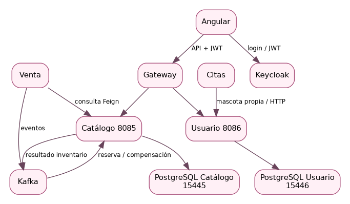
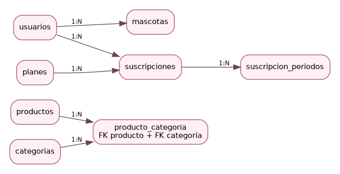
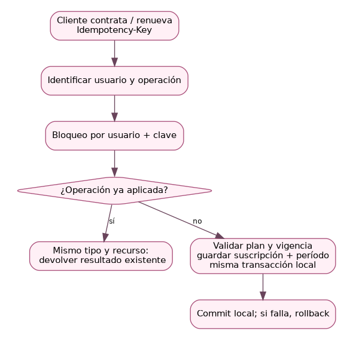

# 1. Cómo estudiar y qué te corresponde

Esta guía describe el código de la versión indicada, no funcionalidades futuras. Lee primero los capítulos de explicación; usa el índice y Ctrl+F para localizar una clase. El anexo reproduce el código de tus dominios y sus pantallas. Las líneas y enlaces corresponden al commit analizado.

Estado vigente: los pagos de compra son simulados. TRANSFERENCIA representa un rechazo didáctico; seleccionar YAPE no realiza un depósito real. Mercado Pago todavía no está conectado. Las suscripciones guardan períodos e importes, pero no realizan cobros bancarios.

En VS Code abre la carpeta raíz Garritas-Store. Presiona Ctrl+P y pega una ruta completa. Ctrl+G lleva a una línea; Ctrl+Shift+F busca un nombre en todo el proyecto. En el PDF puedes pulsar las rutas para abrir GitHub en la línea citada.

Defender no consiste en memorizar todas las líneas. Debes seguir una operación desde Angular hasta la base, identificar sus reglas y explicar qué sucede si falla. Diferencia lo que implementaste personalmente de lo que integraste con el equipo o con ayuda.

Idea | Explicación sencilla
Microservicio | Aplicación independiente con responsabilidad, puerto y base propios. No equivale a una pestaña Angular.
Maestro / no transaccional | Administra datos de referencia. Puede usar transacciones SQL locales; la etiqueta académica no significa ausencia de @Transactional.
Transaccional | Opera un proceso de negocio con datos que deben quedar coherentes: reserva, contratación o compra.
Relación N:M | Cada elemento de ambos lados puede asociarse a varios del otro. Se materializa con una tabla de unión; puede tener entidad propia.
Relación 1:N | Una cabecera o propietario tiene varios detalles o elementos.
Referencia remota | Un ID de otra base, validado por API; no una FK entre PostgreSQL de servicios distintos.

# 2. Cómo leer una clase Java sin perderte

Elemento | Qué decir al mostrarlo
package e import | Ubican la clase e incorporan los tipos utilizados; no realizan una llamada remota por existir.
@SpringBootApplication / main | Arranca el contexto y registra componentes del paquete. @Import añade configuración común.
@RestController / Mapping | Declaran rutas y verbos HTTP. El controlador recibe, valida y delega.
@Service / constructor | Concentra reglas. @RequiredArgsConstructor genera el constructor para inyectar campos final.
Repository | Interfaz Spring Data; su implementación se genera al iniciar. Las consultas y bloqueos son parte de la consistencia.
@Entity, @Table, @Id | Mapean clase, tabla e identidad local. Flyway crea el esquema real.
DTO / mapper | El contrato HTTP no es la entidad. El mapper traduce campos entre ambos.
@Transactional | Define commit/rollback de una base local. No convierte llamadas HTTP o Kafka en una única transacción global.
@Valid y constraints | Validan entradas; las reglas que cruzan recursos se comprueban en servicios.
signal / computed / subscribe | Angular almacena estado, deriva valores y recibe respuestas HTTP asíncronas.
Ejemplo verbal: “Este controlador recibe el Request; @Valid comprueba sus campos; el servicio aplica reglas; el repositorio escribe; el mapper devuelve un Response. La autorización se comprueba también antes de llegar al controlador”.


# 2.1. Diccionario de campos para explicar el código

Campo o tipo | Cómo interpretarlo
id / Long | Identificador numérico de una fila local. No es la contraseña ni el sub de Keycloak.
subject / idCliente | Identidad del JWT: String. Permite comprobar quién posee el recurso.
idMascota, idSede, idProducto, prestacionId | Referencia a otro registro. Mira la migración para saber si es FK local o un ID remoto validado por API.
BigDecimal / NUMERIC | Importes exactos en el backend/base. El total del navegador es una vista previa, no la autoridad.
activo | Disponibilidad o baja lógica. Puede depender también del estado de los padres.
estado | Etapa del proceso; no se cambia libremente a cualquier cadena. Las transiciones están en el servicio/consumidor.
Instant / fechaInicio / fechaFin | Momento y vigencia. El navegador puede mostrar la zona local; la API no debe confundir fecha con texto visual.
version / @Version | Control optimista para detectar modificaciones concurrentes de la misma entidad. No es la versión del proyecto Maven.
idempotencyKey | Identifica una operación reintentada; se conserva para repetir la misma petición y cambia para una operación nueva.
eventId | Identifica un evento para Inbox. Una repetición semántica puede tener otro eventId y requiere además unicidad de negocio.
traceId / X-Trace-ID | Correlación para diagnóstico entre logs; no sustituye autenticación ni deduplicación.
Request / Response / record | Datos que acepta o devuelve la API. Un record no es automáticamente una tabla.
Al explicar una colección, indica qué guarda y cómo se relaciona: categorias, roles, detalles o periodos. “Es una lista” describe el tipo; “son las prestaciones acordadas de esta cita” explica el negocio.


# 3. Tu mapa: Catálogo y Usuario

Servicio | Responsabilidad | Defensa principal
Catálogo · 8085 / PG 15445 | Productos, categorías, imágenes e inventario. | Maestro del catálogo; N:M producto/categoría. Además participa transaccionalmente en la Saga.
Usuario · 8086 / PG 15446 | Perfil, mascotas, roles internos, planes, suscripciones y períodos. | Suscripciones: operación transaccional local. Usuario no reemplaza el login de Keycloak.



# 4. Catálogo: sigue un CRUD de producto

Cuando ADMIN guarda un producto, Angular envía nombre, descripción, precio, stock, estado y categorías. Gateway autoriza la escritura y reenvía a Catálogo. El servicio resuelve los IDs, actualiza la entidad y devuelve un DTO. El cliente consulta los productos, pero no puede modificar sus precios con una petición directa.

services/garritas-catalogo-ms/src/main/java/pe/edu/upeu/garritas/catalogo/controller/ProductoController.java:16

Primero muestra los mappings y la diferencia entre lista completa y consulta paginada.

```
  15  @RequiredArgsConstructor
  16  public class ProductoController {
  17
  18    private final ProductoService productoService;
  19
  20    @GetMapping
  21    public Object listar(
  22        @RequestParam(required = false) String q,
  23        @RequestParam(required = false) Long categoriaId,
```

services/garritas-catalogo-ms/src/main/java/pe/edu/upeu/garritas/catalogo/dto/ProductoRequest.java:15

Explica las restricciones de precio, cantidad y categorías que acepta la API.

```
  14  @Setter
  15  public class ProductoRequest {
  16
  17    @NotBlank
  18    @Size(max = 100)
  19    private String nombre;
  20
  21    @Size(max = 255)
  22    private String descripcion;
```

services/garritas-catalogo-ms/src/main/java/pe/edu/upeu/garritas/catalogo/service/ProductoService.java:45

Crear: mapper, categorías válidas, persistencia y contador de productos creados.

```
  44
  45    public ProductoResponse crear(ProductoRequest request) {
  46      Producto producto = productoMapper.toEntity(request);
  47      asignarCategoriasDesdeRequest(producto, request);
  48      ProductoResponse response = productoMapper.toResponse(productoRepository.save(producto));
  49      meterRegistry.counter("garritas_productos_creados_total").increment();
  50      return response;
  51    }
  52
```

services/garritas-catalogo-ms/src/main/java/pe/edu/upeu/garritas/catalogo/service/ProductoService.java:53

Actualizar: modifica los campos de un producto existente. El stock administrativo es un ajuste de inventario, no una venta.

```
  52
  53    public ProductoResponse actualizar(Long id, ProductoRequest request) {
  54      Producto producto = buscarOFallar(id);
  55      producto.setNombre(request.getNombre());
  56      producto.setDescripcion(request.getDescripcion());
  57      producto.setPrecio(request.getPrecio());
  58      producto.setStock(request.getStock());
  59      producto.setActivo(request.getActivo());
  60      asignarCategoriasDesdeRequest(producto, request);
```

services/garritas-catalogo-ms/src/main/java/pe/edu/upeu/garritas/catalogo/service/ProductoService.java:64

Eliminar en esta API desactiva el producto para preservar historial y reservas.

```
  63
  64    public void eliminar(Long id) {
  65      // Preserve inventory and historical references while asynchronous sagas finish.
  66      Producto producto = buscarOFallar(id);
  67      producto.setActivo(false);
  68      productoRepository.save(producto);
  69    }
  70
  71    private void asignarCategoriasDesdeRequest(Producto producto, ProductoRequest request) {
```

services/garritas-catalogo-ms/src/main/java/pe/edu/upeu/garritas/catalogo/repository/ProductoRepository.java:11

Las búsquedas y el grafo/carga de categorías evitan perder asociaciones al responder.

```
  10
  11  public interface ProductoRepository extends JpaRepository<Producto, Long> {
  12
  13    @Query(
  14        "SELECT DISTINCT p FROM Producto p LEFT JOIN FETCH p.categoria LEFT JOIN FETCH p.categorias")
  15    List<Producto> findAllConCategoria();
  16
  17    @Query(
  18        value =
```

services/garritas-catalogo-ms/src/main/java/pe/edu/upeu/garritas/catalogo/mapper/ProductoMapper.java:15

La conversión define qué propiedades ven Angular y Venta.

```
  14  @RequiredArgsConstructor
  15  public class ProductoMapper {
  16
  17    private final CategoriaMapper categoriaMapper;
  18
  19    public Producto toEntity(ProductoRequest request) {
  20      if (request == null) return null;
  21      return Producto.builder()
  22          .nombre(request.getNombre())
```

No confundas precio actual del producto con el precio acordado de una venta antigua. Venta guarda su detalle. Cambiar el maestro no debe reescribir importes históricos. El borrado lógico tampoco debe destruir la referencia de compras existentes.


# 5. Catálogo: dónde está la relación muchos a muchos



services/garritas-catalogo-ms/src/main/java/pe/edu/upeu/garritas/catalogo/entity/Producto.java:44

El conjunto de categorías se mapea con una tabla de unión.

```
  43    @Builder.Default
  44    @ManyToMany(fetch = FetchType.LAZY)
  45    @JoinTable(
  46        name = "producto_categoria",
  47        joinColumns = @JoinColumn(name = "id_producto"),
  48        inverseJoinColumns = @JoinColumn(name = "id_categoria"))
  49    private Set<Categoria> categorias = new HashSet<>();
  50  }
```

services/garritas-catalogo-ms/src/main/java/pe/edu/upeu/garritas/catalogo/service/ProductoService.java:71

El servicio comprueba que cada ID seleccionado exista. Una categoría principal se mantiene por compatibilidad, sin eliminar las demás asociaciones.

```
  70
  71    private void asignarCategoriasDesdeRequest(Producto producto, ProductoRequest request) {
  72      Set<Categoria> cats = new HashSet<>();
  73      if (request.getCategoriaIds() != null && !request.getCategoriaIds().isEmpty()) {
  74        cats.addAll(categoriaRepository.findAllById(request.getCategoriaIds()));
  75        if (cats.size() != request.getCategoriaIds().size())
  76          throw new org.springframework.web.server.ResponseStatusException(
  77              org.springframework.http.HttpStatus.BAD_REQUEST,
  78              "Una de las categorías seleccionadas no existe");
  79      } else if (request.getCategoriaIds() == null && request.getCategoriaId() != null) {
  80        cats.add(buscarCategoriaOFallar(request.getCategoriaId()));
  81      }
  82      producto.setCategorias(cats);
  83      producto.setCategoria(
  84          cats.stream().min(java.util.Comparator.comparing(Categoria::getId)).orElse(null));
  85    }
```

services/garritas-catalogo-ms/src/main/resources/db/migration/V5__producto_categorias_many_to_many.sql:1

La tabla intermedia y sus restricciones son la evidencia SQL, además de la anotación Java.

```
   1  CREATE TABLE IF NOT EXISTS producto_categoria (
   2      id_producto BIGINT NOT NULL REFERENCES productos(id) ON DELETE CASCADE,
   3      id_categoria BIGINT NOT NULL REFERENCES categorias(id) ON DELETE CASCADE,
   4      PRIMARY KEY (id_producto, id_categoria)
   5  );
   6
   7  CREATE INDEX IF NOT EXISTS idx_producto_categoria_prod ON producto_categoria(id_producto);
   8  CREATE INDEX IF NOT EXISTS idx_producto_categoria_cat ON producto_categoria(id_categoria);
   9
  10  INSERT INTO producto_categoria (id_producto, id_categoria)
  11  SELECT id, id_categoria FROM productos
```

Demostración: como ADMIN asigna dos categorías a un producto, guarda y vuelve a editarlo. Como cliente filtra por cada categoría y verifica que aparezca en ambas. Frase: “No dupliqué el producto; guardé dos asociaciones en la tabla intermedia”.


# 6. Inventario: la parte transaccional de Catálogo

services/garritas-catalogo-ms/src/main/java/pe/edu/upeu/garritas/catalogo/messaging/InventarioEvents.java:25

consume recibe JSON, filtra venta.creada/pago.fallido y registra Inbox dentro de la transacción.

```
  24    @Transactional
  25    public void consume(String payload) {
  26      SagaEvent e = json.readValue(payload, SagaEvent.class);
  27      if (!Set.of("venta.creada", "pago.fallido").contains(e.type())) return;
  28      if (!inbox.claim(e)) return;
  29      try (var scope = MDC.putCloseable("traceId", e.traceId())) {
  30        if (e.type().equals("venta.creada")) reservar(e, payload);
  31        else liberar(e);
  32        log.info(
  33            "component=inventario ventaId={} eventType={} status=processed", e.ventaId(), e.type());
  34      }
  35    }
  36
  37    private void reservar(SagaEvent e, String payload) {
```

services/garritas-catalogo-ms/src/main/java/pe/edu/upeu/garritas/catalogo/messaging/InventarioEvents.java:37

Se crea una reserva única por venta y se agrupan cantidades. Los productos se bloquean en orden determinista; primero se validan todos y después se descuenta.

```
  36
  37    private void reservar(SagaEvent e, String payload) {
  38      // Also deduplicate semantic replays carrying a different eventId.
  39      if (jdbc.update(
  40              "INSERT INTO reservas_stock(id_venta,estado,payload) VALUES (?,'NUEVA',?) ON CONFLICT"
  41                  + " DO NOTHING",
  42              e.ventaId(),
  43              payload)
  44          == 0) return;
  45      var quantities = new TreeMap<Long, Integer>();
  46      e.items().forEach(i -> quantities.merge(i.productoId(), i.cantidad(), Math::addExact));
  47      boolean valid = true;
  48      // Lock in deterministic product order; validate every line before changing any stock.
  49      for (var item : quantities.entrySet()) {
  50        var rows =
  51            jdbc.queryForList(
  52                "SELECT stock,activo,precio FROM productos WHERE id=? FOR UPDATE", item.getKey());
  53        if (rows.isEmpty()) {
  54          valid = false;
  55          continue;
  56        }
  57        var p = rows.getFirst();
  58        if (!(Boolean) p.get("activo") || (Integer) p.get("stock") < item.getValue()) valid = false;
  59        for (var detail : e.items())
  60          if (detail.productoId().equals(item.getKey())
  61              && ((BigDecimal) p.get("precio")).compareTo(detail.precio()) != 0) valid = false;
  62      }
  63      if (valid)
  64        for (var item : quantities.entrySet())
  65          jdbc.update(
```

services/garritas-catalogo-ms/src/main/java/pe/edu/upeu/garritas/catalogo/messaging/InventarioEvents.java:76

Compensación: solo RESERVADA puede pasar a LIBERADA. Se devuelven las cantidades originales y se registra inventario.liberado en Outbox.

```
  75
  76    private void liberar(SagaEvent e) {
  77      var rows =
  78          jdbc.queryForList(
  79              "SELECT estado,payload FROM reservas_stock WHERE id_venta=? FOR UPDATE", e.ventaId());
  80      if (rows.isEmpty()) throw new IllegalStateException("Reserva inexistente: " + e.ventaId());
  81      if (!rows.getFirst().get("estado").equals("RESERVADA")) return;
  82      var original = json.readValue(rows.getFirst().get("payload").toString(), SagaEvent.class);
  83      for (var item :
  84          original.items().stream().sorted(Comparator.comparing(SagaEvent.Item::productoId)).toList())
  85        jdbc.update(
  86            "UPDATE productos SET stock=stock+?,version=version+1 WHERE id=?",
  87            item.cantidad(),
  88            item.productoId());
  89      jdbc.update("UPDATE reservas_stock SET estado='LIBERADA' WHERE id_venta=?", e.ventaId());
  90      outbox.append(original.next("inventario.liberado"));
  91    }
  92  }
```

Hay dos niveles de protección: Inbox deduplica eventId; reservas_stock, única por venta, evita repetir el efecto aunque se reproduzca la misma operación con otro eventId. El versionado del producto se incrementa al modificar stock.

Outbox persiste el evento junto al cambio local. El publicador puede repetirlo si falla después de enviar y antes de marcarlo; por eso se habla de entrega al menos una vez. No prometas exactamente una vez de extremo a extremo.

Caso | Qué explicar
Pago rechaza después de reservar | Sí hay compensación: Catálogo devuelve inventario. Venta espera inventario.liberado antes de terminar CANCELADA.
No se pudo reservar | Rechazo sin descuento; no hay una reserva confirmada que compensar.
Kafka/Pago temporalmente detenido | El proceso puede quedar pendiente. Una demora no equivale automáticamente a cancelación.
Error SQL dentro del consumidor | Rollback local de Inbox, stock y Outbox. No es una compensación global.
Evento imposible de procesar | Reintentos y DLT; necesita diagnóstico/reproceso. No se garantiza recuperación automática infinita.

# 7. Imágenes de producto: qué agregamos y cómo defenderlo

ADMIN selecciona JPG/PNG de su computadora; Angular muestra la vista previa. Después de guardar el producto, manda multipart con campo archivo. Catálogo valida contenido y límites, recodifica, guarda un archivo UUID y su referencia SQL. El cliente solo ve la imagen. No usamos Supabase para las fotos en esta versión.

services/garritas-catalogo-ms/src/main/java/pe/edu/upeu/garritas/catalogo/controller/ImagenController.java:11

GET muestra; PUT sube/reemplaza; DELETE quita solo la foto.

```
  10  @RestController
  11  @RequestMapping("/api/v1/productos/{id}/imagen")
  12  @RequiredArgsConstructor
  13  @Import(LocalImages.class)
  14  public class ImagenController {
  15    private final LocalImages images;
  16    @GetMapping
  17    public ResponseEntity<byte[]> get(@PathVariable long id) {
  18      var image = images.read(id);
  19      return ResponseEntity.ok().contentType(MediaType.parseMediaType(image.contentType()))
  20          .cacheControl(CacheControl.noStore()).header("X-Content-Type-Options", "nosniff").body(image.bytes());
  21    }
  22    @PutMapping(consumes = MediaType.MULTIPART_FORM_DATA_VALUE)
  23    @ResponseStatus(HttpStatus.NO_CONTENT)
  24    public void upload(@PathVariable long id, @RequestParam("archivo") MultipartFile archivo) {
```

infra/garritas-common/src/main/java/pe/edu/upeu/garritas/common/LocalImages.java:55

Máximo 5 MB, dimensiones limitadas, bloqueo y referencia transaccional. Reemplazar no sobrescribe el archivo anterior antes de confirmar.

```
  54    @Transactional
  55    public void upload(long id, MultipartFile file) {
  56      if (!CurrentUser.admin()) throw new org.springframework.security.access.AccessDeniedException("Solo ADMIN modifica imágenes");
  57      if (file.isEmpty() || file.getSize() > MAX_BYTES)
  58        throw new ResponseStatusException(HttpStatus.BAD_REQUEST, "La imagen debe ocupar entre 1 byte y 5 MB");
  59      BufferedImage decoded;
  60      String format;
  61      // Validar contenido real y dimensiones antes de decodificar todos los píxeles.
  62      try (InputStream source = file.getInputStream();
  63          ImageInputStream input = ImageIO.createImageInputStream(source)) {
  64        if (input == null) throw invalidImage();
  65        var readers = ImageIO.getImageReaders(input);
  66        if (!readers.hasNext()) throw invalidImage();
  67        var reader = readers.next();
  68        try {
  69          format = reader.getFormatName().toLowerCase(Locale.ROOT);
```

clients/garritas-frontend/src/app/shared/image-editor.ts:89

El editor compartido aplica la foto al guardar. Si falla tras crear producto, el formulario conserva el ID para no duplicarlo al reintentar.

```
  88    }
  89    persist(id: number): Observable<void> {
  90      const file = this.file();
  91      const request = file
  92        ? this.media.upload(this.resource(), id, file)
  93        : this.removed()
  94          ? this.media.delete(this.resource(), id)
  95          : of(void 0);
  96      return request.pipe(tap(() => this.reset()));
  97    }
  98    ngOnDestroy() {
  99      this.revoke();
```

La carpeta uploads/ de Catálogo se conserva entre reinicios. Git no transporta esas fotos; se respaldan junto a PostgreSQL. En Docker integrado hay un volumen de imágenes. Una interrupción abrupta puede dejar archivos huérfanos: disco y PostgreSQL no comparten una única transacción ACID.


# 8. Usuario: perfil, Keycloak y mascotas

Keycloak autentica y emite el JWT. Usuario guarda nombre, correo de contacto, DNI, teléfono, dirección y mascotas. El sub del token enlaza el perfil con la cuenta. Cambiar el correo de contacto local no cambia automáticamente el correo de login en Keycloak.

services/garritas-usuario-ms/src/main/java/pe/edu/upeu/garritas/usuario/controller/MiCuentaController.java:12

Las rutas /usuarios/me trabajan con el autenticado, no con un sub arbitrario enviado en JSON.

```
  11  @RestController
  12  @RequestMapping("/api/v1/usuarios/me")
  13  @RequiredArgsConstructor
  14  public class MiCuentaController {
  15    private final UsuarioService usuarios;
  16    private final MascotaService mascotas;
  17
  18    @GetMapping
  19    public UsuarioResponse me() {
  20      return usuarios.me();
  21    }
```

services/garritas-usuario-ms/src/main/java/pe/edu/upeu/garritas/usuario/service/UsuarioService.java:95

Normaliza datos, evita apropiación por email y obtiene la identidad de CurrentUser. No asigna roles de seguridad desde el formulario.

```
  94
  95    public UsuarioResponse guardarMe(UsuarioRequest request) {
  96      request.setNombre(request.getNombre().strip());
  97      request.setEmail(request.getEmail().strip().toLowerCase(java.util.Locale.ROOT));
  98      usuarioRepository
  99          .findByEmailIgnoreCase(request.getEmail())
 100          .ifPresent(
 101              existing -> {
 102                if (!pe.edu.upeu.garritas.common.CurrentUser.subject().equals(existing.getSubject()))
 103                  throw new org.springframework.web.server.ResponseStatusException(
 104                      org.springframework.http.HttpStatus.CONFLICT,
 105                      "Ese correo ya está registrado en otro perfil. Usa otro correo o solicita"
 106                          + " revisión al administrador.");
 107              });
 108      Usuario usuario =
 109          usuarioRepository
 110              .findBySubject(pe.edu.upeu.garritas.common.CurrentUser.subject())
 111              .orElseGet(() -> usuarioMapper.toEntity(request));
 112      usuario.setSubject(pe.edu.upeu.garritas.common.CurrentUser.subject());
 113      usuario.setNombre(request.getNombre());
 114      usuario.setEmail(request.getEmail());
 115      usuario.setTelefono(request.getTelefono());
 116      usuario.setDireccion(request.getDireccion());
 117      usuario.setDni(request.getDni());
```

services/garritas-usuario-ms/src/main/java/pe/edu/upeu/garritas/usuario/service/UsuarioService.java:128

Recupera o crea el perfil a partir de la identidad autenticada. Si el correo coincide con otro subject, exige revisión en lugar de enlazarlo automáticamente.

```
 127
 128    public Usuario miUsuario() {
 129      String sub = pe.edu.upeu.garritas.common.CurrentUser.subject();
 130      Usuario usuario =
 131          usuarioRepository
 132              .findBySubject(sub)
 133              .orElseGet(
 134                  () -> {
 135                    var auth =
 136                        org.springframework.security.core.context.SecurityContextHolder.getContext()
 137                            .getAuthentication();
 138                    String email =
 139                        "cliente@"
 140                            + (sub != null && sub.length() > 8 ? sub.substring(0, 8) : "garritas")
 141                            + ".com";
 142                    String nombre = (sub != null && !sub.isBlank()) ? sub : "Usuario Garritas";
 143                    if (auth != null
```

services/garritas-usuario-ms/src/main/java/pe/edu/upeu/garritas/usuario/service/MascotaService.java:61

Verifica propiedad antes de devolver/modificar una mascota. Un usuario no obtiene otra mascota cambiando el id en la URL.

```
  60
  61    private Mascota buscarOFallar(Long id) {
  62      Mascota mascota =
  63          mascotaRepository
  64              .findById(id)
  65              .orElseThrow(() -> new ResourceNotFoundException("Mascota no encontrada: " + id));
  66      pe.edu.upeu.garritas.common.CurrentUser.requireOwner(mascota.getUsuario().getSubject());
  67      return mascota;
  68    }
  69  }
```

services/garritas-usuario-ms/src/main/java/pe/edu/upeu/garritas/usuario/dto/MascotaRequest.java:1

La edad se valida como entero y tiene unidad explícita. Mostrar 3 MESES o 20 DIAS; no decir que guarda años decimales.

```
   1  package pe.edu.upeu.garritas.usuario.dto;
   2
   3  import jakarta.validation.constraints.Min;
   4  import jakarta.validation.constraints.NotBlank;
   5  import jakarta.validation.constraints.Size;
   6  import lombok.Getter;
   7  import lombok.Setter;
   8
   9  @Getter
  10  @Setter
  11  public class MascotaRequest {
  12
  13    @NotBlank
```

Una relación 1:N importante es Usuario → Mascotas. Usuario → Suscripciones y Suscripción → Períodos también son 1:N. El perfil vinculado a Keycloak no se borra libremente desde Clientes para evitar perder historial.


# 9. Roles internos: no son permisos de Keycloak

services/garritas-usuario-ms/src/main/java/pe/edu/upeu/garritas/usuario/entity/Usuario.java:50

Usuario ↔ Rol es otra N:M local. Es clasificación del negocio, no el emisor de permisos JWT.

```
  49    @Builder.Default
  50    @ManyToMany(fetch = FetchType.LAZY)
  51    @JoinTable(
  52        name = "usuario_rol",
  53        joinColumns = @JoinColumn(name = "id_usuario"),
  54        inverseJoinColumns = @JoinColumn(name = "id_rol"))
  55    private Set<Rol> roles = new HashSet<>();
  56  }
```

services/garritas-usuario-ms/src/main/java/pe/edu/upeu/garritas/usuario/controller/UsuarioController.java:16

Las operaciones administrativas y asignación de roles internos se explican junto a SecurityConfiguration, no como un login propio.

```
  15  @RequiredArgsConstructor
  16  public class UsuarioController {
  17
  18    private final UsuarioService usuarioService;
  19
  20    @GetMapping
  21    public Object listar(
  22        @RequestParam(required = false) String q,
  23        @RequestParam(required = false) String rol,
  24        @RequestParam(required = false) Integer page,
  25        @RequestParam(required = false, defaultValue = "10") int size) {
  26      if (size < 1 || size > 100 || (page != null && page < 0))
```

Frase defendible: “Usamos Keycloak para autenticación y autorización distribuida. Las tablas de Usuario almacenan información del negocio. Un rol de esas tablas no transforma un token CLIENTE en ADMIN”. Cambiar un botón o el localStorage tampoco concede permisos en el backend.


# 10. Suscripciones: tu defensa transaccional principal



services/garritas-usuario-ms/src/main/java/pe/edu/upeu/garritas/usuario/service/SuscripcionService.java:64

Contratar: un plan activo, sin duplicar otro vigente; crea cabecera y período ALTA con precio/vigencia acordados.

```
  63
  64    public SuscripcionResponse contratar(SuscripcionRequest r, UUID key) {
  65      if (CurrentUser.admin())
  66        throw new org.springframework.security.access.AccessDeniedException(
  67            "Utiliza una cuenta de cliente para contratar un plan");
  68      Usuario u = usuarios.miUsuario();
  69      lock(u, key);
  70      var old = periodos.findByUsuarioIdAndIdempotencyKey(u.getId(), key);
  71      if (old.isPresent()) {
  72        var p = old.get();
  73        if (!p.getTipo().equals("ALTA") || !p.getSuscripcion().getPlan().getId().equals(r.planId()))
  74          throw error(409, "La clave de reintento ya corresponde a otra operación");
  75        return response(p.getSuscripcion());
  76      }
  77      Plan p = plan(r.planId());
  78      if (!p.getActivo()) throw error(409, "El plan no está disponible");
  79      for (Suscripcion active :
  80          suscripciones.findByUsuarioIdAndPlanIdAndEstado(u.getId(), p.getId(), "ACTIVA")) {
  81        if (active.getFechaFin().isAfter(Instant.now()))
  82          throw error(409, "Ya tienes este plan activo; utiliza Renovar");
  83        active.setEstado("VENCIDA");
  84      }
  85      suscripciones.flush();
  86      Suscripcion s = new Suscripcion();
  87      s.setUsuario(u);
  88      s.setPlan(p);
  89      s.setNombrePlan(p.getNombre());
  90      s.setEstado("ACTIVA");
  91      s.setFechaInicio(Instant.now());
  92      s.setFechaFin(s.getFechaInicio().plus(p.getDuracionDias(), ChronoUnit.DAYS));
  93      suscripciones.saveAndFlush(s);
  94      addPeriod(s, key, "ALTA", s.getFechaInicio(), s.getFechaFin(), p.getPrecio());
  95      return response(s);
  96    }
  97
  98    public SuscripcionResponse renovar(Long id, UUID key) {
```

services/garritas-usuario-ms/src/main/java/pe/edu/upeu/garritas/usuario/service/SuscripcionService.java:98

Renovar: bloquea, refresca después del bloqueo, comprueba reintento, rechaza canceladas y añade un período al precio actual del plan.

```
  97
  98    public SuscripcionResponse renovar(Long id, UUID key) {
  99      Suscripcion s = owned(id);
 100      Usuario u = s.getUsuario();
 101      lock(u, key);
 102      suscripciones.flush(); // reload after the owner lock to avoid a stale period end
 103      jakarta.persistence.EntityManager em = entityManager;
 104      em.refresh(s);
 105      var old = periodos.findByUsuarioIdAndIdempotencyKey(u.getId(), key);
 106      if (old.isPresent()) {
 107        var p = old.get();
 108        if (!p.getTipo().equals("RENOVACION") || !p.getSuscripcion().getId().equals(id))
 109          throw error(409, "La clave de reintento ya corresponde a otra operación");
 110        return response(s);
 111      }
 112      if (s.getEstado().equals("CANCELADA"))
 113        throw error(409, "Una suscripción cancelada no se renueva");
 114      Plan p = s.getPlan();
 115      if (!p.getActivo()) throw error(409, "El plan ya no está disponible");
 116      var other = suscripciones.findByUsuarioIdAndPlanIdAndEstado(u.getId(), p.getId(), "ACTIVA");
 117      if (other.stream()
 118          .anyMatch(x -> !x.getId().equals(id) && x.getFechaFin().isAfter(Instant.now())))
 119        throw error(409, "Ya existe otra suscripción activa para el plan");
 120      other.stream()
 121          .filter(x -> !x.getId().equals(id) && !x.getFechaFin().isAfter(Instant.now()))
 122          .forEach(x -> x.setEstado("VENCIDA"));
 123      suscripciones.flush();
 124      Instant start = s.getFechaFin().isAfter(Instant.now()) ? s.getFechaFin() : Instant.now();
 125      Instant end = start.plus(p.getDuracionDias(), ChronoUnit.DAYS);
 126      s.setFechaFin(end);
 127      s.setEstado("ACTIVA");
 128      addPeriod(s, key, "RENOVACION", start, end, p.getPrecio());
```

services/garritas-usuario-ms/src/main/java/pe/edu/upeu/garritas/usuario/service/SuscripcionService.java:148

El período conserva su propio precio y fechas. Cambiar el plan no reescribe ese historial.

```
 147
 148    private void addPeriod(
 149        Suscripcion s, UUID key, String tipo, Instant start, Instant end, BigDecimal precio) {
 150      PeriodoSuscripcion p = new PeriodoSuscripcion();
 151      p.setSuscripcion(s);
 152      p.setUsuario(s.getUsuario());
 153      p.setIdempotencyKey(key);
 154      p.setTipo(tipo);
 155      p.setFechaInicio(start);
 156      p.setFechaFin(end);
 157      p.setPrecio(precio);
 158      periodos.saveAndFlush(p);
 159      s.getPeriodos().add(p);
 160      suscripciones.saveAndFlush(s);
 161    }
 162
 163    private Plan plan(Long id) {
 164      return planes.findById(id).orElseThrow(() -> error(404, "Plan no encontrado"));
 165    }
```

services/garritas-usuario-ms/src/main/java/pe/edu/upeu/garritas/usuario/service/SuscripcionService.java:142

Bloqueos advisory de PostgreSQL viven hasta finalizar la transacción. Controlan carreras incluso entre instancias que comparten esta base.

```
 141
 142    private void lock(Usuario u, UUID key) {
 143      jdbc.queryForObject(
 144          "SELECT pg_advisory_xact_lock(hashtextextended(?,0))", Object.class, u.getId() + ":" + key);
 145      jdbc.queryForObject("SELECT pg_advisory_xact_lock(?)", Object.class, u.getId());
 146    }
 147
 148    private void addPeriod(
 149        Suscripcion s, UUID key, String tipo, Instant start, Instant end, BigDecimal precio) {
 150      PeriodoSuscripcion p = new PeriodoSuscripcion();
```

Ejemplo: contraté por S/ 30; el plan cambia a S/ 35; renuevo. El período anterior sigue en 30 y el nuevo conserva 35. Renovación extiende desde fechaFin si aún está vigente o desde ahora si venció. Cancelar marca el estado, conserva períodos y no realiza un reembolso bancario.

Por qué sí es transaccional: si se actualizara fechaFin sin guardar el período, el historial no explicaría la vigencia; si solo se guardara el período sin extender vigencia, se perdería el efecto del negocio. La operación evita ambos estados parciales mediante una transacción local, reglas y restricciones.

Límite: no es un cobro ni un beneficio automático de suscripción. Usuario no forma parte de la Saga de compra solo por usar @Transactional.


# 11. Tus pantallas Angular y dónde cambiar cada cosa

Pantalla / archivo bajo src/app | Qué mostrar / estudiar
features/catalogo/product-catalog.ts y .html | Catálogo público, búsqueda, filtro, paginación y botón añadir; ResourceImage muestra la foto.
features/admin/productos.component.ts y .html | Modal crear/editar, categorías múltiples, stock, precio y persistencia de imagen sin duplicar producto.
app.ts y app.html | Administración de categorías sigue en el componente raíz; buscar save(), edit() y remove().
features/cuenta/cuenta.component.ts y .html | save() hace PUT y confirma por GET; guardado() solo se activa con el dato persistido.
features/planes/planes.component.ts y .html | operation conserva una clave por reintento; contratar/renovar/cancelar llaman al backend.
features/admin/clientes.component.* | Búsqueda y gestión administrativa del perfil.
features/admin/roles.component.ts; usuarios-roles.component.* | Roles internos y sus asignaciones; no cambiar autorización Keycloak.
shared/image-editor.ts, media.ts, resource-image.ts | Selector, subida multipart y foto/marcador.
src/styles.css | Colores rosa, fuentes y tamaños. Editar estilo no cambia una regla de negocio.
clients/garritas-frontend/src/app/features/cuenta/cuenta.component.ts:61

Guardar mi perfil no se demuestra por el toast: la pantalla confirma la lectura persistida.

```
  60    }
  61    save() {
  62      if (this.loading() || this.loadFailed()) return;
  63      const value = {
  64        ...this.model,
  65        nombre: this.model.nombre.trim(),
  66        email: this.model.email.trim(),
  67      };
  68      this.guardado.set(false);
  69      // Confirm with a persisted GET, not only the form's local values.
  70      this.send(
  71        this.api
  72          .put<Perfil>("/usuarios/me", value)
  73          .pipe(switchMap(() => this.api.get<Perfil>("/usuarios/me"))),
  74        (p) => {
  75          this.perfil.set(p);
  76          this.model = {
  77            nombre: p.nombre,
  78            email: p.email,
  79            telefono: p.telefono ?? "",
  80            direccion: p.direccion ?? "",
  81            dni: p.dni ?? "",
  82          };
  83          this.guardado.set(true);
```

clients/garritas-frontend/src/app/features/planes/planes.component.ts:104

Una firma de operación conserva la clave para reintentar; la consistencia final la verifica el servidor.

```
 103    }
 104    operation(path: string, body: unknown, signature: string) {
 105      if (!this.keys.has(signature))
 106        this.keys.set(signature, crypto.randomUUID());
 107      this.send(
 108        this.api.post<Suscripcion>(path, body, this.keys.get(signature)),
 109        () => {
 110          this.keys.delete(signature);
 111          this.message.set(
 112            "Operación registrada. Revisa el período y su importe en el historial.",
 113          );
 114          this.load();
 115        },
 116      );
 117    }
```


# Seguridad, configuración y diagnóstico que debes conocer

Angular inicia sesión en Keycloak con Authorization Code + PKCE. El JWT vive en memoria. Un interceptor lo agrega a la API del Gateway. Gateway y cada microservicio validan firma, issuer y audiencia; los permisos efectivos proceden de realm_access.roles. El sub es una cadena, no el id numérico de una tabla local.

clients/garritas-frontend/src/app/core/auth.ts:29

Login, renovación y consulta de roles en Angular.

```
  28        onLoad: "check-sso",
  29        pkceMethod: "S256",
  30        checkLoginIframe: false,
  31        responseMode: "query",
  32        redirectUri: location.origin + "/",
  33      });
  34      this.sync();
```

clients/garritas-frontend/src/app/core/interceptor.ts:17

Token solo para la API propia.

```
  16              "X-Trace-ID": crypto.randomUUID(),
  17              ...(token ? { Authorization: "Bearer " + token } : {}),
  18            },
  19          }),
  20        ),
  21      ),
  22    );
```

infra/garritas-common/src/main/java/pe/edu/upeu/garritas/common/SecurityConfiguration.java:11

Rutas públicas, ADMIN y operaciones del propietario.

```
  10  import org.springframework.security.oauth2.server.resource.authentication.JwtAuthenticationConverter;
  11  import org.springframework.security.web.SecurityFilterChain;
  12  import org.springframework.web.cors.*;
  13
  14  @Import({HttpServices.class, DomainErrors.class})
  15  @Configuration(proxyBeanMethods = false)
  16  public class SecurityConfiguration {
```

infra/garritas-common/src/main/java/pe/edu/upeu/garritas/common/CurrentUser.java:18

Comparación entre dueño persistido y sub del autenticado.

```
  17
  18    public static void requireOwner(String owner) {
  19      if (!admin() && !subject().equals(owner))
  20        throw new AccessDeniedException("El recurso pertenece a otro cliente");
  21    }
  22  }
```

infra/garritas-common/src/main/java/pe/edu/upeu/garritas/common/ServiceClient.java:13

Cliente HTTP común con descubrimiento, token, correlación y espera acotada.

```
  12  /** Bounded, read-only inter-service calls through Eureka, preserving caller identity. */
  13  public class ServiceClient {
  14    private final RestClient client;
  15    private final org.springframework.cloud.client.loadbalancer.LoadBalancerClient loadBalancer;
  16
  17    public ServiceClient(
  18        RestClient client,
```

Eureka publica instancias; Gateway distribuye peticiones; Config Server entrega propiedades DEV/PROD. Feign aparece en Venta para Catálogo/Logística. No afirmes que Citas usa Feign: su código utiliza ServiceClient. Un timeout acota una llamada; Circuit Breaker recuerda fallos de varias llamadas y rechaza rápido mientras está abierto.

Herramienta | Cómo usarla en tu defensa
Eureka · 18761 | Mostrar el nombre de tus dos servicios registrado. No demuestra por sí solo su lógica de negocio.
Swagger · puerto del servicio /swagger-ui.html | Mostrar endpoints reales y DTO. Una ruta protegida necesita JWT válido.
Actuator · /actuator/health/readiness | Comprobar disponibilidad configurada; no sustituye una compra/cita real.
Prometheus · 19090 | Consulta up{job="garritas-microservicios"}; /targets ayuda a detectar scrape fallido.
Grafana · 13000 | Dashboard Garritas - Infraestructura: instancias, tráfico, conexiones y logs.
Loki / X-Trace-ID | Correlacionar logs de una operación. No equivale a trazas OpenTelemetry completas.
Kafka UI · 18085 | Observar topic/eventos/grupos cuando el flujo participa realmente en Kafka.
No enseñes tokens privados, contraseñas personales ni credenciales productivas. Los accesos de laboratorio están en el README; cliente/Cliente123! y admin-store/Admin123! sirven solo en DEV si no se modificaron.


# 12. Guion de demostración y defensa de Fio

Tiempo | Qué hacer en Angular | Qué explicar
0:00–0:40 | ADMIN: producto con dos categorías y una foto. Guardar, reabrir y filtrar. | N:M con tabla de unión; escritura ADMIN; imagen opcional validada por servidor.
0:40–1:15 | CLIENTE: guardar perfil y volver a cargar; mascota con edad/unidad. | Keycloak autentica; Usuario conserva datos del negocio y verifica propiedad con sub.
1:15–2:15 | Contratar plan y renovar; mostrar períodos/vencimiento. | Cabecera/períodos, precios históricos, clave de reintento y bloqueo. No afirmar cobro real.
2:15–3:00 | Compra preparada que rechaza pago; comparar stock. | Catálogo compensa reserva; mostrar InventarioEvents.liberar y evento inventario.liberado.
Presentación sugerida: “Soy responsable de Catálogo y Usuario. Catálogo mantiene productos y categorías, relacionados de muchos a muchos, y controla inventario. Usuario vincula la identidad de Keycloak con perfil y mascotas; su capacidad transaccional es contratar y renovar suscripciones guardando períodos históricos. Puedo demostrar permisos, persistencia e idempotencia”.

Pregunta probable | Respuesta
¿Catálogo no es transaccional? | Su responsabilidad principal es maestra, pero inventario sí realiza transacciones y participa en la Saga.
¿Guardar perfil prueba tu transacción de negocio? | No es mi evidencia principal; muestro suscripción y período guardados juntos y la renovación coherente.
¿Cómo demuestras N:M? | Dos categorías en un producto y otro producto compartiendo una; entidad, tabla intermedia y servicio que resuelve IDs.
¿El rol de PostgreSQL autoriza ADMIN? | No. El permiso real viene del JWT de Keycloak; el backend lo valida.
¿Kafka evita todos los duplicados? | No. Inbox y unicidad de reserva por venta hacen idempotentes los efectos; la entrega es al menos una vez.
¿Qué compensa Catálogo? | Devuelve unidades ya reservadas cuando Pago rechaza; no reembolsa dinero.
¿Los planes cobran de verdad? | No, guardan importes y períodos; Mercado Pago sigue pendiente.
¿Qué evidencia tienes? | Respuesta recargada de perfil, asociaciones persistidas, períodos, stock antes/después y logs/eventos con la misma operación.

# Mapa de endpoints: qué operaciones existen de verdad

Las rutas siguientes se extraen de los controladores de tus módulos. En Angular se consumen a través de Gateway en http://localhost:18080. La tabla no sustituye la autorización: las escrituras maestras son ADMIN y las operaciones propias requieren identidad/propiedad, según SecurityConfiguration.


## Catalogo

Verbo | Ruta | Dónde localizar
GET | /api/v1/categorias | CategoriaController.java:20
GET | /api/v1/categorias/{id} | CategoriaController.java:25
POST | /api/v1/categorias | CategoriaController.java:30
PUT | /api/v1/categorias/{id} | CategoriaController.java:36
DELETE | /api/v1/categorias/{id} | CategoriaController.java:41
GET | /api/v1/productos/{id}/imagen | ImagenController.java:16
PUT | /api/v1/productos/{id}/imagen | ImagenController.java:22
DELETE | /api/v1/productos/{id}/imagen | ImagenController.java:27
GET | /api/v1/productos | ProductoController.java:20
GET | /api/v1/productos/{id} | ProductoController.java:38
POST | /api/v1/productos | ProductoController.java:43
PUT | /api/v1/productos/{id} | ProductoController.java:49
DELETE | /api/v1/productos/{id} | ProductoController.java:55

## Usuario

Verbo | Ruta | Dónde localizar
GET | /api/v1/usuarios/{usuarioId}/mascotas | MascotaController.java:19
POST | /api/v1/usuarios/{usuarioId}/mascotas | MascotaController.java:24
PUT | /api/v1/usuarios/{usuarioId}/mascotas/{id} | MascotaController.java:31
DELETE | /api/v1/usuarios/{usuarioId}/mascotas/{id} | MascotaController.java:40
GET | /api/v1/usuarios/me | MiCuentaController.java:18
PUT | /api/v1/usuarios/me | MiCuentaController.java:23
GET | /api/v1/usuarios/me/mascotas | MiCuentaController.java:28
GET | /api/v1/usuarios/me/mascotas/{id} | MiCuentaController.java:33
POST | /api/v1/usuarios/me/mascotas | MiCuentaController.java:39
PUT | /api/v1/usuarios/me/mascotas/{id} | MiCuentaController.java:45
DELETE | /api/v1/usuarios/me/mascotas/{id} | MiCuentaController.java:51
GET |  | RolController.java:19
GET | /{id} | RolController.java:24
POST |  | RolController.java:29
PUT | /{id} | RolController.java:35
DELETE | /{id} | RolController.java:40
GET | /api/v1/planes | SuscripcionController.java:17
POST | /api/v1/planes | SuscripcionController.java:22
PUT | /api/v1/planes/{id} | SuscripcionController.java:28
DELETE | /api/v1/planes/{id} | SuscripcionController.java:33
GET | /api/v1/suscripciones | SuscripcionController.java:39
GET | /api/v1/suscripciones/{id} | SuscripcionController.java:44
POST | /api/v1/suscripciones | SuscripcionController.java:49
POST | /api/v1/suscripciones/{id}/renovar | SuscripcionController.java:56
POST | /api/v1/suscripciones/{id}/cancelar | SuscripcionController.java:62
GET | /api/v1/usuarios | UsuarioController.java:20
GET | /api/v1/usuarios/{id} | UsuarioController.java:38
POST | /api/v1/usuarios | UsuarioController.java:43
PUT | /api/v1/usuarios/{id} | UsuarioController.java:49
DELETE | /api/v1/usuarios/{id} | UsuarioController.java:55
POST | /api/v1/usuarios/{id}/roles/{idRol} | UsuarioController.java:61
DELETE | /api/v1/usuarios/{id}/roles/{idRol} | UsuarioController.java:66
Citas y suscripciones exponen acciones del negocio, no necesariamente PUT y DELETE genéricos. En cobertura, PUT crea o actualiza la asociación. Los borrados lógicos mantienen historial. No inventes un CRUD uniforme si el dominio requiere estados y reglas.


# Mapa completo: archivos y qué debes explicar

Estas fichas son tu ruta de estudio. Primero localiza la clase, explica su responsabilidad y reconoce sus métodos. Después usa el anexo para leer la implementación completa. El código compartido o de otro dominio se etiqueta como contexto, no como autoría individual.


## Backend Catalogo


### GarritasCatalogoMsApplication.java

services/garritas-catalogo-ms/src/main/java/pe/edu/upeu/garritas/catalogo/GarritasCatalogoMsApplication.java:1

Entrada Spring Boot del dominio. main inicia el contexto; revisa @Import para identificar seguridad/comunicación compartida. El nombre de aplicación se obtiene de application.yml y decide qué propiedades recibe de Config.

Métodos para ubicar: main() L20.


### CategoriaController.java

services/garritas-catalogo-ms/src/main/java/pe/edu/upeu/garritas/catalogo/controller/CategoriaController.java:1

Adaptador HTTP: mappings definen las operaciones reales; recibe DTO con @Valid y delega al servicio. No se deben atribuir endpoints que no aparecen en este archivo; los permisos se completan en SecurityConfiguration.

Métodos para ubicar: listar() L21, obtener() L26, crear() L32, actualizar() L37, eliminar() L43.


### ImagenController.java

services/garritas-catalogo-ms/src/main/java/pe/edu/upeu/garritas/catalogo/controller/ImagenController.java:1

Expone GET/PUT/DELETE de la imagen del producto. Delega en LocalImages; PUT recibe multipart archivo. La seguridad exige ADMIN para modificar; GET público permite mostrar el catálogo.

Métodos para ubicar: get() L17, upload() L24, delete() L29.


### ProductoController.java

services/garritas-catalogo-ms/src/main/java/pe/edu/upeu/garritas/catalogo/controller/ProductoController.java:1

Adaptador HTTP: mappings definen las operaciones reales; recibe DTO con @Valid y delega al servicio. No se deben atribuir endpoints que no aparecen en este archivo; los permisos se completan en SecurityConfiguration.

Métodos para ubicar: listar() L21, obtener() L39, crear() L45, actualizar() L50, eliminar() L57.


### CategoriaRequest.java

services/garritas-catalogo-ms/src/main/java/pe/edu/upeu/garritas/catalogo/dto/CategoriaRequest.java:1

Contrato de API: Request es entrada y Response salida. Las anotaciones de validación restringen campos; los record también representan contratos inmutables. No confundir DTO con tabla.


### CategoriaResponse.java

services/garritas-catalogo-ms/src/main/java/pe/edu/upeu/garritas/catalogo/dto/CategoriaResponse.java:1

Contrato de API: Request es entrada y Response salida. Las anotaciones de validación restringen campos; los record también representan contratos inmutables. No confundir DTO con tabla.


### ProductoRequest.java

services/garritas-catalogo-ms/src/main/java/pe/edu/upeu/garritas/catalogo/dto/ProductoRequest.java:1

Contrato de API: Request es entrada y Response salida. Las anotaciones de validación restringen campos; los record también representan contratos inmutables. No confundir DTO con tabla.


### ProductoResponse.java

services/garritas-catalogo-ms/src/main/java/pe/edu/upeu/garritas/catalogo/dto/ProductoResponse.java:1

Contrato de API: Request es entrada y Response salida. Las anotaciones de validación restringen campos; los record también representan contratos inmutables. No confundir DTO con tabla.


### Categoria.java

services/garritas-catalogo-ms/src/main/java/pe/edu/upeu/garritas/catalogo/entity/Categoria.java:1

Modelo JPA local. Sus campos representan datos persistidos; @ManyToOne/@OneToMany/@ManyToMany declaran relaciones entre tablas de ESTA base. Los IDs de otros servicios son referencias remotas, no claves foráneas distribuidas.


### Producto.java

services/garritas-catalogo-ms/src/main/java/pe/edu/upeu/garritas/catalogo/entity/Producto.java:1

Modelo JPA local. Sus campos representan datos persistidos; @ManyToOne/@OneToMany/@ManyToMany declaran relaciones entre tablas de ESTA base. Los IDs de otros servicios son referencias remotas, no claves foráneas distribuidas.


### GlobalExceptionHandler.java

services/garritas-catalogo-ms/src/main/java/pe/edu/upeu/garritas/catalogo/exception/GlobalExceptionHandler.java:1

Advice REST del módulo: convierte las excepciones de recurso inexistente, validación u otros casos declarados en respuestas HTTP. Se debe leer junto a DomainErrors y a Spring Security; no controla por sí solo todos los fallos del sistema.

Métodos para ubicar: handleNotFound() L21, handleValidation() L34, handleConflict() L49.


### ResourceNotFoundException.java

services/garritas-catalogo-ms/src/main/java/pe/edu/upeu/garritas/catalogo/exception/ResourceNotFoundException.java:1

Excepción de dominio que indica que una búsqueda no encontró el recurso. El manejador de excepciones correspondiente la traduce a una respuesta, evitando devolver una entidad nula.


### CorrelationIdFilter.java

services/garritas-catalogo-ms/src/main/java/pe/edu/upeu/garritas/catalogo/filter/CorrelationIdFilter.java:1

Lee o genera X-Trace-ID, lo asocia al MDC del hilo y devuelve la correlación. Permite buscar en los logs una misma operación HTTP; los eventos conservan traceId. No constituye trazado distribuido automático con OpenTelemetry.

Métodos para ubicar: doFilterInternal() L25.


### CategoriaMapper.java

services/garritas-catalogo-ms/src/main/java/pe/edu/upeu/garritas/catalogo/mapper/CategoriaMapper.java:1

Conversión entre entidad y DTO. Evita exponer el grafo JPA completo. Lee qué campos copia y qué valores iniciales asigna; no sustituye reglas de negocio ni controles de propiedad.

Métodos para ubicar: toEntity() L11, toResponse() L18.


### ProductoMapper.java

services/garritas-catalogo-ms/src/main/java/pe/edu/upeu/garritas/catalogo/mapper/ProductoMapper.java:1

Conversión entre entidad y DTO. Evita exponer el grafo JPA completo. Lee qué campos copia y qué valores iniciales asigna; no sustituye reglas de negocio ni controles de propiedad.

Métodos para ubicar: toEntity() L19, toResponse() L30.


### InventarioEvents.java

services/garritas-catalogo-ms/src/main/java/pe/edu/upeu/garritas/catalogo/messaging/InventarioEvents.java:1

Consumidor Kafka de Catálogo. consume filtra eventos y aplica Inbox; reservar valida todo el pedido y bloquea productos antes de descontar; liberar solo devuelve una reserva RESERVADA y publica inventario.liberado. No llama a un banco.

Métodos para ubicar: consume() L25, reservar() L37, liberar() L76.


### CategoriaRepository.java

services/garritas-catalogo-ms/src/main/java/pe/edu/upeu/garritas/catalogo/repository/CategoriaRepository.java:1

Persistencia Spring Data: interfaz de entidad/clave, consultas y bloqueos. Spring genera su implementación; no es necesario escribir una clase implementadora. Leer junto a su entidad y migraciones.


### ProductoRepository.java

services/garritas-catalogo-ms/src/main/java/pe/edu/upeu/garritas/catalogo/repository/ProductoRepository.java:1

Persistencia Spring Data: interfaz de entidad/clave, consultas y bloqueos. Spring genera su implementación; no es necesario escribir una clase implementadora. Leer junto a su entidad y migraciones.


### CategoriaService.java

services/garritas-catalogo-ms/src/main/java/pe/edu/upeu/garritas/catalogo/service/CategoriaService.java:1

Archivo de soporte de esta capacidad. El listado completo del anexo permite ubicar su uso en el proyecto real.

Métodos para ubicar: listar() L21, obtener() L25, crear() L29, actualizar() L34, eliminar() L41, buscarOFallar() L45.


### ProductoService.java

services/garritas-catalogo-ms/src/main/java/pe/edu/upeu/garritas/catalogo/service/ProductoService.java:1

Administra productos: listar/listarPaginado consultan, crear registra y cuenta la métrica, actualizar cambia campos/categorías y eliminar DESACTIVA. asignarCategoriasDesdeRequest resuelve los IDs y rechaza categorías inexistentes; mantiene una categoría principal de compatibilidad.

Métodos para ubicar: listar() L31, listarPaginado() L37, obtener() L41, crear() L45, actualizar() L53, eliminar() L64, asignarCategoriasDesdeRequest() L71, buscarOFallar() L87, buscarCategoriaOFallar() L93.


### GarritasCatalogoMsApplicationTests.java

services/garritas-catalogo-ms/src/test/java/pe/edu/upeu/garritas/catalogo/GarritasCatalogoMsApplicationTests.java:1

Prueba: identifica preparación, acción y aserciones. Demuestra los escenarios que realmente ejecuta, no todos los fallos posibles del sistema.


## Backend Usuario


### GarritasUsuarioMsApplication.java

services/garritas-usuario-ms/src/main/java/pe/edu/upeu/garritas/usuario/GarritasUsuarioMsApplication.java:1

Entrada Spring Boot del dominio. main inicia el contexto; revisa @Import para identificar seguridad/comunicación compartida. El nombre de aplicación se obtiene de application.yml y decide qué propiedades recibe de Config.

Métodos para ubicar: main() L18.


### MascotaController.java

services/garritas-usuario-ms/src/main/java/pe/edu/upeu/garritas/usuario/controller/MascotaController.java:1

Adaptador HTTP: mappings definen las operaciones reales; recibe DTO con @Valid y delega al servicio. No se deben atribuir endpoints que no aparecen en este archivo; los permisos se completan en SecurityConfiguration.

Métodos para ubicar: listar() L20, crear() L26, actualizar() L32, eliminar() L42.


### MiCuentaController.java

services/garritas-usuario-ms/src/main/java/pe/edu/upeu/garritas/usuario/controller/MiCuentaController.java:1

Expone /api/v1/usuarios/me y sus mascotas para el cliente autenticado. Valida DTO y delega en UsuarioService/MascotaService sin admitir un sub arbitrario enviado por el navegador.

Métodos para ubicar: me() L19, guardar() L24, mascotas() L29, mascota() L34, crear() L41, editar() L46, eliminar() L53.


### RolController.java

services/garritas-usuario-ms/src/main/java/pe/edu/upeu/garritas/usuario/controller/RolController.java:1

Adaptador HTTP: mappings definen las operaciones reales; recibe DTO con @Valid y delega al servicio. No se deben atribuir endpoints que no aparecen en este archivo; los permisos se completan en SecurityConfiguration.

Métodos para ubicar: listar() L20, obtener() L25, crear() L31, actualizar() L36, eliminar() L42.


### SuscripcionController.java

services/garritas-usuario-ms/src/main/java/pe/edu/upeu/garritas/usuario/controller/SuscripcionController.java:1

Adaptador HTTP: mappings definen las operaciones reales; recibe DTO con @Valid y delega al servicio. No se deben atribuir endpoints que no aparecen en este archivo; los permisos se completan en SecurityConfiguration.

Métodos para ubicar: planes() L18, crearPlan() L24, editarPlan() L29, borrarPlan() L35, listar() L40, obtener() L45, contratar() L51, renovar() L57, cancelar() L63.


### UsuarioController.java

services/garritas-usuario-ms/src/main/java/pe/edu/upeu/garritas/usuario/controller/UsuarioController.java:1

Adaptador HTTP: mappings definen las operaciones reales; recibe DTO con @Valid y delega al servicio. No se deben atribuir endpoints que no aparecen en este archivo; los permisos se completan en SecurityConfiguration.

Métodos para ubicar: listar() L21, obtener() L39, crear() L45, actualizar() L50, eliminar() L57, asignarRol() L62, removerRol() L67.


### MascotaRequest.java

services/garritas-usuario-ms/src/main/java/pe/edu/upeu/garritas/usuario/dto/MascotaRequest.java:1

Contrato de API: Request es entrada y Response salida. Las anotaciones de validación restringen campos; los record también representan contratos inmutables. No confundir DTO con tabla.


### MascotaResponse.java

services/garritas-usuario-ms/src/main/java/pe/edu/upeu/garritas/usuario/dto/MascotaResponse.java:1

Contrato de API: Request es entrada y Response salida. Las anotaciones de validación restringen campos; los record también representan contratos inmutables. No confundir DTO con tabla.


### PlanRequest.java

services/garritas-usuario-ms/src/main/java/pe/edu/upeu/garritas/usuario/dto/PlanRequest.java:1

Contrato de API: Request es entrada y Response salida. Las anotaciones de validación restringen campos; los record también representan contratos inmutables. No confundir DTO con tabla.

Métodos para ubicar: PlanRequest() L6.


### PlanResponse.java

services/garritas-usuario-ms/src/main/java/pe/edu/upeu/garritas/usuario/dto/PlanResponse.java:1

Contrato de API: Request es entrada y Response salida. Las anotaciones de validación restringen campos; los record también representan contratos inmutables. No confundir DTO con tabla.

Métodos para ubicar: PlanResponse() L3.


### RolRequest.java

services/garritas-usuario-ms/src/main/java/pe/edu/upeu/garritas/usuario/dto/RolRequest.java:1

Contrato de API: Request es entrada y Response salida. Las anotaciones de validación restringen campos; los record también representan contratos inmutables. No confundir DTO con tabla.


### RolResponse.java

services/garritas-usuario-ms/src/main/java/pe/edu/upeu/garritas/usuario/dto/RolResponse.java:1

Contrato de API: Request es entrada y Response salida. Las anotaciones de validación restringen campos; los record también representan contratos inmutables. No confundir DTO con tabla.


### SuscripcionRequest.java

services/garritas-usuario-ms/src/main/java/pe/edu/upeu/garritas/usuario/dto/SuscripcionRequest.java:1

Contrato de API: Request es entrada y Response salida. Las anotaciones de validación restringen campos; los record también representan contratos inmutables. No confundir DTO con tabla.

Métodos para ubicar: SuscripcionRequest() L5.


### SuscripcionResponse.java

services/garritas-usuario-ms/src/main/java/pe/edu/upeu/garritas/usuario/dto/SuscripcionResponse.java:1

Contrato de API: Request es entrada y Response salida. Las anotaciones de validación restringen campos; los record también representan contratos inmutables. No confundir DTO con tabla.

Métodos para ubicar: SuscripcionResponse() L7, PeriodoResponse() L18.


### UsuarioRequest.java

services/garritas-usuario-ms/src/main/java/pe/edu/upeu/garritas/usuario/dto/UsuarioRequest.java:1

Contrato de API: Request es entrada y Response salida. Las anotaciones de validación restringen campos; los record también representan contratos inmutables. No confundir DTO con tabla.


### UsuarioResponse.java

services/garritas-usuario-ms/src/main/java/pe/edu/upeu/garritas/usuario/dto/UsuarioResponse.java:1

Contrato de API: Request es entrada y Response salida. Las anotaciones de validación restringen campos; los record también representan contratos inmutables. No confundir DTO con tabla.


### Mascota.java

services/garritas-usuario-ms/src/main/java/pe/edu/upeu/garritas/usuario/entity/Mascota.java:1

Modelo JPA local. Sus campos representan datos persistidos; @ManyToOne/@OneToMany/@ManyToMany declaran relaciones entre tablas de ESTA base. Los IDs de otros servicios son referencias remotas, no claves foráneas distribuidas.


### PeriodoSuscripcion.java

services/garritas-usuario-ms/src/main/java/pe/edu/upeu/garritas/usuario/entity/PeriodoSuscripcion.java:1

Modelo JPA local. Sus campos representan datos persistidos; @ManyToOne/@OneToMany/@ManyToMany declaran relaciones entre tablas de ESTA base. Los IDs de otros servicios son referencias remotas, no claves foráneas distribuidas.


### Plan.java

services/garritas-usuario-ms/src/main/java/pe/edu/upeu/garritas/usuario/entity/Plan.java:1

Modelo JPA local. Sus campos representan datos persistidos; @ManyToOne/@OneToMany/@ManyToMany declaran relaciones entre tablas de ESTA base. Los IDs de otros servicios son referencias remotas, no claves foráneas distribuidas.


### Rol.java

services/garritas-usuario-ms/src/main/java/pe/edu/upeu/garritas/usuario/entity/Rol.java:1

Modelo JPA local. Sus campos representan datos persistidos; @ManyToOne/@OneToMany/@ManyToMany declaran relaciones entre tablas de ESTA base. Los IDs de otros servicios son referencias remotas, no claves foráneas distribuidas.


### Suscripcion.java

services/garritas-usuario-ms/src/main/java/pe/edu/upeu/garritas/usuario/entity/Suscripcion.java:1

Modelo JPA local. Sus campos representan datos persistidos; @ManyToOne/@OneToMany/@ManyToMany declaran relaciones entre tablas de ESTA base. Los IDs de otros servicios son referencias remotas, no claves foráneas distribuidas.


### UnidadEdad.java

services/garritas-usuario-ms/src/main/java/pe/edu/upeu/garritas/usuario/entity/UnidadEdad.java:1

Modelo JPA local. Sus campos representan datos persistidos; @ManyToOne/@OneToMany/@ManyToMany declaran relaciones entre tablas de ESTA base. Los IDs de otros servicios son referencias remotas, no claves foráneas distribuidas.


### Usuario.java

services/garritas-usuario-ms/src/main/java/pe/edu/upeu/garritas/usuario/entity/Usuario.java:1

Modelo JPA local. Sus campos representan datos persistidos; @ManyToOne/@OneToMany/@ManyToMany declaran relaciones entre tablas de ESTA base. Los IDs de otros servicios son referencias remotas, no claves foráneas distribuidas.


### GlobalExceptionHandler.java

services/garritas-usuario-ms/src/main/java/pe/edu/upeu/garritas/usuario/exception/GlobalExceptionHandler.java:1

Advice REST del módulo: convierte las excepciones de recurso inexistente, validación u otros casos declarados en respuestas HTTP. Se debe leer junto a DomainErrors y a Spring Security; no controla por sí solo todos los fallos del sistema.

Métodos para ubicar: handleNotFound() L16, handleValidation() L26, handleConflict() L41.


### ResourceNotFoundException.java

services/garritas-usuario-ms/src/main/java/pe/edu/upeu/garritas/usuario/exception/ResourceNotFoundException.java:1

Excepción de dominio que indica que una búsqueda no encontró el recurso. El manejador de excepciones correspondiente la traduce a una respuesta, evitando devolver una entidad nula.


### CorrelationIdFilter.java

services/garritas-usuario-ms/src/main/java/pe/edu/upeu/garritas/usuario/filter/CorrelationIdFilter.java:1

Lee o genera X-Trace-ID, lo asocia al MDC del hilo y devuelve la correlación. Permite buscar en los logs una misma operación HTTP; los eventos conservan traceId. No constituye trazado distribuido automático con OpenTelemetry.

Métodos para ubicar: doFilterInternal() L25.


### MascotaMapper.java

services/garritas-usuario-ms/src/main/java/pe/edu/upeu/garritas/usuario/mapper/MascotaMapper.java:1

Conversión entre entidad y DTO. Evita exponer el grafo JPA completo. Lee qué campos copia y qué valores iniciales asigna; no sustituye reglas de negocio ni controles de propiedad.

Métodos para ubicar: toEntity() L11, toResponse() L21.


### RolMapper.java

services/garritas-usuario-ms/src/main/java/pe/edu/upeu/garritas/usuario/mapper/RolMapper.java:1

Conversión entre entidad y DTO. Evita exponer el grafo JPA completo. Lee qué campos copia y qué valores iniciales asigna; no sustituye reglas de negocio ni controles de propiedad.

Métodos para ubicar: toEntity() L11, toResponse() L16.


### UsuarioMapper.java

services/garritas-usuario-ms/src/main/java/pe/edu/upeu/garritas/usuario/mapper/UsuarioMapper.java:1

Conversión entre entidad y DTO. Evita exponer el grafo JPA completo. Lee qué campos copia y qué valores iniciales asigna; no sustituye reglas de negocio ni controles de propiedad.

Métodos para ubicar: toEntity() L17, toResponse() L28.


### MascotaRepository.java

services/garritas-usuario-ms/src/main/java/pe/edu/upeu/garritas/usuario/repository/MascotaRepository.java:1

Persistencia Spring Data: interfaz de entidad/clave, consultas y bloqueos. Spring genera su implementación; no es necesario escribir una clase implementadora. Leer junto a su entidad y migraciones.


### PeriodoSuscripcionRepository.java

services/garritas-usuario-ms/src/main/java/pe/edu/upeu/garritas/usuario/repository/PeriodoSuscripcionRepository.java:1

Persistencia Spring Data: interfaz de entidad/clave, consultas y bloqueos. Spring genera su implementación; no es necesario escribir una clase implementadora. Leer junto a su entidad y migraciones.


### PlanRepository.java

services/garritas-usuario-ms/src/main/java/pe/edu/upeu/garritas/usuario/repository/PlanRepository.java:1

Persistencia Spring Data: interfaz de entidad/clave, consultas y bloqueos. Spring genera su implementación; no es necesario escribir una clase implementadora. Leer junto a su entidad y migraciones.


### RolRepository.java

services/garritas-usuario-ms/src/main/java/pe/edu/upeu/garritas/usuario/repository/RolRepository.java:1

Persistencia Spring Data: interfaz de entidad/clave, consultas y bloqueos. Spring genera su implementación; no es necesario escribir una clase implementadora. Leer junto a su entidad y migraciones.


### SuscripcionRepository.java

services/garritas-usuario-ms/src/main/java/pe/edu/upeu/garritas/usuario/repository/SuscripcionRepository.java:1

Persistencia Spring Data: interfaz de entidad/clave, consultas y bloqueos. Spring genera su implementación; no es necesario escribir una clase implementadora. Leer junto a su entidad y migraciones.


### UsuarioRepository.java

services/garritas-usuario-ms/src/main/java/pe/edu/upeu/garritas/usuario/repository/UsuarioRepository.java:1

Persistencia Spring Data: interfaz de entidad/clave, consultas y bloqueos. Spring genera su implementación; no es necesario escribir una clase implementadora. Leer junto a su entidad y migraciones.


### MascotaService.java

services/garritas-usuario-ms/src/main/java/pe/edu/upeu/garritas/usuario/service/MascotaService.java:1

Guarda mascotas de un perfil y verifica propiedad. buscarOFallar llama a CurrentUser.requireOwner; verificarUsuario evita mezclar una mascota con otro perfil. Edad entera con unidad DIAS/MESES, no años decimales.

Métodos para ubicar: listarPorUsuario() L22, crear() L29, actualizar() L35, eliminar() L45, obtener() L49, verificarUsuario() L53, buscarOFallar() L61.


### RolService.java

services/garritas-usuario-ms/src/main/java/pe/edu/upeu/garritas/usuario/service/RolService.java:1

Archivo de soporte de esta capacidad. El listado completo del anexo permite ubicar su uso en el proyecto real.

Métodos para ubicar: listar() L23, obtener() L27, crear() L31, actualizar() L38, eliminar() L50, validarNombre() L62, buscarOFallar() L74.


### SuscripcionService.java

services/garritas-usuario-ms/src/main/java/pe/edu/upeu/garritas/usuario/service/SuscripcionService.java:1

Operación transaccional local: contratar crea cabecera y primer período; renovar actualiza vencimiento y añade período al precio vigente; cancelar marca CANCELADA. lock serializa por usuario/clave; un reintento compatible devuelve el resultado existente.

Métodos para ubicar: planes() L28, guardarPlan() L36, desactivarPlan() L46, listar() L50, obtener() L60, contratar() L64, renovar() L98, cancelar() L134, lock() L142, addPeriod() L148, plan() L163, owned() L167, response() L174, error() L197, responsePlan() L201.


### UsuarioService.java

services/garritas-usuario-ms/src/main/java/pe/edu/upeu/garritas/usuario/service/UsuarioService.java:1

Mantiene perfil, búsquedas administrativas y roles internos. guardarMe toma el sub de SecurityContext, normaliza el correo y evita apropiarse de un perfil por coincidencia de email. miUsuario enlaza la identidad real con datos locales. Elimina solo perfiles no vinculados a una cuenta.

Métodos para ubicar: listar() L28, listarPaginado() L32, obtener() L36, crear() L40, actualizar() L47, eliminar() L61, asignarRol() L71, removerRol() L81, me() L91, guardarMe() L95, miUsuario() L128, rolesValidos() L199, validarCorreo() L207, asignarRolesDesdeRequest() L218.


### GarritasUsuarioMsApplicationTests.java

services/garritas-usuario-ms/src/test/java/pe/edu/upeu/garritas/usuario/GarritasUsuarioMsApplicationTests.java:1

Prueba: identifica preparación, acción y aserciones. Demuestra los escenarios que realmente ejecuta, no todos los fallos posibles del sistema.


### MascotaEdadValidationTest.java

services/garritas-usuario-ms/src/test/java/pe/edu/upeu/garritas/usuario/MascotaEdadValidationTest.java:1

Prueba: identifica preparación, acción y aserciones. Demuestra los escenarios que realmente ejecuta, no todos los fallos posibles del sistema.


### SuscripcionesIntegrationTests.java

services/garritas-usuario-ms/src/test/java/pe/edu/upeu/garritas/usuario/SuscripcionesIntegrationTests.java:1

Prueba: identifica preparación, acción y aserciones. Demuestra los escenarios que realmente ejecuta, no todos los fallos posibles del sistema.


### UsuarioRolIntegrationTests.java

services/garritas-usuario-ms/src/test/java/pe/edu/upeu/garritas/usuario/UsuarioRolIntegrationTests.java:1

Prueba: identifica preparación, acción y aserciones. Demuestra los escenarios que realmente ejecuta, no todos los fallos posibles del sistema.


## Base de datos, configuración y frontend

services/garritas-catalogo-ms/compose-dev.yml:1

Configuración del proceso: puerto, conexión propia, seguridad, descubrimiento y/o métricas según sus claves. No es una clase Java ni una tabla.

services/garritas-catalogo-ms/pom.xml:1

Dependencias y configuración Maven del módulo: Java 21, starters, JAR común y plugins. La biblioteca común se llama garritas-distributed aunque su carpeta sea garritas-common.

services/garritas-catalogo-ms/src/main/resources/application.yml:1

Configuración del proceso: puerto, conexión propia, seguridad, descubrimiento y/o métricas según sus claves. No es una clase Java ni una tabla.

services/garritas-catalogo-ms/src/main/resources/db/demo/R__pet_store_catalog.sql:1

Flyway: V crea/evoluciona una vez en orden; R se repite cuando cambia. Las migraciones posteriores completan el esquema. No deducir el modelo final leyendo solo V1.

services/garritas-catalogo-ms/src/main/resources/db/migration/V1__create_catalogo_tables.sql:1

Flyway: V crea/evoluciona una vez en orden; R se repite cuando cambia. Las migraciones posteriores completan el esquema. No deducir el modelo final leyendo solo V1.

services/garritas-catalogo-ms/src/main/resources/db/migration/V2__inventory_reservations.sql:1

Flyway: V crea/evoluciona una vez en orden; R se repite cuando cambia. Las migraciones posteriores completan el esquema. No deducir el modelo final leyendo solo V1.

services/garritas-catalogo-ms/src/main/resources/db/migration/V3__transactional_messaging.sql:1

Flyway: V crea/evoluciona una vez en orden; R se repite cuando cambia. Las migraciones posteriores completan el esquema. No deducir el modelo final leyendo solo V1.

services/garritas-catalogo-ms/src/main/resources/db/migration/V4__product_version.sql:1

Flyway: V crea/evoluciona una vez en orden; R se repite cuando cambia. Las migraciones posteriores completan el esquema. No deducir el modelo final leyendo solo V1.

services/garritas-catalogo-ms/src/main/resources/db/migration/V5__producto_categorias_many_to_many.sql:1

Flyway: V crea/evoluciona una vez en orden; R se repite cuando cambia. Las migraciones posteriores completan el esquema. No deducir el modelo final leyendo solo V1.

services/garritas-catalogo-ms/src/main/resources/db/migration/V6__imagenes.sql:1

Flyway: V crea/evoluciona una vez en orden; R se repite cuando cambia. Las migraciones posteriores completan el esquema. No deducir el modelo final leyendo solo V1.

services/garritas-catalogo-ms/src/main/resources/logback-spring.xml:1

Archivo de soporte de esta capacidad. El listado completo del anexo permite ubicar su uso en el proyecto real.

services/garritas-usuario-ms/compose-dev.yml:1

Configuración del proceso: puerto, conexión propia, seguridad, descubrimiento y/o métricas según sus claves. No es una clase Java ni una tabla.

services/garritas-usuario-ms/pom.xml:1

Dependencias y configuración Maven del módulo: Java 21, starters, JAR común y plugins. La biblioteca común se llama garritas-distributed aunque su carpeta sea garritas-common.

services/garritas-usuario-ms/src/main/resources/application.yml:1

Configuración del proceso: puerto, conexión propia, seguridad, descubrimiento y/o métricas según sus claves. No es una clase Java ni una tabla.

services/garritas-usuario-ms/src/main/resources/db/demo/R__planes_cuidado.sql:1

Flyway: V crea/evoluciona una vez en orden; R se repite cuando cambia. Las migraciones posteriores completan el esquema. No deducir el modelo final leyendo solo V1.

services/garritas-usuario-ms/src/main/resources/db/migration/V1__create_usuario_tables.sql:1

Flyway: V crea/evoluciona una vez en orden; R se repite cuando cambia. Las migraciones posteriores completan el esquema. No deducir el modelo final leyendo solo V1.

services/garritas-usuario-ms/src/main/resources/db/migration/V2__profile_identity.sql:1

Flyway: V crea/evoluciona una vez en orden; R se repite cuando cambia. Las migraciones posteriores completan el esquema. No deducir el modelo final leyendo solo V1.

services/garritas-usuario-ms/src/main/resources/db/migration/V3__mascota_edad_unidad.sql:1

Flyway: V crea/evoluciona una vez en orden; R se repite cuando cambia. Las migraciones posteriores completan el esquema. No deducir el modelo final leyendo solo V1.

services/garritas-usuario-ms/src/main/resources/db/migration/V4__suscripciones_periodos.sql:1

Flyway: V crea/evoluciona una vez en orden; R se repite cuando cambia. Las migraciones posteriores completan el esquema. No deducir el modelo final leyendo solo V1.

services/garritas-usuario-ms/src/main/resources/db/migration/V5__create_roles_tables.sql:1

Flyway: V crea/evoluciona una vez en orden; R se repite cuando cambia. Las migraciones posteriores completan el esquema. No deducir el modelo final leyendo solo V1.

services/garritas-usuario-ms/src/main/resources/db/migration/V6__add_dni_to_usuarios.sql:1

Flyway: V crea/evoluciona una vez en orden; R se repite cuando cambia. Las migraciones posteriores completan el esquema. No deducir el modelo final leyendo solo V1.

services/garritas-usuario-ms/src/main/resources/db/migration/V7__seed_roles_from_user_design.sql:1

Flyway: V crea/evoluciona una vez en orden; R se repite cuando cambia. Las migraciones posteriores completan el esquema. No deducir el modelo final leyendo solo V1.

services/garritas-usuario-ms/src/main/resources/logback-spring.xml:1

Archivo de soporte de esta capacidad. El listado completo del anexo permite ubicar su uso en el proyecto real.

services/garritas-usuario-ms/src/test/resources/application.yml:1

Prueba: identifica preparación, acción y aserciones. Demuestra los escenarios que realmente ejecuta, no todos los fallos posibles del sistema.

clients/garritas-frontend/src/app/app.html:1

Plantilla Angular: campos, tablas, condiciones por rol y eventos que llaman al TypeScript. Cambiar el texto de un botón no cambia el permiso del backend.

clients/garritas-frontend/src/app/app.ts:1

Código Angular: estado con signals, formularios, llamadas HTTP o componentes reutilizables. La plantilla HTML presenta el estado; la autorización efectiva sigue en el servidor.

Entradas de lógica: constructor() L69, refreshSedes() L92, openServicios() L108, openCitas() L112, shipping() L118, refreshCatalogo() L122, add() L140, checkout() L150, edit() L195, save() L200, remove() L216, fail() L223.

clients/garritas-frontend/src/app/core/api.ts:1

Código Angular: estado con signals, formularios, llamadas HTTP o componentes reutilizables. La plantilla HTML presenta el estado; la autorización efectiva sigue en el servidor.

Entradas de lógica: productos() L59, categorias() L63, borrarCategoria() L76, ventas() L80, comprobante() L97, pago() L103.

clients/garritas-frontend/src/app/core/auth.ts:1

Código Angular: estado con signals, formularios, llamadas HTTP o componentes reutilizables. La plantilla HTML presenta el estado; la autorización efectiva sigue en el servidor.

Entradas de lógica: sync() L37, login() L43, logout() L47, accountUrl() L51, manageAccount() L55.

clients/garritas-frontend/src/app/core/config.ts:1

Código Angular: estado con signals, formularios, llamadas HTTP o componentes reutilizables. La plantilla HTML presenta el estado; la autorización efectiva sigue en el servidor.

clients/garritas-frontend/src/app/core/domain-api.ts:1

Código Angular: estado con signals, formularios, llamadas HTTP o componentes reutilizables. La plantilla HTML presenta el estado; la autorización efectiva sigue en el servidor.

Entradas de lógica: delete() L132, report() L174.

clients/garritas-frontend/src/app/core/interceptor.ts:1

Código Angular: estado con signals, formularios, llamadas HTTP o componentes reutilizables. La plantilla HTML presenta el estado; la autorización efectiva sigue en el servidor.

clients/garritas-frontend/src/app/features/admin/clientes.component.html:1

Plantilla Angular: campos, tablas, condiciones por rol y eventos que llaman al TypeScript. Cambiar el texto de un botón no cambia el permiso del backend.

clients/garritas-frontend/src/app/features/admin/clientes.component.ts:1

Código Angular: estado con signals, formularios, llamadas HTTP o componentes reutilizables. La plantilla HTML presenta el estado; la autorización efectiva sigue en el servidor.

Entradas de lógica: constructor() L55, load() L66, onSearchChange() L90, goToPage() L96, openNewClientModal() L104, openEditClientModal() L117, closeClientModal() L136, save() L141, remove() L169, openPetModal() L178, closePetModal() L192, loadClientPets() L199, editPet() L206, cancelEditPet() L217, savePet() L228, removePet() L262.

clients/garritas-frontend/src/app/features/admin/productos.component.html:1

Plantilla Angular: campos, tablas, condiciones por rol y eventos que llaman al TypeScript. Cambiar el texto de un botón no cambia el permiso del backend.

clients/garritas-frontend/src/app/features/admin/productos.component.ts:1

Código Angular: estado con signals, formularios, llamadas HTTP o componentes reutilizables. La plantilla HTML presenta el estado; la autorización efectiva sigue en el servidor.

Entradas de lógica: constructor() L49, loadCategorias() L55, load() L62, onFilterChange() L85, goToPage() L90, openNewProductModal() L97, openEditProductModal() L102, closeProductModal() L107, toggleCategoria() L112, edit() L122, reset() L142, save() L155, deactivate() L180.

clients/garritas-frontend/src/app/features/admin/roles.component.html:1

Plantilla Angular: campos, tablas, condiciones por rol y eventos que llaman al TypeScript. Cambiar el texto de un botón no cambia el permiso del backend.

clients/garritas-frontend/src/app/features/admin/roles.component.ts:1

Código Angular: estado con signals, formularios, llamadas HTTP o componentes reutilizables. La plantilla HTML presenta el estado; la autorización efectiva sigue en el servidor.

Entradas de lógica: constructor() L19, load() L24, openNewModal() L38, openEditModal() L44, closeModal() L50, save() L56, remove() L79.

clients/garritas-frontend/src/app/features/admin/usuarios-roles.component.html:1

Plantilla Angular: campos, tablas, condiciones por rol y eventos que llaman al TypeScript. Cambiar el texto de un botón no cambia el permiso del backend.

clients/garritas-frontend/src/app/features/admin/usuarios-roles.component.ts:1

Código Angular: estado con signals, formularios, llamadas HTTP o componentes reutilizables. La plantilla HTML presenta el estado; la autorización efectiva sigue en el servidor.

Entradas de lógica: constructor() L45, loadRoles() L51, load() L58, onSearchChange() L81, goToPage() L87, openNewUserModal() L95, openEditUserModal() L108, closeUserModal() L121, toggleUserModelRole() L126, saveUser() L137, openAssignModal() L164, closeAssignModal() L170, toggleAssignRole() L176, saveRoleAssignment() L187, remove() L206.

clients/garritas-frontend/src/app/features/catalogo/product-catalog.html:1

Plantilla Angular: campos, tablas, condiciones por rol y eventos que llaman al TypeScript. Cambiar el texto de un botón no cambia el permiso del backend.

clients/garritas-frontend/src/app/features/catalogo/product-catalog.ts:1

Código Angular: estado con signals, formularios, llamadas HTTP o componentes reutilizables. La plantilla HTML presenta el estado; la autorización efectiva sigue en el servidor.

Entradas de lógica: onSearchChange() L61, onCategoryChange() L66, goToPage() L71, icon() L77.

clients/garritas-frontend/src/app/features/cuenta/cuenta.component.html:1

Plantilla Angular: campos, tablas, condiciones por rol y eventos que llaman al TypeScript. Cambiar el texto de un botón no cambia el permiso del backend.

clients/garritas-frontend/src/app/features/cuenta/cuenta.component.ts:1

Código Angular: estado con signals, formularios, llamadas HTTP o componentes reutilizables. La plantilla HTML presenta el estado; la autorización efectiva sigue en el servidor.

Entradas de lógica: constructor() L26, load() L30, loadPets() L55, save() L61, edadValida() L91, savePet() L98, edit() L120, remove() L130.

clients/garritas-frontend/src/app/features/planes/planes.component.html:1

Plantilla Angular: campos, tablas, condiciones por rol y eventos que llaman al TypeScript. Cambiar el texto de un botón no cambia el permiso del backend.

clients/garritas-frontend/src/app/features/planes/planes.component.ts:1

Código Angular: estado con signals, formularios, llamadas HTTP o componentes reutilizables. La plantilla HTML presenta el estado; la autorización efectiva sigue en el servidor.

Entradas de lógica: constructor() L28, load() L32, edit() L61, reset() L71, save() L81, remove() L92, active() L96, operation() L104, contratar() L118, renovar() L132, cancelar() L146.

clients/garritas-frontend/src/app/shared/image-editor.ts:1

Código Angular: estado con signals, formularios, llamadas HTTP o componentes reutilizables. La plantilla HTML presenta el estado; la autorización efectiva sigue en el servidor.

Entradas de lógica: choose() L55, remove() L75, reset() L79, revoke() L85, ngOnDestroy() L98.

clients/garritas-frontend/src/app/shared/media.ts:1

Código Angular: estado con signals, formularios, llamadas HTTP o componentes reutilizables. La plantilla HTML presenta el estado; la autorización efectiva sigue en el servidor.

Entradas de lógica: url() L11, changed() L14, upload() L20, delete() L27.

clients/garritas-frontend/src/app/shared/resource-image.ts:1

Código Angular: estado con signals, formularios, llamadas HTTP o componentes reutilizables. La plantilla HTML presenta el estado; la autorización efectiva sigue en el servidor.

clients/garritas-frontend/src/styles.css:1

Archivo de soporte de esta capacidad. El listado completo del anexo permite ubicar su uso en el proyecto real.

infra/garritas-common/src/main/java/pe/edu/upeu/garritas/common/CurrentUser.java:1

Obtiene el sub autenticado y el rol ADMIN desde SecurityContextHolder. requireOwner impide que un cliente acceda a un recurso de otro sub; ADMIN puede auditarlo. No recibe la identidad del JSON del navegador.

infra/garritas-common/src/main/java/pe/edu/upeu/garritas/common/DomainErrors.java:1

Traduce excepciones de estado HTTP, validación, integridad y concurrencia a respuestas controladas. Una violación de integridad o conflicto de versión produce 409; no inventa una confirmación de negocio.

infra/garritas-common/src/main/java/pe/edu/upeu/garritas/common/HttpServices.java:1

Registra ServiceClient. Construye un RestClient local con límites de conexión/lectura; no publica un RestClient.Builder global balanceado que pueda interferir con Eureka.

infra/garritas-common/src/main/java/pe/edu/upeu/garritas/common/Inbox.java:1

claim exige transacción activa y registra event_id con ON CONFLICT DO NOTHING. Devuelve false si ya fue procesado. Su inserción y el efecto de negocio se confirman o revierten juntos.

infra/garritas-common/src/main/java/pe/edu/upeu/garritas/common/LocalImages.java:1

Valida JPG/PNG reales, tamaño y dimensiones, recodifica, crea nombre UUID y guarda referencia SQL local. Sustituye sin sobreescribir el archivo anterior; limpia según commit/rollback. No es almacenamiento de Supabase ni una transacción ACID de disco más base.

infra/garritas-common/src/main/java/pe/edu/upeu/garritas/common/MessagingConfiguration.java:1

Habilita el planificador y crea Outbox, Inbox, topic de Saga y DLT con tres particiones y réplica 1. Configura nueve reintentos con pausa y publicación en DLT. No proporciona un clúster Kafka de alta disponibilidad.

infra/garritas-common/src/main/java/pe/edu/upeu/garritas/common/Outbox.java:1

append exige una transacción local activa e inserta el evento en PostgreSQL. publish se programa periódicamente, selecciona pendientes con FOR UPDATE SKIP LOCKED, espera el ACK Kafka y marca published_at. Un fallo conserva el pendiente. Puede duplicar entrega tras un reinicio; Inbox controla ese caso.

infra/garritas-common/src/main/java/pe/edu/upeu/garritas/common/Reference.java:1

Record de lectura tolerante a campos JSON adicionales. Representa únicamente los campos remotos necesarios, como id, activo, sedeId, estado e idCliente; no replica entidades ni comparte una base.

infra/garritas-common/src/main/java/pe/edu/upeu/garritas/common/SagaEvent.java:1

Contrato inmutable y versionado del evento de venta; contiene identidad, tipo, items, importes y correlación. validate rechaza contratos inválidos y next produce otro evento con nueva identidad para el mismo agregado.

infra/garritas-common/src/main/java/pe/edu/upeu/garritas/common/SecurityConfiguration.java:1

Declara la cadena de filtros de seguridad, JWT y conversión de roles de realm_access a ROLE_*. Define consultas públicas, rutas del propietario y operaciones exclusivas ADMIN. Se importa tanto en Gateway como en los servicios.

infra/garritas-common/src/main/java/pe/edu/upeu/garritas/common/ServiceClient.java:1

Elige una instancia por nombre mediante LoadBalancerClient, compone su URI y reenvía Bearer JWT y X-Trace-ID. Se usa al verificar mascota, sede, profesional o venta. Si no hay instancia o falla la conexión devuelve 503.

infra/garritas-config/config-repo/garritas-catalogo-ms-dev.yml:1

Configuración del proceso: puerto, conexión propia, seguridad, descubrimiento y/o métricas según sus claves. No es una clase Java ni una tabla.

infra/garritas-config/config-repo/garritas-catalogo-ms-prod.yml:1

Configuración del proceso: puerto, conexión propia, seguridad, descubrimiento y/o métricas según sus claves. No es una clase Java ni una tabla.

infra/garritas-config/config-repo/garritas-gateway-dev.yml:1

Configuración del proceso: puerto, conexión propia, seguridad, descubrimiento y/o métricas según sus claves. No es una clase Java ni una tabla.

infra/garritas-config/config-repo/garritas-usuario-ms-dev.yml:1

Configuración del proceso: puerto, conexión propia, seguridad, descubrimiento y/o métricas según sus claves. No es una clase Java ni una tabla.

infra/garritas-config/config-repo/garritas-usuario-ms-prod.yml:1

Configuración del proceso: puerto, conexión propia, seguridad, descubrimiento y/o métricas según sus claves. No es una clase Java ni una tabla.


# Anexo: código completo de tus módulos y conexiones

Contenido literal de la revisión analizada, con números de línea añadidos para estudiar. Las líneas largas se ajustan visualmente al ancho; para copiar un archivo ejecutable usa el original de GitHub y no incluyas la numeración. No se omiten clases ni se sustituyen cuerpos por puntos suspensivos.

Se incluyen todos los Java de src/main y src/test de tus dos dominios, SQL y configuración, las pantallas asignadas y el soporte común pertinente. Los wrappers Maven, dependencias descargadas, binarios y código de otros dominios no necesarios para esta defensa no se imprimen. Esto es una guía de estudio de tu parte, no un ZIP autónomo para reconstruir el proyecto entero.


## garritas-catalogo-ms


### compose-dev.yml

services/garritas-catalogo-ms/compose-dev.yml:1

Configuración del proceso: puerto, conexión propia, seguridad, descubrimiento y/o métricas según sus claves. No es una clase Java ni una tabla.

```
   1  name: garritas-catalogo-dev
   2
   3  services:
   4    postgres-catalogo-dev:
   5      image: postgres:16-alpine
   6      container_name: garritas-postgres-catalogo-dev
   7      restart: unless-stopped
   8      environment:
   9        POSTGRES_DB: garritas_catalogo_db
  10        POSTGRES_USER: garritas
  11        POSTGRES_PASSWORD: garritas
  12      ports:
  13        - "15445:5432"
  14      volumes:
  15        - garritas_catalogo_dev_data:/var/lib/postgresql/data
  16
  17  volumes:
  18    garritas_catalogo_dev_data:
```


### pom.xml

services/garritas-catalogo-ms/pom.xml:1

Dependencias y configuración Maven del módulo: Java 21, starters, JAR común y plugins. La biblioteca común se llama garritas-distributed aunque su carpeta sea garritas-common.

```
   1  <?xml version="1.0" encoding="UTF-8"?>
   2  <project xmlns="http://maven.apache.org/POM/4.0.0" xmlns:xsi="http://www.w3.org/2001/XMLSchema-instance"
   3  	xsi:schemaLocation="http://maven.apache.org/POM/4.0.0 https://maven.apache.org/xsd/maven-4.0.0.xsd">
   4  	<modelVersion>4.0.0</modelVersion>
   5  	<parent>
   6  		<groupId>org.springframework.boot</groupId>
   7  		<artifactId>spring-boot-starter-parent</artifactId>
   8  		<version>4.0.8</version>
   9  		<relativePath/>
  10  	</parent>
  11  	<groupId>pe.edu.upeu</groupId>
  12  	<artifactId>garritas-catalogo-ms</artifactId>
  13  	<version>0.0.1-SNAPSHOT</version>
  14  	<name>garritas-catalogo-ms</name>
  15  	<description>Productos e inventario</description>
  16  	<properties>
  17  		<java.version>21</java.version>
  18  		<spring-cloud.version>2025.1.3</spring-cloud.version>
  19  	</properties>
  20  	<dependencies>
  21  <dependency><groupId>pe.edu.upeu</groupId><artifactId>garritas-distributed</artifactId><version>0.0.1-SNAPSHOT</version></dependency>
  22  		<dependency>
  23  			<groupId>org.springframework.cloud</groupId>
  24  			<artifactId>spring-cloud-starter-config</artifactId>
  25  		</dependency>
  26  		<dependency>
  27  			<groupId>org.springframework.cloud</groupId>
  28  			<artifactId>spring-cloud-starter-netflix-eureka-client</artifactId>
  29  		</dependency>
  30  		<dependency>
  31  			<groupId>org.springframework.boot</groupId>
  32  			<artifactId>spring-boot-starter-actuator</artifactId>
  33  		</dependency>
  34  		<dependency>
  35  			<groupId>org.springframework.boot</groupId>
  36  			<artifactId>spring-boot-starter-data-jpa</artifactId>
  37  		</dependency>
  38  		<dependency>
  39  			<groupId>org.springframework.boot</groupId>
  40  			<artifactId>spring-boot-starter-flyway</artifactId>
  41  		</dependency>
  42  		<dependency>
  43  			<groupId>org.springframework.boot</groupId>
  44  			<artifactId>spring-boot-starter-validation</artifactId>
  45  		</dependency>
  46  		<dependency>
  47  			<groupId>org.springframework.boot</groupId>
  48  			<artifactId>spring-boot-starter-webmvc</artifactId>
  49  		</dependency>
  50  		<dependency>
  51  			<groupId>org.flywaydb</groupId>
  52  			<artifactId>flyway-database-postgresql</artifactId>
  53  		</dependency>
  54  		<dependency>
  55  			<groupId>org.springdoc</groupId>
  56  			<artifactId>springdoc-openapi-starter-webmvc-ui</artifactId>
  57  			<version>3.0.2</version>
  58  		</dependency>
  59  		<dependency>
  60  			<groupId>org.springframework.boot</groupId>
  61  			<artifactId>spring-boot-devtools</artifactId>
  62  			<scope>runtime</scope>
  63  			<optional>true</optional>
  64  		</dependency>
  65  		<dependency>
  66  			<groupId>io.micrometer</groupId>
  67  			<artifactId>micrometer-registry-prometheus</artifactId>
  68  			<scope>runtime</scope>
  69  		</dependency>
  70  		<dependency>
  71  			<groupId>org.postgresql</groupId>
  72  			<artifactId>postgresql</artifactId>
  73  			<scope>runtime</scope>
  74  		</dependency>
  75  		<dependency>
  76  			<groupId>org.projectlombok</groupId>
  77  			<artifactId>lombok</artifactId>
  78  			<optional>true</optional>
  79  		</dependency>
  80  		<dependency>
  81  			<groupId>org.springframework.boot</groupId>
  82  			<artifactId>spring-boot-starter-actuator-test</artifactId>
  83  			<scope>test</scope>
  84  		</dependency>
  85  		<dependency>
  86  			<groupId>org.springframework.boot</groupId>
  87  			<artifactId>spring-boot-starter-data-jpa-test</artifactId>
  88  			<scope>test</scope>
  89  		</dependency>
  90  		<dependency>
  91  			<groupId>org.springframework.boot</groupId>
  92  			<artifactId>spring-boot-starter-flyway-test</artifactId>
  93  			<scope>test</scope>
  94  		</dependency>
  95  		<dependency>
  96  			<groupId>org.springframework.boot</groupId>
  97  			<artifactId>spring-boot-starter-validation-test</artifactId>
  98  			<scope>test</scope>
  99  		</dependency>
 100  		<dependency>
 101  			<groupId>org.springframework.boot</groupId>
 102  			<artifactId>spring-boot-starter-webmvc-test</artifactId>
 103  			<scope>test</scope>
 104  		</dependency>
 105  	</dependencies>
 106  	<dependencyManagement>
 107  		<dependencies>
 108  			<dependency>
 109  				<groupId>org.springframework.cloud</groupId>
 110  				<artifactId>spring-cloud-dependencies</artifactId>
 111  				<version>${spring-cloud.version}</version>
 112  				<type>pom</type>
 113  				<scope>import</scope>
 114  			</dependency>
 115  		</dependencies>
 116  	</dependencyManagement>
 117  	<build>
 118  		<plugins>
 119  			<plugin>
 120  				<groupId>org.springframework.boot</groupId>
 121  				<artifactId>spring-boot-maven-plugin</artifactId>
 122  			</plugin>
 123  			<plugin>
 124  				<groupId>org.apache.maven.plugins</groupId>
 125  				<artifactId>maven-compiler-plugin</artifactId>
 126  				<executions>
 127  					<execution>
 128  						<id>default-compile</id>
 129  						<phase>compile</phase>
 130  						<goals><goal>compile</goal></goals>
 131  						<configuration>
 132  							<annotationProcessorPaths>
 133  								<path>
 134  									<groupId>org.projectlombok</groupId>
 135  									<artifactId>lombok</artifactId>
 136  								</path>
 137  							</annotationProcessorPaths>
 138  						</configuration>
 139  					</execution>
 140  					<execution>
 141  						<id>default-testCompile</id>
 142  						<phase>test-compile</phase>
 143  						<goals><goal>testCompile</goal></goals>
 144  						<configuration>
 145  							<annotationProcessorPaths>
 146  								<path>
 147  									<groupId>org.projectlombok</groupId>
 148  									<artifactId>lombok</artifactId>
 149  								</path>
 150  							</annotationProcessorPaths>
 151  						</configuration>
 152  					</execution>
 153  				</executions>
 154  			</plugin>
 155  		</plugins>
 156  	</build>
 157  </project>
```


### GarritasCatalogoMsApplication.java

services/garritas-catalogo-ms/src/main/java/pe/edu/upeu/garritas/catalogo/GarritasCatalogoMsApplication.java:1

Entrada Spring Boot del dominio. main inicia el contexto; revisa @Import para identificar seguridad/comunicación compartida. El nombre de aplicación se obtiene de application.yml y decide qué propiedades recibe de Config.

```
   1  package pe.edu.upeu.garritas.catalogo;
   2
   3  import org.springframework.boot.SpringApplication;
   4  import org.springframework.boot.autoconfigure.SpringBootApplication;
   5
   6  @org.springframework.context.annotation.Import({
   7    pe.edu.upeu.garritas.common.SecurityConfiguration.class,
   8    pe.edu.upeu.garritas.common.MessagingConfiguration.class
   9  })
  10  @io.swagger.v3.oas.annotations.OpenAPIDefinition(
  11      security = @io.swagger.v3.oas.annotations.security.SecurityRequirement(name = "bearerAuth"))
  12  @io.swagger.v3.oas.annotations.security.SecurityScheme(
  13      name = "bearerAuth",
  14      type = io.swagger.v3.oas.annotations.enums.SecuritySchemeType.HTTP,
  15      scheme = "bearer",
  16      bearerFormat = "JWT")
  17  @SpringBootApplication
  18  public class GarritasCatalogoMsApplication {
  19
  20    public static void main(String[] args) {
  21      SpringApplication.run(GarritasCatalogoMsApplication.class, args);
  22    }
  23  }
```


### CategoriaController.java

services/garritas-catalogo-ms/src/main/java/pe/edu/upeu/garritas/catalogo/controller/CategoriaController.java:1

Adaptador HTTP: mappings definen las operaciones reales; recibe DTO con @Valid y delega al servicio. No se deben atribuir endpoints que no aparecen en este archivo; los permisos se completan en SecurityConfiguration.

```
   1  package pe.edu.upeu.garritas.catalogo.controller;
   2
   3  import pe.edu.upeu.garritas.catalogo.dto.CategoriaRequest;
   4  import pe.edu.upeu.garritas.catalogo.dto.CategoriaResponse;
   5  import pe.edu.upeu.garritas.catalogo.service.CategoriaService;
   6  import jakarta.validation.Valid;
   7  import lombok.RequiredArgsConstructor;
   8  import org.springframework.http.HttpStatus;
   9  import org.springframework.web.bind.annotation.*;
  10
  11  import java.util.List;
  12
  13  @RestController
  14  @RequestMapping("/api/v1/categorias")
  15  @RequiredArgsConstructor
  16  public class CategoriaController {
  17
  18      private final CategoriaService categoriaService;
  19
  20      @GetMapping
  21      public List<CategoriaResponse> listar() {
  22          return categoriaService.listar();
  23      }
  24
  25      @GetMapping("/{id}")
  26      public CategoriaResponse obtener(@PathVariable Long id) {
  27          return categoriaService.obtener(id);
  28      }
  29
  30      @PostMapping
  31      @ResponseStatus(HttpStatus.CREATED)
  32      public CategoriaResponse crear(@Valid @RequestBody CategoriaRequest request) {
  33          return categoriaService.crear(request);
  34      }
  35
  36      @PutMapping("/{id}")
  37      public CategoriaResponse actualizar(@PathVariable Long id, @Valid @RequestBody CategoriaRequest request) {
  38          return categoriaService.actualizar(id, request);
  39      }
  40
  41      @DeleteMapping("/{id}")
  42      @ResponseStatus(HttpStatus.NO_CONTENT)
  43      public void eliminar(@PathVariable Long id) {
  44          categoriaService.eliminar(id);
  45      }
  46  }
```


### ImagenController.java

services/garritas-catalogo-ms/src/main/java/pe/edu/upeu/garritas/catalogo/controller/ImagenController.java:1

Expone GET/PUT/DELETE de la imagen del producto. Delega en LocalImages; PUT recibe multipart archivo. La seguridad exige ADMIN para modificar; GET público permite mostrar el catálogo.

```
   1  package pe.edu.upeu.garritas.catalogo.controller;
   2
   3  import lombok.RequiredArgsConstructor;
   4  import org.springframework.context.annotation.Import;
   5  import org.springframework.http.*;
   6  import org.springframework.web.bind.annotation.*;
   7  import org.springframework.web.multipart.MultipartFile;
   8  import pe.edu.upeu.garritas.common.LocalImages;
   9
  10  @RestController
  11  @RequestMapping("/api/v1/productos/{id}/imagen")
  12  @RequiredArgsConstructor
  13  @Import(LocalImages.class)
  14  public class ImagenController {
  15    private final LocalImages images;
  16    @GetMapping
  17    public ResponseEntity<byte[]> get(@PathVariable long id) {
  18      var image = images.read(id);
  19      return ResponseEntity.ok().contentType(MediaType.parseMediaType(image.contentType()))
  20          .cacheControl(CacheControl.noStore()).header("X-Content-Type-Options", "nosniff").body(image.bytes());
  21    }
  22    @PutMapping(consumes = MediaType.MULTIPART_FORM_DATA_VALUE)
  23    @ResponseStatus(HttpStatus.NO_CONTENT)
  24    public void upload(@PathVariable long id, @RequestParam("archivo") MultipartFile archivo) {
  25      images.upload(id, archivo);
  26    }
  27    @DeleteMapping
  28    @ResponseStatus(HttpStatus.NO_CONTENT)
  29    public void delete(@PathVariable long id) { images.delete(id); }
  30  }
```


### ProductoController.java

services/garritas-catalogo-ms/src/main/java/pe/edu/upeu/garritas/catalogo/controller/ProductoController.java:1

Adaptador HTTP: mappings definen las operaciones reales; recibe DTO con @Valid y delega al servicio. No se deben atribuir endpoints que no aparecen en este archivo; los permisos se completan en SecurityConfiguration.

```
   1  package pe.edu.upeu.garritas.catalogo.controller;
   2
   3  import jakarta.validation.Valid;
   4  import lombok.RequiredArgsConstructor;
   5  import org.springframework.data.domain.PageRequest;
   6  import org.springframework.data.domain.Sort;
   7  import org.springframework.http.HttpStatus;
   8  import org.springframework.web.bind.annotation.*;
   9  import pe.edu.upeu.garritas.catalogo.dto.ProductoRequest;
  10  import pe.edu.upeu.garritas.catalogo.dto.ProductoResponse;
  11  import pe.edu.upeu.garritas.catalogo.service.ProductoService;
  12
  13  @RestController
  14  @RequestMapping("/api/v1/productos")
  15  @RequiredArgsConstructor
  16  public class ProductoController {
  17
  18    private final ProductoService productoService;
  19
  20    @GetMapping
  21    public Object listar(
  22        @RequestParam(required = false) String q,
  23        @RequestParam(required = false) Long categoriaId,
  24        @RequestParam(required = false) Integer page,
  25        @RequestParam(required = false, defaultValue = "12") int size) {
  26      if (size < 1 || size > 100 || (page != null && page < 0))
  27        throw new org.springframework.web.server.ResponseStatusException(
  28            org.springframework.http.HttpStatus.BAD_REQUEST,
  29            "La página debe ser >= 0 y el tamaño entre 1 y 100");
  30      if (page != null || (q != null && !q.isBlank()) || (categoriaId != null && categoriaId > 0)) {
  31        int pageNum = (page != null && page >= 0) ? page : 0;
  32        return productoService.listarPaginado(
  33            q, categoriaId, PageRequest.of(pageNum, size, Sort.by(Sort.Direction.DESC, "id")));
  34      }
  35      return productoService.listar();
  36    }
  37
  38    @GetMapping("/{id}")
  39    public ProductoResponse obtener(@PathVariable Long id) {
  40      return productoService.obtener(id);
  41    }
  42
  43    @PostMapping
  44    @ResponseStatus(HttpStatus.CREATED)
  45    public ProductoResponse crear(@Valid @RequestBody ProductoRequest request) {
  46      return productoService.crear(request);
  47    }
  48
  49    @PutMapping("/{id}")
  50    public ProductoResponse actualizar(
  51        @PathVariable Long id, @Valid @RequestBody ProductoRequest request) {
  52      return productoService.actualizar(id, request);
  53    }
  54
  55    @DeleteMapping("/{id}")
  56    @ResponseStatus(HttpStatus.NO_CONTENT)
  57    public void eliminar(@PathVariable Long id) {
  58      productoService.eliminar(id);
  59    }
  60  }
```


### CategoriaRequest.java

services/garritas-catalogo-ms/src/main/java/pe/edu/upeu/garritas/catalogo/dto/CategoriaRequest.java:1

Contrato de API: Request es entrada y Response salida. Las anotaciones de validación restringen campos; los record también representan contratos inmutables. No confundir DTO con tabla.

```
   1  package pe.edu.upeu.garritas.catalogo.dto;
   2
   3  import jakarta.validation.constraints.NotBlank;
   4  import jakarta.validation.constraints.Size;
   5  import lombok.Getter;
   6  import lombok.Setter;
   7
   8  @Getter
   9  @Setter
  10  public class CategoriaRequest {
  11
  12      @NotBlank
  13      @Size(max = 100)
  14      private String nombre;
  15
  16      @Size(max = 255)
  17      private String descripcion;
  18  }
```


### CategoriaResponse.java

services/garritas-catalogo-ms/src/main/java/pe/edu/upeu/garritas/catalogo/dto/CategoriaResponse.java:1

Contrato de API: Request es entrada y Response salida. Las anotaciones de validación restringen campos; los record también representan contratos inmutables. No confundir DTO con tabla.

```
   1  package pe.edu.upeu.garritas.catalogo.dto;
   2
   3  import lombok.AllArgsConstructor;
   4  import lombok.Builder;
   5  import lombok.Getter;
   6  import lombok.NoArgsConstructor;
   7  import lombok.Setter;
   8
   9  @Getter
  10  @Setter
  11  @Builder
  12  @NoArgsConstructor
  13  @AllArgsConstructor
  14  public class CategoriaResponse {
  15      private Long id;
  16      private String nombre;
  17      private String descripcion;
  18  }
```


### ProductoRequest.java

services/garritas-catalogo-ms/src/main/java/pe/edu/upeu/garritas/catalogo/dto/ProductoRequest.java:1

Contrato de API: Request es entrada y Response salida. Las anotaciones de validación restringen campos; los record también representan contratos inmutables. No confundir DTO con tabla.

```
   1  package pe.edu.upeu.garritas.catalogo.dto;
   2
   3  import jakarta.validation.constraints.DecimalMin;
   4  import jakarta.validation.constraints.Min;
   5  import jakarta.validation.constraints.NotBlank;
   6  import jakarta.validation.constraints.NotNull;
   7  import jakarta.validation.constraints.Size;
   8  import java.math.BigDecimal;
   9  import java.util.Set;
  10  import lombok.Getter;
  11  import lombok.Setter;
  12
  13  @Getter
  14  @Setter
  15  public class ProductoRequest {
  16
  17    @NotBlank
  18    @Size(max = 100)
  19    private String nombre;
  20
  21    @Size(max = 255)
  22    private String descripcion;
  23
  24    @NotNull
  25    @DecimalMin(value = "0.0", inclusive = true)
  26    private BigDecimal precio;
  27
  28    @NotNull
  29    @Min(0)
  30    private Integer stock;
  31
  32    @NotNull private Boolean activo;
  33
  34    private Long categoriaId;
  35
  36    private Set<Long> categoriaIds;
  37  }
```


### ProductoResponse.java

services/garritas-catalogo-ms/src/main/java/pe/edu/upeu/garritas/catalogo/dto/ProductoResponse.java:1

Contrato de API: Request es entrada y Response salida. Las anotaciones de validación restringen campos; los record también representan contratos inmutables. No confundir DTO con tabla.

```
   1  package pe.edu.upeu.garritas.catalogo.dto;
   2
   3  import java.math.BigDecimal;
   4  import java.util.Set;
   5  import lombok.AllArgsConstructor;
   6  import lombok.Builder;
   7  import lombok.Getter;
   8  import lombok.NoArgsConstructor;
   9  import lombok.Setter;
  10
  11  @Getter
  12  @Setter
  13  @Builder
  14  @NoArgsConstructor
  15  @AllArgsConstructor
  16  public class ProductoResponse {
  17    private Long id;
  18    private String nombre;
  19    private String descripcion;
  20    private BigDecimal precio;
  21    private Integer stock;
  22    private Boolean activo;
  23    private CategoriaResponse categoria;
  24    private Set<CategoriaResponse> categorias;
  25  }
```


### Categoria.java

services/garritas-catalogo-ms/src/main/java/pe/edu/upeu/garritas/catalogo/entity/Categoria.java:1

Modelo JPA local. Sus campos representan datos persistidos; @ManyToOne/@OneToMany/@ManyToMany declaran relaciones entre tablas de ESTA base. Los IDs de otros servicios son referencias remotas, no claves foráneas distribuidas.

```
   1  package pe.edu.upeu.garritas.catalogo.entity;
   2
   3  import jakarta.persistence.*;
   4  import lombok.*;
   5
   6  @Entity
   7  @Table(name = "categorias")
   8  @Getter
   9  @Setter
  10  @Builder
  11  @NoArgsConstructor
  12  @AllArgsConstructor
  13  public class Categoria {
  14
  15      @Id
  16      @GeneratedValue(strategy = GenerationType.IDENTITY)
  17      private Long id;
  18
  19      @Column(name = "nombre", nullable = false, length = 100)
  20      private String nombre;
  21
  22      @Column(name = "descripcion", length = 255)
  23      private String descripcion;
  24  }
```


### Producto.java

services/garritas-catalogo-ms/src/main/java/pe/edu/upeu/garritas/catalogo/entity/Producto.java:1

Modelo JPA local. Sus campos representan datos persistidos; @ManyToOne/@OneToMany/@ManyToMany declaran relaciones entre tablas de ESTA base. Los IDs de otros servicios son referencias remotas, no claves foráneas distribuidas.

```
   1  package pe.edu.upeu.garritas.catalogo.entity;
   2
   3  import jakarta.persistence.*;
   4  import java.math.BigDecimal;
   5  import java.util.HashSet;
   6  import java.util.Set;
   7  import lombok.*;
   8
   9  @Entity
  10  @Table(name = "productos")
  11  @Getter
  12  @Setter
  13  @Builder
  14  @NoArgsConstructor
  15  @AllArgsConstructor
  16  public class Producto {
  17
  18    @Version private Long version;
  19
  20    @Id
  21    @GeneratedValue(strategy = GenerationType.IDENTITY)
  22    private Long id;
  23
  24    @Column(name = "nombre", nullable = false, length = 100)
  25    private String nombre;
  26
  27    @Column(name = "descripcion", length = 255)
  28    private String descripcion;
  29
  30    @Column(name = "precio", nullable = false, precision = 10, scale = 2)
  31    private BigDecimal precio;
  32
  33    @Column(name = "stock", nullable = false)
  34    private Integer stock;
  35
  36    @Column(name = "activo", nullable = false)
  37    private Boolean activo;
  38
  39    @ManyToOne(fetch = FetchType.LAZY)
  40    @JoinColumn(name = "id_categoria")
  41    private Categoria categoria;
  42
  43    @Builder.Default
  44    @ManyToMany(fetch = FetchType.LAZY)
  45    @JoinTable(
  46        name = "producto_categoria",
  47        joinColumns = @JoinColumn(name = "id_producto"),
  48        inverseJoinColumns = @JoinColumn(name = "id_categoria"))
  49    private Set<Categoria> categorias = new HashSet<>();
  50  }
```


### GlobalExceptionHandler.java

services/garritas-catalogo-ms/src/main/java/pe/edu/upeu/garritas/catalogo/exception/GlobalExceptionHandler.java:1

Advice REST del módulo: convierte las excepciones de recurso inexistente, validación u otros casos declarados en respuestas HTTP. Se debe leer junto a DomainErrors y a Spring Security; no controla por sí solo todos los fallos del sistema.

```
   1  package pe.edu.upeu.garritas.catalogo.exception;
   2
   3  import io.micrometer.core.instrument.MeterRegistry;
   4  import java.time.Instant;
   5  import java.util.HashMap;
   6  import java.util.Map;
   7  import lombok.RequiredArgsConstructor;
   8  import org.springframework.http.HttpStatus;
   9  import org.springframework.http.ResponseEntity;
  10  import org.springframework.web.bind.MethodArgumentNotValidException;
  11  import org.springframework.web.bind.annotation.ExceptionHandler;
  12  import org.springframework.web.bind.annotation.RestControllerAdvice;
  13
  14  @RestControllerAdvice
  15  @RequiredArgsConstructor
  16  public class GlobalExceptionHandler {
  17
  18    private final MeterRegistry meterRegistry;
  19
  20    @ExceptionHandler(ResourceNotFoundException.class)
  21    public ResponseEntity<Map<String, Object>> handleNotFound(ResourceNotFoundException ex) {
  22      String recurso = ex.getMessage().split(" ")[0].toLowerCase();
  23      meterRegistry.counter("garritas_recursos_no_encontrados_total", "recurso", recurso).increment();
  24
  25      Map<String, Object> body = new HashMap<>();
  26      body.put("timestamp", Instant.now().toString());
  27      body.put("status", HttpStatus.NOT_FOUND.value());
  28      body.put("error", "Not Found");
  29      body.put("message", ex.getMessage());
  30      return ResponseEntity.status(HttpStatus.NOT_FOUND).body(body);
  31    }
  32
  33    @ExceptionHandler(MethodArgumentNotValidException.class)
  34    public ResponseEntity<Map<String, Object>> handleValidation(MethodArgumentNotValidException ex) {
  35      Map<String, Object> body = new HashMap<>();
  36      body.put("timestamp", Instant.now().toString());
  37      body.put("status", HttpStatus.BAD_REQUEST.value());
  38      body.put("error", "Bad Request");
  39      body.put(
  40          "message",
  41          ex.getBindingResult().getFieldErrors().stream()
  42              .map(e -> e.getField() + ": " + e.getDefaultMessage())
  43              .distinct()
  44              .collect(java.util.stream.Collectors.joining("; ")));
  45      return ResponseEntity.status(HttpStatus.BAD_REQUEST).body(body);
  46    }
  47
  48    @ExceptionHandler(org.springframework.dao.DataIntegrityViolationException.class)
  49    public ResponseEntity<Map<String, Object>> handleConflict(
  50        org.springframework.dao.DataIntegrityViolationException ex) {
  51      return ResponseEntity.status(HttpStatus.CONFLICT)
  52          .body(
  53              Map.of(
  54                  "message",
  55                  "El registro ya existe o tiene información relacionada. Revisa los datos antes de"
  56                      + " continuar."));
  57    }
  58  }
```


### ResourceNotFoundException.java

services/garritas-catalogo-ms/src/main/java/pe/edu/upeu/garritas/catalogo/exception/ResourceNotFoundException.java:1

Excepción de dominio que indica que una búsqueda no encontró el recurso. El manejador de excepciones correspondiente la traduce a una respuesta, evitando devolver una entidad nula.

```
   1  package pe.edu.upeu.garritas.catalogo.exception;
   2
   3  public class ResourceNotFoundException extends RuntimeException {
   4      public ResourceNotFoundException(String mensaje) {
   5          super(mensaje);
   6      }
   7  }
```


### CorrelationIdFilter.java

services/garritas-catalogo-ms/src/main/java/pe/edu/upeu/garritas/catalogo/filter/CorrelationIdFilter.java:1

Lee o genera X-Trace-ID, lo asocia al MDC del hilo y devuelve la correlación. Permite buscar en los logs una misma operación HTTP; los eventos conservan traceId. No constituye trazado distribuido automático con OpenTelemetry.

```
   1  package pe.edu.upeu.garritas.catalogo.filter;
   2
   3  import jakarta.servlet.FilterChain;
   4  import jakarta.servlet.ServletException;
   5  import jakarta.servlet.http.HttpServletRequest;
   6  import jakarta.servlet.http.HttpServletResponse;
   7  import java.io.IOException;
   8  import java.util.UUID;
   9  import org.slf4j.MDC;
  10  import org.springframework.stereotype.Component;
  11  import org.springframework.web.filter.OncePerRequestFilter;
  12
  13  @Component
  14  public class CorrelationIdFilter extends OncePerRequestFilter {
  15    @org.springframework.beans.factory.annotation.Value("${spring.application.name}")
  16    private String application;
  17
  18    @org.springframework.beans.factory.annotation.Value("${server.port}")
  19    private int port;
  20
  21    public static final String TRACE_ID_HEADER = "X-Trace-ID";
  22    public static final String MDC_KEY = "traceId";
  23
  24    @Override
  25    protected void doFilterInternal(
  26        HttpServletRequest request, HttpServletResponse response, FilterChain filterChain)
  27        throws ServletException, IOException {
  28      String traceId = request.getHeader(TRACE_ID_HEADER);
  29      if (traceId == null || !traceId.matches("[A-Za-z0-9._-]{1,100}")) {
  30        traceId = UUID.randomUUID().toString();
  31      }
  32      try {
  33        MDC.put(MDC_KEY, traceId);
  34        response.setHeader(TRACE_ID_HEADER, traceId);
  35        response.setHeader("X-Service-Instance", application + ":" + port);
  36        filterChain.doFilter(request, response);
  37      } finally {
  38        MDC.remove(MDC_KEY);
  39      }
  40    }
  41  }
```


### CategoriaMapper.java

services/garritas-catalogo-ms/src/main/java/pe/edu/upeu/garritas/catalogo/mapper/CategoriaMapper.java:1

Conversión entre entidad y DTO. Evita exponer el grafo JPA completo. Lee qué campos copia y qué valores iniciales asigna; no sustituye reglas de negocio ni controles de propiedad.

```
   1  package pe.edu.upeu.garritas.catalogo.mapper;
   2
   3  import pe.edu.upeu.garritas.catalogo.dto.CategoriaRequest;
   4  import pe.edu.upeu.garritas.catalogo.dto.CategoriaResponse;
   5  import pe.edu.upeu.garritas.catalogo.entity.Categoria;
   6  import org.springframework.stereotype.Component;
   7
   8  @Component
   9  public class CategoriaMapper {
  10
  11      public Categoria toEntity(CategoriaRequest request) {
  12          return Categoria.builder()
  13                  .nombre(request.getNombre())
  14                  .descripcion(request.getDescripcion())
  15                  .build();
  16      }
  17
  18      public CategoriaResponse toResponse(Categoria categoria) {
  19          return CategoriaResponse.builder()
  20                  .id(categoria.getId())
  21                  .nombre(categoria.getNombre())
  22                  .descripcion(categoria.getDescripcion())
  23                  .build();
  24      }
  25  }
```


### ProductoMapper.java

services/garritas-catalogo-ms/src/main/java/pe/edu/upeu/garritas/catalogo/mapper/ProductoMapper.java:1

Conversión entre entidad y DTO. Evita exponer el grafo JPA completo. Lee qué campos copia y qué valores iniciales asigna; no sustituye reglas de negocio ni controles de propiedad.

```
   1  package pe.edu.upeu.garritas.catalogo.mapper;
   2
   3  import java.util.Collections;
   4  import java.util.Set;
   5  import java.util.stream.Collectors;
   6  import lombok.RequiredArgsConstructor;
   7  import org.springframework.stereotype.Component;
   8  import pe.edu.upeu.garritas.catalogo.dto.CategoriaResponse;
   9  import pe.edu.upeu.garritas.catalogo.dto.ProductoRequest;
  10  import pe.edu.upeu.garritas.catalogo.dto.ProductoResponse;
  11  import pe.edu.upeu.garritas.catalogo.entity.Producto;
  12
  13  @Component
  14  @RequiredArgsConstructor
  15  public class ProductoMapper {
  16
  17    private final CategoriaMapper categoriaMapper;
  18
  19    public Producto toEntity(ProductoRequest request) {
  20      if (request == null) return null;
  21      return Producto.builder()
  22          .nombre(request.getNombre())
  23          .descripcion(request.getDescripcion())
  24          .precio(request.getPrecio())
  25          .stock(request.getStock())
  26          .activo(request.getActivo())
  27          .build();
  28    }
  29
  30    public ProductoResponse toResponse(Producto producto) {
  31      if (producto == null) return null;
  32      Set<CategoriaResponse> categoriasResp =
  33          (producto.getCategorias() == null || producto.getCategorias().isEmpty())
  34              ? (producto.getCategoria() != null
  35                  ? Set.of(categoriaMapper.toResponse(producto.getCategoria()))
  36                  : Collections.emptySet())
  37              : producto.getCategorias().stream()
  38                  .map(categoriaMapper::toResponse)
  39                  .collect(Collectors.toSet());
  40
  41      CategoriaResponse primaryCategoria =
  42          producto.getCategoria() != null
  43              ? categoriaMapper.toResponse(producto.getCategoria())
  44              : (!categoriasResp.isEmpty() ? categoriasResp.iterator().next() : null);
  45
  46      return ProductoResponse.builder()
  47          .id(producto.getId())
  48          .nombre(producto.getNombre())
  49          .descripcion(producto.getDescripcion())
  50          .precio(producto.getPrecio())
  51          .stock(producto.getStock())
  52          .activo(producto.getActivo())
  53          .categoria(primaryCategoria)
  54          .categorias(categoriasResp)
  55          .build();
  56    }
  57  }
```


### InventarioEvents.java

services/garritas-catalogo-ms/src/main/java/pe/edu/upeu/garritas/catalogo/messaging/InventarioEvents.java:1

Consumidor Kafka de Catálogo. consume filtra eventos y aplica Inbox; reservar valida todo el pedido y bloquea productos antes de descontar; liberar solo devuelve una reserva RESERVADA y publica inventario.liberado. No llama a un banco.

```
   1  package pe.edu.upeu.garritas.catalogo.messaging;
   2
   3  import java.math.BigDecimal;
   4  import java.util.*;
   5  import lombok.RequiredArgsConstructor;
   6  import org.slf4j.*;
   7  import org.springframework.jdbc.core.JdbcTemplate;
   8  import org.springframework.kafka.annotation.KafkaListener;
   9  import org.springframework.stereotype.Component;
  10  import org.springframework.transaction.annotation.Transactional;
  11  import pe.edu.upeu.garritas.common.*;
  12  import tools.jackson.databind.ObjectMapper;
  13
  14  @Component
  15  @RequiredArgsConstructor
  16  public class InventarioEvents {
  17    private static final Logger log = LoggerFactory.getLogger(InventarioEvents.class);
  18    private final JdbcTemplate jdbc;
  19    private final Inbox inbox;
  20    private final Outbox outbox;
  21    private final ObjectMapper json;
  22
  23    @KafkaListener(topics = "${app.kafka.topic:garritas.ventas.v1}")
  24    @Transactional
  25    public void consume(String payload) {
  26      SagaEvent e = json.readValue(payload, SagaEvent.class);
  27      if (!Set.of("venta.creada", "pago.fallido").contains(e.type())) return;
  28      if (!inbox.claim(e)) return;
  29      try (var scope = MDC.putCloseable("traceId", e.traceId())) {
  30        if (e.type().equals("venta.creada")) reservar(e, payload);
  31        else liberar(e);
  32        log.info(
  33            "component=inventario ventaId={} eventType={} status=processed", e.ventaId(), e.type());
  34      }
  35    }
  36
  37    private void reservar(SagaEvent e, String payload) {
  38      // Also deduplicate semantic replays carrying a different eventId.
  39      if (jdbc.update(
  40              "INSERT INTO reservas_stock(id_venta,estado,payload) VALUES (?,'NUEVA',?) ON CONFLICT"
  41                  + " DO NOTHING",
  42              e.ventaId(),
  43              payload)
  44          == 0) return;
  45      var quantities = new TreeMap<Long, Integer>();
  46      e.items().forEach(i -> quantities.merge(i.productoId(), i.cantidad(), Math::addExact));
  47      boolean valid = true;
  48      // Lock in deterministic product order; validate every line before changing any stock.
  49      for (var item : quantities.entrySet()) {
  50        var rows =
  51            jdbc.queryForList(
  52                "SELECT stock,activo,precio FROM productos WHERE id=? FOR UPDATE", item.getKey());
  53        if (rows.isEmpty()) {
  54          valid = false;
  55          continue;
  56        }
  57        var p = rows.getFirst();
  58        if (!(Boolean) p.get("activo") || (Integer) p.get("stock") < item.getValue()) valid = false;
  59        for (var detail : e.items())
  60          if (detail.productoId().equals(item.getKey())
  61              && ((BigDecimal) p.get("precio")).compareTo(detail.precio()) != 0) valid = false;
  62      }
  63      if (valid)
  64        for (var item : quantities.entrySet())
  65          jdbc.update(
  66              "UPDATE productos SET stock=stock-?,version=version+1 WHERE id=?",
  67              item.getValue(),
  68              item.getKey());
  69      jdbc.update(
  70          "UPDATE reservas_stock SET estado=? WHERE id_venta=?",
  71          valid ? "RESERVADA" : "RECHAZADA",
  72          e.ventaId());
  73      outbox.append(e.next(valid ? "inventario.reservado" : "inventario.rechazado"));
  74    }
  75
  76    private void liberar(SagaEvent e) {
  77      var rows =
  78          jdbc.queryForList(
  79              "SELECT estado,payload FROM reservas_stock WHERE id_venta=? FOR UPDATE", e.ventaId());
  80      if (rows.isEmpty()) throw new IllegalStateException("Reserva inexistente: " + e.ventaId());
  81      if (!rows.getFirst().get("estado").equals("RESERVADA")) return;
  82      var original = json.readValue(rows.getFirst().get("payload").toString(), SagaEvent.class);
  83      for (var item :
  84          original.items().stream().sorted(Comparator.comparing(SagaEvent.Item::productoId)).toList())
  85        jdbc.update(
  86            "UPDATE productos SET stock=stock+?,version=version+1 WHERE id=?",
  87            item.cantidad(),
  88            item.productoId());
  89      jdbc.update("UPDATE reservas_stock SET estado='LIBERADA' WHERE id_venta=?", e.ventaId());
  90      outbox.append(original.next("inventario.liberado"));
  91    }
  92  }
```


### CategoriaRepository.java

services/garritas-catalogo-ms/src/main/java/pe/edu/upeu/garritas/catalogo/repository/CategoriaRepository.java:1

Persistencia Spring Data: interfaz de entidad/clave, consultas y bloqueos. Spring genera su implementación; no es necesario escribir una clase implementadora. Leer junto a su entidad y migraciones.

```
   1  package pe.edu.upeu.garritas.catalogo.repository;
   2
   3  import pe.edu.upeu.garritas.catalogo.entity.Categoria;
   4  import org.springframework.data.jpa.repository.JpaRepository;
   5
   6  public interface CategoriaRepository extends JpaRepository<Categoria, Long> {
   7  }
```


### ProductoRepository.java

services/garritas-catalogo-ms/src/main/java/pe/edu/upeu/garritas/catalogo/repository/ProductoRepository.java:1

Persistencia Spring Data: interfaz de entidad/clave, consultas y bloqueos. Spring genera su implementación; no es necesario escribir una clase implementadora. Leer junto a su entidad y migraciones.

```
   1  package pe.edu.upeu.garritas.catalogo.repository;
   2
   3  import java.util.List;
   4  import org.springframework.data.domain.Page;
   5  import org.springframework.data.domain.Pageable;
   6  import org.springframework.data.jpa.repository.JpaRepository;
   7  import org.springframework.data.jpa.repository.Query;
   8  import org.springframework.data.repository.query.Param;
   9  import pe.edu.upeu.garritas.catalogo.entity.Producto;
  10
  11  public interface ProductoRepository extends JpaRepository<Producto, Long> {
  12
  13    @Query(
  14        "SELECT DISTINCT p FROM Producto p LEFT JOIN FETCH p.categoria LEFT JOIN FETCH p.categorias")
  15    List<Producto> findAllConCategoria();
  16
  17    @Query(
  18        value =
  19            "SELECT DISTINCT p FROM Producto p LEFT JOIN p.categorias c LEFT JOIN p.categoria"
  20                + " principal WHERE (:q IS NULL OR :q = '' OR LOWER(p.nombre) LIKE LOWER(CONCAT('%',"
  21                + " :q, '%')) OR LOWER(COALESCE(p.descripcion, '')) LIKE LOWER(CONCAT('%', :q, '%')))"
  22                + " AND (:categoriaId IS NULL OR :categoriaId = 0 OR c.id = :categoriaId OR"
  23                + " principal.id = :categoriaId)",
  24        countQuery =
  25            "SELECT count(DISTINCT p) FROM Producto p LEFT JOIN p.categorias c LEFT JOIN p.categoria"
  26                + " principal WHERE (:q IS NULL OR :q = '' OR LOWER(p.nombre) LIKE LOWER(CONCAT('%',"
  27                + " :q, '%')) OR LOWER(COALESCE(p.descripcion, '')) LIKE LOWER(CONCAT('%', :q, '%')))"
  28                + " AND (:categoriaId IS NULL OR :categoriaId = 0 OR c.id = :categoriaId OR"
  29                + " principal.id = :categoriaId)")
  30    Page<Producto> buscar(
  31        @Param("q") String q, @Param("categoriaId") Long categoriaId, Pageable pageable);
  32  }
```


### CategoriaService.java

services/garritas-catalogo-ms/src/main/java/pe/edu/upeu/garritas/catalogo/service/CategoriaService.java:1

Archivo de soporte de esta capacidad. El listado completo del anexo permite ubicar su uso en el proyecto real.

```
   1  package pe.edu.upeu.garritas.catalogo.service;
   2
   3  import java.util.List;
   4  import lombok.RequiredArgsConstructor;
   5  import org.springframework.stereotype.Service;
   6  import pe.edu.upeu.garritas.catalogo.dto.CategoriaRequest;
   7  import pe.edu.upeu.garritas.catalogo.dto.CategoriaResponse;
   8  import pe.edu.upeu.garritas.catalogo.entity.Categoria;
   9  import pe.edu.upeu.garritas.catalogo.exception.ResourceNotFoundException;
  10  import pe.edu.upeu.garritas.catalogo.mapper.CategoriaMapper;
  11  import pe.edu.upeu.garritas.catalogo.repository.CategoriaRepository;
  12
  13  @org.springframework.transaction.annotation.Transactional
  14  @Service
  15  @RequiredArgsConstructor
  16  public class CategoriaService {
  17
  18    private final CategoriaRepository categoriaRepository;
  19    private final CategoriaMapper categoriaMapper;
  20
  21    public List<CategoriaResponse> listar() {
  22      return categoriaRepository.findAll().stream().map(categoriaMapper::toResponse).toList();
  23    }
  24
  25    public CategoriaResponse obtener(Long id) {
  26      return categoriaMapper.toResponse(buscarOFallar(id));
  27    }
  28
  29    public CategoriaResponse crear(CategoriaRequest request) {
  30      Categoria categoria = categoriaMapper.toEntity(request);
  31      return categoriaMapper.toResponse(categoriaRepository.save(categoria));
  32    }
  33
  34    public CategoriaResponse actualizar(Long id, CategoriaRequest request) {
  35      Categoria categoria = buscarOFallar(id);
  36      categoria.setNombre(request.getNombre());
  37      categoria.setDescripcion(request.getDescripcion());
  38      return categoriaMapper.toResponse(categoriaRepository.save(categoria));
  39    }
  40
  41    public void eliminar(Long id) {
  42      categoriaRepository.delete(buscarOFallar(id));
  43    }
  44
  45    private Categoria buscarOFallar(Long id) {
  46      return categoriaRepository
  47          .findById(id)
  48          .orElseThrow(() -> new ResourceNotFoundException("Categoria no encontrada: " + id));
  49    }
  50  }
```


### ProductoService.java

services/garritas-catalogo-ms/src/main/java/pe/edu/upeu/garritas/catalogo/service/ProductoService.java:1

Administra productos: listar/listarPaginado consultan, crear registra y cuenta la métrica, actualizar cambia campos/categorías y eliminar DESACTIVA. asignarCategoriasDesdeRequest resuelve los IDs y rechaza categorías inexistentes; mantiene una categoría principal de compatibilidad.

```
   1  package pe.edu.upeu.garritas.catalogo.service;
   2
   3  import io.micrometer.core.instrument.MeterRegistry;
   4  import java.util.HashSet;
   5  import java.util.List;
   6  import java.util.Set;
   7  import lombok.RequiredArgsConstructor;
   8  import org.springframework.data.domain.Page;
   9  import org.springframework.data.domain.Pageable;
  10  import org.springframework.stereotype.Service;
  11  import org.springframework.transaction.annotation.Transactional;
  12  import pe.edu.upeu.garritas.catalogo.dto.ProductoRequest;
  13  import pe.edu.upeu.garritas.catalogo.dto.ProductoResponse;
  14  import pe.edu.upeu.garritas.catalogo.entity.Categoria;
  15  import pe.edu.upeu.garritas.catalogo.entity.Producto;
  16  import pe.edu.upeu.garritas.catalogo.exception.ResourceNotFoundException;
  17  import pe.edu.upeu.garritas.catalogo.mapper.ProductoMapper;
  18  import pe.edu.upeu.garritas.catalogo.repository.CategoriaRepository;
  19  import pe.edu.upeu.garritas.catalogo.repository.ProductoRepository;
  20
  21  @Transactional
  22  @Service
  23  @RequiredArgsConstructor
  24  public class ProductoService {
  25
  26    private final ProductoRepository productoRepository;
  27    private final ProductoMapper productoMapper;
  28    private final CategoriaRepository categoriaRepository;
  29    private final MeterRegistry meterRegistry;
  30
  31    public List<ProductoResponse> listar() {
  32      return productoRepository.findAllConCategoria().stream()
  33          .map(productoMapper::toResponse)
  34          .toList();
  35    }
  36
  37    public Page<ProductoResponse> listarPaginado(String q, Long categoriaId, Pageable pageable) {
  38      return productoRepository.buscar(q, categoriaId, pageable).map(productoMapper::toResponse);
  39    }
  40
  41    public ProductoResponse obtener(Long id) {
  42      return productoMapper.toResponse(buscarOFallar(id));
  43    }
  44
  45    public ProductoResponse crear(ProductoRequest request) {
  46      Producto producto = productoMapper.toEntity(request);
  47      asignarCategoriasDesdeRequest(producto, request);
  48      ProductoResponse response = productoMapper.toResponse(productoRepository.save(producto));
  49      meterRegistry.counter("garritas_productos_creados_total").increment();
  50      return response;
  51    }
  52
  53    public ProductoResponse actualizar(Long id, ProductoRequest request) {
  54      Producto producto = buscarOFallar(id);
  55      producto.setNombre(request.getNombre());
  56      producto.setDescripcion(request.getDescripcion());
  57      producto.setPrecio(request.getPrecio());
  58      producto.setStock(request.getStock());
  59      producto.setActivo(request.getActivo());
  60      asignarCategoriasDesdeRequest(producto, request);
  61      return productoMapper.toResponse(productoRepository.save(producto));
  62    }
  63
  64    public void eliminar(Long id) {
  65      // Preserve inventory and historical references while asynchronous sagas finish.
  66      Producto producto = buscarOFallar(id);
  67      producto.setActivo(false);
  68      productoRepository.save(producto);
  69    }
  70
  71    private void asignarCategoriasDesdeRequest(Producto producto, ProductoRequest request) {
  72      Set<Categoria> cats = new HashSet<>();
  73      if (request.getCategoriaIds() != null && !request.getCategoriaIds().isEmpty()) {
  74        cats.addAll(categoriaRepository.findAllById(request.getCategoriaIds()));
  75        if (cats.size() != request.getCategoriaIds().size())
  76          throw new org.springframework.web.server.ResponseStatusException(
  77              org.springframework.http.HttpStatus.BAD_REQUEST,
  78              "Una de las categorías seleccionadas no existe");
  79      } else if (request.getCategoriaIds() == null && request.getCategoriaId() != null) {
  80        cats.add(buscarCategoriaOFallar(request.getCategoriaId()));
  81      }
  82      producto.setCategorias(cats);
  83      producto.setCategoria(
  84          cats.stream().min(java.util.Comparator.comparing(Categoria::getId)).orElse(null));
  85    }
  86
  87    private Producto buscarOFallar(Long id) {
  88      return productoRepository
  89          .findById(id)
  90          .orElseThrow(() -> new ResourceNotFoundException("Producto no encontrado: " + id));
  91    }
  92
  93    private Categoria buscarCategoriaOFallar(Long categoriaId) {
  94      return categoriaRepository
  95          .findById(categoriaId)
  96          .orElseThrow(
  97              () -> new ResourceNotFoundException("Categoria no encontrada: " + categoriaId));
  98    }
  99  }
```


### application.yml

services/garritas-catalogo-ms/src/main/resources/application.yml:1

Configuración del proceso: puerto, conexión propia, seguridad, descubrimiento y/o métricas según sus claves. No es una clase Java ni una tabla.

```
   1  spring:
   2    application:
   3      name: garritas-catalogo-ms
   4    profiles:
   5      active: dev
   6    config:
   7      import: "configserver:${CONFIG_SERVER_URL:http://localhost:18888}"
```


### R__pet_store_catalog.sql

services/garritas-catalogo-ms/src/main/resources/db/demo/R__pet_store_catalog.sql:1

Flyway: V crea/evoluciona una vez en orden; R se repite cuando cambia. Las migraciones posteriores completan el esquema. No deducir el modelo final leyendo solo V1.

```
   1  -- Local demonstration catalog. Never resets stock, prices or products already managed by a user.
   2  -- Only enabled by the DEV Flyway locations and the local integration Compose.
   3  INSERT INTO categorias(nombre, descripcion)
   4  SELECT seed.nombre, seed.descripcion
   5  FROM (VALUES
   6      ('Alimentos', 'Nutrición para perros, gatos, aves y pequeños animales'),
   7      ('Higiene', 'Limpieza y cuidado diario de tus mascotas'),
   8      ('Juguetes', 'Diversión y estimulación para perros y gatos'),
   9      ('Accesorios', 'Paseo, descanso y comodidad'),
  10      ('Hábitats', 'Espacios y equipamiento para pequeños animales')
  11  ) AS seed(nombre, descripcion)
  12  WHERE NOT EXISTS (SELECT 1 FROM categorias c WHERE lower(c.nombre) = lower(seed.nombre));
  13
  14  INSERT INTO productos(nombre, descripcion, precio, stock, activo, id_categoria, version)
  15  SELECT seed.nombre, seed.descripcion, seed.precio, seed.stock, true,
  16         (SELECT min(c.id) FROM categorias c WHERE lower(c.nombre) = lower(seed.categoria)), 0
  17  FROM (VALUES
  18      ('Alimento para perro adulto 3 kg', 'Alimento seco completo para perros adultos. Bolsa de 3 kg.', 59.90, 30, 'Alimentos'),
  19      ('Alimento para cachorro 1 kg', 'Nutrición para el crecimiento de cachorros. Bolsa de 1 kg.', 29.90, 25, 'Alimentos'),
  20      ('Alimento para gato adulto 1 kg', 'Alimento seco para gatos adultos. Bolsa de 1 kg.', 34.90, 30, 'Alimentos'),
  21      ('Bocaditos para perro 100 g', 'Premios para entrenamiento y paseos. Bolsa de 100 g.', 12.50, 40, 'Alimentos'),
  22      ('Mezcla de semillas para aves 1 kg', 'Mezcla de semillas para aves domésticas. Bolsa de 1 kg.', 18.90, 20, 'Alimentos'),
  23      ('Heno para conejo 500 g', 'Heno para conejos y pequeños herbívoros. Bolsa de 500 g.', 24.90, 18, 'Alimentos'),
  24      ('Arena sanitaria para gato 5 kg', 'Arena aglomerante para el arenero de tu gato. Bolsa de 5 kg.', 32.90, 28, 'Higiene'),
  25      ('Champú para perro 250 ml', 'Champú de uso externo para la limpieza del pelaje. Frasco de 250 ml.', 19.90, 24, 'Higiene'),
  26      ('Bolsas para paseo, 6 rollos', 'Bolsas para recoger desechos durante el paseo.', 14.90, 35, 'Higiene'),
  27      ('Pelota resistente para perro', 'Pelota de juego para acompañar la actividad diaria de tu perro.', 15.90, 25, 'Juguetes'),
  28      ('Caña de juego para gato', 'Juguete interactivo con plumas para gatos. Usar con supervisión.', 18.50, 20, 'Juguetes'),
  29      ('Correa ajustable de paseo', 'Correa para perro con agarre cómodo. Largo de 1.5 m.', 29.90, 22, 'Accesorios'),
  30      ('Plato de acero inoxidable', 'Comedero o bebedero lavable para perros y gatos. Capacidad de 500 ml.', 22.90, 30, 'Accesorios'),
  31      ('Cama lavable mediana', 'Cama acolchada con funda lavable para el descanso de tu mascota.', 89.90, 12, 'Accesorios'),
  32      ('Rascador para gato', 'Rascador compacto con poste de sisal para gatos.', 69.90, 15, 'Accesorios'),
  33      ('Bebedero para pequeños animales', 'Bebedero de 250 ml para jaulas de conejos y roedores.', 17.90, 18, 'Hábitats')
  34  ) AS seed(nombre, descripcion, precio, stock, categoria)
  35  WHERE NOT EXISTS (SELECT 1 FROM productos p WHERE lower(p.nombre) = lower(seed.nombre));
```


### V1__create_catalogo_tables.sql

services/garritas-catalogo-ms/src/main/resources/db/migration/V1__create_catalogo_tables.sql:1

Flyway: V crea/evoluciona una vez en orden; R se repite cuando cambia. Las migraciones posteriores completan el esquema. No deducir el modelo final leyendo solo V1.

```
   1  CREATE TABLE IF NOT EXISTS categorias (
   2      id BIGINT GENERATED BY DEFAULT AS IDENTITY,
   3      nombre VARCHAR(100) NOT NULL,
   4      descripcion VARCHAR(255),
   5      PRIMARY KEY (id)
   6  );
   7
   8  CREATE TABLE IF NOT EXISTS productos (
   9      id BIGINT GENERATED BY DEFAULT AS IDENTITY,
  10      nombre VARCHAR(100) NOT NULL,
  11      descripcion VARCHAR(255),
  12      precio NUMERIC(10,2) NOT NULL,
  13      stock INTEGER NOT NULL DEFAULT 0,
  14      activo BOOLEAN NOT NULL DEFAULT true,
  15      id_categoria BIGINT NOT NULL REFERENCES categorias(id),
  16      PRIMARY KEY (id)
  17  );
```


### V2__inventory_reservations.sql

services/garritas-catalogo-ms/src/main/resources/db/migration/V2__inventory_reservations.sql:1

Flyway: V crea/evoluciona una vez en orden; R se repite cuando cambia. Las migraciones posteriores completan el esquema. No deducir el modelo final leyendo solo V1.

```
   1  CREATE TABLE reservas_stock (
   2   id_venta BIGINT PRIMARY KEY, estado VARCHAR(20) NOT NULL, payload TEXT NOT NULL
   3  );
   4  ALTER TABLE productos ADD CONSTRAINT ck_stock_no_negativo CHECK(stock>=0);
```


### V3__transactional_messaging.sql

services/garritas-catalogo-ms/src/main/resources/db/migration/V3__transactional_messaging.sql:1

Flyway: V crea/evoluciona una vez en orden; R se repite cuando cambia. Las migraciones posteriores completan el esquema. No deducir el modelo final leyendo solo V1.

```
   1  CREATE TABLE outbox_event (
   2   sequence BIGINT GENERATED ALWAYS AS IDENTITY PRIMARY KEY,
   3   event_id UUID NOT NULL UNIQUE, aggregate_id VARCHAR(100) NOT NULL, payload TEXT NOT NULL,
   4   created_at TIMESTAMPTZ NOT NULL DEFAULT CURRENT_TIMESTAMP, published_at TIMESTAMPTZ
   5  );
   6  CREATE INDEX ix_outbox_pending ON outbox_event(sequence) WHERE published_at IS NULL;
   7  CREATE TABLE inbox_event(event_id UUID PRIMARY KEY, processed_at TIMESTAMPTZ NOT NULL DEFAULT CURRENT_TIMESTAMP);
```


### V4__product_version.sql

services/garritas-catalogo-ms/src/main/resources/db/migration/V4__product_version.sql:1

Flyway: V crea/evoluciona una vez en orden; R se repite cuando cambia. Las migraciones posteriores completan el esquema. No deducir el modelo final leyendo solo V1.

```
   1  ALTER TABLE productos ADD COLUMN version BIGINT NOT NULL DEFAULT 0;
```


### V5__producto_categorias_many_to_many.sql

services/garritas-catalogo-ms/src/main/resources/db/migration/V5__producto_categorias_many_to_many.sql:1

Flyway: V crea/evoluciona una vez en orden; R se repite cuando cambia. Las migraciones posteriores completan el esquema. No deducir el modelo final leyendo solo V1.

```
   1  CREATE TABLE IF NOT EXISTS producto_categoria (
   2      id_producto BIGINT NOT NULL REFERENCES productos(id) ON DELETE CASCADE,
   3      id_categoria BIGINT NOT NULL REFERENCES categorias(id) ON DELETE CASCADE,
   4      PRIMARY KEY (id_producto, id_categoria)
   5  );
   6
   7  CREATE INDEX IF NOT EXISTS idx_producto_categoria_prod ON producto_categoria(id_producto);
   8  CREATE INDEX IF NOT EXISTS idx_producto_categoria_cat ON producto_categoria(id_categoria);
   9
  10  INSERT INTO producto_categoria (id_producto, id_categoria)
  11  SELECT id, id_categoria FROM productos
  12  WHERE id_categoria IS NOT NULL
  13  ON CONFLICT DO NOTHING;
  14
  15  ALTER TABLE productos ALTER COLUMN id_categoria DROP NOT NULL;
  16
```


### V6__imagenes.sql

services/garritas-catalogo-ms/src/main/resources/db/migration/V6__imagenes.sql:1

Flyway: V crea/evoluciona una vez en orden; R se repite cuando cambia. Las migraciones posteriores completan el esquema. No deducir el modelo final leyendo solo V1.

```
   1  -- La FK garantiza que una foto pertenece a un registro del mismo microservicio.
   2  CREATE TABLE recurso_imagen (
   3    id_recurso BIGINT PRIMARY KEY REFERENCES productos(id) ON DELETE CASCADE,
   4    archivo VARCHAR(64) NOT NULL UNIQUE
   5  );
```


### logback-spring.xml

services/garritas-catalogo-ms/src/main/resources/logback-spring.xml:1

Archivo de soporte de esta capacidad. El listado completo del anexo permite ubicar su uso en el proyecto real.

```
   1  <?xml version="1.0" encoding="UTF-8"?>
   2  <configuration>
   3      <include resource="org/springframework/boot/logging/logback/defaults.xml"/>
   4
   5      <property name="LOG_PATTERN"
   6                value="%d{yyyy-MM-dd HH:mm:ss.SSS} [%X{traceId}] %-5level %logger{36} - %msg%n"/>
   7
   8      <appender name="CONSOLE" class="ch.qos.logback.core.ConsoleAppender">
   9          <encoder>
  10              <pattern>${LOG_PATTERN}</pattern>
  11          </encoder>
  12      </appender>
  13
  14      <appender name="FILE" class="ch.qos.logback.core.rolling.RollingFileAppender">
  15          <file>${LOG_PATH:-logs}/catalogo.log</file>
  16          <encoder>
  17              <pattern>${LOG_PATTERN}</pattern>
  18          </encoder>
  19          <rollingPolicy class="ch.qos.logback.core.rolling.TimeBasedRollingPolicy">
  20              <fileNamePattern>${LOG_PATH:-logs}/catalogo-%d{yyyy-MM-dd}.log</fileNamePattern>
  21              <maxHistory>7</maxHistory>
  22          </rollingPolicy>
  23      </appender>
  24
  25      <root level="INFO">
  26          <appender-ref ref="CONSOLE"/>
  27          <appender-ref ref="FILE"/>
  28      </root>
  29  </configuration>
```


### GarritasCatalogoMsApplicationTests.java

services/garritas-catalogo-ms/src/test/java/pe/edu/upeu/garritas/catalogo/GarritasCatalogoMsApplicationTests.java:1

Prueba: identifica preparación, acción y aserciones. Demuestra los escenarios que realmente ejecuta, no todos los fallos posibles del sistema.

```
   1  package pe.edu.upeu.garritas.catalogo;
   2
   3  import org.junit.jupiter.api.Test;
   4  import org.springframework.boot.test.context.SpringBootTest;
   5
   6  @SpringBootTest
   7  class GarritasCatalogoMsApplicationTests {
   8
   9  	@Test
  10  	void contextLoads() {
  11  	}
  12
  13  }
```


## garritas-usuario-ms


### compose-dev.yml

services/garritas-usuario-ms/compose-dev.yml:1

Configuración del proceso: puerto, conexión propia, seguridad, descubrimiento y/o métricas según sus claves. No es una clase Java ni una tabla.

```
   1  name: garritas-usuario-dev
   2
   3  services:
   4    postgres-usuario-dev:
   5      image: postgres:16-alpine
   6      container_name: garritas-postgres-usuario-dev
   7      restart: unless-stopped
   8      environment:
   9        POSTGRES_DB: garritas_usuario_db
  10        POSTGRES_USER: garritas
  11        POSTGRES_PASSWORD: garritas
  12      ports:
  13        - "15446:5432"
  14      volumes:
  15        - garritas_usuario_dev_data:/var/lib/postgresql/data
  16
  17  volumes:
  18    garritas_usuario_dev_data:
```


### pom.xml

services/garritas-usuario-ms/pom.xml:1

Dependencias y configuración Maven del módulo: Java 21, starters, JAR común y plugins. La biblioteca común se llama garritas-distributed aunque su carpeta sea garritas-common.

```
   1  <?xml version="1.0" encoding="UTF-8"?>
   2  <project xmlns="http://maven.apache.org/POM/4.0.0" xmlns:xsi="http://www.w3.org/2001/XMLSchema-instance"
   3  	xsi:schemaLocation="http://maven.apache.org/POM/4.0.0 https://maven.apache.org/xsd/maven-4.0.0.xsd">
   4  	<modelVersion>4.0.0</modelVersion>
   5  	<parent>
   6  		<groupId>org.springframework.boot</groupId>
   7  		<artifactId>spring-boot-starter-parent</artifactId>
   8  		<version>4.0.8</version>
   9  		<relativePath/>
  10  	</parent>
  11  	<groupId>pe.edu.upeu</groupId>
  12  	<artifactId>garritas-usuario-ms</artifactId>
  13  	<version>0.0.1-SNAPSHOT</version>
  14  	<name>garritas-usuario-ms</name>
  15  	<description>Perfiles y mascotas</description>
  16  	<properties>
  17  		<java.version>21</java.version>
  18  		<spring-cloud.version>2025.1.3</spring-cloud.version>
  19  	</properties>
  20  	<dependencies>
  21  <dependency><groupId>pe.edu.upeu</groupId><artifactId>garritas-distributed</artifactId><version>0.0.1-SNAPSHOT</version><exclusions><exclusion><groupId>org.springframework.boot</groupId><artifactId>spring-boot-starter-jdbc</artifactId></exclusion><exclusion><groupId>org.springframework.boot</groupId><artifactId>spring-boot-starter-kafka</artifactId></exclusion></exclusions></dependency>
  22  		<dependency>
  23  			<groupId>org.springframework.cloud</groupId>
  24  			<artifactId>spring-cloud-starter-config</artifactId>
  25  		</dependency>
  26  		<dependency>
  27  			<groupId>org.springframework.cloud</groupId>
  28  			<artifactId>spring-cloud-starter-netflix-eureka-client</artifactId>
  29  		</dependency>
  30  		<dependency>
  31  			<groupId>org.springframework.boot</groupId>
  32  			<artifactId>spring-boot-starter-actuator</artifactId>
  33  		</dependency>
  34  		<dependency>
  35  			<groupId>org.springframework.boot</groupId>
  36  			<artifactId>spring-boot-starter-data-jpa</artifactId>
  37  		</dependency>
  38  		<dependency>
  39  			<groupId>org.springframework.boot</groupId>
  40  			<artifactId>spring-boot-starter-flyway</artifactId>
  41  		</dependency>
  42  		<dependency>
  43  			<groupId>org.springframework.boot</groupId>
  44  			<artifactId>spring-boot-starter-validation</artifactId>
  45  		</dependency>
  46  		<dependency>
  47  			<groupId>org.springframework.boot</groupId>
  48  			<artifactId>spring-boot-starter-webmvc</artifactId>
  49  		</dependency>
  50  		<dependency>
  51  			<groupId>org.flywaydb</groupId>
  52  			<artifactId>flyway-database-postgresql</artifactId>
  53  		</dependency>
  54  		<dependency>
  55  			<groupId>org.springdoc</groupId>
  56  			<artifactId>springdoc-openapi-starter-webmvc-ui</artifactId>
  57  			<version>3.0.2</version>
  58  		</dependency>
  59  		<dependency>
  60  			<groupId>org.springframework.boot</groupId>
  61  			<artifactId>spring-boot-devtools</artifactId>
  62  			<scope>runtime</scope>
  63  			<optional>true</optional>
  64  		</dependency>
  65  		<dependency>
  66  			<groupId>io.micrometer</groupId>
  67  			<artifactId>micrometer-registry-prometheus</artifactId>
  68  			<scope>runtime</scope>
  69  		</dependency>
  70  		<dependency>
  71  			<groupId>org.postgresql</groupId>
  72  			<artifactId>postgresql</artifactId>
  73  			<scope>runtime</scope>
  74  		</dependency>
  75  		<dependency>
  76  			<groupId>org.projectlombok</groupId>
  77  			<artifactId>lombok</artifactId>
  78  			<optional>true</optional>
  79  		</dependency>
  80  		<dependency>
  81  			<groupId>org.springframework.boot</groupId>
  82  			<artifactId>spring-boot-starter-actuator-test</artifactId>
  83  			<scope>test</scope>
  84  		</dependency>
  85  		<dependency>
  86  			<groupId>org.springframework.boot</groupId>
  87  			<artifactId>spring-boot-starter-data-jpa-test</artifactId>
  88  			<scope>test</scope>
  89  		</dependency>
  90  		<dependency>
  91  			<groupId>org.springframework.boot</groupId>
  92  			<artifactId>spring-boot-starter-flyway-test</artifactId>
  93  			<scope>test</scope>
  94  		</dependency>
  95  		<dependency>
  96  			<groupId>org.springframework.boot</groupId>
  97  			<artifactId>spring-boot-starter-validation-test</artifactId>
  98  			<scope>test</scope>
  99  		</dependency>
 100  		<dependency>
 101  			<groupId>org.springframework.boot</groupId>
 102  			<artifactId>spring-boot-starter-webmvc-test</artifactId>
 103  			<scope>test</scope>
 104  		</dependency>
 105  	</dependencies>
 106  	<dependencyManagement>
 107  		<dependencies>
 108  			<dependency>
 109  				<groupId>org.springframework.cloud</groupId>
 110  				<artifactId>spring-cloud-dependencies</artifactId>
 111  				<version>${spring-cloud.version}</version>
 112  				<type>pom</type>
 113  				<scope>import</scope>
 114  			</dependency>
 115  		</dependencies>
 116  	</dependencyManagement>
 117  	<build>
 118  		<plugins>
 119  			<plugin>
 120  				<groupId>org.springframework.boot</groupId>
 121  				<artifactId>spring-boot-maven-plugin</artifactId>
 122  			</plugin>
 123  			<plugin>
 124  				<groupId>org.apache.maven.plugins</groupId>
 125  				<artifactId>maven-compiler-plugin</artifactId>
 126  				<executions>
 127  					<execution>
 128  						<id>default-compile</id>
 129  						<phase>compile</phase>
 130  						<goals><goal>compile</goal></goals>
 131  						<configuration>
 132  							<annotationProcessorPaths>
 133  								<path>
 134  									<groupId>org.projectlombok</groupId>
 135  									<artifactId>lombok</artifactId>
 136  								</path>
 137  							</annotationProcessorPaths>
 138  						</configuration>
 139  					</execution>
 140  					<execution>
 141  						<id>default-testCompile</id>
 142  						<phase>test-compile</phase>
 143  						<goals><goal>testCompile</goal></goals>
 144  						<configuration>
 145  							<annotationProcessorPaths>
 146  								<path>
 147  									<groupId>org.projectlombok</groupId>
 148  									<artifactId>lombok</artifactId>
 149  								</path>
 150  							</annotationProcessorPaths>
 151  						</configuration>
 152  					</execution>
 153  				</executions>
 154  			</plugin>
 155  		</plugins>
 156  	</build>
 157  </project>
```


### GarritasUsuarioMsApplication.java

services/garritas-usuario-ms/src/main/java/pe/edu/upeu/garritas/usuario/GarritasUsuarioMsApplication.java:1

Entrada Spring Boot del dominio. main inicia el contexto; revisa @Import para identificar seguridad/comunicación compartida. El nombre de aplicación se obtiene de application.yml y decide qué propiedades recibe de Config.

```
   1  package pe.edu.upeu.garritas.usuario;
   2
   3  import org.springframework.boot.SpringApplication;
   4  import org.springframework.boot.autoconfigure.SpringBootApplication;
   5
   6  @org.springframework.context.annotation.Import(
   7      pe.edu.upeu.garritas.common.SecurityConfiguration.class)
   8  @io.swagger.v3.oas.annotations.OpenAPIDefinition(
   9      security = @io.swagger.v3.oas.annotations.security.SecurityRequirement(name = "bearerAuth"))
  10  @io.swagger.v3.oas.annotations.security.SecurityScheme(
  11      name = "bearerAuth",
  12      type = io.swagger.v3.oas.annotations.enums.SecuritySchemeType.HTTP,
  13      scheme = "bearer",
  14      bearerFormat = "JWT")
  15  @SpringBootApplication
  16  public class GarritasUsuarioMsApplication {
  17
  18    public static void main(String[] args) {
  19      SpringApplication.run(GarritasUsuarioMsApplication.class, args);
  20    }
  21  }
```


### MascotaController.java

services/garritas-usuario-ms/src/main/java/pe/edu/upeu/garritas/usuario/controller/MascotaController.java:1

Adaptador HTTP: mappings definen las operaciones reales; recibe DTO con @Valid y delega al servicio. No se deben atribuir endpoints que no aparecen en este archivo; los permisos se completan en SecurityConfiguration.

```
   1  package pe.edu.upeu.garritas.usuario.controller;
   2
   3  import jakarta.validation.Valid;
   4  import java.util.List;
   5  import lombok.RequiredArgsConstructor;
   6  import org.springframework.http.HttpStatus;
   7  import org.springframework.web.bind.annotation.*;
   8  import pe.edu.upeu.garritas.usuario.dto.MascotaRequest;
   9  import pe.edu.upeu.garritas.usuario.dto.MascotaResponse;
  10  import pe.edu.upeu.garritas.usuario.service.MascotaService;
  11
  12  @RestController
  13  @RequestMapping("/api/v1/usuarios/{usuarioId}/mascotas")
  14  @RequiredArgsConstructor
  15  public class MascotaController {
  16
  17    private final MascotaService mascotaService;
  18
  19    @GetMapping
  20    public List<MascotaResponse> listar(@PathVariable Long usuarioId) {
  21      return mascotaService.listarPorUsuario(usuarioId);
  22    }
  23
  24    @PostMapping
  25    @ResponseStatus(HttpStatus.CREATED)
  26    public MascotaResponse crear(
  27        @PathVariable Long usuarioId, @Valid @RequestBody MascotaRequest request) {
  28      return mascotaService.crear(usuarioId, request);
  29    }
  30
  31    @PutMapping("/{id}")
  32    public MascotaResponse actualizar(
  33        @PathVariable Long usuarioId,
  34        @PathVariable Long id,
  35        @Valid @RequestBody MascotaRequest request) {
  36      mascotaService.verificarUsuario(usuarioId, id);
  37      return mascotaService.actualizar(id, request);
  38    }
  39
  40    @DeleteMapping("/{id}")
  41    @ResponseStatus(HttpStatus.NO_CONTENT)
  42    public void eliminar(@PathVariable Long usuarioId, @PathVariable Long id) {
  43      mascotaService.verificarUsuario(usuarioId, id);
  44      mascotaService.eliminar(id);
  45    }
  46  }
```


### MiCuentaController.java

services/garritas-usuario-ms/src/main/java/pe/edu/upeu/garritas/usuario/controller/MiCuentaController.java:1

Expone /api/v1/usuarios/me y sus mascotas para el cliente autenticado. Valida DTO y delega en UsuarioService/MascotaService sin admitir un sub arbitrario enviado por el navegador.

```
   1  package pe.edu.upeu.garritas.usuario.controller;
   2
   3  import jakarta.validation.Valid;
   4  import java.util.List;
   5  import lombok.RequiredArgsConstructor;
   6  import org.springframework.http.HttpStatus;
   7  import org.springframework.web.bind.annotation.*;
   8  import pe.edu.upeu.garritas.usuario.dto.*;
   9  import pe.edu.upeu.garritas.usuario.service.*;
  10
  11  @RestController
  12  @RequestMapping("/api/v1/usuarios/me")
  13  @RequiredArgsConstructor
  14  public class MiCuentaController {
  15    private final UsuarioService usuarios;
  16    private final MascotaService mascotas;
  17
  18    @GetMapping
  19    public UsuarioResponse me() {
  20      return usuarios.me();
  21    }
  22
  23    @PutMapping
  24    public UsuarioResponse guardar(@Valid @RequestBody UsuarioRequest body) {
  25      return usuarios.guardarMe(body);
  26    }
  27
  28    @GetMapping("/mascotas")
  29    public List<MascotaResponse> mascotas() {
  30      return mascotas.listarPorUsuario(usuarios.miUsuario().getId());
  31    }
  32
  33    @GetMapping("/mascotas/{id}")
  34    public MascotaResponse mascota(@PathVariable Long id) {
  35      mascotas.verificarUsuario(usuarios.miUsuario().getId(), id);
  36      return mascotas.obtener(id);
  37    }
  38
  39    @PostMapping("/mascotas")
  40    @ResponseStatus(HttpStatus.CREATED)
  41    public MascotaResponse crear(@Valid @RequestBody MascotaRequest body) {
  42      return mascotas.crear(usuarios.miUsuario().getId(), body);
  43    }
  44
  45    @PutMapping("/mascotas/{id}")
  46    public MascotaResponse editar(@PathVariable Long id, @Valid @RequestBody MascotaRequest body) {
  47      mascotas.verificarUsuario(usuarios.miUsuario().getId(), id);
  48      return mascotas.actualizar(id, body);
  49    }
  50
  51    @DeleteMapping("/mascotas/{id}")
  52    @ResponseStatus(HttpStatus.NO_CONTENT)
  53    public void eliminar(@PathVariable Long id) {
  54      mascotas.verificarUsuario(usuarios.miUsuario().getId(), id);
  55      mascotas.eliminar(id);
  56    }
  57  }
```


### RolController.java

services/garritas-usuario-ms/src/main/java/pe/edu/upeu/garritas/usuario/controller/RolController.java:1

Adaptador HTTP: mappings definen las operaciones reales; recibe DTO con @Valid y delega al servicio. No se deben atribuir endpoints que no aparecen en este archivo; los permisos se completan en SecurityConfiguration.

```
   1  package pe.edu.upeu.garritas.usuario.controller;
   2
   3  import jakarta.validation.Valid;
   4  import java.util.List;
   5  import lombok.RequiredArgsConstructor;
   6  import org.springframework.http.HttpStatus;
   7  import org.springframework.web.bind.annotation.*;
   8  import pe.edu.upeu.garritas.usuario.dto.RolRequest;
   9  import pe.edu.upeu.garritas.usuario.dto.RolResponse;
  10  import pe.edu.upeu.garritas.usuario.service.RolService;
  11
  12  @RestController
  13  @RequestMapping({"/api/v1/roles", "/api/v1/usuarios/roles"})
  14  @RequiredArgsConstructor
  15  public class RolController {
  16
  17    private final RolService rolService;
  18
  19    @GetMapping
  20    public List<RolResponse> listar() {
  21      return rolService.listar();
  22    }
  23
  24    @GetMapping("/{id}")
  25    public RolResponse obtener(@PathVariable Long id) {
  26      return rolService.obtener(id);
  27    }
  28
  29    @PostMapping
  30    @ResponseStatus(HttpStatus.CREATED)
  31    public RolResponse crear(@Valid @RequestBody RolRequest request) {
  32      return rolService.crear(request);
  33    }
  34
  35    @PutMapping("/{id}")
  36    public RolResponse actualizar(@PathVariable Long id, @Valid @RequestBody RolRequest request) {
  37      return rolService.actualizar(id, request);
  38    }
  39
  40    @DeleteMapping("/{id}")
  41    @ResponseStatus(HttpStatus.NO_CONTENT)
  42    public void eliminar(@PathVariable Long id) {
  43      rolService.eliminar(id);
  44    }
  45  }
```


### SuscripcionController.java

services/garritas-usuario-ms/src/main/java/pe/edu/upeu/garritas/usuario/controller/SuscripcionController.java:1

Adaptador HTTP: mappings definen las operaciones reales; recibe DTO con @Valid y delega al servicio. No se deben atribuir endpoints que no aparecen en este archivo; los permisos se completan en SecurityConfiguration.

```
   1  package pe.edu.upeu.garritas.usuario.controller;
   2
   3  import jakarta.validation.Valid;
   4  import java.util.*;
   5  import lombok.RequiredArgsConstructor;
   6  import org.springframework.http.HttpStatus;
   7  import org.springframework.web.bind.annotation.*;
   8  import pe.edu.upeu.garritas.usuario.dto.*;
   9  import pe.edu.upeu.garritas.usuario.service.SuscripcionService;
  10
  11  @RestController
  12  @RequestMapping("/api/v1")
  13  @RequiredArgsConstructor
  14  public class SuscripcionController {
  15    private final SuscripcionService service;
  16
  17    @GetMapping("/planes")
  18    public List<PlanResponse> planes() {
  19      return service.planes();
  20    }
  21
  22    @PostMapping("/planes")
  23    @ResponseStatus(HttpStatus.CREATED)
  24    public PlanResponse crearPlan(@Valid @RequestBody PlanRequest r) {
  25      return service.guardarPlan(null, r);
  26    }
  27
  28    @PutMapping("/planes/{id}")
  29    public PlanResponse editarPlan(@PathVariable Long id, @Valid @RequestBody PlanRequest r) {
  30      return service.guardarPlan(id, r);
  31    }
  32
  33    @DeleteMapping("/planes/{id}")
  34    @ResponseStatus(HttpStatus.NO_CONTENT)
  35    public void borrarPlan(@PathVariable Long id) {
  36      service.desactivarPlan(id);
  37    }
  38
  39    @GetMapping("/suscripciones")
  40    public List<SuscripcionResponse> listar() {
  41      return service.listar();
  42    }
  43
  44    @GetMapping("/suscripciones/{id}")
  45    public SuscripcionResponse obtener(@PathVariable Long id) {
  46      return service.obtener(id);
  47    }
  48
  49    @PostMapping("/suscripciones")
  50    @ResponseStatus(HttpStatus.CREATED)
  51    public SuscripcionResponse contratar(
  52        @Valid @RequestBody SuscripcionRequest r, @RequestHeader("Idempotency-Key") UUID key) {
  53      return service.contratar(r, key);
  54    }
  55
  56    @PostMapping("/suscripciones/{id}/renovar")
  57    public SuscripcionResponse renovar(
  58        @PathVariable Long id, @RequestHeader("Idempotency-Key") UUID key) {
  59      return service.renovar(id, key);
  60    }
  61
  62    @PostMapping("/suscripciones/{id}/cancelar")
  63    public SuscripcionResponse cancelar(@PathVariable Long id) {
  64      return service.cancelar(id);
  65    }
  66  }
```


### UsuarioController.java

services/garritas-usuario-ms/src/main/java/pe/edu/upeu/garritas/usuario/controller/UsuarioController.java:1

Adaptador HTTP: mappings definen las operaciones reales; recibe DTO con @Valid y delega al servicio. No se deben atribuir endpoints que no aparecen en este archivo; los permisos se completan en SecurityConfiguration.

```
   1  package pe.edu.upeu.garritas.usuario.controller;
   2
   3  import jakarta.validation.Valid;
   4  import lombok.RequiredArgsConstructor;
   5  import org.springframework.data.domain.PageRequest;
   6  import org.springframework.data.domain.Sort;
   7  import org.springframework.http.HttpStatus;
   8  import org.springframework.web.bind.annotation.*;
   9  import pe.edu.upeu.garritas.usuario.dto.UsuarioRequest;
  10  import pe.edu.upeu.garritas.usuario.dto.UsuarioResponse;
  11  import pe.edu.upeu.garritas.usuario.service.UsuarioService;
  12
  13  @RestController
  14  @RequestMapping("/api/v1/usuarios")
  15  @RequiredArgsConstructor
  16  public class UsuarioController {
  17
  18    private final UsuarioService usuarioService;
  19
  20    @GetMapping
  21    public Object listar(
  22        @RequestParam(required = false) String q,
  23        @RequestParam(required = false) String rol,
  24        @RequestParam(required = false) Integer page,
  25        @RequestParam(required = false, defaultValue = "10") int size) {
  26      if (size < 1 || size > 100 || (page != null && page < 0))
  27        throw new org.springframework.web.server.ResponseStatusException(
  28            org.springframework.http.HttpStatus.BAD_REQUEST,
  29            "La página debe ser >= 0 y el tamaño entre 1 y 100");
  30      if (page != null || (q != null && !q.isBlank()) || (rol != null && !rol.isBlank())) {
  31        int pageNum = (page != null && page >= 0) ? page : 0;
  32        return usuarioService.listarPaginado(
  33            q, rol, PageRequest.of(pageNum, size, Sort.by(Sort.Direction.DESC, "id")));
  34      }
  35      return usuarioService.listar();
  36    }
  37
  38    @GetMapping("/{id}")
  39    public UsuarioResponse obtener(@PathVariable Long id) {
  40      return usuarioService.obtener(id);
  41    }
  42
  43    @PostMapping
  44    @ResponseStatus(HttpStatus.CREATED)
  45    public UsuarioResponse crear(@Valid @RequestBody UsuarioRequest request) {
  46      return usuarioService.crear(request);
  47    }
  48
  49    @PutMapping("/{id}")
  50    public UsuarioResponse actualizar(
  51        @PathVariable Long id, @Valid @RequestBody UsuarioRequest request) {
  52      return usuarioService.actualizar(id, request);
  53    }
  54
  55    @DeleteMapping("/{id}")
  56    @ResponseStatus(HttpStatus.NO_CONTENT)
  57    public void eliminar(@PathVariable Long id) {
  58      usuarioService.eliminar(id);
  59    }
  60
  61    @PostMapping("/{id}/roles/{idRol}")
  62    public UsuarioResponse asignarRol(@PathVariable Long id, @PathVariable Long idRol) {
  63      return usuarioService.asignarRol(id, idRol);
  64    }
  65
  66    @DeleteMapping("/{id}/roles/{idRol}")
  67    public UsuarioResponse removerRol(@PathVariable Long id, @PathVariable Long idRol) {
  68      return usuarioService.removerRol(id, idRol);
  69    }
  70  }
```


### MascotaRequest.java

services/garritas-usuario-ms/src/main/java/pe/edu/upeu/garritas/usuario/dto/MascotaRequest.java:1

Contrato de API: Request es entrada y Response salida. Las anotaciones de validación restringen campos; los record también representan contratos inmutables. No confundir DTO con tabla.

```
   1  package pe.edu.upeu.garritas.usuario.dto;
   2
   3  import jakarta.validation.constraints.Min;
   4  import jakarta.validation.constraints.NotBlank;
   5  import jakarta.validation.constraints.Size;
   6  import lombok.Getter;
   7  import lombok.Setter;
   8
   9  @Getter
  10  @Setter
  11  public class MascotaRequest {
  12
  13    @NotBlank
  14    @Size(max = 100)
  15    private String nombre;
  16
  17    @NotBlank
  18    @Size(max = 50)
  19    private String especie;
  20
  21    @Size(max = 100)
  22    private String raza;
  23
  24    @jakarta.validation.constraints.NotNull
  25    private pe.edu.upeu.garritas.usuario.entity.UnidadEdad edadUnidad;
  26
  27    @jakarta.validation.constraints.NotNull
  28    @jakarta.validation.constraints.Max(36500)
  29    @Min(0)
  30    @jakarta.validation.constraints.Digits(
  31        integer = 5,
  32        fraction = 0,
  33        message = "La edad debe ser un número entero de días o meses")
  34    private java.math.BigDecimal edad;
  35  }
```


### MascotaResponse.java

services/garritas-usuario-ms/src/main/java/pe/edu/upeu/garritas/usuario/dto/MascotaResponse.java:1

Contrato de API: Request es entrada y Response salida. Las anotaciones de validación restringen campos; los record también representan contratos inmutables. No confundir DTO con tabla.

```
   1  package pe.edu.upeu.garritas.usuario.dto;
   2
   3  import lombok.AllArgsConstructor;
   4  import lombok.Builder;
   5  import lombok.Getter;
   6  import lombok.NoArgsConstructor;
   7  import lombok.Setter;
   8
   9  @Getter
  10  @Setter
  11  @Builder
  12  @NoArgsConstructor
  13  @AllArgsConstructor
  14  public class MascotaResponse {
  15    private Long id;
  16    private String nombre;
  17    private String especie;
  18    private String raza;
  19    private Integer edad;
  20    private pe.edu.upeu.garritas.usuario.entity.UnidadEdad edadUnidad;
  21  }
```


### PlanRequest.java

services/garritas-usuario-ms/src/main/java/pe/edu/upeu/garritas/usuario/dto/PlanRequest.java:1

Contrato de API: Request es entrada y Response salida. Las anotaciones de validación restringen campos; los record también representan contratos inmutables. No confundir DTO con tabla.

```
   1  package pe.edu.upeu.garritas.usuario.dto;
   2
   3  import jakarta.validation.constraints.*;
   4  import java.math.BigDecimal;
   5
   6  public record PlanRequest(
   7      @NotBlank @Size(max = 100) String nombre,
   8      @Size(max = 255) String descripcion,
   9      @NotNull @DecimalMin("0.01") @Digits(integer = 8, fraction = 2) BigDecimal precio,
  10      @NotNull @Min(1) @Max(366) Integer duracionDias,
  11      @NotNull Boolean activo) {}
```


### PlanResponse.java

services/garritas-usuario-ms/src/main/java/pe/edu/upeu/garritas/usuario/dto/PlanResponse.java:1

Contrato de API: Request es entrada y Response salida. Las anotaciones de validación restringen campos; los record también representan contratos inmutables. No confundir DTO con tabla.

```
   1  package pe.edu.upeu.garritas.usuario.dto;
   2
   3  public record PlanResponse(
   4      Long id,
   5      String nombre,
   6      String descripcion,
   7      java.math.BigDecimal precio,
   8      Integer duracionDias,
   9      Boolean activo) {}
```


### RolRequest.java

services/garritas-usuario-ms/src/main/java/pe/edu/upeu/garritas/usuario/dto/RolRequest.java:1

Contrato de API: Request es entrada y Response salida. Las anotaciones de validación restringen campos; los record también representan contratos inmutables. No confundir DTO con tabla.

```
   1  package pe.edu.upeu.garritas.usuario.dto;
   2
   3  import jakarta.validation.constraints.NotBlank;
   4  import jakarta.validation.constraints.Size;
   5  import lombok.*;
   6
   7  @Getter
   8  @Setter
   9  @Builder
  10  @NoArgsConstructor
  11  @AllArgsConstructor
  12  public class RolRequest {
  13
  14    @NotBlank
  15    @Size(max = 50)
  16    private String nombre;
  17
  18    @Size(max = 255)
  19    private String descripcion;
  20  }
```


### RolResponse.java

services/garritas-usuario-ms/src/main/java/pe/edu/upeu/garritas/usuario/dto/RolResponse.java:1

Contrato de API: Request es entrada y Response salida. Las anotaciones de validación restringen campos; los record también representan contratos inmutables. No confundir DTO con tabla.

```
   1  package pe.edu.upeu.garritas.usuario.dto;
   2
   3  import lombok.*;
   4
   5  @Getter
   6  @Setter
   7  @Builder
   8  @NoArgsConstructor
   9  @AllArgsConstructor
  10  public class RolResponse {
  11    private Long id;
  12    private String nombre;
  13    private String descripcion;
  14  }
```


### SuscripcionRequest.java

services/garritas-usuario-ms/src/main/java/pe/edu/upeu/garritas/usuario/dto/SuscripcionRequest.java:1

Contrato de API: Request es entrada y Response salida. Las anotaciones de validación restringen campos; los record también representan contratos inmutables. No confundir DTO con tabla.

```
   1  package pe.edu.upeu.garritas.usuario.dto;
   2
   3  import jakarta.validation.constraints.*;
   4
   5  public record SuscripcionRequest(@NotNull @Positive Long planId) {}
```


### SuscripcionResponse.java

services/garritas-usuario-ms/src/main/java/pe/edu/upeu/garritas/usuario/dto/SuscripcionResponse.java:1

Contrato de API: Request es entrada y Response salida. Las anotaciones de validación restringen campos; los record también representan contratos inmutables. No confundir DTO con tabla.

```
   1  package pe.edu.upeu.garritas.usuario.dto;
   2
   3  import java.math.BigDecimal;
   4  import java.time.Instant;
   5  import java.util.*;
   6
   7  public record SuscripcionResponse(
   8      Long id,
   9      Long usuarioId,
  10      String cliente,
  11      Long planId,
  12      String nombrePlan,
  13      String estado,
  14      Instant fechaInicio,
  15      Instant fechaFin,
  16      BigDecimal totalContratado,
  17      List<PeriodoResponse> periodos) {
  18    public record PeriodoResponse(
  19        Long id, String tipo, Instant fechaInicio, Instant fechaFin, BigDecimal precio) {}
  20  }
```


### UsuarioRequest.java

services/garritas-usuario-ms/src/main/java/pe/edu/upeu/garritas/usuario/dto/UsuarioRequest.java:1

Contrato de API: Request es entrada y Response salida. Las anotaciones de validación restringen campos; los record también representan contratos inmutables. No confundir DTO con tabla.

```
   1  package pe.edu.upeu.garritas.usuario.dto;
   2
   3  import jakarta.validation.constraints.Email;
   4  import jakarta.validation.constraints.NotBlank;
   5  import jakarta.validation.constraints.Size;
   6  import java.util.Set;
   7  import lombok.Getter;
   8  import lombok.Setter;
   9
  10  @Getter
  11  @Setter
  12  public class UsuarioRequest {
  13
  14    @NotBlank
  15    @Size(max = 100)
  16    private String nombre;
  17
  18    @NotBlank
  19    @Email
  20    @Size(max = 150)
  21    private String email;
  22
  23    @Size(max = 20)
  24    @jakarta.validation.constraints.Pattern(
  25        regexp = "^$|9[0-9]{8}",
  26        message = "El celular peruano debe tener 9 dígitos y comenzar con 9")
  27    private String telefono;
  28
  29    @Size(max = 255)
  30    private String direccion;
  31
  32    @Size(max = 20)
  33    @jakarta.validation.constraints.Pattern(
  34        regexp = "^$|[0-9]{8}",
  35        message = "El DNI debe tener 8 dígitos")
  36    private String dni;
  37
  38    private Set<Long> roleIds;
  39  }
```


### UsuarioResponse.java

services/garritas-usuario-ms/src/main/java/pe/edu/upeu/garritas/usuario/dto/UsuarioResponse.java:1

Contrato de API: Request es entrada y Response salida. Las anotaciones de validación restringen campos; los record también representan contratos inmutables. No confundir DTO con tabla.

```
   1  package pe.edu.upeu.garritas.usuario.dto;
   2
   3  import java.util.List;
   4  import lombok.AllArgsConstructor;
   5  import lombok.Builder;
   6  import lombok.Getter;
   7  import lombok.NoArgsConstructor;
   8  import lombok.Setter;
   9
  10  @Getter
  11  @Setter
  12  @Builder
  13  @NoArgsConstructor
  14  @AllArgsConstructor
  15  public class UsuarioResponse {
  16    private Long id;
  17    private String nombre;
  18    private String email;
  19    private String telefono;
  20    private String direccion;
  21    private String dni;
  22    private List<MascotaResponse> mascotas;
  23    private List<RolResponse> roles;
  24  }
```


### Mascota.java

services/garritas-usuario-ms/src/main/java/pe/edu/upeu/garritas/usuario/entity/Mascota.java:1

Modelo JPA local. Sus campos representan datos persistidos; @ManyToOne/@OneToMany/@ManyToMany declaran relaciones entre tablas de ESTA base. Los IDs de otros servicios son referencias remotas, no claves foráneas distribuidas.

```
   1  package pe.edu.upeu.garritas.usuario.entity;
   2
   3  import jakarta.persistence.*;
   4  import lombok.*;
   5
   6  @Entity
   7  @Table(name = "mascotas")
   8  @Getter
   9  @Setter
  10  @Builder
  11  @NoArgsConstructor
  12  @AllArgsConstructor
  13  public class Mascota {
  14
  15    @Id
  16    @GeneratedValue(strategy = GenerationType.IDENTITY)
  17    private Long id;
  18
  19    @ManyToOne(fetch = FetchType.LAZY)
  20    @JoinColumn(name = "id_usuario", nullable = false)
  21    private Usuario usuario;
  22
  23    @Column(name = "nombre", nullable = false, length = 100)
  24    private String nombre;
  25
  26    @Column(name = "especie", nullable = false, length = 50)
  27    private String especie;
  28
  29    @Column(name = "raza", length = 100)
  30    private String raza;
  31
  32    @Enumerated(EnumType.STRING)
  33    @Column(name = "edad_unidad", nullable = false, length = 5)
  34    @Builder.Default
  35    private UnidadEdad edadUnidad = UnidadEdad.MESES;
  36
  37    @Column(name = "edad")
  38    private Integer edad;
  39  }
```


### PeriodoSuscripcion.java

services/garritas-usuario-ms/src/main/java/pe/edu/upeu/garritas/usuario/entity/PeriodoSuscripcion.java:1

Modelo JPA local. Sus campos representan datos persistidos; @ManyToOne/@OneToMany/@ManyToMany declaran relaciones entre tablas de ESTA base. Los IDs de otros servicios son referencias remotas, no claves foráneas distribuidas.

```
   1  package pe.edu.upeu.garritas.usuario.entity;
   2
   3  import jakarta.persistence.*;
   4  import java.math.BigDecimal;
   5  import java.time.Instant;
   6  import java.util.UUID;
   7  import lombok.*;
   8
   9  @Entity
  10  @Table(name = "suscripcion_periodos")
  11  @Getter
  12  @Setter
  13  @NoArgsConstructor
  14  public class PeriodoSuscripcion {
  15    @Id
  16    @GeneratedValue(strategy = GenerationType.IDENTITY)
  17    private Long id;
  18
  19    @ManyToOne(fetch = FetchType.LAZY, optional = false)
  20    @JoinColumn(name = "id_suscripcion")
  21    private Suscripcion suscripcion;
  22
  23    @ManyToOne(fetch = FetchType.LAZY, optional = false)
  24    @JoinColumn(name = "id_usuario")
  25    private Usuario usuario;
  26
  27    @Column(name = "idempotency_key", nullable = false)
  28    private UUID idempotencyKey;
  29
  30    @Column(nullable = false, length = 10)
  31    private String tipo;
  32
  33    @Column(name = "fecha_inicio", nullable = false)
  34    private Instant fechaInicio;
  35
  36    @Column(name = "fecha_fin", nullable = false)
  37    private Instant fechaFin;
  38
  39    @Column(nullable = false, precision = 10, scale = 2)
  40    private BigDecimal precio;
  41  }
```


### Plan.java

services/garritas-usuario-ms/src/main/java/pe/edu/upeu/garritas/usuario/entity/Plan.java:1

Modelo JPA local. Sus campos representan datos persistidos; @ManyToOne/@OneToMany/@ManyToMany declaran relaciones entre tablas de ESTA base. Los IDs de otros servicios son referencias remotas, no claves foráneas distribuidas.

```
   1  package pe.edu.upeu.garritas.usuario.entity;
   2
   3  import jakarta.persistence.*;
   4  import java.math.BigDecimal;
   5  import lombok.*;
   6
   7  @Entity
   8  @Table(name = "planes")
   9  @Getter
  10  @Setter
  11  @NoArgsConstructor
  12  public class Plan {
  13    @Id
  14    @GeneratedValue(strategy = GenerationType.IDENTITY)
  15    private Long id;
  16
  17    @Column(nullable = false, length = 100)
  18    private String nombre;
  19
  20    @Column(length = 255)
  21    private String descripcion;
  22
  23    @Column(nullable = false, precision = 10, scale = 2)
  24    private BigDecimal precio;
  25
  26    @Column(name = "duracion_dias", nullable = false)
  27    private Integer duracionDias;
  28
  29    @Column(nullable = false)
  30    private Boolean activo = true;
  31  }
```


### Rol.java

services/garritas-usuario-ms/src/main/java/pe/edu/upeu/garritas/usuario/entity/Rol.java:1

Modelo JPA local. Sus campos representan datos persistidos; @ManyToOne/@OneToMany/@ManyToMany declaran relaciones entre tablas de ESTA base. Los IDs de otros servicios son referencias remotas, no claves foráneas distribuidas.

```
   1  package pe.edu.upeu.garritas.usuario.entity;
   2
   3  import com.fasterxml.jackson.annotation.JsonIgnore;
   4  import jakarta.persistence.*;
   5  import java.util.HashSet;
   6  import java.util.Set;
   7  import lombok.*;
   8
   9  @Entity
  10  @Table(name = "rol")
  11  @Getter
  12  @Setter
  13  @Builder
  14  @NoArgsConstructor
  15  @AllArgsConstructor
  16  @EqualsAndHashCode(onlyExplicitlyIncluded = true)
  17  public class Rol {
  18
  19    @Id
  20    @GeneratedValue(strategy = GenerationType.IDENTITY)
  21    @EqualsAndHashCode.Include
  22    private Long id;
  23
  24    @Column(name = "nombre", nullable = false, unique = true, length = 50)
  25    @EqualsAndHashCode.Include
  26    private String nombre;
  27
  28    @Column(name = "descripcion", length = 255)
  29    private String descripcion;
  30
  31    @JsonIgnore
  32    @Builder.Default
  33    @ManyToMany(mappedBy = "roles", fetch = FetchType.LAZY)
  34    private Set<Usuario> usuarios = new HashSet<>();
  35  }
```


### Suscripcion.java

services/garritas-usuario-ms/src/main/java/pe/edu/upeu/garritas/usuario/entity/Suscripcion.java:1

Modelo JPA local. Sus campos representan datos persistidos; @ManyToOne/@OneToMany/@ManyToMany declaran relaciones entre tablas de ESTA base. Los IDs de otros servicios son referencias remotas, no claves foráneas distribuidas.

```
   1  package pe.edu.upeu.garritas.usuario.entity;
   2
   3  import jakarta.persistence.*;
   4  import java.time.Instant;
   5  import java.util.*;
   6  import lombok.*;
   7
   8  @Entity
   9  @Table(name = "suscripciones")
  10  @Getter
  11  @Setter
  12  @NoArgsConstructor
  13  public class Suscripcion {
  14    @Id
  15    @GeneratedValue(strategy = GenerationType.IDENTITY)
  16    private Long id;
  17
  18    @ManyToOne(fetch = FetchType.LAZY, optional = false)
  19    @JoinColumn(name = "id_usuario")
  20    private Usuario usuario;
  21
  22    @ManyToOne(fetch = FetchType.LAZY, optional = false)
  23    @JoinColumn(name = "id_plan")
  24    private Plan plan;
  25
  26    @Column(name = "nombre_plan", nullable = false, length = 100)
  27    private String nombrePlan;
  28
  29    @Column(nullable = false, length = 10)
  30    private String estado;
  31
  32    @Column(name = "fecha_inicio", nullable = false)
  33    private Instant fechaInicio;
  34
  35    @Column(name = "fecha_fin", nullable = false)
  36    private Instant fechaFin;
  37
  38    @Version private Long version;
  39
  40    @OneToMany(mappedBy = "suscripcion", cascade = CascadeType.ALL)
  41    @OrderBy("id ASC")
  42    private List<PeriodoSuscripcion> periodos = new ArrayList<>();
  43  }
```


### UnidadEdad.java

services/garritas-usuario-ms/src/main/java/pe/edu/upeu/garritas/usuario/entity/UnidadEdad.java:1

Modelo JPA local. Sus campos representan datos persistidos; @ManyToOne/@OneToMany/@ManyToMany declaran relaciones entre tablas de ESTA base. Los IDs de otros servicios son referencias remotas, no claves foráneas distribuidas.

```
   1  package pe.edu.upeu.garritas.usuario.entity;
   2
   3  public enum UnidadEdad {
   4    DIAS,
   5    MESES
   6  }
```


### Usuario.java

services/garritas-usuario-ms/src/main/java/pe/edu/upeu/garritas/usuario/entity/Usuario.java:1

Modelo JPA local. Sus campos representan datos persistidos; @ManyToOne/@OneToMany/@ManyToMany declaran relaciones entre tablas de ESTA base. Los IDs de otros servicios son referencias remotas, no claves foráneas distribuidas.

```
   1  package pe.edu.upeu.garritas.usuario.entity;
   2
   3  import jakarta.persistence.*;
   4  import java.util.ArrayList;
   5  import java.util.HashSet;
   6  import java.util.List;
   7  import java.util.Set;
   8  import lombok.*;
   9
  10  @Entity
  11  @Table(name = "usuarios")
  12  @Getter
  13  @Setter
  14  @Builder
  15  @NoArgsConstructor
  16  @AllArgsConstructor
  17  public class Usuario {
  18
  19    @Column(name = "subject", unique = true, length = 100)
  20    private String subject;
  21
  22    @Id
  23    @GeneratedValue(strategy = GenerationType.IDENTITY)
  24    private Long id;
  25
  26    @Column(name = "nombre", nullable = false, length = 100)
  27    private String nombre;
  28
  29    @Column(name = "email", nullable = false, length = 150, unique = true)
  30    private String email;
  31
  32    @Column(name = "telefono", length = 20)
  33    private String telefono;
  34
  35    @Column(name = "direccion", length = 255)
  36    private String direccion;
  37
  38    @Column(name = "dni", length = 20)
  39    private String dni;
  40
  41    @Builder.Default
  42    @OneToMany(
  43        mappedBy = "usuario",
  44        cascade = CascadeType.ALL,
  45        orphanRemoval = true,
  46        fetch = FetchType.LAZY)
  47    private List<Mascota> mascotas = new ArrayList<>();
  48
  49    @Builder.Default
  50    @ManyToMany(fetch = FetchType.LAZY)
  51    @JoinTable(
  52        name = "usuario_rol",
  53        joinColumns = @JoinColumn(name = "id_usuario"),
  54        inverseJoinColumns = @JoinColumn(name = "id_rol"))
  55    private Set<Rol> roles = new HashSet<>();
  56  }
```


### GlobalExceptionHandler.java

services/garritas-usuario-ms/src/main/java/pe/edu/upeu/garritas/usuario/exception/GlobalExceptionHandler.java:1

Advice REST del módulo: convierte las excepciones de recurso inexistente, validación u otros casos declarados en respuestas HTTP. Se debe leer junto a DomainErrors y a Spring Security; no controla por sí solo todos los fallos del sistema.

```
   1  package pe.edu.upeu.garritas.usuario.exception;
   2
   3  import java.time.Instant;
   4  import java.util.HashMap;
   5  import java.util.Map;
   6  import org.springframework.http.HttpStatus;
   7  import org.springframework.http.ResponseEntity;
   8  import org.springframework.web.bind.MethodArgumentNotValidException;
   9  import org.springframework.web.bind.annotation.ExceptionHandler;
  10  import org.springframework.web.bind.annotation.RestControllerAdvice;
  11
  12  @RestControllerAdvice
  13  public class GlobalExceptionHandler {
  14
  15    @ExceptionHandler(ResourceNotFoundException.class)
  16    public ResponseEntity<Map<String, Object>> handleNotFound(ResourceNotFoundException ex) {
  17      Map<String, Object> body = new HashMap<>();
  18      body.put("timestamp", Instant.now().toString());
  19      body.put("status", HttpStatus.NOT_FOUND.value());
  20      body.put("error", "Not Found");
  21      body.put("message", ex.getMessage());
  22      return ResponseEntity.status(HttpStatus.NOT_FOUND).body(body);
  23    }
  24
  25    @ExceptionHandler(MethodArgumentNotValidException.class)
  26    public ResponseEntity<Map<String, Object>> handleValidation(MethodArgumentNotValidException ex) {
  27      Map<String, Object> body = new HashMap<>();
  28      body.put("timestamp", Instant.now().toString());
  29      body.put("status", HttpStatus.BAD_REQUEST.value());
  30      body.put("error", "Bad Request");
  31      body.put(
  32          "message",
  33          ex.getBindingResult().getFieldErrors().stream()
  34              .map(e -> e.getField() + ": " + e.getDefaultMessage())
  35              .distinct()
  36              .collect(java.util.stream.Collectors.joining("; ")));
  37      return ResponseEntity.status(HttpStatus.BAD_REQUEST).body(body);
  38    }
  39
  40    @ExceptionHandler(org.springframework.dao.DataIntegrityViolationException.class)
  41    public ResponseEntity<Map<String, Object>> handleConflict(
  42        org.springframework.dao.DataIntegrityViolationException ex) {
  43      return ResponseEntity.status(HttpStatus.CONFLICT)
  44          .body(
  45              Map.of(
  46                  "message",
  47                  "El registro ya existe o tiene información relacionada. Revisa los datos antes de"
  48                      + " continuar."));
  49    }
  50  }
```


### ResourceNotFoundException.java

services/garritas-usuario-ms/src/main/java/pe/edu/upeu/garritas/usuario/exception/ResourceNotFoundException.java:1

Excepción de dominio que indica que una búsqueda no encontró el recurso. El manejador de excepciones correspondiente la traduce a una respuesta, evitando devolver una entidad nula.

```
   1  package pe.edu.upeu.garritas.usuario.exception;
   2
   3  public class ResourceNotFoundException extends RuntimeException {
   4      public ResourceNotFoundException(String mensaje) {
   5          super(mensaje);
   6      }
   7  }
```


### CorrelationIdFilter.java

services/garritas-usuario-ms/src/main/java/pe/edu/upeu/garritas/usuario/filter/CorrelationIdFilter.java:1

Lee o genera X-Trace-ID, lo asocia al MDC del hilo y devuelve la correlación. Permite buscar en los logs una misma operación HTTP; los eventos conservan traceId. No constituye trazado distribuido automático con OpenTelemetry.

```
   1  package pe.edu.upeu.garritas.usuario.filter;
   2
   3  import jakarta.servlet.FilterChain;
   4  import jakarta.servlet.ServletException;
   5  import jakarta.servlet.http.HttpServletRequest;
   6  import jakarta.servlet.http.HttpServletResponse;
   7  import java.io.IOException;
   8  import java.util.UUID;
   9  import org.slf4j.MDC;
  10  import org.springframework.stereotype.Component;
  11  import org.springframework.web.filter.OncePerRequestFilter;
  12
  13  @Component
  14  public class CorrelationIdFilter extends OncePerRequestFilter {
  15    @org.springframework.beans.factory.annotation.Value("${spring.application.name}")
  16    private String application;
  17
  18    @org.springframework.beans.factory.annotation.Value("${server.port}")
  19    private int port;
  20
  21    public static final String TRACE_ID_HEADER = "X-Trace-ID";
  22    public static final String MDC_KEY = "traceId";
  23
  24    @Override
  25    protected void doFilterInternal(
  26        HttpServletRequest request, HttpServletResponse response, FilterChain filterChain)
  27        throws ServletException, IOException {
  28      String traceId = request.getHeader(TRACE_ID_HEADER);
  29      if (traceId == null || !traceId.matches("[A-Za-z0-9._-]{1,100}")) {
  30        traceId = UUID.randomUUID().toString();
  31      }
  32      try {
  33        MDC.put(MDC_KEY, traceId);
  34        response.setHeader(TRACE_ID_HEADER, traceId);
  35        response.setHeader("X-Service-Instance", application + ":" + port);
  36        filterChain.doFilter(request, response);
  37      } finally {
  38        MDC.remove(MDC_KEY);
  39      }
  40    }
  41  }
```


### MascotaMapper.java

services/garritas-usuario-ms/src/main/java/pe/edu/upeu/garritas/usuario/mapper/MascotaMapper.java:1

Conversión entre entidad y DTO. Evita exponer el grafo JPA completo. Lee qué campos copia y qué valores iniciales asigna; no sustituye reglas de negocio ni controles de propiedad.

```
   1  package pe.edu.upeu.garritas.usuario.mapper;
   2
   3  import org.springframework.stereotype.Component;
   4  import pe.edu.upeu.garritas.usuario.dto.MascotaRequest;
   5  import pe.edu.upeu.garritas.usuario.dto.MascotaResponse;
   6  import pe.edu.upeu.garritas.usuario.entity.Mascota;
   7
   8  @Component
   9  public class MascotaMapper {
  10
  11    public Mascota toEntity(MascotaRequest request) {
  12      return Mascota.builder()
  13          .nombre(request.getNombre())
  14          .especie(request.getEspecie())
  15          .raza(request.getRaza())
  16          .edad(request.getEdad().intValueExact())
  17          .edadUnidad(request.getEdadUnidad())
  18          .build();
  19    }
  20
  21    public MascotaResponse toResponse(Mascota mascota) {
  22      return MascotaResponse.builder()
  23          .id(mascota.getId())
  24          .nombre(mascota.getNombre())
  25          .especie(mascota.getEspecie())
  26          .raza(mascota.getRaza())
  27          .edad(mascota.getEdad())
  28          .edadUnidad(mascota.getEdadUnidad())
  29          .build();
  30    }
  31  }
```


### RolMapper.java

services/garritas-usuario-ms/src/main/java/pe/edu/upeu/garritas/usuario/mapper/RolMapper.java:1

Conversión entre entidad y DTO. Evita exponer el grafo JPA completo. Lee qué campos copia y qué valores iniciales asigna; no sustituye reglas de negocio ni controles de propiedad.

```
   1  package pe.edu.upeu.garritas.usuario.mapper;
   2
   3  import org.springframework.stereotype.Component;
   4  import pe.edu.upeu.garritas.usuario.dto.RolRequest;
   5  import pe.edu.upeu.garritas.usuario.dto.RolResponse;
   6  import pe.edu.upeu.garritas.usuario.entity.Rol;
   7
   8  @Component
   9  public class RolMapper {
  10
  11    public Rol toEntity(RolRequest request) {
  12      if (request == null) return null;
  13      return Rol.builder().nombre(request.getNombre()).descripcion(request.getDescripcion()).build();
  14    }
  15
  16    public RolResponse toResponse(Rol rol) {
  17      if (rol == null) return null;
  18      return RolResponse.builder()
  19          .id(rol.getId())
  20          .nombre(rol.getNombre())
  21          .descripcion(rol.getDescripcion())
  22          .build();
  23    }
  24  }
```


### UsuarioMapper.java

services/garritas-usuario-ms/src/main/java/pe/edu/upeu/garritas/usuario/mapper/UsuarioMapper.java:1

Conversión entre entidad y DTO. Evita exponer el grafo JPA completo. Lee qué campos copia y qué valores iniciales asigna; no sustituye reglas de negocio ni controles de propiedad.

```
   1  package pe.edu.upeu.garritas.usuario.mapper;
   2
   3  import java.util.Collections;
   4  import lombok.RequiredArgsConstructor;
   5  import org.springframework.stereotype.Component;
   6  import pe.edu.upeu.garritas.usuario.dto.UsuarioRequest;
   7  import pe.edu.upeu.garritas.usuario.dto.UsuarioResponse;
   8  import pe.edu.upeu.garritas.usuario.entity.Usuario;
   9
  10  @Component
  11  @RequiredArgsConstructor
  12  public class UsuarioMapper {
  13
  14    private final MascotaMapper mascotaMapper;
  15    private final RolMapper rolMapper;
  16
  17    public Usuario toEntity(UsuarioRequest request) {
  18      if (request == null) return null;
  19      return Usuario.builder()
  20          .nombre(request.getNombre())
  21          .email(request.getEmail())
  22          .telefono(request.getTelefono())
  23          .direccion(request.getDireccion())
  24          .dni(request.getDni())
  25          .build();
  26    }
  27
  28    public UsuarioResponse toResponse(Usuario usuario) {
  29      if (usuario == null) return null;
  30      return UsuarioResponse.builder()
  31          .id(usuario.getId())
  32          .nombre(usuario.getNombre())
  33          .email(usuario.getEmail())
  34          .telefono(usuario.getTelefono())
  35          .direccion(usuario.getDireccion())
  36          .dni(usuario.getDni())
  37          .mascotas(
  38              usuario.getMascotas() == null
  39                  ? Collections.emptyList()
  40                  : usuario.getMascotas().stream().map(mascotaMapper::toResponse).toList())
  41          .roles(
  42              usuario.getRoles() == null
  43                  ? Collections.emptyList()
  44                  : usuario.getRoles().stream().map(rolMapper::toResponse).toList())
  45          .build();
  46    }
  47  }
```


### MascotaRepository.java

services/garritas-usuario-ms/src/main/java/pe/edu/upeu/garritas/usuario/repository/MascotaRepository.java:1

Persistencia Spring Data: interfaz de entidad/clave, consultas y bloqueos. Spring genera su implementación; no es necesario escribir una clase implementadora. Leer junto a su entidad y migraciones.

```
   1  package pe.edu.upeu.garritas.usuario.repository;
   2
   3  import pe.edu.upeu.garritas.usuario.entity.Mascota;
   4  import org.springframework.data.jpa.repository.JpaRepository;
   5
   6  import java.util.List;
   7
   8  public interface MascotaRepository extends JpaRepository<Mascota, Long> {
   9      List<Mascota> findByUsuarioId(Long usuarioId);
  10  }
```


### PeriodoSuscripcionRepository.java

services/garritas-usuario-ms/src/main/java/pe/edu/upeu/garritas/usuario/repository/PeriodoSuscripcionRepository.java:1

Persistencia Spring Data: interfaz de entidad/clave, consultas y bloqueos. Spring genera su implementación; no es necesario escribir una clase implementadora. Leer junto a su entidad y migraciones.

```
   1  package pe.edu.upeu.garritas.usuario.repository;
   2
   3  import org.springframework.data.jpa.repository.JpaRepository;
   4  import pe.edu.upeu.garritas.usuario.entity.PeriodoSuscripcion;
   5
   6  public interface PeriodoSuscripcionRepository extends JpaRepository<PeriodoSuscripcion, Long> {
   7    java.util.Optional<PeriodoSuscripcion> findByUsuarioIdAndIdempotencyKey(
   8        Long usuario, java.util.UUID key);
   9  }
```


### PlanRepository.java

services/garritas-usuario-ms/src/main/java/pe/edu/upeu/garritas/usuario/repository/PlanRepository.java:1

Persistencia Spring Data: interfaz de entidad/clave, consultas y bloqueos. Spring genera su implementación; no es necesario escribir una clase implementadora. Leer junto a su entidad y migraciones.

```
   1  package pe.edu.upeu.garritas.usuario.repository;
   2
   3  import org.springframework.data.jpa.repository.JpaRepository;
   4  import pe.edu.upeu.garritas.usuario.entity.Plan;
   5
   6  public interface PlanRepository extends JpaRepository<Plan, Long> {}
```


### RolRepository.java

services/garritas-usuario-ms/src/main/java/pe/edu/upeu/garritas/usuario/repository/RolRepository.java:1

Persistencia Spring Data: interfaz de entidad/clave, consultas y bloqueos. Spring genera su implementación; no es necesario escribir una clase implementadora. Leer junto a su entidad y migraciones.

```
   1  package pe.edu.upeu.garritas.usuario.repository;
   2
   3  import java.util.Optional;
   4  import org.springframework.data.jpa.repository.JpaRepository;
   5  import pe.edu.upeu.garritas.usuario.entity.Rol;
   6
   7  public interface RolRepository extends JpaRepository<Rol, Long> {
   8    Optional<Rol> findByNombre(String nombre);
   9
  10    Optional<Rol> findByNombreIgnoreCase(String nombre);
  11  }
```


### SuscripcionRepository.java

services/garritas-usuario-ms/src/main/java/pe/edu/upeu/garritas/usuario/repository/SuscripcionRepository.java:1

Persistencia Spring Data: interfaz de entidad/clave, consultas y bloqueos. Spring genera su implementación; no es necesario escribir una clase implementadora. Leer junto a su entidad y migraciones.

```
   1  package pe.edu.upeu.garritas.usuario.repository;
   2
   3  import org.springframework.data.jpa.repository.JpaRepository;
   4  import pe.edu.upeu.garritas.usuario.entity.Suscripcion;
   5
   6  public interface SuscripcionRepository extends JpaRepository<Suscripcion, Long> {
   7    java.util.List<Suscripcion> findByUsuarioIdOrderByIdDesc(Long id);
   8
   9    java.util.List<Suscripcion> findByUsuarioIdAndPlanIdAndEstado(
  10        Long usuario, Long plan, String estado);
  11  }
```


### UsuarioRepository.java

services/garritas-usuario-ms/src/main/java/pe/edu/upeu/garritas/usuario/repository/UsuarioRepository.java:1

Persistencia Spring Data: interfaz de entidad/clave, consultas y bloqueos. Spring genera su implementación; no es necesario escribir una clase implementadora. Leer junto a su entidad y migraciones.

```
   1  package pe.edu.upeu.garritas.usuario.repository;
   2
   3  import java.util.Optional;
   4  import org.springframework.data.domain.Page;
   5  import org.springframework.data.domain.Pageable;
   6  import org.springframework.data.jpa.repository.JpaRepository;
   7  import org.springframework.data.jpa.repository.Query;
   8  import org.springframework.data.repository.query.Param;
   9  import pe.edu.upeu.garritas.usuario.entity.Usuario;
  10
  11  public interface UsuarioRepository extends JpaRepository<Usuario, Long> {
  12    Optional<Usuario> findBySubject(String subject);
  13
  14    Optional<Usuario> findByEmailIgnoreCase(String email);
  15
  16    @Query(
  17        "SELECT DISTINCT u FROM Usuario u LEFT JOIN u.roles r WHERE "
  18            + "(:rol IS NULL OR :rol = '' OR UPPER(r.nombre) = UPPER(:rol)) AND "
  19            + "(:q IS NULL OR :q = '' "
  20            + "OR LOWER(COALESCE(u.dni, '')) LIKE LOWER(CONCAT('%', :q, '%')) "
  21            + "OR LOWER(u.nombre) LIKE LOWER(CONCAT('%', :q, '%')) "
  22            + "OR LOWER(u.email) LIKE LOWER(CONCAT('%', :q, '%')))")
  23    Page<Usuario> buscarConRol(@Param("q") String q, @Param("rol") String rol, Pageable pageable);
  24  }
```


### MascotaService.java

services/garritas-usuario-ms/src/main/java/pe/edu/upeu/garritas/usuario/service/MascotaService.java:1

Guarda mascotas de un perfil y verifica propiedad. buscarOFallar llama a CurrentUser.requireOwner; verificarUsuario evita mezclar una mascota con otro perfil. Edad entera con unidad DIAS/MESES, no años decimales.

```
   1  package pe.edu.upeu.garritas.usuario.service;
   2
   3  import java.util.List;
   4  import lombok.RequiredArgsConstructor;
   5  import org.springframework.stereotype.Service;
   6  import pe.edu.upeu.garritas.usuario.dto.MascotaRequest;
   7  import pe.edu.upeu.garritas.usuario.dto.MascotaResponse;
   8  import pe.edu.upeu.garritas.usuario.entity.Mascota;
   9  import pe.edu.upeu.garritas.usuario.exception.ResourceNotFoundException;
  10  import pe.edu.upeu.garritas.usuario.mapper.MascotaMapper;
  11  import pe.edu.upeu.garritas.usuario.repository.MascotaRepository;
  12
  13  @org.springframework.transaction.annotation.Transactional
  14  @Service
  15  @RequiredArgsConstructor
  16  public class MascotaService {
  17
  18    private final MascotaRepository mascotaRepository;
  19    private final MascotaMapper mascotaMapper;
  20    private final UsuarioService usuarioService;
  21
  22    public List<MascotaResponse> listarPorUsuario(Long usuarioId) {
  23      usuarioService.buscarOFallar(usuarioId);
  24      return mascotaRepository.findByUsuarioId(usuarioId).stream()
  25          .map(mascotaMapper::toResponse)
  26          .toList();
  27    }
  28
  29    public MascotaResponse crear(Long usuarioId, MascotaRequest request) {
  30      Mascota mascota = mascotaMapper.toEntity(request);
  31      mascota.setUsuario(usuarioService.buscarOFallar(usuarioId));
  32      return mascotaMapper.toResponse(mascotaRepository.save(mascota));
  33    }
  34
  35    public MascotaResponse actualizar(Long id, MascotaRequest request) {
  36      Mascota mascota = buscarOFallar(id);
  37      mascota.setNombre(request.getNombre());
  38      mascota.setEspecie(request.getEspecie());
  39      mascota.setRaza(request.getRaza());
  40      mascota.setEdad(request.getEdad().intValueExact());
  41      mascota.setEdadUnidad(request.getEdadUnidad());
  42      return mascotaMapper.toResponse(mascotaRepository.save(mascota));
  43    }
  44
  45    public void eliminar(Long id) {
  46      mascotaRepository.delete(buscarOFallar(id));
  47    }
  48
  49    public MascotaResponse obtener(Long id) {
  50      return mascotaMapper.toResponse(buscarOFallar(id));
  51    }
  52
  53    public void verificarUsuario(Long usuarioId, Long mascotaId) {
  54      Mascota mascota = buscarOFallar(mascotaId);
  55      if (!mascota.getUsuario().getId().equals(usuarioId))
  56        throw new org.springframework.web.server.ResponseStatusException(
  57            org.springframework.http.HttpStatus.NOT_FOUND,
  58            "La mascota no pertenece al perfil indicado");
  59    }
  60
  61    private Mascota buscarOFallar(Long id) {
  62      Mascota mascota =
  63          mascotaRepository
  64              .findById(id)
  65              .orElseThrow(() -> new ResourceNotFoundException("Mascota no encontrada: " + id));
  66      pe.edu.upeu.garritas.common.CurrentUser.requireOwner(mascota.getUsuario().getSubject());
  67      return mascota;
  68    }
  69  }
```


### RolService.java

services/garritas-usuario-ms/src/main/java/pe/edu/upeu/garritas/usuario/service/RolService.java:1

Archivo de soporte de esta capacidad. El listado completo del anexo permite ubicar su uso en el proyecto real.

```
   1  package pe.edu.upeu.garritas.usuario.service;
   2
   3  import java.util.List;
   4  import lombok.RequiredArgsConstructor;
   5  import org.springframework.stereotype.Service;
   6  import org.springframework.transaction.annotation.Transactional;
   7  import pe.edu.upeu.garritas.usuario.dto.RolRequest;
   8  import pe.edu.upeu.garritas.usuario.dto.RolResponse;
   9  import pe.edu.upeu.garritas.usuario.entity.Rol;
  10  import pe.edu.upeu.garritas.usuario.exception.ResourceNotFoundException;
  11  import pe.edu.upeu.garritas.usuario.mapper.RolMapper;
  12  import pe.edu.upeu.garritas.usuario.repository.RolRepository;
  13
  14  @Service
  15  @Transactional
  16  @RequiredArgsConstructor
  17  public class RolService {
  18
  19    private final RolRepository rolRepository;
  20    private final RolMapper rolMapper;
  21    private final org.springframework.jdbc.core.JdbcTemplate jdbc;
  22
  23    public List<RolResponse> listar() {
  24      return rolRepository.findAll().stream().map(rolMapper::toResponse).toList();
  25    }
  26
  27    public RolResponse obtener(Long id) {
  28      return rolMapper.toResponse(buscarOFallar(id));
  29    }
  30
  31    public RolResponse crear(RolRequest request) {
  32      validarNombre(request.getNombre(), null);
  33      Rol rol = rolMapper.toEntity(request);
  34      rol.setNombre(request.getNombre().strip().toUpperCase(java.util.Locale.ROOT));
  35      return rolMapper.toResponse(rolRepository.save(rol));
  36    }
  37
  38    public RolResponse actualizar(Long id, RolRequest request) {
  39      Rol rol = buscarOFallar(id);
  40      if (java.util.Set.of("ADMIN", "CLIENTE").contains(rol.getNombre())
  41          && !rol.getNombre().equalsIgnoreCase(request.getNombre().strip()))
  42        throw new org.springframework.web.server.ResponseStatusException(
  43            org.springframework.http.HttpStatus.CONFLICT, "No se puede renombrar un rol base");
  44      validarNombre(request.getNombre(), id);
  45      rol.setNombre(request.getNombre().strip().toUpperCase(java.util.Locale.ROOT));
  46      rol.setDescripcion(request.getDescripcion());
  47      return rolMapper.toResponse(rolRepository.save(rol));
  48    }
  49
  50    public void eliminar(Long id) {
  51      Rol rol = buscarOFallar(id);
  52      if (java.util.Set.of("ADMIN", "CLIENTE").contains(rol.getNombre()))
  53        throw new org.springframework.web.server.ResponseStatusException(
  54            org.springframework.http.HttpStatus.CONFLICT, "Los roles base no se eliminan");
  55      if (jdbc.queryForObject("SELECT count(*) FROM usuario_rol WHERE id_rol=?", Long.class, id) > 0)
  56        throw new org.springframework.web.server.ResponseStatusException(
  57            org.springframework.http.HttpStatus.CONFLICT,
  58            "Retira las asignaciones del rol antes de eliminarlo");
  59      rolRepository.delete(rol);
  60    }
  61
  62    private void validarNombre(String nombre, Long id) {
  63      rolRepository
  64          .findByNombreIgnoreCase(nombre.strip())
  65          .ifPresent(
  66              r -> {
  67                if (!java.util.Objects.equals(r.getId(), id))
  68                  throw new org.springframework.web.server.ResponseStatusException(
  69                      org.springframework.http.HttpStatus.CONFLICT,
  70                      "Ya existe un rol con ese nombre");
  71              });
  72    }
  73
  74    public Rol buscarOFallar(Long id) {
  75      return rolRepository
  76          .findById(id)
  77          .orElseThrow(() -> new ResourceNotFoundException("Rol no encontrado: " + id));
  78    }
  79  }
```


### SuscripcionService.java

services/garritas-usuario-ms/src/main/java/pe/edu/upeu/garritas/usuario/service/SuscripcionService.java:1

Operación transaccional local: contratar crea cabecera y primer período; renovar actualiza vencimiento y añade período al precio vigente; cancelar marca CANCELADA. lock serializa por usuario/clave; un reintento compatible devuelve el resultado existente.

```
   1  package pe.edu.upeu.garritas.usuario.service;
   2
   3  import java.math.BigDecimal;
   4  import java.time.Instant;
   5  import java.time.temporal.ChronoUnit;
   6  import java.util.*;
   7  import lombok.RequiredArgsConstructor;
   8  import org.springframework.http.HttpStatus;
   9  import org.springframework.jdbc.core.JdbcTemplate;
  10  import org.springframework.stereotype.Service;
  11  import org.springframework.transaction.annotation.Transactional;
  12  import org.springframework.web.server.ResponseStatusException;
  13  import pe.edu.upeu.garritas.common.CurrentUser;
  14  import pe.edu.upeu.garritas.usuario.dto.*;
  15  import pe.edu.upeu.garritas.usuario.entity.*;
  16  import pe.edu.upeu.garritas.usuario.repository.*;
  17
  18  @Service
  19  @RequiredArgsConstructor
  20  @Transactional
  21  public class SuscripcionService {
  22    private final PlanRepository planes;
  23    private final SuscripcionRepository suscripciones;
  24    private final PeriodoSuscripcionRepository periodos;
  25    private final UsuarioService usuarios;
  26    private final JdbcTemplate jdbc;
  27
  28    public List<PlanResponse> planes() {
  29      return planes.findAll().stream()
  30          .filter(p -> CurrentUser.admin() || p.getActivo())
  31          .sorted(Comparator.comparing(Plan::getNombre))
  32          .map(this::responsePlan)
  33          .toList();
  34    }
  35
  36    public PlanResponse guardarPlan(Long id, PlanRequest r) {
  37      Plan p = id == null ? new Plan() : plan(id);
  38      p.setNombre(r.nombre().strip());
  39      p.setDescripcion(r.descripcion());
  40      p.setPrecio(r.precio());
  41      p.setDuracionDias(r.duracionDias());
  42      p.setActivo(r.activo());
  43      return responsePlan(planes.saveAndFlush(p));
  44    }
  45
  46    public void desactivarPlan(Long id) {
  47      plan(id).setActivo(false);
  48    }
  49
  50    public List<SuscripcionResponse> listar() {
  51      return (CurrentUser.admin()
  52              ? suscripciones.findAll()
  53              : suscripciones.findByUsuarioIdOrderByIdDesc(usuarios.miUsuario().getId()))
  54          .stream()
  55              .sorted(Comparator.comparing(Suscripcion::getId).reversed())
  56              .map(this::response)
  57              .toList();
  58    }
  59
  60    public SuscripcionResponse obtener(Long id) {
  61      return response(owned(id));
  62    }
  63
  64    public SuscripcionResponse contratar(SuscripcionRequest r, UUID key) {
  65      if (CurrentUser.admin())
  66        throw new org.springframework.security.access.AccessDeniedException(
  67            "Utiliza una cuenta de cliente para contratar un plan");
  68      Usuario u = usuarios.miUsuario();
  69      lock(u, key);
  70      var old = periodos.findByUsuarioIdAndIdempotencyKey(u.getId(), key);
  71      if (old.isPresent()) {
  72        var p = old.get();
  73        if (!p.getTipo().equals("ALTA") || !p.getSuscripcion().getPlan().getId().equals(r.planId()))
  74          throw error(409, "La clave de reintento ya corresponde a otra operación");
  75        return response(p.getSuscripcion());
  76      }
  77      Plan p = plan(r.planId());
  78      if (!p.getActivo()) throw error(409, "El plan no está disponible");
  79      for (Suscripcion active :
  80          suscripciones.findByUsuarioIdAndPlanIdAndEstado(u.getId(), p.getId(), "ACTIVA")) {
  81        if (active.getFechaFin().isAfter(Instant.now()))
  82          throw error(409, "Ya tienes este plan activo; utiliza Renovar");
  83        active.setEstado("VENCIDA");
  84      }
  85      suscripciones.flush();
  86      Suscripcion s = new Suscripcion();
  87      s.setUsuario(u);
  88      s.setPlan(p);
  89      s.setNombrePlan(p.getNombre());
  90      s.setEstado("ACTIVA");
  91      s.setFechaInicio(Instant.now());
  92      s.setFechaFin(s.getFechaInicio().plus(p.getDuracionDias(), ChronoUnit.DAYS));
  93      suscripciones.saveAndFlush(s);
  94      addPeriod(s, key, "ALTA", s.getFechaInicio(), s.getFechaFin(), p.getPrecio());
  95      return response(s);
  96    }
  97
  98    public SuscripcionResponse renovar(Long id, UUID key) {
  99      Suscripcion s = owned(id);
 100      Usuario u = s.getUsuario();
 101      lock(u, key);
 102      suscripciones.flush(); // reload after the owner lock to avoid a stale period end
 103      jakarta.persistence.EntityManager em = entityManager;
 104      em.refresh(s);
 105      var old = periodos.findByUsuarioIdAndIdempotencyKey(u.getId(), key);
 106      if (old.isPresent()) {
 107        var p = old.get();
 108        if (!p.getTipo().equals("RENOVACION") || !p.getSuscripcion().getId().equals(id))
 109          throw error(409, "La clave de reintento ya corresponde a otra operación");
 110        return response(s);
 111      }
 112      if (s.getEstado().equals("CANCELADA"))
 113        throw error(409, "Una suscripción cancelada no se renueva");
 114      Plan p = s.getPlan();
 115      if (!p.getActivo()) throw error(409, "El plan ya no está disponible");
 116      var other = suscripciones.findByUsuarioIdAndPlanIdAndEstado(u.getId(), p.getId(), "ACTIVA");
 117      if (other.stream()
 118          .anyMatch(x -> !x.getId().equals(id) && x.getFechaFin().isAfter(Instant.now())))
 119        throw error(409, "Ya existe otra suscripción activa para el plan");
 120      other.stream()
 121          .filter(x -> !x.getId().equals(id) && !x.getFechaFin().isAfter(Instant.now()))
 122          .forEach(x -> x.setEstado("VENCIDA"));
 123      suscripciones.flush();
 124      Instant start = s.getFechaFin().isAfter(Instant.now()) ? s.getFechaFin() : Instant.now();
 125      Instant end = start.plus(p.getDuracionDias(), ChronoUnit.DAYS);
 126      s.setFechaFin(end);
 127      s.setEstado("ACTIVA");
 128      addPeriod(s, key, "RENOVACION", start, end, p.getPrecio());
 129      return response(s);
 130    }
 131
 132    private final jakarta.persistence.EntityManager entityManager;
 133
 134    public SuscripcionResponse cancelar(Long id) {
 135      Suscripcion s = owned(id);
 136      jdbc.queryForObject("SELECT pg_advisory_xact_lock(?)", Object.class, s.getUsuario().getId());
 137      entityManager.refresh(s);
 138      s.setEstado("CANCELADA");
 139      return response(suscripciones.saveAndFlush(s));
 140    }
 141
 142    private void lock(Usuario u, UUID key) {
 143      jdbc.queryForObject(
 144          "SELECT pg_advisory_xact_lock(hashtextextended(?,0))", Object.class, u.getId() + ":" + key);
 145      jdbc.queryForObject("SELECT pg_advisory_xact_lock(?)", Object.class, u.getId());
 146    }
 147
 148    private void addPeriod(
 149        Suscripcion s, UUID key, String tipo, Instant start, Instant end, BigDecimal precio) {
 150      PeriodoSuscripcion p = new PeriodoSuscripcion();
 151      p.setSuscripcion(s);
 152      p.setUsuario(s.getUsuario());
 153      p.setIdempotencyKey(key);
 154      p.setTipo(tipo);
 155      p.setFechaInicio(start);
 156      p.setFechaFin(end);
 157      p.setPrecio(precio);
 158      periodos.saveAndFlush(p);
 159      s.getPeriodos().add(p);
 160      suscripciones.saveAndFlush(s);
 161    }
 162
 163    private Plan plan(Long id) {
 164      return planes.findById(id).orElseThrow(() -> error(404, "Plan no encontrado"));
 165    }
 166
 167    private Suscripcion owned(Long id) {
 168      Suscripcion s =
 169          suscripciones.findById(id).orElseThrow(() -> error(404, "Suscripción no encontrada"));
 170      CurrentUser.requireOwner(s.getUsuario().getSubject());
 171      return s;
 172    }
 173
 174    private SuscripcionResponse response(Suscripcion s) {
 175      return new SuscripcionResponse(
 176          s.getId(),
 177          s.getUsuario().getId(),
 178          s.getUsuario().getNombre(),
 179          s.getPlan().getId(),
 180          s.getNombrePlan(),
 181          s.getEstado().equals("ACTIVA") && !s.getFechaFin().isAfter(Instant.now())
 182              ? "VENCIDA"
 183              : s.getEstado(),
 184          s.getFechaInicio(),
 185          s.getFechaFin(),
 186          s.getPeriodos().stream()
 187              .map(PeriodoSuscripcion::getPrecio)
 188              .reduce(BigDecimal.ZERO, BigDecimal::add),
 189          s.getPeriodos().stream()
 190              .map(
 191                  p ->
 192                      new SuscripcionResponse.PeriodoResponse(
 193                          p.getId(), p.getTipo(), p.getFechaInicio(), p.getFechaFin(), p.getPrecio()))
 194              .toList());
 195    }
 196
 197    private ResponseStatusException error(int code, String msg) {
 198      return new ResponseStatusException(HttpStatus.valueOf(code), msg);
 199    }
 200
 201    private PlanResponse responsePlan(Plan p) {
 202      return new PlanResponse(
 203          p.getId(),
 204          p.getNombre(),
 205          p.getDescripcion(),
 206          p.getPrecio(),
 207          p.getDuracionDias(),
 208          p.getActivo());
 209    }
 210  }
```


### UsuarioService.java

services/garritas-usuario-ms/src/main/java/pe/edu/upeu/garritas/usuario/service/UsuarioService.java:1

Mantiene perfil, búsquedas administrativas y roles internos. guardarMe toma el sub de SecurityContext, normaliza el correo y evita apropiarse de un perfil por coincidencia de email. miUsuario enlaza la identidad real con datos locales. Elimina solo perfiles no vinculados a una cuenta.

```
   1  package pe.edu.upeu.garritas.usuario.service;
   2
   3  import java.util.HashSet;
   4  import java.util.List;
   5  import lombok.RequiredArgsConstructor;
   6  import org.springframework.data.domain.Page;
   7  import org.springframework.data.domain.Pageable;
   8  import org.springframework.stereotype.Service;
   9  import org.springframework.transaction.annotation.Transactional;
  10  import pe.edu.upeu.garritas.usuario.dto.UsuarioRequest;
  11  import pe.edu.upeu.garritas.usuario.dto.UsuarioResponse;
  12  import pe.edu.upeu.garritas.usuario.entity.Rol;
  13  import pe.edu.upeu.garritas.usuario.entity.Usuario;
  14  import pe.edu.upeu.garritas.usuario.exception.ResourceNotFoundException;
  15  import pe.edu.upeu.garritas.usuario.mapper.UsuarioMapper;
  16  import pe.edu.upeu.garritas.usuario.repository.RolRepository;
  17  import pe.edu.upeu.garritas.usuario.repository.UsuarioRepository;
  18
  19  @Transactional
  20  @Service
  21  @RequiredArgsConstructor
  22  public class UsuarioService {
  23
  24    private final UsuarioRepository usuarioRepository;
  25    private final RolRepository rolRepository;
  26    private final UsuarioMapper usuarioMapper;
  27
  28    public List<UsuarioResponse> listar() {
  29      return usuarioRepository.findAll().stream().map(usuarioMapper::toResponse).toList();
  30    }
  31
  32    public Page<UsuarioResponse> listarPaginado(String q, String rol, Pageable pageable) {
  33      return usuarioRepository.buscarConRol(q, rol, pageable).map(usuarioMapper::toResponse);
  34    }
  35
  36    public UsuarioResponse obtener(Long id) {
  37      return usuarioMapper.toResponse(buscarOFallar(id));
  38    }
  39
  40    public UsuarioResponse crear(UsuarioRequest request) {
  41      validarCorreo(request.getEmail(), null);
  42      Usuario usuario = usuarioMapper.toEntity(request);
  43      asignarRolesDesdeRequest(usuario, request);
  44      return usuarioMapper.toResponse(usuarioRepository.save(usuario));
  45    }
  46
  47    public UsuarioResponse actualizar(Long id, UsuarioRequest request) {
  48      Usuario usuario = buscarOFallar(id);
  49      validarCorreo(request.getEmail(), id);
  50      usuario.setNombre(request.getNombre());
  51      usuario.setEmail(request.getEmail());
  52      usuario.setTelefono(request.getTelefono());
  53      usuario.setDireccion(request.getDireccion());
  54      usuario.setDni(request.getDni());
  55      if (request.getRoleIds() != null) {
  56        usuario.setRoles(rolesValidos(request.getRoleIds()));
  57      }
  58      return usuarioMapper.toResponse(usuarioRepository.save(usuario));
  59    }
  60
  61    public void eliminar(Long id) {
  62      Usuario user = buscarOFallar(id);
  63      if (user.getSubject() != null)
  64        throw new org.springframework.web.server.ResponseStatusException(
  65            org.springframework.http.HttpStatus.CONFLICT,
  66            "Un perfil vinculado a una cuenta no se borra desde Clientes: conserva su historial de"
  67                + " mascotas y suscripciones.");
  68      usuarioRepository.delete(user);
  69    }
  70
  71    public UsuarioResponse asignarRol(Long idUsuario, Long idRol) {
  72      Usuario usuario = buscarOFallar(idUsuario);
  73      Rol rol =
  74          rolRepository
  75              .findById(idRol)
  76              .orElseThrow(() -> new ResourceNotFoundException("Rol no encontrado: " + idRol));
  77      usuario.getRoles().add(rol);
  78      return usuarioMapper.toResponse(usuarioRepository.save(usuario));
  79    }
  80
  81    public UsuarioResponse removerRol(Long idUsuario, Long idRol) {
  82      Usuario usuario = buscarOFallar(idUsuario);
  83      Rol rol =
  84          rolRepository
  85              .findById(idRol)
  86              .orElseThrow(() -> new ResourceNotFoundException("Rol no encontrado: " + idRol));
  87      usuario.getRoles().remove(rol);
  88      return usuarioMapper.toResponse(usuarioRepository.save(usuario));
  89    }
  90
  91    public UsuarioResponse me() {
  92      return usuarioMapper.toResponse(miUsuario());
  93    }
  94
  95    public UsuarioResponse guardarMe(UsuarioRequest request) {
  96      request.setNombre(request.getNombre().strip());
  97      request.setEmail(request.getEmail().strip().toLowerCase(java.util.Locale.ROOT));
  98      usuarioRepository
  99          .findByEmailIgnoreCase(request.getEmail())
 100          .ifPresent(
 101              existing -> {
 102                if (!pe.edu.upeu.garritas.common.CurrentUser.subject().equals(existing.getSubject()))
 103                  throw new org.springframework.web.server.ResponseStatusException(
 104                      org.springframework.http.HttpStatus.CONFLICT,
 105                      "Ese correo ya está registrado en otro perfil. Usa otro correo o solicita"
 106                          + " revisión al administrador.");
 107              });
 108      Usuario usuario =
 109          usuarioRepository
 110              .findBySubject(pe.edu.upeu.garritas.common.CurrentUser.subject())
 111              .orElseGet(() -> usuarioMapper.toEntity(request));
 112      usuario.setSubject(pe.edu.upeu.garritas.common.CurrentUser.subject());
 113      usuario.setNombre(request.getNombre());
 114      usuario.setEmail(request.getEmail());
 115      usuario.setTelefono(request.getTelefono());
 116      usuario.setDireccion(request.getDireccion());
 117      usuario.setDni(request.getDni());
 118      if (usuario.getRoles().isEmpty()) {
 119        if (pe.edu.upeu.garritas.common.CurrentUser.admin()) {
 120          rolRepository.findByNombre("ADMIN").ifPresent(r -> usuario.getRoles().add(r));
 121        } else {
 122          rolRepository.findByNombre("CLIENTE").ifPresent(r -> usuario.getRoles().add(r));
 123        }
 124      }
 125      return usuarioMapper.toResponse(usuarioRepository.saveAndFlush(usuario));
 126    }
 127
 128    public Usuario miUsuario() {
 129      String sub = pe.edu.upeu.garritas.common.CurrentUser.subject();
 130      Usuario usuario =
 131          usuarioRepository
 132              .findBySubject(sub)
 133              .orElseGet(
 134                  () -> {
 135                    var auth =
 136                        org.springframework.security.core.context.SecurityContextHolder.getContext()
 137                            .getAuthentication();
 138                    String email =
 139                        "cliente@"
 140                            + (sub != null && sub.length() > 8 ? sub.substring(0, 8) : "garritas")
 141                            + ".com";
 142                    String nombre = (sub != null && !sub.isBlank()) ? sub : "Usuario Garritas";
 143                    if (auth != null
 144                        && auth.getPrincipal()
 145                            instanceof org.springframework.security.oauth2.jwt.Jwt jwt) {
 146                      if (jwt.hasClaim("email") && jwt.getClaimAsString("email") != null) {
 147                        email = jwt.getClaimAsString("email");
 148                      }
 149                      if (jwt.hasClaim("name") && jwt.getClaimAsString("name") != null) {
 150                        nombre = jwt.getClaimAsString("name");
 151                      } else if (jwt.hasClaim("preferred_username")
 152                          && jwt.getClaimAsString("preferred_username") != null) {
 153                        nombre = jwt.getClaimAsString("preferred_username");
 154                      }
 155                    }
 156                    var existing = usuarioRepository.findByEmailIgnoreCase(email);
 157                    if (existing.isPresent()) {
 158                      // Never attach a different JWT subject to a profile merely by matching email.
 159                      throw new org.springframework.web.server.ResponseStatusException(
 160                          org.springframework.http.HttpStatus.CONFLICT,
 161                          "Ese correo ya está asociado a otro perfil. Solicita revisión al"
 162                              + " administrador");
 163                    }
 164                    Usuario u = Usuario.builder().subject(sub).nombre(nombre).email(email).build();
 165                    if (pe.edu.upeu.garritas.common.CurrentUser.admin()) {
 166                      rolRepository.findByNombre("ADMIN").ifPresent(r -> u.getRoles().add(r));
 167                    } else {
 168                      rolRepository.findByNombre("CLIENTE").ifPresent(r -> u.getRoles().add(r));
 169                    }
 170                    return usuarioRepository.save(u);
 171                  });
 172
 173      if (pe.edu.upeu.garritas.common.CurrentUser.admin()) {
 174        usuario.getRoles().removeIf(r -> "CLIENTE".equals(r.getNombre()));
 175        rolRepository
 176            .findByNombre("ADMIN")
 177            .ifPresent(
 178                r -> {
 179                  if (usuario.getRoles().stream()
 180                      .noneMatch(existing -> "ADMIN".equalsIgnoreCase(existing.getNombre()))) {
 181                    usuario.getRoles().add(r);
 182                    usuarioRepository.save(usuario);
 183                  }
 184                });
 185      }
 186
 187      return usuario;
 188    }
 189
 190    Usuario buscarOFallar(Long id) {
 191      Usuario usuario =
 192          usuarioRepository
 193              .findById(id)
 194              .orElseThrow(() -> new ResourceNotFoundException("Usuario no encontrado: " + id));
 195      pe.edu.upeu.garritas.common.CurrentUser.requireOwner(usuario.getSubject());
 196      return usuario;
 197    }
 198
 199    private java.util.Set<Rol> rolesValidos(java.util.Set<Long> ids) {
 200      var roles = new HashSet<>(rolRepository.findAllById(ids));
 201      if (roles.size() != ids.size())
 202        throw new org.springframework.web.server.ResponseStatusException(
 203            org.springframework.http.HttpStatus.BAD_REQUEST, "Uno de los roles no existe");
 204      return roles;
 205    }
 206
 207    private void validarCorreo(String email, Long id) {
 208      usuarioRepository
 209          .findByEmailIgnoreCase(email.strip())
 210          .ifPresent(
 211              other -> {
 212                if (!java.util.Objects.equals(other.getId(), id))
 213                  throw new org.springframework.web.server.ResponseStatusException(
 214                      org.springframework.http.HttpStatus.CONFLICT, "Ese correo ya está registrado");
 215              });
 216    }
 217
 218    private void asignarRolesDesdeRequest(Usuario usuario, UsuarioRequest request) {
 219      if (request.getRoleIds() != null && !request.getRoleIds().isEmpty()) {
 220        usuario.setRoles(rolesValidos(request.getRoleIds()));
 221      } else {
 222        rolRepository.findByNombre("CLIENTE").ifPresent(r -> usuario.getRoles().add(r));
 223      }
 224    }
 225  }
```


### application.yml

services/garritas-usuario-ms/src/main/resources/application.yml:1

Configuración del proceso: puerto, conexión propia, seguridad, descubrimiento y/o métricas según sus claves. No es una clase Java ni una tabla.

```
   1  spring:
   2    application:
   3      name: garritas-usuario-ms
   4    profiles:
   5      active: dev
   6    config:
   7      import: "configserver:${CONFIG_SERVER_URL:http://localhost:18888}"
```


### R__planes_cuidado.sql

services/garritas-usuario-ms/src/main/resources/db/demo/R__planes_cuidado.sql:1

Flyway: V crea/evoluciona una vez en orden; R se repite cuando cambia. Las migraciones posteriores completan el esquema. No deducir el modelo final leyendo solo V1.

```
   1  INSERT INTO planes(nombre,descripcion,precio,duracion_dias,activo) VALUES ('Cuidado básico','Plan de acompañamiento de cuidado; contratación de demostración sin cobro bancario',29.90,30,true),('Bienestar integral','Plan de seguimiento para familias con mascotas; contratación de demostración',59.90,30,true) ON CONFLICT(nombre) DO NOTHING;
```


### V1__create_usuario_tables.sql

services/garritas-usuario-ms/src/main/resources/db/migration/V1__create_usuario_tables.sql:1

Flyway: V crea/evoluciona una vez en orden; R se repite cuando cambia. Las migraciones posteriores completan el esquema. No deducir el modelo final leyendo solo V1.

```
   1  CREATE TABLE IF NOT EXISTS usuarios (
   2      id BIGINT GENERATED BY DEFAULT AS IDENTITY,
   3      nombre VARCHAR(100) NOT NULL,
   4      email VARCHAR(150) NOT NULL UNIQUE,
   5      telefono VARCHAR(20),
   6      direccion VARCHAR(255),
   7      PRIMARY KEY (id)
   8  );
   9
  10  CREATE TABLE IF NOT EXISTS mascotas (
  11      id BIGINT GENERATED BY DEFAULT AS IDENTITY,
  12      id_usuario BIGINT NOT NULL REFERENCES usuarios(id),
  13      nombre VARCHAR(100) NOT NULL,
  14      especie VARCHAR(50) NOT NULL,
  15      raza VARCHAR(100),
  16      edad INTEGER,
  17      PRIMARY KEY (id)
  18  );
```


### V2__profile_identity.sql

services/garritas-usuario-ms/src/main/resources/db/migration/V2__profile_identity.sql:1

Flyway: V crea/evoluciona una vez en orden; R se repite cuando cambia. Las migraciones posteriores completan el esquema. No deducir el modelo final leyendo solo V1.

```
   1  ALTER TABLE usuarios ADD COLUMN subject VARCHAR(100) UNIQUE;
   2  ALTER TABLE mascotas ADD CONSTRAINT ck_mascota_edad CHECK(edad IS NULL OR edad>=0);
```


### V3__mascota_edad_unidad.sql

services/garritas-usuario-ms/src/main/resources/db/migration/V3__mascota_edad_unidad.sql:1

Flyway: V crea/evoluciona una vez en orden; R se repite cuando cambia. Las migraciones posteriores completan el esquema. No deducir el modelo final leyendo solo V1.

```
   1  ALTER TABLE mascotas ADD COLUMN edad_unidad VARCHAR(5) NOT NULL DEFAULT 'MESES';
   2  UPDATE mascotas SET edad = edad * 12 WHERE edad IS NOT NULL;
   3  ALTER TABLE mascotas ADD CONSTRAINT mascota_edad_unidad CHECK (edad_unidad IN ('DIAS','MESES'));
   4  ALTER TABLE mascotas ADD CONSTRAINT mascota_edad_limite CHECK (edad IS NULL OR edad BETWEEN 0 AND 36500);
```


### V4__suscripciones_periodos.sql

services/garritas-usuario-ms/src/main/resources/db/migration/V4__suscripciones_periodos.sql:1

Flyway: V crea/evoluciona una vez en orden; R se repite cuando cambia. Las migraciones posteriores completan el esquema. No deducir el modelo final leyendo solo V1.

```
   1  CREATE TABLE planes(id BIGINT GENERATED BY DEFAULT AS IDENTITY PRIMARY KEY,nombre VARCHAR(100) NOT NULL UNIQUE,descripcion VARCHAR(255),precio NUMERIC(10,2) NOT NULL CHECK(precio>0),duracion_dias INTEGER NOT NULL CHECK(duracion_dias BETWEEN 1 AND 366),activo BOOLEAN NOT NULL);
   2  CREATE TABLE suscripciones(id BIGINT GENERATED BY DEFAULT AS IDENTITY PRIMARY KEY,id_usuario BIGINT NOT NULL REFERENCES usuarios(id),id_plan BIGINT NOT NULL REFERENCES planes(id),nombre_plan VARCHAR(100) NOT NULL,estado VARCHAR(10) NOT NULL CHECK(estado IN ('ACTIVA','CANCELADA','VENCIDA')),fecha_inicio TIMESTAMPTZ NOT NULL,fecha_fin TIMESTAMPTZ NOT NULL,version BIGINT NOT NULL DEFAULT 0,CHECK(fecha_fin>fecha_inicio));
   3  CREATE UNIQUE INDEX suscripcion_activa_por_plan ON suscripciones(id_usuario,id_plan) WHERE estado='ACTIVA';
   4  CREATE TABLE suscripcion_periodos(id BIGINT GENERATED BY DEFAULT AS IDENTITY PRIMARY KEY,id_suscripcion BIGINT NOT NULL REFERENCES suscripciones(id),id_usuario BIGINT NOT NULL REFERENCES usuarios(id),idempotency_key UUID NOT NULL,tipo VARCHAR(10) NOT NULL CHECK(tipo IN ('ALTA','RENOVACION')),fecha_inicio TIMESTAMPTZ NOT NULL,fecha_fin TIMESTAMPTZ NOT NULL,precio NUMERIC(10,2) NOT NULL CHECK(precio>0),UNIQUE(id_usuario,idempotency_key),CHECK(fecha_fin>fecha_inicio));
```


### V5__create_roles_tables.sql

services/garritas-usuario-ms/src/main/resources/db/migration/V5__create_roles_tables.sql:1

Flyway: V crea/evoluciona una vez en orden; R se repite cuando cambia. Las migraciones posteriores completan el esquema. No deducir el modelo final leyendo solo V1.

```
   1  CREATE TABLE IF NOT EXISTS rol (
   2      id BIGINT GENERATED BY DEFAULT AS IDENTITY PRIMARY KEY,
   3      nombre VARCHAR(50) NOT NULL UNIQUE,
   4      descripcion VARCHAR(255)
   5  );
   6
   7  CREATE TABLE IF NOT EXISTS usuario_rol (
   8      id_usuario BIGINT NOT NULL REFERENCES usuarios(id) ON DELETE CASCADE,
   9      id_rol BIGINT NOT NULL REFERENCES rol(id) ON DELETE CASCADE,
  10      PRIMARY KEY (id_usuario, id_rol)
  11  );
  12
  13  INSERT INTO rol (nombre, descripcion) VALUES
  14      ('CLIENTE', 'Rol de cliente para compras y gestión de mascotas'),
  15      ('ADMIN', 'Rol de administrador para gestión de tienda y clientes')
  16  ON CONFLICT (nombre) DO NOTHING;
  17
```


### V6__add_dni_to_usuarios.sql

services/garritas-usuario-ms/src/main/resources/db/migration/V6__add_dni_to_usuarios.sql:1

Flyway: V crea/evoluciona una vez en orden; R se repite cuando cambia. Las migraciones posteriores completan el esquema. No deducir el modelo final leyendo solo V1.

```
   1  ALTER TABLE usuarios ADD COLUMN IF NOT EXISTS dni VARCHAR(20);
   2  CREATE INDEX IF NOT EXISTS idx_usuarios_dni ON usuarios(dni);
   3
```


### V7__seed_roles_from_user_design.sql

services/garritas-usuario-ms/src/main/resources/db/migration/V7__seed_roles_from_user_design.sql:1

Flyway: V crea/evoluciona una vez en orden; R se repite cuando cambia. Las migraciones posteriores completan el esquema. No deducir el modelo final leyendo solo V1.

```
   1  -- Internal staff classifications; these never grant JWT permissions.
   2  INSERT INTO rol(nombre,descripcion) VALUES
   3   ('SECRETARIA','Atención y recepción de clientes y citas'),
   4   ('VENTAS','Gestión de pedidos y ventas'),
   5   ('COMPRAS','Reposición de productos'),
   6   ('REPORTES','Consulta de reportes de gestión'),
   7   ('RRHH','Gestión del personal') ON CONFLICT(nombre) DO NOTHING;
   8  -- Preserve existing profiles in the customer list; ADMIN is synchronized only from a verified JWT.
   9  INSERT INTO usuario_rol(id_usuario,id_rol) SELECT u.id,r.id FROM usuarios u CROSS JOIN rol r WHERE r.nombre='CLIENTE' AND NOT EXISTS(SELECT 1 FROM usuario_rol ur WHERE ur.id_usuario=u.id) ON CONFLICT DO NOTHING;
```


### logback-spring.xml

services/garritas-usuario-ms/src/main/resources/logback-spring.xml:1

Archivo de soporte de esta capacidad. El listado completo del anexo permite ubicar su uso en el proyecto real.

```
   1  <?xml version="1.0" encoding="UTF-8"?>
   2  <configuration>
   3      <include resource="org/springframework/boot/logging/logback/defaults.xml"/>
   4
   5      <property name="LOG_PATTERN"
   6                value="%d{yyyy-MM-dd HH:mm:ss.SSS} [%X{traceId}] %-5level %logger{36} - %msg%n"/>
   7
   8      <appender name="CONSOLE" class="ch.qos.logback.core.ConsoleAppender">
   9          <encoder>
  10              <pattern>${LOG_PATTERN}</pattern>
  11          </encoder>
  12      </appender>
  13
  14      <appender name="FILE" class="ch.qos.logback.core.rolling.RollingFileAppender">
  15          <file>${LOG_PATH:-logs}/usuario.log</file>
  16          <encoder>
  17              <pattern>${LOG_PATTERN}</pattern>
  18          </encoder>
  19          <rollingPolicy class="ch.qos.logback.core.rolling.TimeBasedRollingPolicy">
  20              <fileNamePattern>${LOG_PATH:-logs}/usuario-%d{yyyy-MM-dd}.log</fileNamePattern>
  21              <maxHistory>7</maxHistory>
  22          </rollingPolicy>
  23      </appender>
  24
  25      <root level="INFO">
  26          <appender-ref ref="CONSOLE"/>
  27          <appender-ref ref="FILE"/>
  28      </root>
  29  </configuration>
```


### GarritasUsuarioMsApplicationTests.java

services/garritas-usuario-ms/src/test/java/pe/edu/upeu/garritas/usuario/GarritasUsuarioMsApplicationTests.java:1

Prueba: identifica preparación, acción y aserciones. Demuestra los escenarios que realmente ejecuta, no todos los fallos posibles del sistema.

```
   1  package pe.edu.upeu.garritas.usuario;
   2
   3  import org.junit.jupiter.api.Test;
   4  import org.springframework.boot.test.context.SpringBootTest;
   5  import org.springframework.context.annotation.Import;
   6
   7  @SpringBootTest
   8  @Import(UsuarioRolIntegrationTests.TestSecurityConfig.class)
   9  class GarritasUsuarioMsApplicationTests {
  10
  11    @Test
  12    void contextLoads() {}
  13  }
```


### MascotaEdadValidationTest.java

services/garritas-usuario-ms/src/test/java/pe/edu/upeu/garritas/usuario/MascotaEdadValidationTest.java:1

Prueba: identifica preparación, acción y aserciones. Demuestra los escenarios que realmente ejecuta, no todos los fallos posibles del sistema.

```
   1  package pe.edu.upeu.garritas.usuario;
   2
   3  import static org.junit.jupiter.api.Assertions.*;
   4
   5  import jakarta.validation.Validation;
   6  import java.math.BigDecimal;
   7  import org.junit.jupiter.api.Test;
   8  import pe.edu.upeu.garritas.usuario.dto.MascotaRequest;
   9  import pe.edu.upeu.garritas.usuario.entity.UnidadEdad;
  10
  11  class MascotaEdadValidationTest {
  12    @Test
  13    void rejectsFractionalAgeBeforeMappingToInteger() {
  14      try (var factory = Validation.buildDefaultValidatorFactory()) {
  15        var validator = factory.getValidator();
  16        MascotaRequest r = new MascotaRequest();
  17        r.setNombre("Luna");
  18        r.setEspecie("Gato");
  19        r.setEdadUnidad(UnidadEdad.DIAS);
  20        r.setEdad(new BigDecimal("1.5"));
  21        assertFalse(validator.validate(r).isEmpty());
  22        r.setEdad(new BigDecimal("45"));
  23        assertTrue(validator.validate(r).isEmpty());
  24        r.setEdadUnidad(UnidadEdad.MESES);
  25        r.setEdad(new BigDecimal("2"));
  26        assertTrue(validator.validate(r).isEmpty());
  27      }
  28    }
  29  }
```


### SuscripcionesIntegrationTests.java

services/garritas-usuario-ms/src/test/java/pe/edu/upeu/garritas/usuario/SuscripcionesIntegrationTests.java:1

Prueba: identifica preparación, acción y aserciones. Demuestra los escenarios que realmente ejecuta, no todos los fallos posibles del sistema.

```
   1  package pe.edu.upeu.garritas.usuario;
   2
   3  import static org.junit.jupiter.api.Assertions.*;
   4
   5  import java.math.BigDecimal;
   6  import java.time.Instant;
   7  import java.util.*;
   8  import org.junit.jupiter.api.*;
   9  import org.springframework.beans.factory.annotation.Autowired;
  10  import org.springframework.boot.test.context.SpringBootTest;
  11  import org.springframework.security.authentication.UsernamePasswordAuthenticationToken;
  12  import org.springframework.security.core.authority.SimpleGrantedAuthority;
  13  import org.springframework.security.core.context.SecurityContextHolder;
  14  import org.springframework.transaction.annotation.Transactional;
  15  import pe.edu.upeu.garritas.usuario.dto.*;
  16  import pe.edu.upeu.garritas.usuario.repository.*;
  17  import pe.edu.upeu.garritas.usuario.service.*;
  18
  19  @SpringBootTest
  20  @Transactional
  21  class SuscripcionesIntegrationTests {
  22    @Autowired SuscripcionService service;
  23    @Autowired UsuarioService usuarios;
  24    @Autowired SuscripcionRepository repository;
  25
  26    void auth(String sub) {
  27      SecurityContextHolder.getContext()
  28          .setAuthentication(
  29              new UsernamePasswordAuthenticationToken(
  30                  sub, "", List.of(new SimpleGrantedAuthority("ROLE_CLIENTE"))));
  31    }
  32
  33    @AfterEach
  34    void clear() {
  35      SecurityContextHolder.clearContext();
  36    }
  37
  38    String user() {
  39      String key = UUID.randomUUID().toString();
  40      auth(key);
  41      UsuarioRequest r = new UsuarioRequest();
  42      r.setNombre("Prueba");
  43      r.setEmail(key + "@example.test");
  44      usuarios.guardarMe(r);
  45      return key;
  46    }
  47
  48    @Test
  49    void contractsRenewsAndDeduplicatesWhilePreservingPriceHistory() {
  50      user();
  51      var plan =
  52          service.guardarPlan(
  53              null,
  54              new PlanRequest(
  55                  "Plan " + UUID.randomUUID(), "Prueba", new BigDecimal("25.00"), 30, true));
  56      UUID key = UUID.randomUUID();
  57      var s = service.contratar(new SuscripcionRequest(plan.id()), key);
  58      assertEquals(s.id(), service.contratar(new SuscripcionRequest(plan.id()), key).id());
  59      assertEquals(1, service.obtener(s.id()).periodos().size());
  60      service.guardarPlan(
  61          plan.id(),
  62          new PlanRequest(plan.nombre(), "Nuevo precio", new BigDecimal("30.00"), 30, true));
  63      UUID renew = UUID.randomUUID();
  64      var extended = service.renovar(s.id(), renew);
  65      assertEquals(2, service.renovar(s.id(), renew).periodos().size());
  66      assertEquals(new BigDecimal("55.00"), extended.totalContratado());
  67      assertTrue(extended.fechaFin().isAfter(s.fechaFin()));
  68      assertThrows(
  69          org.springframework.web.server.ResponseStatusException.class,
  70          () -> service.contratar(new SuscripcionRequest(plan.id()), UUID.randomUUID()));
  71      service.cancelar(s.id());
  72      assertThrows(
  73          org.springframework.web.server.ResponseStatusException.class,
  74          () -> service.renovar(s.id(), UUID.randomUUID()));
  75    }
  76
  77    @Test
  78    void demonstratesSharedPlanAndIsolationBetweenOwners() {
  79      String first = user();
  80      var p =
  81          service.guardarPlan(
  82              null,
  83              new PlanRequest("Compartido " + UUID.randomUUID(), "Prueba", BigDecimal.TEN, 30, true));
  84      var a = service.contratar(new SuscripcionRequest(p.id()), UUID.randomUUID());
  85      user();
  86      var b = service.contratar(new SuscripcionRequest(p.id()), UUID.randomUUID());
  87      assertEquals(a.planId(), b.planId());
  88      assertNotEquals(a.usuarioId(), b.usuarioId());
  89      SecurityContextHolder.getContext()
  90          .setAuthentication(
  91              new UsernamePasswordAuthenticationToken(
  92                  Current(), "", List.of(new SimpleGrantedAuthority("ROLE_CLIENTE"))));
  93      assertThrows(
  94          org.springframework.security.access.AccessDeniedException.class,
  95          () -> service.obtener(a.id()));
  96    }
  97
  98    String Current() {
  99      return SecurityContextHolder.getContext().getAuthentication().getName();
 100    }
 101
 102    @Test
 103    void canContractAgainAfterExpiryWithoutDuplicateActiveHeader() {
 104      user();
 105      var p =
 106          service.guardarPlan(
 107              null,
 108              new PlanRequest("Vence " + UUID.randomUUID(), "Prueba", BigDecimal.TEN, 30, true));
 109      var s = service.contratar(new SuscripcionRequest(p.id()), UUID.randomUUID());
 110      var old = repository.findById(s.id()).orElseThrow();
 111      old.setFechaInicio(Instant.now().minusSeconds(1000));
 112      old.setFechaFin(Instant.now().minusSeconds(1));
 113      repository.saveAndFlush(old);
 114      var next = service.contratar(new SuscripcionRequest(p.id()), UUID.randomUUID());
 115      assertNotEquals(s.id(), next.id());
 116      assertEquals("VENCIDA", service.obtener(s.id()).estado());
 117    }
 118  }
```


### UsuarioRolIntegrationTests.java

services/garritas-usuario-ms/src/test/java/pe/edu/upeu/garritas/usuario/UsuarioRolIntegrationTests.java:1

Prueba: identifica preparación, acción y aserciones. Demuestra los escenarios que realmente ejecuta, no todos los fallos posibles del sistema.

```
   1  package pe.edu.upeu.garritas.usuario;
   2
   3  import static org.junit.jupiter.api.Assertions.*;
   4
   5  import java.util.List;
   6  import java.util.Set;
   7  import java.util.UUID;
   8  import org.junit.jupiter.api.AfterEach;
   9  import org.junit.jupiter.api.BeforeEach;
  10  import org.junit.jupiter.api.Test;
  11  import org.springframework.beans.factory.annotation.Autowired;
  12  import org.springframework.boot.test.context.SpringBootTest;
  13  import org.springframework.boot.test.context.TestConfiguration;
  14  import org.springframework.context.annotation.Bean;
  15  import org.springframework.context.annotation.Import;
  16  import org.springframework.security.authentication.UsernamePasswordAuthenticationToken;
  17  import org.springframework.security.core.authority.SimpleGrantedAuthority;
  18  import org.springframework.security.core.context.SecurityContextHolder;
  19  import org.springframework.security.oauth2.jwt.JwtDecoder;
  20  import org.springframework.transaction.annotation.Transactional;
  21  import pe.edu.upeu.garritas.usuario.dto.RolRequest;
  22  import pe.edu.upeu.garritas.usuario.dto.UsuarioRequest;
  23  import pe.edu.upeu.garritas.usuario.dto.UsuarioResponse;
  24  import pe.edu.upeu.garritas.usuario.repository.RolRepository;
  25  import pe.edu.upeu.garritas.usuario.repository.UsuarioRepository;
  26  import pe.edu.upeu.garritas.usuario.service.RolService;
  27  import pe.edu.upeu.garritas.usuario.service.UsuarioService;
  28
  29  @SpringBootTest
  30  @Transactional
  31  @Import(UsuarioRolIntegrationTests.TestSecurityConfig.class)
  32  class UsuarioRolIntegrationTests {
  33
  34    @TestConfiguration
  35    static class TestSecurityConfig {
  36      @Bean
  37      JwtDecoder jwtDecoder() {
  38        return token ->
  39            org.springframework.security.oauth2.jwt.Jwt.withTokenValue(token)
  40                .header("alg", "none")
  41                .claim("sub", "test-user")
  42                .claim("preferred_username", "test-admin")
  43                .build();
  44      }
  45    }
  46
  47    @Autowired UsuarioService usuarioService;
  48    @Autowired RolService rolService;
  49    @Autowired UsuarioRepository usuarioRepository;
  50    @Autowired RolRepository rolRepository;
  51
  52    @BeforeEach
  53    void admin() {
  54      SecurityContextHolder.getContext()
  55          .setAuthentication(
  56              new UsernamePasswordAuthenticationToken(
  57                  "test-admin", "", List.of(new SimpleGrantedAuthority("ROLE_ADMIN"))));
  58    }
  59
  60    @AfterEach
  61    void clear() {
  62      SecurityContextHolder.clearContext();
  63    }
  64
  65    @Test
  66    void testUsuarioRolManyToMany() {
  67      String suffix = UUID.randomUUID().toString().substring(0, 8);
  68
  69      // 1. Crear roles personalizados
  70      var rolVeterinario =
  71          rolService.crear(
  72              RolRequest.builder()
  73                  .nombre("VETERINARIO_" + suffix)
  74                  .descripcion("Atención médica")
  75                  .build());
  76      var rolCajero =
  77          rolService.crear(
  78              RolRequest.builder()
  79                  .nombre("CAJERO_" + suffix)
  80                  .descripcion("Gestión de cobros")
  81                  .build());
  82
  83      // 2. Crear usuario asignándole múltiples roles
  84      UsuarioRequest request = new UsuarioRequest();
  85      request.setNombre("Carlos Gomez " + suffix);
  86      request.setEmail("carlos." + suffix + "@garritas.pe");
  87      request.setTelefono("987654321");
  88      request.setDireccion("Av. Las Flores 123");
  89      request.setRoleIds(Set.of(rolVeterinario.getId(), rolCajero.getId()));
  90
  91      UsuarioResponse creado = usuarioService.crear(request);
  92      assertNotNull(creado.getId());
  93      assertEquals(2, creado.getRoles().size());
  94
  95      // 3. Obtener y verificar relación muchos a muchos
  96      UsuarioResponse obtenido = usuarioService.obtener(creado.getId());
  97      assertTrue(
  98          obtenido.getRoles().stream()
  99              .anyMatch(r -> r.getNombre().equals(rolVeterinario.getNombre())));
 100      assertTrue(
 101          obtenido.getRoles().stream().anyMatch(r -> r.getNombre().equals(rolCajero.getNombre())));
 102
 103      // 4. Remover un rol
 104      UsuarioResponse sinCajero = usuarioService.removerRol(creado.getId(), rolCajero.getId());
 105      assertEquals(1, sinCajero.getRoles().size());
 106      assertEquals(rolVeterinario.getNombre(), sinCajero.getRoles().get(0).getNombre());
 107
 108      // 5. Asignar rol nuevamente
 109      UsuarioResponse conCajero = usuarioService.asignarRol(creado.getId(), rolCajero.getId());
 110      assertEquals(2, conCajero.getRoles().size());
 111    }
 112  }
```


### application.yml

services/garritas-usuario-ms/src/test/resources/application.yml:1

Prueba: identifica preparación, acción y aserciones. Demuestra los escenarios que realmente ejecuta, no todos los fallos posibles del sistema.

```
   1  server:
   2    port: 8086
   3  spring:
   4    application:
   5      name: garritas-usuario-ms
   6    cloud:
   7      config:
   8        enabled: false
   9    config:
  10      import: ""
  11    security:
  12      oauth2:
  13        resourceserver:
  14          jwt:
  15            issuer-uri: http://localhost:18180/realms/garritas
  16            jwk-set-uri: http://localhost:18180/realms/garritas/protocol/openid-connect/certs
  17    datasource:
  18      url: jdbc:postgresql://localhost:15446/garritas_usuario_db
  19      username: garritas
  20      password: garritas
  21      driver-class-name: org.postgresql.Driver
  22    flyway:
  23      enabled: true
  24      locations: classpath:db/migration,classpath:db/demo
  25    jpa:
  26      hibernate:
  27        ddl-auto: validate
  28  eureka:
  29    client:
  30      enabled: false
  31      register-with-eureka: false
  32      fetch-registry: false
  33
```


## Angular y estilos


### app.html

clients/garritas-frontend/src/app/app.html:1

Plantilla Angular: campos, tablas, condiciones por rol y eventos que llaman al TypeScript. Cambiar el texto de un botón no cambia el permiso del backend.

```
   1  <div class="app-shell">
   2    <aside class="sidebar">
   3      <a class="brand" href="/"
   4        >🐾 <span>Garritas<small>STORE · PERÚ</small></span></a
   5      >
   6      <nav aria-label="Navegación principal">
   7        <p class="nav-section">TIENDA</p>
   8        <button
   9          [class.selected]="view()==='catalogo'"
  10          (click)="view.set('catalogo');refreshCatalogo()"
  11        >
  12          Catálogo
  13        </button>
  14        @if(!auth.admin()){
  15        <button
  16          [class.selected]="view()==='nueva-orden' && !auth.admin()"
  17          (click)="view.set('nueva-orden')"
  18        >
  19          Nueva orden
  20        </button>
  21        <button
  22          [class.selected]="view()==='carrito' && !auth.admin()"
  23          (click)="view.set('carrito')"
  24          [attr.aria-label]="'Carrito, '+cart.count()+' unidades'"
  25        >
  26          Carrito <span class="cart-count">{{cart.count()}}</span>
  27        </button>
  28        }
  29        <button [class.selected]="view()==='sedes'" (click)="view.set('sedes')">
  30          Sedes
  31        </button>
  32        <button
  33          [class.selected]="view()==='especialistas'"
  34          (click)="view.set('especialistas')"
  35        >
  36          Especialistas
  37        </button>
  38        <button
  39          [class.selected]="view()==='prestaciones'"
  40          (click)="view.set('prestaciones')"
  41        >
  42          Servicios por sede
  43        </button>
  44        @if(auth.loggedIn()){
  45        <p class="nav-section">MI ESPACIO</p>
  46        <button [class.selected]="view()==='planes'" (click)="view.set('planes')">
  47          Planes y suscripciones
  48        </button>
  49        <button [class.selected]="view()==='cuenta'" (click)="view.set('cuenta')">
  50          Mi cuenta y mascotas
  51        </button>
  52        @if(!auth.admin()){
  53        <button [class.selected]="view()==='pedidos'" (click)="view.set('pedidos')">Mis compras</button>
  54        }
  55        <button [class.selected]="view()==='citas'" (click)="view.set('citas')">
  56          Citas
  57        </button>
  58        <button [class.selected]="view()==='envios'" (click)="view.set('envios')">
  59          Envíos
  60        </button>
  61        <button [class.selected]="view()==='pagos'" (click)="view.set('pagos')">
  62          Pagos
  63        </button>
  64        } @if(auth.admin()){
  65        <p class="nav-section">ADMINISTRACIÓN</p>
  66        <button [class.selected]="view()==='pedidos'" (click)="view.set('pedidos')">Ventas</button>
  67        <button
  68          [class.selected]="view()==='logistica'"
  69          (click)="view.set('logistica')"
  70        >
  71          Logística
  72        </button>
  73        <button
  74          [class.selected]="view()==='productos'"
  75          (click)="view.set('productos')"
  76        >
  77          Productos
  78        </button>
  79        <button
  80          [class.selected]="view()==='categorias'"
  81          (click)="view.set('categorias')"
  82        >
  83          Categorías
  84        </button>
  85        <button
  86          [class.selected]="view()==='clientes'"
  87          (click)="view.set('clientes')"
  88        >
  89          Clientes
  90        </button>
  91        } @if(auth.admin()){<button (click)="view.set('roles')">
  92          Roles de personal</button
  93        ><button (click)="view.set('usuarios-roles')">Usuarios y roles</button>}
  94      </nav>
  95      <div class="sidebar-note">
  96        Todo para su bienestar.<br />En cada etapa de su vida.
  97      </div>
  98    </aside>
  99    <div class="workspace">
 100      <header class="topbar">
 101        <span class="topbar-title">Bienvenido a Garritas Store</span>
 102        <div class="session">
 103          @if(auth.loggedIn()){<span class="role-badge"
 104            >{{auth.admin()?'Administrador':'Cliente'}}</span
 105          ><strong>{{auth.name()}}</strong
 106          ><button (click)="auth.logout()">Salir</button>}@else{<button
 107            class="primary"
 108            (click)="auth.login()"
 109          >
 110            Iniciar sesión</button
 111          >}
 112        </div>
 113      </header>
 114      <main class="main-content">
 115        @if(error()){
 116        <p class="error" role="alert">
 117          {{error()}}
 118          <button (click)="error.set('')" aria-label="Cerrar mensaje">×</button>
 119        </p>
 120        } @if(notice()){
 121        <div class="notice" role="status">
 122          <span>{{notice()}}</span>@if(cart.count()>0){<button
 123            (click)="view.set('carrito')"
 124          >
 125            Ver carrito</button
 126          >}<button (click)="notice.set('')" aria-label="Cerrar aviso">×</button>
 127        </div>
 128        } @if(view()==='catalogo'){
 129        <section class="hero">
 130          <span>TODO PARA TU MEJOR AMIGO</span>
 131          <h1>Cuídalos con amor.<br />Nosotros ponemos lo demás.</h1>
 132          <p>
 133            Alimentos, higiene, juguetes y accesorios para cada etapa de su vida.
 134          </p>
 135          @if(!auth.admin()){<button
 136            class="primary"
 137            (click)="view.set('nueva-orden')"
 138          >
 139            Crear nueva orden</button
 140          >}
 141          <div class="hero-features">
 142            <span>🐾 Hecho para su bienestar</span
 143            ><span>♡ Atención en nuestras sedes</span
 144            ><span>✦ Productos para cada etapa</span>
 145          </div>
 146        </section>
 147        <div class="heading">
 148          <h2>Encuentra su próximo favorito</h2>
 149          <button (click)="refreshCatalogo()">Actualizar catálogo</button>
 150        </div>
 151        @if(loading()){
 152        <p role="status">Cargando productos…</p>
 153        }
 154        <app-product-catalog
 155          [productos]="productos()"
 156          [purchasable]="!auth.admin()"
 157          [categorias]="categorias()"
 158          [busy]="busy()"
 159          (add)="add($event)"
 160        />
 161        } @if(view()==='nueva-orden' && !auth.admin()){
 162        <div class="heading">
 163          <div>
 164            <p class="eyebrow">PREPARA SU PRÓXIMA ENTREGA</p>
 165            <h1>Nueva orden</h1>
 166            <p>
 167              Elige lo que necesita tu mascota y revisa tu compra antes de
 168              confirmar.
 169            </p>
 170          </div>
 171          <button (click)="refreshCatalogo()">Actualizar catálogo</button>
 172        </div>
 173        <div class="order-layout">
 174          <section aria-label="Productos para tu nueva orden">
 175            @if(loading()){
 176            <p role="status">Cargando productos…</p>
 177            }<app-product-catalog
 178              [productos]="productos()"
 179              [purchasable]="!auth.admin()"
 180              [categorias]="categorias()"
 181              [busy]="busy()"
 182              (add)="add($event)"
 183            />
 184          </section>
 185          <aside>
 186            <app-cart-panel
 187              [busy]="busy()"
 188              [authenticated]="auth.loggedIn()"
 189              (checkout)="checkout()"
 190              (login)="auth.login()"
 191            />
 192          </aside>
 193        </div>
 194        } @if(view()==='carrito' && !auth.admin()){
 195        <div class="heading">
 196          <h1>Carrito de compras</h1>
 197          <button (click)="view.set('nueva-orden')">Seguir comprando</button>
 198        </div>
 199        <div class="cart-page">
 200          <app-cart-panel
 201            [busy]="busy()"
 202            [authenticated]="auth.loggedIn()"
 203            (checkout)="checkout()"
 204            (login)="auth.login()"
 205          />
 206        </div>
 207        } @if(view()==='pedidos' && auth.loggedIn()){
 208        <app-ventas
 209          (settled)="refreshCatalogo()"
 210          (comprar)="view.set('catalogo')"
 211        />
 212        } @if(view()==='categorias' && auth.admin()){
 213        <h1>Administrar categorías</h1>
 214        <form (ngSubmit)="save()">
 215          <label
 216            >Nombre<input
 217              name="nombre"
 218              [(ngModel)]="nombre"
 219              required
 220              maxlength="100" /></label
 221          ><label
 222            >Descripción<input
 223              name="descripcion"
 224              [(ngModel)]="descripcion"
 225              maxlength="255" /></label
 226          ><button class="primary" [disabled]="!nombre.trim()">
 227            {{categoriaId?'Actualizar':'Crear'}}
 228          </button>
 229        </form>
 230        <section class="grid">
 231          @for(c of categorias();track c.id){
 232          <article>
 233            <h2>{{c.nombre}}</h2>
 234            <p>{{c.descripcion}}</p>
 235            <button (click)="edit(c)">Editar</button
 236            ><button (click)="remove(c)">Eliminar</button>
 237          </article>
 238          }
 239        </section>
 240        } @if(view()==='prestaciones'){<app-prestaciones
 241          (reservar)="openPrestacion($event)"
 242        />} @if(view()==='sedes'){<app-sedes
 243          (servicios)="openServicios($event)"
 244          (order)="view.set('nueva-orden')"
 245        />} @if(view()==='especialistas'){<app-especialistas
 246          (reservar)="openCitas($event)"
 247        />} @if(auth.loggedIn()){ @if(view()==='cuenta'){<button
 248          (click)="auth.manageAccount()"
 249        >
 250          Cambiar contraseña en Keycloak</button
 251        ><app-cuenta />} @if(view()==='planes'){<app-planes
 252          (cuenta)="view.set('cuenta')"
 253        />} @if(view()==='citas'){<app-citas (cuenta)="view.set('cuenta')" />}
 254        @if(view()==='envios'){<app-envios [initialVenta]="shippingSaleId" />}
 255        @if(view()==='pagos'){<app-pagos />} } @if(auth.admin()){
 256        @if(view()==='logistica'){<app-logistica />}
 257        @if(view()==='productos'){<app-admin-productos />}
 258        @if(view()==='clientes'){<app-clientes />}
 259        @if(view()==='roles'){<app-roles />}
 260        @if(view()==='usuarios-roles'){<app-usuarios-roles />} }
 261        @if(!auth.loggedIn() &&
 262        (view()==='planes'||view()==='cuenta'||view()==='citas'||view()==='envios'||view()==='pagos'||view()==='pedidos')){
 263        <section class="empty-state">
 264          <h1>Inicia sesión para continuar</h1>
 265          <button class="primary" (click)="auth.login()">Iniciar sesión</button>
 266        </section>
 267        }
 268      </main>
 269      <footer>Garritas Store · Cuidado que deja huella · Perú</footer>
 270    </div>
 271  </div>
```


### app.ts

clients/garritas-frontend/src/app/app.ts:1

Código Angular: estado con signals, formularios, llamadas HTTP o componentes reutilizables. La plantilla HTML presenta el estado; la autorización efectiva sigue en el servidor.

```
   1  import { VentasComponent } from "./features/ventas/ventas.component";
   2  import { RolesComponent } from "./features/admin/roles.component";
   3  import { UsuariosRolesComponent } from "./features/admin/usuarios-roles.component";
   4  import { PrestacionesComponent } from "./features/prestaciones/prestaciones.component";
   5  import { LogisticaComponent } from "./features/logistica/logistica.component";
   6  import { PlanesComponent } from "./features/planes/planes.component";
   7  import { DomainApi, Sede, stateLabel } from "./core/domain-api";
   8  import { SedesComponent } from "./features/sedes/sedes.component";
   9  import { EspecialistasComponent } from "./features/bienestar/especialistas.component";
  10  import { CuentaComponent } from "./features/cuenta/cuenta.component";
  11  import { CitasComponent } from "./features/citas/citas.component";
  12  import { EnviosComponent } from "./features/envios/envios.component";
  13  import { PagosComponent } from "./features/pagos/pagos.component";
  14  import { ProductosComponent } from "./features/admin/productos.component";
  15  import { ClientesComponent } from "./features/admin/clientes.component";
  16  import { Component, inject, signal, effect } from "@angular/core";
  17  import { FormsModule } from "@angular/forms";
  18  import { HttpErrorResponse } from "@angular/common/http";
  19  import { Auth } from "./core/auth";
  20  import { Api, Categoria, Producto } from "./core/api";
  21  import { CartStore } from "./features/cart/cart-store";
  22  import { CartPanel } from "./features/cart/cart-panel";
  23  import { ProductCatalog } from "./features/catalogo/product-catalog";
  24
  25  @Component({
  26    selector: "app-root",
  27    imports: [
  28      FormsModule,
  29      VentasComponent,
  30      CartPanel,
  31      ProductCatalog,
  32      PrestacionesComponent,
  33      LogisticaComponent,
  34      PlanesComponent,
  35      SedesComponent,
  36      EspecialistasComponent,
  37      CuentaComponent,
  38      CitasComponent,
  39      EnviosComponent,
  40      PagosComponent,
  41      ProductosComponent,
  42      ClientesComponent,
  43      RolesComponent,
  44      UsuariosRolesComponent,
  45    ],
  46    templateUrl: "./app.html",
  47  })
  48  export class App {
  49    readonly auth = inject(Auth);
  50    readonly cart = inject(CartStore);
  51    private readonly api = inject(Api);
  52    private readonly domain = inject(DomainApi);
  53    readonly label = stateLabel;
  54    shippingSaleId = 0;
  55    readonly productos = signal<Producto[]>([]);
  56    readonly categorias = signal<Categoria[]>([]);
  57    readonly error = signal("");
  58    readonly notice = signal("");
  59    readonly busy = signal(false);
  60    readonly loading = signal(true);
  61    readonly view = signal(
  62      sessionStorage.getItem("garritas-view") ||
  63        (this.cart.count() > 0 ? "nueva-orden" : "catalogo"),
  64    );
  65    nombre = "";
  66    descripcion = "";
  67    categoriaId: number | undefined;
  68
  69    constructor() {
  70      if (
  71        !this.auth.admin() &&
  72        [
  73          "productos",
  74          "categorias",
  75          "clientes",
  76          "logistica",
  77          "roles",
  78          "usuarios-roles",
  79        ].includes(this.view())
  80      )
  81        this.view.set("catalogo");
  82      if (this.auth.admin()) {
  83        this.cart.clear();
  84        if (["nueva-orden", "carrito"].includes(this.view()))
  85          this.view.set("catalogo");
  86      }
  87      this.refreshCatalogo();
  88      this.refreshSedes();
  89      effect(() => sessionStorage.setItem("garritas-view", this.view()));
  90    }
  91
  92    refreshSedes() {
  93      this.domain.get<Sede[]>("/sedes").subscribe({
  94        next: (s) => this.cart.setSedes(s),
  95        error: (e) => this.fail(e),
  96      });
  97    }
  98    openPrestacion(event: { sedeId: number; prestacionId: number }) {
  99      if (this.auth.admin()) return;
 100      sessionStorage.setItem("garritas-cita-sede", String(event.sedeId));
 101      sessionStorage.setItem(
 102        "garritas-cita-prestacion",
 103        String(event.prestacionId),
 104      );
 105      this.view.set("citas");
 106      if (!this.auth.loggedIn()) this.auth.login();
 107    }
 108    openServicios(id: number) {
 109      sessionStorage.setItem("garritas-servicios-sede", String(id));
 110      this.view.set("prestaciones");
 111    }
 112    openCitas(id: number) {
 113      sessionStorage.setItem("garritas-profesional", String(id));
 114      sessionStorage.setItem("garritas-view", "citas");
 115      this.view.set("citas");
 116      if (!this.auth.loggedIn()) this.auth.login();
 117    }
 118    shipping(id: number) {
 119      this.shippingSaleId = id;
 120      this.view.set("envios");
 121    }
 122    refreshCatalogo() {
 123      this.loading.set(true);
 124      this.api.productos().subscribe({
 125        next: (p) => {
 126          this.productos.set(p);
 127          this.cart.reconcile(p);
 128          this.loading.set(false);
 129        },
 130        error: (e) => {
 131          this.loading.set(false);
 132          this.fail(e);
 133        },
 134      });
 135      this.api.categorias().subscribe({
 136        next: (c) => this.categorias.set(c),
 137        error: (e) => this.fail(e),
 138      });
 139    }
 140    add(producto: Producto) {
 141      if (this.busy() || this.auth.admin()) return;
 142      this.error.set("");
 143      if (this.cart.add(producto))
 144        this.notice.set(producto.nombre + " añadido al carrito.");
 145      else
 146        this.error.set(
 147          "Ya tienes en el carrito todas las unidades disponibles de este producto.",
 148        );
 149    }
 150    checkout() {
 151      if (this.busy() || this.auth.admin()) return;
 152      this.error.set("");
 153      if (!this.auth.loggedIn()) {
 154        this.auth.login();
 155        return;
 156      }
 157      if (!this.cart.valid()) {
 158        this.error.set(
 159          "Revisa los productos y las cantidades de tu carrito antes de confirmar.",
 160        );
 161        return;
 162      }
 163      this.busy.set(true);
 164      this.api
 165        .crearVenta(this.cart.payload(), this.cart.checkoutKey())
 166        .subscribe({
 167          next: (venta) => {
 168            this.busy.set(false);
 169            this.cart.clear();
 170            this.notice.set(
 171              "Pedido #" +
 172                venta.id +
 173                " registrado. Estamos verificando el inventario y el pago.",
 174            );
 175            this.view.set("pedidos");
 176            this.refreshCatalogo();
 177          },
 178          error: (e) => {
 179            this.busy.set(false);
 180            this.fail(e);
 181            if (e.status === 409) {
 182              this.refreshCatalogo();
 183              this.refreshSedes();
 184              this.domain
 185                .get<import("./core/domain-api").Cobertura[]>("/coberturas")
 186                .subscribe({
 187                  next: (c) =>
 188                    this.cart.coberturas.set(c.filter((x) => x.activo)),
 189                  error: () => this.cart.coberturas.set([]),
 190                });
 191            }
 192          },
 193        });
 194    }
 195    edit(c: Categoria) {
 196      this.categoriaId = c.id;
 197      this.nombre = c.nombre;
 198      this.descripcion = c.descripcion ?? "";
 199    }
 200    save() {
 201      this.api
 202        .guardarCategoria(
 203          { nombre: this.nombre, descripcion: this.descripcion },
 204          this.categoriaId,
 205        )
 206        .subscribe({
 207          next: () => {
 208            this.nombre = "";
 209            this.descripcion = "";
 210            this.categoriaId = undefined;
 211            this.refreshCatalogo();
 212          },
 213          error: (e) => this.fail(e),
 214        });
 215    }
 216    remove(c: Categoria) {
 217      if (confirm("¿Eliminar categoría " + c.nombre + "?"))
 218        this.api.borrarCategoria(c.id).subscribe({
 219          next: () => this.refreshCatalogo(),
 220          error: (e) => this.fail(e),
 221        });
 222    }
 223    private fail(e: HttpErrorResponse) {
 224      this.error.set(
 225        e.status === 401
 226          ? "La sesión expiró. Inicia sesión de nuevo."
 227          : e.status === 403
 228            ? "No tienes permiso para esta operación."
 229            : e.status === 0
 230              ? "No se pudo contactar al servidor. Tu carrito se conserva; puedes reintentar la compra sin duplicarla."
 231              : (e.error?.detail ??
 232                e.error?.message ??
 233                "No se pudo completar la operación. Inténtalo de nuevo."),
 234      );
 235    }
 236  }
```


### api.ts

clients/garritas-frontend/src/app/core/api.ts:1

Código Angular: estado con signals, formularios, llamadas HTTP o componentes reutilizables. La plantilla HTML presenta el estado; la autorización efectiva sigue en el servidor.

```
   1  import { Injectable, inject } from "@angular/core";
   2  import { HttpClient } from "@angular/common/http";
   3  import { Config } from "./config";
   4
   5  export interface Categoria {
   6    id: number;
   7    nombre: string;
   8    descripcion: string;
   9  }
  10
  11  export interface Producto {
  12    id: number;
  13    nombre: string;
  14    descripcion: string;
  15    precio: number;
  16    stock: number;
  17    activo: boolean;
  18    categoria?: Categoria;
  19    categorias?: Categoria[];
  20  }
  21
  22  export interface Venta {
  23    tipoEntrega: "RECOJO" | "ENVIO";
  24    subtotal: number;
  25    costoEnvio: number;
  26    direccionEntrega: string | null;
  27    zonaId: number | null;
  28    transportistaId: number | null;
  29    sedeId: number | null;
  30    id: number;
  31    idCliente: string;
  32    fecha: string;
  33    estado: string;
  34    total: number;
  35    detalles: {
  36      idProducto: number;
  37      cantidad: number;
  38      precioUnitario: number;
  39      subtotal?: number;
  40    }[];
  41  }
  42
  43  export interface Pago {
  44    id: number;
  45    idVenta: number;
  46    estado: string;
  47    monto: number;
  48  }
  49
  50  @Injectable({ providedIn: "root" })
  51  export class Api {
  52    private readonly http = inject(HttpClient);
  53    private readonly config = inject(Config);
  54
  55    private get url() {
  56      return this.config.value.apiUrl;
  57    }
  58
  59    productos() {
  60      return this.http.get<Producto[]>(this.url + "/productos");
  61    }
  62
  63    categorias() {
  64      return this.http.get<Categoria[]>(this.url + "/categorias");
  65    }
  66
  67    guardarCategoria(
  68      value: { nombre: string; descripcion: string },
  69      id?: number,
  70    ) {
  71      return id
  72        ? this.http.put<Categoria>(this.url + "/categorias/" + id, value)
  73        : this.http.post<Categoria>(this.url + "/categorias", value);
  74    }
  75
  76    borrarCategoria(id: number) {
  77      return this.http.delete(this.url + "/categorias/" + id);
  78    }
  79
  80    ventas() {
  81      return this.http.get<Venta[]>(this.url + "/ventas");
  82    }
  83
  84    crearVenta(
  85      body: {
  86        sedeId: number;
  87        metodoPago: string;
  88        detalles: { idProducto: number; cantidad: number }[];
  89      },
  90      key: string,
  91    ) {
  92      return this.http.post<Venta>(this.url + "/ventas", body, {
  93        headers: { "Idempotency-Key": key },
  94      });
  95    }
  96
  97    comprobante(id: number) {
  98      return this.http.get(this.url + "/ventas/" + id + "/comprobante", {
  99        responseType: "blob",
 100      });
 101    }
 102
 103    pago(id: number) {
 104      return this.http.get<Pago>(this.url + "/pagos/venta/" + id);
 105    }
 106  }
 107
 108  export function pending(estado: string) {
 109    return ["PENDIENTE_STOCK", "PENDIENTE_PAGO", "COMPENSANDO"].includes(estado);
 110  }
```


### auth.ts

clients/garritas-frontend/src/app/core/auth.ts:1

Código Angular: estado con signals, formularios, llamadas HTTP o componentes reutilizables. La plantilla HTML presenta el estado; la autorización efectiva sigue en el servidor.

```
   1  import { Injectable, inject, signal } from "@angular/core";
   2  import Keycloak from "keycloak-js";
   3  import { Config } from "./config";
   4
   5  @Injectable({ providedIn: "root" })
   6  export class Auth {
   7    private readonly config = inject(Config);
   8    private kc!: Keycloak;
   9    readonly loggedIn = signal(false);
  10    readonly name = signal("");
  11    readonly admin = signal(false);
  12
  13    async init() {
  14      await this.config.load();
  15      const c = this.config.value;
  16      this.kc = new Keycloak({
  17        url: c.keycloakUrl,
  18        realm: c.realm,
  19        clientId: c.clientId,
  20      });
  21      this.kc.onAuthSuccess = () => this.sync();
  22      this.kc.onAuthRefreshSuccess = () => this.sync();
  23      this.kc.onAuthLogout = () => this.sync();
  24      this.kc.onTokenExpired = () => {
  25        this.token().catch(() => this.kc.clearToken());
  26      };
  27      await this.kc.init({
  28        onLoad: "check-sso",
  29        pkceMethod: "S256",
  30        checkLoginIframe: false,
  31        responseMode: "query",
  32        redirectUri: location.origin + "/",
  33      });
  34      this.sync();
  35    }
  36
  37    private sync() {
  38      this.loggedIn.set(!!this.kc.authenticated);
  39      this.name.set(this.kc.tokenParsed?.["preferred_username"] ?? "");
  40      this.admin.set(this.kc.hasRealmRole("ADMIN"));
  41    }
  42
  43    login() {
  44      return this.kc.login({ redirectUri: location.origin + "/" });
  45    }
  46
  47    logout() {
  48      return this.kc.logout({ redirectUri: location.origin + "/" });
  49    }
  50
  51    accountUrl() {
  52      return `${this.config.value.keycloakUrl}/realms/${this.config.value.realm}/account/#/security/signing-in`;
  53    }
  54
  55    manageAccount() {
  56      if (this.kc) {
  57        this.kc.accountManagement();
  58      } else {
  59        window.open(this.accountUrl(), "_blank");
  60      }
  61    }
  62
  63    async token() {
  64      if (!this.kc.authenticated) return undefined;
  65      try {
  66        await this.kc.updateToken(30);
  67        return this.kc.token;
  68      } catch (error) {
  69        this.kc.clearToken();
  70        this.sync();
  71        throw error;
  72      }
  73    }
  74  }
```


### config.ts

clients/garritas-frontend/src/app/core/config.ts:1

Código Angular: estado con signals, formularios, llamadas HTTP o componentes reutilizables. La plantilla HTML presenta el estado; la autorización efectiva sigue en el servidor.

```
   1  import { Injectable, isDevMode } from "@angular/core";
   2  export interface RuntimeConfig {
   3    apiUrl: string;
   4    keycloakUrl: string;
   5    realm: string;
   6    clientId: string;
   7  }
   8  @Injectable({ providedIn: "root" })
   9  export class Config {
  10    value!: RuntimeConfig;
  11    async load() {
  12      const file = isDevMode() ? "/config.dev.json" : "/config.json";
  13      const response = await fetch(file);
  14      if (!response.ok) throw new Error("No se pudo cargar la configuración");
  15      this.value = await response.json();
  16    }
  17  }
```


### domain-api.ts

clients/garritas-frontend/src/app/core/domain-api.ts:1

Código Angular: estado con signals, formularios, llamadas HTTP o componentes reutilizables. La plantilla HTML presenta el estado; la autorización efectiva sigue en el servidor.

```
   1  import { Injectable, inject, signal } from "@angular/core";
   2  import { HttpClient, HttpErrorResponse } from "@angular/common/http";
   3  import { Observable } from "rxjs";
   4  import { Config } from "./config";
   5
   6  export interface Sede {
   7    id: number;
   8    nombre: string;
   9    direccion: string;
  10    ciudad: string;
  11    telefono: string;
  12    activo: boolean;
  13  }
  14
  15  export interface Especialidad {
  16    id: number;
  17    nombre: string;
  18    descripcion: string;
  19    activo: boolean;
  20  }
  21
  22  export interface Profesional {
  23    id: number;
  24    nombre: string;
  25    email: string;
  26    telefono: string;
  27    sedeId: number | null;
  28    activo: boolean;
  29    especialidades: Especialidad[];
  30  }
  31
  32  export interface Rol {
  33    id: number;
  34    nombre: string;
  35    descripcion: string;
  36  }
  37
  38  export interface Perfil {
  39    id: number;
  40    nombre: string;
  41    email: string;
  42    telefono: string;
  43    direccion: string;
  44    dni?: string;
  45    roles?: Rol[];
  46    mascotas?: Mascota[];
  47  }
  48
  49  export interface PageResponse<T> {
  50    content: T[];
  51    totalElements: number;
  52    totalPages: number;
  53    size: number;
  54    number: number;
  55    first: boolean;
  56    last: boolean;
  57  }
  58
  59  export interface Mascota {
  60    id: number;
  61    nombre: string;
  62    especie: string;
  63    raza: string;
  64    edad: number | null;
  65    edadUnidad: "DIAS" | "MESES";
  66  }
  67
  68  export interface Cita {
  69    total: number;
  70    duracionMinutos: number;
  71    detalles: {
  72      prestacionId: number;
  73      componentes?: string;
  74      nombre: string;
  75      precio: number;
  76      duracionMinutos: number;
  77    }[];
  78    id: number;
  79    idMascota: number;
  80    idSede: number;
  81    profesionalId: number;
  82    nombreMascota: string;
  83    nombreSede: string;
  84    nombreProfesional: string;
  85    fechaHora: string;
  86    motivo: string;
  87    estado: string;
  88  }
  89
  90  export interface Envio {
  91    zonaId: number | null;
  92    transportistaId: number | null;
  93    tarifa: number | null;
  94    id: number;
  95    idVenta: number;
  96    direccionEntrega: string;
  97    transportista: string;
  98    estado: string;
  99    fechaEnvio: string;
 100    fechaEntregaEstimada: string;
 101  }
 102
 103  export interface PagoDetalle {
 104    id: number;
 105    idVenta: number;
 106    monto: number;
 107    metodo: string;
 108    estado: string;
 109    fechaPago: string;
 110  }
 111
 112  @Injectable({ providedIn: "root" })
 113  export class DomainApi {
 114    private readonly http = inject(HttpClient);
 115    private readonly config = inject(Config);
 116
 117    get<T>(path: string) {
 118      return this.http.get<T>(this.config.value.apiUrl + path);
 119    }
 120    post<T>(path: string, body: unknown = {}, key?: string) {
 121      return this.http.post<T>(
 122        this.config.value.apiUrl + path,
 123        body,
 124        key ? { headers: { "Idempotency-Key": key } } : {},
 125      );
 126    }
 127
 128    put<T>(path: string, body: unknown) {
 129      return this.http.put<T>(this.config.value.apiUrl + path, body);
 130    }
 131
 132    delete(path: string) {
 133      return this.http.delete<void>(this.config.value.apiUrl + path);
 134    }
 135  }
 136
 137  export function errorMessage(e: HttpErrorResponse) {
 138    return (
 139      e.error?.detail ??
 140      e.error?.message ??
 141      (e.status === 403
 142        ? "No tienes permiso para esta operación."
 143        : e.status === 409
 144          ? "La operación entra en conflicto con otro registro."
 145          : e.status === 0
 146            ? "El servidor no responde. Inténtalo de nuevo."
 147            : "Revisa los datos e inténtalo de nuevo.")
 148    );
 149  }
 150
 151  export class Feedback {
 152    readonly error = signal("");
 153    readonly message = signal("");
 154    readonly busy = signal(false);
 155
 156    send<T>(operation: Observable<T>, done: (value: T) => void) {
 157      if (this.busy()) return;
 158      this.error.set("");
 159      this.message.set("");
 160      this.busy.set(true);
 161      operation.subscribe({
 162        next: (value) => {
 163          this.busy.set(false);
 164          this.message.set("Cambios guardados correctamente.");
 165          done(value);
 166        },
 167        error: (e) => {
 168          this.busy.set(false);
 169          this.error.set(errorMessage(e));
 170        },
 171      });
 172    }
 173
 174    report(e: HttpErrorResponse) {
 175      this.message.set("");
 176      this.error.set(errorMessage(e));
 177    }
 178  }
 179
 180  export function stateLabel(state: string) {
 181    return (
 182      (
 183        {
 184          PAGADA: "Pagada",
 185          CANCELADA: "Cancelada",
 186          PENDIENTE_STOCK: "Revisando inventario",
 187          PENDIENTE_PAGO: "Esperando pago",
 188          COMPENSANDO: "Devolviendo inventario",
 189          PROGRAMADA: "Programada",
 190          CONFIRMADA: "Confirmada",
 191          ATENDIDA: "Atendida",
 192          PENDIENTE: "Pendiente",
 193          EN_TRANSITO: "En tránsito",
 194          ENTREGADO: "Entregado",
 195          CANCELADO: "Cancelado",
 196          APROBADO: "Aprobado",
 197          RECHAZADO: "Rechazado",
 198        } as Record<string, string>
 199      )[state] ?? state
 200    );
 201  }
 202
 203  export interface Prestacion {
 204    componentes?: { id: number; nombre: string }[];
 205    id: number;
 206    nombre: string;
 207    descripcion: string;
 208    activo: boolean;
 209  }
 210  export interface Oferta {
 211    componentes?: { id: number; nombre: string }[];
 212    id: number;
 213    sedeId: number;
 214    prestacionId: number;
 215    nombre: string;
 216    precio: number;
 217    duracionMinutos: number;
 218    activo: boolean;
 219  }
 220  export interface Transportista {
 221    id: number;
 222    nombre: string;
 223    telefono: string;
 224    activo: boolean;
 225  }
 226  export interface Zona {
 227    id: number;
 228    nombre: string;
 229    ciudad: string;
 230    activo: boolean;
 231  }
 232  export interface Cobertura {
 233    id: number;
 234    transportistaId: number;
 235    zonaId: number;
 236    transportista: string;
 237    zona: string;
 238    tarifa: number;
 239    diasEstimados: number;
 240    activo: boolean;
 241  }
 242  export interface Plan {
 243    id: number;
 244    nombre: string;
 245    descripcion: string;
 246    precio: number;
 247    duracionDias: number;
 248    activo: boolean;
 249  }
 250  export interface Suscripcion {
 251    id: number;
 252    usuarioId: number;
 253    cliente: string;
 254    planId: number;
 255    nombrePlan: string;
 256    estado: string;
 257    fechaInicio: string;
 258    fechaFin: string;
 259    totalContratado: number;
 260    periodos: {
 261      id: number;
 262      tipo: string;
 263      fechaInicio: string;
 264      fechaFin: string;
 265      precio: number;
 266    }[];
 267  }
```


### interceptor.ts

clients/garritas-frontend/src/app/core/interceptor.ts:1

Código Angular: estado con signals, formularios, llamadas HTTP o componentes reutilizables. La plantilla HTML presenta el estado; la autorización efectiva sigue en el servidor.

```
   1  import { HttpInterceptorFn } from "@angular/common/http";
   2  import { inject } from "@angular/core";
   3  import { from, switchMap } from "rxjs";
   4  import { Auth } from "./auth";
   5  import { Config } from "./config";
   6  export const authInterceptor: HttpInterceptorFn = (req, next) => {
   7    const config = inject(Config).value;
   8    if (!req.url.startsWith(config.apiUrl + "/") && req.url !== config.apiUrl)
   9      return next(req);
  10    const auth = inject(Auth);
  11    return from(auth.token()).pipe(
  12      switchMap((token) =>
  13        next(
  14          req.clone({
  15            setHeaders: {
  16              "X-Trace-ID": crypto.randomUUID(),
  17              ...(token ? { Authorization: "Bearer " + token } : {}),
  18            },
  19          }),
  20        ),
  21      ),
  22    );
  23  };
```


### clientes.component.html

clients/garritas-frontend/src/app/features/admin/clientes.component.html:1

Plantilla Angular: campos, tablas, condiciones por rol y eventos que llaman al TypeScript. Cambiar el texto de un botón no cambia el permiso del backend.

```
   1  <div class="page-heading">
   2    <div>
   3      <p class="eyebrow">DIRECTORIO DE CLIENTES</p>
   4      <h1>Gestión de Clientes y Mascotas</h1>
   5      <p>
   6        Registra clientes de la tienda veterinaria y administra sus mascotas
   7        familiares para citas y compras.
   8      </p>
   9    </div>
  10    <div class="actions">
  11      <button (click)="load()">Actualizar</button>
  12      <button class="primary" (click)="openNewClientModal()">
  13        + Nuevo Cliente
  14      </button>
  15    </div>
  16  </div>
  17
  18  @if (error()) {
  19    <p class="error" role="alert">{{ error() }}</p>
  20  }
  21  @if (message()) {
  22    <p class="notice">{{ message() }}</p>
  23  }
  24
  25  <!-- Barra de Búsqueda y Filtros -->
  26  <section class="panel" style="margin-bottom: 1.2rem; padding: 1rem 1.25rem">
  27    <div style="display: flex; gap: 1rem; align-items: center; flex-wrap: wrap">
  28      <div style="flex: 1; min-width: 260px">
  29        <label style="margin: 0">
  30          <strong>Buscar cliente por DNI, Nombre o Correo:</strong>
  31          <input
  32            type="search"
  33            placeholder="Ej: 72345678, María, cliente@gmail.com…"
  34            [ngModel]="search()"
  35            (ngModelChange)="onSearchChange($event)"
  36            style="margin-top: 0.35rem"
  37          />
  38        </label>
  39      </div>
  40      <div
  41        style="
  42          display: flex;
  43          align-items: flex-end;
  44          gap: 0.5rem;
  45          padding-top: 1.2rem;
  46        "
  47      >
  48        <span class="badge" style="font-size: 0.85rem; padding: 0.5rem 0.9rem">
  49          Total: {{ totalElements() }} clientes
  50        </span>
  51        @if (search()) {
  52          <button
  53            (click)="onSearchChange('')"
  54            style="font-size: 0.85rem; padding: 0.5rem 0.8rem"
  55          >
  56            Limpiar filtro
  57          </button>
  58        }
  59      </div>
  60    </div>
  61  </section>
  62
  63  <!-- Tabla de Clientes -->
  64  @if (loading()) {
  65    <p role="status">Cargando clientes…</p>
  66  } @else {
  67    <div class="table-wrap">
  68      <table>
  69        <thead>
  70          <tr>
  71            <th style="width: 120px">DNI</th>
  72            <th>Nombre del Cliente</th>
  73            <th>Correo Electrónico</th>
  74            <th>Teléfono</th>
  75            <th>Dirección</th>
  76            <th style="text-align: right; width: 240px">Acciones</th>
  77          </tr>
  78        </thead>
  79        <tbody>
  80          @for (c of clientes(); track c.id) {
  81            <tr>
  82              <td>
  83                <strong>{{ c.dni || "Sin DNI" }}</strong>
  84              </td>
  85              <td>
  86                <strong>{{ c.nombre }}</strong>
  87                <div class="tags" style="margin: 0.2rem 0 0 0">
  88                  <span class="badge" style="font-size: 0.75rem">🐾 CLIENTE</span>
  89                </div>
  90              </td>
  91              <td>{{ c.email }}</td>
  92              <td>{{ c.telefono || "—" }}</td>
  93              <td>{{ c.direccion || "—" }}</td>
  94              <td style="text-align: right; white-space: nowrap">
  95                <button
  96                  class="primary"
  97                  (click)="openPetModal(c)"
  98                  style="
  99                    background: #24624a;
 100                    color: #fff;
 101                    padding: 0.4rem 0.75rem;
 102                    font-size: 0.85rem;
 103                  "
 104                  title="Administrar mascotas de este cliente"
 105                >
 106                  🐾 Mascotas
 107                </button>
 108                <button
 109                  (click)="openEditClientModal(c)"
 110                  style="padding: 0.4rem 0.7rem; font-size: 0.85rem"
 111                  title="Editar datos del cliente"
 112                >
 113                  Editar
 114                </button>
 115                <button
 116                  (click)="remove(c)"
 117                  style="
 118                    color: #9c4533;
 119                    padding: 0.4rem 0.65rem;
 120                    font-size: 0.85rem;
 121                  "
 122                  title="Eliminar cliente"
 123                >
 124                  Eliminar
 125                </button>
 126              </td>
 127            </tr>
 128          } @empty {
 129            <tr>
 130              <td
 131                colspan="6"
 132                style="text-align: center; padding: 2.5rem"
 133                class="muted"
 134              >
 135                No se encontraron clientes registrados con ese criterio.
 136              </td>
 137            </tr>
 138          }
 139        </tbody>
 140      </table>
 141    </div>
 142
 143    <!-- Controles de Paginación -->
 144    @if (totalPages() > 1 || totalElements() > pageSize()) {
 145      <div
 146        style="
 147          display: flex;
 148          justify-content: space-between;
 149          align-items: center;
 150          margin: 1.2rem 0;
 151          flex-wrap: wrap;
 152          gap: 0.8rem;
 153        "
 154      >
 155        <span class="muted">
 156          Página <strong>{{ page() + 1 }}</strong> de
 157          <strong>{{ totalPages() }}</strong> ({{ totalElements() }} clientes en
 158          total)
 159        </span>
 160        <div class="actions">
 161          <button [disabled]="page() === 0" (click)="goToPage(page() - 1)">
 162            ← Anterior
 163          </button>
 164          @for (p of [].constructor(totalPages()); track $index) {
 165            @if ($index >= page() - 2 && $index <= page() + 2) {
 166              <button
 167                [class.primary]="$index === page()"
 168                (click)="goToPage($index)"
 169                style="min-width: 2.4rem; padding: 0.5rem"
 170              >
 171                {{ $index + 1 }}
 172              </button>
 173            }
 174          }
 175          <button
 176            [disabled]="page() >= totalPages() - 1"
 177            (click)="goToPage(page() + 1)"
 178          >
 179            Siguiente →
 180          </button>
 181        </div>
 182      </div>
 183    }
 184  }
 185
 186  <!-- MODAL FLOTANTE 1: CREAR O EDITAR CLIENTE -->
 187  @if (showClientModal()) {
 188    <div class="modal-backdrop" (click)="closeClientModal()">
 189      <div
 190        class="modal-card"
 191        role="dialog"
 192        aria-modal="true"
 193        aria-label="Formulario de gestión"
 194        style="max-width: 640px"
 195        (click)="$event.stopPropagation()"
 196      >
 197        @if (error()) {
 198          <p class="error" role="alert">{{ error() }}</p>
 199        }
 200        <div class="modal-header">
 201          <h2>
 202            {{ id ? "Editar Datos del Cliente" : "Registrar Nuevo Cliente" }}
 203          </h2>
 204          <button
 205            type="button"
 206            class="modal-close"
 207            (click)="closeClientModal()"
 208            aria-label="Cerrar modal"
 209          >
 210            ✕
 211          </button>
 212        </div>
 213
 214        <form #fc="ngForm" (ngSubmit)="save()">
 215          <div class="field-grid">
 216            <label>
 217              DNI / Documento de Identidad
 218              <input
 219                inputmode="numeric"
 220                pattern="[0-9]{8}"
 221                maxlength="8"
 222                title="DNI de 8 dígitos"
 223                name="dni"
 224                [(ngModel)]="model.dni"
 225                placeholder="Ej: 74839201"
 226                autofocus
 227              />
 228            </label>
 229            <label>
 230              Nombre completo
 231              <input
 232                name="nombre"
 233                [(ngModel)]="model.nombre"
 234                required
 235                maxlength="100"
 236                placeholder="Ej: María Rodríguez"
 237              />
 238            </label>
 239            <label>
 240              Correo electrónico
 241              <input
 242                name="email"
 243                type="email"
 244                [(ngModel)]="model.email"
 245                required
 246                email
 247                maxlength="150"
 248                placeholder="cliente@garritas.pe"
 249              />
 250            </label>
 251            <label>
 252              Teléfono de contacto
 253              <input
 254                type="tel"
 255                inputmode="numeric"
 256                pattern="9[0-9]{8}"
 257                maxlength="9"
 258                title="Celular peruano: 9 dígitos, comienza con 9"
 259                name="telefono"
 260                [(ngModel)]="model.telefono"
 261                placeholder="Ej: 987654321"
 262              />
 263            </label>
 264          </div>
 265
 266          <label>
 267            Dirección de entrega / domicilio
 268            <input
 269              name="direccion"
 270              [(ngModel)]="model.direccion"
 271              maxlength="255"
 272              placeholder="Ej: Av. Las Palmeras 123, Urb. Los Rosales"
 273            />
 274          </label>
 275
 276          <div
 277            class="actions"
 278            style="justify-content: flex-end; margin-top: 1.5rem"
 279          >
 280            <button type="button" (click)="closeClientModal()">Cancelar</button>
 281            <button class="primary" [disabled]="fc.invalid || busy()">
 282              {{ id ? "Guardar cambios" : "Registrar Cliente" }}
 283            </button>
 284          </div>
 285        </form>
 286      </div>
 287    </div>
 288  }
 289
 290  <!-- MODAL FLOTANTE 2: GESTIÓN DE MASCOTAS DEL CLIENTE -->
 291  @if (showPetModal() && activeClient(); as cli) {
 292    <div class="modal-backdrop" (click)="closePetModal()">
 293      <div
 294        class="modal-card"
 295        role="dialog"
 296        aria-modal="true"
 297        aria-label="Formulario de gestión"
 298        style="max-width: 750px"
 299        (click)="$event.stopPropagation()"
 300      >
 301        @if (error()) {
 302          <p class="error" role="alert">{{ error() }}</p>
 303        }
 304        <div class="modal-header">
 305          <div>
 306            <p class="eyebrow" style="margin: 0 0 0.2rem 0">
 307              MASCOTAS FAMILIARES
 308            </p>
 309            <h2>Mascotas de {{ cli.nombre }}</h2>
 310          </div>
 311          <button
 312            type="button"
 313            class="modal-close"
 314            (click)="closePetModal()"
 315            aria-label="Cerrar modal"
 316          >
 317            ✕
 318          </button>
 319        </div>
 320
 321        <div
 322          style="
 323            margin-bottom: 1.2rem;
 324            padding: 0.8rem 1rem;
 325            background: #f6f8f5;
 326            border-radius: 10px;
 327            font-size: 0.88rem;
 328          "
 329        >
 330          <strong>Cliente:</strong> {{ cli.nombre }} · <strong>DNI:</strong>
 331          {{ cli.dni || "Sin DNI" }} · <strong>Correo:</strong> {{ cli.email }}
 332        </div>
 333
 334        <!-- Formulario para Añadir / Editar Mascota -->
 335        <form
 336          #fp="ngForm"
 337          (ngSubmit)="savePet()"
 338          style="
 339            background: #fafcf9;
 340            border: 1px solid #dbe6d6;
 341            border-radius: 12px;
 342            padding: 1.2rem;
 343            margin-bottom: 1.5rem;
 344          "
 345        >
 346          <h3 style="margin-top: 0; color: #23523e; font-size: 1.05rem">
 347            {{ editingPetId ? "Editar Mascota" : "+ Registrar Nueva Mascota" }}
 348          </h3>
 349          <div class="field-grid">
 350            <label>
 351              Nombre de la mascota
 352              <input
 353                name="petNombre"
 354                [(ngModel)]="petModel.nombre"
 355                required
 356                maxlength="100"
 357                placeholder="Ej: Firulais, Michi, Rocky…"
 358              />
 359            </label>
 360            <label>
 361              Especie
 362              <select
 363                aria-label="Especie"
 364                name="petEspecie"
 365                [(ngModel)]="petModel.especie"
 366                required
 367              >
 368                <option value="Perro">Perro</option>
 369                <option value="Gato">Gato</option>
 370                <option value="Ave">Ave</option>
 371                <option value="Conejo">Conejo</option>
 372                <option value="Otro">Otro</option>
 373              </select>
 374            </label>
 375            <label>
 376              Raza
 377              <input
 378                name="petRaza"
 379                [(ngModel)]="petModel.raza"
 380                maxlength="100"
 381                placeholder="Ej: Golden Retriever, Siames…"
 382              />
 383            </label>
 384            <label>
 385              Edad (años)
 386              <input
 387                name="petEdad"
 388                type="number"
 389                min="0"
 390                max="50"
 391                step="1"
 392                max="36500"
 393                [(ngModel)]="petModel.edad"
 394                placeholder="Ej: 3"
 395              /> </label
 396            ><label
 397              >Unidad de edad<select
 398                aria-label="Unidad de edad"
 399                name="edadUnidad"
 400                [(ngModel)]="petModel.edadUnidad"
 401              >
 402                <option value="MESES">Meses</option>
 403                <option value="DIAS">Días</option>
 404              </select></label
 405            >
 406          </div>
 407          <div
 408            class="actions"
 409            style="margin-top: 1rem; justify-content: flex-end"
 410          >
 411            @if (editingPetId) {
 412              <button type="button" (click)="cancelEditPet()">
 413                Cancelar edición
 414              </button>
 415            }
 416            <button class="primary" [disabled]="fp.invalid || busy()">
 417              {{ editingPetId ? "Actualizar Mascota" : "Guardar Mascota" }}
 418            </button>
 419          </div>
 420        </form>
 421
 422        <!-- Lista de Mascotas del Cliente -->
 423        <h3 style="margin-bottom: 0.6rem; color: #23523e">
 424          Mascotas registradas ({{ clientPets().length }})
 425        </h3>
 426        <div
 427          style="
 428            display: grid;
 429            grid-template-columns: repeat(auto-fill, minmax(220px, 1fr));
 430            gap: 0.8rem;
 431            max-height: 260px;
 432            overflow-y: auto;
 433          "
 434        >
 435          @for (m of clientPets(); track m.id) {
 436            <div
 437              style="
 438                border: 1px solid #d4ded0;
 439                border-radius: 10px;
 440                padding: 0.9rem;
 441                background: #fff;
 442              "
 443            >
 444              <div
 445                style="
 446                  display: flex;
 447                  align-items: center;
 448                  justify-content: space-between;
 449                "
 450              >
 451                <strong style="color: #1e4534; font-size: 1.05rem"
 452                  >🐾 {{ m.nombre }}</strong
 453                >
 454                <span class="badge">{{ m.especie }}</span>
 455              </div>
 456              <p class="muted" style="margin: 0.4rem 0; font-size: 0.82rem">
 457                {{ m.raza || "Raza no especificada" }} · {{ m.edad }}
 458                {{
 459                  m.edadUnidad === "DIAS"
 460                    ? m.edad === 1
 461                      ? "día"
 462                      : "días"
 463                    : m.edad === 1
 464                      ? "mes"
 465                      : "meses"
 466                }}
 467              </p>
 468              <div
 469                class="actions"
 470                style="margin-top: 0.6rem; justify-content: flex-end; gap: 0.3rem"
 471              >
 472                <button
 473                  (click)="editPet(m)"
 474                  style="font-size: 0.78rem; padding: 0.25rem 0.5rem"
 475                >
 476                  Editar
 477                </button>
 478                <button
 479                  (click)="removePet(m)"
 480                  style="
 481                    color: #9c4533;
 482                    font-size: 0.78rem;
 483                    padding: 0.25rem 0.5rem;
 484                  "
 485                >
 486                  Eliminar
 487                </button>
 488              </div>
 489            </div>
 490          } @empty {
 491            <p
 492              class="muted"
 493              style="
 494                grid-column: 1 / -1;
 495                text-align: center;
 496                padding: 1.5rem;
 497                background: #fdfdfd;
 498                border-radius: 8px;
 499              "
 500            >
 501              Este cliente aún no tiene mascotas registradas.
 502            </p>
 503          }
 504        </div>
 505
 506        <div
 507          class="actions"
 508          style="margin-top: 1.5rem; justify-content: flex-end"
 509        >
 510          <button type="button" class="primary" (click)="closePetModal()">
 511            Cerrar
 512          </button>
 513        </div>
 514      </div>
 515    </div>
 516  }
```


### clientes.component.ts

clients/garritas-frontend/src/app/features/admin/clientes.component.ts:1

Código Angular: estado con signals, formularios, llamadas HTTP o componentes reutilizables. La plantilla HTML presenta el estado; la autorización efectiva sigue en el servidor.

```
   1  import { Component, inject, signal } from "@angular/core";
   2  import { FormsModule } from "@angular/forms";
   3  import {
   4    DomainApi,
   5    Feedback,
   6    Perfil,
   7    Mascota,
   8    PageResponse,
   9    Rol,
  10  } from "../../core/domain-api";
  11
  12  @Component({
  13    selector: "app-clientes",
  14    imports: [FormsModule],
  15    templateUrl: "./clientes.component.html",
  16  })
  17  export class ClientesComponent extends Feedback {
  18    private readonly api = inject(DomainApi);
  19
  20    readonly clientes = signal<Perfil[]>([]);
  21    readonly loading = signal(true);
  22    readonly search = signal("");
  23    readonly page = signal(0);
  24    readonly pageSize = signal(10);
  25    readonly totalPages = signal(0);
  26    readonly totalElements = signal(0);
  27
  28    // Modal 1: Crear / Editar Cliente
  29    readonly showClientModal = signal(false);
  30    id: number | undefined;
  31    model = {
  32      nombre: "",
  33      email: "",
  34      telefono: "",
  35      direccion: "",
  36      dni: "",
  37      roleIds: [] as number[],
  38    };
  39
  40    // Modal 2: Mascotas del Cliente
  41    readonly showPetModal = signal(false);
  42    activeClient = signal<Perfil | null>(null);
  43    clientPets = signal<Mascota[]>([]);
  44    petModel = {
  45      nombre: "",
  46      especie: "Perro",
  47      raza: "",
  48      edad: 0,
  49      edadUnidad: "MESES" as "DIAS" | "MESES",
  50    };
  51    editingPetId: number | undefined;
  52
  53    clienteRoleId: number | undefined;
  54
  55    constructor() {
  56      super();
  57      this.api.get<Rol[]>("/usuarios/roles").subscribe({
  58        next: (roles) => {
  59          const found = roles.find((r) => r.nombre.toUpperCase() === "CLIENTE");
  60          if (found) this.clienteRoleId = found.id;
  61        },
  62      });
  63      this.load();
  64    }
  65
  66    load() {
  67      this.loading.set(true);
  68      const q = this.search().trim();
  69      const p = this.page();
  70      const s = this.pageSize();
  71
  72      // Filtra exclusivamente usuarios con rol CLIENTE
  73      let url = `/usuarios?rol=CLIENTE&page=${p}&size=${s}`;
  74      if (q) url += `&q=${encodeURIComponent(q)}`;
  75
  76      this.api.get<PageResponse<Perfil>>(url).subscribe({
  77        next: (resp) => {
  78          this.clientes.set(resp.content || []);
  79          this.totalPages.set(resp.totalPages || 0);
  80          this.totalElements.set(resp.totalElements || 0);
  81          this.loading.set(false);
  82        },
  83        error: (e) => {
  84          this.loading.set(false);
  85          this.report(e);
  86        },
  87      });
  88    }
  89
  90    onSearchChange(val: string) {
  91      this.search.set(val);
  92      this.page.set(0);
  93      this.load();
  94    }
  95
  96    goToPage(p: number) {
  97      if (p >= 0 && p < this.totalPages()) {
  98        this.page.set(p);
  99        this.load();
 100      }
 101    }
 102
 103    // --- Modal Cliente ---
 104    openNewClientModal() {
 105      this.id = undefined;
 106      this.model = {
 107        nombre: "",
 108        email: "",
 109        telefono: "",
 110        direccion: "",
 111        dni: "",
 112        roleIds: this.clienteRoleId ? [this.clienteRoleId] : [],
 113      };
 114      this.showClientModal.set(true);
 115    }
 116
 117    openEditClientModal(p: Perfil) {
 118      this.id = p.id;
 119      this.model = {
 120        nombre: p.nombre,
 121        email: p.email,
 122        telefono: p.telefono ?? "",
 123        direccion: p.direccion ?? "",
 124        dni: p.dni ?? "",
 125        roleIds: (p.roles || []).map((r) => r.id),
 126      };
 127      if (
 128        this.clienteRoleId &&
 129        !this.model.roleIds.includes(this.clienteRoleId)
 130      ) {
 131        this.model.roleIds.push(this.clienteRoleId);
 132      }
 133      this.showClientModal.set(true);
 134    }
 135
 136    closeClientModal() {
 137      this.showClientModal.set(false);
 138      this.id = undefined;
 139    }
 140
 141    save() {
 142      const payload = {
 143        nombre: this.model.nombre.trim(),
 144        email: this.model.email.trim(),
 145        telefono: this.model.telefono.trim(),
 146        direccion: this.model.direccion.trim(),
 147        dni: this.model.dni.trim(),
 148        roleIds:
 149          this.model.roleIds.length > 0
 150            ? this.model.roleIds
 151            : this.clienteRoleId
 152              ? [this.clienteRoleId]
 153              : [],
 154      };
 155
 156      if (this.id) {
 157        this.send(this.api.put<Perfil>(`/usuarios/${this.id}`, payload), () => {
 158          this.closeClientModal();
 159          this.load();
 160        });
 161      } else {
 162        this.send(this.api.post<Perfil>("/usuarios", payload), () => {
 163          this.closeClientModal();
 164          this.load();
 165        });
 166      }
 167    }
 168
 169    remove(p: Perfil) {
 170      if (
 171        confirm(`¿Eliminar al cliente "${p.nombre}" y sus mascotas asociadas?`)
 172      ) {
 173        this.send(this.api.delete(`/usuarios/${p.id}`), () => this.load());
 174      }
 175    }
 176
 177    // --- Modal Mascotas ---
 178    openPetModal(p: Perfil) {
 179      this.activeClient.set(p);
 180      this.editingPetId = undefined;
 181      this.petModel = {
 182        nombre: "",
 183        especie: "Perro",
 184        raza: "",
 185        edad: 0,
 186        edadUnidad: "MESES" as "DIAS" | "MESES",
 187      };
 188      this.showPetModal.set(true);
 189      this.loadClientPets(p.id);
 190    }
 191
 192    closePetModal() {
 193      this.showPetModal.set(false);
 194      this.activeClient.set(null);
 195      this.clientPets.set([]);
 196      this.editingPetId = undefined;
 197    }
 198
 199    loadClientPets(userId: number) {
 200      this.api.get<Mascota[]>(`/usuarios/${userId}/mascotas`).subscribe({
 201        next: (pets) => this.clientPets.set(pets || []),
 202        error: (e) => this.report(e),
 203      });
 204    }
 205
 206    editPet(m: Mascota) {
 207      this.editingPetId = m.id;
 208      this.petModel = {
 209        nombre: m.nombre,
 210        especie: m.especie,
 211        raza: m.raza ?? "",
 212        edad: m.edad ?? 0,
 213        edadUnidad: m.edadUnidad,
 214      };
 215    }
 216
 217    cancelEditPet() {
 218      this.editingPetId = undefined;
 219      this.petModel = {
 220        nombre: "",
 221        especie: "Perro",
 222        raza: "",
 223        edad: 0,
 224        edadUnidad: "MESES" as "DIAS" | "MESES",
 225      };
 226    }
 227
 228    savePet() {
 229      const c = this.activeClient();
 230      if (!c) return;
 231
 232      const payload = {
 233        nombre: this.petModel.nombre.trim(),
 234        especie: this.petModel.especie,
 235        raza: this.petModel.raza.trim(),
 236        edad: Number(this.petModel.edad),
 237        edadUnidad: this.petModel.edadUnidad,
 238      };
 239
 240      if (this.editingPetId) {
 241        this.send(
 242          this.api.put<Mascota>(
 243            `/usuarios/${c.id}/mascotas/${this.editingPetId}`,
 244            payload,
 245          ),
 246          () => {
 247            this.cancelEditPet();
 248            this.loadClientPets(c.id);
 249          },
 250        );
 251      } else {
 252        this.send(
 253          this.api.post<Mascota>(`/usuarios/${c.id}/mascotas`, payload),
 254          () => {
 255            this.cancelEditPet();
 256            this.loadClientPets(c.id);
 257          },
 258        );
 259      }
 260    }
 261
 262    removePet(m: Mascota) {
 263      const c = this.activeClient();
 264      if (!c) return;
 265      if (confirm(`¿Eliminar a la mascota "${m.nombre}"?`)) {
 266        this.send(this.api.delete(`/usuarios/${c.id}/mascotas/${m.id}`), () =>
 267          this.loadClientPets(c.id),
 268        );
 269      }
 270    }
 271  }
```


### productos.component.html

clients/garritas-frontend/src/app/features/admin/productos.component.html:1

Plantilla Angular: campos, tablas, condiciones por rol y eventos que llaman al TypeScript. Cambiar el texto de un botón no cambia el permiso del backend.

```
   1  <div class="page-heading">
   2    <div>
   3      <p class="eyebrow">ADMINISTRACIÓN</p>
   4      <h1>Catálogo de Productos</h1>
   5      <p>Gestiona productos, asigna categorías, precios y stock disponible.</p>
   6    </div>
   7    <div class="actions">
   8      <button (click)="load()">Actualizar</button>
   9      <button class="primary" (click)="openNewProductModal()">
  10        + Nuevo Producto
  11      </button>
  12    </div>
  13  </div>
  14
  15  @if (error()) {
  16    <p class="error" role="alert">{{ error() }}</p>
  17  }
  18  @if (message()) {
  19    <p class="notice">{{ message() }}</p>
  20  }
  21
  22  <!-- Barra de Búsqueda y Filtros de Catálogo -->
  23  <section class="panel" style="margin-bottom: 1rem; padding: 1rem 1.5rem">
  24    <div style="display: flex; gap: 1rem; align-items: flex-end; flex-wrap: wrap">
  25      <div style="flex: 2; min-width: 240px">
  26        <label style="margin: 0">
  27          <strong>Buscar productos:</strong>
  28          <input
  29            type="search"
  30            placeholder="Nombre o descripción del producto…"
  31            [ngModel]="search()"
  32            (ngModelChange)="search.set($event); onFilterChange()"
  33            style="margin-top: 0.35rem"
  34          />
  35        </label>
  36      </div>
  37      <div style="flex: 1; min-width: 180px">
  38        <label style="margin: 0">
  39          <strong>Filtrar por categoría:</strong>
  40          <select
  41            [ngModel]="selectedCatFilter()"
  42            (ngModelChange)="selectedCatFilter.set(+$event); onFilterChange()"
  43            style="margin-top: 0.35rem"
  44          >
  45            <option [ngValue]="0">Todas las categorías</option>
  46            @for (c of categorias(); track c.id) {
  47              <option [ngValue]="c.id">{{ c.nombre }}</option>
  48            }
  49          </select>
  50        </label>
  51      </div>
  52      <div style="display: flex; align-items: center; gap: 0.5rem">
  53        <span class="badge" style="font-size: 0.85rem; padding: 0.55rem 0.9rem">
  54          Total: {{ totalElements() }}
  55        </span>
  56        @if (search() || selectedCatFilter() > 0) {
  57          <button
  58            (click)="search.set(''); selectedCatFilter.set(0); onFilterChange()"
  59            style="font-size: 0.85rem"
  60          >
  61            Limpiar
  62          </button>
  63        }
  64      </div>
  65    </div>
  66  </section>
  67
  68  <!-- Tabla de Productos -->
  69  <div class="table-wrap">
  70    <table>
  71      <thead>
  72        <tr>
  73          <th>Producto</th>
  74          <th>Categorías</th>
  75          <th>Precio</th>
  76          <th>Stock</th>
  77          <th>Estado</th>
  78          <th style="text-align: right">Acciones</th>
  79        </tr>
  80      </thead>
  81      <tbody>
  82        @for (p of productos(); track p.id) {
  83          <tr>
  84            <td>
  85              <app-resource-image
  86                class="product-thumbnail"
  87                resource="productos"
  88                [id]="p.id"
  89                [label]="p.nombre"
  90              /><strong>{{ p.nombre }}</strong>
  91              @if (p.descripcion) {
  92                <div class="muted" style="font-size: 0.8rem; margin-top: 0.2rem">
  93                  {{ p.descripcion }}
  94                </div>
  95              }
  96            </td>
  97            <td>
  98              <div class="tags" style="margin: 0; gap: 0.3rem">
  99                @if (p.categorias && p.categorias.length > 0) {
 100                  @for (c of p.categorias; track c.id) {
 101                    <span class="badge">{{ c.nombre }}</span>
 102                  }
 103                } @else if (p.categoria) {
 104                  <span class="badge">{{ p.categoria.nombre }}</span>
 105                } @else {
 106                  <span class="muted">Sin categoría</span>
 107                }
 108              </div>
 109            </td>
 110            <td>
 111              <strong>{{ p.precio | currency: "PEN" : "S/ " }}</strong>
 112            </td>
 113            <td>
 114              <span [class.waiting]="p.stock === 0" style="font-weight: 500">
 115                {{ p.stock }} un.
 116              </span>
 117            </td>
 118            <td>
 119              <span
 120                class="badge"
 121                [style.background]="p.activo ? '#ebf2e3' : '#fff0ca'"
 122              >
 123                {{ p.activo ? "Activo" : "Inactivo" }}
 124              </span>
 125            </td>
 126            <td style="text-align: right; white-space: nowrap">
 127              <button
 128                (click)="openEditProductModal(p)"
 129                [attr.aria-label]="'Editar producto ' + p.nombre"
 130              >
 131                Editar
 132              </button>
 133              <button
 134                (click)="deactivate(p)"
 135                style="color: #9c4533"
 136                [attr.aria-label]="'Desactivar producto ' + p.nombre"
 137              >
 138                Desactivar
 139              </button>
 140            </td>
 141          </tr>
 142        } @empty {
 143          <tr>
 144            <td
 145              colspan="6"
 146              style="text-align: center; padding: 2.5rem"
 147              class="muted"
 148            >
 149              No hay productos que coincidan con la búsqueda o filtro
 150              seleccionado.
 151            </td>
 152          </tr>
 153        }
 154      </tbody>
 155    </table>
 156  </div>
 157
 158  <!-- Controles de Paginación -->
 159  @if (totalPages() > 1 || totalElements() > pageSize()) {
 160    <div
 161      style="
 162        display: flex;
 163        justify-content: space-between;
 164        align-items: center;
 165        margin: 1rem 0;
 166        flex-wrap: wrap;
 167        gap: 0.8rem;
 168      "
 169    >
 170      <span class="muted">
 171        Mostrando página <strong>{{ page() + 1 }}</strong> de
 172        <strong>{{ totalPages() }}</strong> ({{ totalElements() }} productos en
 173        total)
 174      </span>
 175      <div class="actions">
 176        <button [disabled]="page() === 0" (click)="goToPage(page() - 1)">
 177          ← Anterior
 178        </button>
 179        @for (p of [].constructor(totalPages()); track $index) {
 180          @if ($index >= page() - 2 && $index <= page() + 2) {
 181            <button
 182              [class.primary]="$index === page()"
 183              (click)="goToPage($index)"
 184              style="min-width: 2.4rem; padding: 0.5rem"
 185            >
 186              {{ $index + 1 }}
 187            </button>
 188          }
 189        }
 190        <button
 191          [disabled]="page() >= totalPages() - 1"
 192          (click)="goToPage(page() + 1)"
 193        >
 194          Siguiente →
 195        </button>
 196      </div>
 197    </div>
 198  }
 199
 200  <!-- MODAL FLOTANTE: CREAR / EDITAR PRODUCTO -->
 201  @if (showProductModal()) {
 202    <div class="modal-backdrop" (click)="!busy() && closeProductModal()">
 203      <div
 204        class="modal-card"
 205        role="dialog"
 206        aria-modal="true"
 207        aria-label="Formulario de gestión"
 208        (click)="$event.stopPropagation()"
 209      >
 210        @if (error()) {
 211          <p class="error" role="alert">{{ error() }}</p>
 212        }
 213        <div class="modal-header">
 214          <h2>{{ id ? "Editar Producto" : "Nuevo Producto en Catálogo" }}</h2>
 215          <button
 216            type="button"
 217            class="modal-close"
 218            (click)="!busy() && closeProductModal()"
 219            aria-label="Cerrar modal"
 220          >
 221            ✕
 222          </button>
 223        </div>
 224
 225        <form #f="ngForm" (ngSubmit)="save()">
 226          <app-image-editor resource="productos" [id]="id" [disabled]="busy()" />
 227          <div class="field-grid">
 228            <label>
 229              Nombre del producto
 230              <input
 231                name="nombre"
 232                [(ngModel)]="model.nombre"
 233                required
 234                maxlength="100"
 235                placeholder="Ej: Alimento Premium para Cachorros 3kg"
 236              />
 237            </label>
 238            <label>
 239              Precio en soles (S/)
 240              <input
 241                name="precio"
 242                type="number"
 243                min="0.01"
 244                step="0.01"
 245                [(ngModel)]="model.precio"
 246                required
 247                placeholder="0.00"
 248              />
 249            </label>
 250            <label>
 251              Stock disponible (unidades)
 252              <input
 253                name="stock"
 254                type="number"
 255                min="0"
 256                step="1"
 257                [(ngModel)]="model.stock"
 258                required
 259              />
 260            </label>
 261            <div style="display: flex; align-items: center; padding-top: 1.5rem">
 262              <label class="check" style="margin: 0; cursor: pointer">
 263                <input type="checkbox" name="activo" [(ngModel)]="model.activo" />
 264                <strong>Producto activo en la tienda</strong>
 265              </label>
 266            </div>
 267          </div>
 268
 269          <label>
 270            Descripción del producto
 271            <input
 272              name="descripcion"
 273              [(ngModel)]="model.descripcion"
 274              maxlength="255"
 275              placeholder="Breve detalle, beneficios o características"
 276            />
 277          </label>
 278
 279          <!-- Asignación de Categorías Muchos a Muchos -->
 280          <fieldset
 281            style="
 282              margin: 1.2rem 0;
 283              padding: 1.1rem;
 284              border: 1px solid #d4ded0;
 285              border-radius: 12px;
 286              background: #fafbf9;
 287            "
 288          >
 289            <legend style="font-weight: 600; color: #23523e; padding: 0 0.5rem">
 290              Categorías del producto
 291            </legend>
 292            <p
 293              class="muted"
 294              style="margin: 0.2rem 0 0.8rem 0; font-size: 0.82rem"
 295            >
 296              Selecciona una o más categorías a las que pertenece este producto:
 297            </p>
 298            <div style="display: flex; gap: 0.8rem; flex-wrap: wrap">
 299              @for (c of categorias(); track c.id) {
 300                <label
 301                  class="check"
 302                  style="
 303                    background: #fff;
 304                    border: 1px solid #cfdcce;
 305                    border-radius: 9px;
 306                    padding: 0.65rem 1rem;
 307                    cursor: pointer;
 308                    transition: all 0.15s;
 309                  "
 310                  [style.borderColor]="
 311                    model.categoriaIds.includes(c.id) ? '#24624a' : '#cfdcce'
 312                  "
 313                  [style.background]="
 314                    model.categoriaIds.includes(c.id) ? '#edf5eb' : '#fff'
 315                  "
 316                >
 317                  <input
 318                    type="checkbox"
 319                    [checked]="model.categoriaIds.includes(c.id)"
 320                    (change)="toggleCategoria(c.id)"
 321                    style="margin-right: 0.4rem"
 322                  />
 323                  <strong style="color: #23523e">{{ c.nombre }}</strong>
 324                  @if (c.descripcion) {
 325                    <span class="muted" style="font-size: 0.8rem">
 326                      ({{ c.descripcion }})</span
 327                    >
 328                  }
 329                </label>
 330              } @empty {
 331                <p class="muted">No hay categorías registradas aún.</p>
 332              }
 333            </div>
 334            @if (model.categoriaIds.length === 0) {
 335              <small style="color: #9c4533; display: block; margin-top: 0.5rem">
 336                * Debes seleccionar al menos una categoría para el producto.
 337              </small>
 338            }
 339          </fieldset>
 340
 341          <div
 342            class="actions"
 343            style="margin-top: 1.4rem; justify-content: flex-end"
 344          >
 345            <button type="button" (click)="!busy() && closeProductModal()">
 346              Cancelar
 347            </button>
 348            <button
 349              class="primary"
 350              [disabled]="f.invalid || model.categoriaIds.length === 0 || busy()"
 351            >
 352              {{ id ? "Guardar cambios" : "Crear producto" }}
 353            </button>
 354          </div>
 355        </form>
 356      </div>
 357    </div>
 358  }
```


### productos.component.ts

clients/garritas-frontend/src/app/features/admin/productos.component.ts:1

Código Angular: estado con signals, formularios, llamadas HTTP o componentes reutilizables. La plantilla HTML presenta el estado; la autorización efectiva sigue en el servidor.

```
   1  import { ImageEditor } from "../../shared/image-editor";
   2  import { ResourceImage } from "../../shared/resource-image";
   3  import { concatMap, map, of } from "rxjs";
   4  import { Component, viewChild, inject, signal } from "@angular/core";
   5  import { FormsModule } from "@angular/forms";
   6  import { CurrencyPipe } from "@angular/common";
   7  import { DomainApi, Feedback, PageResponse } from "../../core/domain-api";
   8  import { Producto, Categoria } from "../../core/api";
   9
  10  @Component({
  11    selector: "app-admin-productos",
  12    imports: [FormsModule, CurrencyPipe, ImageEditor, ResourceImage],
  13    templateUrl: "./productos.component.html",
  14  })
  15  export class ProductosComponent extends Feedback {
  16    readonly imageEditor = viewChild(ImageEditor);
  17    private readonly api = inject(DomainApi);
  18    readonly productos = signal<Producto[]>([]);
  19    readonly categorias = signal<Categoria[]>([]);
  20
  21    // Modal flotante para crear / editar producto
  22    readonly showProductModal = signal(false);
  23
  24    // Search & Pagination
  25    readonly search = signal("");
  26    readonly selectedCatFilter = signal(0);
  27    readonly page = signal(0);
  28    readonly pageSize = signal(10);
  29    readonly totalPages = signal(1);
  30    readonly totalElements = signal(0);
  31
  32    id: number | undefined;
  33    model: {
  34      nombre: string;
  35      descripcion: string;
  36      precio: number;
  37      stock: number;
  38      activo: boolean;
  39      categoriaIds: number[];
  40    } = {
  41      nombre: "",
  42      descripcion: "",
  43      precio: 0,
  44      stock: 0,
  45      activo: true,
  46      categoriaIds: [],
  47    };
  48
  49    constructor() {
  50      super();
  51      this.loadCategorias();
  52      this.load();
  53    }
  54
  55    loadCategorias() {
  56      this.api.get<Categoria[]>("/categorias").subscribe({
  57        next: (c) => this.categorias.set(c),
  58        error: (e) => this.report(e),
  59      });
  60    }
  61
  62    load() {
  63      const q = this.search().trim();
  64      const cat = this.selectedCatFilter();
  65      let url = `/productos?page=${this.page()}&size=${this.pageSize()}`;
  66      if (q) url += `&q=${encodeURIComponent(q)}`;
  67      if (cat > 0) url += `&categoriaId=${cat}`;
  68
  69      this.api.get<PageResponse<Producto> | Producto[]>(url).subscribe({
  70        next: (res) => {
  71          if ("content" in res) {
  72            this.productos.set(res.content);
  73            this.totalPages.set(res.totalPages || 1);
  74            this.totalElements.set(res.totalElements || 0);
  75          } else {
  76            this.productos.set(res);
  77            this.totalPages.set(1);
  78            this.totalElements.set(res.length);
  79          }
  80        },
  81        error: (e) => this.report(e),
  82      });
  83    }
  84
  85    onFilterChange() {
  86      this.page.set(0);
  87      this.load();
  88    }
  89
  90    goToPage(p: number) {
  91      if (p >= 0 && p < this.totalPages()) {
  92        this.page.set(p);
  93        this.load();
  94      }
  95    }
  96
  97    openNewProductModal() {
  98      this.reset();
  99      this.showProductModal.set(true);
 100    }
 101
 102    openEditProductModal(p: Producto) {
 103      this.edit(p);
 104      this.showProductModal.set(true);
 105    }
 106
 107    closeProductModal() {
 108      this.showProductModal.set(false);
 109      this.reset();
 110    }
 111
 112    toggleCategoria(id: number) {
 113      if (this.model.categoriaIds.includes(id)) {
 114        this.model.categoriaIds = this.model.categoriaIds.filter(
 115          (cid) => cid !== id,
 116        );
 117      } else {
 118        this.model.categoriaIds = [...this.model.categoriaIds, id];
 119      }
 120    }
 121
 122    edit(p: Producto) {
 123      this.imageEditor()?.reset();
 124      this.id = p.id;
 125      const catIds =
 126        p.categorias && p.categorias.length > 0
 127          ? p.categorias.map((c) => c.id)
 128          : p.categoria
 129            ? [p.categoria.id]
 130            : [];
 131
 132      this.model = {
 133        nombre: p.nombre,
 134        descripcion: p.descripcion ?? "",
 135        precio: p.precio,
 136        stock: p.stock,
 137        activo: p.activo,
 138        categoriaIds: catIds,
 139      };
 140    }
 141
 142    reset() {
 143      this.imageEditor()?.reset();
 144      this.id = undefined;
 145      this.model = {
 146        nombre: "",
 147        descripcion: "",
 148        precio: 0,
 149        stock: 0,
 150        activo: true,
 151        categoriaIds: [],
 152      };
 153    }
 154
 155    save() {
 156      const payload = {
 157        ...this.model,
 158        categoriaId: this.model.categoriaIds[0] || 0,
 159      };
 160
 161      this.send(
 162        (this.id
 163          ? this.api.put<Producto>("/productos/" + this.id, payload)
 164          : this.api.post<Producto>("/productos", payload)
 165        ).pipe(
 166          concatMap((saved) => {
 167            this.id = saved.id; // Si falla la imagen, el reintento no duplica el registro.
 168            return (this.imageEditor()?.persist(saved.id) ?? of(void 0)).pipe(
 169              map(() => saved),
 170            );
 171          }),
 172        ),
 173        () => {
 174          this.closeProductModal();
 175          this.load();
 176        },
 177      );
 178    }
 179
 180    deactivate(p: Producto) {
 181      if (confirm("¿Desactivar " + p.nombre + "?")) {
 182        this.send(this.api.delete("/productos/" + p.id), () => this.load());
 183      }
 184    }
 185  }
```


### roles.component.html

clients/garritas-frontend/src/app/features/admin/roles.component.html:1

Plantilla Angular: campos, tablas, condiciones por rol y eventos que llaman al TypeScript. Cambiar el texto de un botón no cambia el permiso del backend.

```
   1  <p class="notice">
   2    Estos roles organizan al personal dentro de Garritas. Los permisos de acceso
   3    CLIENTE y ADMIN se administran en Keycloak; asignar un rol interno no cambia
   4    el token ni convierte una cuenta en administradora.
   5  </p>
   6  <div class="page-heading">
   7    <div>
   8      <p class="eyebrow">ADMINISTRACIÓN DE PERSONAL</p>
   9      <h1>Roles internos de personal</h1>
  10      <p>
  11        Crea, edita y administra el catálogo de roles disponibles (Secretaria,
  12        Ventas, Compras, Reportes, RRHH, Administrador, etc.).
  13      </p>
  14    </div>
  15    <div class="actions">
  16      <button (click)="load()">Actualizar</button>
  17      <button class="primary" (click)="openNewModal()">+ Nuevo Rol</button>
  18    </div>
  19  </div>
  20
  21  @if (error()) {
  22    <p class="error" role="alert">{{ error() }}</p>
  23  }
  24  @if (message()) {
  25    <p class="notice">{{ message() }}</p>
  26  }
  27
  28  @if (loading()) {
  29    <p role="status">Cargando roles…</p>
  30  } @else {
  31    <!-- Tabla de Roles -->
  32    <div class="table-wrap">
  33      <table>
  34        <thead>
  35          <tr>
  36            <th style="width: 80px">ID</th>
  37            <th style="width: 220px">Nombre del Rol</th>
  38            <th>Descripción y Alcance</th>
  39            <th style="text-align: right; width: 180px">Acciones</th>
  40          </tr>
  41        </thead>
  42        <tbody>
  43          @for (r of roles(); track r.id) {
  44            <tr>
  45              <td>
  46                <code>#{{ r.id }}</code>
  47              </td>
  48              <td>
  49                <span
  50                  class="badge"
  51                  [class.waiting]="
  52                    r.nombre === 'ADMIN' || r.nombre === 'Secretaria'
  53                  "
  54                  style="font-size: 0.95rem; font-weight: 600"
  55                >
  56                  {{
  57                    r.nombre === "ADMIN"
  58                      ? "🛡️ " + r.nombre
  59                      : r.nombre === "CLIENTE"
  60                        ? "🐾 " + r.nombre
  61                        : "📋 " + r.nombre
  62                  }}
  63                </span>
  64              </td>
  65              <td>
  66                <span>{{ r.descripcion || "Sin descripción detallada" }}</span>
  67              </td>
  68              <td style="text-align: right; white-space: nowrap">
  69                <button
  70                  (click)="openEditModal(r)"
  71                  title="Editar información del rol"
  72                >
  73                  Editar
  74                </button>
  75                @if (r.nombre !== "ADMIN" && r.nombre !== "CLIENTE") {
  76                  <button
  77                    (click)="remove(r)"
  78                    style="color: #9c4533"
  79                    title="Eliminar este rol"
  80                  >
  81                    Eliminar
  82                  </button>
  83                }
  84              </td>
  85            </tr>
  86          } @empty {
  87            <tr>
  88              <td
  89                colspan="4"
  90                style="text-align: center; padding: 2.5rem"
  91                class="muted"
  92              >
  93                No hay roles registrados en el sistema.
  94              </td>
  95            </tr>
  96          }
  97        </tbody>
  98      </table>
  99    </div>
 100  }
 101
 102  <!-- MODAL FLOTANTE: CREAR O EDITAR ROL -->
 103  @if (showModal()) {
 104    <div class="modal-backdrop" (click)="closeModal()">
 105      <div
 106        class="modal-card"
 107        role="dialog"
 108        aria-modal="true"
 109        aria-label="Formulario de gestión"
 110        style="max-width: 520px"
 111        (click)="$event.stopPropagation()"
 112      >
 113        @if (error()) {
 114          <p class="error" role="alert">{{ error() }}</p>
 115        }
 116        <div class="modal-header">
 117          <h2>{{ editingRol() ? "Editar Rol" : "Nuevo Rol de Usuario" }}</h2>
 118          <button
 119            type="button"
 120            class="modal-close"
 121            (click)="closeModal()"
 122            aria-label="Cerrar modal"
 123          >
 124            ✕
 125          </button>
 126        </div>
 127
 128        <form #f="ngForm" (ngSubmit)="save()">
 129          <label>
 130            Nombre del Rol
 131            <input
 132              name="nombre"
 133              [(ngModel)]="model.nombre"
 134              required
 135              maxlength="50"
 136              placeholder="Ej: Secretaria, Ventas, Compras, RRHH…"
 137              autofocus
 138            />
 139          </label>
 140
 141          <label>
 142            Descripción de Funciones
 143            <textarea
 144              name="descripcion"
 145              [(ngModel)]="model.descripcion"
 146              rows="3"
 147              maxlength="255"
 148              placeholder="Describe las responsabilidades y permisos que otorga este rol…"
 149            ></textarea>
 150          </label>
 151
 152          <div
 153            class="actions"
 154            style="margin-top: 1.5rem; justify-content: flex-end"
 155          >
 156            <button type="button" (click)="closeModal()">Cancelar</button>
 157            <button class="primary" [disabled]="f.invalid || busy()">
 158              {{ editingRol() ? "Guardar cambios" : "Crear Rol" }}
 159            </button>
 160          </div>
 161        </form>
 162      </div>
 163    </div>
 164  }
```


### roles.component.ts

clients/garritas-frontend/src/app/features/admin/roles.component.ts:1

Código Angular: estado con signals, formularios, llamadas HTTP o componentes reutilizables. La plantilla HTML presenta el estado; la autorización efectiva sigue en el servidor.

```
   1  import { Component, inject, signal } from "@angular/core";
   2  import { FormsModule } from "@angular/forms";
   3  import { DomainApi, Feedback, Rol } from "../../core/domain-api";
   4
   5  @Component({
   6    selector: "app-roles",
   7    imports: [FormsModule],
   8    templateUrl: "./roles.component.html",
   9  })
  10  export class RolesComponent extends Feedback {
  11    private readonly api = inject(DomainApi);
  12    readonly roles = signal<Rol[]>([]);
  13    readonly loading = signal(true);
  14    readonly showModal = signal(false);
  15    readonly editingRol = signal<Rol | null>(null);
  16
  17    model = { nombre: "", descripcion: "" };
  18
  19    constructor() {
  20      super();
  21      this.load();
  22    }
  23
  24    load() {
  25      this.loading.set(true);
  26      this.api.get<Rol[]>("/usuarios/roles").subscribe({
  27        next: (r) => {
  28          this.roles.set(r);
  29          this.loading.set(false);
  30        },
  31        error: (e) => {
  32          this.loading.set(false);
  33          this.report(e);
  34        },
  35      });
  36    }
  37
  38    openNewModal() {
  39      this.editingRol.set(null);
  40      this.model = { nombre: "", descripcion: "" };
  41      this.showModal.set(true);
  42    }
  43
  44    openEditModal(r: Rol) {
  45      this.editingRol.set(r);
  46      this.model = { nombre: r.nombre, descripcion: r.descripcion || "" };
  47      this.showModal.set(true);
  48    }
  49
  50    closeModal() {
  51      this.showModal.set(false);
  52      this.editingRol.set(null);
  53      this.model = { nombre: "", descripcion: "" };
  54    }
  55
  56    save() {
  57      const edit = this.editingRol();
  58      const payload = {
  59        nombre: this.model.nombre.trim(),
  60        descripcion: this.model.descripcion.trim(),
  61      };
  62
  63      if (edit) {
  64        this.send(
  65          this.api.put<Rol>(`/usuarios/roles/${edit.id}`, payload),
  66          () => {
  67            this.closeModal();
  68            this.load();
  69          },
  70        );
  71      } else {
  72        this.send(this.api.post<Rol>("/usuarios/roles", payload), () => {
  73          this.closeModal();
  74          this.load();
  75        });
  76      }
  77    }
  78
  79    remove(r: Rol) {
  80      if (confirm(`¿Estás seguro de eliminar el rol "${r.nombre}"?`)) {
  81        this.send(this.api.delete(`/usuarios/roles/${r.id}`), () => this.load());
  82      }
  83    }
  84  }
```


### usuarios-roles.component.html

clients/garritas-frontend/src/app/features/admin/usuarios-roles.component.html:1

Plantilla Angular: campos, tablas, condiciones por rol y eventos que llaman al TypeScript. Cambiar el texto de un botón no cambia el permiso del backend.

```
   1  <p class="notice">
   2    Estos roles organizan al personal dentro de Garritas. Los permisos de acceso
   3    CLIENTE y ADMIN se administran en Keycloak; asignar un rol interno no cambia
   4    el token ni convierte una cuenta en administradora.
   5  </p>
   6  <div class="page-heading">
   7    <div>
   8      <p class="eyebrow">PERSONAL Y ACCESOS DEL SISTEMA</p>
   9      <h1>Usuarios del Sistema y Asignación de Roles</h1>
  10      <p>
  11        Administra el personal del sistema (Secretaria, Ventas, Compras,
  12        Administrador, etc.) y asigna múltiples roles por usuario (Muchos a
  13        Muchos: <code>USUARIOS ↔ USUARIO_ROL ↔ ROL</code>).
  14      </p>
  15    </div>
  16    <div class="actions">
  17      <button (click)="load()">Actualizar</button>
  18      <button class="primary" (click)="openNewUserModal()">
  19        + Nuevo Usuario del Sistema
  20      </button>
  21    </div>
  22  </div>
  23
  24  @if (error()) {
  25    <p class="error" role="alert">{{ error() }}</p>
  26  }
  27  @if (message()) {
  28    <p class="notice">{{ message() }}</p>
  29  }
  30
  31  <!-- Panel Explicativo de la Relación Muchos a Muchos -->
  32  <div
  33    class="panel"
  34    style="
  35      background: linear-gradient(100deg, #f0f7ed, #fafcf7);
  36      border: 1px solid #d4e5ce;
  37      margin-bottom: 1.2rem;
  38      padding: 1rem 1.25rem;
  39    "
  40  >
  41    <div
  42      style="
  43        display: flex;
  44        align-items: center;
  45        justify-content: space-between;
  46        flex-wrap: wrap;
  47        gap: 0.8rem;
  48      "
  49    >
  50      <div>
  51        <strong style="color: #23523e; font-size: 0.95rem">
  52          🔗 Estructura de Muchos a Muchos Activa:
  53        </strong>
  54        <span class="muted" style="margin-left: 0.5rem; font-size: 0.85rem">
  55          Un usuario puede tener varios roles a la vez (ej: Secretaria + Ventas +
  56          Reportes). Cada asignación se almacena en la tabla intermedia
  57          <code>USUARIO_ROL</code>.
  58        </span>
  59      </div>
  60      <div class="tags" style="margin: 0; gap: 0.4rem">
  61        <span class="badge">Total: {{ totalElements() }} usuarios</span>
  62        <span class="badge waiting">Roles activos: {{ roles().length }}</span>
  63      </div>
  64    </div>
  65  </div>
  66
  67  <!-- Filtro de Búsqueda -->
  68  <section class="panel" style="margin-bottom: 1.2rem; padding: 0.9rem 1.25rem">
  69    <div style="display: flex; gap: 1rem; align-items: center; flex-wrap: wrap">
  70      <div style="flex: 1; min-width: 260px">
  71        <label style="margin: 0">
  72          <strong>Buscar usuario por DNI, Nombre o Correo:</strong>
  73          <input
  74            type="search"
  75            placeholder="Ej: 74839201, fiorella, admin@garritas.com…"
  76            [ngModel]="search()"
  77            (ngModelChange)="onSearchChange($event)"
  78            style="margin-top: 0.35rem"
  79          />
  80        </label>
  81      </div>
  82      @if (search()) {
  83        <div style="padding-top: 1.3rem">
  84          <button
  85            (click)="onSearchChange('')"
  86            style="font-size: 0.85rem; padding: 0.45rem 0.8rem"
  87          >
  88            Limpiar filtro
  89          </button>
  90        </div>
  91      }
  92    </div>
  93  </section>
  94
  95  @if (loading()) {
  96    <p role="status">Cargando usuarios y roles…</p>
  97  } @else {
  98    <!-- Tabla de Usuarios y sus Roles -->
  99    <div class="table-wrap">
 100      <table>
 101        <thead>
 102          <tr>
 103            <th style="width: 70px">ID</th>
 104            <th style="width: 120px">DNI</th>
 105            <th>Nombre y Correo</th>
 106            <th>Teléfono / Dirección</th>
 107            <th>Roles Asignados (USUARIO_ROL)</th>
 108            <th style="text-align: right; width: 260px">Acciones</th>
 109          </tr>
 110        </thead>
 111        <tbody>
 112          @for (u of usuarios(); track u.id) {
 113            <tr>
 114              <td>
 115                <code>#{{ u.id }}</code>
 116              </td>
 117              <td>
 118                <strong>{{ u.dni || "—" }}</strong>
 119              </td>
 120              <td>
 121                <strong>{{ u.nombre }}</strong>
 122                <div class="muted" style="font-size: 0.82rem">{{ u.email }}</div>
 123              </td>
 124              <td>
 125                <div>{{ u.telefono || "—" }}</div>
 126                @if (u.direccion) {
 127                  <div class="muted" style="font-size: 0.78rem">
 128                    📍 {{ u.direccion }}
 129                  </div>
 130                }
 131              </td>
 132              <td>
 133                <div class="tags" style="margin: 0; gap: 0.35rem">
 134                  @for (r of u.roles; track r.id) {
 135                    <span
 136                      class="badge"
 137                      [class.waiting]="
 138                        r.nombre === 'ADMIN' || r.nombre === 'Secretaria'
 139                      "
 140                      style="font-size: 0.85rem"
 141                    >
 142                      @if (r.nombre === "ADMIN") {
 143                        🛡️ {{ r.nombre }}
 144                      } @else if (r.nombre === "CLIENTE") {
 145                        🐾 {{ r.nombre }}
 146                      } @else if (r.nombre === "Secretaria") {
 147                        📋 {{ r.nombre }}
 148                      } @else if (r.nombre === "Ventas") {
 149                        🛒 {{ r.nombre }}
 150                      } @else if (r.nombre === "Compras") {
 151                        📦 {{ r.nombre }}
 152                      } @else if (r.nombre === "Reportes") {
 153                        📊 {{ r.nombre }}
 154                      } @else if (r.nombre === "RRHH") {
 155                        👥 {{ r.nombre }}
 156                      } @else {
 157                        💼 {{ r.nombre }}
 158                      }
 159                    </span>
 160                  } @empty {
 161                    <span class="muted" style="font-size: 0.85rem"
 162                      >Sin roles asignados</span
 163                    >
 164                  }
 165                </div>
 166              </td>
 167              <td style="text-align: right; white-space: nowrap">
 168                <button
 169                  class="primary"
 170                  (click)="openAssignModal(u)"
 171                  style="padding: 0.4rem 0.75rem; font-size: 0.85rem"
 172                  title="Asignar o modificar roles de este usuario"
 173                >
 174                  🛡️ Asignar Roles
 175                </button>
 176                <button
 177                  (click)="openEditUserModal(u)"
 178                  style="padding: 0.4rem 0.7rem; font-size: 0.85rem"
 179                  title="Editar datos del usuario"
 180                >
 181                  Editar
 182                </button>
 183                <button
 184                  (click)="remove(u)"
 185                  style="
 186                    color: #9c4533;
 187                    padding: 0.4rem 0.65rem;
 188                    font-size: 0.85rem;
 189                  "
 190                  title="Eliminar usuario"
 191                >
 192                  Eliminar
 193                </button>
 194              </td>
 195            </tr>
 196          } @empty {
 197            <tr>
 198              <td
 199                colspan="6"
 200                style="text-align: center; padding: 2.5rem"
 201                class="muted"
 202              >
 203                No se encontraron usuarios registrados.
 204              </td>
 205            </tr>
 206          }
 207        </tbody>
 208      </table>
 209    </div>
 210
 211    <!-- Paginación -->
 212    @if (totalPages() > 1 || totalElements() > pageSize()) {
 213      <div
 214        style="
 215          display: flex;
 216          justify-content: space-between;
 217          align-items: center;
 218          margin: 1.2rem 0;
 219          flex-wrap: wrap;
 220          gap: 0.8rem;
 221        "
 222      >
 223        <span class="muted">
 224          Página <strong>{{ page() + 1 }}</strong> de
 225          <strong>{{ totalPages() }}</strong> ({{ totalElements() }} usuarios en
 226          total)
 227        </span>
 228        <div class="actions">
 229          <button [disabled]="page() === 0" (click)="goToPage(page() - 1)">
 230            ← Anterior
 231          </button>
 232          @for (p of [].constructor(totalPages()); track $index) {
 233            @if ($index >= page() - 2 && $index <= page() + 2) {
 234              <button
 235                [class.primary]="$index === page()"
 236                (click)="goToPage($index)"
 237                style="min-width: 2.4rem; padding: 0.5rem"
 238              >
 239                {{ $index + 1 }}
 240              </button>
 241            }
 242          }
 243          <button
 244            [disabled]="page() >= totalPages() - 1"
 245            (click)="goToPage(page() + 1)"
 246          >
 247            Siguiente →
 248          </button>
 249        </div>
 250      </div>
 251    }
 252  }
 253
 254  <!-- MODAL FLOTANTE 1: CREAR O EDITAR USUARIO DEL SISTEMA -->
 255  @if (showUserModal()) {
 256    <div class="modal-backdrop" (click)="closeUserModal()">
 257      <div
 258        class="modal-card"
 259        role="dialog"
 260        aria-modal="true"
 261        aria-label="Formulario de gestión"
 262        style="max-width: 680px"
 263        (click)="$event.stopPropagation()"
 264      >
 265        @if (error()) {
 266          <p class="error" role="alert">{{ error() }}</p>
 267        }
 268        <div class="modal-header">
 269          <h2>
 270            {{
 271              editingUserId
 272                ? "Editar Usuario del Sistema"
 273                : "Nuevo Usuario del Sistema"
 274            }}
 275          </h2>
 276          <button
 277            type="button"
 278            class="modal-close"
 279            (click)="closeUserModal()"
 280            aria-label="Cerrar modal"
 281          >
 282            ✕
 283          </button>
 284        </div>
 285
 286        <form #fu="ngForm" (ngSubmit)="saveUser()">
 287          <div class="field-grid">
 288            <label>
 289              DNI / Identificación
 290              <input
 291                inputmode="numeric"
 292                pattern="[0-9]{8}"
 293                maxlength="8"
 294                title="DNI de 8 dígitos"
 295                name="dni"
 296                [(ngModel)]="userModel.dni"
 297                placeholder="Ej: 74839201"
 298              />
 299            </label>
 300            <label>
 301              Nombre completo
 302              <input
 303                name="nombre"
 304                [(ngModel)]="userModel.nombre"
 305                required
 306                maxlength="100"
 307                placeholder="Ej: Kevin Flores"
 308              />
 309            </label>
 310            <label>
 311              Correo electrónico
 312              <input
 313                name="email"
 314                type="email"
 315                [(ngModel)]="userModel.email"
 316                required
 317                email
 318                maxlength="150"
 319                placeholder="kevin@garritas.pe"
 320              />
 321            </label>
 322            <label>
 323              Teléfono
 324              <input
 325                type="tel"
 326                inputmode="numeric"
 327                pattern="9[0-9]{8}"
 328                maxlength="9"
 329                title="Celular peruano: 9 dígitos, comienza con 9"
 330                name="telefono"
 331                [(ngModel)]="userModel.telefono"
 332                placeholder="Ej: 987654321"
 333              />
 334            </label>
 335          </div>
 336
 337          <label>
 338            Dirección
 339            <input
 340              name="direccion"
 341              [(ngModel)]="userModel.direccion"
 342              maxlength="255"
 343              placeholder="Ej: Av. Brasil 450, Lima"
 344            />
 345          </label>
 346
 347          <!-- Selector de Roles -->
 348          <fieldset
 349            style="
 350              margin: 1.2rem 0;
 351              padding: 1.1rem;
 352              border: 1px solid #d4ded0;
 353              border-radius: 12px;
 354              background: #fafbf9;
 355            "
 356          >
 357            <legend style="font-weight: 600; color: #23523e; padding: 0 0.5rem">
 358              Asignar Roles Iniciales (Muchos a Muchos: USUARIO_ROL)
 359            </legend>
 360            <p
 361              class="muted"
 362              style="margin: 0.2rem 0 0.8rem 0; font-size: 0.82rem"
 363            >
 364              Selecciona los roles asignados a este usuario (puedes marcar
 365              múltiples opciones):
 366            </p>
 367            <div style="display: flex; gap: 0.6rem; flex-wrap: wrap">
 368              @for (r of roles(); track r.id) {
 369                <label
 370                  class="check"
 371                  style="
 372                    background: #fff;
 373                    border: 1px solid #cfdcce;
 374                    border-radius: 9px;
 375                    padding: 0.55rem 0.9rem;
 376                    cursor: pointer;
 377                    transition: all 0.15s;
 378                  "
 379                  [style.borderColor]="
 380                    userModel.roleIds.includes(r.id) ? '#24624a' : '#cfdcce'
 381                  "
 382                  [style.background]="
 383                    userModel.roleIds.includes(r.id) ? '#edf5eb' : '#fff'
 384                  "
 385                >
 386                  <input
 387                    type="checkbox"
 388                    [checked]="userModel.roleIds.includes(r.id)"
 389                    (change)="toggleUserModelRole(r.id)"
 390                    style="margin-right: 0.4rem"
 391                  />
 392                  <strong style="color: #23523e">{{ r.nombre }}</strong>
 393                </label>
 394              }
 395            </div>
 396          </fieldset>
 397
 398          <div
 399            class="actions"
 400            style="justify-content: flex-end; margin-top: 1.5rem"
 401          >
 402            <button type="button" (click)="closeUserModal()">Cancelar</button>
 403            <button class="primary" [disabled]="fu.invalid || busy()">
 404              {{ editingUserId ? "Guardar cambios" : "Crear Usuario" }}
 405            </button>
 406          </div>
 407        </form>
 408      </div>
 409    </div>
 410  }
 411
 412  <!-- MODAL FLOTANTE 2: ASIGNACIÓN DEDICADA DE ROLES (USUARIO_ROL) -->
 413  @if (showAssignModal() && assigningUser(); as usr) {
 414    <div class="modal-backdrop" (click)="closeAssignModal()">
 415      <div
 416        class="modal-card"
 417        role="dialog"
 418        aria-modal="true"
 419        aria-label="Formulario de gestión"
 420        style="max-width: 620px"
 421        (click)="$event.stopPropagation()"
 422      >
 423        @if (error()) {
 424          <p class="error" role="alert">{{ error() }}</p>
 425        }
 426        <div class="modal-header">
 427          <div>
 428            <p class="eyebrow" style="margin: 0 0 0.2rem 0">
 429              TABLA INTERMEDIA: USUARIO_ROL
 430            </p>
 431            <h2>Asignar Roles a {{ usr.nombre }}</h2>
 432          </div>
 433          <button
 434            type="button"
 435            class="modal-close"
 436            (click)="closeAssignModal()"
 437            aria-label="Cerrar modal"
 438          >
 439            ✕
 440          </button>
 441        </div>
 442
 443        <div
 444          style="
 445            margin-bottom: 1.2rem;
 446            padding: 0.8rem 1rem;
 447            background: #f6f8f5;
 448            border-radius: 10px;
 449            font-size: 0.88rem;
 450          "
 451        >
 452          <strong>Usuario:</strong> {{ usr.nombre }} (<code>ID: {{ usr.id }}</code
 453          >) · <strong>Correo:</strong> {{ usr.email }}
 454        </div>
 455
 456        <p class="muted" style="margin-bottom: 1rem; font-size: 0.88rem">
 457          Marca o desmarca los roles que este usuario debe desempeñar. Los cambios
 458          actualizarán directamente las filas en la tabla intermedia
 459          <code>USUARIO_ROL</code>:
 460        </p>
 461
 462        <div
 463          style="
 464            display: grid;
 465            grid-template-columns: repeat(auto-fill, minmax(240px, 1fr));
 466            gap: 0.8rem;
 467          "
 468        >
 469          @for (r of roles(); track r.id) {
 470            <div
 471              (click)="toggleAssignRole(r.id)"
 472              style="
 473                border: 2px solid #cfdcce;
 474                border-radius: 12px;
 475                padding: 0.85rem 1rem;
 476                cursor: pointer;
 477                transition: all 0.15s;
 478                background: #fff;
 479              "
 480              [style.borderColor]="
 481                selectedRoleIds().includes(r.id) ? '#24624a' : '#dbe5da'
 482              "
 483              [style.background]="
 484                selectedRoleIds().includes(r.id) ? '#eef6ec' : '#fff'
 485              "
 486            >
 487              <div
 488                style="
 489                  display: flex;
 490                  align-items: center;
 491                  justify-content: space-between;
 492                  margin-bottom: 0.35rem;
 493                "
 494              >
 495                <div style="display: flex; align-items: center; gap: 0.5rem">
 496                  <input
 497                    type="checkbox"
 498                    [checked]="selectedRoleIds().includes(r.id)"
 499                    (click)="$event.stopPropagation()"
 500                    (change)="toggleAssignRole(r.id)"
 501                  />
 502                  <strong style="color: #1e4534; font-size: 0.95rem">
 503                    @if (r.nombre === "ADMIN") {
 504                      🛡️ {{ r.nombre }}
 505                    } @else if (r.nombre === "CLIENTE") {
 506                      🐾 {{ r.nombre }}
 507                    } @else if (r.nombre === "Secretaria") {
 508                      📋 {{ r.nombre }}
 509                    } @else if (r.nombre === "Ventas") {
 510                      🛒 {{ r.nombre }}
 511                    } @else if (r.nombre === "Compras") {
 512                      📦 {{ r.nombre }}
 513                    } @else if (r.nombre === "Reportes") {
 514                      📊 {{ r.nombre }}
 515                    } @else if (r.nombre === "RRHH") {
 516                      👥 {{ r.nombre }}
 517                    } @else {
 518                      💼 {{ r.nombre }}
 519                    }
 520                  </strong>
 521                </div>
 522                @if (selectedRoleIds().includes(r.id)) {
 523                  <span
 524                    class="badge"
 525                    style="
 526                      background: #24624a;
 527                      color: #fff;
 528                      font-size: 0.72rem;
 529                      padding: 0.2rem 0.5rem;
 530                    "
 531                  >
 532                    Asignado
 533                  </span>
 534                }
 535              </div>
 536              <p style="margin: 0; font-size: 0.8rem; color: #5a7061">
 537                {{ r.descripcion || "Sin descripción detallada" }}
 538              </p>
 539            </div>
 540          }
 541        </div>
 542
 543        <div
 544          class="actions"
 545          style="justify-content: flex-end; margin-top: 1.6rem"
 546        >
 547          <button type="button" (click)="closeAssignModal()">Cancelar</button>
 548          <button
 549            class="primary"
 550            [disabled]="busy()"
 551            (click)="saveRoleAssignment()"
 552          >
 553            Guardar Asignaciones en USUARIO_ROL
 554          </button>
 555        </div>
 556      </div>
 557    </div>
 558  }
```


### usuarios-roles.component.ts

clients/garritas-frontend/src/app/features/admin/usuarios-roles.component.ts:1

Código Angular: estado con signals, formularios, llamadas HTTP o componentes reutilizables. La plantilla HTML presenta el estado; la autorización efectiva sigue en el servidor.

```
   1  import { Component, inject, signal } from "@angular/core";
   2  import { FormsModule } from "@angular/forms";
   3  import {
   4    DomainApi,
   5    Feedback,
   6    Perfil,
   7    Rol,
   8    PageResponse,
   9  } from "../../core/domain-api";
  10
  11  @Component({
  12    selector: "app-usuarios-roles",
  13    imports: [FormsModule],
  14    templateUrl: "./usuarios-roles.component.html",
  15  })
  16  export class UsuariosRolesComponent extends Feedback {
  17    private readonly api = inject(DomainApi);
  18
  19    readonly usuarios = signal<Perfil[]>([]);
  20    readonly roles = signal<Rol[]>([]);
  21    readonly loading = signal(true);
  22    readonly search = signal("");
  23    readonly page = signal(0);
  24    readonly pageSize = signal(10);
  25    readonly totalPages = signal(0);
  26    readonly totalElements = signal(0);
  27
  28    // Modal 1: Crear / Editar Usuario
  29    readonly showUserModal = signal(false);
  30    editingUserId: number | undefined;
  31    userModel = {
  32      nombre: "",
  33      email: "",
  34      telefono: "",
  35      direccion: "",
  36      dni: "",
  37      roleIds: [] as number[],
  38    };
  39
  40    // Modal 2: Asignación dedicada de Roles (Muchos a Muchos: USUARIO_ROL)
  41    readonly showAssignModal = signal(false);
  42    assigningUser = signal<Perfil | null>(null);
  43    selectedRoleIds = signal<number[]>([]);
  44
  45    constructor() {
  46      super();
  47      this.loadRoles();
  48      this.load();
  49    }
  50
  51    loadRoles() {
  52      this.api.get<Rol[]>("/usuarios/roles").subscribe({
  53        next: (r) => this.roles.set(r),
  54        error: (e) => this.report(e),
  55      });
  56    }
  57
  58    load() {
  59      this.loading.set(true);
  60      const q = this.search().trim();
  61      const p = this.page();
  62      const s = this.pageSize();
  63
  64      let url = `/usuarios?page=${p}&size=${s}`;
  65      if (q) url += `&q=${encodeURIComponent(q)}`;
  66
  67      this.api.get<PageResponse<Perfil>>(url).subscribe({
  68        next: (resp) => {
  69          this.usuarios.set(resp.content || []);
  70          this.totalPages.set(resp.totalPages || 0);
  71          this.totalElements.set(resp.totalElements || 0);
  72          this.loading.set(false);
  73        },
  74        error: (e) => {
  75          this.loading.set(false);
  76          this.report(e);
  77        },
  78      });
  79    }
  80
  81    onSearchChange(val: string) {
  82      this.search.set(val);
  83      this.page.set(0);
  84      this.load();
  85    }
  86
  87    goToPage(p: number) {
  88      if (p >= 0 && p < this.totalPages()) {
  89        this.page.set(p);
  90        this.load();
  91      }
  92    }
  93
  94    // --- Modal Crear/Editar Usuario ---
  95    openNewUserModal() {
  96      this.editingUserId = undefined;
  97      this.userModel = {
  98        nombre: "",
  99        email: "",
 100        telefono: "",
 101        direccion: "",
 102        dni: "",
 103        roleIds: [],
 104      };
 105      this.showUserModal.set(true);
 106    }
 107
 108    openEditUserModal(u: Perfil) {
 109      this.editingUserId = u.id;
 110      this.userModel = {
 111        nombre: u.nombre,
 112        email: u.email,
 113        telefono: u.telefono ?? "",
 114        direccion: u.direccion ?? "",
 115        dni: u.dni ?? "",
 116        roleIds: (u.roles || []).map((r) => r.id),
 117      };
 118      this.showUserModal.set(true);
 119    }
 120
 121    closeUserModal() {
 122      this.showUserModal.set(false);
 123      this.editingUserId = undefined;
 124    }
 125
 126    toggleUserModelRole(roleId: number) {
 127      const list = [...this.userModel.roleIds];
 128      const idx = list.indexOf(roleId);
 129      if (idx >= 0) {
 130        list.splice(idx, 1);
 131      } else {
 132        list.push(roleId);
 133      }
 134      this.userModel.roleIds = list;
 135    }
 136
 137    saveUser() {
 138      const payload = {
 139        nombre: this.userModel.nombre.trim(),
 140        email: this.userModel.email.trim(),
 141        telefono: this.userModel.telefono.trim(),
 142        direccion: this.userModel.direccion.trim(),
 143        dni: this.userModel.dni.trim(),
 144        roleIds: this.userModel.roleIds,
 145      };
 146
 147      if (this.editingUserId) {
 148        this.send(
 149          this.api.put<Perfil>(`/usuarios/${this.editingUserId}`, payload),
 150          () => {
 151            this.closeUserModal();
 152            this.load();
 153          },
 154        );
 155      } else {
 156        this.send(this.api.post<Perfil>("/usuarios", payload), () => {
 157          this.closeUserModal();
 158          this.load();
 159        });
 160      }
 161    }
 162
 163    // --- Modal Asignación de Roles (USUARIO_ROL) ---
 164    openAssignModal(u: Perfil) {
 165      this.assigningUser.set(u);
 166      this.selectedRoleIds.set((u.roles || []).map((r) => r.id));
 167      this.showAssignModal.set(true);
 168    }
 169
 170    closeAssignModal() {
 171      this.showAssignModal.set(false);
 172      this.assigningUser.set(null);
 173      this.selectedRoleIds.set([]);
 174    }
 175
 176    toggleAssignRole(roleId: number) {
 177      const current = [...this.selectedRoleIds()];
 178      const idx = current.indexOf(roleId);
 179      if (idx >= 0) {
 180        current.splice(idx, 1);
 181      } else {
 182        current.push(roleId);
 183      }
 184      this.selectedRoleIds.set(current);
 185    }
 186
 187    saveRoleAssignment() {
 188      const u = this.assigningUser();
 189      if (!u) return;
 190
 191      const payload = {
 192        nombre: u.nombre,
 193        email: u.email,
 194        telefono: u.telefono ?? "",
 195        direccion: u.direccion ?? "",
 196        dni: u.dni ?? "",
 197        roleIds: this.selectedRoleIds(),
 198      };
 199
 200      this.send(this.api.put<Perfil>(`/usuarios/${u.id}`, payload), () => {
 201        this.closeAssignModal();
 202        this.load();
 203      });
 204    }
 205
 206    remove(u: Perfil) {
 207      if (confirm(`¿Estás seguro de eliminar al usuario "${u.nombre}"?`)) {
 208        this.send(this.api.delete(`/usuarios/${u.id}`), () => this.load());
 209      }
 210    }
 211  }
```


### product-catalog.html

clients/garritas-frontend/src/app/features/catalogo/product-catalog.html:1

Plantilla Angular: campos, tablas, condiciones por rol y eventos que llaman al TypeScript. Cambiar el texto de un botón no cambia el permiso del backend.

```
   1  <div class="catalog-filters">
   2    <label>
   3      Buscar productos
   4      <input
   5        type="search"
   6        placeholder="Alimento para gato, correa, champú…"
   7        [ngModel]="search()"
   8        (ngModelChange)="onSearchChange($event)"
   9      />
  10    </label>
  11    <label>
  12      Categoría
  13      <select aria-label="Categoría" [ngModel]="category()" (ngModelChange)="onCategoryChange(+$event)">
  14        <option [ngValue]="0">Todas las categorías</option>
  15        @for (c of categorias(); track c.id) {
  16        <option [ngValue]="c.id">{{ c.nombre }}</option>
  17        }
  18      </select>
  19    </label>
  20  </div>
  21
  22  <div
  23    style="
  24      display: flex;
  25      justify-content: space-between;
  26      align-items: center;
  27      margin: 0.8rem 0;
  28      flex-wrap: wrap;
  29      gap: 0.5rem;
  30    "
  31  >
  32    <p class="muted" aria-live="polite" style="margin: 0">
  33      {{ filtered().length }} productos disponibles
  34    </p>
  35    @if (totalPages() > 1) {
  36    <span class="muted"> Página {{ page() + 1 }} de {{ totalPages() }} </span>
  37    }
  38  </div>
  39
  40  <section class="grid product-grid">
  41    @for (p of paginated(); track p.id) {
  42    <article class="product-card">
  43      <app-resource-image resource="productos" [id]="p.id" [label]="p.nombre" />
  44
  45      <!-- Etiquetas de Categorías (Muchos a Muchos) -->
  46      <div class="tags" style="margin: 0; gap: 0.25rem">
  47        @if (p.categorias && p.categorias.length > 0) { @for (c of p.categorias;
  48        track c.id) {
  49        <span class="badge" style="font-size: 0.7rem; padding: 0.2rem 0.5rem"
  50          >{{ c.nombre }}</span
  51        >
  52        } } @else if (p.categoria) {
  53        <span class="badge" style="font-size: 0.7rem; padding: 0.2rem 0.5rem"
  54          >{{ p.categoria.nombre }}</span
  55        >
  56        }
  57      </div>
  58
  59      <h3 style="margin-top: 0.2rem">{{ p.nombre }}</h3>
  60      <p class="description">{{ p.descripcion }}</p>
  61
  62      <div class="heading">
  63        <strong>{{ p.precio | currency: 'PEN' : 'S/ ' }}</strong>
  64        <span [class.stock-warning]="p.stock === 0">
  65          {{ p.stock > 0 ? p.stock + ' disponibles' : 'Agotado' }}
  66        </span>
  67      </div>
  68
  69      @if(purchasable()){
  70      <button
  71        class="primary"
  72        [disabled]="busy() || p.stock < 1"
  73        (click)="add.emit(p)"
  74        [attr.aria-label]="'Añadir ' + p.nombre + ' al carrito'"
  75      >
  76        {{ p.stock > 0 ? 'Añadir al carrito' : 'Sin stock' }}
  77      </button>
  78      }
  79    </article>
  80    } @empty {
  81    <div class="empty-state">
  82      <h3>No encontramos productos</h3>
  83      <p>Prueba con otro nombre o selecciona otra categoría.</p>
  84    </div>
  85    }
  86  </section>
  87
  88  <!-- Paginación de la Tienda -->
  89  @if (totalPages() > 1) {
  90  <div
  91    style="
  92      display: flex;
  93      justify-content: center;
  94      align-items: center;
  95      margin: 2rem 0;
  96      gap: 0.5rem;
  97    "
  98  >
  99    <button [disabled]="page() === 0" (click)="goToPage(page() - 1)">
 100      ← Anterior
 101    </button>
 102    @for (p of [].constructor(totalPages()); track $index) {
 103    <button
 104      [class.primary]="$index === page()"
 105      (click)="goToPage($index)"
 106      style="min-width: 2.4rem; padding: 0.5rem"
 107    >
 108      {{ $index + 1 }}
 109    </button>
 110    }
 111    <button
 112      [disabled]="page() >= totalPages() - 1"
 113      (click)="goToPage(page() + 1)"
 114    >
 115      Siguiente →
 116    </button>
 117  </div>
 118  }
```


### product-catalog.ts

clients/garritas-frontend/src/app/features/catalogo/product-catalog.ts:1

Código Angular: estado con signals, formularios, llamadas HTTP o componentes reutilizables. La plantilla HTML presenta el estado; la autorización efectiva sigue en el servidor.

```
   1  import { ResourceImage } from "../../shared/resource-image";
   2  import { Component, computed, input, output, signal } from "@angular/core";
   3  import { CurrencyPipe } from "@angular/common";
   4  import { FormsModule } from "@angular/forms";
   5  import { Categoria, Producto } from "../../core/api";
   6
   7  @Component({
   8    selector: "app-product-catalog",
   9    imports: [CurrencyPipe, FormsModule, ResourceImage],
  10    templateUrl: "./product-catalog.html",
  11  })
  12  export class ProductCatalog {
  13    readonly productos = input.required<Producto[]>();
  14    readonly categorias = input<Categoria[]>([]);
  15    readonly busy = input(false);
  16    readonly purchasable = input(true);
  17    readonly add = output<Producto>();
  18
  19    readonly search = signal("");
  20    readonly category = signal(0);
  21    readonly page = signal(0);
  22    readonly pageSize = signal(8);
  23
  24    readonly filtered = computed(() => {
  25      const normalize = (value: string) =>
  26        value
  27          .normalize("NFD")
  28          .replace(/[\u0300-\u036f]/g, "")
  29          .toLowerCase();
  30      const query = normalize(this.search().trim());
  31      const selectedCat = Number(this.category());
  32
  33      return this.productos().filter((p) => {
  34        if (!p.activo) return false;
  35        const matchesCategory =
  36          !selectedCat ||
  37          (p.categorias && p.categorias.some((c) => c.id === selectedCat)) ||
  38          (p.categoria && p.categoria.id === selectedCat);
  39
  40        if (!matchesCategory) return false;
  41        if (!query) return true;
  42
  43        const searchableText = `${p.nombre} ${p.descripcion ?? ""} ${
  44          p.categorias
  45            ? p.categorias.map((c) => c.nombre).join(" ")
  46            : (p.categoria?.nombre ?? "")
  47        }`;
  48        return normalize(searchableText).includes(query);
  49      });
  50    });
  51
  52    readonly totalPages = computed(() => {
  53      return Math.ceil(this.filtered().length / this.pageSize()) || 1;
  54    });
  55
  56    readonly paginated = computed(() => {
  57      const start = this.page() * this.pageSize();
  58      return this.filtered().slice(start, start + this.pageSize());
  59    });
  60
  61    onSearchChange(term: string) {
  62      this.search.set(term);
  63      this.page.set(0);
  64    }
  65
  66    onCategoryChange(catId: number) {
  67      this.category.set(catId);
  68      this.page.set(0);
  69    }
  70
  71    goToPage(p: number) {
  72      if (p >= 0 && p < this.totalPages()) {
  73        this.page.set(p);
  74      }
  75    }
  76
  77    icon(producto: Producto) {
  78      const catNames =
  79        producto.categorias && producto.categorias.length > 0
  80          ? producto.categorias.map((c) => c.nombre.toLowerCase()).join(" ")
  81          : (producto.categoria?.nombre?.toLowerCase() ?? "");
  82
  83      if (catNames.includes("alimento")) return "🥣";
  84      if (catNames.includes("higiene")) return "🧼";
  85      if (catNames.includes("juguete")) return "🎾";
  86      if (catNames.includes("hábitat") || catNames.includes("habitat"))
  87        return "🏠";
  88      return "🐾";
  89    }
  90  }
```


### cuenta.component.html

clients/garritas-frontend/src/app/features/cuenta/cuenta.component.html:1

Plantilla Angular: campos, tablas, condiciones por rol y eventos que llaman al TypeScript. Cambiar el texto de un botón no cambia el permiso del backend.

```
   1  <div class="page-heading">
   2    <div>
   3      <p class="eyebrow">TU FAMILIA, TUS MASCOTAS</p>
   4      <h1>Mi cuenta y mascotas</h1>
   5      <p>Completa tus datos para reservar citas para tus mascotas.</p>
   6    </div>
   7  </div>
   8  @if (error()) {
   9    <p class="error" role="alert">{{ error() }}</p>
  10  }
  11  @if (message()) {
  12    <p class="notice" role="status">{{ message() }}</p>
  13  }
  14  @if (loading()) {
  15    <p role="status">Cargando tu perfil…</p>
  16  } @else if (loadFailed()) {
  17    <button (click)="load()">Reintentar carga de mi perfil</button>
  18  } @else {
  19    <section class="panel">
  20      <h2>Mi perfil</h2>
  21      <form #f="ngForm" (ngSubmit)="save()">
  22        <div class="field-grid">
  23          <label
  24            >DNI<input
  25              inputmode="numeric"
  26              pattern="[0-9]{8}"
  27              maxlength="8"
  28              title="DNI de 8 dígitos"
  29              name="dni"
  30              [(ngModel)]="model.dni"
  31              placeholder="8 dígitos (opcional)"
  32          /></label>
  33          <label
  34            >Nombre completo<input
  35              name="nombre"
  36              [(ngModel)]="model.nombre"
  37              required
  38              maxlength="100" /></label
  39          ><label
  40            >Correo de contacto<input
  41              name="email"
  42              type="email"
  43              [(ngModel)]="model.email"
  44              required
  45              email
  46              maxlength="150" /></label
  47          ><label
  48            >Teléfono de contacto<input
  49              type="tel"
  50              inputmode="numeric"
  51              pattern="9[0-9]{8}"
  52              maxlength="9"
  53              title="Celular peruano: 9 dígitos, comienza con 9"
  54              name="telefono"
  55              [(ngModel)]="model.telefono" /></label
  56          ><label
  57            >Dirección de contacto<input
  58              name="direccion"
  59              [(ngModel)]="model.direccion"
  60              maxlength="255"
  61          /></label>
  62        </div>
  63        @if (f.invalid) {
  64          <p class="muted">Completa tu nombre y un correo válido para guardar.</p>
  65        }
  66        <button class="primary" [disabled]="f.invalid || busy()">
  67          {{ busy() ? "Guardando…" : "Guardar perfil" }}
  68        </button>
  69      </form>
  70      @if (perfil()) {
  71        <p class="muted" aria-live="polite">
  72          Perfil registrado: {{ perfil()!.nombre }} · {{ perfil()!.email }}
  73        </p>
  74      }
  75    </section>
  76  }
  77  @if (perfil()) {
  78    <div class="page-heading"><h2>Mis mascotas</h2></div>
  79    <div class="grid">
  80      @for (p of mascotas(); track p.id) {
  81        <article>
  82          <span class="location-icon">🐾</span>
  83          <h3>{{ p.nombre }}</h3>
  84          <p>
  85            {{ p.especie }} · {{ p.raza || "Sin raza indicada" }} ·
  86            {{
  87              p.edad === null
  88                ? "Edad no registrada"
  89                : p.edad +
  90                  " " +
  91                  (p.edadUnidad === "DIAS"
  92                    ? p.edad === 1
  93                      ? "día"
  94                      : "días"
  95                    : p.edad === 1
  96                      ? "mes"
  97                      : "meses")
  98            }}
  99          </p>
 100          <div class="actions">
 101            <button
 102              (click)="edit(p)"
 103              [attr.aria-label]="'Editar mascota ' + p.nombre"
 104            >
 105              Editar</button
 106            ><button
 107              (click)="remove(p)"
 108              [attr.aria-label]="'Eliminar mascota ' + p.nombre"
 109            >
 110              Eliminar
 111            </button>
 112          </div>
 113        </article>
 114      } @empty {
 115        <p>Todavía no has registrado mascotas.</p>
 116      }
 117    </div>
 118    <section class="panel">
 119      <h2>{{ petId ? "Editar mascota" : "Registrar mascota" }}</h2>
 120      <form #pf="ngForm" (ngSubmit)="savePet()">
 121        <div class="field-grid">
 122          <label
 123            >Nombre de mascota<input
 124              name="nombreMascota"
 125              [(ngModel)]="pet.nombre"
 126              required
 127              maxlength="100" /></label
 128          ><label
 129            >Especie<select aria-label="Especie" name="especie" [(ngModel)]="pet.especie">
 130              <option>Perro</option>
 131              <option>Gato</option>
 132              <option>Ave</option>
 133              <option>Conejo</option>
 134              <option>Otro</option>
 135            </select></label
 136          ><label
 137            >Raza<input
 138              name="raza"
 139              [(ngModel)]="pet.raza"
 140              maxlength="100" /></label
 141          ><label
 142            >Edad de la mascota<input
 143              name="edad"
 144              type="number"
 145              min="0"
 146              max="36500"
 147              required
 148              step="1"
 149              [(ngModel)]="pet.edad"
 150          /></label>
 151          <label
 152            >Unidad de edad<select aria-label="Unidad de edad"
 153              name="edadUnidad"
 154              [(ngModel)]="pet.edadUnidad"
 155              required
 156            >
 157              <option value="MESES">Meses</option>
 158              <option value="DIAS">Días</option>
 159            </select></label
 160          >
 161        </div>
 162        @if (!edadValida()) {
 163          <p class="error">
 164            Ingresa una edad entera, sin decimales, y selecciona días o meses.
 165          </p>
 166        }
 167        <button
 168          class="primary"
 169          [disabled]="pf.invalid || !edadValida() || busy()"
 170        >
 171          Guardar mascota
 172        </button>
 173      </form>
 174    </section>
 175  } @else {
 176    <p class="empty-state">Guarda tu perfil para añadir tus mascotas.</p>
 177  }
```


### cuenta.component.ts

clients/garritas-frontend/src/app/features/cuenta/cuenta.component.ts:1

Código Angular: estado con signals, formularios, llamadas HTTP o componentes reutilizables. La plantilla HTML presenta el estado; la autorización efectiva sigue en el servidor.

```
   1  import { Component, inject, signal } from "@angular/core";
   2  import { switchMap } from "rxjs";
   3  import { FormsModule } from "@angular/forms";
   4  import { DomainApi, Feedback, Perfil, Mascota } from "../../core/domain-api";
   5  @Component({
   6    selector: "app-cuenta",
   7    imports: [FormsModule],
   8    templateUrl: "./cuenta.component.html",
   9  })
  10  export class CuentaComponent extends Feedback {
  11    private readonly api = inject(DomainApi);
  12    readonly loading = signal(true);
  13    readonly loadFailed = signal(false);
  14    readonly guardado = signal(false);
  15    readonly perfil = signal<Perfil | null>(null);
  16    readonly mascotas = signal<Mascota[]>([]);
  17    model = { nombre: "", email: "", telefono: "", direccion: "", dni: "" };
  18    pet = {
  19      nombre: "",
  20      especie: "Perro",
  21      raza: "",
  22      edad: 0,
  23      edadUnidad: "MESES" as "DIAS" | "MESES",
  24    };
  25    petId: number | undefined;
  26    constructor() {
  27      super();
  28      this.load();
  29    }
  30    load() {
  31      this.loading.set(true);
  32      this.loadFailed.set(false);
  33      this.api.get<Perfil>("/usuarios/me").subscribe({
  34        next: (p) => {
  35          this.perfil.set(p);
  36          this.model = {
  37            nombre: p.nombre,
  38            email: p.email,
  39            telefono: p.telefono ?? "",
  40            direccion: p.direccion ?? "",
  41            dni: p.dni ?? "",
  42          };
  43          this.loading.set(false);
  44          this.loadPets();
  45        },
  46        error: (e) => {
  47          this.loading.set(false);
  48          if (e.status !== 404) {
  49            this.loadFailed.set(true);
  50            this.report(e);
  51          }
  52        },
  53      });
  54    }
  55    loadPets() {
  56      this.api.get<Mascota[]>("/usuarios/me/mascotas").subscribe({
  57        next: (p) => this.mascotas.set(p),
  58        error: (e) => this.report(e),
  59      });
  60    }
  61    save() {
  62      if (this.loading() || this.loadFailed()) return;
  63      const value = {
  64        ...this.model,
  65        nombre: this.model.nombre.trim(),
  66        email: this.model.email.trim(),
  67      };
  68      this.guardado.set(false);
  69      // Confirm with a persisted GET, not only the form's local values.
  70      this.send(
  71        this.api
  72          .put<Perfil>("/usuarios/me", value)
  73          .pipe(switchMap(() => this.api.get<Perfil>("/usuarios/me"))),
  74        (p) => {
  75          this.perfil.set(p);
  76          this.model = {
  77            nombre: p.nombre,
  78            email: p.email,
  79            telefono: p.telefono ?? "",
  80            direccion: p.direccion ?? "",
  81            dni: p.dni ?? "",
  82          };
  83          this.guardado.set(true);
  84          this.message.set(
  85            "Tu perfil se guardó correctamente. Ya puedes gestionar tus mascotas.",
  86          );
  87          this.loadPets();
  88        },
  89      );
  90    }
  91    edadValida() {
  92      return (
  93        Number.isInteger(this.pet.edad) &&
  94        this.pet.edad >= 0 &&
  95        this.pet.edad <= 36500
  96      );
  97    }
  98    savePet() {
  99      if (!this.edadValida()) {
 100        this.error.set("La edad debe ser un número entero de días o meses.");
 101        return;
 102      }
 103      this.send(
 104        this.petId
 105          ? this.api.put<Mascota>("/usuarios/me/mascotas/" + this.petId, this.pet)
 106          : this.api.post<Mascota>("/usuarios/me/mascotas", this.pet),
 107        () => {
 108          this.petId = undefined;
 109          this.pet = {
 110            nombre: "",
 111            especie: "Perro",
 112            raza: "",
 113            edad: 0,
 114            edadUnidad: "MESES" as "DIAS" | "MESES",
 115          };
 116          this.loadPets();
 117        },
 118      );
 119    }
 120    edit(p: Mascota) {
 121      this.petId = p.id;
 122      this.pet = {
 123        nombre: p.nombre,
 124        especie: p.especie,
 125        raza: p.raza ?? "",
 126        edad: p.edad ?? 0,
 127        edadUnidad: p.edadUnidad,
 128      };
 129    }
 130    remove(p: Mascota) {
 131      if (confirm("¿Eliminar a " + p.nombre + " de tus mascotas?"))
 132        this.send(this.api.delete("/usuarios/me/mascotas/" + p.id), () =>
 133          this.loadPets(),
 134        );
 135    }
 136  }
```


### planes.component.html

clients/garritas-frontend/src/app/features/planes/planes.component.html:1

Plantilla Angular: campos, tablas, condiciones por rol y eventos que llaman al TypeScript. Cambiar el texto de un botón no cambia el permiso del backend.

```
   1  <div class="page-heading">
   2    <div>
   3      <p class="eyebrow">ACOMPAÑAMOS SU BIENESTAR</p>
   4      <h1>Planes y suscripciones</h1>
   5      <p>
   6        Contrata y renueva planes de cuidado. Esta demostración registra la
   7        contratación, sin cobro bancario ni canje automático de beneficios.
   8      </p>
   9    </div>
  10    <button (click)="load()">Actualizar planes</button>
  11  </div>
  12  @if (error()) {
  13    <p class="error" role="alert">{{ error() }}</p>
  14  }
  15  @if (message()) {
  16    <p class="notice" role="status">{{ message() }}</p>
  17  }
  18  @if (needsProfile()) {
  19    <div class="panel">
  20      <p>Guarda tu perfil antes de contratar un plan.</p>
  21      <button class="primary" (click)="cuenta.emit()">Completar mi perfil</button>
  22    </div>
  23  }
  24  <div class="grid">
  25    @for (p of planes(); track p.id) {
  26      <article>
  27        <h2>{{ p.nombre }}</h2>
  28        <p>{{ p.descripcion }}</p>
  29        <p>
  30          <strong>{{ p.precio | currency: "PEN" : "S/ " }}</strong> /
  31          {{ p.duracionDias }} días
  32        </p>
  33        <span class="badge">{{ p.activo ? "Disponible" : "Inactivo" }}</span>
  34        <div class="actions">
  35          @if (p.activo && !needsProfile() && !auth.admin()) {
  36            <button
  37              class="primary"
  38              [disabled]="busy() || active(p)"
  39              (click)="contratar(p)"
  40            >
  41              {{
  42                active(p)
  43                  ? "Ya contratado: utiliza Renovar"
  44                  : "Contratar " + p.nombre
  45              }}
  46            </button>
  47          }
  48          @if (auth.admin()) {
  49            <button (click)="edit(p)">Editar plan {{ p.nombre }}</button
  50            ><button (click)="remove(p)">Desactivar plan {{ p.nombre }}</button>
  51          }
  52        </div>
  53      </article>
  54    }
  55  </div>
  56  <h2>{{ auth.admin() ? "Suscripciones de clientes" : "Mis suscripciones" }}</h2>
  57  <div class="grid">
  58    @for (s of suscripciones(); track s.id) {
  59      <article>
  60        <h3>{{ s.nombrePlan }} · #{{ s.id }}</h3>
  61        @if (auth.admin()) {
  62          <p>{{ s.cliente }}</p>
  63        }
  64        <p>
  65          Desde {{ s.fechaInicio | date: "short" }} hasta
  66          {{ s.fechaFin | date: "short" }}
  67        </p>
  68        <span class="badge">{{
  69          s.estado === "ACTIVA"
  70            ? "Activa"
  71            : s.estado === "CANCELADA"
  72              ? "Cancelada"
  73              : "Vencida"
  74        }}</span>
  75        <p>
  76          Total de períodos contratados:
  77          {{ s.totalContratado | currency: "PEN" : "S/ " }}
  78        </p>
  79        <details>
  80          <summary>Ver períodos de la suscripción #{{ s.id }}</summary>
  81          <div class="table-wrap">
  82            <table>
  83              <thead>
  84                <tr>
  85                  <th>Operación</th>
  86                  <th>Inicio / fin</th>
  87                  <th>Importe</th>
  88                </tr>
  89              </thead>
  90              <tbody>
  91                @for (d of s.periodos; track d.id) {
  92                  <tr>
  93                    <td>
  94                      {{ d.tipo === "ALTA" ? "Contratación" : "Renovación" }}
  95                    </td>
  96                    <td>
  97                      {{ d.fechaInicio | date: "short" }} —
  98                      {{ d.fechaFin | date: "short" }}
  99                    </td>
 100                    <td>{{ d.precio | currency: "PEN" : "S/ " }}</td>
 101                  </tr>
 102                }
 103              </tbody>
 104            </table>
 105          </div>
 106        </details>
 107        <div class="actions">
 108          @if (s.estado !== "CANCELADA") {
 109            <button [disabled]="busy()" (click)="renovar(s)">
 110              Renovar suscripción #{{ s.id }}</button
 111            ><button [disabled]="busy()" (click)="cancelar(s)">
 112              Cancelar suscripción #{{ s.id }}
 113            </button>
 114          }
 115        </div>
 116      </article>
 117    } @empty {
 118      <p>Aún no hay suscripciones registradas.</p>
 119    }
 120  </div>
 121  @if (auth.admin()) {
 122    <section class="panel">
 123      <h2>{{ id ? "Editar plan" : "Nuevo plan de cuidado" }}</h2>
 124      <form #f="ngForm" (ngSubmit)="save()">
 125        <div class="field-grid">
 126          <label
 127            >Nombre del plan<input
 128              name="nombre"
 129              [(ngModel)]="model.nombre"
 130              maxlength="100"
 131              required /></label
 132          ><label
 133            >Descripción del plan<input
 134              name="descripcion"
 135              [(ngModel)]="model.descripcion"
 136              maxlength="255" /></label
 137          ><label
 138            >Precio del plan<input
 139              name="precio"
 140              type="number"
 141              min="0.01"
 142              max="99999999.99"
 143              step="0.01"
 144              [(ngModel)]="model.precio"
 145              required /></label
 146          ><label
 147            >Duración del plan en días<input
 148              name="dias"
 149              type="number"
 150              min="1"
 151              max="366"
 152              step="1"
 153              [(ngModel)]="model.duracionDias"
 154              required /></label
 155          ><label class="check"
 156            ><input
 157              name="activo"
 158              type="checkbox"
 159              [(ngModel)]="model.activo"
 160            />Plan activo</label
 161          >
 162        </div>
 163        <div class="actions">
 164          <button class="primary" [disabled]="f.invalid || busy()">
 165            Guardar plan</button
 166          ><button type="button" (click)="reset()">Limpiar plan</button>
 167        </div>
 168      </form>
 169    </section>
 170  }
```


### planes.component.ts

clients/garritas-frontend/src/app/features/planes/planes.component.ts:1

Código Angular: estado con signals, formularios, llamadas HTTP o componentes reutilizables. La plantilla HTML presenta el estado; la autorización efectiva sigue en el servidor.

```
   1  import { Component, inject, signal, output } from "@angular/core";
   2  import { FormsModule } from "@angular/forms";
   3  import { CurrencyPipe, DatePipe } from "@angular/common";
   4  import { Auth } from "../../core/auth";
   5  import { DomainApi, Feedback, Plan, Suscripcion } from "../../core/domain-api";
   6  @Component({
   7    selector: "app-planes",
   8    imports: [FormsModule, CurrencyPipe, DatePipe],
   9    templateUrl: "./planes.component.html",
  10  })
  11  export class PlanesComponent extends Feedback {
  12    readonly auth = inject(Auth);
  13    private readonly api = inject(DomainApi);
  14    readonly cuenta = output<void>();
  15    readonly planes = signal<Plan[]>([]);
  16    readonly suscripciones = signal<Suscripcion[]>([]);
  17    readonly needsProfile = signal(false);
  18    readonly myProfileId = signal(0);
  19    private keys = new Map<string, string>();
  20    id: number | undefined;
  21    model = {
  22      nombre: "",
  23      descripcion: "",
  24      precio: 29.9,
  25      duracionDias: 30,
  26      activo: true,
  27    };
  28    constructor() {
  29      super();
  30      this.load();
  31    }
  32    load() {
  33      this.api.get<{ id: number }>("/usuarios/me").subscribe({
  34        next: (p) => {
  35          this.myProfileId.set(p.id);
  36          this.needsProfile.set(false);
  37        },
  38        error: (e) => {
  39          if (e.status === 404) this.needsProfile.set(true);
  40          else this.report(e);
  41        },
  42      });
  43      this.api
  44        .get<Plan[]>("/planes")
  45        .subscribe({
  46          next: (p) => this.planes.set(p),
  47          error: (e) => this.report(e),
  48        });
  49      this.api.get<Suscripcion[]>("/suscripciones").subscribe({
  50        next: (s) => {
  51          this.suscripciones.set(s);
  52        },
  53        error: (e) => {
  54          if (e.status === 404) {
  55            this.needsProfile.set(true);
  56            this.suscripciones.set([]);
  57          } else this.report(e);
  58        },
  59      });
  60    }
  61    edit(p: Plan) {
  62      this.id = p.id;
  63      this.model = {
  64        nombre: p.nombre,
  65        descripcion: p.descripcion ?? "",
  66        precio: p.precio,
  67        duracionDias: p.duracionDias,
  68        activo: p.activo,
  69      };
  70    }
  71    reset() {
  72      this.id = undefined;
  73      this.model = {
  74        nombre: "",
  75        descripcion: "",
  76        precio: 29.9,
  77        duracionDias: 30,
  78        activo: true,
  79      };
  80    }
  81    save() {
  82      this.send(
  83        this.id
  84          ? this.api.put("/planes/" + this.id, this.model)
  85          : this.api.post("/planes", this.model),
  86        () => {
  87          this.reset();
  88          this.load();
  89        },
  90      );
  91    }
  92    remove(p: Plan) {
  93      if (confirm("¿Desactivar " + p.nombre + "?"))
  94        this.send(this.api.delete("/planes/" + p.id), () => this.load());
  95    }
  96    active(p: Plan) {
  97      return this.suscripciones().some(
  98        (s) =>
  99          s.planId === p.id &&
 100          s.usuarioId === this.myProfileId() &&
 101          s.estado === "ACTIVA",
 102      );
 103    }
 104    operation(path: string, body: unknown, signature: string) {
 105      if (!this.keys.has(signature))
 106        this.keys.set(signature, crypto.randomUUID());
 107      this.send(
 108        this.api.post<Suscripcion>(path, body, this.keys.get(signature)),
 109        () => {
 110          this.keys.delete(signature);
 111          this.message.set(
 112            "Operación registrada. Revisa el período y su importe en el historial.",
 113          );
 114          this.load();
 115        },
 116      );
 117    }
 118    contratar(p: Plan) {
 119      if (
 120        confirm(
 121          "¿Contratar " +
 122            p.nombre +
 123            " por S/ " +
 124            p.precio +
 125            " durante " +
 126            p.duracionDias +
 127            " días? Es una operación de demostración sin cobro bancario.",
 128        )
 129      )
 130        this.operation("/suscripciones", { planId: p.id }, "alta:" + p.id);
 131    }
 132    renovar(s: Suscripcion) {
 133      if (
 134        confirm(
 135          "¿Renovar " +
 136            s.nombrePlan +
 137            " con el precio y duración actuales del plan?",
 138        )
 139      )
 140        this.operation(
 141          "/suscripciones/" + s.id + "/renovar",
 142          {},
 143          "renovar:" + s.id,
 144        );
 145    }
 146    cancelar(s: Suscripcion) {
 147      if (
 148        confirm(
 149          "¿Cancelar " +
 150            s.nombrePlan +
 151            "? Se conserva el historial y no se simula un reembolso.",
 152        )
 153      )
 154        this.send(this.api.post("/suscripciones/" + s.id + "/cancelar"), () =>
 155          this.load(),
 156        );
 157    }
 158  }
```


### image-editor.ts

clients/garritas-frontend/src/app/shared/image-editor.ts:1

Código Angular: estado con signals, formularios, llamadas HTTP o componentes reutilizables. La plantilla HTML presenta el estado; la autorización efectiva sigue en el servidor.

```
   1  import { Component, OnDestroy, inject, input, signal } from "@angular/core";
   2  import { Observable, of, tap } from "rxjs";
   3  import { Media, ImageResource } from "./media";
   4  import { ResourceImage } from "./resource-image";
   5  @Component({
   6    selector: "app-image-editor",
   7    imports: [ResourceImage],
   8    template: `<section class="image-editor">
   9      <h3>Imagen principal (opcional)</h3>
  10      @if (preview()) {
  11        
  16      } @else if (id() && !removed()) {
  17        <app-resource-image
  18          [resource]="resource()"
  19          [id]="id()!"
  20          label="Imagen actual"
  21        />
  22      }
  23      <label
  24        >Seleccionar imagen de tu computadora<input
  25          type="file"
  26          accept="image/jpeg,image/png"
  27          [disabled]="disabled()"
  28          (change)="choose($event)"
  29      /></label>
  30      <p class="muted">
  31        JPG o PNG, hasta 5 MB. La imagen se aplica al guardar el registro.
  32      </p>
  33      @if (file() || (id() && !removed())) {
  34        <button type="button" [disabled]="disabled()" (click)="remove()">
  35          Quitar imagen al guardar
  36        </button>
  37      }
  38      @if (removed()) {
  39        <p class="muted">Se guardará sin imagen.</p>
  40      }
  41      @if (error()) {
  42        <p class="error" role="alert">{{ error() }}</p>
  43      }
  44    </section>`,
  45  })
  46  export class ImageEditor implements OnDestroy {
  47    readonly resource = input.required<ImageResource>();
  48    readonly id = input<number>();
  49    readonly disabled = input(false);
  50    readonly file = signal<File | null>(null);
  51    readonly preview = signal("");
  52    readonly removed = signal(false);
  53    readonly error = signal("");
  54    private readonly media = inject(Media);
  55    choose(event: Event) {
  56      const input = event.target as HTMLInputElement;
  57      const file = input.files?.[0];
  58      if (!file) return;
  59      this.error.set("");
  60      if (
  61        !["image/jpeg", "image/png"].includes(file.type) ||
  62        file.size > 5 * 1024 * 1024 ||
  63        !file.size
  64      ) {
  65        this.error.set("Selecciona JPG o PNG de hasta 5 MB.");
  66        input.value = "";
  67        return;
  68      }
  69      this.revoke();
  70      this.file.set(file);
  71      this.removed.set(false);
  72      this.preview.set(URL.createObjectURL(file));
  73      input.value = "";
  74    }
  75    remove() {
  76      this.reset();
  77      this.removed.set(true);
  78    }
  79    reset() {
  80      this.revoke();
  81      this.file.set(null);
  82      this.removed.set(false);
  83      this.error.set("");
  84    }
  85    private revoke() {
  86      if (this.preview()) URL.revokeObjectURL(this.preview());
  87      this.preview.set("");
  88    }
  89    persist(id: number): Observable<void> {
  90      const file = this.file();
  91      const request = file
  92        ? this.media.upload(this.resource(), id, file)
  93        : this.removed()
  94          ? this.media.delete(this.resource(), id)
  95          : of(void 0);
  96      return request.pipe(tap(() => this.reset()));
  97    }
  98    ngOnDestroy() {
  99      this.revoke();
 100    }
 101  }
```


### media.ts

clients/garritas-frontend/src/app/shared/media.ts:1

Código Angular: estado con signals, formularios, llamadas HTTP o componentes reutilizables. La plantilla HTML presenta el estado; la autorización efectiva sigue en el servidor.

```
   1  import { Injectable, inject, signal } from "@angular/core";
   2  import { HttpClient } from "@angular/common/http";
   3  import { tap } from "rxjs";
   4  import { Config } from "../core/config";
   5  export type ImageResource = "productos" | "especialistas" | "sedes";
   6  @Injectable({ providedIn: "root" })
   7  export class Media {
   8    private readonly http = inject(HttpClient);
   9    private readonly config = inject(Config);
  10    readonly versions = signal<Record<string, number>>({});
  11    url(resource: ImageResource, id: number) {
  12      return `${this.config.value.apiUrl}/${resource}/${id}/imagen?v=${this.versions()[resource + "/" + id] ?? 0}`;
  13    }
  14    private changed(resource: ImageResource, id: number) {
  15      this.versions.update((v) => ({
  16        ...v,
  17        [resource + "/" + id]: (v[resource + "/" + id] ?? 0) + 1,
  18      }));
  19    }
  20    upload(resource: ImageResource, id: number, file: File) {
  21      const body = new FormData();
  22      body.append("archivo", file);
  23      return this.http
  24        .put<void>(`${this.config.value.apiUrl}/${resource}/${id}/imagen`, body)
  25        .pipe(tap(() => this.changed(resource, id)));
  26    }
  27    delete(resource: ImageResource, id: number) {
  28      return this.http
  29        .delete<void>(`${this.config.value.apiUrl}/${resource}/${id}/imagen`)
  30        .pipe(tap(() => this.changed(resource, id)));
  31    }
  32  }
```


### resource-image.ts

clients/garritas-frontend/src/app/shared/resource-image.ts:1

Código Angular: estado con signals, formularios, llamadas HTTP o componentes reutilizables. La plantilla HTML presenta el estado; la autorización efectiva sigue en el servidor.

```
   1  import { Component, computed, inject, input, signal } from "@angular/core";
   2  import { Media, ImageResource } from "./media";
   3  @Component({
   4    selector: "app-resource-image",
   5    template: `@if (failed() !== url()) {
   6        
  12      } @else {
  13        <span
  14          class="image-placeholder"
  15          role="img"
  16          [attr.aria-label]="label() + ', sin foto'"
  17          >{{
  18            resource() === "productos"
  19              ? "🐾"
  20              : resource() === "sedes"
  21                ? "🏡"
  22                : "🩺"
  23          }}</span
  24        >
  25      }`,
  26  })
  27  export class ResourceImage {
  28    readonly resource = input.required<ImageResource>();
  29    readonly id = input.required<number>();
  30    readonly label = input.required<string>();
  31    readonly failed = signal("");
  32    private readonly media = inject(Media);
  33    readonly url = computed(() => this.media.url(this.resource(), this.id()));
  34  }
```


### styles.css

clients/garritas-frontend/src/styles.css:1

Archivo de soporte de esta capacidad. El listado completo del anexo permite ubicar su uso en el proyecto real.

```
   1  :root {
   2    font-family:
   3      Inter,
   4      ui-sans-serif,
   5      system-ui,
   6      -apple-system,
   7      BlinkMacSystemFont,
   8      "Segoe UI",
   9      sans-serif;
  10    color: #233c35;
  11    background: #f5f6f2;
  12    font-synthesis: none;
  13    font-size: 15px;
  14    line-height: 1.5;
  15  }
  16  * {
  17    box-sizing: border-box;
  18  }
  19  body {
  20    margin: 0;
  21  }
  22  button,
  23  input,
  24  select,
  25  textarea {
  26    font: inherit;
  27  }
  28  button {
  29    cursor: pointer;
  30    border: 1px solid #d3ddd5;
  31    border-radius: 9px;
  32    padding: 0.65rem 1rem;
  33    background: #fff;
  34    color: #264a3b;
  35    transition: background 0.15s;
  36  }
  37  button:hover {
  38    background: #eef4e9;
  39  }
  40  button:disabled {
  41    opacity: 0.48;
  42    cursor: not-allowed;
  43  }
  44  .primary {
  45    background: #24624a;
  46    border-color: #24624a;
  47    color: white;
  48    font-weight: 600;
  49  }
  50  .primary:hover {
  51    background: #174c38;
  52  }
  53  .app-shell {
  54    display: grid;
  55    grid-template-columns: 228px minmax(0, 1fr);
  56    min-height: 100vh;
  57  }
  58  .sidebar {
  59    background: #fff;
  60    border-right: 1px solid #e0e6dc;
  61    position: sticky;
  62    top: 0;
  63    height: 100vh;
  64    display: flex;
  65    flex-direction: column;
  66    padding: 1.6rem 1rem;
  67    gap: 1.3rem;
  68    overflow-y: auto;
  69  }
  70  .brand {
  71    text-decoration: none;
  72    color: #23523e;
  73    display: flex;
  74    align-items: center;
  75    gap: 0.7rem;
  76    font-size: 1.7rem;
  77    font-weight: 750;
  78    padding: 0 0.6rem;
  79  }
  80  .brand small {
  81    display: block;
  82    letter-spacing: 0.2em;
  83    font-size: 0.6rem;
  84    font-weight: 600;
  85    color: #7a8e7e;
  86  }
  87  .sidebar nav {
  88    display: flex;
  89    flex-direction: column;
  90    gap: 0.3rem;
  91  }
  92  .sidebar nav button {
  93    text-align: left;
  94    border: 0;
  95    background: transparent;
  96    font-weight: 500;
  97    padding: 0.7rem 1rem;
  98  }
  99  .sidebar nav button:hover {
 100    background: #f1f5ed;
 101  }
 102  .sidebar nav button.selected {
 103    background: #e4efdc;
 104    color: #214d35;
 105    font-weight: 700;
 106  }
 107  .nav-section {
 108    font-size: 0.64rem;
 109    letter-spacing: 0.17em;
 110    color: #8a998b;
 111    margin: 1.1rem 1rem 0.4rem;
 112  }
 113  .cart-count {
 114    display: inline-block;
 115    padding: 0.1rem 0.45rem;
 116    border-radius: 15px;
 117    min-width: 1.4rem;
 118    text-align: center;
 119    background: #2b6045;
 120    color: #fff;
 121    font-size: 0.75rem;
 122    float: right;
 123  }
 124  .sidebar-note {
 125    margin-top: auto;
 126    font-size: 0.8rem;
 127    line-height: 1.7;
 128    color: #859383;
 129    padding: 1rem;
 130  }
 131  .workspace {
 132    min-width: 0;
 133  }
 134  .topbar {
 135    background: #fff;
 136    border-bottom: 1px solid #e0e6dc;
 137    min-height: 82px;
 138    display: flex;
 139    align-items: center;
 140    justify-content: space-between;
 141    padding: 1rem 2rem;
 142    gap: 1rem;
 143  }
 144  .topbar-title {
 145    font-size: 0.9rem;
 146    color: #6b7c70;
 147  }
 148  .session {
 149    display: flex;
 150    align-items: center;
 151    gap: 0.8rem;
 152    font-size: 0.9rem;
 153  }
 154  .role-badge {
 155    font-size: 0.7rem;
 156    border: 1px solid #d8e3d3;
 157    border-radius: 20px;
 158    padding: 0.25rem 0.6rem;
 159    color: #64765e;
 160  }
 161  .main-content {
 162    max-width: 1450px;
 163    margin: auto;
 164    padding: 2rem;
 165    min-height: calc(100vh - 150px);
 166  }
 167  h1,
 168  h2,
 169  h3 {
 170    line-height: 1.25;
 171    color: #254b3d;
 172  }
 173  h1 {
 174    font-size: 2.1rem;
 175    margin: 0.35rem 0 1rem;
 176    letter-spacing: -0.04em;
 177  }
 178  h2 {
 179    font-size: 1.3rem;
 180  }
 181  h3 {
 182    font-size: 1.08rem;
 183  }
 184  .page-heading,
 185  .heading {
 186    display: flex;
 187    align-items: center;
 188    justify-content: space-between;
 189    gap: 1rem;
 190    margin-bottom: 1.3rem;
 191  }
 192  .page-heading p {
 193    margin: 0.5rem 0;
 194    color: #758473;
 195  }
 196  .eyebrow {
 197    font-size: 0.65rem;
 198    letter-spacing: 0.19em;
 199    color: #809475;
 200  }
 201  .hero {
 202    border-radius: 22px;
 203    background: linear-gradient(110deg, #e3edda, #f0efdd);
 204    padding: 2.8rem;
 205    margin-bottom: 2rem;
 206    border: 1px solid #dfe7d3;
 207    position: relative;
 208    overflow: hidden;
 209  }
 210  .hero > span {
 211    font-size: 0.7rem;
 212    letter-spacing: 0.2em;
 213    color: #6b825f;
 214  }
 215  .hero h1 {
 216    font-size: clamp(2.3rem, 4vw, 3.8rem);
 217    line-height: 1.12;
 218    max-width: 800px;
 219    margin: 1rem 0;
 220  }
 221  .hero p {
 222    max-width: 600px;
 223    color: #6b7e62;
 224  }
 225  .grid {
 226    display: grid;
 227    grid-template-columns: repeat(auto-fit, minmax(245px, 1fr));
 228    gap: 1.1rem;
 229  }
 230  article,
 231  .panel {
 232    border: 1px solid #e0e7dc;
 233    border-radius: 15px;
 234    padding: 1.5rem;
 235    background: #fff;
 236  }
 237  article p {
 238    color: #6f7f70;
 239  }
 240  .panel {
 241    margin: 1.5rem 0;
 242  }
 243  .panel > h2 {
 244    margin-top: 0;
 245  }
 246  .location-icon {
 247    font-size: 1.8rem;
 248  }
 249  .location-card {
 250    display: flex;
 251    flex-direction: column;
 252    align-items: start;
 253  }
 254  .location-card small {
 255    font-weight: 700;
 256    color: #739368;
 257    text-transform: uppercase;
 258    letter-spacing: 0.1em;
 259  }
 260  .location-card h2 {
 261    margin: 0.75rem 0;
 262  }
 263  .location-card p {
 264    margin: 0.3rem 0;
 265  }
 266  .location-card .actions {
 267    margin-top: 1rem;
 268  }
 269  .actions {
 270    display: flex;
 271    gap: 0.5rem;
 272    flex-wrap: wrap;
 273    align-items: center;
 274  }
 275  label {
 276    display: flex;
 277    flex-direction: column;
 278    gap: 0.45rem;
 279    margin: 0.7rem 0;
 280    font-size: 0.87rem;
 281    font-weight: 500;
 282  }
 283  input,
 284  select,
 285  textarea {
 286    border: 1px solid #cfdcce;
 287    border-radius: 8px;
 288    padding: 0.7rem;
 289    background: #fff;
 290    color: #294333;
 291    max-width: 100%;
 292    min-width: 0;
 293    outline-color: #6c9c75;
 294  }
 295  input[type="number"] {
 296    width: 100%;
 297  }
 298  .field-grid {
 299    display: grid;
 300    grid-template-columns: repeat(2, minmax(0, 1fr));
 301    gap: 0.3rem 1.2rem;
 302  }
 303  .check {
 304    display: flex;
 305    flex-direction: row;
 306    align-items: center;
 307    gap: 0.5rem;
 308  }
 309  .check input {
 310    width: auto;
 311  }
 312  .check-list {
 313    display: flex;
 314    gap: 1rem;
 315    flex-wrap: wrap;
 316  }
 317  fieldset {
 318    border: 1px solid #e1e7da;
 319    border-radius: 10px;
 320    padding: 0.5rem 1rem;
 321    margin: 1rem 0;
 322  }
 323  legend {
 324    font-size: 0.85rem;
 325    padding: 0 0.4rem;
 326    color: #6c7b66;
 327  }
 328  .avatar {
 329    width: 56px;
 330    height: 56px;
 331    border-radius: 18px;
 332    background: #e8efdf;
 333    color: #446d42;
 334    display: grid;
 335    place-items: center;
 336    font-weight: 700;
 337    font-size: 1.7rem;
 338  }
 339  .tags {
 340    display: flex;
 341    flex-wrap: wrap;
 342    gap: 0.4rem;
 343    margin: 1rem 0;
 344  }
 345  .badge {
 346    background: #ebf2e3;
 347    color: #4c7040;
 348    border-radius: 20px;
 349    padding: 0.3rem 0.75rem;
 350    font-size: 0.72rem;
 351    display: inline-block;
 352    white-space: nowrap;
 353  }
 354  .waiting {
 355    background: #fff0ca;
 356    color: #89651b;
 357  }
 358  .error {
 359    background: #fff0e9;
 360    color: #9c4533;
 361    border: 1px solid #f4d6ca;
 362    border-radius: 10px;
 363    padding: 1rem;
 364  }
 365  .notice {
 366    display: flex;
 367    align-items: center;
 368    gap: 1rem;
 369    border-radius: 10px;
 370    padding: 1rem;
 371    border: 1px solid #cfdfc3;
 372    background: #eaf2e3;
 373    color: #4a7042;
 374    margin-bottom: 1rem;
 375  }
 376  .notice span {
 377    flex: 1;
 378  }
 379  .muted,
 380  small {
 381    font-size: 0.82rem;
 382    color: #7a8b76;
 383  }
 384  .table-wrap {
 385    overflow-x: auto;
 386    background: #fff;
 387    border: 1px solid #e0e7dc;
 388    border-radius: 14px;
 389    margin: 1.2rem 0;
 390  }
 391  table {
 392    border-collapse: collapse;
 393    width: 100%;
 394    font-size: 0.85rem;
 395  }
 396  th {
 397    text-align: left;
 398    background: #f1f5ec;
 399    color: #6b7b62;
 400    font-size: 0.7rem;
 401    text-transform: uppercase;
 402    letter-spacing: 0.05em;
 403    font-weight: 600;
 404  }
 405  th,
 406  td {
 407    padding: 1rem;
 408    border-bottom: 1px solid #edf0e8;
 409  }
 410  td button {
 411    padding: 0.4rem 0.6rem;
 412    font-size: 0.8rem;
 413    margin: 0.15rem;
 414  }
 415  tr:last-child td {
 416    border-bottom: 0;
 417  }
 418  .catalog-filters {
 419    display: grid;
 420    grid-template-columns: minmax(0, 2fr) minmax(160px, 1fr);
 421    gap: 1rem;
 422  }
 423  .product-card {
 424    display: flex;
 425    flex-direction: column;
 426    gap: 0.7rem;
 427  }
 428  .product-card h3,
 429  .product-card p {
 430    margin: 0;
 431  }
 432  .product-card .description {
 433    flex: 1;
 434    font-size: 0.88rem;
 435    line-height: 1.6;
 436  }
 437  .product-card .heading {
 438    font-size: 0.85rem;
 439    margin: 0.5rem 0;
 440    align-items: center;
 441  }
 442  .product-card .primary {
 443    width: 100%;
 444    margin-top: auto;
 445  }
 446  .product-icon {
 447    height: 115px;
 448    display: grid;
 449    place-items: center;
 450    background: #f3f1e7;
 451    border-radius: 10px;
 452    font-size: 2.7rem;
 453    margin-bottom: 0.4rem;
 454  }
 455  .order-layout {
 456    display: grid;
 457    grid-template-columns: minmax(0, 1fr) minmax(310px, 360px);
 458    gap: 1.4rem;
 459    align-items: start;
 460  }
 461  .order-layout aside {
 462    position: sticky;
 463    top: 1rem;
 464  }
 465  .order-layout .grid {
 466    grid-template-columns: repeat(auto-fit, minmax(190px, 1fr));
 467  }
 468  .cart-panel {
 469    background: #fff;
 470    border: 1px solid #dce3d9;
 471    padding: 1.3rem;
 472    border-radius: 16px;
 473  }
 474  .cart-panel .heading {
 475    align-items: start;
 476  }
 477  .cart-panel h2 {
 478    margin-top: 0;
 479  }
 480  .cart-line {
 481    border: 0;
 482    border-top: 1px solid #e4e9df;
 483    border-radius: 0;
 484    padding: 1rem 0;
 485  }
 486  .cart-line h3 {
 487    font-size: 0.95rem;
 488    margin: 0;
 489  }
 490  .cart-line p {
 491    font-size: 0.8rem;
 492  }
 493  .cart-line .text-button {
 494    font-size: 0.8rem;
 495    padding: 0;
 496  }
 497  .quantity-control {
 498    display: flex;
 499    align-items: center;
 500    gap: 0.4rem;
 501    flex-wrap: wrap;
 502  }
 503  .quantity-control button {
 504    padding: 0.35rem 0.7rem;
 505  }
 506  .quantity-control input {
 507    width: 60px;
 508    text-align: center;
 509  }
 510  .quantity-control strong {
 511    margin-left: auto;
 512  }
 513  .text-button {
 514    border: 0;
 515    text-decoration: underline;
 516    background: transparent;
 517  }
 518  .cart-summary {
 519    display: flex;
 520    justify-content: space-between;
 521    align-items: center;
 522    gap: 1rem;
 523    border-top: 1px solid #dce3d9;
 524    padding-top: 1rem;
 525  }
 526  .cart-summary strong {
 527    font-size: 1.4rem;
 528  }
 529  .checkout-button {
 530    width: 100%;
 531    margin: 0.7rem 0;
 532  }
 533  .stock-warning {
 534    color: #9d6129 !important;
 535  }
 536  .unavailable {
 537    background: #fffaf0;
 538  }
 539  .empty-state {
 540    text-align: center;
 541    padding: 2rem 1rem;
 542    color: #778573;
 543  }
 544  .empty-state > span {
 545    font-size: 2.6rem;
 546  }
 547  .cart-page {
 548    max-width: 780px;
 549    margin: 1rem auto;
 550  }
 551  .order {
 552    display: flex;
 553    align-items: center;
 554    flex-wrap: wrap;
 555    gap: 1rem;
 556    justify-content: space-between;
 557    margin: 1rem 0;
 558  }
 559  .order h2 {
 560    margin: 0;
 561  }
 562  .order p {
 563    font-size: 0.85rem;
 564  }
 565  footer {
 566    text-align: center;
 567    color: #8d9b86;
 568    padding: 1.5rem;
 569    font-size: 0.75rem;
 570  }
 571  @media (max-width: 1150px) {
 572    .order-layout {
 573      grid-template-columns: 1fr;
 574    }
 575    .order-layout aside {
 576      position: static;
 577    }
 578    .order-layout .grid {
 579      grid-template-columns: repeat(auto-fit, minmax(220px, 1fr));
 580    }
 581  }
 582  @media (max-width: 850px) {
 583    .app-shell {
 584      display: block;
 585    }
 586    .sidebar {
 587      position: static;
 588      height: auto;
 589      width: 100%;
 590      padding: 1rem;
 591      border-right: 0;
 592      border-bottom: 1px solid #e0e6dc;
 593      gap: 0.6rem;
 594    }
 595    .sidebar nav {
 596      flex-direction: row;
 597      overflow-x: auto;
 598      white-space: nowrap;
 599      padding-bottom: 0.4rem;
 600    }
 601    .sidebar nav button {
 602      flex-shrink: 0;
 603      border: 1px solid #e1e9dc;
 604      padding: 0.5rem 0.8rem;
 605    }
 606    .nav-section,
 607    .sidebar-note {
 608      display: none;
 609    }
 610    .brand {
 611      font-size: 1.4rem;
 612    }
 613    .brand small {
 614      display: inline;
 615      font-size: 0.5rem;
 616      margin-left: 0.5rem;
 617    }
 618    .topbar {
 619      padding: 1rem;
 620      min-height: 60px;
 621    }
 622    .main-content {
 623      padding: 1.2rem;
 624    }
 625    .cart-count {
 626      float: none;
 627      margin-left: 0.4rem;
 628    }
 629    .hero {
 630      padding: 2rem;
 631    }
 632    .session {
 633      gap: 0.5rem;
 634    }
 635    .topbar-title {
 636      display: none;
 637    }
 638  }
 639  @media (max-width: 520px) {
 640    .field-grid,
 641    .catalog-filters {
 642      grid-template-columns: 1fr;
 643    }
 644    .page-heading,
 645    .heading {
 646      flex-wrap: wrap;
 647    }
 648    .grid,
 649    .order-layout .grid {
 650      grid-template-columns: 1fr;
 651    }
 652    .notice {
 653      flex-wrap: wrap;
 654    }
 655    .cart-panel {
 656      padding: 1rem;
 657    }
 658    h1 {
 659      font-size: 1.9rem;
 660    }
 661    .hero h1 {
 662      font-size: 2.5rem;
 663    }
 664    th,
 665    td {
 666      padding: 0.7rem;
 667    }
 668    .session strong {
 669      font-size: 0.8rem;
 670    }
 671  }
 672
 673  /* Modal flotante interactivo */
 674  .modal-backdrop {
 675    position: fixed;
 676    inset: 0;
 677    background: rgba(20, 38, 28, 0.58);
 678    backdrop-filter: blur(4px);
 679    display: flex;
 680    align-items: center;
 681    justify-content: center;
 682    z-index: 1000;
 683    padding: 1rem;
 684  }
 685  .modal-card {
 686    background: #ffffff;
 687    border-radius: 18px;
 688    border: 1px solid #d8e4d3;
 689    box-shadow: 0 24px 48px rgba(18, 35, 24, 0.28);
 690    width: 100%;
 691    max-width: 660px;
 692    max-height: 90vh;
 693    overflow-y: auto;
 694    padding: 1.8rem;
 695    position: relative;
 696    animation: modalEnter 0.18s cubic-bezier(0.16, 1, 0.3, 1);
 697  }
 698  .modal-card.modal-lg {
 699    max-width: 820px;
 700  }
 701  @keyframes modalEnter {
 702    from {
 703      opacity: 0;
 704      transform: translateY(14px) scale(0.97);
 705    }
 706    to {
 707      opacity: 1;
 708      transform: translateY(0) scale(1);
 709    }
 710  }
 711  .modal-header {
 712    display: flex;
 713    justify-content: space-between;
 714    align-items: center;
 715    margin-bottom: 1.2rem;
 716    padding-bottom: 0.8rem;
 717    border-bottom: 1px solid #e2ebe0;
 718  }
 719  .modal-header h2 {
 720    margin: 0;
 721    color: #23523e;
 722    font-size: 1.35rem;
 723  }
 724  .modal-close {
 725    background: #f1f5ee;
 726    border: 1px solid #dce5d8;
 727    font-size: 1.1rem;
 728    width: 34px;
 729    height: 34px;
 730    border-radius: 50%;
 731    display: grid;
 732    place-items: center;
 733    cursor: pointer;
 734    color: #3b5a45;
 735    padding: 0;
 736    line-height: 1;
 737    transition: all 0.15s;
 738  }
 739  .modal-close:hover {
 740    background: #e4eee0;
 741    color: #173827;
 742    border-color: #c7d8c1;
 743  }
 744
 745  /* Rosa pastel: presentación de tienda y administración, sin alterar permisos. */
 746  :root {
 747    color: #4c3042;
 748    background: #fff5f8;
 749    --rose: #a92f69;
 750    --rose-dark: #83234f;
 751    --rose-line: #efcdda;
 752  }
 753  body {
 754    background:
 755      radial-gradient(ellipse at top right, #fde3ed 0, transparent 50%), #fff7fa;
 756  }
 757  button {
 758    color: #733252;
 759    border-color: var(--rose-line);
 760  }
 761  button:hover {
 762    background: #fce5ef;
 763  }
 764  button:focus-visible,
 765  a:focus-visible,
 766  input:focus-visible,
 767  select:focus-visible {
 768    outline: 3px solid #a92f69;
 769    outline-offset: 3px;
 770  }
 771  .primary {
 772    background: var(--rose);
 773    border-color: var(--rose);
 774    color: white;
 775  }
 776  .primary:hover {
 777    background: var(--rose-dark);
 778  }
 779  .brand,
 780  .brand small,
 781  .eyebrow,
 782  .sidebar-note,
 783  .nav-section {
 784    color: #86385c;
 785  }
 786  .sidebar {
 787    background: #fffafd;
 788    border-color: #efd3df;
 789  }
 790  .sidebar nav button:hover,
 791  .sidebar nav button.selected {
 792    background: #f9dfeb;
 793    color: #78264d;
 794  }
 795  .topbar {
 796    background: #fffafd;
 797    border-bottom-color: #efd3df;
 798  }
 799  .hero {
 800    position: relative;
 801    isolation: isolate;
 802    overflow: hidden;
 803    background: linear-gradient(115deg, #fce0eb, #fff4df);
 804    border: 1px solid #edc2d4;
 805    border-radius: 28px;
 806    color: #5b2843;
 807    padding: clamp(1.5rem, 4vw, 3.5rem);
 808    box-shadow: 0 15px 45px #c75c8920;
 809  }
 810  .hero h1 {
 811    color: #6c2148;
 812    font-size: clamp(2rem, 4vw, 3.6rem);
 813    line-height: 1.12;
 814    max-width: 700px;
 815    position: relative;
 816    z-index: 1;
 817  }
 818  .hero p {
 819    color: #71465a;
 820    max-width: 580px;
 821    position: relative;
 822    z-index: 1;
 823  }
 824  .hero > span {
 825    color: #8d315d;
 826  }
 827  .hero:after {
 828    content: "🐶  🐱";
 829    position: absolute;
 830    font-size: clamp(4rem, 9vw, 8rem);
 831    right: 2rem;
 832    bottom: 1.5rem;
 833    opacity: 0.18;
 834    z-index: 0;
 835    pointer-events: none;
 836  }
 837  .hero-features {
 838    display: flex;
 839    gap: 0.6rem;
 840    flex-wrap: wrap;
 841    margin-top: 1.4rem;
 842    position: relative;
 843    z-index: 1;
 844  }
 845  .hero-features span {
 846    border: 1px solid #e7bacd;
 847    border-radius: 30px;
 848    padding: 0.4rem 0.8rem;
 849    background: #ffffffaa;
 850    font-size: 0.85rem;
 851    color: #743653;
 852  }
 853  .panel,
 854  .product-card,
 855  .location-card,
 856  .grid > article {
 857    border-color: #efd6e0;
 858    box-shadow: 0 5px 22px #9a3b6510;
 859  }
 860  .badge,
 861  .role-badge,
 862  .cart-count {
 863    background: #f9e3ed;
 864    color: #74294c;
 865  }
 866  .badge[data-state="PAGADA"] {
 867    background: #dff3e9;
 868    color: #1c6445;
 869  }
 870  .badge[data-state="CANCELADA"] {
 871    background: #fde2e4;
 872    color: #8d263a;
 873  }
 874  .badge[data-state="COMPENSANDO"],
 875  .badge[data-state="PENDIENTE_PAGO"],
 876  .badge[data-state="PENDIENTE_STOCK"] {
 877    background: #fff0cd;
 878    color: #75520d;
 879  }
 880  .sales-summary {
 881    display: grid;
 882    grid-template-columns: repeat(3, minmax(0, 1fr));
 883    gap: 1rem;
 884    margin: 1rem 0;
 885  }
 886  .sales-summary article {
 887    border: 1px solid var(--rose-line);
 888    border-radius: 18px;
 889    padding: 1.3rem;
 890    background: #fff;
 891  }
 892  .sales-summary strong {
 893    display: block;
 894    font-size: 1.7rem;
 895    color: #8c2c59;
 896    margin-top: 0.4rem;
 897  }
 898  .sales-filters {
 899    display: flex;
 900    gap: 1rem;
 901    flex-wrap: wrap;
 902    align-items: end;
 903  }
 904  .sales-filters label {
 905    flex: 1;
 906    min-width: 140px;
 907    margin: 0;
 908  }
 909  .sales-filters label:first-child {
 910    flex: 2;
 911  }
 912  .block {
 913    display: block;
 914  }
 915  .client-reference {
 916    max-width: 260px;
 917    overflow-wrap: anywhere;
 918    font-size: 0.85rem;
 919  }
 920  .sale-detail {
 921    margin-top: 1.5rem;
 922  }
 923  .sale-totals {
 924    max-width: 340px;
 925    margin-left: auto;
 926  }
 927  .sale-totals p {
 928    display: flex;
 929    justify-content: space-between;
 930    gap: 1rem;
 931  }
 932  .simulation-note {
 933    padding: 0.8rem 1rem;
 934    border-radius: 12px;
 935    background: #fff0da;
 936    color: #79551c;
 937    font-size: 0.85rem;
 938  }
 939  app-resource-image {
 940    display: block;
 941    overflow: hidden;
 942    border-radius: 16px;
 943    background: linear-gradient(135deg, #fce3ee, #fff4e5);
 944    margin-bottom: 0.8rem;
 945    height: 180px;
 946  }
 947  app-resource-image img {
 948    display: block;
 949    width: 100%;
 950    height: 100%;
 951    object-fit: cover;
 952  }
 953  .image-placeholder {
 954    height: 100%;
 955    display: grid;
 956    place-items: center;
 957    font-size: 3rem;
 958  }
 959  .product-thumbnail {
 960    height: 64px;
 961    width: 80px;
 962  }
 963  .image-editor {
 964    margin: 1rem 0;
 965    padding: 1rem;
 966    border: 1px dashed #d797b3;
 967    border-radius: 16px;
 968    background: #fff7fa;
 969  }
 970  .image-editor h3 {
 971    margin-top: 0;
 972  }
 973  .image-editor app-resource-image,
 974  .image-preview {
 975    width: 180px;
 976    height: 140px;
 977    object-fit: cover;
 978    border-radius: 12px;
 979    display: block;
 980  }
 981  .image-editor input[type="file"] {
 982    max-width: 100%;
 983    background: #fff;
 984  }
 985  @media (max-width: 700px) {
 986    .sales-summary {
 987      grid-template-columns: 1fr;
 988    }
 989    .hero:after {
 990      right: 0.5rem;
 991      bottom: 2rem;
 992    }
 993    .sale-detail .heading {
 994      flex-wrap: wrap;
 995    }
 996    .client-reference {
 997      max-width: 160px;
 998    }
 999    .sales-filters label {
1000      min-width: 100%;
1001    }
1002    .sale-totals {
1003      max-width: none;
1004    }
1005    app-resource-image {
1006      height: 160px;
1007    }
1008  }
1009  h1,h2,h3,.product-card h3{color:#6c294c}
1010  th{background:#fcecf3;color:#75435c}
1011  input,select,textarea{border-color:#e9cad8;color:#523447}
1012  .muted,.description,.topbar-title,footer{color:#7b6372}
```


## Soporte común y configuración


### CurrentUser.java

infra/garritas-common/src/main/java/pe/edu/upeu/garritas/common/CurrentUser.java:1

Obtiene el sub autenticado y el rol ADMIN desde SecurityContextHolder. requireOwner impide que un cliente acceda a un recurso de otro sub; ADMIN puede auditarlo. No recibe la identidad del JSON del navegador.

```
   1  package pe.edu.upeu.garritas.common;
   2
   3  import org.springframework.security.access.AccessDeniedException;
   4  import org.springframework.security.core.context.SecurityContextHolder;
   5
   6  public final class CurrentUser {
   7    private CurrentUser() {}
   8
   9    public static String subject() {
  10      return SecurityContextHolder.getContext().getAuthentication().getName();
  11    }
  12
  13    public static boolean admin() {
  14      return SecurityContextHolder.getContext().getAuthentication().getAuthorities().stream()
  15          .anyMatch(a -> a.getAuthority().equals("ROLE_ADMIN"));
  16    }
  17
  18    public static void requireOwner(String owner) {
  19      if (!admin() && !subject().equals(owner))
  20        throw new AccessDeniedException("El recurso pertenece a otro cliente");
  21    }
  22  }
```


### DomainErrors.java

infra/garritas-common/src/main/java/pe/edu/upeu/garritas/common/DomainErrors.java:1

Traduce excepciones de estado HTTP, validación, integridad y concurrencia a respuestas controladas. Una violación de integridad o conflicto de versión produce 409; no inventa una confirmación de negocio.

```
   1  package pe.edu.upeu.garritas.common;
   2
   3  import org.springframework.dao.DataIntegrityViolationException;
   4  import org.springframework.dao.OptimisticLockingFailureException;
   5  import org.springframework.http.HttpStatus;
   6  import org.springframework.http.ProblemDetail;
   7  import org.springframework.web.bind.MethodArgumentNotValidException;
   8  import org.springframework.web.bind.annotation.ExceptionHandler;
   9  import org.springframework.web.bind.annotation.RestControllerAdvice;
  10  import org.springframework.web.server.ResponseStatusException;
  11
  12  @RestControllerAdvice
  13  public class DomainErrors {
  14    @ExceptionHandler(org.springframework.web.multipart.MaxUploadSizeExceededException.class)
  15    ProblemDetail imageTooLarge(Exception ex) {
  16      return ProblemDetail.forStatusAndDetail(HttpStatus.PAYLOAD_TOO_LARGE, "La imagen no puede superar 5 MB");
  17    }
  18
  19    @ExceptionHandler(ResponseStatusException.class)
  20    ProblemDetail status(ResponseStatusException ex) {
  21      return ProblemDetail.forStatusAndDetail(
  22          ex.getStatusCode(),
  23          ex.getReason() == null ? "No se pudo completar la operación" : ex.getReason());
  24    }
  25
  26    @ExceptionHandler({
  27      DataIntegrityViolationException.class,
  28      OptimisticLockingFailureException.class
  29    })
  30    ProblemDetail conflict(Exception ex) {
  31      return ProblemDetail.forStatusAndDetail(
  32          HttpStatus.CONFLICT,
  33          "El registro ya existe, está relacionado con otros datos o cambió durante la operación");
  34    }
  35
  36    @ExceptionHandler(MethodArgumentNotValidException.class)
  37    ProblemDetail invalid(MethodArgumentNotValidException ex) {
  38      String message =
  39          ex.getBindingResult().getFieldErrors().stream()
  40              .map(e -> e.getField() + ": " + e.getDefaultMessage())
  41              .findFirst()
  42              .orElse("Revisa los datos enviados");
  43      return ProblemDetail.forStatusAndDetail(HttpStatus.BAD_REQUEST, message);
  44    }
  45  }
```


### HttpServices.java

infra/garritas-common/src/main/java/pe/edu/upeu/garritas/common/HttpServices.java:1

Registra ServiceClient. Construye un RestClient local con límites de conexión/lectura; no publica un RestClient.Builder global balanceado que pueda interferir con Eureka.

```
   1  package pe.edu.upeu.garritas.common;
   2
   3  import java.net.http.HttpClient;
   4  import java.time.Duration;
   5  import org.springframework.cloud.client.loadbalancer.LoadBalancerClient;
   6  import org.springframework.context.annotation.Bean;
   7  import org.springframework.context.annotation.Configuration;
   8  import org.springframework.http.client.JdkClientHttpRequestFactory;
   9  import org.springframework.web.client.RestClient;
  10
  11  @Configuration(proxyBeanMethods = false)
  12  public class HttpServices {
  13    @Bean
  14    ServiceClient serviceClient(LoadBalancerClient loadBalancer) {
  15      var factory =
  16          new JdkClientHttpRequestFactory(
  17              HttpClient.newBuilder().connectTimeout(Duration.ofSeconds(2)).build());
  18      factory.setReadTimeout(Duration.ofSeconds(3));
  19      return new ServiceClient(RestClient.builder().requestFactory(factory).build(), loadBalancer);
  20    }
  21  }
```


### Inbox.java

infra/garritas-common/src/main/java/pe/edu/upeu/garritas/common/Inbox.java:1

claim exige transacción activa y registra event_id con ON CONFLICT DO NOTHING. Devuelve false si ya fue procesado. Su inserción y el efecto de negocio se confirman o revierten juntos.

```
   1  package pe.edu.upeu.garritas.common;
   2
   3  import org.springframework.jdbc.core.JdbcTemplate;
   4  import org.springframework.transaction.support.TransactionSynchronizationManager;
   5
   6  public class Inbox {
   7    private final JdbcTemplate jdbc;
   8
   9    public Inbox(JdbcTemplate jdbc) {
  10      this.jdbc = jdbc;
  11    }
  12
  13    public boolean claim(SagaEvent event) {
  14      event.validate();
  15      if (!TransactionSynchronizationManager.isActualTransactionActive())
  16        throw new IllegalStateException("Inbox requiere una transacción local");
  17      return jdbc.update(
  18              "INSERT INTO inbox_event(event_id) VALUES (?) ON CONFLICT DO NOTHING", event.eventId())
  19          == 1;
  20    }
  21  }
```


### LocalImages.java

infra/garritas-common/src/main/java/pe/edu/upeu/garritas/common/LocalImages.java:1

Valida JPG/PNG reales, tamaño y dimensiones, recodifica, crea nombre UUID y guarda referencia SQL local. Sustituye sin sobreescribir el archivo anterior; limpia según commit/rollback. No es almacenamiento de Supabase ni una transacción ACID de disco más base.

```
   1  package pe.edu.upeu.garritas.common;
   2
   3  import java.awt.image.BufferedImage;
   4  import java.io.*;
   5  import java.nio.file.*;
   6  import java.util.*;
   7  import javax.imageio.ImageIO;
   8  import javax.imageio.stream.ImageInputStream;
   9  import org.slf4j.LoggerFactory;
  10  import org.springframework.beans.factory.annotation.Value;
  11  import org.springframework.http.HttpStatus;
  12  import org.springframework.jdbc.core.JdbcTemplate;
  13  import org.springframework.stereotype.Service;
  14  import org.springframework.transaction.annotation.Transactional;
  15  import org.springframework.transaction.support.TransactionSynchronization;
  16  import org.springframework.transaction.support.TransactionSynchronizationManager;
  17  import org.springframework.web.multipart.MultipartFile;
  18  import org.springframework.web.server.ResponseStatusException;
  19
  20  /** Archivos locales y referencia SQL. Cada servicio conserva su propia carpeta y tabla. */
  21  @Service
  22  public class LocalImages {
  23    public static final long MAX_BYTES = 5L * 1024 * 1024;
  24    private final JdbcTemplate jdbc;
  25    private final Path directory;
  26    private final String table;
  27
  28    public LocalImages(JdbcTemplate jdbc, @Value("${app.media.directory:./uploads}") String directory,
  29        @Value("${spring.application.name}") String application) {
  30      this.jdbc = jdbc;
  31      this.directory = Path.of(directory).toAbsolutePath().normalize();
  32      // Los nombres SQL proceden exclusivamente de esta lista, nunca de la petición.
  33      this.table = switch (application) {
  34        case "garritas-catalogo-ms" -> "productos";
  35        case "garritas-institucion-ms" -> "sedes";
  36        case "garritas-bienestar-ms" -> "profesionales";
  37        default -> throw new IllegalArgumentException("Servicio sin almacenamiento de imágenes");
  38      };
  39    }
  40
  41    public record Image(byte[] bytes, String contentType) {}
  42
  43    @Transactional(readOnly = true)
  44    public Image read(long id) {
  45      var names = jdbc.queryForList("SELECT archivo FROM recurso_imagen WHERE id_recurso=?", String.class, id);
  46      if (names.isEmpty()) throw new ResponseStatusException(HttpStatus.NOT_FOUND, "Sin imagen");
  47      Path path = resolve(names.getFirst());
  48      try {
  49        if (!Files.isRegularFile(path)) throw new ResponseStatusException(HttpStatus.NOT_FOUND, "Sin imagen");
  50        return new Image(Files.readAllBytes(path), path.toString().endsWith(".png") ? "image/png" : "image/jpeg");
  51      } catch (IOException ex) { throw storageFailure(); }
  52    }
  53
  54    @Transactional
  55    public void upload(long id, MultipartFile file) {
  56      if (!CurrentUser.admin()) throw new org.springframework.security.access.AccessDeniedException("Solo ADMIN modifica imágenes");
  57      if (file.isEmpty() || file.getSize() > MAX_BYTES)
  58        throw new ResponseStatusException(HttpStatus.BAD_REQUEST, "La imagen debe ocupar entre 1 byte y 5 MB");
  59      BufferedImage decoded;
  60      String format;
  61      // Validar contenido real y dimensiones antes de decodificar todos los píxeles.
  62      try (InputStream source = file.getInputStream();
  63          ImageInputStream input = ImageIO.createImageInputStream(source)) {
  64        if (input == null) throw invalidImage();
  65        var readers = ImageIO.getImageReaders(input);
  66        if (!readers.hasNext()) throw invalidImage();
  67        var reader = readers.next();
  68        try {
  69          format = reader.getFormatName().toLowerCase(Locale.ROOT);
  70          if (!Set.of("jpeg", "jpg", "png").contains(format)) throw invalidImage();
  71          reader.setInput(input, true, true);
  72          int width = reader.getWidth(0), height = reader.getHeight(0);
  73          if (width < 1 || height < 1 || width > 4096 || height > 4096 || (long) width * height > 16000000)
  74            throw new ResponseStatusException(HttpStatus.BAD_REQUEST, "Máximo 4096 × 4096 y 16 millones de píxeles");
  75          decoded = reader.read(0);
  76          if (decoded == null) throw invalidImage();
  77        } finally { reader.dispose(); }
  78      } catch (IOException | IllegalArgumentException ex) { throw invalidImage(); }
  79      lockResource(id);
  80      String old = jdbc.queryForList("SELECT archivo FROM recurso_imagen WHERE id_recurso=?", String.class, id).stream().findFirst().orElse(null);
  81      String name = UUID.randomUUID() + (format.equals("png") ? ".png" : ".jpg");
  82      Path target = resolve(name);
  83      // Crear nombre nuevo: un reemplazo nunca sobreescribe la foto todavía referenciada.
  84      try {
  85        Files.createDirectories(directory);
  86        if (!ImageIO.write(decoded, format.equals("png") ? "png" : "jpeg", target.toFile())) throw invalidImage();
  87        if (Files.size(target) > MAX_BYTES) {
  88          Files.deleteIfExists(target);
  89          throw new ResponseStatusException(HttpStatus.BAD_REQUEST, "La imagen procesada supera 5 MB; reduce su tamaño");
  90        }
  91      } catch (IOException ex) { remove(name); throw storageFailure(); }
  92      TransactionSynchronizationManager.registerSynchronization(new TransactionSynchronization() {
  93        @Override public void afterCompletion(int status) {
  94          if (status == STATUS_COMMITTED) { if (old != null) remove(old); }
  95          else remove(name);
  96        }
  97      });
  98      jdbc.update("INSERT INTO recurso_imagen(id_recurso,archivo) VALUES (?,?) ON CONFLICT(id_recurso) DO UPDATE SET archivo=EXCLUDED.archivo", id, name);
  99    }
 100
 101    @Transactional
 102    public void delete(long id) {
 103      if (!CurrentUser.admin()) throw new org.springframework.security.access.AccessDeniedException("Solo ADMIN modifica imágenes");
 104      lockResource(id);
 105      var old = jdbc.queryForList("SELECT archivo FROM recurso_imagen WHERE id_recurso=?", String.class, id);
 106      jdbc.update("DELETE FROM recurso_imagen WHERE id_recurso=?", id);
 107      TransactionSynchronizationManager.registerSynchronization(new TransactionSynchronization() {
 108        @Override public void afterCommit() { old.forEach(LocalImages.this::remove); }
 109      });
 110    }
 111
 112    private void lockResource(long id) {
 113      if (jdbc.queryForList("SELECT id FROM " + table + " WHERE id=? FOR UPDATE", Long.class, id).isEmpty())
 114        throw new ResponseStatusException(HttpStatus.NOT_FOUND, "El registro no existe");
 115    }
 116    private Path resolve(String name) {
 117      if (!name.matches("[0-9a-f-]{36}\\.(png|jpg)")) throw storageFailure();
 118      Path path = directory.resolve(name).normalize();
 119      if (!path.startsWith(directory)) throw storageFailure();
 120      return path;
 121    }
 122    private void remove(String name) {
 123      try { Files.deleteIfExists(resolve(name)); }
 124      catch (Exception ex) { LoggerFactory.getLogger(LocalImages.class).warn("No se pudo limpiar archivo de imagen {}", name); }
 125    }
 126    private static ResponseStatusException invalidImage() {
 127      return new ResponseStatusException(HttpStatus.BAD_REQUEST, "Selecciona una imagen JPG o PNG válida");
 128    }
 129    private static ResponseStatusException storageFailure() {
 130      return new ResponseStatusException(HttpStatus.SERVICE_UNAVAILABLE, "No se pudo acceder al almacenamiento de imágenes");
 131    }
 132  }
```


### MessagingConfiguration.java

infra/garritas-common/src/main/java/pe/edu/upeu/garritas/common/MessagingConfiguration.java:1

Habilita el planificador y crea Outbox, Inbox, topic de Saga y DLT con tres particiones y réplica 1. Configura nueve reintentos con pausa y publicación en DLT. No proporciona un clúster Kafka de alta disponibilidad.

```
   1  package pe.edu.upeu.garritas.common;
   2
   3  import org.apache.kafka.clients.admin.NewTopic;
   4  import org.springframework.beans.factory.annotation.Value;
   5  import org.springframework.context.annotation.*;
   6  import org.springframework.jdbc.core.JdbcTemplate;
   7  import org.springframework.kafka.core.KafkaTemplate;
   8  import org.springframework.kafka.listener.*;
   9  import org.springframework.scheduling.annotation.EnableScheduling;
  10  import org.springframework.util.backoff.FixedBackOff;
  11  import tools.jackson.databind.ObjectMapper;
  12
  13  @Configuration(proxyBeanMethods = false)
  14  @EnableScheduling
  15  public class MessagingConfiguration {
  16    @Bean
  17    Outbox outbox(
  18        JdbcTemplate jdbc,
  19        KafkaTemplate<String, String> kafka,
  20        ObjectMapper json,
  21        @Value("${app.kafka.topic:garritas.ventas.v1}") String topic) {
  22      return new Outbox(jdbc, kafka, json, topic);
  23    }
  24
  25    @Bean
  26    Inbox inbox(JdbcTemplate jdbc) {
  27      return new Inbox(jdbc);
  28    }
  29
  30    @Bean
  31    NewTopic sagaTopic(@Value("${app.kafka.topic:garritas.ventas.v1}") String topic) {
  32      return new NewTopic(topic, 3, (short) 1);
  33    }
  34
  35    @Bean
  36    NewTopic deadLetterTopic(@Value("${app.kafka.topic:garritas.ventas.v1}") String topic) {
  37      return new NewTopic(topic + ".DLT", 3, (short) 1);
  38    }
  39
  40    @Bean
  41    DefaultErrorHandler kafkaErrorHandler(KafkaTemplate<String, String> kafka) {
  42      var recoverer = new DeadLetterPublishingRecoverer(kafka);
  43      recoverer.setFailIfSendResultIsError(true);
  44      return new DefaultErrorHandler(recoverer, new FixedBackOff(1000L, 9L));
  45    }
  46  }
```


### Outbox.java

infra/garritas-common/src/main/java/pe/edu/upeu/garritas/common/Outbox.java:1

append exige una transacción local activa e inserta el evento en PostgreSQL. publish se programa periódicamente, selecciona pendientes con FOR UPDATE SKIP LOCKED, espera el ACK Kafka y marca published_at. Un fallo conserva el pendiente. Puede duplicar entrega tras un reinicio; Inbox controla ese caso.

```
   1  package pe.edu.upeu.garritas.common;
   2
   3  import java.util.concurrent.TimeUnit;
   4  import org.slf4j.Logger;
   5  import org.slf4j.LoggerFactory;
   6  import org.springframework.beans.factory.annotation.Value;
   7  import org.springframework.jdbc.core.JdbcTemplate;
   8  import org.springframework.kafka.core.KafkaTemplate;
   9  import org.springframework.scheduling.annotation.Scheduled;
  10  import org.springframework.transaction.annotation.Transactional;
  11  import org.springframework.transaction.support.TransactionSynchronizationManager;
  12  import tools.jackson.databind.ObjectMapper;
  13
  14  /**
  15   * DB + outbox commit together. A crash after Kafka ack can duplicate delivery; consumers use Inbox.
  16   */
  17  public class Outbox {
  18    private static final Logger log = LoggerFactory.getLogger(Outbox.class);
  19    private final JdbcTemplate jdbc;
  20    private final KafkaTemplate<String, String> kafka;
  21    private final ObjectMapper json;
  22    private final String topic;
  23
  24    public Outbox(
  25        JdbcTemplate jdbc,
  26        KafkaTemplate<String, String> kafka,
  27        ObjectMapper json,
  28        @Value("${app.kafka.topic:garritas.ventas.v1}") String topic) {
  29      this.jdbc = jdbc;
  30      this.kafka = kafka;
  31      this.json = json;
  32      this.topic = topic;
  33    }
  34
  35    public void append(SagaEvent event) {
  36      if (!TransactionSynchronizationManager.isActualTransactionActive())
  37        throw new IllegalStateException("Outbox requiere una transacción local");
  38      event.validate();
  39      jdbc.update(
  40          "INSERT INTO outbox_event(event_id,aggregate_id,payload) VALUES (?,?,?)",
  41          event.eventId(),
  42          event.ventaId().toString(),
  43          json.writeValueAsString(event));
  44    }
  45
  46    @Scheduled(fixedDelayString = "${app.outbox.delay:500}")
  47    @Transactional
  48    public void publish() {
  49      var pending =
  50          jdbc.queryForList(
  51              "SELECT event_id,aggregate_id,payload FROM outbox_event WHERE published_at IS NULL"
  52                  + " ORDER BY sequence LIMIT 20 FOR UPDATE SKIP LOCKED");
  53      for (var row : pending) {
  54        try {
  55          kafka
  56              .send(topic, row.get("aggregate_id").toString(), row.get("payload").toString())
  57              .get(10, TimeUnit.SECONDS);
  58          jdbc.update(
  59              "UPDATE outbox_event SET published_at=CURRENT_TIMESTAMP WHERE event_id=?",
  60              row.get("event_id"));
  61          log.info(
  62              "component=outbox eventId={} aggregateId={} status=published",
  63              row.get("event_id"),
  64              row.get("aggregate_id"));
  65        } catch (InterruptedException ex) {
  66          Thread.currentThread().interrupt();
  67          return;
  68        } catch (Exception ex) {
  69          log.warn(
  70              "component=outbox eventId={} status=retry error={}",
  71              row.get("event_id"),
  72              ex.getMessage());
  73          return;
  74        }
  75      }
  76    }
  77  }
```


### Reference.java

infra/garritas-common/src/main/java/pe/edu/upeu/garritas/common/Reference.java:1

Record de lectura tolerante a campos JSON adicionales. Representa únicamente los campos remotos necesarios, como id, activo, sedeId, estado e idCliente; no replica entidades ni comparte una base.

```
   1  package pe.edu.upeu.garritas.common;
   2
   3  @com.fasterxml.jackson.annotation.JsonIgnoreProperties(ignoreUnknown = true)
   4  public record Reference(
   5      Long id, String nombre, Boolean activo, Long sedeId, String estado, String idCliente) {}
```


### SagaEvent.java

infra/garritas-common/src/main/java/pe/edu/upeu/garritas/common/SagaEvent.java:1

Contrato inmutable y versionado del evento de venta; contiene identidad, tipo, items, importes y correlación. validate rechaza contratos inválidos y next produce otro evento con nueva identidad para el mismo agregado.

```
   1  package pe.edu.upeu.garritas.common;
   2
   3  import java.math.BigDecimal;
   4  import java.time.Instant;
   5  import java.util.List;
   6  import java.util.UUID;
   7
   8  /** Versioned wire contract. No JPA entities or Java type headers cross service boundaries. */
   9  public record SagaEvent(
  10      UUID eventId,
  11      int version,
  12      String type,
  13      Long ventaId,
  14      String clienteId,
  15      BigDecimal total,
  16      String metodo,
  17      String traceId,
  18      List<Item> items,
  19      Instant occurredAt) {
  20    public record Item(Long productoId, int cantidad, BigDecimal precio) {}
  21
  22    public SagaEvent next(String nextType) {
  23      return new SagaEvent(
  24          UUID.randomUUID(),
  25          1,
  26          nextType,
  27          ventaId,
  28          clienteId,
  29          total,
  30          metodo,
  31          traceId,
  32          items,
  33          Instant.now());
  34    }
  35
  36    public void validate() {
  37      if (eventId == null
  38          || version != 1
  39          || ventaId == null
  40          || ventaId <= 0
  41          || type == null
  42          || clienteId == null
  43          || total == null
  44          || total.signum() <= 0
  45          || metodo == null
  46          || items == null
  47          || items.isEmpty()
  48          || items.stream()
  49              .anyMatch(
  50                  i ->
  51                      i.productoId() == null
  52                          || i.cantidad() <= 0
  53                          || i.precio() == null
  54                          || i.precio().signum() < 0)) {
  55        throw new IllegalArgumentException("Contrato de evento inválido o versión no soportada");
  56      }
  57    }
  58  }
```


### SecurityConfiguration.java

infra/garritas-common/src/main/java/pe/edu/upeu/garritas/common/SecurityConfiguration.java:1

Declara la cadena de filtros de seguridad, JWT y conversión de roles de realm_access a ROLE_*. Define consultas públicas, rutas del propietario y operaciones exclusivas ADMIN. Se importa tanto en Gateway como en los servicios.

```
   1  package pe.edu.upeu.garritas.common;
   2
   3  import java.util.*;
   4  import org.springframework.beans.factory.annotation.Value;
   5  import org.springframework.context.annotation.*;
   6  import org.springframework.http.HttpMethod;
   7  import org.springframework.security.config.annotation.web.builders.HttpSecurity;
   8  import org.springframework.security.config.http.SessionCreationPolicy;
   9  import org.springframework.security.core.authority.SimpleGrantedAuthority;
  10  import org.springframework.security.oauth2.server.resource.authentication.JwtAuthenticationConverter;
  11  import org.springframework.security.web.SecurityFilterChain;
  12  import org.springframework.web.cors.*;
  13
  14  @Import({HttpServices.class, DomainErrors.class})
  15  @Configuration(proxyBeanMethods = false)
  16  public class SecurityConfiguration {
  17    @Bean
  18    SecurityFilterChain security(
  19        HttpSecurity http,
  20        @Value("${garritas.cors.allowed-origins:http://localhost:4200}") String origins,
  21        @Value("${spring.application.name}") String app)
  22        throws Exception {
  23      var converter = new JwtAuthenticationConverter();
  24      converter.setJwtGrantedAuthoritiesConverter(
  25          jwt -> {
  26            Map<String, Object> realm = jwt.getClaimAsMap("realm_access");
  27            if (realm == null || !(realm.get("roles") instanceof Collection<?> roles))
  28              return List.of();
  29            return roles.stream()
  30                .filter(String.class::isInstance)
  31                .map(
  32                    r ->
  33                        (org.springframework.security.core.GrantedAuthority)
  34                            new SimpleGrantedAuthority("ROLE_" + r))
  35                .toList();
  36          });
  37      if (app.equals("garritas-gateway")) {
  38        var cors = new CorsConfiguration();
  39        cors.setAllowedOrigins(Arrays.asList(origins.split(",")));
  40        cors.setAllowedMethods(List.of("GET", "POST", "PUT", "PATCH", "DELETE", "OPTIONS"));
  41        cors.setAllowedHeaders(
  42            List.of("Authorization", "Content-Type", "X-Trace-ID", "Idempotency-Key"));
  43        cors.setExposedHeaders(List.of("X-Trace-ID", "X-Service-Instance"));
  44        var source = new UrlBasedCorsConfigurationSource();
  45        source.registerCorsConfiguration("/**", cors);
  46        http.cors(c -> c.configurationSource(source));
  47      }
  48      http.csrf(c -> c.disable())
  49          .sessionManagement(s -> s.sessionCreationPolicy(SessionCreationPolicy.STATELESS))
  50          .authorizeHttpRequests(
  51              a ->
  52                  a.dispatcherTypeMatchers(jakarta.servlet.DispatcherType.ERROR)
  53                      .permitAll()
  54                      .requestMatchers(
  55                          "/actuator/health/**", "/actuator/health", "/actuator/prometheus")
  56                      .permitAll()
  57                      .requestMatchers(
  58                          HttpMethod.GET,
  59                          "/api/v1/productos/**",
  60                          "/api/v1/categorias/**",
  61                          "/v3/api-docs/**",
  62                          "/swagger-ui/**",
  63                          "/swagger-ui.html")
  64                      .permitAll()
  65                      .requestMatchers(
  66                          HttpMethod.GET,
  67                          "/api/v1/sedes/**",
  68                          "/api/v1/prestaciones/**",
  69                          "/api/v1/planes/**",
  70                          "/api/v1/transportistas/**",
  71                          "/api/v1/zonas/**",
  72                          "/api/v1/coberturas/**",
  73                          "/api/v1/especialistas/**",
  74                          "/api/v1/especialidades/**")
  75                      .permitAll()
  76                      .requestMatchers(HttpMethod.POST, "/api/v1/ventas")
  77                      .access(
  78                          (authentication, context) ->
  79                              new org.springframework.security.authorization.AuthorizationDecision(
  80                                  authentication.get().getAuthorities().stream()
  81                                          .anyMatch(a1 -> a1.getAuthority().equals("ROLE_CLIENTE"))
  82                                      && authentication.get().getAuthorities().stream()
  83                                          .noneMatch(a1 -> a1.getAuthority().equals("ROLE_ADMIN"))))
  84                      .requestMatchers(
  85                          HttpMethod.POST,
  86                          "/api/v1/citas/*/confirmar",
  87                          "/api/v1/citas/*/atender",
  88                          "/api/v1/envios/*/en-transito",
  89                          "/api/v1/despachos/*/en-transito",
  90                          "/api/v1/despachos/*/entregado",
  91                          "/api/v1/envios/*/entregado")
  92                      .hasRole("ADMIN")
  93                      .requestMatchers(
  94                          "/api/v1/usuarios/me/**",
  95                          "/api/v1/usuarios/*/mascotas/**",
  96                          "/api/v1/mascotas/**",
  97                          "/api/v1/citas/**",
  98                          "/api/v1/envios/**",
  99                          "/api/v1/despachos/**",
 100                          "/api/v1/suscripciones/**",
 101                          "/api/v1/ventas/**")
 102                      .hasAnyRole("CLIENTE", "ADMIN")
 103                      .requestMatchers(HttpMethod.GET, "/api/v1/pagos/**")
 104                      .hasAnyRole("CLIENTE", "ADMIN")
 105                      .anyRequest()
 106                      .hasRole("ADMIN"))
 107          .oauth2ResourceServer(o -> o.jwt(j -> j.jwtAuthenticationConverter(converter)));
 108      return http.build();
 109    }
 110  }
```


### ServiceClient.java

infra/garritas-common/src/main/java/pe/edu/upeu/garritas/common/ServiceClient.java:1

Elige una instancia por nombre mediante LoadBalancerClient, compone su URI y reenvía Bearer JWT y X-Trace-ID. Se usa al verificar mascota, sede, profesional o venta. Si no hay instancia o falla la conexión devuelve 503.

```
   1  package pe.edu.upeu.garritas.common;
   2
   3  import org.slf4j.MDC;
   4  import org.springframework.http.HttpStatus;
   5  import org.springframework.security.core.context.SecurityContextHolder;
   6  import org.springframework.security.oauth2.server.resource.authentication.JwtAuthenticationToken;
   7  import org.springframework.web.client.HttpClientErrorException;
   8  import org.springframework.web.client.RestClient;
   9  import org.springframework.web.client.RestClientException;
  10  import org.springframework.web.server.ResponseStatusException;
  11
  12  /** Bounded, read-only inter-service calls through Eureka, preserving caller identity. */
  13  public class ServiceClient {
  14    private final RestClient client;
  15    private final org.springframework.cloud.client.loadbalancer.LoadBalancerClient loadBalancer;
  16
  17    public ServiceClient(
  18        RestClient client,
  19        org.springframework.cloud.client.loadbalancer.LoadBalancerClient loadBalancer) {
  20      this.client = client;
  21      this.loadBalancer = loadBalancer;
  22    }
  23
  24    public <T> T get(String service, String path, Class<T> type) {
  25      try {
  26        var instance = loadBalancer.choose(service);
  27        if (instance == null)
  28          throw new ResponseStatusException(
  29              HttpStatus.SERVICE_UNAVAILABLE,
  30              "El servicio " + service + " no está disponible; vuelve a intentarlo");
  31        var request = client.get().uri(instance.getUri().toString() + path);
  32        var auth = SecurityContextHolder.getContext().getAuthentication();
  33        if (auth instanceof JwtAuthenticationToken jwt)
  34          request.header("Authorization", "Bearer " + jwt.getToken().getTokenValue());
  35        String trace = MDC.get("traceId");
  36        if (trace != null) request.header("X-Trace-ID", trace);
  37        return request.retrieve().body(type);
  38      } catch (HttpClientErrorException ex) {
  39        throw new ResponseStatusException(
  40            ex.getStatusCode(), "Referencia no disponible o sin permiso: " + path);
  41      } catch (RestClientException ex) {
  42        throw new ResponseStatusException(
  43            HttpStatus.SERVICE_UNAVAILABLE,
  44            "El servicio " + service + " no está disponible; vuelve a intentarlo",
  45            ex);
  46      }
  47    }
  48  }
```


### garritas-catalogo-ms-dev.yml

infra/garritas-config/config-repo/garritas-catalogo-ms-dev.yml:1

Configuración del proceso: puerto, conexión propia, seguridad, descubrimiento y/o métricas según sus claves. No es una clase Java ni una tabla.

```
   1  server:
   2    port: 8085
   3  spring:
   4    servlet:
   5      multipart:
   6        max-file-size: 5MB
   7        max-request-size: 6MB
   8    datasource:
   9      url: jdbc:postgresql://localhost:15445/garritas_catalogo_db
  10      username: garritas
  11      password: garritas
  12      driver-class-name: org.postgresql.Driver
  13    flyway:
  14      enabled: true
  15      locations:
  16      - classpath:db/migration
  17      - classpath:db/demo
  18    jpa:
  19      hibernate:
  20        ddl-auto: validate
  21      show-sql: true
  22      properties:
  23        hibernate:
  24          format_sql: true
  25      open-in-view: false
  26    devtools:
  27      restart:
  28        enabled: true
  29      livereload:
  30        enabled: true
  31    security:
  32      oauth2:
  33        resourceserver:
  34          jwt:
  35            issuer-uri: ${OIDC_ISSUER_URI:http://localhost:18180/realms/garritas}
  36            jwk-set-uri: ${OIDC_JWK_SET_URI:http://localhost:18180/realms/garritas/protocol/openid-connect/certs}
  37            audiences:
  38            - garritas-api
  39    kafka:
  40      bootstrap-servers: ${KAFKA_BOOTSTRAP_SERVERS:localhost:19092}
  41      producer:
  42        key-serializer: org.apache.kafka.common.serialization.StringSerializer
  43        value-serializer: org.apache.kafka.common.serialization.StringSerializer
  44        acks: all
  45        properties:
  46          enable.idempotence: true
  47          delivery.timeout.ms: 15000
  48          request.timeout.ms: 10000
  49          max.block.ms: 10000
  50      consumer:
  51        group-id: garritas-catalogo-ms-v1
  52        auto-offset-reset: earliest
  53        enable-auto-commit: false
  54        key-deserializer: org.apache.kafka.common.serialization.StringDeserializer
  55        value-deserializer: org.apache.kafka.common.serialization.StringDeserializer
  56      listener:
  57        ack-mode: record
  58        observation-enabled: true
  59      template:
  60        observation-enabled: true
  61  springdoc:
  62    swagger-ui:
  63      path: /swagger-ui.html
  64  logging:
  65    level:
  66      pe.edu.upeu.garritas.catalogo: DEBUG
  67  eureka:
  68    instance:
  69      hostname: localhost
  70      instance-id: ${spring.application.name}:${server.port}
  71    client:
  72      service-url:
  73        defaultZone: http://localhost:18761/eureka
  74  management:
  75    endpoints:
  76      web:
  77        exposure:
  78          include: health,info,metrics,prometheus
  79    endpoint:
  80      health:
  81        show-details: when_authorized
  82        probes:
  83          enabled: true
  84        group:
  85          liveness:
  86            include: livenessState
  87          readiness:
  88            include: readinessState,db
  89  app:
  90    kafka:
  91      topic: garritas.ventas.v1
```


### garritas-catalogo-ms-prod.yml

infra/garritas-config/config-repo/garritas-catalogo-ms-prod.yml:1

Configuración del proceso: puerto, conexión propia, seguridad, descubrimiento y/o métricas según sus claves. No es una clase Java ni una tabla.

```
   1  server:
   2    port: 8085
   3  spring:
   4    servlet:
   5      multipart:
   6        max-file-size: 5MB
   7        max-request-size: 6MB
   8    datasource:
   9      url: jdbc:postgresql://${DB_HOST}:${DB_PORT}/${DB_NAME}
  10      username: ${DB_USER}
  11      password: ${DB_PASS}
  12      driver-class-name: org.postgresql.Driver
  13    flyway:
  14      enabled: true
  15      locations: classpath:db/migration
  16    jpa:
  17      hibernate:
  18        ddl-auto: validate
  19      show-sql: false
  20      properties:
  21        hibernate:
  22          format_sql: false
  23      open-in-view: false
  24    security:
  25      oauth2:
  26        resourceserver:
  27          jwt:
  28            issuer-uri: ${OIDC_ISSUER_URI:http://localhost:18180/realms/garritas}
  29            jwk-set-uri: ${OIDC_JWK_SET_URI:http://localhost:18180/realms/garritas/protocol/openid-connect/certs}
  30            audiences:
  31            - garritas-api
  32    kafka:
  33      bootstrap-servers: ${KAFKA_BOOTSTRAP_SERVERS:localhost:19092}
  34      producer:
  35        key-serializer: org.apache.kafka.common.serialization.StringSerializer
  36        value-serializer: org.apache.kafka.common.serialization.StringSerializer
  37        acks: all
  38        properties:
  39          enable.idempotence: true
  40          delivery.timeout.ms: 15000
  41          request.timeout.ms: 10000
  42          max.block.ms: 10000
  43      consumer:
  44        group-id: garritas-catalogo-ms-v1
  45        auto-offset-reset: earliest
  46        enable-auto-commit: false
  47        key-deserializer: org.apache.kafka.common.serialization.StringDeserializer
  48        value-deserializer: org.apache.kafka.common.serialization.StringDeserializer
  49      listener:
  50        ack-mode: record
  51        observation-enabled: true
  52      template:
  53        observation-enabled: true
  54  springdoc:
  55    swagger-ui:
  56      enabled: false
  57    api-docs:
  58      enabled: false
  59  eureka:
  60    instance:
  61      instance-id: ${spring.application.name}:${random.value}
  62      prefer-ip-address: true
  63    client:
  64      service-url:
  65        defaultZone: http://garritas-eureka:8761/eureka
  66  management:
  67    endpoints:
  68      web:
  69        exposure:
  70          include: health,info,metrics,prometheus
  71    endpoint:
  72      health:
  73        show-details: when_authorized
  74        probes:
  75          enabled: true
  76        group:
  77          liveness:
  78            include: livenessState
  79          readiness:
  80            include: readinessState,db
  81  app:
  82    kafka:
  83      topic: garritas.ventas.v1
```


### garritas-gateway-dev.yml

infra/garritas-config/config-repo/garritas-gateway-dev.yml:1

Configuración del proceso: puerto, conexión propia, seguridad, descubrimiento y/o métricas según sus claves. No es una clase Java ni una tabla.

```
   1  server:
   2    port: 18080
   3  spring:
   4    servlet:
   5      multipart:
   6        max-file-size: 5MB
   7        max-request-size: 6MB
   8    cloud:
   9      gateway:
  10        server:
  11          webmvc:
  12            routes:
  13            - id: garritas-venta
  14              uri: lb://garritas-venta-ms
  15              predicates:
  16              - Path=/api/v1/ventas/**
  17            - id: garritas-institucion
  18              uri: lb://garritas-institucion-ms
  19              predicates:
  20              - Path=/api/v1/sedes/**
  21            - id: garritas-envio
  22              uri: lb://garritas-venta-ms
  23              predicates:
  24              - Path=/api/v1/envios/**,/api/v1/despachos/**
  25            - id: garritas-citas
  26              uri: lb://garritas-citas-ms
  27              predicates:
  28              - Path=/api/v1/citas/**
  29            - id: garritas-catalogo-categorias
  30              uri: lb://garritas-catalogo-ms
  31              predicates:
  32              - Path=/api/v1/categorias/**
  33            - id: garritas-catalogo-productos
  34              uri: lb://garritas-catalogo-ms
  35              predicates:
  36              - Path=/api/v1/productos/**
  37            - id: garritas-usuario
  38              uri: lb://garritas-usuario-ms
  39              predicates:
  40              - Path=/api/v1/usuarios/**
  41            - id: garritas-roles
  42              uri: lb://garritas-usuario-ms
  43              predicates:
  44              - Path=/api/v1/roles/**
  45            - id: garritas-pago
  46              uri: lb://garritas-pago-ms
  47              predicates:
  48              - Path=/api/v1/pagos/**
  49            - id: garritas-mascotas
  50              uri: lb://garritas-usuario-ms
  51              predicates:
  52              - Path=/api/v1/mascotas/**
  53            - id: garritas-logistica
  54              uri: lb://garritas-envio-ms
  55              predicates:
  56              - Path=/api/v1/transportistas/**,/api/v1/zonas/**,/api/v1/coberturas/**
  57            - id: garritas-prestaciones
  58              uri: lb://garritas-institucion-ms
  59              predicates:
  60              - Path=/api/v1/prestaciones/**
  61            - id: garritas-suscripciones
  62              uri: lb://garritas-usuario-ms
  63              predicates:
  64              - Path=/api/v1/planes/**,/api/v1/suscripciones/**
  65            - id: garritas-bienestar
  66              uri: lb://garritas-bienestar-ms
  67              predicates:
  68              - Path=/api/v1/especialistas/**,/api/v1/especialidades/**
  69    security:
  70      oauth2:
  71        resourceserver:
  72          jwt:
  73            issuer-uri: ${OIDC_ISSUER_URI:http://localhost:18180/realms/garritas}
  74            jwk-set-uri: ${OIDC_JWK_SET_URI:http://localhost:18180/realms/garritas/protocol/openid-connect/certs}
  75            audiences:
  76            - garritas-api
  77  eureka:
  78    instance:
  79      hostname: localhost
  80      instance-id: ${spring.application.name}:${server.port}
  81    client:
  82      service-url:
  83        defaultZone: http://localhost:18761/eureka
  84  management:
  85    endpoints:
  86      web:
  87        exposure:
  88          include: health,info,metrics,prometheus
  89    endpoint:
  90      health:
  91        show-details: when_authorized
  92        probes:
  93          enabled: true
  94        group:
  95          liveness:
  96            include: livenessState
  97          readiness:
  98            include: readinessState
  99  garritas:
 100    cors:
 101      allowed-origins: ${CORS_ALLOWED_ORIGINS:http://localhost:4200}
```


### garritas-usuario-ms-dev.yml

infra/garritas-config/config-repo/garritas-usuario-ms-dev.yml:1

Configuración del proceso: puerto, conexión propia, seguridad, descubrimiento y/o métricas según sus claves. No es una clase Java ni una tabla.

```
   1  server:
   2    port: 8086
   3  spring:
   4    datasource:
   5      url: jdbc:postgresql://localhost:15446/garritas_usuario_db
   6      username: garritas
   7      password: garritas
   8      driver-class-name: org.postgresql.Driver
   9    flyway:
  10      enabled: true
  11      locations: classpath:db/migration,classpath:db/demo
  12    jpa:
  13      hibernate:
  14        ddl-auto: validate
  15      show-sql: true
  16      properties:
  17        hibernate:
  18          format_sql: true
  19      open-in-view: false
  20    devtools:
  21      restart:
  22        enabled: true
  23      livereload:
  24        enabled: true
  25    security:
  26      oauth2:
  27        resourceserver:
  28          jwt:
  29            issuer-uri: ${OIDC_ISSUER_URI:http://localhost:18180/realms/garritas}
  30            jwk-set-uri: ${OIDC_JWK_SET_URI:http://localhost:18180/realms/garritas/protocol/openid-connect/certs}
  31            audiences:
  32            - garritas-api
  33  springdoc:
  34    swagger-ui:
  35      path: /swagger-ui.html
  36  logging:
  37    level:
  38      pe.edu.upeu.garritas.usuario: DEBUG
  39  eureka:
  40    instance:
  41      hostname: localhost
  42      instance-id: ${spring.application.name}:${server.port}
  43    client:
  44      service-url:
  45        defaultZone: http://localhost:18761/eureka
  46  management:
  47    endpoints:
  48      web:
  49        exposure:
  50          include: health,info,metrics,prometheus
  51    endpoint:
  52      health:
  53        show-details: when_authorized
  54        probes:
  55          enabled: true
  56        group:
  57          liveness:
  58            include: livenessState
  59          readiness:
  60            include: readinessState,db
```


### garritas-usuario-ms-prod.yml

infra/garritas-config/config-repo/garritas-usuario-ms-prod.yml:1

Configuración del proceso: puerto, conexión propia, seguridad, descubrimiento y/o métricas según sus claves. No es una clase Java ni una tabla.

```
   1  server:
   2    port: 8086
   3  spring:
   4    datasource:
   5      url: jdbc:postgresql://${DB_HOST}:${DB_PORT}/${DB_NAME}
   6      username: ${DB_USER}
   7      password: ${DB_PASS}
   8      driver-class-name: org.postgresql.Driver
   9    flyway:
  10      enabled: true
  11      locations: classpath:db/migration
  12    jpa:
  13      hibernate:
  14        ddl-auto: validate
  15      show-sql: false
  16      properties:
  17        hibernate:
  18          format_sql: false
  19      open-in-view: false
  20    security:
  21      oauth2:
  22        resourceserver:
  23          jwt:
  24            issuer-uri: ${OIDC_ISSUER_URI:http://localhost:18180/realms/garritas}
  25            jwk-set-uri: ${OIDC_JWK_SET_URI:http://localhost:18180/realms/garritas/protocol/openid-connect/certs}
  26            audiences:
  27            - garritas-api
  28  springdoc:
  29    swagger-ui:
  30      enabled: false
  31    api-docs:
  32      enabled: false
  33  eureka:
  34    instance:
  35      instance-id: ${spring.application.name}:${random.value}
  36      prefer-ip-address: true
  37    client:
  38      service-url:
  39        defaultZone: http://garritas-eureka:8761/eureka
  40  management:
  41    endpoints:
  42      web:
  43        exposure:
  44          include: health,info,metrics,prometheus
  45    endpoint:
  46      health:
  47        show-details: when_authorized
  48        probes:
  49          enabled: true
  50        group:
  51          liveness:
  52            include: livenessState
  53          readiness:
  54            include: readinessState,db
```


# Lista para repasar antes de exponer

- Ubico mi Application, Controller, Service, Repository, Entity, DTO y mapper sin buscar al azar.

- Sigo una acción de Angular hasta la base y conozco el endpoint real.

- Muestro mi N:M persistida y mi operación transaccional con datos coherentes.

- Distingo roles de Keycloak, roles internos y propietario sub.

- Puedo explicar un caso inválido y qué estado/datos quedan después del rechazo.

- No afirmo que todas las llamadas son Feign, todas las operaciones son Saga o los pagos son reales.

- Reconozco qué código es mío, qué es compartido y qué módulo aporta mi compañera.

- Tengo el entorno probado y datos de demostración preparados antes de los tres minutos.

Para cada archivo importante responde: qué recibe, qué valida, a quién llama, qué guarda, qué devuelve y qué ocurre si falla. Ese recorrido explica el código mejor que leer sus imports en voz alta.

Referencia docente: https://262dist.github.io/pagatu/ (sesiones 1–11). Referencia verificable de esta guía: https://github.com/Nikol235/Garritas-Store/blob/6e2239c55884c2a6ae53dd921147d9e5b53749ab/README.md. Las funciones nuevas de fotos/PDF están documentadas en docs/ventas-imagenes-y-comprobantes.md. El despliegue y Mercado Pago todavía están pendientes en esta revisión.
