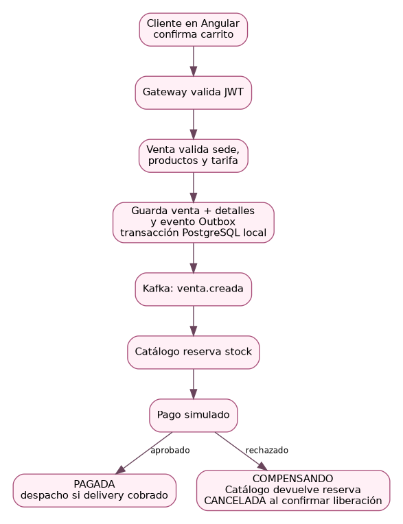
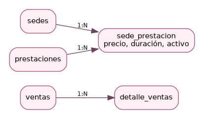
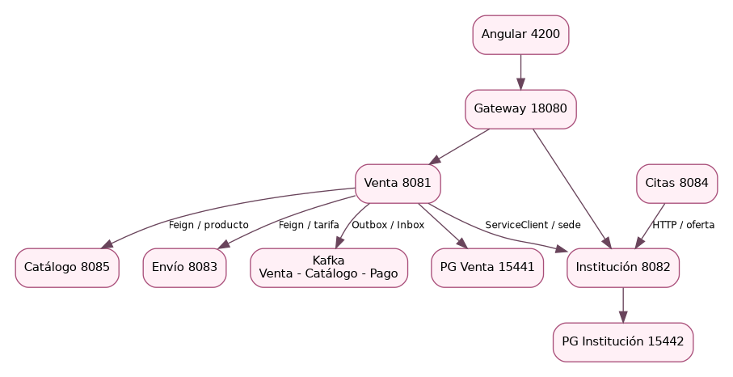

# PARTE I · Qué son tus microservicios

Tu responsabilidad asignada es Venta e Institución. Un microservicio es una aplicación de backend independiente con puerto, configuración y base propios; no es una pestaña. Venta ya existía aunque antes Angular lo llamara Mis pedidos. Ahora ADMIN ve Ventas y CLIENTE Mis compras: ambas pantallas utilizan el mismo servicio y el mismo historial.

Tu servicio | Qué administra | Cómo defenderlo
Venta | Compras, detalles, total, estado de la Saga y despacho del delivery cobrado. | Transaccional: registra una compra coherente y coordina su avance con inventario/pago.
Institución | Sedes, prestaciones, paquetes y condiciones de oferta por sede. | Maestro: datos de referencia. Tu N:M principal es Sede ↔ Prestación con precio, duración y estado en la asociación.
La etiqueta académica maestro/no transaccional no significa que Institución carezca de @Transactional. También confirma/revierte sus cambios locales. La diferencia es su responsabilidad: Venta ejecuta la compra; Institución define dónde y qué se ofrece.

Estado real de esta revisión: los pagos siguen simulados. Elegir YAPE en el laboratorio no deposita dinero real. Mercado Pago, Railway y Supabase aún no están conectados/desplegados en este código. La constancia PDF no es una boleta ni una factura SUNAT.

Lee primero las partes I y II para entender. En la parte III están todas las direcciones, rutas y conexiones. La parte IV responde dónde están el diseño y las letras. Los anexos tienen un mapa de archivos y el código completo, numerado para consultar.


# 1. Venta: qué hace desde que el cliente compra



Venta consulta datos reales del servidor; no confía en precios, total o identidad enviados por el navegador. Identifica al comprador por sub del JWT, agrupa cantidades y guarda precios acordados. El cargo de envío se suma al subtotal y forma parte del importe que procesa Pago.

Dato | Qué significa
Venta (cabecera) | Identificador, cliente, sede, fecha, estado, método, total y entrega.
DetalleVenta | Producto de referencia, cantidad, precio unitario y subtotal de esa compra.
Subtotal / envío / total | Productos + costo de envío = total. Recojo no lleva tarifa de delivery.
Idempotency-Key | Identifica un intento de compra: reintentar lo mismo no crea dos ventas.
Estado | Etapa verificable del proceso; no se cambia libremente desde un botón ADMIN.

# 2. Institución: qué hace y quién puede utilizarlo

Institución mantiene las sedes y sus ofertas. El cliente consulta sedes activas, elige dónde recoger o atenderse y ve los servicios disponibles. ADMIN crea/edita/desactiva sedes, prestaciones y paquetes y configura el precio/duración por sede. No crea usuarios ni autentica contraseñas.

Concepto | Ejemplo didáctico | Dónde está la regla
Sede | Local de Lima, Arequipa o Cusco. | SedeService filtra disponibilidad y aplica baja lógica.
Prestación | Baño, corte o consulta. | PrestacionService guarda nombre, descripción y estado.
Paquete | Baño + corte, como oferta conjunta. | Componentes individuales activos; no paquetes dentro de paquetes ni incluirse a sí mismo.
Oferta por sede | Paquete en sede A a S/ 45 y 60 minutos; en sede B a otro precio. | SedePrestacion guarda las condiciones de esa pareja.
Las sedes de db/demo son ejemplos ficticios del Perú. El precio de una prestación no está fijado para todo el sistema: la oferta de cada sede lo determina. Citas consulta esa oferta y conserva su precio/duración acordados en su propio detalle.




# PARTE II · Qué contiene tu código y por qué

Capa | Qué contiene | Cómo explicarla
Application | Entrada Spring Boot e importaciones de infraestructura común. | Arranca el servicio; incorpora seguridad y mensajería si corresponde.
Controller | Rutas HTTP, DTO de entrada y validación. | Recibe, valida y delega; no concentra toda la compra.
Service | Reglas y transacciones del negocio. | Valida, consulta otros servicios y coordina persistencia.
Repository | Consultas JPA, búsquedas por cliente/clave y persistencia. | Spring genera la implementación; las consultas y bloqueos importan.
Entity | Tablas y relaciones locales. | Representa datos; no debe confundirse con el JSON del cliente.
DTO y mapper | Request/Response y conversión. | Controlan qué entra/sale sin serializar un grafo JPA completo.
client / messaging | Llamadas síncronas y consumidores de eventos. | Feign consulta; Kafka comunica resultados diferidos.
db/migration | Evolución SQL con Flyway. | V1 no es todo el modelo; se aplican todas las versiones en orden.
Al leer los inicios de una clase: package ubica el nombre; import incorpora tipos; @Service o @RestController registra un componente; @RequiredArgsConstructor genera el constructor de los campos final. @Transactional define commit/rollback de esa base, no una transacción global entre servicios.


# 3. VentaService: operación transaccional paso a paso

- Rechaza a ADMIN como comprador: el administrador gestiona y utiliza otra cuenta para comprar.

- Valida entrega: recojo sin campos/cargos de envío; delivery requiere zona, transportista, tarifa cotizada y dirección suficiente.

- Obtiene el subject del JWT y toma un bloqueo por propietario + Idempotency-Key.

- Si la clave ya existe, compara los datos de la operación. Misma petición devuelve la venta existente; clave con otra petición responde 409.

- Consulta Institución para comprobar sede activa. Agrupa productos repetidos y sus cantidades.

- Si hay delivery, consulta Envío: cobertura activa, tarifa válida y plazo. Si cambió la tarifa cotizada, devuelve conflicto para confirmar un nuevo total.

- Consulta Catálogo y valida producto activo, stock observado y precio vigente. La reserva definitiva se decidirá después en Catálogo.

- Construye la cabecera y los detalles con precios acordados. Calcula el total e impide importes fuera del rango permitido.

- Guarda venta y Outbox venta.creada en una transacción local. Responde pendiente de stock; no declara que ya está pagada.

Tu defensa: “Si falla la escritura de detalles o del Outbox, no debe quedar una venta confirmada parcialmente. @Transactional protege ese conjunto local. El resultado remoto de inventario/pago llega después por eventos; no hay ACID único entre las tres bases”.


# 4. Estados, Saga y compensación: qué sí sucede

Estado | Qué ocurre | Qué ve el usuario
PENDIENTE_STOCK | Venta creada; Catálogo intenta reservar. | Aún no hay compra pagada.
PENDIENTE_PAGO | Reserva confirmada; se espera el resultado del pago simulado. | Pendiente, no volver a crear otro intento distinto por impaciencia.
PAGADA | Pago aprobado; despacho único si el delivery fue cobrado. | Constancia PDF disponible.
COMPENSANDO | Pago rechazado tras reserva; Catálogo debe devolver stock. | Cancelación en curso.
CANCELADA | Inventario rechazado, o liberación confirmada tras compensar. | La compra no se completó.
VentaEvents escucha inventario.reservado, inventario.rechazado, pago.validado, pago.fallido e inventario.liberado. Usa Inbox y UPDATE condicionado al estado esperado para no aplicar transiciones fuera de secuencia. Cuando el pago es aprobado, el INSERT del despacho comparte transacción con Inbox y el cambio de venta.

La devolución física del stock la realiza Catálogo, en InventarioEvents.liberar. Venta no modifica directamente la base de Catálogo; espera su evento inventario.liberado. Compensar es una nueva operación de negocio que revierte un efecto ya confirmado, no deshacer toda la historia con un rollback global.

Situación | Cómo responder al ingeniero
Catálogo/Envío cae antes de aceptar checkout | Error controlado; todavía no se guardó una venta para compensar.
No alcanza el stock al reservar | Rechazo de inventario; no continuar al pago.
Pago rechaza después de reservar | Sí hay compensación: devolver reserva y después terminar CANCELADA.
Kafka o Pago demora | Puede quedar pendiente para recuperación. Una demora no cancela automáticamente.
Evento duplicado | Inbox deduplica por eventId y las reglas/restricciones por venta evitan repetir el efecto.
Error SQL dentro de una operación | Rollback de esa base. No equivale a compensación entre servicios.
Outbox publica después del commit local, pero un fallo entre enviar y registrar confirmación puede duplicar el mensaje. Se diseña para entrega al menos una vez. Los reintentos tienen límite y existe DLT para mensajes que necesitan diagnóstico; no se promete recuperación automática de cualquier fallo.


# 5. Institución: la N:M, las ofertas y los paquetes

La N:M defendible es Sede ↔ Prestación: una sede ofrece muchas prestaciones y una prestación puede ofrecerse en muchas sedes. SedePrestacion tiene dos @ManyToOne, precio, duración y activo. Es una N:M relacional con entidad de asociación, aunque no se anote literalmente @ManyToMany.

guardarOferta busca primero sede y prestación; impide activar una oferta si sus padres no están disponibles y exige duración múltiplo de 30 minutos. Si la pareja ya existe, actualiza sus condiciones. No es necesario duplicar una prestación para ofrecerla en otra sede.

Prestacion también tiene una asociación con sus componentes para representar paquetes. Se exigen componentes individuales activos y al menos dos; el DTO limita cuántos se aceptan. No se permiten paquetes anidados ni incluirse a sí mismo. Un bloqueo serializa cambios concurrentes del grafo para que dos solicitudes no creen una estructura inválida.

Ejemplo: creo Baño y Corte; creo el paquete Baño + Corte; lo ofrezco en una sede a S/ 45 y 60 min. En otra sede la misma prestación puede tener otro precio. Citas toma una copia del acuerdo, de modo que cambiar mañana la oferta no modifica una cita antigua.


# 6. Imágenes, despacho y PDF: contenido adicional de tu parte

Capacidad | Qué implementa | Límite que debes decir
Foto de sede | Selector local en Angular → multipart → Institución valida y guarda archivo + referencia SQL. | Solo ADMIN modifica. JPG/PNG de hasta 5 MB. Git no copia fotos ni bases.
Despacho | Venta crea seguimiento al aprobarse un pago que incluye delivery. ADMIN marca tránsito/entrega. | La tarifa maestra viene de Envío. No se añade delivery gratis a un recojo pagado.
Constancia PDF | Venta verifica propiedad y PAGADA y genera un archivo PDF con importes persistidos. | Es laboratorio sin validez tributaria, no comprobante electrónico SUNAT.
Cancelar un envío cobrado | El servicio rechaza una cancelación simple que simule devolver dinero. | No existe reembolso bancario integrado.
El botón de la pantalla no crea por sí solo la seguridad: el servidor comprueba las reglas. Un cliente no puede editar sede, cambiar el resultado del pago ni descargar el comprobante de otro cliente mediante una URL directa.


# PARTE III · Direcciones exactas y conexiones

Todas las rutas se interpretan desde la carpeta raíz Garritas-Store. En VS Code usa Ctrl+P para pegar la ruta y Ctrl+G para ir a la línea. En este PDF las direcciones azules abren el archivo en GitHub en el commit analizado. Para explicar una clase, indica qué recibe, qué valida, a quién llama, qué guarda y qué devuelve.

```
Garritas-Store/
  services/garritas-venta-ms/
    src/main/java/pe/edu/upeu/garritas/venta/
      controller/  service/  repository/  entity/  dto/  mapper/
      client/  messaging/  despacho/
    src/main/resources/db/migration/
  services/garritas-institucion-ms/
    src/main/java/pe/edu/upeu/garritas/institucion/
      controller/  service/  repository/  entity/  dto/  mapper/
    src/main/resources/db/migration/ y db/demo/
  clients/garritas-frontend/src/app/features/
    ventas/  sedes/  prestaciones/  cart/
  clients/garritas-frontend/src/styles.css
  infra/garritas-config/config-repo/
  infra/garritas-common/
```


# 7. Los archivos de Venta que debes abrir primero

services/garritas-venta-ms/src/main/java/pe/edu/upeu/garritas/venta/GarritasVentaMsApplication.java:18

Tu aplicación existe de forma independiente. @Import incluye seguridad/mensajería y @EnableFeignClients activa clientes declarativos.

```
  17      bearerFormat = "JWT")
  18  @SpringBootApplication
  19  public class GarritasVentaMsApplication {
  20
  21    public static void main(String[] args) {
  22      SpringApplication.run(GarritasVentaMsApplication.class, args);
  23    }
  24  }
```

services/garritas-venta-ms/src/main/java/pe/edu/upeu/garritas/venta/controller/VentaController.java:12

Entrada real: /api/v1/ventas. POST recibe DTO + Idempotency-Key; GET lista/consulta y la ruta de comprobante devuelve PDF.

```
  11  @RestController
  12  @RequestMapping("/api/v1/ventas")
  13  @RequiredArgsConstructor
  14  public class VentaController {
  15    private final VentaService service;
  16    private final pe.edu.upeu.garritas.venta.service.ComprobanteService comprobantes;
  17
  18    @GetMapping(value = "/{id}/comprobante", produces = "application/pdf")
  19    public org.springframework.http.ResponseEntity<byte[]> comprobante(@PathVariable Long id) {
  20      return org.springframework.http.ResponseEntity.ok()
  21          .header("Content-Disposition", "attachment; filename=Garritas-compra-" + id + ".pdf")
  22          .cacheControl(org.springframework.http.CacheControl.noStore())
  23          .body(comprobantes.generar(id));
  24    }
  25
  26    @GetMapping
  27    public List<VentaResponse> listar() {
  28      return service.listar();
  29    }
  30
```

services/garritas-venta-ms/src/main/java/pe/edu/upeu/garritas/venta/service/VentaService.java:49

Esta es la operación principal: empieza por autorización, entrega, propietario y clave.

```
  48    @Transactional
  49    public VentaResponse crear(VentaRequest request, UUID key) {
  50      if (CurrentUser.admin())
  51        throw new org.springframework.security.access.AccessDeniedException(
  52            "El administrador gestiona la tienda; utiliza una cuenta de cliente para comprar");
  53      validarEntrega(request);
  54      String owner = CurrentUser.subject();
  55      // Serialize equal request keys across instances without holding a distributed transaction.
  56      jdbc.queryForObject(
  57          "SELECT pg_advisory_xact_lock(hashtextextended(?,0))", Object.class, owner + ":" + key);
  58      var existing = repository.findByIdClienteAndIdempotencyKey(owner, key);
  59      if (existing.isPresent()) {
  60        Venta old = existing.get();
  61        var original = new TreeMap<Long, Integer>();
  62        old.getDetalles()
  63            .forEach(d -> original.merge(d.getIdProducto(), d.getCantidad(), Integer::sum));
  64        var incoming = new TreeMap<Long, Integer>();
  65        request
  66            .getDetalles()
  67            .forEach(d -> incoming.merge(d.getIdProducto(), d.getCantidad(), Integer::sum));
```

services/garritas-venta-ms/src/main/java/pe/edu/upeu/garritas/venta/service/VentaService.java:79

Consulta síncrona a Institución por nombre de servicio.

```
  78      }
  79      Reference sede =
  80          services.get(
  81              "garritas-institucion-ms", "/api/v1/sedes/" + request.getSedeId(), Reference.class);
  82      if (!Boolean.TRUE.equals(sede.activo()))
  83        throw new ResponseStatusException(HttpStatus.CONFLICT, "La sede no está disponible");
  84      var quantities = new TreeMap<Long, Integer>();
  85      request
  86          .getDetalles()
  87          .forEach(d -> quantities.merge(d.getIdProducto(), d.getCantidad(), Math::addExact));
  88      Venta venta =
```

services/garritas-venta-ms/src/main/java/pe/edu/upeu/garritas/venta/service/VentaService.java:100

Valida tarifa real. No confiar en una suma enviada desde Angular.

```
  99      if ("ENVIO".equals(request.getTipoEntrega())) {
 100        var cobertura = logistica.obtener(request.getTransportistaId(), request.getZonaId());
 101        if (!Boolean.TRUE.equals(cobertura.activo())
 102            || cobertura.tarifa() == null
 103            || cobertura.tarifa().signum() < 0
 104            || cobertura.diasEstimados() < 1)
 105          throw new ResponseStatusException(HttpStatus.CONFLICT, "Cobertura no disponible");
 106        if (cobertura.tarifa().compareTo(request.getTarifaCotizada()) != 0)
 107          throw new ResponseStatusException(
 108              HttpStatus.CONFLICT,
 109              "La tarifa de envío cambió. Actualiza las opciones y confirma el nuevo total");
 110        venta.setCostoEnvio(cobertura.tarifa());
 111        venta.setDireccionEntrega(direccion(request));
 112        venta.setZonaId(request.getZonaId());
 113        venta.setTransportistaId(request.getTransportistaId());
 114        venta.setTransportistaNombre(cobertura.transportista());
 115        venta.setDiasEntrega(cobertura.diasEstimados());
 116      }
 117      for (var item : quantities.entrySet()) {
```

services/garritas-venta-ms/src/main/java/pe/edu/upeu/garritas/venta/service/VentaService.java:140

Venta y Outbox se guardan bajo la misma transacción local.

```
 139            HttpStatus.UNPROCESSABLE_CONTENT, "Total fuera del rango permitido");
 140      repository.saveAndFlush(venta);
 141      outbox.append(
 142          new SagaEvent(
 143              UUID.randomUUID(),
 144              1,
 145              "venta.creada",
 146              venta.getId(),
 147              owner,
 148              venta.getTotal(),
 149              venta.getMetodoPago(),
 150              Optional.ofNullable(MDC.get("traceId")).orElseGet(() -> UUID.randomUUID().toString()),
 151              venta.getDetalles().stream()
 152                  .map(
 153                      d ->
 154                          new SagaEvent.Item(
 155                              d.getIdProducto(), d.getCantidad(), d.getPrecioUnitario()))
 156                  .toList(),
 157              Instant.now()));
```

services/garritas-venta-ms/src/main/java/pe/edu/upeu/garritas/venta/service/VentaService.java:32

ADMIN ve todas; CLIENTE solo las del sub autenticado. No basta filtrar en la plantilla.

```
  31    @Transactional(readOnly = true)
  32    public List<VentaResponse> listar() {
  33      var ventas =
  34          CurrentUser.admin()
  35              ? repository.findAll()
  36              : repository.findByIdCliente(CurrentUser.subject());
  37      return ventas.stream()
  38          .sorted(Comparator.comparing(Venta::getFecha).reversed())
  39          .map(mapper::toResponse)
  40          .toList();
  41    }
  42
  43    @Transactional(readOnly = true)
```

services/garritas-venta-ms/src/main/java/pe/edu/upeu/garritas/venta/service/VentaService.java:183

Protege la consulta individual y, por reutilización, el comprobante.

```
 182
 183    private Venta owned(Long id) {
 184      Venta v =
 185          repository
 186              .findById(id)
 187              .orElseThrow(
 188                  () -> new ResponseStatusException(HttpStatus.NOT_FOUND, "Venta no encontrada"));
 189      CurrentUser.requireOwner(v.getIdCliente());
 190      return v;
 191    }
 192  }
```

services/garritas-venta-ms/src/main/java/pe/edu/upeu/garritas/venta/entity/Venta.java:60

Tu relación 1:N local. Los detalles se guardan con la cabecera.

```
  59    @Builder.Default
  60    @OneToMany(
  61        mappedBy = "venta",
  62        cascade = CascadeType.ALL,
  63        orphanRemoval = true,
  64        fetch = FetchType.LAZY)
  65    private List<DetalleVenta> detalles = new ArrayList<>();
  66  }
```

services/garritas-venta-ms/src/main/java/pe/edu/upeu/garritas/venta/entity/DetalleVenta.java:21

Cada detalle pertenece a una venta. idProducto es una referencia remota.

```
  20
  21      @ManyToOne(fetch = FetchType.LAZY)
  22      @JoinColumn(name = "id_venta", nullable = false)
  23      private Venta venta;
  24
  25      @Column(name = "id_producto", nullable = false)
  26      private Long idProducto;
  27
  28      @Column(name = "cantidad", nullable = false)
  29      private Integer cantidad;
  30
  31      @Column(name = "precio_unitario", nullable = false, precision = 10, scale = 2)
```

services/garritas-venta-ms/src/main/java/pe/edu/upeu/garritas/venta/repository/VentaRepository.java:7

Busca el dueño y las claves de reintento. El SQL de bloqueo está en el servicio.

```
   6
   7  public interface VentaRepository extends JpaRepository<Venta, Long> {
   8    java.util.List<Venta> findByIdCliente(String idCliente);
   9
  10    java.util.Optional<Venta> findByIdClienteAndIdempotencyKey(String idCliente, java.util.UUID key);
  11
  12    List<Venta> findByIdCliente(Long idCliente);
  13  }
```

services/garritas-venta-ms/src/main/java/pe/edu/upeu/garritas/venta/messaging/VentaEvents.java:22

Recibe resultados, filtra tipos y aplica Inbox antes de cambiar estados.

```
  21    @Transactional
  22    public void consume(String payload) {
  23      SagaEvent e = json.readValue(payload, SagaEvent.class);
  24      if (!java.util.Set.of(
  25              "inventario.reservado",
  26              "inventario.rechazado",
  27              "pago.validado",
  28              "pago.fallido",
  29              "inventario.liberado")
  30          .contains(e.type())) return;
  31      if (!inbox.claim(e)) return;
  32      try (var scope = MDC.putCloseable("traceId", e.traceId())) {
  33        String state =
  34            switch (e.type()) {
  35              case "inventario.reservado" -> "PENDIENTE_PAGO";
  36              case "pago.validado" -> "PAGADA";
  37              case "pago.fallido" -> "COMPENSANDO";
  38              default -> "CANCELADA";
  39            };
  40        String expected =
  41            switch (e.type()) {
```

services/garritas-venta-ms/src/main/java/pe/edu/upeu/garritas/venta/messaging/VentaEvents.java:48

Compara el estado anterior y evita transiciones incompatibles. El despacho es único por venta.

```
  47            jdbc.update(
  48                "UPDATE ventas SET estado=? WHERE id=? AND estado=?", state, e.ventaId(), expected);
  49        if (changed == 1 && "pago.validado".equals(e.type())) {
  50          // Same local transaction as inbox and sale transition: no paid order without its dispatch.
  51          jdbc.update(
  52              """
  53              INSERT INTO despachos(id_venta,id_cliente,direccion_entrega,transportista,estado,fecha_entrega_estimada,id_zona,id_transportista,tarifa)
  54              SELECT id,id_cliente,direccion_entrega,transportista_nombre,'PENDIENTE',CURRENT_TIMESTAMP + dias_entrega * interval '1 day',zona_id,transportista_id,costo_envio
  55              FROM ventas WHERE id=? AND tipo_entrega='ENVIO'
  56              ON CONFLICT(id_venta) DO NOTHING
  57              """,
  58              e.ventaId());
  59        }
  60        log.info(
  61            "component=saga ventaId={} eventType={} estado={} changed={}",
  62            e.ventaId(),
  63            e.type(),
  64            state,
```

services/garritas-venta-ms/src/main/java/pe/edu/upeu/garritas/venta/service/ComprobanteService.java:19

Obtiene la venta con propiedad validada y exige PAGADA antes de crear el PDF.

```
  18    private final VentaService ventas;
  19    public byte[] generar(long id) {
  20      var v = ventas.obtener(id); // Aplica la misma propiedad/rol que la consulta de venta.
  21      if (v.getEstado() != EstadoVenta.PAGADA)
  22        throw new ResponseStatusException(HttpStatus.CONFLICT, "El comprobante está disponible cuando la compra está pagada");
  23      List<String> lines = new ArrayList<>();
  24      lines.add("GARRITAS STORE - CONSTANCIA DE COMPRA #" + id);
  25      lines.add("Laboratorio: pago simulado. Sin validez tributaria.");
  26      lines.add("Fecha: " + DateTimeFormatter.ofPattern("dd/MM/yyyy HH:mm").withZone(ZoneId.of("America/Lima")).format(v.getFecha()));
  27      lines.add("Cliente (identificador): " + v.getIdCliente());
  28      lines.add("Sede: #" + v.getSedeId() + " | Estado: PAGADA");
  29      lines.add(" "); lines.add("Producto / cantidad / precio acordado / subtotal (S/)");
  30      for (var d : v.getDetalles())
  31        lines.add("Producto #" + d.getIdProducto() + " | " + d.getCantidad() + " un. | S/ " + d.getPrecioUnitario() + " | S/ " + d.getSubtotal());
  32      lines.add(" "); lines.add("Subtotal: S/ " + v.getSubtotal());
  33      lines.add("Envio: S/ " + v.getCostoEnvio()); lines.add("TOTAL: S/ " + v.getTotal());
  34      lines.add("Entrega: " + v.getTipoEntrega());
  35      if (v.getDireccionEntrega() != null) lines.add("Direccion: " + v.getDireccionEntrega());
  36      lines.add(" ");lines.add("Los importes corresponden a la compra registrada.");
```

services/garritas-venta-ms/src/main/java/pe/edu/upeu/garritas/venta/despacho/service/DespachoService.java:35

El endpoint de compatibilidad no agrega un envío sin cobrar: verifica la venta y devuelve el despacho ya preparado.

```
  34
  35    public DespachoResponse crear(DespachoRequest r) {
  36      var venta =
  37          ventas
  38              .findById(r.getIdVenta())
  39              .orElseThrow(
  40                  () -> new ResponseStatusException(HttpStatus.NOT_FOUND, "Venta no encontrada"));
  41      CurrentUser.requireOwner(venta.getIdCliente());
  42      if (!"PAGADA".equals(venta.getEstado().name()))
  43        throw new ResponseStatusException(
  44            HttpStatus.CONFLICT, "Solo se puede solicitar envío para una venta pagada");
  45      if (!"ENVIO".equals(venta.getTipoEntrega())
  46          || !Objects.equals(venta.getZonaId(), r.getZonaId())
  47          || !Objects.equals(venta.getTransportistaId(), r.getTransportistaId())
  48          || !Objects.equals(venta.getDireccionEntrega(), r.getDireccionEntrega().strip()))
  49        throw new ResponseStatusException(
  50            HttpStatus.CONFLICT,
  51            "El delivery debe seleccionarse y pagarse al confirmar la compra. Esta venta no incluye"
  52                + " ese envío");
  53      return repository.findByIdVenta(venta.getId()).stream()
  54          .findFirst()
```

VentaController no expone PUT ni DELETE de la venta: no se permite reescribir importes históricos o borrar compras como un producto maestro. Sus estados avanzan con la Saga. Los endpoints adicionales del despacho tienen sus propias reglas.


# 8. Los archivos de Institución que debes abrir primero

services/garritas-institucion-ms/src/main/java/pe/edu/upeu/garritas/institucion/GarritasInstitucionMsApplication.java:15

Entrada del servicio Institución y su contexto.

```
  14      bearerFormat = "JWT")
  15  @SpringBootApplication
  16  public class GarritasInstitucionMsApplication {
  17
  18    public static void main(String[] args) {
  19      SpringApplication.run(GarritasInstitucionMsApplication.class, args);
  20    }
  21  }
```

services/garritas-institucion-ms/src/main/java/pe/edu/upeu/garritas/institucion/controller/SedeController.java:14

Rutas CRUD de /sedes; @Valid activa validación del Request.

```
  13  @RestController
  14  @RequestMapping("/api/v1/sedes")
  15  @RequiredArgsConstructor
  16  public class SedeController {
  17
  18      private final SedeService sedeService;
  19
  20      @GetMapping
  21      public List<SedeResponse> listar() {
  22          return sedeService.listar();
  23      }
  24
  25      @GetMapping("/{id}")
  26      public SedeResponse obtener(@PathVariable Long id) {
  27          return sedeService.obtener(id);
  28      }
  29
```

services/garritas-institucion-ms/src/main/java/pe/edu/upeu/garritas/institucion/service/SedeService.java:21

Disponibilidad y orden de sedes según rol.

```
  20
  21    public List<SedeResponse> listar() {
  22      return sedeRepository.findAll().stream()
  23          .filter(s -> pe.edu.upeu.garritas.common.CurrentUser.admin() || s.getActivo())
  24          .sorted(java.util.Comparator.comparing(Sede::getCiudad).thenComparing(Sede::getNombre))
  25          .map(sedeMapper::toResponse)
  26          .toList();
  27    }
  28
  29    public SedeResponse obtener(Long id) {
  30      Sede sede = buscarOFallar(id);
  31      if (!sede.getActivo() && !pe.edu.upeu.garritas.common.CurrentUser.admin())
```

services/garritas-institucion-ms/src/main/java/pe/edu/upeu/garritas/institucion/service/SedeService.java:37

Crear pasa por mapper y repositorio. Actualizar modifica el registro existente.

```
  36
  37    public SedeResponse crear(SedeRequest request) {
  38      Sede sede = sedeMapper.toEntity(request);
  39      return sedeMapper.toResponse(sedeRepository.save(sede));
  40    }
  41
  42    public SedeResponse actualizar(Long id, SedeRequest request) {
  43      Sede sede = buscarOFallar(id);
  44      sede.setNombre(request.getNombre());
  45      sede.setDireccion(request.getDireccion());
  46      sede.setCiudad(request.getCiudad());
  47      sede.setTelefono(request.getTelefono());
  48      sede.setActivo(request.getActivo());
  49      return sedeMapper.toResponse(sedeRepository.save(sede));
  50    }
  51
  52    public void eliminar(Long id) {
  53      Sede sede = buscarOFallar(id);
  54      sede.setActivo(false);
  55      sedeRepository.save(sede);
```

services/garritas-institucion-ms/src/main/java/pe/edu/upeu/garritas/institucion/service/SedeService.java:52

Eliminar se implementa como baja lógica activo=false.

```
  51
  52    public void eliminar(Long id) {
  53      Sede sede = buscarOFallar(id);
  54      sede.setActivo(false);
  55      sedeRepository.save(sede);
  56    }
  57
  58    private Sede buscarOFallar(Long id) {
  59      return sedeRepository
  60          .findById(id)
  61          .orElseThrow(() -> new ResourceNotFoundException("Sede no encontrada: " + id));
```

services/garritas-institucion-ms/src/main/java/pe/edu/upeu/garritas/institucion/entity/SedePrestacion.java:17

Dos referencias locales forman la entidad de asociación N:M.

```
  16
  17    @ManyToOne(fetch = FetchType.LAZY, optional = false)
  18    @JoinColumn(name = "id_sede")
  19    private Sede sede;
  20
  21    @ManyToOne(fetch = FetchType.LAZY, optional = false)
  22    @JoinColumn(name = "id_prestacion")
  23    private Prestacion prestacion;
  24
  25    @Column(nullable = false, precision = 10, scale = 2)
  26    private BigDecimal precio;
  27
  28    @Column(name = "duracion_minutos", nullable = false)
  29    private Integer duracionMinutos;
  30
  31    @Column(nullable = false)
  32    private Boolean activo = true;
  33  }
```

services/garritas-institucion-ms/src/main/java/pe/edu/upeu/garritas/institucion/service/PrestacionService.java:84

Precio/duración por sede, padres disponibles y búsqueda de pareja existente.

```
  83
  84    public OfertaResponse guardarOferta(Long sede, OfertaRequest r) {
  85      if (r.duracionMinutos() % 30 != 0)
  86        throw error(400, "La duración debe ser múltiplo de 30 minutos");
  87      Sede s = sedes.findById(sede).orElseThrow(() -> error(404, "Sede no encontrada"));
  88      Prestacion p =
  89          prestaciones
  90              .findById(r.prestacionId())
  91              .orElseThrow(() -> error(404, "Prestación no encontrada"));
  92      if (r.activo() && (!s.getActivo() || !disponible(p)))
  93        throw error(409, "Activa la sede y la prestación antes de ofrecerla");
  94      SedePrestacion o =
  95          ofertas.findBySedeIdAndPrestacionId(sede, p.getId()).orElseGet(SedePrestacion::new);
  96      o.setSede(s);
  97      o.setPrestacion(p);
  98      o.setPrecio(r.precio());
  99      o.setDuracionMinutos(r.duracionMinutos());
 100      o.setActivo(r.activo());
 101      return response(ofertas.saveAndFlush(o));
 102    }
 103
 104    private OfertaResponse response(SedePrestacion o) {
 105      return new OfertaResponse(
 106          o.getId(),
 107          o.getSede().getId(),
 108          o.getPrestacion().getId(),
```

services/garritas-institucion-ms/src/main/java/pe/edu/upeu/garritas/institucion/entity/Prestacion.java:25

La prestación puede ser paquete de componentes locales.

```
  24
  25    @ManyToMany(fetch = FetchType.LAZY)
  26    @JoinTable(
  27        name = "prestacion_componentes",
  28        joinColumns = @JoinColumn(name = "id_paquete"),
  29        inverseJoinColumns = @JoinColumn(name = "id_componente"))
  30    private java.util.Set<Prestacion> componentes = new java.util.HashSet<>();
  31  }
```

services/garritas-institucion-ms/src/main/java/pe/edu/upeu/garritas/institucion/service/PrestacionService.java:31

Bloqueo del grafo y validación de paquetes.

```
  30
  31    public PrestacionResponse guardar(Long id, PrestacionRequest r) {
  32      // Serialize graph edits across replicas so concurrent requests cannot introduce nested
  33      // packages.
  34      jdbc.queryForObject(
  35          "SELECT pg_advisory_xact_lock(hashtextextended(?,0))", Object.class, "garritas:paquetes");
  36      Prestacion p =
  37          id == null
  38              ? new Prestacion()
  39              : prestaciones.findById(id).orElseThrow(() -> error(404, "Prestación no encontrada"));
  40      var ids = r.componenteIds() == null ? java.util.Set.<Long>of() : r.componenteIds();
  41      if (!ids.isEmpty()) {
  42        if (ids.size() < 2) throw error(400, "Un paquete necesita al menos dos servicios distintos");
  43        if (id != null && ids.contains(id))
  44          throw error(400, "Un paquete no puede incluirse a sí mismo");
  45        var componentes = new java.util.HashSet<>(prestaciones.findAllById(ids));
  46        if (componentes.size() != ids.size())
  47          throw error(400, "Uno de los servicios del paquete no existe");
  48        if (componentes.stream().anyMatch(x -> !x.getActivo() || !x.getComponentes().isEmpty()))
  49          throw error(
  50              409,
  51              "Selecciona servicios individuales activos; no se permiten paquetes dentro de"
  52                  + " paquetes");
  53        if (id != null
  54            && jdbc.queryForObject(
  55                    "SELECT count(*) FROM prestacion_componentes WHERE id_componente=?",
  56                    Long.class,
  57                    id)
  58                > 0) throw error(409, "Este servicio ya forma parte de otro paquete");
  59        p.setComponentes(componentes);
  60      } else {
  61        p.getComponentes().clear();
```

services/garritas-institucion-ms/src/main/java/pe/edu/upeu/garritas/institucion/controller/PrestacionController.java:39

Citas y la interfaz consumen esta oferta por sede.

```
  38
  39    @GetMapping("/sedes/{id}/prestaciones")
  40    public List<OfertaResponse> ofertas(@PathVariable Long id) {
  41      return service.ofertas(id);
  42    }
  43
  44    @PutMapping("/sedes/{id}/prestaciones")
  45    public OfertaResponse oferta(@PathVariable Long id, @Valid @RequestBody OfertaRequest r) {
  46      return service.guardarOferta(id, r);
  47    }
  48  }
```

services/garritas-institucion-ms/src/main/java/pe/edu/upeu/garritas/institucion/controller/ImagenController.java:11

GET/PUT/DELETE de foto de sede, con validación compartida.

```
  10  @RestController
  11  @RequestMapping("/api/v1/sedes/{id}/imagen")
  12  @RequiredArgsConstructor
  13  @Import(LocalImages.class)
  14  public class ImagenController {
  15    private final LocalImages images;
  16    @GetMapping
  17    public ResponseEntity<byte[]> get(@PathVariable long id) {
  18      var image = images.read(id);
  19      return ResponseEntity.ok().contentType(MediaType.parseMediaType(image.contentType()))
  20          .cacheControl(CacheControl.noStore()).header("X-Content-Type-Options", "nosniff").body(image.bytes());
  21    }
  22    @PutMapping(consumes = MediaType.MULTIPART_FORM_DATA_VALUE)
  23    @ResponseStatus(HttpStatus.NO_CONTENT)
  24    public void upload(@PathVariable long id, @RequestParam("archivo") MultipartFile archivo) {
  25      images.upload(id, archivo);
  26    }
  27    @DeleteMapping
  28    @ResponseStatus(HttpStatus.NO_CONTENT)
  29    public void delete(@PathVariable long id) { images.delete(id); }
```

Las migraciones de Institución crean sedes, prestaciones/ofertas, componentes de paquetes e imágenes. db/demo añade ejemplos peruanos. No edites V1 para explicar el esquema final: consulta todas las migraciones en orden.


# 9. Con quién se conecta cada servicio y dónde



Origen → destino | Para qué | Código exacto
Angular → Gateway | Entrada de negocio con JWT. | core/api.ts, core/domain-api.ts e interceptor.ts.
Gateway → Venta / Institución | Rutas lb:// por Eureka. | config-repo/garritas-gateway-dev.yml.
Venta → Catálogo | Producto, precio, activo y stock observado. | client/ProductoClient.java y CatalogoConsulta.java.
Venta → Envío | Cobertura, tarifa y días estimados. | client/LogisticaClient.java y LogisticaConsulta.java.
Venta → Institución | Sede activa. | VentaService.crear, services.get con nombre lógico.
Citas → Institución | Sede y oferta con precio/duración/componentes. | CitaService.crear de Deissy; PrestacionController.ofertas de tu dominio.
Venta ↔ Kafka | Evento de creación y resultados. | VentaService + Outbox; VentaEvents + Inbox.
Servicio → PostgreSQL propio | Datos persistidos. | YAML datasource; repositorios/JdbcTemplate y migraciones.
services/garritas-venta-ms/src/main/java/pe/edu/upeu/garritas/venta/client/ProductoClient.java:7

Nombre lógico de Catálogo, no dirección fija de instancia.

```
   6
   7  @FeignClient(name = "garritas-catalogo-ms")
   8  public interface ProductoClient {
   9    record Producto(Long id, String nombre, BigDecimal precio, Integer stock, Boolean activo) {}
  10
  11    @GetMapping("/api/v1/productos/{id}")
  12    Producto obtener(@PathVariable Long id);
  13  }
```

services/garritas-venta-ms/src/main/java/pe/edu/upeu/garritas/venta/client/LogisticaClient.java:7

Nombre lógico de Envío y contrato de cobertura.

```
   6
   7  @FeignClient(name = "garritas-envio-ms")
   8  public interface LogisticaClient {
   9    record Cobertura(Boolean activo, String transportista, BigDecimal tarifa, int diasEstimados) {}
  10
  11    @GetMapping("/api/v1/transportistas/{t}/zonas/{z}")
  12    Cobertura obtener(@PathVariable("t") Long transportista, @PathVariable("z") Long zona);
  13  }
```

services/garritas-venta-ms/src/main/java/pe/edu/upeu/garritas/venta/client/CatalogoConsulta.java:18

Circuit Breaker alrededor de la consulta de producto.

```
  17      return breakers
  18          .create("catalogo")
  19          .run(
  20              () -> client.obtener(id),
  21              ex -> {
  22                if (ex instanceof FeignException.NotFound)
  23                  throw new ResponseStatusException(
  24                      HttpStatus.UNPROCESSABLE_CONTENT, "Producto no encontrado");
  25                throw new ResponseStatusException(
  26                    HttpStatus.SERVICE_UNAVAILABLE, "Catálogo no disponible; inténtalo de nuevo", ex);
  27              });
  28    }
  29  }
```

services/garritas-venta-ms/src/main/java/pe/edu/upeu/garritas/venta/client/FeignConfiguration.java:1

Token de usuario y correlación de las llamadas.

```
   1  package pe.edu.upeu.garritas.venta.client;
   2
   3  import feign.RequestInterceptor;
   4  import org.slf4j.MDC;
   5  import org.springframework.context.annotation.*;
   6
   7  @Configuration(proxyBeanMethods = false)
   8  public class FeignConfiguration {
   9    @Bean
  10    RequestInterceptor traceInterceptor() {
  11      return t -> {
  12        var trace = MDC.get("traceId");
```

infra/garritas-config/config-repo/garritas-venta-ms-dev.yml:60

Timeout de conexión/lectura de Feign; revisar también los circuitos.

```
  59            default:
  60              connectTimeout: 2000
  61              readTimeout: 3000
  62  springdoc:
  63    swagger-ui:
  64      path: /swagger-ui.html
  65  logging:
  66    level:
  67      pe.edu.upeu.garritas.venta: DEBUG
  68  eureka:
  69    instance:
  70      hostname: localhost
  71      instance-id: ${spring.application.name}:${server.port}
```

infra/garritas-config/config-repo/garritas-venta-ms-dev.yml:97

Ventana, mínimo de llamadas, umbral y tiempo abierto.

```
  96        logistica:
  97          sliding-window-size: 10
  98          minimum-number-of-calls: 5
  99          failure-rate-threshold: 50
 100          wait-duration-in-open-state: 10s
 101        catalogo:
 102          sliding-window-size: 10
 103          minimum-number-of-calls: 5
 104          failure-rate-threshold: 50
 105          wait-duration-in-open-state: 10s
 106    timelimiter:
 107      instances:
 108        catalogo:
```

infra/garritas-config/config-repo/garritas-gateway-dev.yml:17

Ruta pública de API hacia el nombre lógico de Institución.

```
  16              - Path=/api/v1/ventas/**
  17            - id: garritas-institucion
  18              uri: lb://garritas-institucion-ms
  19              predicates:
  20              - Path=/api/v1/sedes/**
  21            - id: garritas-envio
  22              uri: lb://garritas-venta-ms
  23              predicates:
  24              - Path=/api/v1/envios/**,/api/v1/despachos/**
  25            - id: garritas-citas
  26              uri: lb://garritas-citas-ms
  27              predicates:
  28              - Path=/api/v1/citas/**
```

services/garritas-catalogo-ms/src/main/java/pe/edu/upeu/garritas/catalogo/messaging/InventarioEvents.java:76

Código de colaboración: Catálogo devuelve el stock reservado; tú consumes su confirmación.

```
  75
  76    private void liberar(SagaEvent e) {
  77      var rows =
  78          jdbc.queryForList(
  79              "SELECT estado,payload FROM reservas_stock WHERE id_venta=? FOR UPDATE", e.ventaId());
  80      if (rows.isEmpty()) throw new IllegalStateException("Reserva inexistente: " + e.ventaId());
  81      if (!rows.getFirst().get("estado").equals("RESERVADA")) return;
  82      var original = json.readValue(rows.getFirst().get("payload").toString(), SagaEvent.class);
  83      for (var item :
  84          original.items().stream().sorted(Comparator.comparing(SagaEvent.Item::productoId)).toList())
  85        jdbc.update(
  86            "UPDATE productos SET stock=stock+?,version=version+1 WHERE id=?",
  87            item.cantidad(),
```

Timeout y Circuit Breaker no son sinónimos. El timeout limita una espera individual; el circuito recuerda fallos y rechaza rápido cuando el destino no está saludable. Aquí el error controlado no inventa precios ni stock para seguir vendiendo. Las referencias a Institución y Citas usan ServiceClient, no todos los enlaces son Feign con circuito.


# 10. Seguridad: cómo se conectan Keycloak y tus tablas

Keycloak autentica y emite el JWT con sub y realm_access.roles. Angular conserva el token en memoria y lo adjunta a la API. Gateway y cada microservicio vuelven a validar firma, issuer y audiencia. La identidad del comprador no se toma de un idCliente enviado en JSON.

clients/garritas-frontend/src/app/core/auth.ts:29

Authorization Code con PKCE S256, login/logout y roles.

```
  28        onLoad: "check-sso",
  29        pkceMethod: "S256",
  30        checkLoginIframe: false,
  31        responseMode: "query",
  32        redirectUri: location.origin + "/",
  33      });
  34      this.sync();
  35    }
  36
  37    private sync() {
  38      this.loggedIn.set(!!this.kc.authenticated);
```

clients/garritas-frontend/src/app/core/interceptor.ts:17

Bearer solo para nuestra API.

```
  16              "X-Trace-ID": crypto.randomUUID(),
  17              ...(token ? { Authorization: "Bearer " + token } : {}),
  18            },
  19          }),
  20        ),
  21      ),
  22    );
  23  };
```

infra/garritas-common/src/main/java/pe/edu/upeu/garritas/common/SecurityConfiguration.java:11

ADMIN para maestros; CLIENTE/ADMIN para recursos propios, con excepciones por acción.

```
  10  import org.springframework.security.oauth2.server.resource.authentication.JwtAuthenticationConverter;
  11  import org.springframework.security.web.SecurityFilterChain;
  12  import org.springframework.web.cors.*;
  13
  14  @Import({HttpServices.class, DomainErrors.class})
  15  @Configuration(proxyBeanMethods = false)
  16  public class SecurityConfiguration {
  17    @Bean
  18    SecurityFilterChain security(
  19        HttpSecurity http,
  20        @Value("${garritas.cors.allowed-origins:http://localhost:4200}") String origins,
```

infra/garritas-common/src/main/java/pe/edu/upeu/garritas/common/SecurityConfiguration.java:76

POST compra requiere CLIENTE y rechaza ADMIN aunque tenga ambos roles.

```
  75                      .permitAll()
  76                      .requestMatchers(HttpMethod.POST, "/api/v1/ventas")
  77                      .access(
  78                          (authentication, context) ->
  79                              new org.springframework.security.authorization.AuthorizationDecision(
  80                                  authentication.get().getAuthorities().stream()
  81                                          .anyMatch(a1 -> a1.getAuthority().equals("ROLE_CLIENTE"))
  82                                      && authentication.get().getAuthorities().stream()
  83                                          .noneMatch(a1 -> a1.getAuthority().equals("ROLE_ADMIN"))))
  84                      .requestMatchers(
  85                          HttpMethod.POST,
```

infra/garritas-common/src/main/java/pe/edu/upeu/garritas/common/CurrentUser.java:18

Identidad persistida frente al sujeto autenticado; ADMIN puede auditar.

```
  17
  18    public static void requireOwner(String owner) {
  19      if (!admin() && !subject().equals(owner))
  20        throw new AccessDeniedException("El recurso pertenece a otro cliente");
  21    }
  22  }
```

Las tablas locales no sustituyen Keycloak. Institución guarda sedes/ofertas; Venta guarda compras. La tabla de roles internos de Usuario es otra capacidad: cambiarla no cambia por sí solo un JWT a ADMIN. Ocultar botones es presentación, no la barrera de seguridad.


# 11. Direcciones para abrir y comprobar el sistema

Componente | Dirección local | Qué puedes mostrar
Angular | http://localhost:4200 | ADMIN → Ventas/Sedes; CLIENTE → Mis compras.
Venta Swagger | http://localhost:8081/swagger-ui.html | Endpoints y DTO reales.
Institución Swagger | http://localhost:8082/swagger-ui.html | Sedes, prestaciones, ofertas e imágenes.
Gateway | http://localhost:18080/api/v1/sedes | API a través del punto de entrada. No tiene una portada de tienda en /.
Health Venta / Institución | http://localhost:8081/actuator/health/readiness y puerto 8082 | Disponibilidad configurada; no sustituye la prueba de negocio.
Eureka | http://localhost:18761 | Tus servicios registrados por nombre.
Config | http://localhost:18888/garritas-venta-ms/dev | Propiedades entregadas a Venta.
Keycloak | http://localhost:18180/admin/ | Realm garritas, usuarios y roles efectivos.
Kafka UI | http://localhost:18085 | Eventos y grupos del topic garritas.ventas.v1.
Grafana / Prometheus | http://localhost:13000 / http://localhost:19090 | Panel, métricas y targets.
PostgreSQL propio | Venta 15441; Institución 15442 | Cliente SQL, no navegador. garritas_venta_db / garritas_institucion_db.
Credenciales iniciales DEV: cliente / Cliente123!; administrador de tienda admin-store / Admin123!; consola Keycloak admin / local-admin-change-me; Grafana admin / local-grafana. Si se cambiaron en una base persistente, el valor actual puede ser otro. No utilizar estas credenciales de demostración para publicar una tienda real.


# PARTE IV · Diseño, letras, colores y pantallas

Esta es la respuesta directa a “¿dónde cambiaste el diseño y las letras?”. La presentación está en Angular: HTML define la estructura, TypeScript maneja datos/acciones y CSS define cómo se ve. Las clases Java y PostgreSQL no deciden el tamaño de letra de la página.

Qué quieres localizar | Ruta exacta
Pantalla Ventas/Mis compras | clients/garritas-frontend/src/app/features/ventas/ventas.component.html
Filtros, carga, detalle y descarga de PDF | clients/garritas-frontend/src/app/features/ventas/ventas.component.ts
Sedes: tarjetas y formulario | clients/garritas-frontend/src/app/features/sedes/sedes.component.html y .ts
Servicios/paquetes por sede | clients/garritas-frontend/src/app/features/prestaciones/prestaciones.component.html y .ts
Menú por rol, portada y navegación | clients/garritas-frontend/src/app/app.html y app.ts
Fuentes, colores, tamaños y responsive | clients/garritas-frontend/src/styles.css
Registro del CSS global | clients/garritas-frontend/angular.json → build.options.styles
Foto/selector reutilizable | clients/garritas-frontend/src/app/shared/image-editor.ts, resource-image.ts y media.ts
En esta versión los componentes comparten CSS global. No necesitas encontrar ventas.component.css: Ventas declara templateUrl y los selectores visuales se encuentran en styles.css. El selector de fotos contiene su plantilla dentro del archivo image-editor.ts.


# 12. Dónde están exactamente las letras y el rosa

clients/garritas-frontend/src/styles.css:2

Familia de letras global. El navegador elige la primera disponible: Inter es una preferencia, no se descarga una fuente por nombrarla.

```
   1  :root {
   2    font-family:
   3      Inter,
   4      ui-sans-serif,
   5      system-ui,
   6      -apple-system,
   7      BlinkMacSystemFont,
   8      "Segoe UI",
   9      sans-serif;
  10    color: #233c35;
  11    background: #f5f6f2;
  12    font-synthesis: none;
```

clients/garritas-frontend/src/styles.css:13

Tamaño base de texto. rem se calcula a partir de ese tamaño raíz.

```
  12    font-synthesis: none;
  13    font-size: 15px;
  14    line-height: 1.5;
  15  }
  16  * {
  17    box-sizing: border-box;
  18  }
```

clients/garritas-frontend/src/styles.css:745

Inicio del tema nuevo: fondo, variables y colores de marca. Las reglas al final pueden sustituir las anteriores.

```
 744
 745  /* Rosa pastel: presentación de tienda y administración, sin alterar permisos. */
 746  :root {
 747    color: #4c3042;
 748    background: #fff5f8;
 749    --rose: #a92f69;
 750    --rose-dark: #83234f;
 751    --rose-line: #efcdda;
 752  }
 753  body {
 754    background:
 755      radial-gradient(ellipse at top right, #fde3ed 0, transparent 50%), #fff7fa;
 756  }
 757  button {
 758    color: #733252;
 759    border-color: var(--rose-line);
 760  }
 761  button:hover {
 762    background: #fce5ef;
 763  }
```

clients/garritas-frontend/src/styles.css:812

Título de portada adaptable: crece dentro de límites según el ancho de pantalla.

```
 811    color: #6c2148;
 812    font-size: clamp(2rem, 4vw, 3.6rem);
 813    line-height: 1.12;
 814    max-width: 700px;
 815    position: relative;
 816    z-index: 1;
 817  }
 818  .hero p {
 819    color: #71465a;
 820    max-width: 580px;
 821    position: relative;
```

clients/garritas-frontend/src/styles.css:880

Distribución de tarjetas de resumen administrativo.

```
 879  }
 880  .sales-summary {
 881    display: grid;
 882    grid-template-columns: repeat(3, minmax(0, 1fr));
 883    gap: 1rem;
 884    margin: 1rem 0;
 885  }
 886  .sales-summary article {
 887    border: 1px solid var(--rose-line);
 888    border-radius: 18px;
 889    padding: 1.3rem;
 890    background: #fff;
 891  }
 892  .sales-summary strong {
 893    display: block;
```

clients/garritas-frontend/src/styles.css:939

Presentación de la foto y su contenedor. No es el almacenamiento del archivo.

```
 938  }
 939  app-resource-image {
 940    display: block;
 941    overflow: hidden;
 942    border-radius: 16px;
 943    background: linear-gradient(135deg, #fce3ee, #fff4e5);
 944    margin-bottom: 0.8rem;
 945    height: 180px;
 946  }
 947  app-resource-image img {
 948    display: block;
 949    width: 100%;
 950    height: 100%;
```

clients/garritas-frontend/angular.json:28

Angular incorpora src/styles.css al compilar. No editar el CSS con nombre hash de dist para mantener cambios.

```
  27              ],
  28              "styles": ["src/styles.css"]
  29            },
  30            "configurations": {
  31              "production": {
  32                "budgets": [
  33                  {
```

Paleta principal: rosa profundo #a92f69 para acciones sobre fondos suaves, con texto oscuro para lectura. La portada usa degradado pastel y títulos adaptables. Las tablas y botones tienen clases compartidas; una regla específica puede ganar a otra global. Un estilo inline también puede tener prioridad.

Para demostrar un cambio pequeño, puedes añadir ejemplos como estos al final de styles.css. Son ejercicios de estudio, no cambios aplicados automáticamente por esta guía:

```
/* Solo el título de la pantalla de Ventas/Mis compras */
app-ventas h1 {
  font-size: 2rem;
  color: #91365f;
}
/* Solo los títulos de tarjetas en Sedes */
app-sedes h2 {
  font-size: 1.25rem;
}
/* Solo el panel de detalle de la compra */
app-ventas .sale-detail {
  border-radius: 20px;
}
```

Procedimiento: identifica el texto en su HTML → encuentra su clase/selector en CSS → cambia una propiedad → guarda → revisa escritorio y móvil. Con ng serve el navegador actualiza la presentación. En producción hay que compilar y desplegar la versión nueva; guardar un archivo local no actualiza una web publicada.

Si no se aplica el color/tamaño, inspecciona el elemento con F12 y revisa Styles/Computed: allí ves qué regla gana y qué fuente se usa. Los cambios hechos únicamente en DevTools son temporales; se conservan editando el archivo fuente en VS Code. Evita cambiar node_modules, target o archivos generados para personalizar la página.


# 13. Cómo funciona tu pantalla de Ventas

clients/garritas-frontend/src/app/app.html:66

El botón ADMIN lleva a la vista pedidos que monta app-ventas. El cliente recibe Mis compras; el nombre visual no crea otra base ni otra API.

```
  65        <p class="nav-section">ADMINISTRACIÓN</p>
  66        <button [class.selected]="view()==='pedidos'" (click)="view.set('pedidos')">Ventas</button>
  67        <button
  68          [class.selected]="view()==='logistica'"
  69          (click)="view.set('logistica')"
  70        >
  71          Logística
  72        </button>
```

clients/garritas-frontend/src/app/features/ventas/ventas.component.ts:53

Componente separado: estado, filtros, selección, carga de venta y consulta de pago.

```
  52  })
  53  export class VentasComponent extends Feedback {
  54    readonly auth = inject(Auth);
  55    private readonly api = inject(Api);
  56    private readonly domain = inject(DomainApi);
  57    private readonly destroy = inject(DestroyRef);
  58    readonly settled = output<void>();
  59    readonly comprar = output<void>();
  60    readonly ventas = signal<Venta[]>([]);
  61    readonly productos = signal<Producto[]>([]);
  62    readonly sedes = signal<Sede[]>([]);
  63    readonly selected = signal<number | null>(null);
  64    readonly detalle = computed(() =>
  65      this.ventas().find((v) => v.id === this.selected()),
  66    );
  67    readonly pagos = signal<Record<number, Pago>>({});
  68    readonly loading = signal(false);
  69    readonly pdfBusy = signal(false);
  70    readonly search = signal("");
```

clients/garritas-frontend/src/app/features/ventas/ventas.component.ts:75

Combina búsqueda, estado y rango de días locales del navegador. No es la autorización: el servidor ya filtra lo que puede recibir el cliente.

```
  74    readonly estados = Object.entries(ESTADOS_VENTA);
  75    readonly filtered = computed(() => {
  76      const query = this.search().trim().toLowerCase();
  77      return this.ventas().filter((v) => {
  78        const fecha = this.localDate(v.fecha);
  79        return (
  80          (!query ||
  81            String(v.id).includes(query) ||
  82            (this.auth.admin() && v.idCliente.toLowerCase().includes(query))) &&
  83          (!this.estado() || v.estado === this.estado()) &&
  84          (!this.desde() || fecha >= this.desde()) &&
  85          (!this.hasta() || fecha <= this.hasta())
  86        );
  87      });
  88    });
  89    readonly pagadas = computed(() =>
  90      this.ventas().filter((v) => v.estado === "PAGADA"),
  91    );
  92    readonly totalPagado = computed(() =>
  93      this.pagadas().reduce((sum, v) => sum + v.total, 0),
```

clients/garritas-frontend/src/app/features/ventas/ventas.component.ts:144

Traduce el estado técnico a nombre y explicación comprensible.

```
 143    }
 144    info(estado: string) {
 145      return (
 146        ESTADOS_VENTA[estado] ?? {
 147          nombre: estado,
 148          descripcion: "Consulta el estado actualizado de esta compra.",
 149        }
 150      );
 151    }
```

clients/garritas-frontend/src/app/features/ventas/ventas.component.ts:181

Solo solicita PDF para PAGADA y usa el endpoint autenticado; descarga el Blob y libera su URL temporal.

```
 180    }
 181    comprobante(venta: Venta) {
 182      if (venta.estado !== "PAGADA" || this.pdfBusy()) return;
 183      this.pdfBusy.set(true);
 184      this.error.set("");
 185      this.api
 186        .comprobante(venta.id)
 187        .pipe(
 188          finalize(() => this.pdfBusy.set(false)),
 189          takeUntilDestroyed(this.destroy),
 190        )
 191        .subscribe({
 192          next: (blob) => {
 193            const url = URL.createObjectURL(blob);
 194            const anchor = document.createElement("a");
 195            anchor.href = url;
 196            anchor.download = `Garritas-compra-${venta.id}.pdf`;
 197            document.body.appendChild(anchor);
 198            anchor.click();
 199            anchor.remove();
 200            setTimeout(() => URL.revokeObjectURL(url), 60000);
 201            this.message.set(
 202              "PDF descargado. Ábrelo y elige Imprimir para obtener una copia en papel.",
 203            );
 204          },
```

clients/garritas-frontend/src/app/core/api.ts:80

GET /ventas carga la misma API para ambos roles.

```
  79
  80    ventas() {
  81      return this.http.get<Venta[]>(this.url + "/ventas");
  82    }
  83
  84    crearVenta(
  85      body: {
  86        sedeId: number;
  87        metodoPago: string;
  88        detalles: { idProducto: number; cantidad: number }[];
```

clients/garritas-frontend/src/app/app.ts:150

La compra se crea desde el carrito; conserva Idempotency-Key al reintentar. No se duplicó ese proceso dentro de la tabla de administración.

```
 149    }
 150    checkout() {
 151      if (this.busy() || this.auth.admin()) return;
 152      this.error.set("");
 153      if (!this.auth.loggedIn()) {
 154        this.auth.login();
 155        return;
 156      }
 157      if (!this.cart.valid()) {
 158        this.error.set(
 159          "Revisa los productos y las cantidades de tu carrito antes de confirmar.",
 160        );
 161        return;
 162      }
 163      this.busy.set(true);
 164      this.api
 165        .crearVenta(this.cart.payload(), this.cart.checkoutKey())
 166        .subscribe({
 167          next: (venta) => {
 168            this.busy.set(false);
```

Frase para defender el menú: “Antes el rótulo Mis pedidos ocultaba la responsabilidad del módulo. Ahora hay una vista administrativa Ventas y una vista del cliente Mis compras, con el mismo backend y permisos por identidad. La autorización no depende del texto del menú”.


# 14. Fotos de sedes y constancia imprimible

clients/garritas-frontend/src/app/features/sedes/sedes.component.html:63

Selector de imagen en el formulario de sede; no hay URL que el administrador tenga que escribir manualmente.

```
  62      <form #f="ngForm" (ngSubmit)="save()">
  63        <app-image-editor resource="sedes" [id]="id" [disabled]="busy()" />
  64        <div class="field-grid">
  65          <label
  66            >Nombre de sede<input
  67              name="nombre"
  68              [(ngModel)]="model.nombre"
```

clients/garritas-frontend/src/app/shared/image-editor.ts:89

El editor envía la foto cuando ya existe el ID del registro. También aplica el borrado al guardar.

```
  88    }
  89    persist(id: number): Observable<void> {
  90      const file = this.file();
  91      const request = file
  92        ? this.media.upload(this.resource(), id, file)
  93        : this.removed()
  94          ? this.media.delete(this.resource(), id)
  95          : of(void 0);
  96      return request.pipe(tap(() => this.reset()));
  97    }
  98    ngOnDestroy() {
  99      this.revoke();
 100    }
 101  }
```

infra/garritas-common/src/main/java/pe/edu/upeu/garritas/common/LocalImages.java:55

Valida el contenido real, recodifica y guarda con nombre UUID. Sustituye la referencia local bajo transacción; no promete ACID entre disco y base.

```
  54    @Transactional
  55    public void upload(long id, MultipartFile file) {
  56      if (!CurrentUser.admin()) throw new org.springframework.security.access.AccessDeniedException("Solo ADMIN modifica imágenes");
  57      if (file.isEmpty() || file.getSize() > MAX_BYTES)
  58        throw new ResponseStatusException(HttpStatus.BAD_REQUEST, "La imagen debe ocupar entre 1 byte y 5 MB");
  59      BufferedImage decoded;
  60      String format;
  61      // Validar contenido real y dimensiones antes de decodificar todos los píxeles.
  62      try (InputStream source = file.getInputStream();
  63          ImageInputStream input = ImageIO.createImageInputStream(source)) {
  64        if (input == null) throw invalidImage();
  65        var readers = ImageIO.getImageReaders(input);
  66        if (!readers.hasNext()) throw invalidImage();
  67        var reader = readers.next();
  68        try {
  69          format = reader.getFormatName().toLowerCase(Locale.ROOT);
  70          if (!Set.of("jpeg", "jpg", "png").contains(format)) throw invalidImage();
  71          reader.setInput(input, true, true);
  72          int width = reader.getWidth(0), height = reader.getHeight(0);
  73          if (width < 1 || height < 1 || width > 4096 || height > 4096 || (long) width * height > 16000000)
```

services/garritas-institucion-ms/src/main/resources/db/migration/V4__imagenes.sql:1

La referencia pertenece a la sede mediante FK local. El archivo se conserva en uploads/.

```
   1  -- La FK garantiza que una foto pertenece a un registro del mismo microservicio.
   2  CREATE TABLE recurso_imagen (
   3    id_recurso BIGINT PRIMARY KEY REFERENCES sedes(id) ON DELETE CASCADE,
   4    archivo VARCHAR(64) NOT NULL UNIQUE
   5  );
```

services/garritas-venta-ms/src/main/java/pe/edu/upeu/garritas/venta/service/ComprobanteService.java:19

El PDF se produce en Java mediante PDFBox, desde el registro autorizado y pagado; Angular no envía el importe a imprimir.

```
  18    private final VentaService ventas;
  19    public byte[] generar(long id) {
  20      var v = ventas.obtener(id); // Aplica la misma propiedad/rol que la consulta de venta.
  21      if (v.getEstado() != EstadoVenta.PAGADA)
  22        throw new ResponseStatusException(HttpStatus.CONFLICT, "El comprobante está disponible cuando la compra está pagada");
  23      List<String> lines = new ArrayList<>();
  24      lines.add("GARRITAS STORE - CONSTANCIA DE COMPRA #" + id);
  25      lines.add("Laboratorio: pago simulado. Sin validez tributaria.");
  26      lines.add("Fecha: " + DateTimeFormatter.ofPattern("dd/MM/yyyy HH:mm").withZone(ZoneId.of("America/Lima")).format(v.getFecha()));
  27      lines.add("Cliente (identificador): " + v.getIdCliente());
  28      lines.add("Sede: #" + v.getSedeId() + " | Estado: PAGADA");
  29      lines.add(" "); lines.add("Producto / cantidad / precio acordado / subtotal (S/)");
  30      for (var d : v.getDetalles())
  31        lines.add("Producto #" + d.getIdProducto() + " | " + d.getCantidad() + " un. | S/ " + d.getPrecioUnitario() + " | S/ " + d.getSubtotal());
  32      lines.add(" "); lines.add("Subtotal: S/ " + v.getSubtotal());
  33      lines.add("Envio: S/ " + v.getCostoEnvio()); lines.add("TOTAL: S/ " + v.getTotal());
  34      lines.add("Entrega: " + v.getTipoEntrega());
  35      if (v.getDireccionEntrega() != null) lines.add("Direccion: " + v.getDireccionEntrega());
  36      lines.add(" ");lines.add("Los importes corresponden a la compra registrada.");
  37      lines.add("Esta constancia no es una boleta ni una factura SUNAT.");
  38      try (var doc = new PDDocument(); var out = new ByteArrayOutputStream()) {
  39        var font = new PDType1Font(Standard14Fonts.FontName.HELVETICA);
  40        PDPageContentStream stream = null; int y = 0;
  41        try {
```

Demostración PDF: CLIENTE → Mis compras → Ver detalle de una PAGADA → Descargar comprobante PDF → abrir el archivo → Imprimir. Para CANCELADA/PENDIENTE el botón no aparece y el backend responde 409 si se intenta acceder. Otro cliente no puede descargarlo. Los nombres actuales de producto/sede no se presentan como un snapshot histórico en el PDF: conserva referencias e importes de la operación.

Una foto eliminada no elimina la sede. Un clon Git no incluye fotos subidas ni datos de compras. La carpeta uploads y PostgreSQL deben respaldarse; el modo Docker integrado tiene volúmenes. Una plataforma con disco efímero requiere almacenamiento persistente antes de publicar.


# PARTE V · Código a la izquierda y explicación al costado

Cada bloque siguiente es un fragmento REAL del repositorio, con su ruta y líneas. A la derecha se explica qué hace y por qué existe en Garritas. No es necesario memorizar imports: entiende la entrada, la regla, el efecto y el resultado. El anexo posterior conserva los archivos completos.


## A. Leer la estructura Java y la entrada de Venta


### A1. La aplicación importa seguridad, eventos y Feign

services/garritas-venta-ms/src/main/java/pe/edu/upeu/garritas/venta/GarritasVentaMsApplication.java:6

```
   6  @org.springframework.context.annotation.Import({
   7    pe.edu.upeu.garritas.common.SecurityConfiguration.class,
   8    pe.edu.upeu.garritas.common.MessagingConfiguration.class
   9  })
  10  @org.springframework.cloud.openfeign.EnableFeignClients
  11  @io.swagger.v3.oas.annotations.OpenAPIDefinition(
  12      security = @io.swagger.v3.oas.annotations.security.SecurityRequirement(name = "bearerAuth"))
  13  @io.swagger.v3.oas.annotations.security.SecurityScheme(
  14      name = "bearerAuth",
  15      type = io.swagger.v3.oas.annotations.enums.SecuritySchemeType.HTTP,
```
Explicación: **@Import:** incorpora la configuración común que no está en el paquete de Venta.
Explicación: **SecurityConfiguration:** valida JWT y permisos. **MessagingConfiguration:** prepara Kafka.
Explicación: **EnableFeignClients:** habilita los contratos de llamadas declarativas. Las anotaciones Swagger documentan el esquema Bearer.


### A2. Este es el controlador REST de Venta

services/garritas-venta-ms/src/main/java/pe/edu/upeu/garritas/venta/controller/VentaController.java:11

```
  11  @RestController
  12  @RequestMapping("/api/v1/ventas")
  13  @RequiredArgsConstructor
  14  public class VentaController {
  15    private final VentaService service;
  16    private final pe.edu.upeu.garritas.venta.service.ComprobanteService comprobantes;
  17
```
Explicación: **@RestController:** sus métodos atienden HTTP y producen una respuesta de API.
Explicación: **@RequestMapping:** agrupa las rutas bajo /api/v1/ventas.
Explicación: **private final:** dependencias inyectadas por constructor. El controlador delega al servicio; no calcula el carrito aquí.


### A3. Crear una compra: POST, DTO y clave

services/garritas-venta-ms/src/main/java/pe/edu/upeu/garritas/venta/controller/VentaController.java:36

```
  36    @PostMapping
  37    @ResponseStatus(HttpStatus.CREATED)
  38    public VentaResponse crear(
  39        @Valid @RequestBody VentaRequest request, @RequestHeader("Idempotency-Key") UUID key) {
  40      return service.crear(request, key);
  41    }
  42  }
```
Explicación: **POST:** crea una compra; **201 CREATED** es la respuesta de creación.
Explicación: **@Valid + @RequestBody:** recibe JSON y ejecuta las validaciones del DTO.
Explicación: **Idempotency-Key:** UUID obligatorio para reconocer reintentos. El servicio compara su contenido antes de reutilizar una venta.


### A4. El DTO limita sede y tipo de entrega

services/garritas-venta-ms/src/main/java/pe/edu/upeu/garritas/venta/dto/VentaRequest.java:11

```
  11  public class VentaRequest {
  12    @NotNull @Positive private Long sedeId;
  13
  14    @NotNull
  15    @Pattern(regexp = "RECOJO|ENVIO")
  16    private String tipoEntrega = "RECOJO";
  17
  18    @Size(max = 255)
  19    private String direccionEntrega;
  20
  21    @Positive private Long zonaId;
  22    @Positive private Long transportistaId;
  23
  24    @DecimalMin("0.00")
  25    @Digits(integer = 8, fraction = 2)
```
Explicación: **sedeId:** ID obligatorio y positivo; después el servicio comprobará que esa sede exista y esté activa.
Explicación: **tipoEntrega:** solo RECOJO o ENVIO. El valor inicial es recojo.
Explicación: **@Size / @Positive:** limitan campos. Validar el formato no sustituye comprobar referencias o cobrar la tarifa real.


### A5. Una cantidad válida no puede ser cero

services/garritas-venta-ms/src/main/java/pe/edu/upeu/garritas/venta/dto/DetalleVentaRequest.java:9

```
   9  public class DetalleVentaRequest {
  10    @NotNull @Positive private Long idProducto;
  11
  12    @NotNull
  13    @Min(1)
  14    @Max(10000)
  15    private Integer cantidad;
  16  }
```
Explicación: **idProducto:** referencia positiva de un producto de Catálogo.
Explicación: **cantidad:** entero obligatorio entre 1 y 10000 según este contrato. No se permite comprar una cantidad negativa para aumentar stock.
Explicación: El servidor también verifica disponibilidad: pasar la validación del DTO no garantiza que haya inventario.


### A6. Cabecera y detalles: una relación 1:N

services/garritas-venta-ms/src/main/java/pe/edu/upeu/garritas/venta/entity/Venta.java:60

```
  60    @OneToMany(
  61        mappedBy = "venta",
  62        cascade = CascadeType.ALL,
  63        orphanRemoval = true,
  64        fetch = FetchType.LAZY)
  65    private List<DetalleVenta> detalles = new ArrayList<>();
  66  }
```
Explicación: **mappedBy = venta:** cada detalle indica a qué venta pertenece.
Explicación: **cascade ALL:** guardar la cabecera propaga la persistencia de sus detalles.
Explicación: **LAZY:** la colección no se carga siempre por defecto. Se convierte a DTO dentro de la operación de servicio.


## B. Reglas que hacen consistente la compra


### B1. La operación es localmente transaccional

services/garritas-venta-ms/src/main/java/pe/edu/upeu/garritas/venta/service/VentaService.java:49

```
  48    @Transactional
  49    public VentaResponse crear(VentaRequest request, UUID key) {
  50      if (CurrentUser.admin())
  51        throw new org.springframework.security.access.AccessDeniedException(
  52            "El administrador gestiona la tienda; utiliza una cuenta de cliente para comprar");
  53      validarEntrega(request);
  54      String owner = CurrentUser.subject();
  55      // Serialize equal request keys across instances without holding a distributed transaction.
```
Explicación: **@Transactional:** protege la escritura local de la compra. Un fallo no debe confirmar solo una parte del agregado.
Explicación: **CurrentUser.admin():** rechaza ADMIN como comprador.
Explicación: **validarEntrega / subject:** comprueba entrega y toma la identidad del JWT, no un idCliente escrito por el navegador.


### B2. Bloqueo y búsqueda de una clave ya utilizada

services/garritas-venta-ms/src/main/java/pe/edu/upeu/garritas/venta/service/VentaService.java:56

```
  56      jdbc.queryForObject(
  57          "SELECT pg_advisory_xact_lock(hashtextextended(?,0))", Object.class, owner + ":" + key);
  58      var existing = repository.findByIdClienteAndIdempotencyKey(owner, key);
  59      if (existing.isPresent()) {
  60        Venta old = existing.get();
  61        var original = new TreeMap<Long, Integer>();
  62        old.getDetalles()
  63            .forEach(d -> original.merge(d.getIdProducto(), d.getCantidad(), Integer::sum));
  64        var incoming = new TreeMap<Long, Integer>();
```
Explicación: **pg_advisory_xact_lock:** serializa peticiones con la misma combinación de dueño y clave en esta base.
Explicación: **findByIdClienteAndIdempotencyKey:** busca el resultado anterior de esa operación.
Explicación: No basta generar un UUID: el mismo reintento debe conservarlo; una clave reutilizada con otros datos se rechaza más adelante.


### B3. Consultar una sede por nombre de servicio

services/garritas-venta-ms/src/main/java/pe/edu/upeu/garritas/venta/service/VentaService.java:79

```
  79      Reference sede =
  80          services.get(
  81              "garritas-institucion-ms", "/api/v1/sedes/" + request.getSedeId(), Reference.class);
  82      if (!Boolean.TRUE.equals(sede.activo()))
  83        throw new ResponseStatusException(HttpStatus.CONFLICT, "La sede no está disponible");
  84      var quantities = new TreeMap<Long, Integer>();
  85      request
```
Explicación: **services.get:** llamada HTTP a Institución mediante el cliente común.
Explicación: **garritas-institucion-ms:** nombre lógico para descubrimiento; no es una tabla de Venta.
Explicación: **activo:** si la sede no está disponible se rechaza la compra, sin aceptar una referencia falsa.


### B4. Una tarifa cambiada exige nueva confirmación

services/garritas-venta-ms/src/main/java/pe/edu/upeu/garritas/venta/service/VentaService.java:106

```
 106        if (cobertura.tarifa().compareTo(request.getTarifaCotizada()) != 0)
 107          throw new ResponseStatusException(
 108              HttpStatus.CONFLICT,
 109              "La tarifa de envío cambió. Actualiza las opciones y confirma el nuevo total");
 110        venta.setCostoEnvio(cobertura.tarifa());
 111        venta.setDireccionEntrega(direccion(request));
 112        venta.setZonaId(request.getZonaId());
 113        venta.setTransportistaId(request.getTransportistaId());
 114        venta.setTransportistaNombre(cobertura.transportista());
 115        venta.setDiasEntrega(cobertura.diasEstimados());
```
Explicación: **compareTo:** compara importes BigDecimal, evitando basarse en un total arbitrario del cliente.
Explicación: **409 CONFLICT:** la cotización cambió; Angular debe actualizar y el cliente confirmar las condiciones nuevas.
Explicación: Después se conserva costoEnvio y los datos acordados de la entrega dentro de Venta.


### B5. Producto, cantidad y subtotal calculado por el servidor

services/garritas-venta-ms/src/main/java/pe/edu/upeu/garritas/venta/service/VentaService.java:118

```
 118        var producto = catalogo.obtener(item.getKey());
 119        if (!Boolean.TRUE.equals(producto.activo()) || producto.stock() < item.getValue())
 120          throw new ResponseStatusException(
 121              HttpStatus.CONFLICT, "Producto inactivo o stock insuficiente: " + item.getKey());
 122        var subtotal = producto.precio().multiply(BigDecimal.valueOf(item.getValue()));
 123        venta
 124            .getDetalles()
 125            .add(
 126                DetalleVenta.builder()
 127                    .venta(venta)
 128                    .idProducto(item.getKey())
 129                    .cantidad(item.getValue())
```
Explicación: **catalogo.obtener:** consulta el producto real.
Explicación: **activo / stock:** comprobación previa de elegibilidad; la reserva definitiva se decide luego en Catálogo.
Explicación: **precio × cantidad:** calcula el subtotal con BigDecimal y construye el detalle con el precio acordado.


### B6. Guardar y registrar venta.creada

services/garritas-venta-ms/src/main/java/pe/edu/upeu/garritas/venta/service/VentaService.java:140

```
 140      repository.saveAndFlush(venta);
 141      outbox.append(
 142          new SagaEvent(
 143              UUID.randomUUID(),
 144              1,
 145              "venta.creada",
 146              venta.getId(),
 147              owner,
 148              venta.getTotal(),
 149              venta.getMetodoPago(),
 150              Optional.ofNullable(MDC.get("traceId")).orElseGet(() -> UUID.randomUUID().toString()),
 151              venta.getDetalles().stream()
 152                  .map(
 153                      d ->
 154                          new SagaEvent.Item(
 155                              d.getIdProducto(), d.getCantidad(), d.getPrecioUnitario()))
```
Explicación: **saveAndFlush:** persiste la venta y sus detalles.
Explicación: **outbox.append:** registra el evento en la misma transacción local. No envía directamente un pago bancario.
Explicación: **eventId / ventaId / owner / traceId:** distinguen mensaje, agregado, propietario y correlación; no son cuatro nombres de la misma clave.


### B7. El listado también aplica el rol en el servidor

services/garritas-venta-ms/src/main/java/pe/edu/upeu/garritas/venta/service/VentaService.java:32

```
  32    public List<VentaResponse> listar() {
  33      var ventas =
  34          CurrentUser.admin()
  35              ? repository.findAll()
  36              : repository.findByIdCliente(CurrentUser.subject());
  37      return ventas.stream()
  38          .sorted(Comparator.comparing(Venta::getFecha).reversed())
  39          .map(mapper::toResponse)
  40          .toList();
  41    }
```
Explicación: **ADMIN:** recupera todas las ventas.
Explicación: **Cliente:** obtiene solo las del subject autenticado.
Explicación: **mapper + orden:** convierte a DTO y presenta las más recientes. La tabla Angular no recibe ventas ajenas para ocultarlas después.


### B8. Outbox exige una transacción activa

infra/garritas-common/src/main/java/pe/edu/upeu/garritas/common/Outbox.java:35

```
  35    public void append(SagaEvent event) {
  36      if (!TransactionSynchronizationManager.isActualTransactionActive())
  37        throw new IllegalStateException("Outbox requiere una transacción local");
  38      event.validate();
  39      jdbc.update(
  40          "INSERT INTO outbox_event(event_id,aggregate_id,payload) VALUES (?,?,?)",
  41          event.eventId(),
  42          event.ventaId().toString(),
  43          json.writeValueAsString(event));
  44    }
```
Explicación: **isActualTransactionActive:** evita usar Outbox sin el límite transaccional requerido.
Explicación: **event.validate:** comprueba el contrato antes de persistirlo.
Explicación: **INSERT outbox_event:** guarda el mensaje con los datos locales. Un publicador posterior lo enviará a Kafka.


### B9. Feign más Circuit Breaker no inventa stock

services/garritas-venta-ms/src/main/java/pe/edu/upeu/garritas/venta/client/CatalogoConsulta.java:18

```
  18          .create("catalogo")
  19          .run(
  20              () -> client.obtener(id),
  21              ex -> {
  22                if (ex instanceof FeignException.NotFound)
  23                  throw new ResponseStatusException(
  24                      HttpStatus.UNPROCESSABLE_CONTENT, "Producto no encontrado");
  25                throw new ResponseStatusException(
  26                    HttpStatus.SERVICE_UNAVAILABLE, "Catálogo no disponible; inténtalo de nuevo", ex);
  27              });
  28    }
```
Explicación: **create(catalogo):** utiliza el circuito configurado para esa dependencia.
Explicación: **run:** ejecuta la consulta o maneja su fallo. Un producto inexistente y un servicio no disponible se distinguen.
Explicación: El fallback es un error controlado; no devuelve un producto ficticio para seguir vendiendo.


## C. Eventos, compensación y comprobante


### C1. Filtrar eventos y deduplicar consumo

services/garritas-venta-ms/src/main/java/pe/edu/upeu/garritas/venta/messaging/VentaEvents.java:24

```
  24      if (!java.util.Set.of(
  25              "inventario.reservado",
  26              "inventario.rechazado",
  27              "pago.validado",
  28              "pago.fallido",
  29              "inventario.liberado")
  30          .contains(e.type())) return;
  31      if (!inbox.claim(e)) return;
  32      try (var scope = MDC.putCloseable("traceId", e.traceId())) {
  33        String state =
  34            switch (e.type()) {
```
Explicación: Solo procesa los tipos de inventario/pago que le corresponden; otros eventos se ignoran.
Explicación: **inbox.claim:** evita repetir el mismo eventId en una transacción confirmada.
Explicación: El estado previo y las restricciones del negocio aportan protección adicional frente a repeticiones semánticas.


### C2. La transición SQL comprueba el estado anterior

services/garritas-venta-ms/src/main/java/pe/edu/upeu/garritas/venta/messaging/VentaEvents.java:46

```
  46        int changed =
  47            jdbc.update(
  48                "UPDATE ventas SET estado=? WHERE id=? AND estado=?", state, e.ventaId(), expected);
  49        if (changed == 1 && "pago.validado".equals(e.type())) {
  50          // Same local transaction as inbox and sale transition: no paid order without its dispatch.
  51          jdbc.update(
  52              """
  53              INSERT INTO despachos(id_venta,id_cliente,direccion_entrega,transportista,estado,fecha_entrega_estimada,id_zona,id_transportista,tarifa)
  54              SELECT id,id_cliente,direccion_entrega,transportista_nombre,'PENDIENTE',CURRENT_TIMESTAMP + dias_entrega * interval '1 day',zona_id,transportista_id,costo_envio
  55              FROM ventas WHERE id=? AND tipo_entrega='ENVIO'
  56              ON CONFLICT(id_venta) DO NOTHING
  57              """,
```
Explicación: **WHERE id AND estado:** aplica la transición solo si la venta sigue en el estado esperado.
Explicación: **changed == 1:** un cambio realmente aplicado puede desencadenar el despacho.
Explicación: El INSERT usa datos de una venta ENVIO ya pagada. No crea un delivery gratuito para un recojo.


### C3. La reserva solo se libera una vez (Catálogo)

services/garritas-catalogo-ms/src/main/java/pe/edu/upeu/garritas/catalogo/messaging/InventarioEvents.java:76

```
  76    private void liberar(SagaEvent e) {
  77      var rows =
  78          jdbc.queryForList(
  79              "SELECT estado,payload FROM reservas_stock WHERE id_venta=? FOR UPDATE", e.ventaId());
  80      if (rows.isEmpty()) throw new IllegalStateException("Reserva inexistente: " + e.ventaId());
  81      if (!rows.getFirst().get("estado").equals("RESERVADA")) return;
  82      var original = json.readValue(rows.getFirst().get("payload").toString(), SagaEvent.class);
  83      for (var item :
  84          original.items().stream().sorted(Comparator.comparing(SagaEvent.Item::productoId)).toList())
  85        jdbc.update(
  86            "UPDATE productos SET stock=stock+?,version=version+1 WHERE id=?",
  87            item.cantidad(),
  88            item.productoId());
  89      jdbc.update("UPDATE reservas_stock SET estado='LIBERADA' WHERE id_venta=?", e.ventaId());
  90      outbox.append(original.next("inventario.liberado"));
  91    }
  92  }
```
Explicación: **Código de colaboración de Catálogo:** la devolución del stock sucede aquí, no escribiendo desde Venta otra base.
Explicación: **FOR UPDATE / RESERVADA:** bloquea la reserva y verifica que aún pueda liberarse.
Explicación: **stock + cantidad:** devuelve unidades originales; luego marca LIBERADA y añade inventario.liberado al Outbox.


### C4. El PDF comprueba identidad y estado antes de crearse

services/garritas-venta-ms/src/main/java/pe/edu/upeu/garritas/venta/service/ComprobanteService.java:19

```
  19    public byte[] generar(long id) {
  20      var v = ventas.obtener(id); // Aplica la misma propiedad/rol que la consulta de venta.
  21      if (v.getEstado() != EstadoVenta.PAGADA)
  22        throw new ResponseStatusException(HttpStatus.CONFLICT, "El comprobante está disponible cuando la compra está pagada");
  23      List<String> lines = new ArrayList<>();
  24      lines.add("GARRITAS STORE - CONSTANCIA DE COMPRA #" + id);
  25      lines.add("Laboratorio: pago simulado. Sin validez tributaria.");
  26      lines.add("Fecha: " + DateTimeFormatter.ofPattern("dd/MM/yyyy HH:mm").withZone(ZoneId.of("America/Lima")).format(v.getFecha()));
  27      lines.add("Cliente (identificador): " + v.getIdCliente());
  28      lines.add("Sede: #" + v.getSedeId() + " | Estado: PAGADA");
  29      lines.add(" "); lines.add("Producto / cantidad / precio acordado / subtotal (S/)");
  30      for (var d : v.getDetalles())
```
Explicación: **ventas.obtener:** reutiliza el control de propietario/ADMIN.
Explicación: **PAGADA:** si no está confirmada, responde conflicto en vez de emitir una constancia engañosa.
Explicación: **lines:** prepara contenido desde datos persistidos. Declara pago simulado y ausencia de validez tributaria.


## D. Institución: CRUD, relación y ofertas


### D1. Sedes visibles según disponibilidad y rol

services/garritas-institucion-ms/src/main/java/pe/edu/upeu/garritas/institucion/service/SedeService.java:21

```
  21    public List<SedeResponse> listar() {
  22      return sedeRepository.findAll().stream()
  23          .filter(s -> pe.edu.upeu.garritas.common.CurrentUser.admin() || s.getActivo())
  24          .sorted(java.util.Comparator.comparing(Sede::getCiudad).thenComparing(Sede::getNombre))
  25          .map(sedeMapper::toResponse)
  26          .toList();
  27    }
  28
  29    public SedeResponse obtener(Long id) {
```
Explicación: **findAll:** obtiene entidades de la base propia.
Explicación: **filter:** ADMIN puede ver todas; un cliente consulta activas.
Explicación: **sorted y mapper:** ordena por ciudad/nombre y prepara una respuesta de API, sin exponer directamente JPA.


### D2. Crear y actualizar una sede son operaciones distintas

services/garritas-institucion-ms/src/main/java/pe/edu/upeu/garritas/institucion/service/SedeService.java:37

```
  37    public SedeResponse crear(SedeRequest request) {
  38      Sede sede = sedeMapper.toEntity(request);
  39      return sedeMapper.toResponse(sedeRepository.save(sede));
  40    }
  41
  42    public SedeResponse actualizar(Long id, SedeRequest request) {
  43      Sede sede = buscarOFallar(id);
  44      sede.setNombre(request.getNombre());
  45      sede.setDireccion(request.getDireccion());
  46      sede.setCiudad(request.getCiudad());
  47      sede.setTelefono(request.getTelefono());
  48      sede.setActivo(request.getActivo());
  49      return sedeMapper.toResponse(sedeRepository.save(sede));
  50    }
  51
  52    public void eliminar(Long id) {
```
Explicación: **crear:** convierte el DTO y guarda un registro nuevo.
Explicación: **actualizar:** busca por ID y cambia nombre, dirección, ciudad, teléfono y activo.
Explicación: La identidad de una sede se mantiene al editar: no se crea otra para cada cambio.


### D3. Eliminar es una baja lógica

services/garritas-institucion-ms/src/main/java/pe/edu/upeu/garritas/institucion/service/SedeService.java:52

```
  52    public void eliminar(Long id) {
  53      Sede sede = buscarOFallar(id);
  54      sede.setActivo(false);
  55      sedeRepository.save(sede);
  56    }
```
Explicación: **buscarOFallar:** no acepta un ID inexistente como éxito.
Explicación: **setActivo(false):** desactiva la sede, conserva la fila y el historial.
Explicación: El verbo HTTP DELETE no obliga a borrar físicamente una tabla.


### D4. Dos relaciones N:1 forman tu N:M con atributos

services/garritas-institucion-ms/src/main/java/pe/edu/upeu/garritas/institucion/entity/SedePrestacion.java:17

```
  17    @ManyToOne(fetch = FetchType.LAZY, optional = false)
  18    @JoinColumn(name = "id_sede")
  19    private Sede sede;
  20
  21    @ManyToOne(fetch = FetchType.LAZY, optional = false)
  22    @JoinColumn(name = "id_prestacion")
  23    private Prestacion prestacion;
  24
  25    @Column(nullable = false, precision = 10, scale = 2)
  26    private BigDecimal precio;
  27
  28    @Column(name = "duracion_minutos", nullable = false)
  29    private Integer duracionMinutos;
  30
  31    @Column(nullable = false)
  32    private Boolean activo = true;
  33  }
```
Explicación: **id_sede e id_prestacion:** claves foráneas locales hacia los dos lados de la asociación.
Explicación: **precio / duracionMinutos / activo:** condiciones de esa pareja concreta.
Explicación: Una sede puede aparecer en muchas filas y una prestación también: así se representa la N:M.


### D5. La oferta no duplica la pareja sede/prestación

services/garritas-institucion-ms/src/main/java/pe/edu/upeu/garritas/institucion/service/PrestacionService.java:94

```
  94      SedePrestacion o =
  95          ofertas.findBySedeIdAndPrestacionId(sede, p.getId()).orElseGet(SedePrestacion::new);
  96      o.setSede(s);
  97      o.setPrestacion(p);
  98      o.setPrecio(r.precio());
  99      o.setDuracionMinutos(r.duracionMinutos());
 100      o.setActivo(r.activo());
 101      return response(ofertas.saveAndFlush(o));
 102    }
 103
 104    private OfertaResponse response(SedePrestacion o) {
 105      return new OfertaResponse(
```
Explicación: **findBySedeIdAndPrestacionId:** recupera la asociación si ya existe.
Explicación: **orElseGet:** crea una solo cuando falta.
Explicación: **setPrecio / setDuracion:** actualiza las condiciones de esa sede; saveAndFlush conserva el resultado.


### D6. Un paquete contiene prestaciones individuales

services/garritas-institucion-ms/src/main/java/pe/edu/upeu/garritas/institucion/entity/Prestacion.java:25

```
  25    @ManyToMany(fetch = FetchType.LAZY)
  26    @JoinTable(
  27        name = "prestacion_componentes",
  28        joinColumns = @JoinColumn(name = "id_paquete"),
  29        inverseJoinColumns = @JoinColumn(name = "id_componente"))
  30    private java.util.Set<Prestacion> componentes = new java.util.HashSet<>();
  31  }
```
Explicación: **prestacion_componentes:** tabla intermedia de una asociación autorreferente.
Explicación: **id_paquete / id_componente:** el mismo tipo Prestacion cumple dos papeles.
Explicación: La entidad expresa la relación; PrestacionService impide anidamientos y componentes inválidos.


### D7. Bloquear cambios del grafo evita carreras entre paquetes

services/garritas-institucion-ms/src/main/java/pe/edu/upeu/garritas/institucion/service/PrestacionService.java:34

```
  34      jdbc.queryForObject(
  35          "SELECT pg_advisory_xact_lock(hashtextextended(?,0))", Object.class, "garritas:paquetes");
  36      Prestacion p =
  37          id == null
  38              ? new Prestacion()
  39              : prestaciones.findById(id).orElseThrow(() -> error(404, "Prestación no encontrada"));
  40      var ids = r.componenteIds() == null ? java.util.Set.<Long>of() : r.componenteIds();
  41      if (!ids.isEmpty()) {
  42        if (ids.size() < 2) throw error(400, "Un paquete necesita al menos dos servicios distintos");
  43        if (id != null && ids.contains(id))
  44          throw error(400, "Un paquete no puede incluirse a sí mismo");
  45        var componentes = new java.util.HashSet<>(prestaciones.findAllById(ids));
  46        if (componentes.size() != ids.size())
  47          throw error(400, "Uno de los servicios del paquete no existe");
  48        if (componentes.stream().anyMatch(x -> !x.getActivo() || !x.getComponentes().isEmpty()))
```
Explicación: **garritas:paquetes:** clave de bloqueo de las ediciones del grafo en esta base.
Explicación: **componentes:** se exige un conjunto válido y no incluir el propio paquete.
Explicación: La comprobación posterior exige servicios individuales activos y evita paquetes dentro de paquetes.


## E. Angular, diseño y seguridad: lo que se ve en pantalla


### E1. El botón Ventas solo aparece en la sección ADMIN

clients/garritas-frontend/src/app/app.html:65

```
  65        <p class="nav-section">ADMINISTRACIÓN</p>
  66        <button [class.selected]="view()==='pedidos'" (click)="view.set('pedidos')">Ventas</button>
  67        <button
  68          [class.selected]="view()==='logistica'"
  69          (click)="view.set('logistica')"
```
Explicación: **auth.admin():** la sección que contiene este bloque se presenta al administrador.
Explicación: **view.set(pedidos):** cambia la vista de Angular; no crea otra venta ni otra API.
Explicación: **class.selected:** da estilo al botón activo. La autorización real sigue en el servidor.


### E2. Los filtros son valores derivados de las ventas autorizadas

clients/garritas-frontend/src/app/features/ventas/ventas.component.ts:75

```
  75    readonly filtered = computed(() => {
  76      const query = this.search().trim().toLowerCase();
  77      return this.ventas().filter((v) => {
  78        const fecha = this.localDate(v.fecha);
  79        return (
  80          (!query ||
  81            String(v.id).includes(query) ||
  82            (this.auth.admin() && v.idCliente.toLowerCase().includes(query))) &&
  83          (!this.estado() || v.estado === this.estado()) &&
  84          (!this.desde() || fecha >= this.desde()) &&
  85          (!this.hasta() || fecha <= this.hasta())
  86        );
  87      });
  88    });
  89    readonly pagadas = computed(() =>
  90      this.ventas().filter((v) => v.estado === "PAGADA"),
  91    );
```
Explicación: **computed:** recalcula al cambiar las señales de búsqueda/estado/fechas.
Explicación: **filter:** reduce la colección que devolvió el servidor.
Explicación: No reemplaza permisos: el endpoint ya entrega al cliente únicamente sus compras.


### E3. Un Blob permite descargar el PDF del backend

clients/garritas-frontend/src/app/features/ventas/ventas.component.ts:193

```
 193            const url = URL.createObjectURL(blob);
 194            const anchor = document.createElement("a");
 195            anchor.href = url;
 196            anchor.download = `Garritas-compra-${venta.id}.pdf`;
 197            document.body.appendChild(anchor);
 198            anchor.click();
 199            anchor.remove();
 200            setTimeout(() => URL.revokeObjectURL(url), 60000);
 201            this.message.set(
 202              "PDF descargado. Ábrelo y elige Imprimir para obtener una copia en papel.",
 203            );
 204          },
```
Explicación: **createObjectURL:** crea una referencia temporal al archivo recibido.
Explicación: **anchor.download / click:** inicia la descarga con un nombre reconocible.
Explicación: **revokeObjectURL:** libera la referencia después. El usuario abre el PDF y lo imprime; el navegador no calcula el comprobante.


### E4. Seleccionar una foto no obliga a escribir su URL

clients/garritas-frontend/src/app/shared/image-editor.ts:89

```
  89    persist(id: number): Observable<void> {
  90      const file = this.file();
  91      const request = file
  92        ? this.media.upload(this.resource(), id, file)
  93        : this.removed()
  94          ? this.media.delete(this.resource(), id)
  95          : of(void 0);
  96      return request.pipe(tap(() => this.reset()));
  97    }
  98    ngOnDestroy() {
  99      this.revoke();
 100    }
```
Explicación: **file / removed:** decide si subir, borrar o conservar la foto.
Explicación: **persist(id):** espera un ID real del registro. Se aplica al guardar el formulario.
Explicación: **reset:** limpia la selección tras el éxito. Si la foto falla al crear, el padre conserva el ID y no duplica el registro al reintentar.


### E5. La familia de letras y el tamaño base

clients/garritas-frontend/src/styles.css:2

```
   2    font-family:
   3      Inter,
   4      ui-sans-serif,
   5      system-ui,
   6      -apple-system,
   7      BlinkMacSystemFont,
   8      "Segoe UI",
   9      sans-serif;
  10    color: #233c35;
  11    background: #f5f6f2;
  12    font-synthesis: none;
  13    font-size: 15px;
  14    line-height: 1.5;
```
Explicación: **font-family:** lista de preferencia; usa la primera fuente disponible en el equipo.
Explicación: **font-size: 15px:** tamaño raíz. Una medida rem se calcula a partir de este valor.
Explicación: **line-height:** distancia de líneas. Estas propiedades son presentación, no datos de PostgreSQL.


### E6. Los colores rosa son reglas CSS

clients/garritas-frontend/src/styles.css:745

```
 745  /* Rosa pastel: presentación de tienda y administración, sin alterar permisos. */
 746  :root {
 747    color: #4c3042;
 748    background: #fff5f8;
 749    --rose: #a92f69;
 750    --rose-dark: #83234f;
 751    --rose-line: #efcdda;
 752  }
 753  body {
 754    background:
 755      radial-gradient(ellipse at top right, #fde3ed 0, transparent 50%), #fff7fa;
 756  }
 757  button {
 758    color: #733252;
 759    border-color: var(--rose-line);
 760  }
```
Explicación: **color / background:** texto y fondo global.
Explicación: **--rose:** variable reutilizable por botones; cambiarla modifica los lugares que la consumen.
Explicación: La cascada importa: entre reglas con igual prioridad puede ganar la posterior; revisa también selectores específicos e inline.


### E7. El título de portada se adapta al tamaño de pantalla

clients/garritas-frontend/src/styles.css:812

```
 812    font-size: clamp(2rem, 4vw, 3.6rem);
 813    line-height: 1.12;
 814    max-width: 700px;
 815    position: relative;
 816    z-index: 1;
 817  }
 818  .hero p {
```
Explicación: **clamp:** define mínimo, valor adaptable y máximo de tamaño de letra.
Explicación: **line-height y max-width:** controlan lectura y ancho del título.
Explicación: No hay que cambiar Java para ampliar un título: se modifica este estilo y se comprueba en móvil y escritorio.


### E8. Propiedad del recurso: no basta ocultar un botón

infra/garritas-common/src/main/java/pe/edu/upeu/garritas/common/CurrentUser.java:18

```
  18    public static void requireOwner(String owner) {
  19      if (!admin() && !subject().equals(owner))
  20        throw new AccessDeniedException("El recurso pertenece a otro cliente");
  21    }
```
Explicación: **owner:** identidad persistida del dueño.
Explicación: **subject():** identidad del JWT autenticado.
Explicación: Si no es ADMIN y no coincide con el dueño, el backend rechaza el acceso, aunque se llame directamente a la API.

Para contestar frente a cada bloque: “Esta instrucción hace X; la usamos para proteger o representar Y; recibe Z; si no se cumple la regla responde/error W”. El anexo permite ampliar el contexto sin atribuir a un fragmento aislado más de lo que realmente implementa.


# PARTE VI · Cómo demostrar y responder al ingeniero

Tiempo aproximado | Acción preparada | Qué defiendes
0:00–0:45 | ADMIN: Sedes y oferta con un paquete. Mostrar la misma prestación en dos sedes. | Institución es maestro y posee N:M con atributos de precio/duración.
0:45–1:30 | CLIENTE: comprar un producto, elegir entrega y confirmar una sola vez. | Venta calcula total y guarda cabecera/detalles/Outbox.
1:30–2:10 | ADMIN: Ventas, filtros, detalle. CLIENTE: Mis compras y PDF de una pagada. | Una API por rol, seguridad por propietario y constancia desde datos persistidos.
2:10–3:00 | Compra con TRANSFERENCIA preparada: estado y stock antes/después. | Compensación real de inventario; no camino feliz únicamente.
Prepara dos ventanas con sesiones distintas, datos y pantallas antes de empezar el tiempo. Elige un caso pequeño y una ruta de código clave por idea. No gastes los tres minutos recorriendo imports o instalando dependencias.

Presentación sugerida: “Mis servicios son Venta e Institución. Institución mantiene sedes y prestaciones relacionadas mediante ofertas con precio/duración. Venta registra compras de clientes, consulta referencias, guarda cabecera y detalles y participa en la Saga con Catálogo y Pago. ADMIN supervisa desde Ventas y el cliente consulta Mis compras. Puedo demostrar una aprobación y una compensación”.

Pregunta probable | Respuesta defendible
¿Dónde está Venta si el cliente ve compras? | Es la misma operación: cliente compra, tienda vende. El servicio independiente es garritas-venta-ms y ambas vistas usan /ventas.
¿Por qué sí es transaccional? | Guarda cabecera/detalles/Outbox coherentes en una base, con reglas, clave de reintento y participación en un proceso distribuido.
¿Institución no usa transacciones? | Sí usa transacciones locales. Se clasifica como maestro por su responsabilidad, no por ausencia de @Transactional.
¿Dónde está tu N:M? | SedePrestacion con dos @ManyToOne y sus FK; muestro varias prestaciones por sede y la misma en otra sede.
¿Quién devuelve el stock? | Catálogo. Venta entra COMPENSANDO y termina CANCELADA al recibir inventario.liberado.
¿Qué evita quedar esperando? | Timeout limita la llamada; Circuit Breaker de Venta evita insistir tras fallos. No todos los clientes HTTP tienen el mismo mecanismo.
¿Por qué seguridad en el servicio y Gateway? | Una petición directa no debe saltarse la validación JWT ni la propiedad.
¿Dónde están el color y las letras? | En src/styles.css; HTML aporta estructura/clases y angular.json registra ese CSS. F12 muestra la regla y fuente efectivas.
¿Una tabla de roles de Usuario da ADMIN? | No, el permiso efectivo procede del JWT de Keycloak.
¿Pago real o factura electrónica? | No: pago simulado y constancia sin validez tributaria. Mercado Pago y SUNAT no están implementados.
Explica con honestidad qué desarrollaste, qué integraste con ayuda y qué verificaste personalmente. Sustenta tu comprensión con código y evidencia.


# PARTE VII · Endpoints, archivos y código completo

La tabla siguiente se extrae de los controladores reales. Las rutas /envios y /despachos son alias del mismo controlador en Venta. No cuentan como dos microservicios. Las escrituras maestras son ADMIN; confirmar compra es CLIENTE sin ADMIN; las consultas de recursos propios vuelven a comprobar dueño en el servidor.


## API Venta

Verbo | Ruta | Controlador / línea
GET | /api/v1/ventas/{id}/comprobante | VentaController.java:18
GET | /api/v1/ventas | VentaController.java:26
GET | /api/v1/ventas/{id} | VentaController.java:31
POST | /api/v1/ventas | VentaController.java:36
GET | /api/v1/despachos | DespachoController.java:19
GET | /api/v1/envios | DespachoController.java:19
GET | /api/v1/despachos/{id} | DespachoController.java:24
GET | /api/v1/envios/{id} | DespachoController.java:24
POST | /api/v1/despachos | DespachoController.java:29
POST | /api/v1/envios | DespachoController.java:29
POST | /api/v1/despachos/{id}/en-transito | DespachoController.java:35
POST | /api/v1/envios/{id}/en-transito | DespachoController.java:35
POST | /api/v1/despachos/{id}/entregado | DespachoController.java:40
POST | /api/v1/envios/{id}/entregado | DespachoController.java:40
POST | /api/v1/despachos/{id}/cancelar | DespachoController.java:45
POST | /api/v1/envios/{id}/cancelar | DespachoController.java:45

## API Institucion

Verbo | Ruta | Controlador / línea
GET | /api/v1/sedes/{id}/imagen | ImagenController.java:16
PUT | /api/v1/sedes/{id}/imagen | ImagenController.java:22
DELETE | /api/v1/sedes/{id}/imagen | ImagenController.java:27
GET | /api/v1/prestaciones | PrestacionController.java:17
POST | /api/v1/prestaciones | PrestacionController.java:22
PUT | /api/v1/prestaciones/{id} | PrestacionController.java:28
DELETE | /api/v1/prestaciones/{id} | PrestacionController.java:33
GET | /api/v1/sedes/{id}/prestaciones | PrestacionController.java:39
PUT | /api/v1/sedes/{id}/prestaciones | PrestacionController.java:44
GET | /api/v1/sedes | SedeController.java:20
GET | /api/v1/sedes/{id} | SedeController.java:25
POST | /api/v1/sedes | SedeController.java:30
PUT | /api/v1/sedes/{id} | SedeController.java:36
DELETE | /api/v1/sedes/{id} | SedeController.java:41

# Mapa completo: archivos y qué debes explicar

Estas fichas son tu ruta de estudio. Primero localiza la clase, explica su responsabilidad y reconoce sus métodos. Después usa el anexo para leer la implementación completa. El código compartido o de otro dominio se etiqueta como contexto, no como autoría individual.


## Backend Venta


### GarritasVentaMsApplication.java

services/garritas-venta-ms/src/main/java/pe/edu/upeu/garritas/venta/GarritasVentaMsApplication.java:1

Entrada Spring Boot del dominio. main inicia el contexto; revisa @Import para identificar seguridad/comunicación compartida. El nombre de aplicación se obtiene de application.yml y decide qué propiedades recibe de Config.

Métodos para ubicar: main() L21.


### CatalogoConsulta.java

services/garritas-venta-ms/src/main/java/pe/edu/upeu/garritas/venta/client/CatalogoConsulta.java:1

Envuelve la consulta Feign de producto con el Circuit Breaker catalogo. El error controlado no inventa stock/precios para vender igual.

Métodos para ubicar: obtener() L16.


### FeignConfiguration.java

services/garritas-venta-ms/src/main/java/pe/edu/upeu/garritas/venta/client/FeignConfiguration.java:1

Propaga autorización y correlación a las llamadas Feign. No coloca un Access Token de Mercado Pago en Angular.


### LogisticaClient.java

services/garritas-venta-ms/src/main/java/pe/edu/upeu/garritas/venta/client/LogisticaClient.java:1

Contrato Feign de cobertura por transportista y zona. El maestro y sus tarifas pertenecen a Envío, aunque Venta los utilice al cobrar.


### LogisticaConsulta.java

services/garritas-venta-ms/src/main/java/pe/edu/upeu/garritas/venta/client/LogisticaConsulta.java:1

Envuelve el cliente Feign de cobertura con el Circuit Breaker logistica. Si no hay tarifa confiable, no se acepta la compra con un monto inventado.

Métodos para ubicar: obtener() L16.


### ProductoClient.java

services/garritas-venta-ms/src/main/java/pe/edu/upeu/garritas/venta/client/ProductoClient.java:1

Contrato Feign por nombre lógico garritas-catalogo-ms. Se resuelve con Eureka; no utiliza un puerto de instancia fijo en la anotación.


### VentaController.java

services/garritas-venta-ms/src/main/java/pe/edu/upeu/garritas/venta/controller/VentaController.java:1

Adaptador HTTP: mappings definen las operaciones reales; recibe DTO con @Valid y delega al servicio. No se deben atribuir endpoints que no aparecen en este archivo; los permisos se completan en SecurityConfiguration.

Métodos para ubicar: comprobante() L19, listar() L27, obtener() L32, crear() L38.


### DespachoController.java

services/garritas-venta-ms/src/main/java/pe/edu/upeu/garritas/venta/despacho/controller/DespachoController.java:1

Adaptador HTTP: mappings definen las operaciones reales; recibe DTO con @Valid y delega al servicio. No se deben atribuir endpoints que no aparecen en este archivo; los permisos se completan en SecurityConfiguration.

Métodos para ubicar: listar() L20, obtener() L25, crear() L31, marcarEnTransito() L36, marcarEntregado() L41, cancelar() L46.


### DespachoRequest.java

services/garritas-venta-ms/src/main/java/pe/edu/upeu/garritas/venta/despacho/dto/DespachoRequest.java:1

Contrato de API: Request es entrada y Response salida. Las anotaciones de validación restringen campos; los record también representan contratos inmutables. No confundir DTO con tabla.


### DespachoResponse.java

services/garritas-venta-ms/src/main/java/pe/edu/upeu/garritas/venta/despacho/dto/DespachoResponse.java:1

Contrato de API: Request es entrada y Response salida. Las anotaciones de validación restringen campos; los record también representan contratos inmutables. No confundir DTO con tabla.


### Despacho.java

services/garritas-venta-ms/src/main/java/pe/edu/upeu/garritas/venta/despacho/entity/Despacho.java:1

Modelo JPA local. Sus campos representan datos persistidos; @ManyToOne/@OneToMany/@ManyToMany declaran relaciones entre tablas de ESTA base. Los IDs de otros servicios son referencias remotas, no claves foráneas distribuidas.


### EstadoDespacho.java

services/garritas-venta-ms/src/main/java/pe/edu/upeu/garritas/venta/despacho/entity/EstadoDespacho.java:1

Modelo JPA local. Sus campos representan datos persistidos; @ManyToOne/@OneToMany/@ManyToMany declaran relaciones entre tablas de ESTA base. Los IDs de otros servicios son referencias remotas, no claves foráneas distribuidas.


### DespachoMapper.java

services/garritas-venta-ms/src/main/java/pe/edu/upeu/garritas/venta/despacho/mapper/DespachoMapper.java:1

Conversión entre entidad y DTO. Evita exponer el grafo JPA completo. Lee qué campos copia y qué valores iniciales asigna; no sustituye reglas de negocio ni controles de propiedad.

Métodos para ubicar: toEntity() L13, toResponse() L24.


### DespachoRepository.java

services/garritas-venta-ms/src/main/java/pe/edu/upeu/garritas/venta/despacho/repository/DespachoRepository.java:1

Persistencia Spring Data: interfaz de entidad/clave, consultas y bloqueos. Spring genera su implementación; no es necesario escribir una clase implementadora. Leer junto a su entidad y migraciones.


### DespachoService.java

services/garritas-venta-ms/src/main/java/pe/edu/upeu/garritas/venta/despacho/service/DespachoService.java:1

Seguimiento del delivery cobrado. listar/obtener verifican dueño; crear solo devuelve el despacho existente si la venta pagada incluye esos datos. En tránsito/entregado son transiciones ADMIN; no implementa reembolso bancario.

Métodos para ubicar: listar() L24, obtener() L31, crear() L35, marcarEnTransito() L63, marcarEntregado() L72, cancelar() L80, Cobertura() L94, owned() L97.


### DetalleVentaRequest.java

services/garritas-venta-ms/src/main/java/pe/edu/upeu/garritas/venta/dto/DetalleVentaRequest.java:1

Contrato de API: Request es entrada y Response salida. Las anotaciones de validación restringen campos; los record también representan contratos inmutables. No confundir DTO con tabla.


### DetalleVentaResponse.java

services/garritas-venta-ms/src/main/java/pe/edu/upeu/garritas/venta/dto/DetalleVentaResponse.java:1

Contrato de API: Request es entrada y Response salida. Las anotaciones de validación restringen campos; los record también representan contratos inmutables. No confundir DTO con tabla.


### VentaRequest.java

services/garritas-venta-ms/src/main/java/pe/edu/upeu/garritas/venta/dto/VentaRequest.java:1

Contrato de API: Request es entrada y Response salida. Las anotaciones de validación restringen campos; los record también representan contratos inmutables. No confundir DTO con tabla.


### VentaResponse.java

services/garritas-venta-ms/src/main/java/pe/edu/upeu/garritas/venta/dto/VentaResponse.java:1

Contrato de API: Request es entrada y Response salida. Las anotaciones de validación restringen campos; los record también representan contratos inmutables. No confundir DTO con tabla.


### DetalleVenta.java

services/garritas-venta-ms/src/main/java/pe/edu/upeu/garritas/venta/entity/DetalleVenta.java:1

Modelo JPA local. Sus campos representan datos persistidos; @ManyToOne/@OneToMany/@ManyToMany declaran relaciones entre tablas de ESTA base. Los IDs de otros servicios son referencias remotas, no claves foráneas distribuidas.


### EstadoVenta.java

services/garritas-venta-ms/src/main/java/pe/edu/upeu/garritas/venta/entity/EstadoVenta.java:1

Modelo JPA local. Sus campos representan datos persistidos; @ManyToOne/@OneToMany/@ManyToMany declaran relaciones entre tablas de ESTA base. Los IDs de otros servicios son referencias remotas, no claves foráneas distribuidas.


### Venta.java

services/garritas-venta-ms/src/main/java/pe/edu/upeu/garritas/venta/entity/Venta.java:1

Modelo JPA local. Sus campos representan datos persistidos; @ManyToOne/@OneToMany/@ManyToMany declaran relaciones entre tablas de ESTA base. Los IDs de otros servicios son referencias remotas, no claves foráneas distribuidas.


### GlobalExceptionHandler.java

services/garritas-venta-ms/src/main/java/pe/edu/upeu/garritas/venta/exception/GlobalExceptionHandler.java:1

Advice REST del módulo: convierte las excepciones de recurso inexistente, validación u otros casos declarados en respuestas HTTP. Se debe leer junto a DomainErrors y a Spring Security; no controla por sí solo todos los fallos del sistema.

Métodos para ubicar: handleNotFound() L16, handleValidation() L26, handleConflict() L41.


### ResourceNotFoundException.java

services/garritas-venta-ms/src/main/java/pe/edu/upeu/garritas/venta/exception/ResourceNotFoundException.java:1

Excepción de dominio que indica que una búsqueda no encontró el recurso. El manejador de excepciones correspondiente la traduce a una respuesta, evitando devolver una entidad nula.


### CorrelationIdFilter.java

services/garritas-venta-ms/src/main/java/pe/edu/upeu/garritas/venta/filter/CorrelationIdFilter.java:1

Lee o genera X-Trace-ID, lo asocia al MDC del hilo y devuelve la correlación. Permite buscar en los logs una misma operación HTTP; los eventos conservan traceId. No constituye trazado distribuido automático con OpenTelemetry.

Métodos para ubicar: doFilterInternal() L25.


### DetalleVentaMapper.java

services/garritas-venta-ms/src/main/java/pe/edu/upeu/garritas/venta/mapper/DetalleVentaMapper.java:1

Conversión entre entidad y DTO. Evita exponer el grafo JPA completo. Lee qué campos copia y qué valores iniciales asigna; no sustituye reglas de negocio ni controles de propiedad.

Métodos para ubicar: toResponse() L10.


### VentaMapper.java

services/garritas-venta-ms/src/main/java/pe/edu/upeu/garritas/venta/mapper/VentaMapper.java:1

Convierte la entidad a respuesta; calcula subtotal como total menos costoEnvio y expone los detalles/precios de la operación ya persistida.

Métodos para ubicar: toResponse() L14.


### VentaEvents.java

services/garritas-venta-ms/src/main/java/pe/edu/upeu/garritas/venta/messaging/VentaEvents.java:1

Consume resultados de inventario/pago, aplica Inbox y transiciones condicionadas por estado anterior. Un pago aprobado crea un despacho único solo si se cobró delivery. No confirma CANCELADA antes de la liberación cuando hubo reserva.

Métodos para ubicar: consume() L22.


### VentaRepository.java

services/garritas-venta-ms/src/main/java/pe/edu/upeu/garritas/venta/repository/VentaRepository.java:1

Persistencia Spring Data: interfaz de entidad/clave, consultas y bloqueos. Spring genera su implementación; no es necesario escribir una clase implementadora. Leer junto a su entidad y migraciones.


### ComprobanteService.java

services/garritas-venta-ms/src/main/java/pe/edu/upeu/garritas/venta/service/ComprobanteService.java:1

Referencia externa a las asignaciones: genera constancia PDF para una venta PAGADA y autorizada. Pago sigue simulado. No es factura/boleta SUNAT.

Métodos para ubicar: generar() L19.


### VentaService.java

services/garritas-venta-ms/src/main/java/pe/edu/upeu/garritas/venta/service/VentaService.java:1

Acepta la compra: impide ADMIN comprador, verifica clave/propietario, valida sede/productos/tarifa, calcula el total en el servidor y guarda venta+detalles+Outbox. listar filtra por dueño salvo ADMIN; obtener también comprueba propiedad.

Métodos para ubicar: listar() L32, obtener() L44, crear() L49, direccion() L161, validarEntrega() L165, owned() L183.


### ComprobanteTest.java

services/garritas-venta-ms/src/test/java/pe/edu/upeu/garritas/venta/ComprobanteTest.java:1

Prueba: identifica preparación, acción y aserciones. Demuestra los escenarios que realmente ejecuta, no todos los fallos posibles del sistema.


### DeliveryCheckoutIntegrationTests.java

services/garritas-venta-ms/src/test/java/pe/edu/upeu/garritas/venta/DeliveryCheckoutIntegrationTests.java:1

Prueba: identifica preparación, acción y aserciones. Demuestra los escenarios que realmente ejecuta, no todos los fallos posibles del sistema.


### DespachoOwnershipTest.java

services/garritas-venta-ms/src/test/java/pe/edu/upeu/garritas/venta/DespachoOwnershipTest.java:1

Prueba: identifica preparación, acción y aserciones. Demuestra los escenarios que realmente ejecuta, no todos los fallos posibles del sistema.


### GarritasVentaMsApplicationTests.java

services/garritas-venta-ms/src/test/java/pe/edu/upeu/garritas/venta/GarritasVentaMsApplicationTests.java:1

Prueba: identifica preparación, acción y aserciones. Demuestra los escenarios que realmente ejecuta, no todos los fallos posibles del sistema.


## Backend Institucion


### GarritasInstitucionMsApplication.java

services/garritas-institucion-ms/src/main/java/pe/edu/upeu/garritas/institucion/GarritasInstitucionMsApplication.java:1

Entrada Spring Boot del dominio. main inicia el contexto; revisa @Import para identificar seguridad/comunicación compartida. El nombre de aplicación se obtiene de application.yml y decide qué propiedades recibe de Config.

Métodos para ubicar: main() L18.


### ImagenController.java

services/garritas-institucion-ms/src/main/java/pe/edu/upeu/garritas/institucion/controller/ImagenController.java:1

Expone GET/PUT/DELETE de la imagen del producto. Delega en LocalImages; PUT recibe multipart archivo. La seguridad exige ADMIN para modificar; GET público permite mostrar el catálogo.

Métodos para ubicar: get() L17, upload() L24, delete() L29.


### PrestacionController.java

services/garritas-institucion-ms/src/main/java/pe/edu/upeu/garritas/institucion/controller/PrestacionController.java:1

Adaptador HTTP: mappings definen las operaciones reales; recibe DTO con @Valid y delega al servicio. No se deben atribuir endpoints que no aparecen en este archivo; los permisos se completan en SecurityConfiguration.

Métodos para ubicar: listar() L18, crear() L24, editar() L29, borrar() L35, ofertas() L40, oferta() L45.


### SedeController.java

services/garritas-institucion-ms/src/main/java/pe/edu/upeu/garritas/institucion/controller/SedeController.java:1

Adaptador HTTP: mappings definen las operaciones reales; recibe DTO con @Valid y delega al servicio. No se deben atribuir endpoints que no aparecen en este archivo; los permisos se completan en SecurityConfiguration.

Métodos para ubicar: listar() L21, obtener() L26, crear() L32, actualizar() L37, eliminar() L43.


### ComponenteResponse.java

services/garritas-institucion-ms/src/main/java/pe/edu/upeu/garritas/institucion/dto/ComponenteResponse.java:1

Contrato de API: Request es entrada y Response salida. Las anotaciones de validación restringen campos; los record también representan contratos inmutables. No confundir DTO con tabla.

Métodos para ubicar: ComponenteResponse() L3.


### OfertaRequest.java

services/garritas-institucion-ms/src/main/java/pe/edu/upeu/garritas/institucion/dto/OfertaRequest.java:1

Contrato de API: Request es entrada y Response salida. Las anotaciones de validación restringen campos; los record también representan contratos inmutables. No confundir DTO con tabla.

Métodos para ubicar: OfertaRequest() L6.


### OfertaResponse.java

services/garritas-institucion-ms/src/main/java/pe/edu/upeu/garritas/institucion/dto/OfertaResponse.java:1

Contrato de API: Request es entrada y Response salida. Las anotaciones de validación restringen campos; los record también representan contratos inmutables. No confundir DTO con tabla.

Métodos para ubicar: OfertaResponse() L5.


### PrestacionRequest.java

services/garritas-institucion-ms/src/main/java/pe/edu/upeu/garritas/institucion/dto/PrestacionRequest.java:1

Contrato de API: Request es entrada y Response salida. Las anotaciones de validación restringen campos; los record también representan contratos inmutables. No confundir DTO con tabla.

Métodos para ubicar: PrestacionRequest() L5.


### PrestacionResponse.java

services/garritas-institucion-ms/src/main/java/pe/edu/upeu/garritas/institucion/dto/PrestacionResponse.java:1

Contrato de API: Request es entrada y Response salida. Las anotaciones de validación restringen campos; los record también representan contratos inmutables. No confundir DTO con tabla.

Métodos para ubicar: PrestacionResponse() L3.


### SedeRequest.java

services/garritas-institucion-ms/src/main/java/pe/edu/upeu/garritas/institucion/dto/SedeRequest.java:1

Contrato de API: Request es entrada y Response salida. Las anotaciones de validación restringen campos; los record también representan contratos inmutables. No confundir DTO con tabla.


### SedeResponse.java

services/garritas-institucion-ms/src/main/java/pe/edu/upeu/garritas/institucion/dto/SedeResponse.java:1

Contrato de API: Request es entrada y Response salida. Las anotaciones de validación restringen campos; los record también representan contratos inmutables. No confundir DTO con tabla.


### Prestacion.java

services/garritas-institucion-ms/src/main/java/pe/edu/upeu/garritas/institucion/entity/Prestacion.java:1

Modelo JPA local. Sus campos representan datos persistidos; @ManyToOne/@OneToMany/@ManyToMany declaran relaciones entre tablas de ESTA base. Los IDs de otros servicios son referencias remotas, no claves foráneas distribuidas.


### Sede.java

services/garritas-institucion-ms/src/main/java/pe/edu/upeu/garritas/institucion/entity/Sede.java:1

Modelo JPA local. Sus campos representan datos persistidos; @ManyToOne/@OneToMany/@ManyToMany declaran relaciones entre tablas de ESTA base. Los IDs de otros servicios son referencias remotas, no claves foráneas distribuidas.


### SedePrestacion.java

services/garritas-institucion-ms/src/main/java/pe/edu/upeu/garritas/institucion/entity/SedePrestacion.java:1

Modelo JPA local. Sus campos representan datos persistidos; @ManyToOne/@OneToMany/@ManyToMany declaran relaciones entre tablas de ESTA base. Los IDs de otros servicios son referencias remotas, no claves foráneas distribuidas.


### GlobalExceptionHandler.java

services/garritas-institucion-ms/src/main/java/pe/edu/upeu/garritas/institucion/exception/GlobalExceptionHandler.java:1

Advice REST del módulo: convierte las excepciones de recurso inexistente, validación u otros casos declarados en respuestas HTTP. Se debe leer junto a DomainErrors y a Spring Security; no controla por sí solo todos los fallos del sistema.

Métodos para ubicar: handleNotFound() L16, handleValidation() L26, handleConflict() L41.


### ResourceNotFoundException.java

services/garritas-institucion-ms/src/main/java/pe/edu/upeu/garritas/institucion/exception/ResourceNotFoundException.java:1

Excepción de dominio que indica que una búsqueda no encontró el recurso. El manejador de excepciones correspondiente la traduce a una respuesta, evitando devolver una entidad nula.


### CorrelationIdFilter.java

services/garritas-institucion-ms/src/main/java/pe/edu/upeu/garritas/institucion/filter/CorrelationIdFilter.java:1

Lee o genera X-Trace-ID, lo asocia al MDC del hilo y devuelve la correlación. Permite buscar en los logs una misma operación HTTP; los eventos conservan traceId. No constituye trazado distribuido automático con OpenTelemetry.

Métodos para ubicar: doFilterInternal() L25.


### SedeMapper.java

services/garritas-institucion-ms/src/main/java/pe/edu/upeu/garritas/institucion/mapper/SedeMapper.java:1

Conversión entre entidad y DTO. Evita exponer el grafo JPA completo. Lee qué campos copia y qué valores iniciales asigna; no sustituye reglas de negocio ni controles de propiedad.

Métodos para ubicar: toEntity() L11, toResponse() L21.


### PrestacionRepository.java

services/garritas-institucion-ms/src/main/java/pe/edu/upeu/garritas/institucion/repository/PrestacionRepository.java:1

Persistencia Spring Data: interfaz de entidad/clave, consultas y bloqueos. Spring genera su implementación; no es necesario escribir una clase implementadora. Leer junto a su entidad y migraciones.


### SedePrestacionRepository.java

services/garritas-institucion-ms/src/main/java/pe/edu/upeu/garritas/institucion/repository/SedePrestacionRepository.java:1

Persistencia Spring Data: interfaz de entidad/clave, consultas y bloqueos. Spring genera su implementación; no es necesario escribir una clase implementadora. Leer junto a su entidad y migraciones.


### SedeRepository.java

services/garritas-institucion-ms/src/main/java/pe/edu/upeu/garritas/institucion/repository/SedeRepository.java:1

Persistencia Spring Data: interfaz de entidad/clave, consultas y bloqueos. Spring genera su implementación; no es necesario escribir una clase implementadora. Leer junto a su entidad y migraciones.


### PrestacionService.java

services/garritas-institucion-ms/src/main/java/pe/edu/upeu/garritas/institucion/service/PrestacionService.java:1

Administra servicios y paquetes; valida componentes y bloquea cambios concurrentes del grafo. guardarOferta relaciona sede/prestación con precio, duración y disponibilidad. No asigna el precio de un paquete globalmente a todas las sedes.

Métodos para ubicar: listar() L23, guardar() L31, desactivar() L69, ofertas() L75, guardarOferta() L84, response() L104, disponible() L116, componentes() L120, error() L127, responsePrestacion() L131.


### SedeService.java

services/garritas-institucion-ms/src/main/java/pe/edu/upeu/garritas/institucion/service/SedeService.java:1

CRUD de sedes. ADMIN puede ver inactivas; el cliente consulta activas. Eliminar desactiva sin borrar historia. DTO y mapper separan API y persistencia.

Métodos para ubicar: listar() L21, obtener() L29, crear() L37, actualizar() L42, eliminar() L52, buscarOFallar() L58.


### GarritasInstitucionMsApplicationTests.java

services/garritas-institucion-ms/src/test/java/pe/edu/upeu/garritas/institucion/GarritasInstitucionMsApplicationTests.java:1

Prueba: identifica preparación, acción y aserciones. Demuestra los escenarios que realmente ejecuta, no todos los fallos posibles del sistema.


### PrestacionesIntegrationTests.java

services/garritas-institucion-ms/src/test/java/pe/edu/upeu/garritas/institucion/PrestacionesIntegrationTests.java:1

Prueba: identifica preparación, acción y aserciones. Demuestra los escenarios que realmente ejecuta, no todos los fallos posibles del sistema.


## Base de datos, configuración y frontend

services/garritas-institucion-ms/compose-dev.yml:1

Configuración del proceso: puerto, conexión propia, seguridad, descubrimiento y/o métricas según sus claves. No es una clase Java ni una tabla.

services/garritas-institucion-ms/pom.xml:1

Dependencias y configuración Maven del módulo: Java 21, starters, JAR común y plugins. La biblioteca común se llama garritas-distributed aunque su carpeta sea garritas-common.

services/garritas-institucion-ms/src/main/resources/application.yml:1

Configuración del proceso: puerto, conexión propia, seguridad, descubrimiento y/o métricas según sus claves. No es una clase Java ni una tabla.

services/garritas-institucion-ms/src/main/resources/db/demo/R__prestaciones_peru.sql:1

Flyway: V crea/evoluciona una vez en orden; R se repite cuando cambia. Las migraciones posteriores completan el esquema. No deducir el modelo final leyendo solo V1.

services/garritas-institucion-ms/src/main/resources/db/demo/R__sedes_peru.sql:1

Flyway: V crea/evoluciona una vez en orden; R se repite cuando cambia. Las migraciones posteriores completan el esquema. No deducir el modelo final leyendo solo V1.

services/garritas-institucion-ms/src/main/resources/db/demo/R__zz_paquetes_peru.sql:1

Flyway: V crea/evoluciona una vez en orden; R se repite cuando cambia. Las migraciones posteriores completan el esquema. No deducir el modelo final leyendo solo V1.

services/garritas-institucion-ms/src/main/resources/db/migration/V1__create_institucion_tables.sql:1

Flyway: V crea/evoluciona una vez en orden; R se repite cuando cambia. Las migraciones posteriores completan el esquema. No deducir el modelo final leyendo solo V1.

services/garritas-institucion-ms/src/main/resources/db/migration/V2__prestaciones_sede.sql:1

Flyway: V crea/evoluciona una vez en orden; R se repite cuando cambia. Las migraciones posteriores completan el esquema. No deducir el modelo final leyendo solo V1.

services/garritas-institucion-ms/src/main/resources/db/migration/V3__paquetes_servicios.sql:1

Flyway: V crea/evoluciona una vez en orden; R se repite cuando cambia. Las migraciones posteriores completan el esquema. No deducir el modelo final leyendo solo V1.

services/garritas-institucion-ms/src/main/resources/db/migration/V4__imagenes.sql:1

Flyway: V crea/evoluciona una vez en orden; R se repite cuando cambia. Las migraciones posteriores completan el esquema. No deducir el modelo final leyendo solo V1.

services/garritas-institucion-ms/src/main/resources/logback-spring.xml:1

Archivo de soporte de esta capacidad. El listado completo del anexo permite ubicar su uso en el proyecto real.

services/garritas-venta-ms/compose-dev.yml:1

Configuración del proceso: puerto, conexión propia, seguridad, descubrimiento y/o métricas según sus claves. No es una clase Java ni una tabla.

services/garritas-venta-ms/pom.xml:1

Dependencias y configuración Maven del módulo: Java 21, starters, JAR común y plugins. La biblioteca común se llama garritas-distributed aunque su carpeta sea garritas-common.

services/garritas-venta-ms/src/main/resources/application.yml:1

Configuración del proceso: puerto, conexión propia, seguridad, descubrimiento y/o métricas según sus claves. No es una clase Java ni una tabla.

services/garritas-venta-ms/src/main/resources/db/migration/V1__create_venta_tables.sql:1

Flyway: V crea/evoluciona una vez en orden; R se repite cuando cambia. Las migraciones posteriores completan el esquema. No deducir el modelo final leyendo solo V1.

services/garritas-venta-ms/src/main/resources/db/migration/V2__saga_identity.sql:1

Flyway: V crea/evoluciona una vez en orden; R se repite cuando cambia. Las migraciones posteriores completan el esquema. No deducir el modelo final leyendo solo V1.

services/garritas-venta-ms/src/main/resources/db/migration/V3__transactional_messaging.sql:1

Flyway: V crea/evoluciona una vez en orden; R se repite cuando cambia. Las migraciones posteriores completan el esquema. No deducir el modelo final leyendo solo V1.

services/garritas-venta-ms/src/main/resources/db/migration/V4__sede_venta.sql:1

Flyway: V crea/evoluciona una vez en orden; R se repite cuando cambia. Las migraciones posteriores completan el esquema. No deducir el modelo final leyendo solo V1.

services/garritas-venta-ms/src/main/resources/db/migration/V5__despachos.sql:1

Flyway: V crea/evoluciona una vez en orden; R se repite cuando cambia. Las migraciones posteriores completan el esquema. No deducir el modelo final leyendo solo V1.

services/garritas-venta-ms/src/main/resources/db/migration/V6__delivery_checkout.sql:1

Flyway: V crea/evoluciona una vez en orden; R se repite cuando cambia. Las migraciones posteriores completan el esquema. No deducir el modelo final leyendo solo V1.

services/garritas-venta-ms/src/main/resources/logback-spring.xml:1

Archivo de soporte de esta capacidad. El listado completo del anexo permite ubicar su uso en el proyecto real.

clients/garritas-frontend/angular.json:1

Archivo de soporte de esta capacidad. El listado completo del anexo permite ubicar su uso en el proyecto real.

clients/garritas-frontend/public/config.dev.json:1

Archivo de soporte de esta capacidad. El listado completo del anexo permite ubicar su uso en el proyecto real.

clients/garritas-frontend/src/app/app.config.ts:1

Código Angular: estado con signals, formularios, llamadas HTTP o componentes reutilizables. La plantilla HTML presenta el estado; la autorización efectiva sigue en el servidor.

clients/garritas-frontend/src/app/app.html:1

Plantilla Angular: campos, tablas, condiciones por rol y eventos que llaman al TypeScript. Cambiar el texto de un botón no cambia el permiso del backend.

clients/garritas-frontend/src/app/app.ts:1

Código Angular: estado con signals, formularios, llamadas HTTP o componentes reutilizables. La plantilla HTML presenta el estado; la autorización efectiva sigue en el servidor.

Entradas de lógica: constructor() L69, refreshSedes() L92, openServicios() L108, openCitas() L112, shipping() L118, refreshCatalogo() L122, add() L140, checkout() L150, edit() L195, save() L200, remove() L216, fail() L223.

clients/garritas-frontend/src/app/core/api.ts:1

Código Angular: estado con signals, formularios, llamadas HTTP o componentes reutilizables. La plantilla HTML presenta el estado; la autorización efectiva sigue en el servidor.

Entradas de lógica: productos() L59, categorias() L63, borrarCategoria() L76, ventas() L80, comprobante() L97, pago() L103.

clients/garritas-frontend/src/app/core/auth.ts:1

Código Angular: estado con signals, formularios, llamadas HTTP o componentes reutilizables. La plantilla HTML presenta el estado; la autorización efectiva sigue en el servidor.

Entradas de lógica: sync() L37, login() L43, logout() L47, accountUrl() L51, manageAccount() L55.

clients/garritas-frontend/src/app/core/config.ts:1

Código Angular: estado con signals, formularios, llamadas HTTP o componentes reutilizables. La plantilla HTML presenta el estado; la autorización efectiva sigue en el servidor.

clients/garritas-frontend/src/app/core/domain-api.ts:1

Código Angular: estado con signals, formularios, llamadas HTTP o componentes reutilizables. La plantilla HTML presenta el estado; la autorización efectiva sigue en el servidor.

Entradas de lógica: delete() L132, report() L174.

clients/garritas-frontend/src/app/core/interceptor.ts:1

Código Angular: estado con signals, formularios, llamadas HTTP o componentes reutilizables. La plantilla HTML presenta el estado; la autorización efectiva sigue en el servidor.

clients/garritas-frontend/src/app/features/cart/cart-panel.html:1

Plantilla Angular: campos, tablas, condiciones por rol y eventos que llaman al TypeScript. Cambiar el texto de un botón no cambia el permiso del backend.

clients/garritas-frontend/src/app/features/cart/cart-panel.ts:1

Código Angular: estado con signals, formularios, llamadas HTTP o componentes reutilizables. La plantilla HTML presenta el estado; la autorización efectiva sigue en el servidor.

Entradas de lógica: constructor() L21, refreshShipping() L24, change() L36.

clients/garritas-frontend/src/app/features/cart/cart-store.spec.ts:1

Prueba: identifica preparación, acción y aserciones. Demuestra los escenarios que realmente ejecuta, no todos los fallos posibles del sistema.

clients/garritas-frontend/src/app/features/cart/cart-store.ts:1

Código Angular: estado con signals, formularios, llamadas HTTP o componentes reutilizables. La plantilla HTML presenta el estado; la autorización efectiva sigue en el servidor.

Entradas de lógica: constructor() L87, reconcile() L91, setSedes() L96, selectSede() L99, remove() L131, clear() L135, setPayment() L143, payload() L150, set() L177, saveDraft() L186, persist() L190, restore() L218.

clients/garritas-frontend/src/app/features/envios/envios.component.html:1

Plantilla Angular: campos, tablas, condiciones por rol y eventos que llaman al TypeScript. Cambiar el texto de un botón no cambia el permiso del backend.

clients/garritas-frontend/src/app/features/envios/envios.component.ts:1

Código Angular: estado con signals, formularios, llamadas HTTP o componentes reutilizables. La plantilla HTML presenta el estado; la autorización efectiva sigue en el servidor.

Entradas de lógica: ngOnInit() L28, load() L32, available() L46, zonas() L52, carriers() L62, cobertura() L65, save() L70, action() L81.

clients/garritas-frontend/src/app/features/prestaciones/prestaciones.component.html:1

Plantilla Angular: campos, tablas, condiciones por rol y eventos que llaman al TypeScript. Cambiar el texto de un botón no cambia el permiso del backend.

clients/garritas-frontend/src/app/features/prestaciones/prestaciones.component.ts:1

Código Angular: estado con signals, formularios, llamadas HTTP o componentes reutilizables. La plantilla HTML presenta el estado; la autorización efectiva sigue en el servidor.

Entradas de lógica: constructor() L34, load() L38, loadOfertas() L59, edit() L72, reset() L81, individuales() L90, toggleComponente() L95, save() L100, remove() L111, editOferta() L115, saveOferta() L123.

clients/garritas-frontend/src/app/features/sedes/sedes.component.html:1

Plantilla Angular: campos, tablas, condiciones por rol y eventos que llaman al TypeScript. Cambiar el texto de un botón no cambia el permiso del backend.

clients/garritas-frontend/src/app/features/sedes/sedes.component.ts:1

Código Angular: estado con signals, formularios, llamadas HTTP o componentes reutilizables. La plantilla HTML presenta el estado; la autorización efectiva sigue en el servidor.

Entradas de lógica: constructor() L24, load() L28, edit() L37, reset() L48, save() L59, deactivate() L78, choose() L82.

clients/garritas-frontend/src/app/features/ventas/ventas.component.html:1

Plantilla Angular: campos, tablas, condiciones por rol y eventos que llaman al TypeScript. Cambiar el texto de un botón no cambia el permiso del backend.

clients/garritas-frontend/src/app/features/ventas/ventas.component.spec.ts:1

Prueba: identifica preparación, acción y aserciones. Demuestra los escenarios que realmente ejecuta, no todos los fallos posibles del sistema.

clients/garritas-frontend/src/app/features/ventas/ventas.component.ts:1

Código Angular: estado con signals, formularios, llamadas HTTP o componentes reutilizables. La plantilla HTML presenta el estado; la autorización efectiva sigue en el servidor.

Entradas de lógica: constructor() L96, refresh() L120, apply() L135, info() L144, sede() L152, producto() L157, localDate() L162, clear() L166, pago() L172, comprobante() L181.

clients/garritas-frontend/src/app/shared/image-editor.ts:1

Código Angular: estado con signals, formularios, llamadas HTTP o componentes reutilizables. La plantilla HTML presenta el estado; la autorización efectiva sigue en el servidor.

Entradas de lógica: choose() L55, remove() L75, reset() L79, revoke() L85, ngOnDestroy() L98.

clients/garritas-frontend/src/app/shared/media.ts:1

Código Angular: estado con signals, formularios, llamadas HTTP o componentes reutilizables. La plantilla HTML presenta el estado; la autorización efectiva sigue en el servidor.

Entradas de lógica: url() L11, changed() L14, upload() L20, delete() L27.

clients/garritas-frontend/src/app/shared/resource-image.ts:1

Código Angular: estado con signals, formularios, llamadas HTTP o componentes reutilizables. La plantilla HTML presenta el estado; la autorización efectiva sigue en el servidor.

clients/garritas-frontend/src/styles.css:1

Archivo de soporte de esta capacidad. El listado completo del anexo permite ubicar su uso en el proyecto real.

infra/garritas-common/src/main/java/pe/edu/upeu/garritas/common/CurrentUser.java:1

Obtiene el sub autenticado y el rol ADMIN desde SecurityContextHolder. requireOwner impide que un cliente acceda a un recurso de otro sub; ADMIN puede auditarlo. No recibe la identidad del JSON del navegador.

infra/garritas-common/src/main/java/pe/edu/upeu/garritas/common/DomainErrors.java:1

Traduce excepciones de estado HTTP, validación, integridad y concurrencia a respuestas controladas. Una violación de integridad o conflicto de versión produce 409; no inventa una confirmación de negocio.

infra/garritas-common/src/main/java/pe/edu/upeu/garritas/common/HttpServices.java:1

Registra ServiceClient. Construye un RestClient local con límites de conexión/lectura; no publica un RestClient.Builder global balanceado que pueda interferir con Eureka.

infra/garritas-common/src/main/java/pe/edu/upeu/garritas/common/Inbox.java:1

claim exige transacción activa y registra event_id con ON CONFLICT DO NOTHING. Devuelve false si ya fue procesado. Su inserción y el efecto de negocio se confirman o revierten juntos.

infra/garritas-common/src/main/java/pe/edu/upeu/garritas/common/LocalImages.java:1

Valida JPG/PNG reales, tamaño y dimensiones, recodifica, crea nombre UUID y guarda referencia SQL local. Sustituye sin sobreescribir el archivo anterior; limpia según commit/rollback. No es almacenamiento de Supabase ni una transacción ACID de disco más base.

infra/garritas-common/src/main/java/pe/edu/upeu/garritas/common/MessagingConfiguration.java:1

Habilita el planificador y crea Outbox, Inbox, topic de Saga y DLT con tres particiones y réplica 1. Configura nueve reintentos con pausa y publicación en DLT. No proporciona un clúster Kafka de alta disponibilidad.

infra/garritas-common/src/main/java/pe/edu/upeu/garritas/common/Outbox.java:1

append exige una transacción local activa e inserta el evento en PostgreSQL. publish se programa periódicamente, selecciona pendientes con FOR UPDATE SKIP LOCKED, espera el ACK Kafka y marca published_at. Un fallo conserva el pendiente. Puede duplicar entrega tras un reinicio; Inbox controla ese caso.

infra/garritas-common/src/main/java/pe/edu/upeu/garritas/common/Reference.java:1

Record de lectura tolerante a campos JSON adicionales. Representa únicamente los campos remotos necesarios, como id, activo, sedeId, estado e idCliente; no replica entidades ni comparte una base.

infra/garritas-common/src/main/java/pe/edu/upeu/garritas/common/SagaEvent.java:1

Contrato inmutable y versionado del evento de venta; contiene identidad, tipo, items, importes y correlación. validate rechaza contratos inválidos y next produce otro evento con nueva identidad para el mismo agregado.

infra/garritas-common/src/main/java/pe/edu/upeu/garritas/common/SecurityConfiguration.java:1

Declara la cadena de filtros de seguridad, JWT y conversión de roles de realm_access a ROLE_*. Define consultas públicas, rutas del propietario y operaciones exclusivas ADMIN. Se importa tanto en Gateway como en los servicios.

infra/garritas-common/src/main/java/pe/edu/upeu/garritas/common/ServiceClient.java:1

Elige una instancia por nombre mediante LoadBalancerClient, compone su URI y reenvía Bearer JWT y X-Trace-ID. Se usa al verificar mascota, sede, profesional o venta. Si no hay instancia o falla la conexión devuelve 503.

infra/garritas-config/config-repo/garritas-gateway-dev.yml:1

Configuración del proceso: puerto, conexión propia, seguridad, descubrimiento y/o métricas según sus claves. No es una clase Java ni una tabla.

infra/garritas-config/config-repo/garritas-institucion-ms-dev.yml:1

Configuración del proceso: puerto, conexión propia, seguridad, descubrimiento y/o métricas según sus claves. No es una clase Java ni una tabla.

infra/garritas-config/config-repo/garritas-institucion-ms-prod.yml:1

Configuración del proceso: puerto, conexión propia, seguridad, descubrimiento y/o métricas según sus claves. No es una clase Java ni una tabla.

infra/garritas-config/config-repo/garritas-venta-ms-dev.yml:1

Configuración del proceso: puerto, conexión propia, seguridad, descubrimiento y/o métricas según sus claves. No es una clase Java ni una tabla.

infra/garritas-config/config-repo/garritas-venta-ms-prod.yml:1

Configuración del proceso: puerto, conexión propia, seguridad, descubrimiento y/o métricas según sus claves. No es una clase Java ni una tabla.

services/garritas-catalogo-ms/src/main/java/pe/edu/upeu/garritas/catalogo/messaging/InventarioEvents.java:1

Consumidor Kafka de Catálogo. consume filtra eventos y aplica Inbox; reservar valida todo el pedido y bloquea productos antes de descontar; liberar solo devuelve una reserva RESERVADA y publica inventario.liberado. No llama a un banco.

services/garritas-pago-ms/src/main/java/pe/edu/upeu/garritas/pago/messaging/PagoEvents.java:1

Escucha inventario.reservado y crea un pago simulado único por venta dentro de una transacción con Inbox y Outbox. Publica pago.validado o pago.fallido. La regla didáctica configurada rechaza TRANSFERENCIA; no llama a una pasarela bancaria.


# Anexo: código completo de tus módulos y conexiones

Contenido literal de la revisión analizada, con números de línea añadidos para estudiar. Las líneas largas se ajustan visualmente al ancho; para copiar un archivo ejecutable usa el original de GitHub y no incluyas la numeración. No se omiten clases ni se sustituyen cuerpos por puntos suspensivos.

Se incluyen todos los Java de src/main y src/test de tus dos dominios, SQL y configuración, las pantallas asignadas y el soporte común pertinente. Los wrappers Maven, dependencias descargadas, binarios y código de otros dominios no necesarios para esta defensa no se imprimen. Esto es una guía de estudio de tu parte, no un ZIP autónomo para reconstruir el proyecto entero.


## garritas-institucion-ms


### compose-dev.yml

services/garritas-institucion-ms/compose-dev.yml:1

Configuración del proceso: puerto, conexión propia, seguridad, descubrimiento y/o métricas según sus claves. No es una clase Java ni una tabla.

```
   1  name: garritas-institucion-dev
   2
   3  services:
   4    postgres-institucion-dev:
   5      image: postgres:16-alpine
   6      container_name: garritas-postgres-institucion-dev
   7      restart: unless-stopped
   8      environment:
   9        POSTGRES_DB: garritas_institucion_db
  10        POSTGRES_USER: garritas
  11        POSTGRES_PASSWORD: garritas
  12      ports:
  13        - "15442:5432"
  14      volumes:
  15        - garritas_institucion_dev_data:/var/lib/postgresql/data
  16
  17  volumes:
  18    garritas_institucion_dev_data:
```


### pom.xml

services/garritas-institucion-ms/pom.xml:1

Dependencias y configuración Maven del módulo: Java 21, starters, JAR común y plugins. La biblioteca común se llama garritas-distributed aunque su carpeta sea garritas-common.

```
   1  <?xml version="1.0" encoding="UTF-8"?>
   2  <project xmlns="http://maven.apache.org/POM/4.0.0" xmlns:xsi="http://www.w3.org/2001/XMLSchema-instance"
   3  	xsi:schemaLocation="http://maven.apache.org/POM/4.0.0 https://maven.apache.org/xsd/maven-4.0.0.xsd">
   4  	<modelVersion>4.0.0</modelVersion>
   5  	<parent>
   6  		<groupId>org.springframework.boot</groupId>
   7  		<artifactId>spring-boot-starter-parent</artifactId>
   8  		<version>4.0.8</version>
   9  		<relativePath/>
  10  	</parent>
  11  	<groupId>pe.edu.upeu</groupId>
  12  	<artifactId>garritas-institucion-ms</artifactId>
  13  	<version>0.0.1-SNAPSHOT</version>
  14  	<name>garritas-institucion-ms</name>
  15  	<description>Sedes y sucursales</description>
  16  	<properties>
  17  		<java.version>21</java.version>
  18  		<spring-cloud.version>2025.1.3</spring-cloud.version>
  19  	</properties>
  20  	<dependencies>
  21  <dependency><groupId>pe.edu.upeu</groupId><artifactId>garritas-distributed</artifactId><version>0.0.1-SNAPSHOT</version><exclusions><exclusion><groupId>org.springframework.boot</groupId><artifactId>spring-boot-starter-jdbc</artifactId></exclusion><exclusion><groupId>org.springframework.boot</groupId><artifactId>spring-boot-starter-kafka</artifactId></exclusion></exclusions></dependency>
  22  		<dependency>
  23  			<groupId>org.springframework.cloud</groupId>
  24  			<artifactId>spring-cloud-starter-config</artifactId>
  25  		</dependency>
  26  		<dependency>
  27  			<groupId>org.springframework.cloud</groupId>
  28  			<artifactId>spring-cloud-starter-netflix-eureka-client</artifactId>
  29  		</dependency>
  30  		<dependency>
  31  			<groupId>org.springframework.boot</groupId>
  32  			<artifactId>spring-boot-starter-actuator</artifactId>
  33  		</dependency>
  34  		<dependency>
  35  			<groupId>org.springframework.boot</groupId>
  36  			<artifactId>spring-boot-starter-data-jpa</artifactId>
  37  		</dependency>
  38  		<dependency>
  39  			<groupId>org.springframework.boot</groupId>
  40  			<artifactId>spring-boot-starter-flyway</artifactId>
  41  		</dependency>
  42  		<dependency>
  43  			<groupId>org.springframework.boot</groupId>
  44  			<artifactId>spring-boot-starter-validation</artifactId>
  45  		</dependency>
  46  		<dependency>
  47  			<groupId>org.springframework.boot</groupId>
  48  			<artifactId>spring-boot-starter-webmvc</artifactId>
  49  		</dependency>
  50  		<dependency>
  51  			<groupId>org.flywaydb</groupId>
  52  			<artifactId>flyway-database-postgresql</artifactId>
  53  		</dependency>
  54  		<dependency>
  55  			<groupId>org.springdoc</groupId>
  56  			<artifactId>springdoc-openapi-starter-webmvc-ui</artifactId>
  57  			<version>3.0.2</version>
  58  		</dependency>
  59  		<dependency>
  60  			<groupId>org.springframework.boot</groupId>
  61  			<artifactId>spring-boot-devtools</artifactId>
  62  			<scope>runtime</scope>
  63  			<optional>true</optional>
  64  		</dependency>
  65  		<dependency>
  66  			<groupId>io.micrometer</groupId>
  67  			<artifactId>micrometer-registry-prometheus</artifactId>
  68  			<scope>runtime</scope>
  69  		</dependency>
  70  		<dependency>
  71  			<groupId>org.postgresql</groupId>
  72  			<artifactId>postgresql</artifactId>
  73  			<scope>runtime</scope>
  74  		</dependency>
  75  		<dependency>
  76  			<groupId>org.projectlombok</groupId>
  77  			<artifactId>lombok</artifactId>
  78  			<optional>true</optional>
  79  		</dependency>
  80  		<dependency>
  81  			<groupId>org.springframework.boot</groupId>
  82  			<artifactId>spring-boot-starter-actuator-test</artifactId>
  83  			<scope>test</scope>
  84  		</dependency>
  85  		<dependency>
  86  			<groupId>org.springframework.boot</groupId>
  87  			<artifactId>spring-boot-starter-data-jpa-test</artifactId>
  88  			<scope>test</scope>
  89  		</dependency>
  90  		<dependency>
  91  			<groupId>org.springframework.boot</groupId>
  92  			<artifactId>spring-boot-starter-flyway-test</artifactId>
  93  			<scope>test</scope>
  94  		</dependency>
  95  		<dependency>
  96  			<groupId>org.springframework.boot</groupId>
  97  			<artifactId>spring-boot-starter-validation-test</artifactId>
  98  			<scope>test</scope>
  99  		</dependency>
 100  		<dependency>
 101  			<groupId>org.springframework.boot</groupId>
 102  			<artifactId>spring-boot-starter-webmvc-test</artifactId>
 103  			<scope>test</scope>
 104  		</dependency>
 105  	</dependencies>
 106  	<dependencyManagement>
 107  		<dependencies>
 108  			<dependency>
 109  				<groupId>org.springframework.cloud</groupId>
 110  				<artifactId>spring-cloud-dependencies</artifactId>
 111  				<version>${spring-cloud.version}</version>
 112  				<type>pom</type>
 113  				<scope>import</scope>
 114  			</dependency>
 115  		</dependencies>
 116  	</dependencyManagement>
 117  	<build>
 118  		<plugins>
 119  			<plugin>
 120  				<groupId>org.springframework.boot</groupId>
 121  				<artifactId>spring-boot-maven-plugin</artifactId>
 122  			</plugin>
 123  			<plugin>
 124  				<groupId>org.apache.maven.plugins</groupId>
 125  				<artifactId>maven-compiler-plugin</artifactId>
 126  				<executions>
 127  					<execution>
 128  						<id>default-compile</id>
 129  						<phase>compile</phase>
 130  						<goals><goal>compile</goal></goals>
 131  						<configuration>
 132  							<annotationProcessorPaths>
 133  								<path>
 134  									<groupId>org.projectlombok</groupId>
 135  									<artifactId>lombok</artifactId>
 136  								</path>
 137  							</annotationProcessorPaths>
 138  						</configuration>
 139  					</execution>
 140  					<execution>
 141  						<id>default-testCompile</id>
 142  						<phase>test-compile</phase>
 143  						<goals><goal>testCompile</goal></goals>
 144  						<configuration>
 145  							<annotationProcessorPaths>
 146  								<path>
 147  									<groupId>org.projectlombok</groupId>
 148  									<artifactId>lombok</artifactId>
 149  								</path>
 150  							</annotationProcessorPaths>
 151  						</configuration>
 152  					</execution>
 153  				</executions>
 154  			</plugin>
 155  		</plugins>
 156  	</build>
 157  </project>
```


### GarritasInstitucionMsApplication.java

services/garritas-institucion-ms/src/main/java/pe/edu/upeu/garritas/institucion/GarritasInstitucionMsApplication.java:1

Entrada Spring Boot del dominio. main inicia el contexto; revisa @Import para identificar seguridad/comunicación compartida. El nombre de aplicación se obtiene de application.yml y decide qué propiedades recibe de Config.

```
   1  package pe.edu.upeu.garritas.institucion;
   2
   3  import org.springframework.boot.SpringApplication;
   4  import org.springframework.boot.autoconfigure.SpringBootApplication;
   5
   6  @org.springframework.context.annotation.Import(
   7      pe.edu.upeu.garritas.common.SecurityConfiguration.class)
   8  @io.swagger.v3.oas.annotations.OpenAPIDefinition(
   9      security = @io.swagger.v3.oas.annotations.security.SecurityRequirement(name = "bearerAuth"))
  10  @io.swagger.v3.oas.annotations.security.SecurityScheme(
  11      name = "bearerAuth",
  12      type = io.swagger.v3.oas.annotations.enums.SecuritySchemeType.HTTP,
  13      scheme = "bearer",
  14      bearerFormat = "JWT")
  15  @SpringBootApplication
  16  public class GarritasInstitucionMsApplication {
  17
  18    public static void main(String[] args) {
  19      SpringApplication.run(GarritasInstitucionMsApplication.class, args);
  20    }
  21  }
```


### ImagenController.java

services/garritas-institucion-ms/src/main/java/pe/edu/upeu/garritas/institucion/controller/ImagenController.java:1

Expone GET/PUT/DELETE de la imagen del producto. Delega en LocalImages; PUT recibe multipart archivo. La seguridad exige ADMIN para modificar; GET público permite mostrar el catálogo.

```
   1  package pe.edu.upeu.garritas.institucion.controller;
   2
   3  import lombok.RequiredArgsConstructor;
   4  import org.springframework.context.annotation.Import;
   5  import org.springframework.http.*;
   6  import org.springframework.web.bind.annotation.*;
   7  import org.springframework.web.multipart.MultipartFile;
   8  import pe.edu.upeu.garritas.common.LocalImages;
   9
  10  @RestController
  11  @RequestMapping("/api/v1/sedes/{id}/imagen")
  12  @RequiredArgsConstructor
  13  @Import(LocalImages.class)
  14  public class ImagenController {
  15    private final LocalImages images;
  16    @GetMapping
  17    public ResponseEntity<byte[]> get(@PathVariable long id) {
  18      var image = images.read(id);
  19      return ResponseEntity.ok().contentType(MediaType.parseMediaType(image.contentType()))
  20          .cacheControl(CacheControl.noStore()).header("X-Content-Type-Options", "nosniff").body(image.bytes());
  21    }
  22    @PutMapping(consumes = MediaType.MULTIPART_FORM_DATA_VALUE)
  23    @ResponseStatus(HttpStatus.NO_CONTENT)
  24    public void upload(@PathVariable long id, @RequestParam("archivo") MultipartFile archivo) {
  25      images.upload(id, archivo);
  26    }
  27    @DeleteMapping
  28    @ResponseStatus(HttpStatus.NO_CONTENT)
  29    public void delete(@PathVariable long id) { images.delete(id); }
  30  }
```


### PrestacionController.java

services/garritas-institucion-ms/src/main/java/pe/edu/upeu/garritas/institucion/controller/PrestacionController.java:1

Adaptador HTTP: mappings definen las operaciones reales; recibe DTO con @Valid y delega al servicio. No se deben atribuir endpoints que no aparecen en este archivo; los permisos se completan en SecurityConfiguration.

```
   1  package pe.edu.upeu.garritas.institucion.controller;
   2
   3  import jakarta.validation.Valid;
   4  import java.util.*;
   5  import lombok.RequiredArgsConstructor;
   6  import org.springframework.http.HttpStatus;
   7  import org.springframework.web.bind.annotation.*;
   8  import pe.edu.upeu.garritas.institucion.dto.*;
   9  import pe.edu.upeu.garritas.institucion.service.PrestacionService;
  10
  11  @RestController
  12  @RequestMapping("/api/v1")
  13  @RequiredArgsConstructor
  14  public class PrestacionController {
  15    private final PrestacionService service;
  16
  17    @GetMapping("/prestaciones")
  18    public List<PrestacionResponse> listar() {
  19      return service.listar();
  20    }
  21
  22    @PostMapping("/prestaciones")
  23    @ResponseStatus(HttpStatus.CREATED)
  24    public PrestacionResponse crear(@Valid @RequestBody PrestacionRequest r) {
  25      return service.guardar(null, r);
  26    }
  27
  28    @PutMapping("/prestaciones/{id}")
  29    public PrestacionResponse editar(@PathVariable Long id, @Valid @RequestBody PrestacionRequest r) {
  30      return service.guardar(id, r);
  31    }
  32
  33    @DeleteMapping("/prestaciones/{id}")
  34    @ResponseStatus(HttpStatus.NO_CONTENT)
  35    public void borrar(@PathVariable Long id) {
  36      service.desactivar(id);
  37    }
  38
  39    @GetMapping("/sedes/{id}/prestaciones")
  40    public List<OfertaResponse> ofertas(@PathVariable Long id) {
  41      return service.ofertas(id);
  42    }
  43
  44    @PutMapping("/sedes/{id}/prestaciones")
  45    public OfertaResponse oferta(@PathVariable Long id, @Valid @RequestBody OfertaRequest r) {
  46      return service.guardarOferta(id, r);
  47    }
  48  }
```


### SedeController.java

services/garritas-institucion-ms/src/main/java/pe/edu/upeu/garritas/institucion/controller/SedeController.java:1

Adaptador HTTP: mappings definen las operaciones reales; recibe DTO con @Valid y delega al servicio. No se deben atribuir endpoints que no aparecen en este archivo; los permisos se completan en SecurityConfiguration.

```
   1  package pe.edu.upeu.garritas.institucion.controller;
   2
   3  import pe.edu.upeu.garritas.institucion.dto.SedeRequest;
   4  import pe.edu.upeu.garritas.institucion.dto.SedeResponse;
   5  import pe.edu.upeu.garritas.institucion.service.SedeService;
   6  import jakarta.validation.Valid;
   7  import lombok.RequiredArgsConstructor;
   8  import org.springframework.http.HttpStatus;
   9  import org.springframework.web.bind.annotation.*;
  10
  11  import java.util.List;
  12
  13  @RestController
  14  @RequestMapping("/api/v1/sedes")
  15  @RequiredArgsConstructor
  16  public class SedeController {
  17
  18      private final SedeService sedeService;
  19
  20      @GetMapping
  21      public List<SedeResponse> listar() {
  22          return sedeService.listar();
  23      }
  24
  25      @GetMapping("/{id}")
  26      public SedeResponse obtener(@PathVariable Long id) {
  27          return sedeService.obtener(id);
  28      }
  29
  30      @PostMapping
  31      @ResponseStatus(HttpStatus.CREATED)
  32      public SedeResponse crear(@Valid @RequestBody SedeRequest request) {
  33          return sedeService.crear(request);
  34      }
  35
  36      @PutMapping("/{id}")
  37      public SedeResponse actualizar(@PathVariable Long id, @Valid @RequestBody SedeRequest request) {
  38          return sedeService.actualizar(id, request);
  39      }
  40
  41      @DeleteMapping("/{id}")
  42      @ResponseStatus(HttpStatus.NO_CONTENT)
  43      public void eliminar(@PathVariable Long id) {
  44          sedeService.eliminar(id);
  45      }
  46  }
```


### ComponenteResponse.java

services/garritas-institucion-ms/src/main/java/pe/edu/upeu/garritas/institucion/dto/ComponenteResponse.java:1

Contrato de API: Request es entrada y Response salida. Las anotaciones de validación restringen campos; los record también representan contratos inmutables. No confundir DTO con tabla.

```
   1  package pe.edu.upeu.garritas.institucion.dto;
   2
   3  public record ComponenteResponse(Long id, String nombre) {}
```


### OfertaRequest.java

services/garritas-institucion-ms/src/main/java/pe/edu/upeu/garritas/institucion/dto/OfertaRequest.java:1

Contrato de API: Request es entrada y Response salida. Las anotaciones de validación restringen campos; los record también representan contratos inmutables. No confundir DTO con tabla.

```
   1  package pe.edu.upeu.garritas.institucion.dto;
   2
   3  import jakarta.validation.constraints.*;
   4  import java.math.BigDecimal;
   5
   6  public record OfertaRequest(
   7      @NotNull @Positive Long prestacionId,
   8      @NotNull @DecimalMin("0.00") @Digits(integer = 8, fraction = 2) BigDecimal precio,
   9      @NotNull @Min(30) @Max(240) Integer duracionMinutos,
  10      @NotNull Boolean activo) {}
```


### OfertaResponse.java

services/garritas-institucion-ms/src/main/java/pe/edu/upeu/garritas/institucion/dto/OfertaResponse.java:1

Contrato de API: Request es entrada y Response salida. Las anotaciones de validación restringen campos; los record también representan contratos inmutables. No confundir DTO con tabla.

```
   1  package pe.edu.upeu.garritas.institucion.dto;
   2
   3  import java.math.BigDecimal;
   4
   5  public record OfertaResponse(
   6      Long id,
   7      Long sedeId,
   8      Long prestacionId,
   9      String nombre,
  10      BigDecimal precio,
  11      Integer duracionMinutos,
  12      Boolean activo,
  13      java.util.List<ComponenteResponse> componentes) {}
```


### PrestacionRequest.java

services/garritas-institucion-ms/src/main/java/pe/edu/upeu/garritas/institucion/dto/PrestacionRequest.java:1

Contrato de API: Request es entrada y Response salida. Las anotaciones de validación restringen campos; los record también representan contratos inmutables. No confundir DTO con tabla.

```
   1  package pe.edu.upeu.garritas.institucion.dto;
   2
   3  import jakarta.validation.constraints.*;
   4
   5  public record PrestacionRequest(
   6      @NotBlank @Size(max = 100) String nombre,
   7      @Size(max = 255) String descripcion,
   8      @NotNull Boolean activo,
   9      @Size(max = 8) java.util.Set<@NotNull @Positive Long> componenteIds) {
  10    public PrestacionRequest(String nombre, String descripcion, Boolean activo) {
  11      this(nombre, descripcion, activo, java.util.Set.of());
  12    }
  13  }
```


### PrestacionResponse.java

services/garritas-institucion-ms/src/main/java/pe/edu/upeu/garritas/institucion/dto/PrestacionResponse.java:1

Contrato de API: Request es entrada y Response salida. Las anotaciones de validación restringen campos; los record también representan contratos inmutables. No confundir DTO con tabla.

```
   1  package pe.edu.upeu.garritas.institucion.dto;
   2
   3  public record PrestacionResponse(
   4      Long id,
   5      String nombre,
   6      String descripcion,
   7      Boolean activo,
   8      java.util.List<ComponenteResponse> componentes) {}
```


### SedeRequest.java

services/garritas-institucion-ms/src/main/java/pe/edu/upeu/garritas/institucion/dto/SedeRequest.java:1

Contrato de API: Request es entrada y Response salida. Las anotaciones de validación restringen campos; los record también representan contratos inmutables. No confundir DTO con tabla.

```
   1  package pe.edu.upeu.garritas.institucion.dto;
   2
   3  import jakarta.validation.constraints.NotBlank;
   4  import jakarta.validation.constraints.NotNull;
   5  import jakarta.validation.constraints.Size;
   6  import lombok.Getter;
   7  import lombok.Setter;
   8
   9  @Getter
  10  @Setter
  11  public class SedeRequest {
  12
  13    @NotBlank
  14    @Size(max = 100)
  15    private String nombre;
  16
  17    @NotBlank
  18    @Size(max = 255)
  19    private String direccion;
  20
  21    @NotBlank
  22    @Size(max = 100)
  23    private String ciudad;
  24
  25    @Size(max = 20)
  26    @jakarta.validation.constraints.Pattern(
  27        regexp = "^$|9[0-9]{8}",
  28        message = "El celular peruano debe tener 9 dígitos y comenzar con 9")
  29    private String telefono;
  30
  31    @NotNull private Boolean activo;
  32  }
```


### SedeResponse.java

services/garritas-institucion-ms/src/main/java/pe/edu/upeu/garritas/institucion/dto/SedeResponse.java:1

Contrato de API: Request es entrada y Response salida. Las anotaciones de validación restringen campos; los record también representan contratos inmutables. No confundir DTO con tabla.

```
   1  package pe.edu.upeu.garritas.institucion.dto;
   2
   3  import lombok.AllArgsConstructor;
   4  import lombok.Builder;
   5  import lombok.Getter;
   6  import lombok.NoArgsConstructor;
   7  import lombok.Setter;
   8
   9  @Getter
  10  @Setter
  11  @Builder
  12  @NoArgsConstructor
  13  @AllArgsConstructor
  14  public class SedeResponse {
  15      private Long id;
  16      private String nombre;
  17      private String direccion;
  18      private String ciudad;
  19      private String telefono;
  20      private Boolean activo;
  21  }
```


### Prestacion.java

services/garritas-institucion-ms/src/main/java/pe/edu/upeu/garritas/institucion/entity/Prestacion.java:1

Modelo JPA local. Sus campos representan datos persistidos; @ManyToOne/@OneToMany/@ManyToMany declaran relaciones entre tablas de ESTA base. Los IDs de otros servicios son referencias remotas, no claves foráneas distribuidas.

```
   1  package pe.edu.upeu.garritas.institucion.entity;
   2
   3  import jakarta.persistence.*;
   4  import lombok.*;
   5
   6  @Entity
   7  @Table(name = "prestaciones")
   8  @Getter
   9  @Setter
  10  @NoArgsConstructor
  11  public class Prestacion {
  12    @Id
  13    @GeneratedValue(strategy = GenerationType.IDENTITY)
  14    private Long id;
  15
  16    @Column(nullable = false, length = 100)
  17    private String nombre;
  18
  19    @Column(length = 255)
  20    private String descripcion;
  21
  22    @Column(nullable = false)
  23    private Boolean activo = true;
  24
  25    @ManyToMany(fetch = FetchType.LAZY)
  26    @JoinTable(
  27        name = "prestacion_componentes",
  28        joinColumns = @JoinColumn(name = "id_paquete"),
  29        inverseJoinColumns = @JoinColumn(name = "id_componente"))
  30    private java.util.Set<Prestacion> componentes = new java.util.HashSet<>();
  31  }
```


### Sede.java

services/garritas-institucion-ms/src/main/java/pe/edu/upeu/garritas/institucion/entity/Sede.java:1

Modelo JPA local. Sus campos representan datos persistidos; @ManyToOne/@OneToMany/@ManyToMany declaran relaciones entre tablas de ESTA base. Los IDs de otros servicios son referencias remotas, no claves foráneas distribuidas.

```
   1  package pe.edu.upeu.garritas.institucion.entity;
   2
   3  import jakarta.persistence.*;
   4  import lombok.*;
   5
   6  @Entity
   7  @Table(name = "sedes")
   8  @Getter
   9  @Setter
  10  @Builder
  11  @NoArgsConstructor
  12  @AllArgsConstructor
  13  public class Sede {
  14
  15      @Id
  16      @GeneratedValue(strategy = GenerationType.IDENTITY)
  17      private Long id;
  18
  19      @Column(name = "nombre", nullable = false, length = 100)
  20      private String nombre;
  21
  22      @Column(name = "direccion", nullable = false, length = 255)
  23      private String direccion;
  24
  25      @Column(name = "ciudad", nullable = false, length = 100)
  26      private String ciudad;
  27
  28      @Column(name = "telefono", length = 20)
  29      private String telefono;
  30
  31      @Column(name = "activo", nullable = false)
  32      private Boolean activo;
  33  }
```


### SedePrestacion.java

services/garritas-institucion-ms/src/main/java/pe/edu/upeu/garritas/institucion/entity/SedePrestacion.java:1

Modelo JPA local. Sus campos representan datos persistidos; @ManyToOne/@OneToMany/@ManyToMany declaran relaciones entre tablas de ESTA base. Los IDs de otros servicios son referencias remotas, no claves foráneas distribuidas.

```
   1  package pe.edu.upeu.garritas.institucion.entity;
   2
   3  import jakarta.persistence.*;
   4  import java.math.BigDecimal;
   5  import lombok.*;
   6
   7  @Entity
   8  @Table(name = "sede_prestacion")
   9  @Getter
  10  @Setter
  11  @NoArgsConstructor
  12  public class SedePrestacion {
  13    @Id
  14    @GeneratedValue(strategy = GenerationType.IDENTITY)
  15    private Long id;
  16
  17    @ManyToOne(fetch = FetchType.LAZY, optional = false)
  18    @JoinColumn(name = "id_sede")
  19    private Sede sede;
  20
  21    @ManyToOne(fetch = FetchType.LAZY, optional = false)
  22    @JoinColumn(name = "id_prestacion")
  23    private Prestacion prestacion;
  24
  25    @Column(nullable = false, precision = 10, scale = 2)
  26    private BigDecimal precio;
  27
  28    @Column(name = "duracion_minutos", nullable = false)
  29    private Integer duracionMinutos;
  30
  31    @Column(nullable = false)
  32    private Boolean activo = true;
  33  }
```


### GlobalExceptionHandler.java

services/garritas-institucion-ms/src/main/java/pe/edu/upeu/garritas/institucion/exception/GlobalExceptionHandler.java:1

Advice REST del módulo: convierte las excepciones de recurso inexistente, validación u otros casos declarados en respuestas HTTP. Se debe leer junto a DomainErrors y a Spring Security; no controla por sí solo todos los fallos del sistema.

```
   1  package pe.edu.upeu.garritas.institucion.exception;
   2
   3  import java.time.Instant;
   4  import java.util.HashMap;
   5  import java.util.Map;
   6  import org.springframework.http.HttpStatus;
   7  import org.springframework.http.ResponseEntity;
   8  import org.springframework.web.bind.MethodArgumentNotValidException;
   9  import org.springframework.web.bind.annotation.ExceptionHandler;
  10  import org.springframework.web.bind.annotation.RestControllerAdvice;
  11
  12  @RestControllerAdvice
  13  public class GlobalExceptionHandler {
  14
  15    @ExceptionHandler(ResourceNotFoundException.class)
  16    public ResponseEntity<Map<String, Object>> handleNotFound(ResourceNotFoundException ex) {
  17      Map<String, Object> body = new HashMap<>();
  18      body.put("timestamp", Instant.now().toString());
  19      body.put("status", HttpStatus.NOT_FOUND.value());
  20      body.put("error", "Not Found");
  21      body.put("message", ex.getMessage());
  22      return ResponseEntity.status(HttpStatus.NOT_FOUND).body(body);
  23    }
  24
  25    @ExceptionHandler(MethodArgumentNotValidException.class)
  26    public ResponseEntity<Map<String, Object>> handleValidation(MethodArgumentNotValidException ex) {
  27      Map<String, Object> body = new HashMap<>();
  28      body.put("timestamp", Instant.now().toString());
  29      body.put("status", HttpStatus.BAD_REQUEST.value());
  30      body.put("error", "Bad Request");
  31      body.put(
  32          "message",
  33          ex.getBindingResult().getFieldErrors().stream()
  34              .map(e -> e.getField() + ": " + e.getDefaultMessage())
  35              .distinct()
  36              .collect(java.util.stream.Collectors.joining("; ")));
  37      return ResponseEntity.status(HttpStatus.BAD_REQUEST).body(body);
  38    }
  39
  40    @ExceptionHandler(org.springframework.dao.DataIntegrityViolationException.class)
  41    public ResponseEntity<Map<String, Object>> handleConflict(
  42        org.springframework.dao.DataIntegrityViolationException ex) {
  43      return ResponseEntity.status(HttpStatus.CONFLICT)
  44          .body(
  45              Map.of(
  46                  "message",
  47                  "El registro ya existe o tiene información relacionada. Revisa los datos antes de"
  48                      + " continuar."));
  49    }
  50  }
```


### ResourceNotFoundException.java

services/garritas-institucion-ms/src/main/java/pe/edu/upeu/garritas/institucion/exception/ResourceNotFoundException.java:1

Excepción de dominio que indica que una búsqueda no encontró el recurso. El manejador de excepciones correspondiente la traduce a una respuesta, evitando devolver una entidad nula.

```
   1  package pe.edu.upeu.garritas.institucion.exception;
   2
   3  public class ResourceNotFoundException extends RuntimeException {
   4      public ResourceNotFoundException(String mensaje) {
   5          super(mensaje);
   6      }
   7  }
```


### CorrelationIdFilter.java

services/garritas-institucion-ms/src/main/java/pe/edu/upeu/garritas/institucion/filter/CorrelationIdFilter.java:1

Lee o genera X-Trace-ID, lo asocia al MDC del hilo y devuelve la correlación. Permite buscar en los logs una misma operación HTTP; los eventos conservan traceId. No constituye trazado distribuido automático con OpenTelemetry.

```
   1  package pe.edu.upeu.garritas.institucion.filter;
   2
   3  import jakarta.servlet.FilterChain;
   4  import jakarta.servlet.ServletException;
   5  import jakarta.servlet.http.HttpServletRequest;
   6  import jakarta.servlet.http.HttpServletResponse;
   7  import java.io.IOException;
   8  import java.util.UUID;
   9  import org.slf4j.MDC;
  10  import org.springframework.stereotype.Component;
  11  import org.springframework.web.filter.OncePerRequestFilter;
  12
  13  @Component
  14  public class CorrelationIdFilter extends OncePerRequestFilter {
  15    @org.springframework.beans.factory.annotation.Value("${spring.application.name}")
  16    private String application;
  17
  18    @org.springframework.beans.factory.annotation.Value("${server.port}")
  19    private int port;
  20
  21    public static final String TRACE_ID_HEADER = "X-Trace-ID";
  22    public static final String MDC_KEY = "traceId";
  23
  24    @Override
  25    protected void doFilterInternal(
  26        HttpServletRequest request, HttpServletResponse response, FilterChain filterChain)
  27        throws ServletException, IOException {
  28      String traceId = request.getHeader(TRACE_ID_HEADER);
  29      if (traceId == null || !traceId.matches("[A-Za-z0-9._-]{1,100}")) {
  30        traceId = UUID.randomUUID().toString();
  31      }
  32      try {
  33        MDC.put(MDC_KEY, traceId);
  34        response.setHeader(TRACE_ID_HEADER, traceId);
  35        response.setHeader("X-Service-Instance", application + ":" + port);
  36        filterChain.doFilter(request, response);
  37      } finally {
  38        MDC.remove(MDC_KEY);
  39      }
  40    }
  41  }
```


### SedeMapper.java

services/garritas-institucion-ms/src/main/java/pe/edu/upeu/garritas/institucion/mapper/SedeMapper.java:1

Conversión entre entidad y DTO. Evita exponer el grafo JPA completo. Lee qué campos copia y qué valores iniciales asigna; no sustituye reglas de negocio ni controles de propiedad.

```
   1  package pe.edu.upeu.garritas.institucion.mapper;
   2
   3  import pe.edu.upeu.garritas.institucion.dto.SedeRequest;
   4  import pe.edu.upeu.garritas.institucion.dto.SedeResponse;
   5  import pe.edu.upeu.garritas.institucion.entity.Sede;
   6  import org.springframework.stereotype.Component;
   7
   8  @Component
   9  public class SedeMapper {
  10
  11      public Sede toEntity(SedeRequest request) {
  12          return Sede.builder()
  13                  .nombre(request.getNombre())
  14                  .direccion(request.getDireccion())
  15                  .ciudad(request.getCiudad())
  16                  .telefono(request.getTelefono())
  17                  .activo(request.getActivo())
  18                  .build();
  19      }
  20
  21      public SedeResponse toResponse(Sede sede) {
  22          return SedeResponse.builder()
  23                  .id(sede.getId())
  24                  .nombre(sede.getNombre())
  25                  .direccion(sede.getDireccion())
  26                  .ciudad(sede.getCiudad())
  27                  .telefono(sede.getTelefono())
  28                  .activo(sede.getActivo())
  29                  .build();
  30      }
  31  }
```


### PrestacionRepository.java

services/garritas-institucion-ms/src/main/java/pe/edu/upeu/garritas/institucion/repository/PrestacionRepository.java:1

Persistencia Spring Data: interfaz de entidad/clave, consultas y bloqueos. Spring genera su implementación; no es necesario escribir una clase implementadora. Leer junto a su entidad y migraciones.

```
   1  package pe.edu.upeu.garritas.institucion.repository;
   2
   3  import org.springframework.data.jpa.repository.JpaRepository;
   4  import pe.edu.upeu.garritas.institucion.entity.Prestacion;
   5
   6  public interface PrestacionRepository extends JpaRepository<Prestacion, Long> {}
```


### SedePrestacionRepository.java

services/garritas-institucion-ms/src/main/java/pe/edu/upeu/garritas/institucion/repository/SedePrestacionRepository.java:1

Persistencia Spring Data: interfaz de entidad/clave, consultas y bloqueos. Spring genera su implementación; no es necesario escribir una clase implementadora. Leer junto a su entidad y migraciones.

```
   1  package pe.edu.upeu.garritas.institucion.repository;
   2
   3  import java.util.*;
   4  import org.springframework.data.jpa.repository.EntityGraph;
   5  import org.springframework.data.jpa.repository.JpaRepository;
   6  import pe.edu.upeu.garritas.institucion.entity.SedePrestacion;
   7
   8  public interface SedePrestacionRepository extends JpaRepository<SedePrestacion, Long> {
   9    @EntityGraph(attributePaths = {"sede", "prestacion"})
  10    List<SedePrestacion> findBySedeId(Long id);
  11
  12    Optional<SedePrestacion> findBySedeIdAndPrestacionId(Long sede, Long prestacion);
  13  }
```


### SedeRepository.java

services/garritas-institucion-ms/src/main/java/pe/edu/upeu/garritas/institucion/repository/SedeRepository.java:1

Persistencia Spring Data: interfaz de entidad/clave, consultas y bloqueos. Spring genera su implementación; no es necesario escribir una clase implementadora. Leer junto a su entidad y migraciones.

```
   1  package pe.edu.upeu.garritas.institucion.repository;
   2
   3  import pe.edu.upeu.garritas.institucion.entity.Sede;
   4  import org.springframework.data.jpa.repository.JpaRepository;
   5
   6  public interface SedeRepository extends JpaRepository<Sede, Long> {
   7  }
```


### PrestacionService.java

services/garritas-institucion-ms/src/main/java/pe/edu/upeu/garritas/institucion/service/PrestacionService.java:1

Administra servicios y paquetes; valida componentes y bloquea cambios concurrentes del grafo. guardarOferta relaciona sede/prestación con precio, duración y disponibilidad. No asigna el precio de un paquete globalmente a todas las sedes.

```
   1  package pe.edu.upeu.garritas.institucion.service;
   2
   3  import java.util.*;
   4  import lombok.RequiredArgsConstructor;
   5  import org.springframework.http.HttpStatus;
   6  import org.springframework.stereotype.Service;
   7  import org.springframework.transaction.annotation.Transactional;
   8  import org.springframework.web.server.ResponseStatusException;
   9  import pe.edu.upeu.garritas.common.CurrentUser;
  10  import pe.edu.upeu.garritas.institucion.dto.*;
  11  import pe.edu.upeu.garritas.institucion.entity.*;
  12  import pe.edu.upeu.garritas.institucion.repository.*;
  13
  14  @Service
  15  @RequiredArgsConstructor
  16  @Transactional
  17  public class PrestacionService {
  18    private final PrestacionRepository prestaciones;
  19    private final SedeRepository sedes;
  20    private final SedePrestacionRepository ofertas;
  21    private final org.springframework.jdbc.core.JdbcTemplate jdbc;
  22
  23    public List<PrestacionResponse> listar() {
  24      return prestaciones.findAll().stream()
  25          .filter(p -> CurrentUser.admin() || disponible(p))
  26          .sorted(Comparator.comparing(Prestacion::getNombre))
  27          .map(this::responsePrestacion)
  28          .toList();
  29    }
  30
  31    public PrestacionResponse guardar(Long id, PrestacionRequest r) {
  32      // Serialize graph edits across replicas so concurrent requests cannot introduce nested
  33      // packages.
  34      jdbc.queryForObject(
  35          "SELECT pg_advisory_xact_lock(hashtextextended(?,0))", Object.class, "garritas:paquetes");
  36      Prestacion p =
  37          id == null
  38              ? new Prestacion()
  39              : prestaciones.findById(id).orElseThrow(() -> error(404, "Prestación no encontrada"));
  40      var ids = r.componenteIds() == null ? java.util.Set.<Long>of() : r.componenteIds();
  41      if (!ids.isEmpty()) {
  42        if (ids.size() < 2) throw error(400, "Un paquete necesita al menos dos servicios distintos");
  43        if (id != null && ids.contains(id))
  44          throw error(400, "Un paquete no puede incluirse a sí mismo");
  45        var componentes = new java.util.HashSet<>(prestaciones.findAllById(ids));
  46        if (componentes.size() != ids.size())
  47          throw error(400, "Uno de los servicios del paquete no existe");
  48        if (componentes.stream().anyMatch(x -> !x.getActivo() || !x.getComponentes().isEmpty()))
  49          throw error(
  50              409,
  51              "Selecciona servicios individuales activos; no se permiten paquetes dentro de"
  52                  + " paquetes");
  53        if (id != null
  54            && jdbc.queryForObject(
  55                    "SELECT count(*) FROM prestacion_componentes WHERE id_componente=?",
  56                    Long.class,
  57                    id)
  58                > 0) throw error(409, "Este servicio ya forma parte de otro paquete");
  59        p.setComponentes(componentes);
  60      } else {
  61        p.getComponentes().clear();
  62      }
  63      p.setNombre(r.nombre().strip());
  64      p.setDescripcion(r.descripcion());
  65      p.setActivo(r.activo());
  66      return responsePrestacion(prestaciones.saveAndFlush(p));
  67    }
  68
  69    public void desactivar(Long id) {
  70      Prestacion p =
  71          prestaciones.findById(id).orElseThrow(() -> error(404, "Prestación no encontrada"));
  72      p.setActivo(false);
  73    }
  74
  75    public List<OfertaResponse> ofertas(Long sede) {
  76      Sede s = sedes.findById(sede).orElseThrow(() -> error(404, "Sede no encontrada"));
  77      if (!s.getActivo() && !CurrentUser.admin()) throw error(404, "Sede no disponible");
  78      return ofertas.findBySedeId(sede).stream()
  79          .map(this::response)
  80          .filter(o -> CurrentUser.admin() || o.activo())
  81          .toList();
  82    }
  83
  84    public OfertaResponse guardarOferta(Long sede, OfertaRequest r) {
  85      if (r.duracionMinutos() % 30 != 0)
  86        throw error(400, "La duración debe ser múltiplo de 30 minutos");
  87      Sede s = sedes.findById(sede).orElseThrow(() -> error(404, "Sede no encontrada"));
  88      Prestacion p =
  89          prestaciones
  90              .findById(r.prestacionId())
  91              .orElseThrow(() -> error(404, "Prestación no encontrada"));
  92      if (r.activo() && (!s.getActivo() || !disponible(p)))
  93        throw error(409, "Activa la sede y la prestación antes de ofrecerla");
  94      SedePrestacion o =
  95          ofertas.findBySedeIdAndPrestacionId(sede, p.getId()).orElseGet(SedePrestacion::new);
  96      o.setSede(s);
  97      o.setPrestacion(p);
  98      o.setPrecio(r.precio());
  99      o.setDuracionMinutos(r.duracionMinutos());
 100      o.setActivo(r.activo());
 101      return response(ofertas.saveAndFlush(o));
 102    }
 103
 104    private OfertaResponse response(SedePrestacion o) {
 105      return new OfertaResponse(
 106          o.getId(),
 107          o.getSede().getId(),
 108          o.getPrestacion().getId(),
 109          o.getPrestacion().getNombre(),
 110          o.getPrecio(),
 111          o.getDuracionMinutos(),
 112          o.getActivo() && o.getSede().getActivo() && disponible(o.getPrestacion()),
 113          componentes(o.getPrestacion()));
 114    }
 115
 116    private boolean disponible(Prestacion p) {
 117      return p.getActivo() && p.getComponentes().stream().allMatch(Prestacion::getActivo);
 118    }
 119
 120    private java.util.List<ComponenteResponse> componentes(Prestacion p) {
 121      return p.getComponentes().stream()
 122          .sorted(java.util.Comparator.comparing(Prestacion::getId))
 123          .map(x -> new ComponenteResponse(x.getId(), x.getNombre()))
 124          .toList();
 125    }
 126
 127    private ResponseStatusException error(int s, String m) {
 128      return new ResponseStatusException(HttpStatus.valueOf(s), m);
 129    }
 130
 131    private PrestacionResponse responsePrestacion(Prestacion p) {
 132      return new PrestacionResponse(
 133          p.getId(), p.getNombre(), p.getDescripcion(), disponible(p), componentes(p));
 134    }
 135  }
```


### SedeService.java

services/garritas-institucion-ms/src/main/java/pe/edu/upeu/garritas/institucion/service/SedeService.java:1

CRUD de sedes. ADMIN puede ver inactivas; el cliente consulta activas. Eliminar desactiva sin borrar historia. DTO y mapper separan API y persistencia.

```
   1  package pe.edu.upeu.garritas.institucion.service;
   2
   3  import java.util.List;
   4  import lombok.RequiredArgsConstructor;
   5  import org.springframework.stereotype.Service;
   6  import pe.edu.upeu.garritas.institucion.dto.SedeRequest;
   7  import pe.edu.upeu.garritas.institucion.dto.SedeResponse;
   8  import pe.edu.upeu.garritas.institucion.entity.Sede;
   9  import pe.edu.upeu.garritas.institucion.exception.ResourceNotFoundException;
  10  import pe.edu.upeu.garritas.institucion.mapper.SedeMapper;
  11  import pe.edu.upeu.garritas.institucion.repository.SedeRepository;
  12
  13  @org.springframework.transaction.annotation.Transactional
  14  @Service
  15  @RequiredArgsConstructor
  16  public class SedeService {
  17
  18    private final SedeRepository sedeRepository;
  19    private final SedeMapper sedeMapper;
  20
  21    public List<SedeResponse> listar() {
  22      return sedeRepository.findAll().stream()
  23          .filter(s -> pe.edu.upeu.garritas.common.CurrentUser.admin() || s.getActivo())
  24          .sorted(java.util.Comparator.comparing(Sede::getCiudad).thenComparing(Sede::getNombre))
  25          .map(sedeMapper::toResponse)
  26          .toList();
  27    }
  28
  29    public SedeResponse obtener(Long id) {
  30      Sede sede = buscarOFallar(id);
  31      if (!sede.getActivo() && !pe.edu.upeu.garritas.common.CurrentUser.admin())
  32        throw new org.springframework.web.server.ResponseStatusException(
  33            org.springframework.http.HttpStatus.NOT_FOUND, "Sede no disponible");
  34      return sedeMapper.toResponse(sede);
  35    }
  36
  37    public SedeResponse crear(SedeRequest request) {
  38      Sede sede = sedeMapper.toEntity(request);
  39      return sedeMapper.toResponse(sedeRepository.save(sede));
  40    }
  41
  42    public SedeResponse actualizar(Long id, SedeRequest request) {
  43      Sede sede = buscarOFallar(id);
  44      sede.setNombre(request.getNombre());
  45      sede.setDireccion(request.getDireccion());
  46      sede.setCiudad(request.getCiudad());
  47      sede.setTelefono(request.getTelefono());
  48      sede.setActivo(request.getActivo());
  49      return sedeMapper.toResponse(sedeRepository.save(sede));
  50    }
  51
  52    public void eliminar(Long id) {
  53      Sede sede = buscarOFallar(id);
  54      sede.setActivo(false);
  55      sedeRepository.save(sede);
  56    }
  57
  58    private Sede buscarOFallar(Long id) {
  59      return sedeRepository
  60          .findById(id)
  61          .orElseThrow(() -> new ResourceNotFoundException("Sede no encontrada: " + id));
  62    }
  63  }
```


### application.yml

services/garritas-institucion-ms/src/main/resources/application.yml:1

Configuración del proceso: puerto, conexión propia, seguridad, descubrimiento y/o métricas según sus claves. No es una clase Java ni una tabla.

```
   1  spring:
   2    application:
   3      name: garritas-institucion-ms
   4    profiles:
   5      active: dev
   6    config:
   7      import: "configserver:${CONFIG_SERVER_URL:http://localhost:18888}"
```


### R__prestaciones_peru.sql

services/garritas-institucion-ms/src/main/resources/db/demo/R__prestaciones_peru.sql:1

Flyway: V crea/evoluciona una vez en orden; R se repite cuando cambia. Las migraciones posteriores completan el esquema. No deducir el modelo final leyendo solo V1.

```
   1  INSERT INTO prestaciones(nombre,descripcion,activo) VALUES ('Consulta veterinaria','Evaluación general de tu mascota',true),('Vacunación','Aplicación con evaluación previa',true),('Baño y peluquería','Cuidado e higiene',true) ON CONFLICT(nombre) DO NOTHING;
   2  INSERT INTO sede_prestacion(id_sede,id_prestacion,precio,duracion_minutos,activo) SELECT s.id,p.id,CASE WHEN p.nombre='Consulta veterinaria' THEN 60.00 WHEN p.nombre='Vacunación' THEN 45.00 ELSE 40.00 END,30,true FROM sedes s CROSS JOIN prestaciones p WHERE s.nombre IN ('Garritas Miraflores','Garritas Los Olivos','Garritas Cayma','Garritas Trujillo Centro','Garritas Wanchaq','Garritas El Tambo') AND p.nombre IN ('Consulta veterinaria','Vacunación','Baño y peluquería') ON CONFLICT(id_sede,id_prestacion) DO NOTHING;
```


### R__sedes_peru.sql

services/garritas-institucion-ms/src/main/resources/db/demo/R__sedes_peru.sql:1

Flyway: V crea/evoluciona una vez en orden; R se repite cuando cambia. Las migraciones posteriores completan el esquema. No deducir el modelo final leyendo solo V1.

```
   1  -- Direcciones ficticias para demostración; no representan establecimientos reales.
   2  INSERT INTO sedes(nombre,direccion,ciudad,telefono,activo)
   3  SELECT n,d,c,t,true FROM (VALUES
   4   ('Garritas Miraflores','Av. José Larco 1200, Miraflores','Lima','999100001'),
   5   ('Garritas Los Olivos','Av. Las Palmeras 1200, Los Olivos','Lima','999100002'),
   6   ('Garritas Cayma','Av. Ejército 800, Cayma','Arequipa','999100003'),
   7   ('Garritas Trujillo Centro','Av. España 1200, Trujillo','Trujillo','999100004'),
   8   ('Garritas Wanchaq','Av. de la Cultura 900, Wanchaq','Cusco','999100005'),
   9   ('Garritas El Tambo','Av. Mariscal Castilla 1500, El Tambo','Huancayo','999100006')
  10  ) AS s(n,d,c,t) WHERE NOT EXISTS(SELECT 1 FROM sedes WHERE lower(nombre)=lower(s.n));
```


### R__zz_paquetes_peru.sql

services/garritas-institucion-ms/src/main/resources/db/demo/R__zz_paquetes_peru.sql:1

Flyway: V crea/evoluciona una vez en orden; R se repite cuando cambia. Las migraciones posteriores completan el esquema. No deducir el modelo final leyendo solo V1.

```
   1  INSERT INTO prestaciones(nombre,descripcion,activo) VALUES ('Baño higiénico','Limpieza y secado para mascotas',true),('Corte de pelo','Corte y acabado del pelaje',true),('Paquete Baño + Corte','Incluye baño higiénico y corte de pelo',true),('Paquete Preventivo','Consulta veterinaria y vacunación',true) ON CONFLICT(nombre) DO NOTHING;
   2  INSERT INTO prestacion_componentes SELECT p.id,c.id FROM prestaciones p CROSS JOIN prestaciones c WHERE (p.nombre='Paquete Baño + Corte' AND c.nombre IN ('Baño higiénico','Corte de pelo')) OR (p.nombre='Paquete Preventivo' AND c.nombre IN ('Consulta veterinaria','Vacunación')) ON CONFLICT DO NOTHING;
   3  INSERT INTO sede_prestacion(id_sede,id_prestacion,precio,duracion_minutos,activo) SELECT s.id,p.id,CASE WHEN p.nombre='Paquete Preventivo' THEN 90.00 ELSE 65.00 END,60,true FROM sedes s CROSS JOIN prestaciones p WHERE s.nombre IN ('Garritas Miraflores','Garritas Los Olivos','Garritas Cayma','Garritas Trujillo Centro','Garritas Wanchaq','Garritas El Tambo') AND p.nombre IN ('Paquete Baño + Corte','Paquete Preventivo') ON CONFLICT(id_sede,id_prestacion) DO NOTHING;
```


### V1__create_institucion_tables.sql

services/garritas-institucion-ms/src/main/resources/db/migration/V1__create_institucion_tables.sql:1

Flyway: V crea/evoluciona una vez en orden; R se repite cuando cambia. Las migraciones posteriores completan el esquema. No deducir el modelo final leyendo solo V1.

```
   1  CREATE TABLE IF NOT EXISTS sedes (
   2      id BIGINT GENERATED BY DEFAULT AS IDENTITY,
   3      nombre VARCHAR(100) NOT NULL,
   4      direccion VARCHAR(255) NOT NULL,
   5      ciudad VARCHAR(100) NOT NULL,
   6      telefono VARCHAR(20),
   7      activo BOOLEAN NOT NULL DEFAULT true,
   8      PRIMARY KEY (id)
   9  );
```


### V2__prestaciones_sede.sql

services/garritas-institucion-ms/src/main/resources/db/migration/V2__prestaciones_sede.sql:1

Flyway: V crea/evoluciona una vez en orden; R se repite cuando cambia. Las migraciones posteriores completan el esquema. No deducir el modelo final leyendo solo V1.

```
   1  CREATE TABLE prestaciones(id BIGINT GENERATED BY DEFAULT AS IDENTITY PRIMARY KEY,nombre VARCHAR(100) NOT NULL UNIQUE,descripcion VARCHAR(255),activo BOOLEAN NOT NULL DEFAULT true);
   2  CREATE TABLE sede_prestacion(id BIGINT GENERATED BY DEFAULT AS IDENTITY PRIMARY KEY,id_sede BIGINT NOT NULL REFERENCES sedes(id),id_prestacion BIGINT NOT NULL REFERENCES prestaciones(id),precio NUMERIC(10,2) NOT NULL CHECK(precio>=0),duracion_minutos INTEGER NOT NULL CHECK(duracion_minutos BETWEEN 30 AND 240 AND duracion_minutos % 30=0),activo BOOLEAN NOT NULL,UNIQUE(id_sede,id_prestacion));
```


### V3__paquetes_servicios.sql

services/garritas-institucion-ms/src/main/resources/db/migration/V3__paquetes_servicios.sql:1

Flyway: V crea/evoluciona una vez en orden; R se repite cuando cambia. Las migraciones posteriores completan el esquema. No deducir el modelo final leyendo solo V1.

```
   1  CREATE TABLE prestacion_componentes(id_paquete BIGINT NOT NULL REFERENCES prestaciones(id),id_componente BIGINT NOT NULL REFERENCES prestaciones(id),PRIMARY KEY(id_paquete,id_componente),CHECK(id_paquete<>id_componente));
   2  CREATE INDEX ON prestacion_componentes(id_componente);
```


### V4__imagenes.sql

services/garritas-institucion-ms/src/main/resources/db/migration/V4__imagenes.sql:1

Flyway: V crea/evoluciona una vez en orden; R se repite cuando cambia. Las migraciones posteriores completan el esquema. No deducir el modelo final leyendo solo V1.

```
   1  -- La FK garantiza que una foto pertenece a un registro del mismo microservicio.
   2  CREATE TABLE recurso_imagen (
   3    id_recurso BIGINT PRIMARY KEY REFERENCES sedes(id) ON DELETE CASCADE,
   4    archivo VARCHAR(64) NOT NULL UNIQUE
   5  );
```


### logback-spring.xml

services/garritas-institucion-ms/src/main/resources/logback-spring.xml:1

Archivo de soporte de esta capacidad. El listado completo del anexo permite ubicar su uso en el proyecto real.

```
   1  <?xml version="1.0" encoding="UTF-8"?>
   2  <configuration>
   3      <include resource="org/springframework/boot/logging/logback/defaults.xml"/>
   4
   5      <property name="LOG_PATTERN"
   6                value="%d{yyyy-MM-dd HH:mm:ss.SSS} [%X{traceId}] %-5level %logger{36} - %msg%n"/>
   7
   8      <appender name="CONSOLE" class="ch.qos.logback.core.ConsoleAppender">
   9          <encoder>
  10              <pattern>${LOG_PATTERN}</pattern>
  11          </encoder>
  12      </appender>
  13
  14      <appender name="FILE" class="ch.qos.logback.core.rolling.RollingFileAppender">
  15          <file>${LOG_PATH:-logs}/institucion.log</file>
  16          <encoder>
  17              <pattern>${LOG_PATTERN}</pattern>
  18          </encoder>
  19          <rollingPolicy class="ch.qos.logback.core.rolling.TimeBasedRollingPolicy">
  20              <fileNamePattern>${LOG_PATH:-logs}/institucion-%d{yyyy-MM-dd}.log</fileNamePattern>
  21              <maxHistory>7</maxHistory>
  22          </rollingPolicy>
  23      </appender>
  24
  25      <root level="INFO">
  26          <appender-ref ref="CONSOLE"/>
  27          <appender-ref ref="FILE"/>
  28      </root>
  29  </configuration>
```


### GarritasInstitucionMsApplicationTests.java

services/garritas-institucion-ms/src/test/java/pe/edu/upeu/garritas/institucion/GarritasInstitucionMsApplicationTests.java:1

Prueba: identifica preparación, acción y aserciones. Demuestra los escenarios que realmente ejecuta, no todos los fallos posibles del sistema.

```
   1  package pe.edu.upeu.garritas.institucion;
   2
   3  import org.junit.jupiter.api.Test;
   4  import org.springframework.boot.test.context.SpringBootTest;
   5
   6  @SpringBootTest
   7  class GarritasInstitucionMsApplicationTests {
   8
   9  	@Test
  10  	void contextLoads() {
  11  	}
  12
  13  }
```


### PrestacionesIntegrationTests.java

services/garritas-institucion-ms/src/test/java/pe/edu/upeu/garritas/institucion/PrestacionesIntegrationTests.java:1

Prueba: identifica preparación, acción y aserciones. Demuestra los escenarios que realmente ejecuta, no todos los fallos posibles del sistema.

```
   1  package pe.edu.upeu.garritas.institucion;
   2
   3  import static org.junit.jupiter.api.Assertions.*;
   4
   5  import java.math.BigDecimal;
   6  import java.util.*;
   7  import org.junit.jupiter.api.*;
   8  import org.springframework.beans.factory.annotation.Autowired;
   9  import org.springframework.boot.test.context.SpringBootTest;
  10  import org.springframework.security.authentication.UsernamePasswordAuthenticationToken;
  11  import org.springframework.security.core.authority.SimpleGrantedAuthority;
  12  import org.springframework.security.core.context.SecurityContextHolder;
  13  import org.springframework.transaction.annotation.Transactional;
  14  import pe.edu.upeu.garritas.institucion.dto.*;
  15  import pe.edu.upeu.garritas.institucion.entity.*;
  16  import pe.edu.upeu.garritas.institucion.repository.*;
  17  import pe.edu.upeu.garritas.institucion.service.*;
  18
  19  @SpringBootTest
  20  @Transactional
  21  class PrestacionesIntegrationTests {
  22    @Autowired PrestacionService service;
  23    @Autowired SedeRepository sedes;
  24
  25    void auth(String sub) {
  26      SecurityContextHolder.getContext()
  27          .setAuthentication(
  28              new UsernamePasswordAuthenticationToken(
  29                  sub, "", List.of(new SimpleGrantedAuthority("ROLE_ADMIN"))));
  30    }
  31
  32    @AfterEach
  33    void clear() {
  34      SecurityContextHolder.clearContext();
  35    }
  36
  37    Sede sede(String n) {
  38      Sede s =
  39          Sede.builder()
  40              .nombre(n)
  41              .direccion("Dirección de prueba")
  42              .ciudad("Lima")
  43              .activo(true)
  44              .build();
  45      return sedes.saveAndFlush(s);
  46    }
  47
  48    @Test
  49    void sharesPrestacionesAcrossSedesWithoutDuplicatingAssociation() {
  50      auth("prueba");
  51      var a = sede("Sede A");
  52      var b = sede("Sede B");
  53      var p =
  54          service.guardar(
  55              null, new PrestacionRequest("Prestación " + UUID.randomUUID(), "Test", true));
  56      var r = new OfertaRequest(p.id(), new BigDecimal("60.00"), 30, true);
  57      var first = service.guardarOferta(a.getId(), r);
  58      service.guardarOferta(b.getId(), r);
  59      var changed =
  60          service.guardarOferta(
  61              a.getId(), new OfertaRequest(p.id(), new BigDecimal("75.00"), 60, true));
  62      assertEquals(first.id(), changed.id());
  63      assertEquals(1, service.ofertas(a.getId()).size());
  64      assertEquals(1, service.ofertas(b.getId()).size());
  65      service.desactivar(p.id());
  66      assertFalse(service.ofertas(a.getId()).getFirst().activo());
  67    }
  68
  69    @Test
  70    void rejectsNonSchedulingDuration() {
  71      auth("prueba");
  72      var s = sede("Sede C");
  73      var p = service.guardar(null, new PrestacionRequest("P " + UUID.randomUUID(), "Test", true));
  74      assertThrows(
  75          org.springframework.web.server.ResponseStatusException.class,
  76          () ->
  77              service.guardarOferta(s.getId(), new OfertaRequest(p.id(), BigDecimal.ONE, 45, true)));
  78    }
  79
  80    @Test
  81    void packageUsesItsOwnPriceAndBecomesUnavailableWhenAComponentIsDisabled() {
  82      auth("prueba");
  83      var sede = sede("Paquete " + UUID.randomUUID());
  84      var a = service.guardar(null, new PrestacionRequest("Baño " + UUID.randomUUID(), "", true));
  85      var b = service.guardar(null, new PrestacionRequest("Corte " + UUID.randomUUID(), "", true));
  86      var pack =
  87          service.guardar(
  88              null,
  89              new PrestacionRequest("Pack " + UUID.randomUUID(), "", true, Set.of(a.id(), b.id())));
  90      assertEquals(2, pack.componentes().size());
  91      var oferta =
  92          service.guardarOferta(
  93              sede.getId(), new OfertaRequest(pack.id(), new BigDecimal("65.00"), 60, true));
  94      assertEquals(new BigDecimal("65.00"), oferta.precio());
  95      assertTrue(oferta.activo());
  96      service.desactivar(a.id());
  97      assertFalse(service.ofertas(sede.getId()).get(0).activo());
  98      assertThrows(
  99          org.springframework.web.server.ResponseStatusException.class,
 100          () ->
 101              service.guardar(
 102                  null, new PrestacionRequest("Nested", "", true, Set.of(pack.id(), b.id()))));
 103    }
 104  }
```


## garritas-venta-ms


### compose-dev.yml

services/garritas-venta-ms/compose-dev.yml:1

Configuración del proceso: puerto, conexión propia, seguridad, descubrimiento y/o métricas según sus claves. No es una clase Java ni una tabla.

```
   1  name: garritas-venta-dev
   2
   3  services:
   4    postgres-venta-dev:
   5      image: postgres:16-alpine
   6      container_name: garritas-postgres-venta-dev
   7      restart: unless-stopped
   8      environment:
   9        POSTGRES_DB: garritas_venta_db
  10        POSTGRES_USER: garritas
  11        POSTGRES_PASSWORD: garritas
  12      ports:
  13        - "15441:5432"
  14      volumes:
  15        - garritas_venta_dev_data:/var/lib/postgresql/data
  16
  17  volumes:
  18    garritas_venta_dev_data:
```


### pom.xml

services/garritas-venta-ms/pom.xml:1

Dependencias y configuración Maven del módulo: Java 21, starters, JAR común y plugins. La biblioteca común se llama garritas-distributed aunque su carpeta sea garritas-common.

```
   1  <?xml version="1.0" encoding="UTF-8"?>
   2  <project xmlns="http://maven.apache.org/POM/4.0.0" xmlns:xsi="http://www.w3.org/2001/XMLSchema-instance"
   3  	xsi:schemaLocation="http://maven.apache.org/POM/4.0.0 https://maven.apache.org/xsd/maven-4.0.0.xsd">
   4  	<modelVersion>4.0.0</modelVersion>
   5  	<parent>
   6  		<groupId>org.springframework.boot</groupId>
   7  		<artifactId>spring-boot-starter-parent</artifactId>
   8  		<version>4.0.8</version>
   9  		<relativePath/>
  10  	</parent>
  11  	<groupId>pe.edu.upeu</groupId>
  12  	<artifactId>garritas-venta-ms</artifactId>
  13  	<version>0.0.1-SNAPSHOT</version>
  14  	<name>garritas-venta-ms</name>
  15  	<description>Ventas y carrito</description>
  16  	<properties>
  17  		<java.version>21</java.version>
  18  		<spring-cloud.version>2025.1.3</spring-cloud.version>
  19  	</properties>
  20  	<dependencies>
  21  <dependency><groupId>org.apache.pdfbox</groupId><artifactId>pdfbox</artifactId><version>3.0.5</version></dependency><dependency><groupId>org.springframework.cloud</groupId><artifactId>spring-cloud-starter-openfeign</artifactId></dependency><dependency><groupId>org.springframework.cloud</groupId><artifactId>spring-cloud-starter-circuitbreaker-resilience4j</artifactId></dependency>
  22  <dependency><groupId>pe.edu.upeu</groupId><artifactId>garritas-distributed</artifactId><version>0.0.1-SNAPSHOT</version></dependency>
  23  		<dependency>
  24  			<groupId>org.springframework.cloud</groupId>
  25  			<artifactId>spring-cloud-starter-config</artifactId>
  26  		</dependency>
  27  		<dependency>
  28  			<groupId>org.springframework.cloud</groupId>
  29  			<artifactId>spring-cloud-starter-netflix-eureka-client</artifactId>
  30  		</dependency>
  31  		<dependency>
  32  			<groupId>org.springframework.boot</groupId>
  33  			<artifactId>spring-boot-starter-actuator</artifactId>
  34  		</dependency>
  35  		<dependency>
  36  			<groupId>org.springframework.boot</groupId>
  37  			<artifactId>spring-boot-starter-data-jpa</artifactId>
  38  		</dependency>
  39  		<dependency>
  40  			<groupId>org.springframework.boot</groupId>
  41  			<artifactId>spring-boot-starter-flyway</artifactId>
  42  		</dependency>
  43  		<dependency>
  44  			<groupId>org.springframework.boot</groupId>
  45  			<artifactId>spring-boot-starter-validation</artifactId>
  46  		</dependency>
  47  		<dependency>
  48  			<groupId>org.springframework.boot</groupId>
  49  			<artifactId>spring-boot-starter-webmvc</artifactId>
  50  		</dependency>
  51  		<dependency>
  52  			<groupId>org.flywaydb</groupId>
  53  			<artifactId>flyway-database-postgresql</artifactId>
  54  		</dependency>
  55  		<dependency>
  56  			<groupId>org.springdoc</groupId>
  57  			<artifactId>springdoc-openapi-starter-webmvc-ui</artifactId>
  58  			<version>3.0.2</version>
  59  		</dependency>
  60  		<dependency>
  61  			<groupId>org.springframework.boot</groupId>
  62  			<artifactId>spring-boot-devtools</artifactId>
  63  			<scope>runtime</scope>
  64  			<optional>true</optional>
  65  		</dependency>
  66  		<dependency>
  67  			<groupId>io.micrometer</groupId>
  68  			<artifactId>micrometer-registry-prometheus</artifactId>
  69  			<scope>runtime</scope>
  70  		</dependency>
  71  		<dependency>
  72  			<groupId>org.postgresql</groupId>
  73  			<artifactId>postgresql</artifactId>
  74  			<scope>runtime</scope>
  75  		</dependency>
  76  		<dependency>
  77  			<groupId>org.projectlombok</groupId>
  78  			<artifactId>lombok</artifactId>
  79  			<optional>true</optional>
  80  		</dependency>
  81  		<dependency>
  82  			<groupId>org.springframework.boot</groupId>
  83  			<artifactId>spring-boot-starter-actuator-test</artifactId>
  84  			<scope>test</scope>
  85  		</dependency>
  86  		<dependency>
  87  			<groupId>org.springframework.boot</groupId>
  88  			<artifactId>spring-boot-starter-data-jpa-test</artifactId>
  89  			<scope>test</scope>
  90  		</dependency>
  91  		<dependency>
  92  			<groupId>org.springframework.boot</groupId>
  93  			<artifactId>spring-boot-starter-flyway-test</artifactId>
  94  			<scope>test</scope>
  95  		</dependency>
  96  		<dependency>
  97  			<groupId>org.springframework.boot</groupId>
  98  			<artifactId>spring-boot-starter-validation-test</artifactId>
  99  			<scope>test</scope>
 100  		</dependency>
 101  		<dependency>
 102  			<groupId>org.springframework.boot</groupId>
 103  			<artifactId>spring-boot-starter-webmvc-test</artifactId>
 104  			<scope>test</scope>
 105  		</dependency>
 106  	</dependencies>
 107  	<dependencyManagement>
 108  		<dependencies>
 109  			<dependency>
 110  				<groupId>org.springframework.cloud</groupId>
 111  				<artifactId>spring-cloud-dependencies</artifactId>
 112  				<version>${spring-cloud.version}</version>
 113  				<type>pom</type>
 114  				<scope>import</scope>
 115  			</dependency>
 116  		</dependencies>
 117  	</dependencyManagement>
 118  	<build>
 119  		<plugins>
 120  			<plugin>
 121  				<groupId>org.springframework.boot</groupId>
 122  				<artifactId>spring-boot-maven-plugin</artifactId>
 123  			</plugin>
 124  			<plugin>
 125  				<groupId>org.apache.maven.plugins</groupId>
 126  				<artifactId>maven-compiler-plugin</artifactId>
 127  				<executions>
 128  					<execution>
 129  						<id>default-compile</id>
 130  						<phase>compile</phase>
 131  						<goals><goal>compile</goal></goals>
 132  						<configuration>
 133  							<annotationProcessorPaths>
 134  								<path>
 135  									<groupId>org.projectlombok</groupId>
 136  									<artifactId>lombok</artifactId>
 137  								</path>
 138  							</annotationProcessorPaths>
 139  						</configuration>
 140  					</execution>
 141  					<execution>
 142  						<id>default-testCompile</id>
 143  						<phase>test-compile</phase>
 144  						<goals><goal>testCompile</goal></goals>
 145  						<configuration>
 146  							<annotationProcessorPaths>
 147  								<path>
 148  									<groupId>org.projectlombok</groupId>
 149  									<artifactId>lombok</artifactId>
 150  								</path>
 151  							</annotationProcessorPaths>
 152  						</configuration>
 153  					</execution>
 154  				</executions>
 155  			</plugin>
 156  		</plugins>
 157  	</build>
 158  </project>
```


### GarritasVentaMsApplication.java

services/garritas-venta-ms/src/main/java/pe/edu/upeu/garritas/venta/GarritasVentaMsApplication.java:1

Entrada Spring Boot del dominio. main inicia el contexto; revisa @Import para identificar seguridad/comunicación compartida. El nombre de aplicación se obtiene de application.yml y decide qué propiedades recibe de Config.

```
   1  package pe.edu.upeu.garritas.venta;
   2
   3  import org.springframework.boot.SpringApplication;
   4  import org.springframework.boot.autoconfigure.SpringBootApplication;
   5
   6  @org.springframework.context.annotation.Import({
   7    pe.edu.upeu.garritas.common.SecurityConfiguration.class,
   8    pe.edu.upeu.garritas.common.MessagingConfiguration.class
   9  })
  10  @org.springframework.cloud.openfeign.EnableFeignClients
  11  @io.swagger.v3.oas.annotations.OpenAPIDefinition(
  12      security = @io.swagger.v3.oas.annotations.security.SecurityRequirement(name = "bearerAuth"))
  13  @io.swagger.v3.oas.annotations.security.SecurityScheme(
  14      name = "bearerAuth",
  15      type = io.swagger.v3.oas.annotations.enums.SecuritySchemeType.HTTP,
  16      scheme = "bearer",
  17      bearerFormat = "JWT")
  18  @SpringBootApplication
  19  public class GarritasVentaMsApplication {
  20
  21    public static void main(String[] args) {
  22      SpringApplication.run(GarritasVentaMsApplication.class, args);
  23    }
  24  }
```


### CatalogoConsulta.java

services/garritas-venta-ms/src/main/java/pe/edu/upeu/garritas/venta/client/CatalogoConsulta.java:1

Envuelve la consulta Feign de producto con el Circuit Breaker catalogo. El error controlado no inventa stock/precios para vender igual.

```
   1  package pe.edu.upeu.garritas.venta.client;
   2
   3  import feign.FeignException;
   4  import lombok.RequiredArgsConstructor;
   5  import org.springframework.cloud.client.circuitbreaker.CircuitBreakerFactory;
   6  import org.springframework.http.HttpStatus;
   7  import org.springframework.stereotype.Service;
   8  import org.springframework.web.server.ResponseStatusException;
   9
  10  @Service
  11  @RequiredArgsConstructor
  12  public class CatalogoConsulta {
  13    private final ProductoClient client;
  14    private final CircuitBreakerFactory<?, ?> breakers;
  15
  16    public ProductoClient.Producto obtener(Long id) {
  17      return breakers
  18          .create("catalogo")
  19          .run(
  20              () -> client.obtener(id),
  21              ex -> {
  22                if (ex instanceof FeignException.NotFound)
  23                  throw new ResponseStatusException(
  24                      HttpStatus.UNPROCESSABLE_CONTENT, "Producto no encontrado");
  25                throw new ResponseStatusException(
  26                    HttpStatus.SERVICE_UNAVAILABLE, "Catálogo no disponible; inténtalo de nuevo", ex);
  27              });
  28    }
  29  }
```


### FeignConfiguration.java

services/garritas-venta-ms/src/main/java/pe/edu/upeu/garritas/venta/client/FeignConfiguration.java:1

Propaga autorización y correlación a las llamadas Feign. No coloca un Access Token de Mercado Pago en Angular.

```
   1  package pe.edu.upeu.garritas.venta.client;
   2
   3  import feign.RequestInterceptor;
   4  import org.slf4j.MDC;
   5  import org.springframework.context.annotation.*;
   6
   7  @Configuration(proxyBeanMethods = false)
   8  public class FeignConfiguration {
   9    @Bean
  10    RequestInterceptor traceInterceptor() {
  11      return t -> {
  12        var trace = MDC.get("traceId");
  13        if (trace != null) t.header("X-Trace-ID", trace);
  14      };
  15    }
  16  }
```


### LogisticaClient.java

services/garritas-venta-ms/src/main/java/pe/edu/upeu/garritas/venta/client/LogisticaClient.java:1

Contrato Feign de cobertura por transportista y zona. El maestro y sus tarifas pertenecen a Envío, aunque Venta los utilice al cobrar.

```
   1  package pe.edu.upeu.garritas.venta.client;
   2
   3  import java.math.BigDecimal;
   4  import org.springframework.cloud.openfeign.FeignClient;
   5  import org.springframework.web.bind.annotation.*;
   6
   7  @FeignClient(name = "garritas-envio-ms")
   8  public interface LogisticaClient {
   9    record Cobertura(Boolean activo, String transportista, BigDecimal tarifa, int diasEstimados) {}
  10
  11    @GetMapping("/api/v1/transportistas/{t}/zonas/{z}")
  12    Cobertura obtener(@PathVariable("t") Long transportista, @PathVariable("z") Long zona);
  13  }
```


### LogisticaConsulta.java

services/garritas-venta-ms/src/main/java/pe/edu/upeu/garritas/venta/client/LogisticaConsulta.java:1

Envuelve el cliente Feign de cobertura con el Circuit Breaker logistica. Si no hay tarifa confiable, no se acepta la compra con un monto inventado.

```
   1  package pe.edu.upeu.garritas.venta.client;
   2
   3  import feign.FeignException;
   4  import lombok.RequiredArgsConstructor;
   5  import org.springframework.cloud.client.circuitbreaker.CircuitBreakerFactory;
   6  import org.springframework.http.HttpStatus;
   7  import org.springframework.stereotype.Service;
   8  import org.springframework.web.server.ResponseStatusException;
   9
  10  @Service
  11  @RequiredArgsConstructor
  12  public class LogisticaConsulta {
  13    private final LogisticaClient client;
  14    private final CircuitBreakerFactory<?, ?> breakers;
  15
  16    public LogisticaClient.Cobertura obtener(Long t, Long z) {
  17      return breakers
  18          .create("logistica")
  19          .run(
  20              () -> client.obtener(t, z),
  21              ex -> {
  22                if (ex instanceof FeignException f && (f.status() == 404 || f.status() == 409))
  23                  throw new ResponseStatusException(
  24                      HttpStatus.CONFLICT, "La cobertura ya no está disponible");
  25                throw new ResponseStatusException(
  26                    HttpStatus.SERVICE_UNAVAILABLE,
  27                    "No se pudo validar el delivery. No se registró la compra; reintenta más tarde",
  28                    ex);
  29              });
  30    }
  31  }
```


### ProductoClient.java

services/garritas-venta-ms/src/main/java/pe/edu/upeu/garritas/venta/client/ProductoClient.java:1

Contrato Feign por nombre lógico garritas-catalogo-ms. Se resuelve con Eureka; no utiliza un puerto de instancia fijo en la anotación.

```
   1  package pe.edu.upeu.garritas.venta.client;
   2
   3  import java.math.BigDecimal;
   4  import org.springframework.cloud.openfeign.FeignClient;
   5  import org.springframework.web.bind.annotation.*;
   6
   7  @FeignClient(name = "garritas-catalogo-ms")
   8  public interface ProductoClient {
   9    record Producto(Long id, String nombre, BigDecimal precio, Integer stock, Boolean activo) {}
  10
  11    @GetMapping("/api/v1/productos/{id}")
  12    Producto obtener(@PathVariable Long id);
  13  }
```


### VentaController.java

services/garritas-venta-ms/src/main/java/pe/edu/upeu/garritas/venta/controller/VentaController.java:1

Adaptador HTTP: mappings definen las operaciones reales; recibe DTO con @Valid y delega al servicio. No se deben atribuir endpoints que no aparecen en este archivo; los permisos se completan en SecurityConfiguration.

```
   1  package pe.edu.upeu.garritas.venta.controller;
   2
   3  import jakarta.validation.Valid;
   4  import java.util.*;
   5  import lombok.RequiredArgsConstructor;
   6  import org.springframework.http.HttpStatus;
   7  import org.springframework.web.bind.annotation.*;
   8  import pe.edu.upeu.garritas.venta.dto.*;
   9  import pe.edu.upeu.garritas.venta.service.VentaService;
  10
  11  @RestController
  12  @RequestMapping("/api/v1/ventas")
  13  @RequiredArgsConstructor
  14  public class VentaController {
  15    private final VentaService service;
  16    private final pe.edu.upeu.garritas.venta.service.ComprobanteService comprobantes;
  17
  18    @GetMapping(value = "/{id}/comprobante", produces = "application/pdf")
  19    public org.springframework.http.ResponseEntity<byte[]> comprobante(@PathVariable Long id) {
  20      return org.springframework.http.ResponseEntity.ok()
  21          .header("Content-Disposition", "attachment; filename=Garritas-compra-" + id + ".pdf")
  22          .cacheControl(org.springframework.http.CacheControl.noStore())
  23          .body(comprobantes.generar(id));
  24    }
  25
  26    @GetMapping
  27    public List<VentaResponse> listar() {
  28      return service.listar();
  29    }
  30
  31    @GetMapping("/{id}")
  32    public VentaResponse obtener(@PathVariable Long id) {
  33      return service.obtener(id);
  34    }
  35
  36    @PostMapping
  37    @ResponseStatus(HttpStatus.CREATED)
  38    public VentaResponse crear(
  39        @Valid @RequestBody VentaRequest request, @RequestHeader("Idempotency-Key") UUID key) {
  40      return service.crear(request, key);
  41    }
  42  }
```


### DespachoController.java

services/garritas-venta-ms/src/main/java/pe/edu/upeu/garritas/venta/despacho/controller/DespachoController.java:1

Adaptador HTTP: mappings definen las operaciones reales; recibe DTO con @Valid y delega al servicio. No se deben atribuir endpoints que no aparecen en este archivo; los permisos se completan en SecurityConfiguration.

```
   1  package pe.edu.upeu.garritas.venta.despacho.controller;
   2
   3  import jakarta.validation.Valid;
   4  import java.util.List;
   5  import lombok.RequiredArgsConstructor;
   6  import org.springframework.http.HttpStatus;
   7  import org.springframework.web.bind.annotation.*;
   8  import pe.edu.upeu.garritas.venta.despacho.dto.DespachoRequest;
   9  import pe.edu.upeu.garritas.venta.despacho.dto.DespachoResponse;
  10  import pe.edu.upeu.garritas.venta.despacho.service.DespachoService;
  11
  12  @RestController
  13  @RequestMapping({"/api/v1/despachos", "/api/v1/envios"})
  14  @RequiredArgsConstructor
  15  public class DespachoController {
  16
  17    private final DespachoService envioService;
  18
  19    @GetMapping
  20    public List<DespachoResponse> listar() {
  21      return envioService.listar();
  22    }
  23
  24    @GetMapping("/{id}")
  25    public DespachoResponse obtener(@PathVariable Long id) {
  26      return envioService.obtener(id);
  27    }
  28
  29    @PostMapping
  30    @ResponseStatus(HttpStatus.CREATED)
  31    public DespachoResponse crear(@Valid @RequestBody DespachoRequest request) {
  32      return envioService.crear(request);
  33    }
  34
  35    @PostMapping("/{id}/en-transito")
  36    public DespachoResponse marcarEnTransito(@PathVariable Long id) {
  37      return envioService.marcarEnTransito(id);
  38    }
  39
  40    @PostMapping("/{id}/entregado")
  41    public DespachoResponse marcarEntregado(@PathVariable Long id) {
  42      return envioService.marcarEntregado(id);
  43    }
  44
  45    @PostMapping("/{id}/cancelar")
  46    public DespachoResponse cancelar(@PathVariable Long id) {
  47      return envioService.cancelar(id);
  48    }
  49  }
```


### DespachoRequest.java

services/garritas-venta-ms/src/main/java/pe/edu/upeu/garritas/venta/despacho/dto/DespachoRequest.java:1

Contrato de API: Request es entrada y Response salida. Las anotaciones de validación restringen campos; los record también representan contratos inmutables. No confundir DTO con tabla.

```
   1  package pe.edu.upeu.garritas.venta.despacho.dto;
   2
   3  import jakarta.validation.constraints.NotBlank;
   4  import jakarta.validation.constraints.NotNull;
   5  import jakarta.validation.constraints.Size;
   6  import java.time.Instant;
   7  import lombok.Getter;
   8  import lombok.Setter;
   9
  10  @Getter
  11  @Setter
  12  public class DespachoRequest {
  13    @NotNull @jakarta.validation.constraints.Positive private Long zonaId;
  14    @NotNull @jakarta.validation.constraints.Positive private Long transportistaId;
  15
  16    @NotNull @jakarta.validation.constraints.Positive private Long idVenta;
  17
  18    @NotBlank
  19    @Size(max = 255)
  20    private String direccionEntrega;
  21
  22    @Size(max = 100)
  23    private String transportista;
  24
  25    private Instant fechaEntregaEstimada;
  26  }
```


### DespachoResponse.java

services/garritas-venta-ms/src/main/java/pe/edu/upeu/garritas/venta/despacho/dto/DespachoResponse.java:1

Contrato de API: Request es entrada y Response salida. Las anotaciones de validación restringen campos; los record también representan contratos inmutables. No confundir DTO con tabla.

```
   1  package pe.edu.upeu.garritas.venta.despacho.dto;
   2
   3  import java.time.Instant;
   4  import lombok.AllArgsConstructor;
   5  import lombok.Builder;
   6  import lombok.Getter;
   7  import lombok.NoArgsConstructor;
   8  import lombok.Setter;
   9  import pe.edu.upeu.garritas.venta.despacho.entity.EstadoDespacho;
  10
  11  @Getter
  12  @Setter
  13  @Builder
  14  @NoArgsConstructor
  15  @AllArgsConstructor
  16  public class DespachoResponse {
  17    private Long zonaId;
  18    private Long transportistaId;
  19    private java.math.BigDecimal tarifa;
  20    private Long id;
  21    private Long idVenta;
  22    private String direccionEntrega;
  23    private String transportista;
  24    private EstadoDespacho estado;
  25    private Instant fechaEnvio;
  26    private Instant fechaEntregaEstimada;
  27  }
```


### Despacho.java

services/garritas-venta-ms/src/main/java/pe/edu/upeu/garritas/venta/despacho/entity/Despacho.java:1

Modelo JPA local. Sus campos representan datos persistidos; @ManyToOne/@OneToMany/@ManyToMany declaran relaciones entre tablas de ESTA base. Los IDs de otros servicios son referencias remotas, no claves foráneas distribuidas.

```
   1  package pe.edu.upeu.garritas.venta.despacho.entity;
   2
   3  import jakarta.persistence.*;
   4  import java.time.Instant;
   5  import lombok.*;
   6
   7  @Entity
   8  @Table(name = "despachos")
   9  @Getter
  10  @Setter
  11  @Builder
  12  @NoArgsConstructor
  13  @AllArgsConstructor
  14  public class Despacho {
  15    @Version private Long version;
  16
  17    @Column(name = "id_zona")
  18    private Long zonaId;
  19
  20    @Column(name = "id_transportista")
  21    private Long transportistaId;
  22
  23    @Column(precision = 10, scale = 2)
  24    private java.math.BigDecimal tarifa;
  25
  26    @Column(name = "id_cliente", length = 100)
  27    private String idCliente;
  28
  29    @Id
  30    @GeneratedValue(strategy = GenerationType.IDENTITY)
  31    private Long id;
  32
  33    @Column(name = "id_venta", nullable = false)
  34    private Long idVenta;
  35
  36    @Column(name = "direccion_entrega", nullable = false, length = 255)
  37    private String direccionEntrega;
  38
  39    @Column(name = "transportista", length = 100)
  40    private String transportista;
  41
  42    @Enumerated(EnumType.STRING)
  43    @Column(name = "estado", nullable = false, length = 20)
  44    private EstadoDespacho estado;
  45
  46    @Column(name = "fecha_envio")
  47    private Instant fechaEnvio;
  48
  49    @Column(name = "fecha_entrega_estimada")
  50    private Instant fechaEntregaEstimada;
  51  }
```


### EstadoDespacho.java

services/garritas-venta-ms/src/main/java/pe/edu/upeu/garritas/venta/despacho/entity/EstadoDespacho.java:1

Modelo JPA local. Sus campos representan datos persistidos; @ManyToOne/@OneToMany/@ManyToMany declaran relaciones entre tablas de ESTA base. Los IDs de otros servicios son referencias remotas, no claves foráneas distribuidas.

```
   1  package pe.edu.upeu.garritas.venta.despacho.entity;
   2
   3  public enum EstadoDespacho {
   4    PENDIENTE,
   5    EN_TRANSITO,
   6    ENTREGADO,
   7    CANCELADO
   8  }
```


### DespachoMapper.java

services/garritas-venta-ms/src/main/java/pe/edu/upeu/garritas/venta/despacho/mapper/DespachoMapper.java:1

Conversión entre entidad y DTO. Evita exponer el grafo JPA completo. Lee qué campos copia y qué valores iniciales asigna; no sustituye reglas de negocio ni controles de propiedad.

```
   1  package pe.edu.upeu.garritas.venta.despacho.mapper;
   2
   3  import java.time.Instant;
   4  import org.springframework.stereotype.Component;
   5  import pe.edu.upeu.garritas.venta.despacho.dto.DespachoRequest;
   6  import pe.edu.upeu.garritas.venta.despacho.dto.DespachoResponse;
   7  import pe.edu.upeu.garritas.venta.despacho.entity.Despacho;
   8  import pe.edu.upeu.garritas.venta.despacho.entity.EstadoDespacho;
   9
  10  @Component
  11  public class DespachoMapper {
  12
  13    public Despacho toEntity(DespachoRequest request) {
  14      return Despacho.builder()
  15          .idVenta(request.getIdVenta())
  16          .direccionEntrega(request.getDireccionEntrega())
  17          .transportista(request.getTransportista())
  18          .estado(EstadoDespacho.PENDIENTE)
  19          .fechaEnvio(Instant.now())
  20          .fechaEntregaEstimada(request.getFechaEntregaEstimada())
  21          .build();
  22    }
  23
  24    public DespachoResponse toResponse(Despacho envio) {
  25      return DespachoResponse.builder()
  26          .id(envio.getId())
  27          .zonaId(envio.getZonaId())
  28          .transportistaId(envio.getTransportistaId())
  29          .tarifa(envio.getTarifa())
  30          .idVenta(envio.getIdVenta())
  31          .direccionEntrega(envio.getDireccionEntrega())
  32          .transportista(envio.getTransportista())
  33          .estado(envio.getEstado())
  34          .fechaEnvio(envio.getFechaEnvio())
  35          .fechaEntregaEstimada(envio.getFechaEntregaEstimada())
  36          .build();
  37    }
  38  }
```


### DespachoRepository.java

services/garritas-venta-ms/src/main/java/pe/edu/upeu/garritas/venta/despacho/repository/DespachoRepository.java:1

Persistencia Spring Data: interfaz de entidad/clave, consultas y bloqueos. Spring genera su implementación; no es necesario escribir una clase implementadora. Leer junto a su entidad y migraciones.

```
   1  package pe.edu.upeu.garritas.venta.despacho.repository;
   2
   3  import java.util.List;
   4  import org.springframework.data.jpa.repository.JpaRepository;
   5  import pe.edu.upeu.garritas.venta.despacho.entity.Despacho;
   6
   7  public interface DespachoRepository extends JpaRepository<Despacho, Long> {
   8    java.util.List<Despacho> findByIdCliente(String idCliente);
   9
  10    List<Despacho> findByIdVenta(Long idVenta);
  11  }
```


### DespachoService.java

services/garritas-venta-ms/src/main/java/pe/edu/upeu/garritas/venta/despacho/service/DespachoService.java:1

Seguimiento del delivery cobrado. listar/obtener verifican dueño; crear solo devuelve el despacho existente si la venta pagada incluye esos datos. En tránsito/entregado son transiciones ADMIN; no implementa reembolso bancario.

```
   1  package pe.edu.upeu.garritas.venta.despacho.service;
   2
   3  import java.util.*;
   4  import lombok.RequiredArgsConstructor;
   5  import org.springframework.http.HttpStatus;
   6  import org.springframework.stereotype.Service;
   7  import org.springframework.transaction.annotation.Transactional;
   8  import org.springframework.web.server.ResponseStatusException;
   9  import pe.edu.upeu.garritas.common.*;
  10  import pe.edu.upeu.garritas.venta.despacho.dto.*;
  11  import pe.edu.upeu.garritas.venta.despacho.entity.*;
  12  import pe.edu.upeu.garritas.venta.despacho.mapper.DespachoMapper;
  13  import pe.edu.upeu.garritas.venta.despacho.repository.DespachoRepository;
  14
  15  @Service
  16  @RequiredArgsConstructor
  17  @Transactional
  18  public class DespachoService {
  19    private final DespachoRepository repository;
  20    private final DespachoMapper mapper;
  21    private final ServiceClient services;
  22    private final pe.edu.upeu.garritas.venta.repository.VentaRepository ventas;
  23
  24    public List<DespachoResponse> listar() {
  25      return (CurrentUser.admin()
  26              ? repository.findAll()
  27              : repository.findByIdCliente(CurrentUser.subject()))
  28          .stream().map(mapper::toResponse).toList();
  29    }
  30
  31    public DespachoResponse obtener(Long id) {
  32      return mapper.toResponse(owned(id));
  33    }
  34
  35    public DespachoResponse crear(DespachoRequest r) {
  36      var venta =
  37          ventas
  38              .findById(r.getIdVenta())
  39              .orElseThrow(
  40                  () -> new ResponseStatusException(HttpStatus.NOT_FOUND, "Venta no encontrada"));
  41      CurrentUser.requireOwner(venta.getIdCliente());
  42      if (!"PAGADA".equals(venta.getEstado().name()))
  43        throw new ResponseStatusException(
  44            HttpStatus.CONFLICT, "Solo se puede solicitar envío para una venta pagada");
  45      if (!"ENVIO".equals(venta.getTipoEntrega())
  46          || !Objects.equals(venta.getZonaId(), r.getZonaId())
  47          || !Objects.equals(venta.getTransportistaId(), r.getTransportistaId())
  48          || !Objects.equals(venta.getDireccionEntrega(), r.getDireccionEntrega().strip()))
  49        throw new ResponseStatusException(
  50            HttpStatus.CONFLICT,
  51            "El delivery debe seleccionarse y pagarse al confirmar la compra. Esta venta no incluye"
  52                + " ese envío");
  53      return repository.findByIdVenta(venta.getId()).stream()
  54          .findFirst()
  55          .map(mapper::toResponse)
  56          .orElseThrow(
  57              () ->
  58                  new ResponseStatusException(
  59                      HttpStatus.CONFLICT,
  60                      "El despacho pagado se está preparando; actualiza en unos segundos"));
  61    }
  62
  63    public DespachoResponse marcarEnTransito(Long id) {
  64      Despacho e = owned(id);
  65      if (e.getEstado() != EstadoDespacho.PENDIENTE)
  66        throw new ResponseStatusException(HttpStatus.CONFLICT, "El envío no está pendiente");
  67      e.setEstado(EstadoDespacho.EN_TRANSITO);
  68      e.setFechaEnvio(java.time.Instant.now());
  69      return mapper.toResponse(repository.save(e));
  70    }
  71
  72    public DespachoResponse marcarEntregado(Long id) {
  73      Despacho e = owned(id);
  74      if (e.getEstado() != EstadoDespacho.EN_TRANSITO)
  75        throw new ResponseStatusException(HttpStatus.CONFLICT, "El envío no está en tránsito");
  76      e.setEstado(EstadoDespacho.ENTREGADO);
  77      return mapper.toResponse(repository.save(e));
  78    }
  79
  80    public DespachoResponse cancelar(Long id) {
  81      Despacho e = owned(id);
  82      if (ventas.findById(e.getIdVenta()).map(v -> "ENVIO".equals(v.getTipoEntrega())).orElse(false))
  83        throw new ResponseStatusException(
  84            HttpStatus.CONFLICT,
  85            "Este envío forma parte del pago. La cancelación con devolución requiere atención del"
  86                + " administrador; no se ha realizado ningún reembolso");
  87      if (e.getEstado() == EstadoDespacho.ENTREGADO
  88          || (!CurrentUser.admin() && e.getEstado() == EstadoDespacho.EN_TRANSITO))
  89        throw new ResponseStatusException(HttpStatus.CONFLICT, "Este envío ya no se puede cancelar");
  90      e.setEstado(EstadoDespacho.CANCELADO);
  91      return mapper.toResponse(repository.save(e));
  92    }
  93
  94    private record Cobertura(
  95        Boolean activo, String transportista, java.math.BigDecimal tarifa, int diasEstimados) {}
  96
  97    private Despacho owned(Long id) {
  98      Despacho e =
  99          repository
 100              .findById(id)
 101              .orElseThrow(
 102                  () -> new ResponseStatusException(HttpStatus.NOT_FOUND, "Envío no encontrado"));
 103      CurrentUser.requireOwner(e.getIdCliente());
 104      return e;
 105    }
 106  }
```


### DetalleVentaRequest.java

services/garritas-venta-ms/src/main/java/pe/edu/upeu/garritas/venta/dto/DetalleVentaRequest.java:1

Contrato de API: Request es entrada y Response salida. Las anotaciones de validación restringen campos; los record también representan contratos inmutables. No confundir DTO con tabla.

```
   1  package pe.edu.upeu.garritas.venta.dto;
   2
   3  import jakarta.validation.constraints.*;
   4  import lombok.Getter;
   5  import lombok.Setter;
   6
   7  @Getter
   8  @Setter
   9  public class DetalleVentaRequest {
  10    @NotNull @Positive private Long idProducto;
  11
  12    @NotNull
  13    @Min(1)
  14    @Max(10000)
  15    private Integer cantidad;
  16  }
```


### DetalleVentaResponse.java

services/garritas-venta-ms/src/main/java/pe/edu/upeu/garritas/venta/dto/DetalleVentaResponse.java:1

Contrato de API: Request es entrada y Response salida. Las anotaciones de validación restringen campos; los record también representan contratos inmutables. No confundir DTO con tabla.

```
   1  package pe.edu.upeu.garritas.venta.dto;
   2
   3  import lombok.AllArgsConstructor;
   4  import lombok.Builder;
   5  import lombok.Getter;
   6  import lombok.NoArgsConstructor;
   7  import lombok.Setter;
   8  import java.math.BigDecimal;
   9
  10  @Getter
  11  @Setter
  12  @Builder
  13  @NoArgsConstructor
  14  @AllArgsConstructor
  15  public class DetalleVentaResponse {
  16      private Long id;
  17      private Long idProducto;
  18      private Integer cantidad;
  19      private BigDecimal precioUnitario;
  20      private BigDecimal subtotal;
  21  }
```


### VentaRequest.java

services/garritas-venta-ms/src/main/java/pe/edu/upeu/garritas/venta/dto/VentaRequest.java:1

Contrato de API: Request es entrada y Response salida. Las anotaciones de validación restringen campos; los record también representan contratos inmutables. No confundir DTO con tabla.

```
   1  package pe.edu.upeu.garritas.venta.dto;
   2
   3  import jakarta.validation.Valid;
   4  import jakarta.validation.constraints.*;
   5  import java.util.List;
   6  import lombok.Getter;
   7  import lombok.Setter;
   8
   9  @Getter
  10  @Setter
  11  public class VentaRequest {
  12    @NotNull @Positive private Long sedeId;
  13
  14    @NotNull
  15    @Pattern(regexp = "RECOJO|ENVIO")
  16    private String tipoEntrega = "RECOJO";
  17
  18    @Size(max = 255)
  19    private String direccionEntrega;
  20
  21    @Positive private Long zonaId;
  22    @Positive private Long transportistaId;
  23
  24    @DecimalMin("0.00")
  25    @Digits(integer = 8, fraction = 2)
  26    private java.math.BigDecimal tarifaCotizada;
  27
  28    @NotNull
  29    @Pattern(regexp = "TARJETA|YAPE|PLIN|TRANSFERENCIA")
  30    private String metodoPago;
  31
  32    @NotEmpty
  33    @Size(max = 50)
  34    @Valid
  35    private List<DetalleVentaRequest> detalles;
  36  }
```


### VentaResponse.java

services/garritas-venta-ms/src/main/java/pe/edu/upeu/garritas/venta/dto/VentaResponse.java:1

Contrato de API: Request es entrada y Response salida. Las anotaciones de validación restringen campos; los record también representan contratos inmutables. No confundir DTO con tabla.

```
   1  package pe.edu.upeu.garritas.venta.dto;
   2
   3  import java.math.BigDecimal;
   4  import java.time.Instant;
   5  import java.util.List;
   6  import lombok.AllArgsConstructor;
   7  import lombok.Builder;
   8  import lombok.Getter;
   9  import lombok.NoArgsConstructor;
  10  import lombok.Setter;
  11  import pe.edu.upeu.garritas.venta.entity.EstadoVenta;
  12
  13  @Getter
  14  @Setter
  15  @Builder
  16  @NoArgsConstructor
  17  @AllArgsConstructor
  18  public class VentaResponse {
  19    private Long id;
  20    private Long sedeId;
  21    private String idCliente;
  22    private Instant fecha;
  23    private EstadoVenta estado;
  24    private BigDecimal total;
  25    private BigDecimal subtotal;
  26    private BigDecimal costoEnvio;
  27    private String tipoEntrega;
  28    private String direccionEntrega;
  29    private Long zonaId;
  30    private Long transportistaId;
  31
  32    private List<DetalleVentaResponse> detalles;
  33  }
```


### DetalleVenta.java

services/garritas-venta-ms/src/main/java/pe/edu/upeu/garritas/venta/entity/DetalleVenta.java:1

Modelo JPA local. Sus campos representan datos persistidos; @ManyToOne/@OneToMany/@ManyToMany declaran relaciones entre tablas de ESTA base. Los IDs de otros servicios son referencias remotas, no claves foráneas distribuidas.

```
   1  package pe.edu.upeu.garritas.venta.entity;
   2
   3  import jakarta.persistence.*;
   4  import lombok.*;
   5
   6  import java.math.BigDecimal;
   7
   8  @Entity
   9  @Table(name = "detalle_ventas")
  10  @Getter
  11  @Setter
  12  @Builder
  13  @NoArgsConstructor
  14  @AllArgsConstructor
  15  public class DetalleVenta {
  16
  17      @Id
  18      @GeneratedValue(strategy = GenerationType.IDENTITY)
  19      private Long id;
  20
  21      @ManyToOne(fetch = FetchType.LAZY)
  22      @JoinColumn(name = "id_venta", nullable = false)
  23      private Venta venta;
  24
  25      @Column(name = "id_producto", nullable = false)
  26      private Long idProducto;
  27
  28      @Column(name = "cantidad", nullable = false)
  29      private Integer cantidad;
  30
  31      @Column(name = "precio_unitario", nullable = false, precision = 10, scale = 2)
  32      private BigDecimal precioUnitario;
  33
  34      @Column(name = "subtotal", nullable = false, precision = 10, scale = 2)
  35      private BigDecimal subtotal;
  36  }
```


### EstadoVenta.java

services/garritas-venta-ms/src/main/java/pe/edu/upeu/garritas/venta/entity/EstadoVenta.java:1

Modelo JPA local. Sus campos representan datos persistidos; @ManyToOne/@OneToMany/@ManyToMany declaran relaciones entre tablas de ESTA base. Los IDs de otros servicios son referencias remotas, no claves foráneas distribuidas.

```
   1  package pe.edu.upeu.garritas.venta.entity;
   2
   3  public enum EstadoVenta {
   4    CARRITO,
   5    CONFIRMADA,
   6    PENDIENTE_STOCK,
   7    PENDIENTE_PAGO,
   8    COMPENSANDO,
   9    PAGADA,
  10    CANCELADA
  11  }
```


### Venta.java

services/garritas-venta-ms/src/main/java/pe/edu/upeu/garritas/venta/entity/Venta.java:1

Modelo JPA local. Sus campos representan datos persistidos; @ManyToOne/@OneToMany/@ManyToMany declaran relaciones entre tablas de ESTA base. Los IDs de otros servicios son referencias remotas, no claves foráneas distribuidas.

```
   1  package pe.edu.upeu.garritas.venta.entity;
   2
   3  import jakarta.persistence.*;
   4  import java.math.BigDecimal;
   5  import java.time.Instant;
   6  import java.util.ArrayList;
   7  import java.util.List;
   8  import lombok.*;
   9
  10  @Entity
  11  @Table(name = "ventas")
  12  @Getter
  13  @Setter
  14  @Builder
  15  @NoArgsConstructor
  16  @AllArgsConstructor
  17  public class Venta {
  18
  19    @Id
  20    @GeneratedValue(strategy = GenerationType.IDENTITY)
  21    private Long id;
  22
  23    @Column(name = "id_cliente", nullable = false)
  24    private String idCliente;
  25
  26    @Column(name = "fecha", nullable = false)
  27    private Instant fecha;
  28
  29    @Enumerated(EnumType.STRING)
  30    @Column(name = "estado", nullable = false, length = 20)
  31    private EstadoVenta estado;
  32
  33    @Column(name = "total", nullable = false, precision = 10, scale = 2)
  34    private BigDecimal total;
  35
  36    @Builder.Default
  37    @Column(name = "tipo_entrega", nullable = false)
  38    private String tipoEntrega = "RECOJO";
  39
  40    @Builder.Default
  41    @Column(name = "costo_envio", nullable = false)
  42    private BigDecimal costoEnvio = BigDecimal.ZERO;
  43
  44    private String direccionEntrega;
  45    private Long zonaId;
  46    private Long transportistaId;
  47    private String transportistaNombre;
  48    private Integer diasEntrega;
  49
  50    @Column(name = "id_sede")
  51    private Long sedeId;
  52
  53    @Column(name = "metodo_pago", nullable = false)
  54    private String metodoPago;
  55
  56    @Column(name = "idempotency_key")
  57    private java.util.UUID idempotencyKey;
  58
  59    @Builder.Default
  60    @OneToMany(
  61        mappedBy = "venta",
  62        cascade = CascadeType.ALL,
  63        orphanRemoval = true,
  64        fetch = FetchType.LAZY)
  65    private List<DetalleVenta> detalles = new ArrayList<>();
  66  }
```


### GlobalExceptionHandler.java

services/garritas-venta-ms/src/main/java/pe/edu/upeu/garritas/venta/exception/GlobalExceptionHandler.java:1

Advice REST del módulo: convierte las excepciones de recurso inexistente, validación u otros casos declarados en respuestas HTTP. Se debe leer junto a DomainErrors y a Spring Security; no controla por sí solo todos los fallos del sistema.

```
   1  package pe.edu.upeu.garritas.venta.exception;
   2
   3  import java.time.Instant;
   4  import java.util.HashMap;
   5  import java.util.Map;
   6  import org.springframework.http.HttpStatus;
   7  import org.springframework.http.ResponseEntity;
   8  import org.springframework.web.bind.MethodArgumentNotValidException;
   9  import org.springframework.web.bind.annotation.ExceptionHandler;
  10  import org.springframework.web.bind.annotation.RestControllerAdvice;
  11
  12  @RestControllerAdvice
  13  public class GlobalExceptionHandler {
  14
  15    @ExceptionHandler(ResourceNotFoundException.class)
  16    public ResponseEntity<Map<String, Object>> handleNotFound(ResourceNotFoundException ex) {
  17      Map<String, Object> body = new HashMap<>();
  18      body.put("timestamp", Instant.now().toString());
  19      body.put("status", HttpStatus.NOT_FOUND.value());
  20      body.put("error", "Not Found");
  21      body.put("message", ex.getMessage());
  22      return ResponseEntity.status(HttpStatus.NOT_FOUND).body(body);
  23    }
  24
  25    @ExceptionHandler(MethodArgumentNotValidException.class)
  26    public ResponseEntity<Map<String, Object>> handleValidation(MethodArgumentNotValidException ex) {
  27      Map<String, Object> body = new HashMap<>();
  28      body.put("timestamp", Instant.now().toString());
  29      body.put("status", HttpStatus.BAD_REQUEST.value());
  30      body.put("error", "Bad Request");
  31      body.put(
  32          "message",
  33          ex.getBindingResult().getFieldErrors().stream()
  34              .map(e -> e.getField() + ": " + e.getDefaultMessage())
  35              .distinct()
  36              .collect(java.util.stream.Collectors.joining("; ")));
  37      return ResponseEntity.status(HttpStatus.BAD_REQUEST).body(body);
  38    }
  39
  40    @ExceptionHandler(org.springframework.dao.DataIntegrityViolationException.class)
  41    public ResponseEntity<Map<String, Object>> handleConflict(
  42        org.springframework.dao.DataIntegrityViolationException ex) {
  43      return ResponseEntity.status(HttpStatus.CONFLICT)
  44          .body(
  45              Map.of(
  46                  "message",
  47                  "El registro ya existe o tiene información relacionada. Revisa los datos antes de"
  48                      + " continuar."));
  49    }
  50  }
```


### ResourceNotFoundException.java

services/garritas-venta-ms/src/main/java/pe/edu/upeu/garritas/venta/exception/ResourceNotFoundException.java:1

Excepción de dominio que indica que una búsqueda no encontró el recurso. El manejador de excepciones correspondiente la traduce a una respuesta, evitando devolver una entidad nula.

```
   1  package pe.edu.upeu.garritas.venta.exception;
   2
   3  public class ResourceNotFoundException extends RuntimeException {
   4      public ResourceNotFoundException(String mensaje) {
   5          super(mensaje);
   6      }
   7  }
```


### CorrelationIdFilter.java

services/garritas-venta-ms/src/main/java/pe/edu/upeu/garritas/venta/filter/CorrelationIdFilter.java:1

Lee o genera X-Trace-ID, lo asocia al MDC del hilo y devuelve la correlación. Permite buscar en los logs una misma operación HTTP; los eventos conservan traceId. No constituye trazado distribuido automático con OpenTelemetry.

```
   1  package pe.edu.upeu.garritas.venta.filter;
   2
   3  import jakarta.servlet.FilterChain;
   4  import jakarta.servlet.ServletException;
   5  import jakarta.servlet.http.HttpServletRequest;
   6  import jakarta.servlet.http.HttpServletResponse;
   7  import java.io.IOException;
   8  import java.util.UUID;
   9  import org.slf4j.MDC;
  10  import org.springframework.stereotype.Component;
  11  import org.springframework.web.filter.OncePerRequestFilter;
  12
  13  @Component
  14  public class CorrelationIdFilter extends OncePerRequestFilter {
  15    @org.springframework.beans.factory.annotation.Value("${spring.application.name}")
  16    private String application;
  17
  18    @org.springframework.beans.factory.annotation.Value("${server.port}")
  19    private int port;
  20
  21    public static final String TRACE_ID_HEADER = "X-Trace-ID";
  22    public static final String MDC_KEY = "traceId";
  23
  24    @Override
  25    protected void doFilterInternal(
  26        HttpServletRequest request, HttpServletResponse response, FilterChain filterChain)
  27        throws ServletException, IOException {
  28      String traceId = request.getHeader(TRACE_ID_HEADER);
  29      if (traceId == null || !traceId.matches("[A-Za-z0-9._-]{1,100}")) {
  30        traceId = UUID.randomUUID().toString();
  31      }
  32      try {
  33        MDC.put(MDC_KEY, traceId);
  34        response.setHeader(TRACE_ID_HEADER, traceId);
  35        response.setHeader("X-Service-Instance", application + ":" + port);
  36        filterChain.doFilter(request, response);
  37      } finally {
  38        MDC.remove(MDC_KEY);
  39      }
  40    }
  41  }
```


### DetalleVentaMapper.java

services/garritas-venta-ms/src/main/java/pe/edu/upeu/garritas/venta/mapper/DetalleVentaMapper.java:1

Conversión entre entidad y DTO. Evita exponer el grafo JPA completo. Lee qué campos copia y qué valores iniciales asigna; no sustituye reglas de negocio ni controles de propiedad.

```
   1  package pe.edu.upeu.garritas.venta.mapper;
   2
   3  import org.springframework.stereotype.Component;
   4  import pe.edu.upeu.garritas.venta.dto.DetalleVentaResponse;
   5  import pe.edu.upeu.garritas.venta.entity.DetalleVenta;
   6
   7  @Component
   8  public class DetalleVentaMapper {
   9
  10    public DetalleVentaResponse toResponse(DetalleVenta detalle) {
  11      return DetalleVentaResponse.builder()
  12          .id(detalle.getId())
  13          .idProducto(detalle.getIdProducto())
  14          .cantidad(detalle.getCantidad())
  15          .precioUnitario(detalle.getPrecioUnitario())
  16          .subtotal(detalle.getSubtotal())
  17          .build();
  18    }
  19  }
```


### VentaMapper.java

services/garritas-venta-ms/src/main/java/pe/edu/upeu/garritas/venta/mapper/VentaMapper.java:1

Convierte la entidad a respuesta; calcula subtotal como total menos costoEnvio y expone los detalles/precios de la operación ya persistida.

```
   1  package pe.edu.upeu.garritas.venta.mapper;
   2
   3  import lombok.RequiredArgsConstructor;
   4  import org.springframework.stereotype.Component;
   5  import pe.edu.upeu.garritas.venta.dto.VentaResponse;
   6  import pe.edu.upeu.garritas.venta.entity.Venta;
   7
   8  @Component
   9  @RequiredArgsConstructor
  10  public class VentaMapper {
  11
  12    private final DetalleVentaMapper detalleVentaMapper;
  13
  14    public VentaResponse toResponse(Venta venta) {
  15      return VentaResponse.builder()
  16          .id(venta.getId())
  17          .sedeId(venta.getSedeId())
  18          .idCliente(venta.getIdCliente())
  19          .fecha(venta.getFecha())
  20          .estado(venta.getEstado())
  21          .total(venta.getTotal())
  22          .subtotal(venta.getTotal().subtract(venta.getCostoEnvio()))
  23          .costoEnvio(venta.getCostoEnvio())
  24          .tipoEntrega(venta.getTipoEntrega())
  25          .direccionEntrega(venta.getDireccionEntrega())
  26          .zonaId(venta.getZonaId())
  27          .transportistaId(venta.getTransportistaId())
  28          .detalles(venta.getDetalles().stream().map(detalleVentaMapper::toResponse).toList())
  29          .build();
  30    }
  31  }
```


### VentaEvents.java

services/garritas-venta-ms/src/main/java/pe/edu/upeu/garritas/venta/messaging/VentaEvents.java:1

Consume resultados de inventario/pago, aplica Inbox y transiciones condicionadas por estado anterior. Un pago aprobado crea un despacho único solo si se cobró delivery. No confirma CANCELADA antes de la liberación cuando hubo reserva.

```
   1  package pe.edu.upeu.garritas.venta.messaging;
   2
   3  import lombok.RequiredArgsConstructor;
   4  import org.slf4j.*;
   5  import org.springframework.jdbc.core.JdbcTemplate;
   6  import org.springframework.kafka.annotation.KafkaListener;
   7  import org.springframework.stereotype.Component;
   8  import org.springframework.transaction.annotation.Transactional;
   9  import pe.edu.upeu.garritas.common.*;
  10  import tools.jackson.databind.ObjectMapper;
  11
  12  @Component
  13  @RequiredArgsConstructor
  14  public class VentaEvents {
  15    private static final Logger log = LoggerFactory.getLogger(VentaEvents.class);
  16    private final JdbcTemplate jdbc;
  17    private final Inbox inbox;
  18    private final ObjectMapper json;
  19
  20    @KafkaListener(topics = "${app.kafka.topic:garritas.ventas.v1}")
  21    @Transactional
  22    public void consume(String payload) {
  23      SagaEvent e = json.readValue(payload, SagaEvent.class);
  24      if (!java.util.Set.of(
  25              "inventario.reservado",
  26              "inventario.rechazado",
  27              "pago.validado",
  28              "pago.fallido",
  29              "inventario.liberado")
  30          .contains(e.type())) return;
  31      if (!inbox.claim(e)) return;
  32      try (var scope = MDC.putCloseable("traceId", e.traceId())) {
  33        String state =
  34            switch (e.type()) {
  35              case "inventario.reservado" -> "PENDIENTE_PAGO";
  36              case "pago.validado" -> "PAGADA";
  37              case "pago.fallido" -> "COMPENSANDO";
  38              default -> "CANCELADA";
  39            };
  40        String expected =
  41            switch (e.type()) {
  42              case "inventario.reservado", "inventario.rechazado" -> "PENDIENTE_STOCK";
  43              case "pago.validado", "pago.fallido" -> "PENDIENTE_PAGO";
  44              default -> "COMPENSANDO";
  45            };
  46        int changed =
  47            jdbc.update(
  48                "UPDATE ventas SET estado=? WHERE id=? AND estado=?", state, e.ventaId(), expected);
  49        if (changed == 1 && "pago.validado".equals(e.type())) {
  50          // Same local transaction as inbox and sale transition: no paid order without its dispatch.
  51          jdbc.update(
  52              """
  53              INSERT INTO despachos(id_venta,id_cliente,direccion_entrega,transportista,estado,fecha_entrega_estimada,id_zona,id_transportista,tarifa)
  54              SELECT id,id_cliente,direccion_entrega,transportista_nombre,'PENDIENTE',CURRENT_TIMESTAMP + dias_entrega * interval '1 day',zona_id,transportista_id,costo_envio
  55              FROM ventas WHERE id=? AND tipo_entrega='ENVIO'
  56              ON CONFLICT(id_venta) DO NOTHING
  57              """,
  58              e.ventaId());
  59        }
  60        log.info(
  61            "component=saga ventaId={} eventType={} estado={} changed={}",
  62            e.ventaId(),
  63            e.type(),
  64            state,
  65            changed);
  66      }
  67    }
  68  }
```


### VentaRepository.java

services/garritas-venta-ms/src/main/java/pe/edu/upeu/garritas/venta/repository/VentaRepository.java:1

Persistencia Spring Data: interfaz de entidad/clave, consultas y bloqueos. Spring genera su implementación; no es necesario escribir una clase implementadora. Leer junto a su entidad y migraciones.

```
   1  package pe.edu.upeu.garritas.venta.repository;
   2
   3  import java.util.List;
   4  import org.springframework.data.jpa.repository.JpaRepository;
   5  import pe.edu.upeu.garritas.venta.entity.Venta;
   6
   7  public interface VentaRepository extends JpaRepository<Venta, Long> {
   8    java.util.List<Venta> findByIdCliente(String idCliente);
   9
  10    java.util.Optional<Venta> findByIdClienteAndIdempotencyKey(String idCliente, java.util.UUID key);
  11
  12    List<Venta> findByIdCliente(Long idCliente);
  13  }
```


### ComprobanteService.java

services/garritas-venta-ms/src/main/java/pe/edu/upeu/garritas/venta/service/ComprobanteService.java:1

Referencia externa a las asignaciones: genera constancia PDF para una venta PAGADA y autorizada. Pago sigue simulado. No es factura/boleta SUNAT.

```
   1  package pe.edu.upeu.garritas.venta.service;
   2
   3  import java.io.*;
   4  import java.time.ZoneId;
   5  import java.time.format.DateTimeFormatter;
   6  import java.util.*;
   7  import lombok.RequiredArgsConstructor;
   8  import org.apache.pdfbox.pdmodel.*;
   9  import org.apache.pdfbox.pdmodel.font.*;
  10  import org.springframework.http.HttpStatus;
  11  import org.springframework.stereotype.Service;
  12  import org.springframework.web.server.ResponseStatusException;
  13  import pe.edu.upeu.garritas.venta.entity.EstadoVenta;
  14
  15  @Service
  16  @RequiredArgsConstructor
  17  public class ComprobanteService {
  18    private final VentaService ventas;
  19    public byte[] generar(long id) {
  20      var v = ventas.obtener(id); // Aplica la misma propiedad/rol que la consulta de venta.
  21      if (v.getEstado() != EstadoVenta.PAGADA)
  22        throw new ResponseStatusException(HttpStatus.CONFLICT, "El comprobante está disponible cuando la compra está pagada");
  23      List<String> lines = new ArrayList<>();
  24      lines.add("GARRITAS STORE - CONSTANCIA DE COMPRA #" + id);
  25      lines.add("Laboratorio: pago simulado. Sin validez tributaria.");
  26      lines.add("Fecha: " + DateTimeFormatter.ofPattern("dd/MM/yyyy HH:mm").withZone(ZoneId.of("America/Lima")).format(v.getFecha()));
  27      lines.add("Cliente (identificador): " + v.getIdCliente());
  28      lines.add("Sede: #" + v.getSedeId() + " | Estado: PAGADA");
  29      lines.add(" "); lines.add("Producto / cantidad / precio acordado / subtotal (S/)");
  30      for (var d : v.getDetalles())
  31        lines.add("Producto #" + d.getIdProducto() + " | " + d.getCantidad() + " un. | S/ " + d.getPrecioUnitario() + " | S/ " + d.getSubtotal());
  32      lines.add(" "); lines.add("Subtotal: S/ " + v.getSubtotal());
  33      lines.add("Envio: S/ " + v.getCostoEnvio()); lines.add("TOTAL: S/ " + v.getTotal());
  34      lines.add("Entrega: " + v.getTipoEntrega());
  35      if (v.getDireccionEntrega() != null) lines.add("Direccion: " + v.getDireccionEntrega());
  36      lines.add(" ");lines.add("Los importes corresponden a la compra registrada.");
  37      lines.add("Esta constancia no es una boleta ni una factura SUNAT.");
  38      try (var doc = new PDDocument(); var out = new ByteArrayOutputStream()) {
  39        var font = new PDType1Font(Standard14Fonts.FontName.HELVETICA);
  40        PDPageContentStream stream = null; int y = 0;
  41        try {
  42          for (String text : lines) {
  43            // Identificadores y referencias no dependen de nombres mutables del catálogo.
  44            text = text.replaceAll("[^\\x20-\\x7E\\xA0-\\xFF]", "?");
  45            for (int start = 0; start < text.length(); start += 85) {
  46              if (stream == null || y < 55) {
  47                if (stream != null) stream.close();
  48                var page = new PDPage(); doc.addPage(page); stream = new PDPageContentStream(doc,page); y = 735;
  49              }
  50              stream.beginText();stream.setFont(font,11);stream.newLineAtOffset(45,y);
  51              stream.showText(text.substring(start, Math.min(start+85,text.length())));stream.endText(); y -= 19;
  52            }
  53          }
  54        } finally { if (stream != null) stream.close(); }
  55        doc.save(out);return out.toByteArray();
  56      } catch (IOException e) { throw new ResponseStatusException(HttpStatus.SERVICE_UNAVAILABLE,"No se pudo generar el PDF"); }
  57    }
  58  }
```


### VentaService.java

services/garritas-venta-ms/src/main/java/pe/edu/upeu/garritas/venta/service/VentaService.java:1

Acepta la compra: impide ADMIN comprador, verifica clave/propietario, valida sede/productos/tarifa, calcula el total en el servidor y guarda venta+detalles+Outbox. listar filtra por dueño salvo ADMIN; obtener también comprueba propiedad.

```
   1  package pe.edu.upeu.garritas.venta.service;
   2
   3  import java.math.BigDecimal;
   4  import java.time.Instant;
   5  import java.util.*;
   6  import lombok.RequiredArgsConstructor;
   7  import org.slf4j.MDC;
   8  import org.springframework.http.HttpStatus;
   9  import org.springframework.jdbc.core.JdbcTemplate;
  10  import org.springframework.stereotype.Service;
  11  import org.springframework.transaction.annotation.Transactional;
  12  import org.springframework.web.server.ResponseStatusException;
  13  import pe.edu.upeu.garritas.common.*;
  14  import pe.edu.upeu.garritas.venta.client.CatalogoConsulta;
  15  import pe.edu.upeu.garritas.venta.dto.*;
  16  import pe.edu.upeu.garritas.venta.entity.*;
  17  import pe.edu.upeu.garritas.venta.mapper.VentaMapper;
  18  import pe.edu.upeu.garritas.venta.repository.VentaRepository;
  19
  20  @Service
  21  @RequiredArgsConstructor
  22  public class VentaService {
  23    private final VentaRepository repository;
  24    private final VentaMapper mapper;
  25    private final CatalogoConsulta catalogo;
  26    private final pe.edu.upeu.garritas.venta.client.LogisticaConsulta logistica;
  27    private final Outbox outbox;
  28    private final JdbcTemplate jdbc;
  29    private final ServiceClient services;
  30
  31    @Transactional(readOnly = true)
  32    public List<VentaResponse> listar() {
  33      var ventas =
  34          CurrentUser.admin()
  35              ? repository.findAll()
  36              : repository.findByIdCliente(CurrentUser.subject());
  37      return ventas.stream()
  38          .sorted(Comparator.comparing(Venta::getFecha).reversed())
  39          .map(mapper::toResponse)
  40          .toList();
  41    }
  42
  43    @Transactional(readOnly = true)
  44    public VentaResponse obtener(Long id) {
  45      return mapper.toResponse(owned(id));
  46    }
  47
  48    @Transactional
  49    public VentaResponse crear(VentaRequest request, UUID key) {
  50      if (CurrentUser.admin())
  51        throw new org.springframework.security.access.AccessDeniedException(
  52            "El administrador gestiona la tienda; utiliza una cuenta de cliente para comprar");
  53      validarEntrega(request);
  54      String owner = CurrentUser.subject();
  55      // Serialize equal request keys across instances without holding a distributed transaction.
  56      jdbc.queryForObject(
  57          "SELECT pg_advisory_xact_lock(hashtextextended(?,0))", Object.class, owner + ":" + key);
  58      var existing = repository.findByIdClienteAndIdempotencyKey(owner, key);
  59      if (existing.isPresent()) {
  60        Venta old = existing.get();
  61        var original = new TreeMap<Long, Integer>();
  62        old.getDetalles()
  63            .forEach(d -> original.merge(d.getIdProducto(), d.getCantidad(), Integer::sum));
  64        var incoming = new TreeMap<Long, Integer>();
  65        request
  66            .getDetalles()
  67            .forEach(d -> incoming.merge(d.getIdProducto(), d.getCantidad(), Integer::sum));
  68        if (!Objects.equals(old.getSedeId(), request.getSedeId())
  69            || !old.getMetodoPago().equals(request.getMetodoPago())
  70            || !original.equals(incoming)
  71            || !Objects.equals(old.getTipoEntrega(), request.getTipoEntrega())
  72            || !Objects.equals(old.getZonaId(), request.getZonaId())
  73            || !Objects.equals(old.getTransportistaId(), request.getTransportistaId())
  74            || !Objects.equals(old.getDireccionEntrega(), direccion(request)))
  75          throw new ResponseStatusException(
  76              HttpStatus.CONFLICT, "Idempotency-Key ya utilizado con otros datos");
  77        return mapper.toResponse(old);
  78      }
  79      Reference sede =
  80          services.get(
  81              "garritas-institucion-ms", "/api/v1/sedes/" + request.getSedeId(), Reference.class);
  82      if (!Boolean.TRUE.equals(sede.activo()))
  83        throw new ResponseStatusException(HttpStatus.CONFLICT, "La sede no está disponible");
  84      var quantities = new TreeMap<Long, Integer>();
  85      request
  86          .getDetalles()
  87          .forEach(d -> quantities.merge(d.getIdProducto(), d.getCantidad(), Math::addExact));
  88      Venta venta =
  89          Venta.builder()
  90              .idCliente(owner)
  91              .sedeId(request.getSedeId())
  92              .idempotencyKey(key)
  93              .metodoPago(request.getMetodoPago())
  94              .fecha(Instant.now())
  95              .estado(EstadoVenta.PENDIENTE_STOCK)
  96              .total(BigDecimal.ZERO)
  97              .build();
  98      venta.setTipoEntrega(request.getTipoEntrega());
  99      if ("ENVIO".equals(request.getTipoEntrega())) {
 100        var cobertura = logistica.obtener(request.getTransportistaId(), request.getZonaId());
 101        if (!Boolean.TRUE.equals(cobertura.activo())
 102            || cobertura.tarifa() == null
 103            || cobertura.tarifa().signum() < 0
 104            || cobertura.diasEstimados() < 1)
 105          throw new ResponseStatusException(HttpStatus.CONFLICT, "Cobertura no disponible");
 106        if (cobertura.tarifa().compareTo(request.getTarifaCotizada()) != 0)
 107          throw new ResponseStatusException(
 108              HttpStatus.CONFLICT,
 109              "La tarifa de envío cambió. Actualiza las opciones y confirma el nuevo total");
 110        venta.setCostoEnvio(cobertura.tarifa());
 111        venta.setDireccionEntrega(direccion(request));
 112        venta.setZonaId(request.getZonaId());
 113        venta.setTransportistaId(request.getTransportistaId());
 114        venta.setTransportistaNombre(cobertura.transportista());
 115        venta.setDiasEntrega(cobertura.diasEstimados());
 116      }
 117      for (var item : quantities.entrySet()) {
 118        var producto = catalogo.obtener(item.getKey());
 119        if (!Boolean.TRUE.equals(producto.activo()) || producto.stock() < item.getValue())
 120          throw new ResponseStatusException(
 121              HttpStatus.CONFLICT, "Producto inactivo o stock insuficiente: " + item.getKey());
 122        var subtotal = producto.precio().multiply(BigDecimal.valueOf(item.getValue()));
 123        venta
 124            .getDetalles()
 125            .add(
 126                DetalleVenta.builder()
 127                    .venta(venta)
 128                    .idProducto(item.getKey())
 129                    .cantidad(item.getValue())
 130                    .precioUnitario(producto.precio())
 131                    .subtotal(subtotal)
 132                    .build());
 133        venta.setTotal(venta.getTotal().add(subtotal));
 134      }
 135      venta.setTotal(venta.getTotal().add(venta.getCostoEnvio()));
 136      if (venta.getTotal().signum() <= 0
 137          || venta.getTotal().compareTo(new BigDecimal("99999999.99")) > 0)
 138        throw new ResponseStatusException(
 139            HttpStatus.UNPROCESSABLE_CONTENT, "Total fuera del rango permitido");
 140      repository.saveAndFlush(venta);
 141      outbox.append(
 142          new SagaEvent(
 143              UUID.randomUUID(),
 144              1,
 145              "venta.creada",
 146              venta.getId(),
 147              owner,
 148              venta.getTotal(),
 149              venta.getMetodoPago(),
 150              Optional.ofNullable(MDC.get("traceId")).orElseGet(() -> UUID.randomUUID().toString()),
 151              venta.getDetalles().stream()
 152                  .map(
 153                      d ->
 154                          new SagaEvent.Item(
 155                              d.getIdProducto(), d.getCantidad(), d.getPrecioUnitario()))
 156                  .toList(),
 157              Instant.now()));
 158      return mapper.toResponse(venta);
 159    }
 160
 161    private static String direccion(VentaRequest r) {
 162      return r.getDireccionEntrega() == null ? null : r.getDireccionEntrega().strip();
 163    }
 164
 165    private void validarEntrega(VentaRequest r) {
 166      if ("ENVIO".equals(r.getTipoEntrega())) {
 167        if (r.getZonaId() == null
 168            || r.getTransportistaId() == null
 169            || r.getTarifaCotizada() == null
 170            || direccion(r) == null
 171            || direccion(r).length() < 10)
 172          throw new ResponseStatusException(
 173              HttpStatus.BAD_REQUEST,
 174              "Selecciona zona, transportista y una dirección de al menos 10 caracteres");
 175      } else if (r.getZonaId() != null
 176          || r.getTransportistaId() != null
 177          || r.getDireccionEntrega() != null
 178          || r.getTarifaCotizada() != null)
 179        throw new ResponseStatusException(
 180            HttpStatus.BAD_REQUEST, "El recojo en sede no lleva datos ni cargos de envío");
 181    }
 182
 183    private Venta owned(Long id) {
 184      Venta v =
 185          repository
 186              .findById(id)
 187              .orElseThrow(
 188                  () -> new ResponseStatusException(HttpStatus.NOT_FOUND, "Venta no encontrada"));
 189      CurrentUser.requireOwner(v.getIdCliente());
 190      return v;
 191    }
 192  }
```


### application.yml

services/garritas-venta-ms/src/main/resources/application.yml:1

Configuración del proceso: puerto, conexión propia, seguridad, descubrimiento y/o métricas según sus claves. No es una clase Java ni una tabla.

```
   1  spring:
   2    application:
   3      name: garritas-venta-ms
   4    profiles:
   5      active: dev
   6    config:
   7      import: "configserver:${CONFIG_SERVER_URL:http://localhost:18888}"
```


### V1__create_venta_tables.sql

services/garritas-venta-ms/src/main/resources/db/migration/V1__create_venta_tables.sql:1

Flyway: V crea/evoluciona una vez en orden; R se repite cuando cambia. Las migraciones posteriores completan el esquema. No deducir el modelo final leyendo solo V1.

```
   1  CREATE TABLE IF NOT EXISTS ventas (
   2      id BIGINT GENERATED BY DEFAULT AS IDENTITY,
   3      id_cliente BIGINT NOT NULL,
   4      fecha TIMESTAMP NOT NULL,
   5      estado VARCHAR(20) NOT NULL,
   6      total NUMERIC(10,2) NOT NULL,
   7      PRIMARY KEY (id)
   8  );
   9
  10  CREATE TABLE IF NOT EXISTS detalle_ventas (
  11      id BIGINT GENERATED BY DEFAULT AS IDENTITY,
  12      id_venta BIGINT NOT NULL REFERENCES ventas(id),
  13      id_producto BIGINT NOT NULL,
  14      cantidad INTEGER NOT NULL,
  15      precio_unitario NUMERIC(10,2) NOT NULL,
  16      subtotal NUMERIC(10,2) NOT NULL,
  17      PRIMARY KEY (id)
  18  );
```


### V2__saga_identity.sql

services/garritas-venta-ms/src/main/resources/db/migration/V2__saga_identity.sql:1

Flyway: V crea/evoluciona una vez en orden; R se repite cuando cambia. Las migraciones posteriores completan el esquema. No deducir el modelo final leyendo solo V1.

```
   1  ALTER TABLE ventas ALTER COLUMN id_cliente TYPE VARCHAR(100) USING id_cliente::text;
   2  ALTER TABLE ventas ADD COLUMN metodo_pago VARCHAR(20) NOT NULL DEFAULT 'TARJETA';
   3  ALTER TABLE ventas ADD COLUMN idempotency_key UUID;
   4  CREATE UNIQUE INDEX uk_venta_request ON ventas(id_cliente,idempotency_key);
   5  ALTER TABLE detalle_ventas ADD CONSTRAINT ck_detalle_cantidad CHECK (cantidad>0);
```


### V3__transactional_messaging.sql

services/garritas-venta-ms/src/main/resources/db/migration/V3__transactional_messaging.sql:1

Flyway: V crea/evoluciona una vez en orden; R se repite cuando cambia. Las migraciones posteriores completan el esquema. No deducir el modelo final leyendo solo V1.

```
   1  CREATE TABLE outbox_event (
   2   sequence BIGINT GENERATED ALWAYS AS IDENTITY PRIMARY KEY,
   3   event_id UUID NOT NULL UNIQUE, aggregate_id VARCHAR(100) NOT NULL, payload TEXT NOT NULL,
   4   created_at TIMESTAMPTZ NOT NULL DEFAULT CURRENT_TIMESTAMP, published_at TIMESTAMPTZ
   5  );
   6  CREATE INDEX ix_outbox_pending ON outbox_event(sequence) WHERE published_at IS NULL;
   7  CREATE TABLE inbox_event(event_id UUID PRIMARY KEY, processed_at TIMESTAMPTZ NOT NULL DEFAULT CURRENT_TIMESTAMP);
```


### V4__sede_venta.sql

services/garritas-venta-ms/src/main/resources/db/migration/V4__sede_venta.sql:1

Flyway: V crea/evoluciona una vez en orden; R se repite cuando cambia. Las migraciones posteriores completan el esquema. No deducir el modelo final leyendo solo V1.

```
   1  ALTER TABLE ventas ADD COLUMN id_sede BIGINT;
```


### V5__despachos.sql

services/garritas-venta-ms/src/main/resources/db/migration/V5__despachos.sql:1

Flyway: V crea/evoluciona una vez en orden; R se repite cuando cambia. Las migraciones posteriores completan el esquema. No deducir el modelo final leyendo solo V1.

```
   1  CREATE TABLE despachos(id BIGINT GENERATED BY DEFAULT AS IDENTITY PRIMARY KEY,id_venta BIGINT NOT NULL UNIQUE REFERENCES ventas(id),id_cliente VARCHAR(100),direccion_entrega VARCHAR(255) NOT NULL,transportista VARCHAR(100),estado VARCHAR(20) NOT NULL,fecha_envio TIMESTAMP,fecha_entrega_estimada TIMESTAMP,id_zona BIGINT,id_transportista BIGINT,tarifa NUMERIC(10,2),version BIGINT NOT NULL DEFAULT 0);
```


### V6__delivery_checkout.sql

services/garritas-venta-ms/src/main/resources/db/migration/V6__delivery_checkout.sql:1

Flyway: V crea/evoluciona una vez en orden; R se repite cuando cambia. Las migraciones posteriores completan el esquema. No deducir el modelo final leyendo solo V1.

```
   1  ALTER TABLE ventas ADD COLUMN tipo_entrega VARCHAR(8) NOT NULL DEFAULT 'RECOJO' CHECK(tipo_entrega IN ('RECOJO','ENVIO'));
   2  ALTER TABLE ventas ADD COLUMN costo_envio NUMERIC(10,2) NOT NULL DEFAULT 0 CHECK(costo_envio>=0);
   3  ALTER TABLE ventas ADD COLUMN direccion_entrega VARCHAR(255);
   4  ALTER TABLE ventas ADD COLUMN zona_id BIGINT;
   5  ALTER TABLE ventas ADD COLUMN transportista_id BIGINT;
   6  ALTER TABLE ventas ADD COLUMN transportista_nombre VARCHAR(100);
   7  ALTER TABLE ventas ADD COLUMN dias_entrega INTEGER;
   8  ALTER TABLE ventas ADD CONSTRAINT entrega_completa CHECK(tipo_entrega='RECOJO' OR (direccion_entrega IS NOT NULL AND zona_id IS NOT NULL AND transportista_id IS NOT NULL AND dias_entrega>0));
```


### logback-spring.xml

services/garritas-venta-ms/src/main/resources/logback-spring.xml:1

Archivo de soporte de esta capacidad. El listado completo del anexo permite ubicar su uso en el proyecto real.

```
   1  <?xml version="1.0" encoding="UTF-8"?>
   2  <configuration>
   3      <include resource="org/springframework/boot/logging/logback/defaults.xml"/>
   4
   5      <property name="LOG_PATTERN"
   6                value="%d{yyyy-MM-dd HH:mm:ss.SSS} [%X{traceId}] %-5level %logger{36} - %msg%n"/>
   7
   8      <appender name="CONSOLE" class="ch.qos.logback.core.ConsoleAppender">
   9          <encoder>
  10              <pattern>${LOG_PATTERN}</pattern>
  11          </encoder>
  12      </appender>
  13
  14      <appender name="FILE" class="ch.qos.logback.core.rolling.RollingFileAppender">
  15          <file>${LOG_PATH:-logs}/venta.log</file>
  16          <encoder>
  17              <pattern>${LOG_PATTERN}</pattern>
  18          </encoder>
  19          <rollingPolicy class="ch.qos.logback.core.rolling.TimeBasedRollingPolicy">
  20              <fileNamePattern>${LOG_PATH:-logs}/venta-%d{yyyy-MM-dd}.log</fileNamePattern>
  21              <maxHistory>7</maxHistory>
  22          </rollingPolicy>
  23      </appender>
  24
  25      <root level="INFO">
  26          <appender-ref ref="CONSOLE"/>
  27          <appender-ref ref="FILE"/>
  28      </root>
  29  </configuration>
```


### ComprobanteTest.java

services/garritas-venta-ms/src/test/java/pe/edu/upeu/garritas/venta/ComprobanteTest.java:1

Prueba: identifica preparación, acción y aserciones. Demuestra los escenarios que realmente ejecuta, no todos los fallos posibles del sistema.

```
   1  package pe.edu.upeu.garritas.venta;
   2  import static org.junit.jupiter.api.Assertions.*;
   3  import static org.mockito.Mockito.*;
   4  import java.math.BigDecimal;
   5  import java.time.Instant;
   6  import java.util.*;
   7  import org.junit.jupiter.api.Test;
   8  import org.apache.pdfbox.Loader;
   9  import org.apache.pdfbox.text.PDFTextStripper;
  10  import org.springframework.web.server.ResponseStatusException;
  11  import pe.edu.upeu.garritas.venta.dto.*;
  12  import pe.edu.upeu.garritas.venta.entity.EstadoVenta;
  13  import pe.edu.upeu.garritas.venta.service.*;
  14  class ComprobanteTest {
  15    @Test void unpaidSaleCannotIssueReceipt() {
  16      var ventas=mock(VentaService.class);
  17      when(ventas.obtener(1L)).thenReturn(VentaResponse.builder().estado(EstadoVenta.PENDIENTE_PAGO).build());
  18      var error=assertThrows(ResponseStatusException.class,()->new ComprobanteService(ventas).generar(1));
  19      assertEquals(409,error.getStatusCode().value());
  20    }
  21    @Test void paidReceiptKeepsAgreedAmountsAndPaginates() throws Exception {
  22      var ventas=mock(VentaService.class);var details=new ArrayList<DetalleVentaResponse>();
  23      for(int i=0;i<60;i++) details.add(DetalleVentaResponse.builder().idProducto((long)i+1).cantidad(1).precioUnitario(BigDecimal.TEN).subtotal(BigDecimal.TEN).build());
  24      when(ventas.obtener(5L)).thenReturn(VentaResponse.builder().id(5L).estado(EstadoVenta.PAGADA).fecha(Instant.now()).idCliente("cliente-prueba").sedeId(1L).subtotal(new BigDecimal("600.00")).costoEnvio(new BigDecimal("10.00")).total(new BigDecimal("610.00")).tipoEntrega("ENVIO").direccionEntrega("Direccion de demostracion").detalles(details).build());
  25      try(var doc=Loader.loadPDF(new ComprobanteService(ventas).generar(5))) {
  26        assertTrue(doc.getNumberOfPages()>1);
  27        String text=new PDFTextStripper().getText(doc);
  28        assertTrue(text.contains("TOTAL: S/ 610.00"));assertTrue(text.contains("Producto #60"));
  29        assertTrue(text.contains("pago simulado"));assertTrue(text.contains("Sin validez tributaria"));
  30      }
  31    }
  32    @Test void ownershipFailureIsNotBypassed() {
  33      var ventas=mock(VentaService.class);
  34      when(ventas.obtener(7L)).thenThrow(new org.springframework.security.access.AccessDeniedException("Ajeno"));
  35      assertThrows(org.springframework.security.access.AccessDeniedException.class,()->new ComprobanteService(ventas).generar(7));
  36    }
  37  }
```


### DeliveryCheckoutIntegrationTests.java

services/garritas-venta-ms/src/test/java/pe/edu/upeu/garritas/venta/DeliveryCheckoutIntegrationTests.java:1

Prueba: identifica preparación, acción y aserciones. Demuestra los escenarios que realmente ejecuta, no todos los fallos posibles del sistema.

```
   1  package pe.edu.upeu.garritas.venta;
   2
   3  import static org.junit.jupiter.api.Assertions.*;
   4  import static org.mockito.Mockito.*;
   5
   6  import java.math.BigDecimal;
   7  import java.util.*;
   8  import org.junit.jupiter.api.*;
   9  import org.springframework.beans.factory.annotation.Autowired;
  10  import org.springframework.boot.test.context.SpringBootTest;
  11  import org.springframework.security.authentication.UsernamePasswordAuthenticationToken;
  12  import org.springframework.security.core.authority.SimpleGrantedAuthority;
  13  import org.springframework.security.core.context.SecurityContextHolder;
  14  import org.springframework.test.context.bean.override.mockito.MockitoBean;
  15  import org.springframework.transaction.annotation.Transactional;
  16  import org.springframework.web.server.ResponseStatusException;
  17  import pe.edu.upeu.garritas.common.*;
  18  import pe.edu.upeu.garritas.venta.client.*;
  19  import pe.edu.upeu.garritas.venta.dto.*;
  20  import pe.edu.upeu.garritas.venta.service.VentaService;
  21
  22  @SpringBootTest
  23  @Transactional
  24  class DeliveryCheckoutIntegrationTests {
  25    @Autowired VentaService service;
  26    @MockitoBean CatalogoConsulta catalogo;
  27    @MockitoBean LogisticaConsulta logistica;
  28    @MockitoBean ServiceClient remote;
  29
  30    @BeforeEach
  31    void setup() {
  32      auth("CLIENTE");
  33      when(remote.get(eq("garritas-institucion-ms"), anyString(), eq(Reference.class)))
  34          .thenReturn(new Reference(1L, "Sede", true, null, null, null));
  35      when(catalogo.obtener(1L))
  36          .thenReturn(new ProductoClient.Producto(1L, "Alimento", new BigDecimal("15.00"), 10, true));
  37      when(logistica.obtener(2L, 3L))
  38          .thenReturn(
  39              new LogisticaClient.Cobertura(true, "Transportista", new BigDecimal("12.50"), 2));
  40    }
  41
  42    void auth(String role) {
  43      SecurityContextHolder.getContext()
  44          .setAuthentication(
  45              new UsernamePasswordAuthenticationToken(
  46                  "test-delivery", "", List.of(new SimpleGrantedAuthority("ROLE_" + role))));
  47    }
  48
  49    @AfterEach
  50    void clear() {
  51      SecurityContextHolder.clearContext();
  52    }
  53
  54    VentaRequest request() {
  55      var r = new VentaRequest();
  56      r.setSedeId(1L);
  57      r.setMetodoPago("YAPE");
  58      r.setTipoEntrega("ENVIO");
  59      r.setZonaId(3L);
  60      r.setTransportistaId(2L);
  61      r.setDireccionEntrega("Av. Perú 123, Lima");
  62      r.setTarifaCotizada(new BigDecimal("12.50"));
  63      var d = new DetalleVentaRequest();
  64      d.setIdProducto(1L);
  65      d.setCantidad(2);
  66      r.setDetalles(List.of(d));
  67      return r;
  68    }
  69
  70    @Test
  71    void includesValidatedShippingInPaymentAndReusesTheSameOrder() {
  72      var r = request();
  73      var key = UUID.randomUUID();
  74      var first = service.crear(r, key);
  75      assertEquals(0, new BigDecimal("42.50").compareTo(first.getTotal()));
  76      assertEquals(0, new BigDecimal("30.00").compareTo(first.getSubtotal()));
  77      assertEquals(0, new BigDecimal("12.50").compareTo(first.getCostoEnvio()));
  78      assertEquals(first.getId(), service.crear(r, key).getId());
  79      verify(logistica, times(1)).obtener(2L, 3L);
  80      r.setDireccionEntrega("Otra dirección 999, Lima");
  81      assertEquals(
  82          409,
  83          assertThrows(ResponseStatusException.class, () -> service.crear(r, key))
  84              .getStatusCode()
  85              .value());
  86    }
  87
  88    @Test
  89    void rejectsChangedTariffInsteadOfChargingAnUnconfirmedAmount() {
  90      var r = request();
  91      r.setTarifaCotizada(BigDecimal.ZERO);
  92      assertEquals(
  93          409,
  94          assertThrows(ResponseStatusException.class, () -> service.crear(r, UUID.randomUUID()))
  95              .getStatusCode()
  96              .value());
  97    }
  98
  99    @Test
 100    void administratorCannotPurchaseEvenWhenCallingServiceDirectly() {
 101      auth("ADMIN");
 102      assertThrows(
 103          org.springframework.security.access.AccessDeniedException.class,
 104          () -> service.crear(request(), UUID.randomUUID()));
 105      verifyNoInteractions(remote, catalogo, logistica);
 106    }
 107
 108    @Test
 109    void pickupCannotSmuggleShippingDetails() {
 110      var r = request();
 111      r.setTipoEntrega("RECOJO");
 112      assertEquals(
 113          400,
 114          assertThrows(ResponseStatusException.class, () -> service.crear(r, UUID.randomUUID()))
 115              .getStatusCode()
 116              .value());
 117      verifyNoInteractions(remote, catalogo, logistica);
 118    }
 119  }
```


### DespachoOwnershipTest.java

services/garritas-venta-ms/src/test/java/pe/edu/upeu/garritas/venta/DespachoOwnershipTest.java:1

Prueba: identifica preparación, acción y aserciones. Demuestra los escenarios que realmente ejecuta, no todos los fallos posibles del sistema.

```
   1  package pe.edu.upeu.garritas.venta;
   2
   3  import static org.junit.jupiter.api.Assertions.*;
   4  import static org.mockito.Mockito.*;
   5
   6  import java.util.*;
   7  import org.junit.jupiter.api.*;
   8  import org.springframework.security.authentication.UsernamePasswordAuthenticationToken;
   9  import org.springframework.security.core.authority.SimpleGrantedAuthority;
  10  import org.springframework.security.core.context.SecurityContextHolder;
  11  import pe.edu.upeu.garritas.common.ServiceClient;
  12  import pe.edu.upeu.garritas.venta.despacho.dto.DespachoRequest;
  13  import pe.edu.upeu.garritas.venta.despacho.mapper.DespachoMapper;
  14  import pe.edu.upeu.garritas.venta.despacho.repository.DespachoRepository;
  15  import pe.edu.upeu.garritas.venta.despacho.service.DespachoService;
  16  import pe.edu.upeu.garritas.venta.entity.*;
  17  import pe.edu.upeu.garritas.venta.repository.VentaRepository;
  18
  19  class DespachoOwnershipTest {
  20    @AfterEach
  21    void clear() {
  22      SecurityContextHolder.clearContext();
  23    }
  24
  25    @Test
  26    void rejectsForeignOrderBeforeRevealingPaymentStateOrCallingLogistics() {
  27      SecurityContextHolder.getContext()
  28          .setAuthentication(
  29              new UsernamePasswordAuthenticationToken(
  30                  "otro-cliente", "", List.of(new SimpleGrantedAuthority("ROLE_CLIENTE"))));
  31      VentaRepository ventas = mock(VentaRepository.class);
  32      ServiceClient remote = mock(ServiceClient.class);
  33      DespachoRepository despachos = mock(DespachoRepository.class);
  34      DespachoMapper mapper = mock(DespachoMapper.class);
  35      when(ventas.findById(10L))
  36          .thenReturn(
  37              Optional.of(
  38                  Venta.builder()
  39                      .id(10L)
  40                      .idCliente("propietario")
  41                      .estado(EstadoVenta.CANCELADA)
  42                      .build()));
  43      DespachoService service = new DespachoService(despachos, mapper, remote, ventas);
  44      DespachoRequest request = new DespachoRequest();
  45      request.setIdVenta(10L);
  46      assertThrows(
  47          org.springframework.security.access.AccessDeniedException.class,
  48          () -> service.crear(request));
  49      verifyNoInteractions(remote, despachos, mapper);
  50    }
  51  }
```


### GarritasVentaMsApplicationTests.java

services/garritas-venta-ms/src/test/java/pe/edu/upeu/garritas/venta/GarritasVentaMsApplicationTests.java:1

Prueba: identifica preparación, acción y aserciones. Demuestra los escenarios que realmente ejecuta, no todos los fallos posibles del sistema.

```
   1  package pe.edu.upeu.garritas.venta;
   2
   3  import org.junit.jupiter.api.Test;
   4  import org.springframework.boot.test.context.SpringBootTest;
   5
   6  @SpringBootTest
   7  class GarritasVentaMsApplicationTests {
   8
   9  	@Test
  10  	void contextLoads() {
  11  	}
  12
  13  }
```


## Angular y estilos


### angular.json

clients/garritas-frontend/angular.json:1

Archivo de soporte de esta capacidad. El listado completo del anexo permite ubicar su uso en el proyecto real.

```
   1  {
   2    "$schema": "./node_modules/@angular/cli/lib/config/schema.json",
   3    "version": 1,
   4    "cli": {
   5      "packageManager": "npm",
   6      "analytics": false
   7    },
   8    "newProjectRoot": "projects",
   9    "projects": {
  10      "garritas-frontend": {
  11        "projectType": "application",
  12        "schematics": {},
  13        "root": "",
  14        "sourceRoot": "src",
  15        "prefix": "app",
  16        "architect": {
  17          "build": {
  18            "builder": "@angular/build:application",
  19            "options": {
  20              "browser": "src/main.ts",
  21              "tsConfig": "tsconfig.app.json",
  22              "assets": [
  23                {
  24                  "glob": "**/*",
  25                  "input": "public"
  26                }
  27              ],
  28              "styles": ["src/styles.css"]
  29            },
  30            "configurations": {
  31              "production": {
  32                "budgets": [
  33                  {
  34                    "type": "initial",
  35                    "maximumWarning": "500kB",
  36                    "maximumError": "1MB"
  37                  },
  38                  {
  39                    "type": "anyComponentStyle",
  40                    "maximumWarning": "4kB",
  41                    "maximumError": "8kB"
  42                  }
  43                ],
  44                "outputHashing": "all"
  45              },
  46              "development": {
  47                "optimization": false,
  48                "extractLicenses": false,
  49                "sourceMap": true
  50              }
  51            },
  52            "defaultConfiguration": "production"
  53          },
  54          "serve": {
  55            "builder": "@angular/build:dev-server",
  56            "configurations": {
  57              "production": {
  58                "buildTarget": "garritas-frontend:build:production"
  59              },
  60              "development": {
  61                "buildTarget": "garritas-frontend:build:development"
  62              }
  63            },
  64            "defaultConfiguration": "development"
  65          },
  66          "test": {
  67            "builder": "@angular/build:unit-test"
  68          }
  69        }
  70      }
  71    }
  72  }
```


### config.dev.json

clients/garritas-frontend/public/config.dev.json:1

Archivo de soporte de esta capacidad. El listado completo del anexo permite ubicar su uso en el proyecto real.

```
   1  {"apiUrl": "http://localhost:18080/api/v1", "keycloakUrl": "http://localhost:18180", "realm": "garritas", "clientId": "garritas-frontend"}
```


### app.config.ts

clients/garritas-frontend/src/app/app.config.ts:1

Código Angular: estado con signals, formularios, llamadas HTTP o componentes reutilizables. La plantilla HTML presenta el estado; la autorización efectiva sigue en el servidor.

```
   1  import {
   2    ApplicationConfig,
   3    inject,
   4    provideAppInitializer,
   5    provideBrowserGlobalErrorListeners,
   6  } from "@angular/core";
   7  import { provideHttpClient, withInterceptors } from "@angular/common/http";
   8  import { Auth } from "./core/auth";
   9  import { authInterceptor } from "./core/interceptor";
  10  export const appConfig: ApplicationConfig = {
  11    providers: [
  12      provideBrowserGlobalErrorListeners(),
  13      provideHttpClient(withInterceptors([authInterceptor])),
  14      provideAppInitializer(() => inject(Auth).init()),
  15    ],
  16  };
```


### app.html

clients/garritas-frontend/src/app/app.html:1

Plantilla Angular: campos, tablas, condiciones por rol y eventos que llaman al TypeScript. Cambiar el texto de un botón no cambia el permiso del backend.

```
   1  <div class="app-shell">
   2    <aside class="sidebar">
   3      <a class="brand" href="/"
   4        >🐾 <span>Garritas<small>STORE · PERÚ</small></span></a
   5      >
   6      <nav aria-label="Navegación principal">
   7        <p class="nav-section">TIENDA</p>
   8        <button
   9          [class.selected]="view()==='catalogo'"
  10          (click)="view.set('catalogo');refreshCatalogo()"
  11        >
  12          Catálogo
  13        </button>
  14        @if(!auth.admin()){
  15        <button
  16          [class.selected]="view()==='nueva-orden' && !auth.admin()"
  17          (click)="view.set('nueva-orden')"
  18        >
  19          Nueva orden
  20        </button>
  21        <button
  22          [class.selected]="view()==='carrito' && !auth.admin()"
  23          (click)="view.set('carrito')"
  24          [attr.aria-label]="'Carrito, '+cart.count()+' unidades'"
  25        >
  26          Carrito <span class="cart-count">{{cart.count()}}</span>
  27        </button>
  28        }
  29        <button [class.selected]="view()==='sedes'" (click)="view.set('sedes')">
  30          Sedes
  31        </button>
  32        <button
  33          [class.selected]="view()==='especialistas'"
  34          (click)="view.set('especialistas')"
  35        >
  36          Especialistas
  37        </button>
  38        <button
  39          [class.selected]="view()==='prestaciones'"
  40          (click)="view.set('prestaciones')"
  41        >
  42          Servicios por sede
  43        </button>
  44        @if(auth.loggedIn()){
  45        <p class="nav-section">MI ESPACIO</p>
  46        <button [class.selected]="view()==='planes'" (click)="view.set('planes')">
  47          Planes y suscripciones
  48        </button>
  49        <button [class.selected]="view()==='cuenta'" (click)="view.set('cuenta')">
  50          Mi cuenta y mascotas
  51        </button>
  52        @if(!auth.admin()){
  53        <button [class.selected]="view()==='pedidos'" (click)="view.set('pedidos')">Mis compras</button>
  54        }
  55        <button [class.selected]="view()==='citas'" (click)="view.set('citas')">
  56          Citas
  57        </button>
  58        <button [class.selected]="view()==='envios'" (click)="view.set('envios')">
  59          Envíos
  60        </button>
  61        <button [class.selected]="view()==='pagos'" (click)="view.set('pagos')">
  62          Pagos
  63        </button>
  64        } @if(auth.admin()){
  65        <p class="nav-section">ADMINISTRACIÓN</p>
  66        <button [class.selected]="view()==='pedidos'" (click)="view.set('pedidos')">Ventas</button>
  67        <button
  68          [class.selected]="view()==='logistica'"
  69          (click)="view.set('logistica')"
  70        >
  71          Logística
  72        </button>
  73        <button
  74          [class.selected]="view()==='productos'"
  75          (click)="view.set('productos')"
  76        >
  77          Productos
  78        </button>
  79        <button
  80          [class.selected]="view()==='categorias'"
  81          (click)="view.set('categorias')"
  82        >
  83          Categorías
  84        </button>
  85        <button
  86          [class.selected]="view()==='clientes'"
  87          (click)="view.set('clientes')"
  88        >
  89          Clientes
  90        </button>
  91        } @if(auth.admin()){<button (click)="view.set('roles')">
  92          Roles de personal</button
  93        ><button (click)="view.set('usuarios-roles')">Usuarios y roles</button>}
  94      </nav>
  95      <div class="sidebar-note">
  96        Todo para su bienestar.<br />En cada etapa de su vida.
  97      </div>
  98    </aside>
  99    <div class="workspace">
 100      <header class="topbar">
 101        <span class="topbar-title">Bienvenido a Garritas Store</span>
 102        <div class="session">
 103          @if(auth.loggedIn()){<span class="role-badge"
 104            >{{auth.admin()?'Administrador':'Cliente'}}</span
 105          ><strong>{{auth.name()}}</strong
 106          ><button (click)="auth.logout()">Salir</button>}@else{<button
 107            class="primary"
 108            (click)="auth.login()"
 109          >
 110            Iniciar sesión</button
 111          >}
 112        </div>
 113      </header>
 114      <main class="main-content">
 115        @if(error()){
 116        <p class="error" role="alert">
 117          {{error()}}
 118          <button (click)="error.set('')" aria-label="Cerrar mensaje">×</button>
 119        </p>
 120        } @if(notice()){
 121        <div class="notice" role="status">
 122          <span>{{notice()}}</span>@if(cart.count()>0){<button
 123            (click)="view.set('carrito')"
 124          >
 125            Ver carrito</button
 126          >}<button (click)="notice.set('')" aria-label="Cerrar aviso">×</button>
 127        </div>
 128        } @if(view()==='catalogo'){
 129        <section class="hero">
 130          <span>TODO PARA TU MEJOR AMIGO</span>
 131          <h1>Cuídalos con amor.<br />Nosotros ponemos lo demás.</h1>
 132          <p>
 133            Alimentos, higiene, juguetes y accesorios para cada etapa de su vida.
 134          </p>
 135          @if(!auth.admin()){<button
 136            class="primary"
 137            (click)="view.set('nueva-orden')"
 138          >
 139            Crear nueva orden</button
 140          >}
 141          <div class="hero-features">
 142            <span>🐾 Hecho para su bienestar</span
 143            ><span>♡ Atención en nuestras sedes</span
 144            ><span>✦ Productos para cada etapa</span>
 145          </div>
 146        </section>
 147        <div class="heading">
 148          <h2>Encuentra su próximo favorito</h2>
 149          <button (click)="refreshCatalogo()">Actualizar catálogo</button>
 150        </div>
 151        @if(loading()){
 152        <p role="status">Cargando productos…</p>
 153        }
 154        <app-product-catalog
 155          [productos]="productos()"
 156          [purchasable]="!auth.admin()"
 157          [categorias]="categorias()"
 158          [busy]="busy()"
 159          (add)="add($event)"
 160        />
 161        } @if(view()==='nueva-orden' && !auth.admin()){
 162        <div class="heading">
 163          <div>
 164            <p class="eyebrow">PREPARA SU PRÓXIMA ENTREGA</p>
 165            <h1>Nueva orden</h1>
 166            <p>
 167              Elige lo que necesita tu mascota y revisa tu compra antes de
 168              confirmar.
 169            </p>
 170          </div>
 171          <button (click)="refreshCatalogo()">Actualizar catálogo</button>
 172        </div>
 173        <div class="order-layout">
 174          <section aria-label="Productos para tu nueva orden">
 175            @if(loading()){
 176            <p role="status">Cargando productos…</p>
 177            }<app-product-catalog
 178              [productos]="productos()"
 179              [purchasable]="!auth.admin()"
 180              [categorias]="categorias()"
 181              [busy]="busy()"
 182              (add)="add($event)"
 183            />
 184          </section>
 185          <aside>
 186            <app-cart-panel
 187              [busy]="busy()"
 188              [authenticated]="auth.loggedIn()"
 189              (checkout)="checkout()"
 190              (login)="auth.login()"
 191            />
 192          </aside>
 193        </div>
 194        } @if(view()==='carrito' && !auth.admin()){
 195        <div class="heading">
 196          <h1>Carrito de compras</h1>
 197          <button (click)="view.set('nueva-orden')">Seguir comprando</button>
 198        </div>
 199        <div class="cart-page">
 200          <app-cart-panel
 201            [busy]="busy()"
 202            [authenticated]="auth.loggedIn()"
 203            (checkout)="checkout()"
 204            (login)="auth.login()"
 205          />
 206        </div>
 207        } @if(view()==='pedidos' && auth.loggedIn()){
 208        <app-ventas
 209          (settled)="refreshCatalogo()"
 210          (comprar)="view.set('catalogo')"
 211        />
 212        } @if(view()==='categorias' && auth.admin()){
 213        <h1>Administrar categorías</h1>
 214        <form (ngSubmit)="save()">
 215          <label
 216            >Nombre<input
 217              name="nombre"
 218              [(ngModel)]="nombre"
 219              required
 220              maxlength="100" /></label
 221          ><label
 222            >Descripción<input
 223              name="descripcion"
 224              [(ngModel)]="descripcion"
 225              maxlength="255" /></label
 226          ><button class="primary" [disabled]="!nombre.trim()">
 227            {{categoriaId?'Actualizar':'Crear'}}
 228          </button>
 229        </form>
 230        <section class="grid">
 231          @for(c of categorias();track c.id){
 232          <article>
 233            <h2>{{c.nombre}}</h2>
 234            <p>{{c.descripcion}}</p>
 235            <button (click)="edit(c)">Editar</button
 236            ><button (click)="remove(c)">Eliminar</button>
 237          </article>
 238          }
 239        </section>
 240        } @if(view()==='prestaciones'){<app-prestaciones
 241          (reservar)="openPrestacion($event)"
 242        />} @if(view()==='sedes'){<app-sedes
 243          (servicios)="openServicios($event)"
 244          (order)="view.set('nueva-orden')"
 245        />} @if(view()==='especialistas'){<app-especialistas
 246          (reservar)="openCitas($event)"
 247        />} @if(auth.loggedIn()){ @if(view()==='cuenta'){<button
 248          (click)="auth.manageAccount()"
 249        >
 250          Cambiar contraseña en Keycloak</button
 251        ><app-cuenta />} @if(view()==='planes'){<app-planes
 252          (cuenta)="view.set('cuenta')"
 253        />} @if(view()==='citas'){<app-citas (cuenta)="view.set('cuenta')" />}
 254        @if(view()==='envios'){<app-envios [initialVenta]="shippingSaleId" />}
 255        @if(view()==='pagos'){<app-pagos />} } @if(auth.admin()){
 256        @if(view()==='logistica'){<app-logistica />}
 257        @if(view()==='productos'){<app-admin-productos />}
 258        @if(view()==='clientes'){<app-clientes />}
 259        @if(view()==='roles'){<app-roles />}
 260        @if(view()==='usuarios-roles'){<app-usuarios-roles />} }
 261        @if(!auth.loggedIn() &&
 262        (view()==='planes'||view()==='cuenta'||view()==='citas'||view()==='envios'||view()==='pagos'||view()==='pedidos')){
 263        <section class="empty-state">
 264          <h1>Inicia sesión para continuar</h1>
 265          <button class="primary" (click)="auth.login()">Iniciar sesión</button>
 266        </section>
 267        }
 268      </main>
 269      <footer>Garritas Store · Cuidado que deja huella · Perú</footer>
 270    </div>
 271  </div>
```


### app.ts

clients/garritas-frontend/src/app/app.ts:1

Código Angular: estado con signals, formularios, llamadas HTTP o componentes reutilizables. La plantilla HTML presenta el estado; la autorización efectiva sigue en el servidor.

```
   1  import { VentasComponent } from "./features/ventas/ventas.component";
   2  import { RolesComponent } from "./features/admin/roles.component";
   3  import { UsuariosRolesComponent } from "./features/admin/usuarios-roles.component";
   4  import { PrestacionesComponent } from "./features/prestaciones/prestaciones.component";
   5  import { LogisticaComponent } from "./features/logistica/logistica.component";
   6  import { PlanesComponent } from "./features/planes/planes.component";
   7  import { DomainApi, Sede, stateLabel } from "./core/domain-api";
   8  import { SedesComponent } from "./features/sedes/sedes.component";
   9  import { EspecialistasComponent } from "./features/bienestar/especialistas.component";
  10  import { CuentaComponent } from "./features/cuenta/cuenta.component";
  11  import { CitasComponent } from "./features/citas/citas.component";
  12  import { EnviosComponent } from "./features/envios/envios.component";
  13  import { PagosComponent } from "./features/pagos/pagos.component";
  14  import { ProductosComponent } from "./features/admin/productos.component";
  15  import { ClientesComponent } from "./features/admin/clientes.component";
  16  import { Component, inject, signal, effect } from "@angular/core";
  17  import { FormsModule } from "@angular/forms";
  18  import { HttpErrorResponse } from "@angular/common/http";
  19  import { Auth } from "./core/auth";
  20  import { Api, Categoria, Producto } from "./core/api";
  21  import { CartStore } from "./features/cart/cart-store";
  22  import { CartPanel } from "./features/cart/cart-panel";
  23  import { ProductCatalog } from "./features/catalogo/product-catalog";
  24
  25  @Component({
  26    selector: "app-root",
  27    imports: [
  28      FormsModule,
  29      VentasComponent,
  30      CartPanel,
  31      ProductCatalog,
  32      PrestacionesComponent,
  33      LogisticaComponent,
  34      PlanesComponent,
  35      SedesComponent,
  36      EspecialistasComponent,
  37      CuentaComponent,
  38      CitasComponent,
  39      EnviosComponent,
  40      PagosComponent,
  41      ProductosComponent,
  42      ClientesComponent,
  43      RolesComponent,
  44      UsuariosRolesComponent,
  45    ],
  46    templateUrl: "./app.html",
  47  })
  48  export class App {
  49    readonly auth = inject(Auth);
  50    readonly cart = inject(CartStore);
  51    private readonly api = inject(Api);
  52    private readonly domain = inject(DomainApi);
  53    readonly label = stateLabel;
  54    shippingSaleId = 0;
  55    readonly productos = signal<Producto[]>([]);
  56    readonly categorias = signal<Categoria[]>([]);
  57    readonly error = signal("");
  58    readonly notice = signal("");
  59    readonly busy = signal(false);
  60    readonly loading = signal(true);
  61    readonly view = signal(
  62      sessionStorage.getItem("garritas-view") ||
  63        (this.cart.count() > 0 ? "nueva-orden" : "catalogo"),
  64    );
  65    nombre = "";
  66    descripcion = "";
  67    categoriaId: number | undefined;
  68
  69    constructor() {
  70      if (
  71        !this.auth.admin() &&
  72        [
  73          "productos",
  74          "categorias",
  75          "clientes",
  76          "logistica",
  77          "roles",
  78          "usuarios-roles",
  79        ].includes(this.view())
  80      )
  81        this.view.set("catalogo");
  82      if (this.auth.admin()) {
  83        this.cart.clear();
  84        if (["nueva-orden", "carrito"].includes(this.view()))
  85          this.view.set("catalogo");
  86      }
  87      this.refreshCatalogo();
  88      this.refreshSedes();
  89      effect(() => sessionStorage.setItem("garritas-view", this.view()));
  90    }
  91
  92    refreshSedes() {
  93      this.domain.get<Sede[]>("/sedes").subscribe({
  94        next: (s) => this.cart.setSedes(s),
  95        error: (e) => this.fail(e),
  96      });
  97    }
  98    openPrestacion(event: { sedeId: number; prestacionId: number }) {
  99      if (this.auth.admin()) return;
 100      sessionStorage.setItem("garritas-cita-sede", String(event.sedeId));
 101      sessionStorage.setItem(
 102        "garritas-cita-prestacion",
 103        String(event.prestacionId),
 104      );
 105      this.view.set("citas");
 106      if (!this.auth.loggedIn()) this.auth.login();
 107    }
 108    openServicios(id: number) {
 109      sessionStorage.setItem("garritas-servicios-sede", String(id));
 110      this.view.set("prestaciones");
 111    }
 112    openCitas(id: number) {
 113      sessionStorage.setItem("garritas-profesional", String(id));
 114      sessionStorage.setItem("garritas-view", "citas");
 115      this.view.set("citas");
 116      if (!this.auth.loggedIn()) this.auth.login();
 117    }
 118    shipping(id: number) {
 119      this.shippingSaleId = id;
 120      this.view.set("envios");
 121    }
 122    refreshCatalogo() {
 123      this.loading.set(true);
 124      this.api.productos().subscribe({
 125        next: (p) => {
 126          this.productos.set(p);
 127          this.cart.reconcile(p);
 128          this.loading.set(false);
 129        },
 130        error: (e) => {
 131          this.loading.set(false);
 132          this.fail(e);
 133        },
 134      });
 135      this.api.categorias().subscribe({
 136        next: (c) => this.categorias.set(c),
 137        error: (e) => this.fail(e),
 138      });
 139    }
 140    add(producto: Producto) {
 141      if (this.busy() || this.auth.admin()) return;
 142      this.error.set("");
 143      if (this.cart.add(producto))
 144        this.notice.set(producto.nombre + " añadido al carrito.");
 145      else
 146        this.error.set(
 147          "Ya tienes en el carrito todas las unidades disponibles de este producto.",
 148        );
 149    }
 150    checkout() {
 151      if (this.busy() || this.auth.admin()) return;
 152      this.error.set("");
 153      if (!this.auth.loggedIn()) {
 154        this.auth.login();
 155        return;
 156      }
 157      if (!this.cart.valid()) {
 158        this.error.set(
 159          "Revisa los productos y las cantidades de tu carrito antes de confirmar.",
 160        );
 161        return;
 162      }
 163      this.busy.set(true);
 164      this.api
 165        .crearVenta(this.cart.payload(), this.cart.checkoutKey())
 166        .subscribe({
 167          next: (venta) => {
 168            this.busy.set(false);
 169            this.cart.clear();
 170            this.notice.set(
 171              "Pedido #" +
 172                venta.id +
 173                " registrado. Estamos verificando el inventario y el pago.",
 174            );
 175            this.view.set("pedidos");
 176            this.refreshCatalogo();
 177          },
 178          error: (e) => {
 179            this.busy.set(false);
 180            this.fail(e);
 181            if (e.status === 409) {
 182              this.refreshCatalogo();
 183              this.refreshSedes();
 184              this.domain
 185                .get<import("./core/domain-api").Cobertura[]>("/coberturas")
 186                .subscribe({
 187                  next: (c) =>
 188                    this.cart.coberturas.set(c.filter((x) => x.activo)),
 189                  error: () => this.cart.coberturas.set([]),
 190                });
 191            }
 192          },
 193        });
 194    }
 195    edit(c: Categoria) {
 196      this.categoriaId = c.id;
 197      this.nombre = c.nombre;
 198      this.descripcion = c.descripcion ?? "";
 199    }
 200    save() {
 201      this.api
 202        .guardarCategoria(
 203          { nombre: this.nombre, descripcion: this.descripcion },
 204          this.categoriaId,
 205        )
 206        .subscribe({
 207          next: () => {
 208            this.nombre = "";
 209            this.descripcion = "";
 210            this.categoriaId = undefined;
 211            this.refreshCatalogo();
 212          },
 213          error: (e) => this.fail(e),
 214        });
 215    }
 216    remove(c: Categoria) {
 217      if (confirm("¿Eliminar categoría " + c.nombre + "?"))
 218        this.api.borrarCategoria(c.id).subscribe({
 219          next: () => this.refreshCatalogo(),
 220          error: (e) => this.fail(e),
 221        });
 222    }
 223    private fail(e: HttpErrorResponse) {
 224      this.error.set(
 225        e.status === 401
 226          ? "La sesión expiró. Inicia sesión de nuevo."
 227          : e.status === 403
 228            ? "No tienes permiso para esta operación."
 229            : e.status === 0
 230              ? "No se pudo contactar al servidor. Tu carrito se conserva; puedes reintentar la compra sin duplicarla."
 231              : (e.error?.detail ??
 232                e.error?.message ??
 233                "No se pudo completar la operación. Inténtalo de nuevo."),
 234      );
 235    }
 236  }
```


### api.ts

clients/garritas-frontend/src/app/core/api.ts:1

Código Angular: estado con signals, formularios, llamadas HTTP o componentes reutilizables. La plantilla HTML presenta el estado; la autorización efectiva sigue en el servidor.

```
   1  import { Injectable, inject } from "@angular/core";
   2  import { HttpClient } from "@angular/common/http";
   3  import { Config } from "./config";
   4
   5  export interface Categoria {
   6    id: number;
   7    nombre: string;
   8    descripcion: string;
   9  }
  10
  11  export interface Producto {
  12    id: number;
  13    nombre: string;
  14    descripcion: string;
  15    precio: number;
  16    stock: number;
  17    activo: boolean;
  18    categoria?: Categoria;
  19    categorias?: Categoria[];
  20  }
  21
  22  export interface Venta {
  23    tipoEntrega: "RECOJO" | "ENVIO";
  24    subtotal: number;
  25    costoEnvio: number;
  26    direccionEntrega: string | null;
  27    zonaId: number | null;
  28    transportistaId: number | null;
  29    sedeId: number | null;
  30    id: number;
  31    idCliente: string;
  32    fecha: string;
  33    estado: string;
  34    total: number;
  35    detalles: {
  36      idProducto: number;
  37      cantidad: number;
  38      precioUnitario: number;
  39      subtotal?: number;
  40    }[];
  41  }
  42
  43  export interface Pago {
  44    id: number;
  45    idVenta: number;
  46    estado: string;
  47    monto: number;
  48  }
  49
  50  @Injectable({ providedIn: "root" })
  51  export class Api {
  52    private readonly http = inject(HttpClient);
  53    private readonly config = inject(Config);
  54
  55    private get url() {
  56      return this.config.value.apiUrl;
  57    }
  58
  59    productos() {
  60      return this.http.get<Producto[]>(this.url + "/productos");
  61    }
  62
  63    categorias() {
  64      return this.http.get<Categoria[]>(this.url + "/categorias");
  65    }
  66
  67    guardarCategoria(
  68      value: { nombre: string; descripcion: string },
  69      id?: number,
  70    ) {
  71      return id
  72        ? this.http.put<Categoria>(this.url + "/categorias/" + id, value)
  73        : this.http.post<Categoria>(this.url + "/categorias", value);
  74    }
  75
  76    borrarCategoria(id: number) {
  77      return this.http.delete(this.url + "/categorias/" + id);
  78    }
  79
  80    ventas() {
  81      return this.http.get<Venta[]>(this.url + "/ventas");
  82    }
  83
  84    crearVenta(
  85      body: {
  86        sedeId: number;
  87        metodoPago: string;
  88        detalles: { idProducto: number; cantidad: number }[];
  89      },
  90      key: string,
  91    ) {
  92      return this.http.post<Venta>(this.url + "/ventas", body, {
  93        headers: { "Idempotency-Key": key },
  94      });
  95    }
  96
  97    comprobante(id: number) {
  98      return this.http.get(this.url + "/ventas/" + id + "/comprobante", {
  99        responseType: "blob",
 100      });
 101    }
 102
 103    pago(id: number) {
 104      return this.http.get<Pago>(this.url + "/pagos/venta/" + id);
 105    }
 106  }
 107
 108  export function pending(estado: string) {
 109    return ["PENDIENTE_STOCK", "PENDIENTE_PAGO", "COMPENSANDO"].includes(estado);
 110  }
```


### auth.ts

clients/garritas-frontend/src/app/core/auth.ts:1

Código Angular: estado con signals, formularios, llamadas HTTP o componentes reutilizables. La plantilla HTML presenta el estado; la autorización efectiva sigue en el servidor.

```
   1  import { Injectable, inject, signal } from "@angular/core";
   2  import Keycloak from "keycloak-js";
   3  import { Config } from "./config";
   4
   5  @Injectable({ providedIn: "root" })
   6  export class Auth {
   7    private readonly config = inject(Config);
   8    private kc!: Keycloak;
   9    readonly loggedIn = signal(false);
  10    readonly name = signal("");
  11    readonly admin = signal(false);
  12
  13    async init() {
  14      await this.config.load();
  15      const c = this.config.value;
  16      this.kc = new Keycloak({
  17        url: c.keycloakUrl,
  18        realm: c.realm,
  19        clientId: c.clientId,
  20      });
  21      this.kc.onAuthSuccess = () => this.sync();
  22      this.kc.onAuthRefreshSuccess = () => this.sync();
  23      this.kc.onAuthLogout = () => this.sync();
  24      this.kc.onTokenExpired = () => {
  25        this.token().catch(() => this.kc.clearToken());
  26      };
  27      await this.kc.init({
  28        onLoad: "check-sso",
  29        pkceMethod: "S256",
  30        checkLoginIframe: false,
  31        responseMode: "query",
  32        redirectUri: location.origin + "/",
  33      });
  34      this.sync();
  35    }
  36
  37    private sync() {
  38      this.loggedIn.set(!!this.kc.authenticated);
  39      this.name.set(this.kc.tokenParsed?.["preferred_username"] ?? "");
  40      this.admin.set(this.kc.hasRealmRole("ADMIN"));
  41    }
  42
  43    login() {
  44      return this.kc.login({ redirectUri: location.origin + "/" });
  45    }
  46
  47    logout() {
  48      return this.kc.logout({ redirectUri: location.origin + "/" });
  49    }
  50
  51    accountUrl() {
  52      return `${this.config.value.keycloakUrl}/realms/${this.config.value.realm}/account/#/security/signing-in`;
  53    }
  54
  55    manageAccount() {
  56      if (this.kc) {
  57        this.kc.accountManagement();
  58      } else {
  59        window.open(this.accountUrl(), "_blank");
  60      }
  61    }
  62
  63    async token() {
  64      if (!this.kc.authenticated) return undefined;
  65      try {
  66        await this.kc.updateToken(30);
  67        return this.kc.token;
  68      } catch (error) {
  69        this.kc.clearToken();
  70        this.sync();
  71        throw error;
  72      }
  73    }
  74  }
```


### config.ts

clients/garritas-frontend/src/app/core/config.ts:1

Código Angular: estado con signals, formularios, llamadas HTTP o componentes reutilizables. La plantilla HTML presenta el estado; la autorización efectiva sigue en el servidor.

```
   1  import { Injectable, isDevMode } from "@angular/core";
   2  export interface RuntimeConfig {
   3    apiUrl: string;
   4    keycloakUrl: string;
   5    realm: string;
   6    clientId: string;
   7  }
   8  @Injectable({ providedIn: "root" })
   9  export class Config {
  10    value!: RuntimeConfig;
  11    async load() {
  12      const file = isDevMode() ? "/config.dev.json" : "/config.json";
  13      const response = await fetch(file);
  14      if (!response.ok) throw new Error("No se pudo cargar la configuración");
  15      this.value = await response.json();
  16    }
  17  }
```


### domain-api.ts

clients/garritas-frontend/src/app/core/domain-api.ts:1

Código Angular: estado con signals, formularios, llamadas HTTP o componentes reutilizables. La plantilla HTML presenta el estado; la autorización efectiva sigue en el servidor.

```
   1  import { Injectable, inject, signal } from "@angular/core";
   2  import { HttpClient, HttpErrorResponse } from "@angular/common/http";
   3  import { Observable } from "rxjs";
   4  import { Config } from "./config";
   5
   6  export interface Sede {
   7    id: number;
   8    nombre: string;
   9    direccion: string;
  10    ciudad: string;
  11    telefono: string;
  12    activo: boolean;
  13  }
  14
  15  export interface Especialidad {
  16    id: number;
  17    nombre: string;
  18    descripcion: string;
  19    activo: boolean;
  20  }
  21
  22  export interface Profesional {
  23    id: number;
  24    nombre: string;
  25    email: string;
  26    telefono: string;
  27    sedeId: number | null;
  28    activo: boolean;
  29    especialidades: Especialidad[];
  30  }
  31
  32  export interface Rol {
  33    id: number;
  34    nombre: string;
  35    descripcion: string;
  36  }
  37
  38  export interface Perfil {
  39    id: number;
  40    nombre: string;
  41    email: string;
  42    telefono: string;
  43    direccion: string;
  44    dni?: string;
  45    roles?: Rol[];
  46    mascotas?: Mascota[];
  47  }
  48
  49  export interface PageResponse<T> {
  50    content: T[];
  51    totalElements: number;
  52    totalPages: number;
  53    size: number;
  54    number: number;
  55    first: boolean;
  56    last: boolean;
  57  }
  58
  59  export interface Mascota {
  60    id: number;
  61    nombre: string;
  62    especie: string;
  63    raza: string;
  64    edad: number | null;
  65    edadUnidad: "DIAS" | "MESES";
  66  }
  67
  68  export interface Cita {
  69    total: number;
  70    duracionMinutos: number;
  71    detalles: {
  72      prestacionId: number;
  73      componentes?: string;
  74      nombre: string;
  75      precio: number;
  76      duracionMinutos: number;
  77    }[];
  78    id: number;
  79    idMascota: number;
  80    idSede: number;
  81    profesionalId: number;
  82    nombreMascota: string;
  83    nombreSede: string;
  84    nombreProfesional: string;
  85    fechaHora: string;
  86    motivo: string;
  87    estado: string;
  88  }
  89
  90  export interface Envio {
  91    zonaId: number | null;
  92    transportistaId: number | null;
  93    tarifa: number | null;
  94    id: number;
  95    idVenta: number;
  96    direccionEntrega: string;
  97    transportista: string;
  98    estado: string;
  99    fechaEnvio: string;
 100    fechaEntregaEstimada: string;
 101  }
 102
 103  export interface PagoDetalle {
 104    id: number;
 105    idVenta: number;
 106    monto: number;
 107    metodo: string;
 108    estado: string;
 109    fechaPago: string;
 110  }
 111
 112  @Injectable({ providedIn: "root" })
 113  export class DomainApi {
 114    private readonly http = inject(HttpClient);
 115    private readonly config = inject(Config);
 116
 117    get<T>(path: string) {
 118      return this.http.get<T>(this.config.value.apiUrl + path);
 119    }
 120    post<T>(path: string, body: unknown = {}, key?: string) {
 121      return this.http.post<T>(
 122        this.config.value.apiUrl + path,
 123        body,
 124        key ? { headers: { "Idempotency-Key": key } } : {},
 125      );
 126    }
 127
 128    put<T>(path: string, body: unknown) {
 129      return this.http.put<T>(this.config.value.apiUrl + path, body);
 130    }
 131
 132    delete(path: string) {
 133      return this.http.delete<void>(this.config.value.apiUrl + path);
 134    }
 135  }
 136
 137  export function errorMessage(e: HttpErrorResponse) {
 138    return (
 139      e.error?.detail ??
 140      e.error?.message ??
 141      (e.status === 403
 142        ? "No tienes permiso para esta operación."
 143        : e.status === 409
 144          ? "La operación entra en conflicto con otro registro."
 145          : e.status === 0
 146            ? "El servidor no responde. Inténtalo de nuevo."
 147            : "Revisa los datos e inténtalo de nuevo.")
 148    );
 149  }
 150
 151  export class Feedback {
 152    readonly error = signal("");
 153    readonly message = signal("");
 154    readonly busy = signal(false);
 155
 156    send<T>(operation: Observable<T>, done: (value: T) => void) {
 157      if (this.busy()) return;
 158      this.error.set("");
 159      this.message.set("");
 160      this.busy.set(true);
 161      operation.subscribe({
 162        next: (value) => {
 163          this.busy.set(false);
 164          this.message.set("Cambios guardados correctamente.");
 165          done(value);
 166        },
 167        error: (e) => {
 168          this.busy.set(false);
 169          this.error.set(errorMessage(e));
 170        },
 171      });
 172    }
 173
 174    report(e: HttpErrorResponse) {
 175      this.message.set("");
 176      this.error.set(errorMessage(e));
 177    }
 178  }
 179
 180  export function stateLabel(state: string) {
 181    return (
 182      (
 183        {
 184          PAGADA: "Pagada",
 185          CANCELADA: "Cancelada",
 186          PENDIENTE_STOCK: "Revisando inventario",
 187          PENDIENTE_PAGO: "Esperando pago",
 188          COMPENSANDO: "Devolviendo inventario",
 189          PROGRAMADA: "Programada",
 190          CONFIRMADA: "Confirmada",
 191          ATENDIDA: "Atendida",
 192          PENDIENTE: "Pendiente",
 193          EN_TRANSITO: "En tránsito",
 194          ENTREGADO: "Entregado",
 195          CANCELADO: "Cancelado",
 196          APROBADO: "Aprobado",
 197          RECHAZADO: "Rechazado",
 198        } as Record<string, string>
 199      )[state] ?? state
 200    );
 201  }
 202
 203  export interface Prestacion {
 204    componentes?: { id: number; nombre: string }[];
 205    id: number;
 206    nombre: string;
 207    descripcion: string;
 208    activo: boolean;
 209  }
 210  export interface Oferta {
 211    componentes?: { id: number; nombre: string }[];
 212    id: number;
 213    sedeId: number;
 214    prestacionId: number;
 215    nombre: string;
 216    precio: number;
 217    duracionMinutos: number;
 218    activo: boolean;
 219  }
 220  export interface Transportista {
 221    id: number;
 222    nombre: string;
 223    telefono: string;
 224    activo: boolean;
 225  }
 226  export interface Zona {
 227    id: number;
 228    nombre: string;
 229    ciudad: string;
 230    activo: boolean;
 231  }
 232  export interface Cobertura {
 233    id: number;
 234    transportistaId: number;
 235    zonaId: number;
 236    transportista: string;
 237    zona: string;
 238    tarifa: number;
 239    diasEstimados: number;
 240    activo: boolean;
 241  }
 242  export interface Plan {
 243    id: number;
 244    nombre: string;
 245    descripcion: string;
 246    precio: number;
 247    duracionDias: number;
 248    activo: boolean;
 249  }
 250  export interface Suscripcion {
 251    id: number;
 252    usuarioId: number;
 253    cliente: string;
 254    planId: number;
 255    nombrePlan: string;
 256    estado: string;
 257    fechaInicio: string;
 258    fechaFin: string;
 259    totalContratado: number;
 260    periodos: {
 261      id: number;
 262      tipo: string;
 263      fechaInicio: string;
 264      fechaFin: string;
 265      precio: number;
 266    }[];
 267  }
```


### interceptor.ts

clients/garritas-frontend/src/app/core/interceptor.ts:1

Código Angular: estado con signals, formularios, llamadas HTTP o componentes reutilizables. La plantilla HTML presenta el estado; la autorización efectiva sigue en el servidor.

```
   1  import { HttpInterceptorFn } from "@angular/common/http";
   2  import { inject } from "@angular/core";
   3  import { from, switchMap } from "rxjs";
   4  import { Auth } from "./auth";
   5  import { Config } from "./config";
   6  export const authInterceptor: HttpInterceptorFn = (req, next) => {
   7    const config = inject(Config).value;
   8    if (!req.url.startsWith(config.apiUrl + "/") && req.url !== config.apiUrl)
   9      return next(req);
  10    const auth = inject(Auth);
  11    return from(auth.token()).pipe(
  12      switchMap((token) =>
  13        next(
  14          req.clone({
  15            setHeaders: {
  16              "X-Trace-ID": crypto.randomUUID(),
  17              ...(token ? { Authorization: "Bearer " + token } : {}),
  18            },
  19          }),
  20        ),
  21      ),
  22    );
  23  };
```


### cart-panel.html

clients/garritas-frontend/src/app/features/cart/cart-panel.html:1

Plantilla Angular: campos, tablas, condiciones por rol y eventos que llaman al TypeScript. Cambiar el texto de un botón no cambia el permiso del backend.

```
   1  <section class="cart-panel" aria-labelledby="cart-title">
   2    <div class="heading">
   3      <h2 id="cart-title">Tu carrito</h2>
   4      <span class="badge">{{cart.count()}} unidades</span>
   5    </div>
   6    <label
   7      >Sede de la compra<select aria-label="Sede de la compra"
   8        [ngModel]="cart.sedeId()"
   9        (ngModelChange)="cart.selectSede(+$event)"
  10        [disabled]="busy()"
  11      >
  12        <option [ngValue]="0">Selecciona una sede</option>
  13        @for(s of cart.sedes();track s.id){@if(s.activo){
  14        <option [ngValue]="s.id">{{s.nombre}} · {{s.ciudad}}</option>
  15        }}
  16      </select></label
  17    >
  18    @if(!cart.sedeId()){
  19    <p class="muted">Selecciona una sede para confirmar tu compra.</p>
  20    } @if(message()){
  21    <p class="error" role="alert">{{message()}}</p>
  22    } @for(line of cart.lines();track line.id){
  23    <article class="cart-line" [class.unavailable]="!line.disponible">
  24      <div class="heading">
  25        <h3>{{line.producto?.nombre ?? 'Producto no disponible'}}</h3>
  26        <button
  27          class="text-button"
  28          [disabled]="busy()"
  29          (click)="cart.remove(line.id)"
  30          [attr.aria-label]="'Quitar '+(line.producto?.nombre ?? 'producto')"
  31        >
  32          Quitar
  33        </button>
  34      </div>
  35      @if(line.producto; as p){
  36      <p>
  37        {{p.precio|currency:'PEN':'S/ '}} por unidad · {{p.stock}} disponibles
  38      </p>
  39      <div class="quantity-control">
  40        <button
  41          [disabled]="busy()||line.cantidad<=1"
  42          (click)="cart.setQuantity(line.id,line.cantidad-1)"
  43          [attr.aria-label]="'Reducir '+p.nombre"
  44        >
  45          −
  46        </button>
  47        <input
  48          #quantity
  49          type="number"
  50          min="1"
  51          [max]="p.stock"
  52          [value]="line.cantidad"
  53          [disabled]="busy()"
  54          (change)="change(line.id,quantity.valueAsNumber,quantity)"
  55          [attr.aria-label]="'Cantidad de '+p.nombre"
  56        />
  57        <button
  58          [disabled]="busy()||line.cantidad>=p.stock||!p.activo"
  59          (click)="cart.setQuantity(line.id,line.cantidad+1)"
  60          [attr.aria-label]="'Aumentar '+p.nombre"
  61        >
  62          +
  63        </button>
  64        <strong>{{line.subtotal|currency:'PEN':'S/ '}}</strong>
  65      </div>
  66      } @if(!line.disponible){
  67      <p class="stock-warning" role="status">
  68        El producto ya no está disponible o su stock cambió. Ajusta la cantidad o
  69        quítalo para continuar.
  70      </p>
  71      }
  72    </article>
  73    }@empty{
  74    <div class="empty-state">
  75      <span>🛒</span>
  76      <h3>Tu carrito está esperando</h3>
  77      <p>Añade alimentos, juguetes o accesorios para tu mascota.</p>
  78    </div>
  79    } @if(cart.lines().length){
  80    <label
  81      >Forma de entrega<select
  82        aria-label="Forma de entrega"
  83        [ngModel]="cart.tipoEntrega()"
  84        (ngModelChange)="cart.tipoEntrega.set($event);cart.saveDraft()"
  85        [disabled]="busy()"
  86      >
  87        <option value="RECOJO">Recojo en sede · Gratis</option>
  88        <option value="ENVIO">Delivery a domicilio</option>
  89      </select></label
  90    >
  91    @if(cart.tipoEntrega()==='ENVIO'){
  92    <label
  93      >Zona y transportista<select
  94        aria-label="Zona y transportista"
  95        [ngModel]="cart.coberturaId()"
  96        (ngModelChange)="cart.coberturaId.set(+$event);cart.saveDraft()"
  97        [disabled]="busy()"
  98      >
  99        <option [ngValue]="0">Selecciona una cobertura</option>
 100        @for(c of cart.coberturas();track c.id){
 101        <option [ngValue]="c.id">
 102          {{c.zona}} · {{c.transportista}} · {{c.tarifa|currency:'PEN':'S/ '}} ·
 103          {{c.diasEstimados}} días
 104        </option>
 105        }
 106      </select></label
 107    >
 108    <label
 109      >Dirección de entrega<input
 110        aria-label="Dirección de entrega"
 111        [ngModel]="cart.direccion()"
 112        (ngModelChange)="cart.direccion.set($event);cart.saveDraft()"
 113        minlength="10"
 114        maxlength="255"
 115        placeholder="Calle, número y referencia"
 116        [disabled]="busy()"
 117    /></label>
 118    @if(shippingError()){
 119    <p role="alert" class="error">{{shippingError()}}</p>
 120    }
 121    <button type="button" (click)="refreshShipping()" [disabled]="busy()">
 122      Actualizar tarifas de envío
 123    </button>
 124    }
 125    <p>Productos: {{cart.subtotal()|currency:'PEN':'S/ '}}</p>
 126    <p>Envío: {{cart.costoEnvio()|currency:'PEN':'S/ '}}</p>
 127    <div class="cart-summary">
 128      <span>Total estimado</span
 129      ><strong data-testid="cart-total"
 130        >{{cart.total()|currency:'PEN':'S/ '}}</strong
 131      >
 132    </div>
 133    <p class="muted">
 134      El total incluye el envío seleccionado. El servidor verifica los precios, el
 135      stock y la tarifa antes de registrar el pedido.
 136    </p>
 137    <label
 138      >Método de pago<select aria-label="Método de pago"
 139        [ngModel]="cart.metodo()"
 140        (ngModelChange)="cart.setPayment($event)"
 141        [disabled]="busy()"
 142      >
 143        <option>TARJETA</option>
 144        <option>YAPE</option>
 145        <option>PLIN</option>
 146        <option>TRANSFERENCIA</option>
 147      </select></label
 148    >
 149    <p class="muted">
 150      Modo demostración: TRANSFERENCIA simula un rechazo y devuelve el stock. No
 151      se realizan cobros reales.
 152    </p>
 153    @if(authenticated()){<button
 154      class="primary checkout-button"
 155      [disabled]="busy()||!cart.valid()"
 156      (click)="checkout.emit()"
 157    >
 158      {{busy()?'Enviando pedido…':'Confirmar compra'}}</button
 159    >} @else{<button class="primary checkout-button" (click)="login.emit()">
 160      Inicia sesión para comprar
 161    </button>
 162    <p class="muted">Conservaremos tu carrito al iniciar sesión.</p>
 163    }
 164    <button
 165      class="text-button"
 166      [disabled]="busy()"
 167      (click)="cart.clear();message.set('')"
 168    >
 169      Vaciar carrito
 170    </button>
 171    }
 172  </section>
```


### cart-panel.ts

clients/garritas-frontend/src/app/features/cart/cart-panel.ts:1

Código Angular: estado con signals, formularios, llamadas HTTP o componentes reutilizables. La plantilla HTML presenta el estado; la autorización efectiva sigue en el servidor.

```
   1  import { Component, inject, input, output, signal } from "@angular/core";
   2  import { CurrencyPipe } from "@angular/common";
   3  import { FormsModule } from "@angular/forms";
   4  import { DomainApi, Cobertura } from "../../core/domain-api";
   5  import { CartStore } from "./cart-store";
   6
   7  @Component({
   8    selector: "app-cart-panel",
   9    imports: [CurrencyPipe, FormsModule],
  10    templateUrl: "./cart-panel.html",
  11  })
  12  export class CartPanel {
  13    readonly cart = inject(CartStore);
  14    readonly busy = input(false);
  15    readonly authenticated = input(false);
  16    readonly checkout = output<void>();
  17    readonly login = output<void>();
  18    readonly message = signal("");
  19    private readonly api = inject(DomainApi);
  20    readonly shippingError = signal("");
  21    constructor() {
  22      this.refreshShipping();
  23    }
  24    refreshShipping() {
  25      this.shippingError.set("");
  26      this.api.get<Cobertura[]>("/coberturas").subscribe({
  27        next: (c) => this.cart.coberturas.set(c.filter((x) => x.activo)),
  28        error: () => {
  29          this.cart.coberturas.set([]);
  30          this.shippingError.set(
  31            "No pudimos consultar las tarifas. Puedes reintentar o elegir recojo en sede.",
  32          );
  33        },
  34      });
  35    }
  36    change(id: number, value: number, input: HTMLInputElement) {
  37      const accepted = this.cart.setQuantity(id, value);
  38      this.message.set(
  39        accepted
  40          ? ""
  41          : "Introduce una cantidad entera entre 1 y el stock disponible.",
  42      );
  43      input.value = String(this.cart.quantity(id));
  44    }
  45  }
```


### cart-store.spec.ts

clients/garritas-frontend/src/app/features/cart/cart-store.spec.ts:1

Prueba: identifica preparación, acción y aserciones. Demuestra los escenarios que realmente ejecuta, no todos los fallos posibles del sistema.

```
   1  import { beforeEach, describe, expect, it } from "vitest";
   2  import { Producto } from "../../core/api";
   3  import { CART_STORAGE_KEY, CartStore } from "./cart-store";
   4
   5  const food: Producto = {
   6    id: 1,
   7    nombre: "Alimento para perro",
   8    descripcion: "",
   9    precio: 10.1,
  10    stock: 3,
  11    activo: true,
  12    categoria: { id: 1, nombre: "Alimentos", descripcion: "" },
  13  };
  14  const toy: Producto = { ...food, id: 2, nombre: "Pelota", precio: 20.2 };
  15  const catalog = [food, toy];
  16  const sedes = [
  17    {
  18      id: 1,
  19      nombre: "Miraflores",
  20      direccion: "Dirección de ejemplo",
  21      ciudad: "Lima",
  22      telefono: "999100001",
  23      activo: true,
  24    },
  25  ];
  26  function ready(cart: CartStore) {
  27    cart.setSedes(sedes);
  28    cart.selectSede(1);
  29    return cart;
  30  }
  31
  32  describe("Carrito de compras", () => {
  33    beforeEach(() => localStorage.clear());
  34
  35    it("agrupa productos iguales y calcula totales monetarios sin errores de coma flotante", () => {
  36      const cart = ready(new CartStore());
  37      cart.reconcile(catalog);
  38      cart.add(food);
  39      cart.add(food);
  40      cart.add(toy);
  41      expect(cart.count()).toBe(3);
  42      expect(cart.lines()).toHaveLength(2);
  43      expect(cart.total()).toBe(40.4);
  44      expect(cart.valid()).toBe(true);
  45    });
  46
  47    it("rechaza cantidades fraccionarias, no numéricas, negativas y superiores al stock", () => {
  48      const cart = ready(new CartStore());
  49      cart.reconcile(catalog);
  50      cart.add(food);
  51      for (const value of [0, -1, 1.5, 4, NaN, Infinity])
  52        expect(cart.setQuantity(food.id, value)).toBe(false);
  53      expect(cart.quantity(food.id)).toBe(1);
  54      expect(cart.setQuantity(food.id, 3)).toBe(true);
  55      expect(cart.add(food)).toBe(false);
  56      expect(cart.quantity(food.id)).toBe(3);
  57    });
  58
  59    it("quita productos y vacía el pedido actualizando cantidades y total", () => {
  60      const cart = ready(new CartStore());
  61      cart.reconcile(catalog);
  62      cart.add(food);
  63      cart.add(toy);
  64      cart.remove(food.id);
  65      expect(cart.total()).toBe(20.2);
  66      cart.clear();
  67      expect(cart.count()).toBe(0);
  68      expect(cart.total()).toBe(0);
  69      expect(cart.valid()).toBe(false);
  70    });
  71
  72    it("conserva el carrito al recargar, pero usa los precios actuales de la API", () => {
  73      const cart = ready(new CartStore());
  74      cart.reconcile(catalog);
  75      cart.add(food);
  76      cart.setPayment("YAPE");
  77      const restored = new CartStore();
  78      restored.setSedes(sedes);
  79      expect(restored.count()).toBe(1);
  80      expect(restored.valid()).toBe(false);
  81      restored.reconcile([{ ...food, precio: 15.5 }]);
  82      expect(restored.total()).toBe(15.5);
  83      expect(restored.metodo()).toBe("YAPE");
  84      expect(restored.payload()).toEqual({
  85        tipoEntrega: "RECOJO",
  86        sedeId: 1,
  87        metodoPago: "YAPE",
  88        detalles: [{ idProducto: 1, cantidad: 1 }],
  89      });
  90      expect(localStorage.getItem(CART_STORAGE_KEY)).not.toContain("precio");
  91    });
  92
  93    it("bloquea la compra si el stock baja o el producto deja de estar disponible", () => {
  94      const cart = ready(new CartStore());
  95      cart.reconcile(catalog);
  96      cart.add(food);
  97      cart.setQuantity(1, 3);
  98      cart.reconcile([{ ...food, stock: 1 }]);
  99      expect(cart.valid()).toBe(false);
 100      cart.setQuantity(1, 1);
 101      expect(cart.valid()).toBe(true);
 102      cart.reconcile([{ ...food, activo: false }]);
 103      expect(cart.valid()).toBe(false);
 104      cart.reconcile([]);
 105      expect(cart.valid()).toBe(false);
 106      expect(cart.count()).toBe(1);
 107    });
 108
 109    it("mantiene la clave al reintentar incluso tras recargar y la cambia al editar el pedido", () => {
 110      const cart = ready(new CartStore());
 111      cart.reconcile(catalog);
 112      cart.add(food);
 113      const key = cart.checkoutKey();
 114      expect(cart.checkoutKey()).toBe(key);
 115      const restored = new CartStore();
 116      restored.setSedes(sedes);
 117      restored.reconcile(catalog);
 118      expect(restored.checkoutKey()).toBe(key);
 119      restored.setQuantity(1, 2);
 120      const changed = restored.checkoutKey();
 121      expect(changed).not.toBe(key);
 122      restored.setPayment("PLIN");
 123      expect(restored.checkoutKey()).not.toBe(changed);
 124    });
 125
 126    it("se recupera de datos guardados corruptos y descarta entradas inválidas", () => {
 127      localStorage.setItem(CART_STORAGE_KEY, "not JSON");
 128      expect(new CartStore().count()).toBe(0);
 129      localStorage.setItem(
 130        CART_STORAGE_KEY,
 131        JSON.stringify({
 132          version: 1,
 133          items: [
 134            { id: 1, cantidad: 2 },
 135            { id: 1, cantidad: 3 },
 136            { id: 2, cantidad: -1 },
 137            { id: "3", cantidad: 1 },
 138          ],
 139          metodo: "INVALIDO",
 140        }),
 141      );
 142      const cart = ready(new CartStore());
 143      expect(cart.count()).toBe(2);
 144      expect(cart.metodo()).toBe("TARJETA");
 145    });
 146  });
 147
 148  it("no confirma una compra sin sede activa y cambia la clave cuando cambia la sede", () => {
 149    localStorage.clear();
 150    const cart = new CartStore();
 151    cart.reconcile(catalog);
 152    cart.add(food);
 153    expect(cart.valid()).toBe(false);
 154    cart.setSedes(sedes);
 155    cart.selectSede(1);
 156    expect(cart.valid()).toBe(true);
 157    const key = cart.checkoutKey();
 158    cart.selectSede(2);
 159    expect(cart.valid()).toBe(false);
 160    expect(cart.checkoutKey()).not.toBe(key);
 161  });
 162
 163  describe("Delivery incluido en la compra", () => {
 164    beforeEach(() => localStorage.clear());
 165    it("exige cobertura y dirección y suma la tarifa una sola vez", () => {
 166      const cart = ready(new CartStore());
 167      cart.reconcile(catalog);
 168      cart.add(food);
 169      cart.tipoEntrega.set("ENVIO");
 170      expect(cart.valid()).toBe(false);
 171      cart.coberturas.set([
 172        {
 173          id: 1,
 174          zonaId: 3,
 175          transportistaId: 2,
 176          zona: "Lima",
 177          transportista: "Courier",
 178          tarifa: 12.5,
 179          diasEstimados: 2,
 180          activo: true,
 181        },
 182      ]);
 183      cart.coberturaId.set(1);
 184      cart.direccion.set("Av. Perú 123, Lima");
 185      expect(cart.valid()).toBe(true);
 186      expect(cart.total()).toBe(22.6);
 187      expect(cart.payload()).toMatchObject({
 188        tipoEntrega: "ENVIO",
 189        tarifaCotizada: 12.5,
 190        zonaId: 3,
 191        transportistaId: 2,
 192      });
 193      const key = cart.checkoutKey();
 194      expect(cart.checkoutKey()).toBe(key);
 195      cart.coberturas.set([]);
 196      expect(cart.valid()).toBe(false);
 197      cart.tipoEntrega.set("RECOJO");
 198      expect(cart.total()).toBe(10.1);
 199      expect(cart.payload()).not.toHaveProperty("direccionEntrega");
 200    });
 201  });
 202
 203  describe("Reintento de delivery en la misma pestaña", () => {
 204    beforeEach(() => {
 205      localStorage.clear();
 206      sessionStorage.clear();
 207    });
 208    it("recupera la dirección y la clave al recargar sin guardar tokens", () => {
 209      const cart = ready(new CartStore());
 210      cart.reconcile(catalog);
 211      cart.add(food);
 212      const coverage = {
 213        id: 1,
 214        zonaId: 3,
 215        transportistaId: 2,
 216        zona: "Lima",
 217        transportista: "Courier",
 218        tarifa: 10,
 219        diasEstimados: 2,
 220        activo: true,
 221      };
 222      cart.coberturas.set([coverage]);
 223      cart.tipoEntrega.set("ENVIO");
 224      cart.coberturaId.set(1);
 225      cart.direccion.set("Av. Perú 123, Lima");
 226      const key = cart.checkoutKey();
 227      const restored = new CartStore();
 228      restored.setSedes(sedes);
 229      restored.reconcile(catalog);
 230      restored.coberturas.set([coverage]);
 231      expect(restored.valid()).toBe(true);
 232      expect(restored.payload()).toEqual(cart.payload());
 233      expect(restored.checkoutKey()).toBe(key);
 234      expect(localStorage.getItem(CART_STORAGE_KEY)).not.toContain("Av. Perú");
 235      restored.clear();
 236      expect(sessionStorage.getItem("garritas-delivery-draft")).toBeNull();
 237    });
 238  });
```


### cart-store.ts

clients/garritas-frontend/src/app/features/cart/cart-store.ts:1

Código Angular: estado con signals, formularios, llamadas HTTP o componentes reutilizables. La plantilla HTML presenta el estado; la autorización efectiva sigue en el servidor.

```
   1  import { Injectable, computed, signal } from "@angular/core";
   2  import { Sede, Cobertura } from "../../core/domain-api";
   3  import { Producto } from "../../core/api";
   4
   5  export interface CartEntry {
   6    id: number;
   7    cantidad: number;
   8  }
   9  export interface CartLine extends CartEntry {
  10    producto: Producto | undefined;
  11    disponible: boolean;
  12    subtotal: number;
  13  }
  14  export const CART_STORAGE_KEY = "garritas-cart-v1";
  15  const METHODS = ["TARJETA", "YAPE", "PLIN", "TRANSFERENCIA"];
  16
  17  @Injectable({ providedIn: "root" })
  18  export class CartStore {
  19    private readonly items = signal<CartEntry[]>([]);
  20    private readonly catalog = signal<Producto[]>([]);
  21    private readonly loaded = signal(false);
  22    private readonly payment = signal("TARJETA");
  23    readonly sedes = signal<Sede[]>([]);
  24    readonly coberturas = signal<Cobertura[]>([]);
  25    readonly tipoEntrega = signal<"RECOJO" | "ENVIO">("RECOJO");
  26    readonly coberturaId = signal(0);
  27    readonly direccion = signal("");
  28    readonly cobertura = computed(() =>
  29      this.coberturas().find((c) => c.id === this.coberturaId() && c.activo),
  30    );
  31    readonly costoEnvio = computed(() =>
  32      this.tipoEntrega() === "ENVIO" ? (this.cobertura()?.tarifa ?? 0) : 0,
  33    );
  34    readonly entregaValida = computed(
  35      () =>
  36        this.tipoEntrega() === "RECOJO" ||
  37        (!!this.cobertura() && this.direccion().trim().length >= 10),
  38    );
  39    private readonly selectedSede = signal(0);
  40    readonly sedeId = this.selectedSede.asReadonly();
  41    private request: { key: string; signature: string } | undefined;
  42    readonly metodo = this.payment.asReadonly();
  43    readonly entries = this.items.asReadonly();
  44    readonly count = computed(() =>
  45      this.items().reduce((total, item) => total + item.cantidad, 0),
  46    );
  47    readonly lines = computed<CartLine[]>(() =>
  48      this.items().map((item) => {
  49        const producto = this.catalog().find((p) => p.id === item.id);
  50        const disponible =
  51          this.loaded() &&
  52          !!producto?.activo &&
  53          item.cantidad <= (producto?.stock ?? 0);
  54        return {
  55          ...item,
  56          producto,
  57          disponible,
  58          subtotal: producto
  59            ? (Math.round(producto.precio * 100) * item.cantidad) / 100
  60            : 0,
  61        };
  62      }),
  63    );
  64    readonly subtotal = computed(
  65      () =>
  66        this.lines().reduce(
  67          (sum, line) => sum + Math.round(line.subtotal * 100),
  68          0,
  69        ) / 100,
  70    );
  71    readonly total = computed(
  72      () =>
  73        (Math.round(this.subtotal() * 100) +
  74          Math.round(this.costoEnvio() * 100)) /
  75        100,
  76    );
  77    readonly valid = computed(
  78      () =>
  79        this.loaded() &&
  80        this.entregaValida() &&
  81        this.sedes().some((s) => s.id === this.sedeId() && s.activo) &&
  82        this.lines().length > 0 &&
  83        this.total() > 0 &&
  84        this.lines().every((l) => l.disponible),
  85    );
  86
  87    constructor() {
  88      this.restore();
  89    }
  90
  91    reconcile(productos: Producto[]) {
  92      this.catalog.set(productos);
  93      this.loaded.set(true);
  94    }
  95
  96    setSedes(sedes: Sede[]) {
  97      this.sedes.set(sedes);
  98    }
  99    selectSede(id: number) {
 100      this.selectedSede.set(id);
 101      this.persist();
 102    }
 103
 104    add(producto: Producto): boolean {
 105      if (!producto.activo || producto.stock < 1) return false;
 106      const current =
 107        this.items().find((i) => i.id === producto.id)?.cantidad ?? 0;
 108      if (current >= producto.stock) return false;
 109      this.set(producto.id, current + 1);
 110      return true;
 111    }
 112
 113    quantity(id: number): number {
 114      return this.items().find((i) => i.id === id)?.cantidad ?? 0;
 115    }
 116
 117    setQuantity(id: number, value: number): boolean {
 118      const producto = this.catalog().find((p) => p.id === id);
 119      if (
 120        !Number.isFinite(value) ||
 121        !Number.isInteger(value) ||
 122        value < 1 ||
 123        !producto?.activo ||
 124        value > producto.stock
 125      )
 126        return false;
 127      this.set(id, value);
 128      return true;
 129    }
 130
 131    remove(id: number) {
 132      this.items.update((items) => items.filter((i) => i.id !== id));
 133      this.persist();
 134    }
 135    clear() {
 136      this.items.set([]);
 137      this.direccion.set("");
 138      this.coberturaId.set(0);
 139      this.tipoEntrega.set("RECOJO");
 140      this.request = undefined;
 141      this.persist();
 142    }
 143    setPayment(method: string) {
 144      if (METHODS.includes(method)) {
 145        this.payment.set(method);
 146        this.persist();
 147      }
 148    }
 149
 150    payload() {
 151      return {
 152        sedeId: this.sedeId(),
 153        tipoEntrega: this.tipoEntrega(),
 154        ...(this.tipoEntrega() === "ENVIO"
 155          ? {
 156              zonaId: this.cobertura()?.zonaId,
 157              transportistaId: this.cobertura()?.transportistaId,
 158              direccionEntrega: this.direccion().trim(),
 159              tarifaCotizada: this.cobertura()?.tarifa,
 160            }
 161          : {}),
 162        metodoPago: this.metodo(),
 163        detalles: this.items()
 164          .map((i) => ({ idProducto: i.id, cantidad: i.cantidad }))
 165          .sort((a, b) => a.idProducto - b.idProducto),
 166      };
 167    }
 168
 169    checkoutKey(): string {
 170      const signature = JSON.stringify(this.payload());
 171      if (this.request?.signature !== signature)
 172        this.request = { key: crypto.randomUUID(), signature };
 173      this.persist();
 174      return this.request!.key;
 175    }
 176
 177    private set(id: number, cantidad: number) {
 178      this.items.update((items) =>
 179        [...items.filter((i) => i.id !== id), { id, cantidad }].sort(
 180          (a, b) => a.id - b.id,
 181        ),
 182      );
 183      this.persist();
 184    }
 185
 186    saveDraft() {
 187      this.persist();
 188    }
 189
 190    private persist() {
 191      // No token or identity is persisted. The delivery draft is confined to this browser tab.
 192      try {
 193        if (this.tipoEntrega() === "ENVIO" && this.items().length)
 194          sessionStorage.setItem(
 195            "garritas-delivery-draft",
 196            JSON.stringify({
 197              direccion: this.direccion(),
 198              coberturaId: this.coberturaId(),
 199              request: this.request,
 200            }),
 201          );
 202        else sessionStorage.removeItem("garritas-delivery-draft");
 203        localStorage.setItem(
 204          CART_STORAGE_KEY,
 205          JSON.stringify({
 206            version: 1,
 207            items: this.items(),
 208            sedeId: this.sedeId(),
 209            metodo: this.metodo(),
 210            request: this.tipoEntrega() === "RECOJO" ? this.request : undefined,
 211          }),
 212        );
 213      } catch {
 214        /* Private browsing or full storage: the in-memory cart remains usable. */
 215      }
 216    }
 217
 218    private restore() {
 219      try {
 220        const saved = JSON.parse(
 221          localStorage.getItem(CART_STORAGE_KEY) ?? "null",
 222        );
 223        if (saved?.version !== 1 || !Array.isArray(saved.items)) return;
 224        const entries: CartEntry[] = [];
 225        for (const item of saved.items.slice(0, 50)) {
 226          if (
 227            Number.isSafeInteger(item?.id) &&
 228            item.id > 0 &&
 229            Number.isInteger(item.cantidad) &&
 230            item.cantidad > 0 &&
 231            item.cantidad <= 10000 &&
 232            !entries.some((i) => i.id === item.id)
 233          )
 234            entries.push({ id: item.id, cantidad: item.cantidad });
 235        }
 236        this.items.set(entries);
 237        try {
 238          const draft = JSON.parse(
 239            sessionStorage.getItem("garritas-delivery-draft") ?? "null",
 240          );
 241          if (
 242            entries.length &&
 243            draft &&
 244            typeof draft.direccion === "string" &&
 245            draft.direccion.length <= 255 &&
 246            Number.isSafeInteger(draft.coberturaId)
 247          ) {
 248            this.tipoEntrega.set("ENVIO");
 249            this.direccion.set(draft.direccion);
 250            this.coberturaId.set(draft.coberturaId);
 251            if (
 252              typeof draft.request?.key === "string" &&
 253              /^[0-9a-f-]{36}$/i.test(draft.request.key) &&
 254              typeof draft.request?.signature === "string"
 255            )
 256              this.request = draft.request;
 257          }
 258        } catch {
 259          /* Ignore a damaged draft. */
 260        }
 261        if (Number.isSafeInteger(saved.sedeId) && saved.sedeId > 0)
 262          this.selectedSede.set(saved.sedeId);
 263        if (METHODS.includes(saved.metodo)) this.payment.set(saved.metodo);
 264        if (
 265          typeof saved.request?.key === "string" &&
 266          /^[0-9a-f]{8}-[0-9a-f]{4}-[0-9a-f]{4}-[0-9a-f]{4}-[0-9a-f]{12}$/i.test(
 267            saved.request.key,
 268          ) &&
 269          typeof saved.request.signature === "string"
 270        )
 271          this.request = saved.request;
 272      } catch {
 273        /* A corrupt saved cart must not prevent the shop from opening. */
 274      }
 275    }
 276  }
```


### envios.component.html

clients/garritas-frontend/src/app/features/envios/envios.component.html:1

Plantilla Angular: campos, tablas, condiciones por rol y eventos que llaman al TypeScript. Cambiar el texto de un botón no cambia el permiso del backend.

```
   1  <div class="page-heading">
   2    <div>
   3      <p class="eyebrow">HASTA TU PUERTA</p>
   4      <h1>Envíos</h1>
   5      <p>Consulta los envíos pagados y sigue su entrega.</p>
   6    </div>
   7    <button (click)="load()">Actualizar envíos</button>
   8  </div>
   9  @if (error()) {
  10    <p class="error" role="alert">{{ error() }}</p>
  11  }
  12  @if (message()) {
  13    <p class="notice">{{ message() }}</p>
  14  }
  15  <p class="notice">
  16    Elige el delivery al confirmar tu carrito. Su tarifa se incluye en el pago y
  17    el envío aparece aquí automáticamente cuando la compra queda pagada. Los
  18    pedidos con recojo no generan envío.
  19  </p>
  20  <div class="grid">
  21    @for (e of envios(); track e.id) {
  22      <article>
  23        <h2>Envío #{{ e.id }}</h2>
  24        <p>Pedido #{{ e.idVenta }}</p>
  25        <p>{{ e.direccionEntrega }}</p>
  26        <p>{{ e.transportista || "Histórico: por asignar" }}</p>
  27        @if (e.tarifa !== null) {
  28          <p>Tarifa de envío: S/ {{ e.tarifa }}</p>
  29        }
  30        <span class="badge">{{ label(e.estado) }}</span>
  31        @if (e.fechaEnvio) {
  32          <p>Despacho: {{ e.fechaEnvio | date: "short" }}</p>
  33        }
  34        <div class="actions">
  35          @if (auth.admin() && e.estado === "PENDIENTE") {
  36            <button class="primary" (click)="action(e, 'en-transito')">
  37              Marcar en tránsito
  38            </button>
  39          }
  40          @if (auth.admin() && e.estado === "EN_TRANSITO") {
  41            <button class="primary" (click)="action(e, 'entregado')">
  42              Marcar entregado
  43            </button>
  44          }
  45        </div>
  46      </article>
  47    } @empty {
  48      <p>No hay envíos registrados.</p>
  49    }
  50  </div>
```


### envios.component.ts

clients/garritas-frontend/src/app/features/envios/envios.component.ts:1

Código Angular: estado con signals, formularios, llamadas HTTP o componentes reutilizables. La plantilla HTML presenta el estado; la autorización efectiva sigue en el servidor.

```
   1  import { Component, inject, signal, input, OnInit } from "@angular/core";
   2  import { FormsModule } from "@angular/forms";
   3  import { DatePipe } from "@angular/common";
   4  import { forkJoin } from "rxjs";
   5  import { Auth } from "../../core/auth";
   6  import { Venta } from "../../core/api";
   7  import {
   8    DomainApi,
   9    Feedback,
  10    Envio,
  11    Cobertura,
  12    stateLabel,
  13  } from "../../core/domain-api";
  14  @Component({
  15    selector: "app-envios",
  16    imports: [FormsModule, DatePipe],
  17    templateUrl: "./envios.component.html",
  18  })
  19  export class EnviosComponent extends Feedback implements OnInit {
  20    readonly auth = inject(Auth);
  21    private readonly api = inject(DomainApi);
  22    readonly initialVenta = input(0);
  23    readonly envios = signal<Envio[]>([]);
  24    readonly ventas = signal<Venta[]>([]);
  25    readonly coberturas = signal<Cobertura[]>([]);
  26    readonly label = stateLabel;
  27    model = { idVenta: 0, direccionEntrega: "", zonaId: 0, transportistaId: 0 };
  28    ngOnInit() {
  29      this.model.idVenta = this.initialVenta();
  30      this.load();
  31    }
  32    load() {
  33      forkJoin({
  34        e: this.api.get<Envio[]>("/envios"),
  35        v: this.api.get<Venta[]>("/ventas"),
  36        c: this.api.get<Cobertura[]>("/coberturas"),
  37      }).subscribe({
  38        next: (r) => {
  39          this.envios.set(r.e);
  40          this.ventas.set(r.v);
  41          this.coberturas.set(r.c.filter((c) => c.activo));
  42        },
  43        error: (e) => this.report(e),
  44      });
  45    }
  46    available() {
  47      return this.ventas().filter(
  48        (v) =>
  49          v.estado === "PAGADA" && !this.envios().some((e) => e.idVenta === v.id),
  50      );
  51    }
  52    zonas() {
  53      return [
  54        ...new Map(
  55          this.coberturas().map((c) => [
  56            c.zonaId,
  57            { id: c.zonaId, nombre: c.zona },
  58          ]),
  59        ).values(),
  60      ];
  61    }
  62    carriers() {
  63      return this.coberturas().filter((c) => c.zonaId === this.model.zonaId);
  64    }
  65    cobertura() {
  66      return this.carriers().find(
  67        (c) => c.transportistaId === this.model.transportistaId,
  68      );
  69    }
  70    save() {
  71      this.send(this.api.post<Envio>("/envios", this.model), () => {
  72        this.model = {
  73          idVenta: 0,
  74          direccionEntrega: "",
  75          zonaId: 0,
  76          transportistaId: 0,
  77        };
  78        this.load();
  79      });
  80    }
  81    action(e: Envio, action: string) {
  82      this.send(this.api.post<Envio>("/envios/" + e.id + "/" + action), () =>
  83        this.load(),
  84      );
  85    }
  86  }
```


### prestaciones.component.html

clients/garritas-frontend/src/app/features/prestaciones/prestaciones.component.html:1

Plantilla Angular: campos, tablas, condiciones por rol y eventos que llaman al TypeScript. Cambiar el texto de un botón no cambia el permiso del backend.

```
   1  <div class="page-heading">
   2    <div>
   3      <p class="eyebrow">ATENCIÓN CERCA DE TI</p>
   4      <h1>Servicios y paquetes por sede</h1>
   5      <p>Consulta precios y duración de las prestaciones disponibles.</p>
   6    </div>
   7    <button (click)="load()">Actualizar servicios</button>
   8  </div>
   9  @if (error()) {
  10    <p class="error" role="alert">{{ error() }}</p>
  11  }
  12  @if (message()) {
  13    <p class="notice" role="status">{{ message() }}</p>
  14  }
  15  <label
  16    >Sede de atención<select aria-label="Sede de atención" [(ngModel)]="sedeId" (ngModelChange)="loadOfertas()">
  17      @for (s of sedes(); track s.id) {
  18        @if (s.activo || auth.admin()) {
  19          <option [ngValue]="s.id">
  20            {{ s.nombre }} · {{ s.ciudad }}{{ s.activo ? "" : " (inactiva)" }}
  21          </option>
  22        }
  23      }
  24    </select></label
  25  >
  26  <div class="grid">
  27    @for (o of ofertas(); track o.id) {
  28      <article>
  29        <h2>{{ o.nombre }}</h2>
  30        @if (o.componentes?.length) {
  31          <span class="badge">Paquete de servicios</span>
  32          <p>Incluye:</p>
  33          <ul>
  34            @for (c of o.componentes; track c.id) {
  35              <li>{{ c.nombre }}</li>
  36            }
  37          </ul>
  38          <p>
  39            Precio del paquete completo en esta sede; no se cobra cada componente
  40            por separado.
  41          </p>
  42        }
  43        <p>
  44          {{ o.precio | currency: "PEN" : "S/ " }} ·
  45          {{ o.duracionMinutos }} minutos
  46        </p>
  47        <span class="badge">{{ o.activo ? "Disponible" : "No disponible" }}</span>
  48        <div class="actions">
  49          @if (!auth.admin() && o.activo) {
  50            <button
  51              class="primary"
  52              (click)="
  53                reservar.emit({ sedeId: sedeId, prestacionId: o.prestacionId })
  54              "
  55            >
  56              Reservar {{ o.nombre }}
  57            </button>
  58          }
  59          @if (auth.admin()) {
  60            <button (click)="editOferta(o)">Editar oferta {{ o.nombre }}</button>
  61          }
  62        </div>
  63      </article>
  64    } @empty {
  65      <p>No hay prestaciones disponibles en esta sede.</p>
  66    }
  67  </div>
  68  @if (auth.admin()) {
  69    <section class="panel">
  70      <h2>Oferta de la sede seleccionada</h2>
  71      <form #o="ngForm" (ngSubmit)="saveOferta()">
  72        <div class="field-grid">
  73          <label
  74            >Prestación para la sede<select aria-label="Prestación para la sede"
  75              name="prestacion"
  76              [(ngModel)]="oferta.prestacionId"
  77              required
  78            >
  79              <option [ngValue]="0">Selecciona una prestación</option>
  80              @for (p of prestaciones(); track p.id) {
  81                <option [ngValue]="p.id">{{ p.nombre }}</option>
  82              }
  83            </select></label
  84          ><label
  85            >Precio de la prestación<input
  86              name="precio"
  87              type="number"
  88              min="0"
  89              max="99999999.99"
  90              step="0.01"
  91              [(ngModel)]="oferta.precio"
  92              required /></label
  93          ><label
  94            >Duración en minutos<input
  95              name="duracion"
  96              type="number"
  97              min="30"
  98              max="240"
  99              step="30"
 100              [(ngModel)]="oferta.duracionMinutos"
 101              required /></label
 102          ><label class="check"
 103            ><input
 104              name="ofertaActiva"
 105              type="checkbox"
 106              [(ngModel)]="oferta.activo"
 107            />Oferta activa</label
 108          >
 109        </div>
 110        <button
 111          class="primary"
 112          [disabled]="
 113            o.invalid ||
 114            !oferta.prestacionId ||
 115            !sedeId ||
 116            oferta.duracionMinutos % 30 !== 0 ||
 117            busy()
 118          "
 119        >
 120          Guardar oferta
 121        </button>
 122      </form>
 123    </section>
 124    <section class="panel">
 125      <h2>{{ id ? "Editar prestación" : "Nueva prestación" }}</h2>
 126      <form #p="ngForm" (ngSubmit)="save()">
 127        <div class="field-grid">
 128          <label
 129            >Nombre de prestación<input
 130              name="nombre"
 131              [(ngModel)]="model.nombre"
 132              maxlength="100"
 133              required /></label
 134          ><label
 135            >Descripción de prestación<input
 136              name="descripcion"
 137              [(ngModel)]="model.descripcion"
 138              maxlength="255" /></label
 139          ><label class="check"
 140            ><input
 141              name="activa"
 142              type="checkbox"
 143              [(ngModel)]="model.activo"
 144            />Prestación activa</label
 145          >
 146        </div>
 147        <fieldset>
 148          <legend>Componentes del paquete (opcional)</legend>
 149          <p>
 150            Sin selección: servicio individual. Para crear un paquete, selecciona
 151            entre 2 y 8 servicios; luego configura su precio y duración en cada
 152            sede.
 153          </p>
 154          @for (c of individuales(); track c.id) {
 155            <label class="check"
 156              ><input
 157                type="checkbox"
 158                [checked]="model.componenteIds.includes(c.id)"
 159                (change)="toggleComponente(c.id)"
 160              />{{ c.nombre }}</label
 161            >
 162          }
 163        </fieldset>
 164        <div class="actions">
 165          <button
 166            class="primary"
 167            [disabled]="
 168              p.invalid ||
 169              model.componenteIds.length === 1 ||
 170              model.componenteIds.length > 8 ||
 171              busy()
 172            "
 173          >
 174            Guardar prestación</button
 175          ><button type="button" (click)="reset()">Limpiar prestación</button>
 176        </div>
 177      </form>
 178    </section>
 179    <div class="table-wrap">
 180      <table>
 181        <thead>
 182          <tr>
 183            <th>Prestación</th>
 184            <th>Estado</th>
 185            <th>Acciones</th>
 186          </tr>
 187        </thead>
 188        <tbody>
 189          @for (p of prestaciones(); track p.id) {
 190            <tr>
 191              <td>{{ p.nombre }}</td>
 192              <td>{{ p.activo ? "Activa" : "Inactiva" }}</td>
 193              <td>
 194                <button (click)="edit(p)">Editar prestación {{ p.nombre }}</button
 195                ><button (click)="remove(p)">
 196                  Desactivar prestación {{ p.nombre }}
 197                </button>
 198              </td>
 199            </tr>
 200          }
 201        </tbody>
 202      </table>
 203    </div>
 204  }
```


### prestaciones.component.ts

clients/garritas-frontend/src/app/features/prestaciones/prestaciones.component.ts:1

Código Angular: estado con signals, formularios, llamadas HTTP o componentes reutilizables. La plantilla HTML presenta el estado; la autorización efectiva sigue en el servidor.

```
   1  import { Component, inject, signal, output } from "@angular/core";
   2  import { FormsModule } from "@angular/forms";
   3  import { CurrencyPipe } from "@angular/common";
   4  import { forkJoin } from "rxjs";
   5  import { Auth } from "../../core/auth";
   6  import {
   7    DomainApi,
   8    Feedback,
   9    Sede,
  10    Prestacion,
  11    Oferta,
  12  } from "../../core/domain-api";
  13  @Component({
  14    selector: "app-prestaciones",
  15    imports: [FormsModule, CurrencyPipe],
  16    templateUrl: "./prestaciones.component.html",
  17  })
  18  export class PrestacionesComponent extends Feedback {
  19    readonly auth = inject(Auth);
  20    private readonly api = inject(DomainApi);
  21    readonly reservar = output<{ sedeId: number; prestacionId: number }>();
  22    readonly sedes = signal<Sede[]>([]);
  23    readonly prestaciones = signal<Prestacion[]>([]);
  24    readonly ofertas = signal<Oferta[]>([]);
  25    sedeId = Number(sessionStorage.getItem("garritas-servicios-sede") ?? 0);
  26    id: number | undefined;
  27    model = {
  28      nombre: "",
  29      descripcion: "",
  30      activo: true,
  31      componenteIds: [] as number[],
  32    };
  33    oferta = { prestacionId: 0, precio: 60, duracionMinutos: 30, activo: true };
  34    constructor() {
  35      super();
  36      this.load();
  37    }
  38    load() {
  39      forkJoin({
  40        s: this.api.get<Sede[]>("/sedes"),
  41        p: this.api.get<Prestacion[]>("/prestaciones"),
  42      }).subscribe({
  43        next: (r) => {
  44          this.sedes.set(r.s);
  45          this.prestaciones.set(r.p);
  46          sessionStorage.removeItem("garritas-servicios-sede");
  47          if (
  48            !r.s.some(
  49              (s) => s.id === this.sedeId && (s.activo || this.auth.admin()),
  50            )
  51          )
  52            this.sedeId = 0;
  53          if (!this.sedeId) this.sedeId = r.s.find((s) => s.activo)?.id ?? 0;
  54          this.loadOfertas();
  55        },
  56        error: (e) => this.report(e),
  57      });
  58    }
  59    loadOfertas() {
  60      this.ofertas.set([]);
  61      const selected = this.sedeId;
  62      if (this.sedeId)
  63        this.api
  64          .get<Oferta[]>("/sedes/" + this.sedeId + "/prestaciones")
  65          .subscribe({
  66            next: (o) => {
  67              if (this.sedeId === selected) this.ofertas.set(o);
  68            },
  69            error: (e) => this.report(e),
  70          });
  71    }
  72    edit(p: Prestacion) {
  73      this.id = p.id;
  74      this.model = {
  75        nombre: p.nombre,
  76        descripcion: p.descripcion ?? "",
  77        activo: p.activo,
  78        componenteIds: (p.componentes ?? []).map((c) => c.id),
  79      };
  80    }
  81    reset() {
  82      this.id = undefined;
  83      this.model = {
  84        nombre: "",
  85        descripcion: "",
  86        activo: true,
  87        componenteIds: [] as number[],
  88      };
  89    }
  90    individuales() {
  91      return this.prestaciones().filter(
  92        (p) => p.id !== this.id && !p.componentes?.length && p.activo,
  93      );
  94    }
  95    toggleComponente(id: number) {
  96      this.model.componenteIds = this.model.componenteIds.includes(id)
  97        ? this.model.componenteIds.filter((x) => x !== id)
  98        : [...this.model.componenteIds, id];
  99    }
 100    save() {
 101      this.send(
 102        this.id
 103          ? this.api.put("/prestaciones/" + this.id, this.model)
 104          : this.api.post("/prestaciones", this.model),
 105        () => {
 106          this.reset();
 107          this.load();
 108        },
 109      );
 110    }
 111    remove(p: Prestacion) {
 112      if (confirm("¿Desactivar " + p.nombre + "?"))
 113        this.send(this.api.delete("/prestaciones/" + p.id), () => this.load());
 114    }
 115    editOferta(o: Oferta) {
 116      this.oferta = {
 117        prestacionId: o.prestacionId,
 118        precio: o.precio,
 119        duracionMinutos: o.duracionMinutos,
 120        activo: o.activo,
 121      };
 122    }
 123    saveOferta() {
 124      this.send(
 125        this.api.put("/sedes/" + this.sedeId + "/prestaciones", this.oferta),
 126        () => this.loadOfertas(),
 127      );
 128    }
 129  }
```


### sedes.component.html

clients/garritas-frontend/src/app/features/sedes/sedes.component.html:1

Plantilla Angular: campos, tablas, condiciones por rol y eventos que llaman al TypeScript. Cambiar el texto de un botón no cambia el permiso del backend.

```
   1  <div class="page-heading">
   2    <div>
   3      <p class="eyebrow">CERCA DE TI</p>
   4      <h1>Nuestras sedes</h1>
   5      <p>Elige dónde recoger tu compra o reservar una cita.</p>
   6    </div>
   7    <button (click)="load()">Actualizar sedes</button>
   8  </div>
   9  @if (error()) {
  10    <p class="error" role="alert">{{ error() }}</p>
  11  }
  12  @if (message()) {
  13    <p class="notice" role="status">{{ message() }}</p>
  14  }
  15  <p class="muted">Sedes y direcciones de demostración en el Perú.</p>
  16  <div class="grid">
  17    @for (s of sedes(); track s.id) {
  18      <article class="location-card">
  19        <app-resource-image
  20          resource="sedes"
  21          [id]="s.id"
  22          [label]="s.nombre"
  23        /><span class="location-icon">📍</span><small>{{ s.ciudad }}</small>
  24        <h2>{{ s.nombre }}</h2>
  25        <p>{{ s.direccion }}</p>
  26        <p>Teléfono: {{ s.telefono }}</p>
  27        <span class="badge" [class.waiting]="!s.activo">{{
  28          s.activo ? "Activa" : "Inactiva"
  29        }}</span>
  30        <div class="actions">
  31          <button [disabled]="!s.activo" (click)="servicios.emit(s.id)">
  32            Ver servicios y paquetes
  33          </button>
  34          @if (!auth.admin()) {
  35            <button
  36              class="primary"
  37              [disabled]="!s.activo"
  38              (click)="choose(s)"
  39              [attr.aria-label]="'Seleccionar ' + s.nombre"
  40            >
  41              {{
  42                cart.sedeId() === s.id ? "Sede seleccionada" : "Seleccionar sede"
  43              }}
  44            </button>
  45          }
  46          @if (auth.admin()) {
  47            <button (click)="edit(s)" [attr.aria-label]="'Editar ' + s.nombre">
  48              Editar</button
  49            ><button [disabled]="!s.activo || busy()" (click)="deactivate(s)">
  50              Desactivar
  51            </button>
  52          }
  53        </div>
  54      </article>
  55    } @empty {
  56      <p>No hay sedes disponibles.</p>
  57    }
  58  </div>
  59  @if (auth.admin()) {
  60    <section class="panel">
  61      <h2>{{ id ? "Editar sede" : "Nueva sede" }}</h2>
  62      <form #f="ngForm" (ngSubmit)="save()">
  63        <app-image-editor resource="sedes" [id]="id" [disabled]="busy()" />
  64        <div class="field-grid">
  65          <label
  66            >Nombre de sede<input
  67              name="nombre"
  68              [(ngModel)]="model.nombre"
  69              required
  70              maxlength="100" /></label
  71          ><label
  72            >Ciudad<input
  73              name="ciudad"
  74              [(ngModel)]="model.ciudad"
  75              required
  76              maxlength="100" /></label
  77          ><label
  78            >Dirección<input
  79              name="direccion"
  80              [(ngModel)]="model.direccion"
  81              required
  82              maxlength="255" /></label
  83          ><label
  84            >Teléfono<input
  85              type="tel"
  86              inputmode="numeric"
  87              pattern="9[0-9]{8}"
  88              maxlength="9"
  89              title="Celular peruano: 9 dígitos, comienza con 9"
  90              name="telefono"
  91              [(ngModel)]="model.telefono"
  92          /></label>
  93        </div>
  94        <label class="check"
  95          ><input type="checkbox" name="activo" [(ngModel)]="model.activo" />Sede
  96          activa</label
  97        >
  98        <div class="actions">
  99          <button class="primary" [disabled]="f.invalid || busy()">
 100            Guardar sede</button
 101          ><button type="button" (click)="reset()">Cancelar edición</button>
 102        </div>
 103      </form>
 104    </section>
 105  }
```


### sedes.component.ts

clients/garritas-frontend/src/app/features/sedes/sedes.component.ts:1

Código Angular: estado con signals, formularios, llamadas HTTP o componentes reutilizables. La plantilla HTML presenta el estado; la autorización efectiva sigue en el servidor.

```
   1  import { ImageEditor } from "../../shared/image-editor";
   2  import { ResourceImage } from "../../shared/resource-image";
   3  import { concatMap, map, of } from "rxjs";
   4  import { Component, viewChild, inject, signal, output } from "@angular/core";
   5  import { FormsModule } from "@angular/forms";
   6  import { Auth } from "../../core/auth";
   7  import { DomainApi, Feedback, Sede } from "../../core/domain-api";
   8  import { CartStore } from "../cart/cart-store";
   9  @Component({
  10    selector: "app-sedes",
  11    imports: [FormsModule, ImageEditor, ResourceImage],
  12    templateUrl: "./sedes.component.html",
  13  })
  14  export class SedesComponent extends Feedback {
  15    readonly imageEditor = viewChild(ImageEditor);
  16    readonly auth = inject(Auth);
  17    readonly cart = inject(CartStore);
  18    private readonly api = inject(DomainApi);
  19    readonly sedes = signal<Sede[]>([]);
  20    readonly order = output<void>();
  21    readonly servicios = output<number>();
  22    id: number | undefined;
  23    model = { nombre: "", ciudad: "", direccion: "", telefono: "", activo: true };
  24    constructor() {
  25      super();
  26      this.load();
  27    }
  28    load() {
  29      this.api.get<Sede[]>("/sedes").subscribe({
  30        next: (s) => {
  31          this.sedes.set(s);
  32          this.cart.setSedes(s);
  33        },
  34        error: (e) => this.report(e),
  35      });
  36    }
  37    edit(s: Sede) {
  38      this.imageEditor()?.reset();
  39      this.id = s.id;
  40      this.model = {
  41        nombre: s.nombre,
  42        ciudad: s.ciudad,
  43        direccion: s.direccion,
  44        telefono: s.telefono,
  45        activo: s.activo,
  46      };
  47    }
  48    reset() {
  49      this.imageEditor()?.reset();
  50      this.id = undefined;
  51      this.model = {
  52        nombre: "",
  53        ciudad: "",
  54        direccion: "",
  55        telefono: "",
  56        activo: true,
  57      };
  58    }
  59    save() {
  60      this.send(
  61        (this.id
  62          ? this.api.put<Sede>("/sedes/" + this.id, this.model)
  63          : this.api.post<Sede>("/sedes", this.model)
  64        ).pipe(
  65          concatMap((saved) => {
  66            this.id = saved.id; // Si falla la imagen, el reintento no duplica el registro.
  67            return (this.imageEditor()?.persist(saved.id) ?? of(void 0)).pipe(
  68              map(() => saved),
  69            );
  70          }),
  71        ),
  72        () => {
  73          this.reset();
  74          this.load();
  75        },
  76      );
  77    }
  78    deactivate(s: Sede) {
  79      if (confirm("¿Desactivar la sede " + s.nombre + "?"))
  80        this.send(this.api.delete("/sedes/" + s.id), () => this.load());
  81    }
  82    choose(s: Sede) {
  83      this.cart.selectSede(s.id);
  84      this.order.emit();
  85    }
  86  }
```


### ventas.component.html

clients/garritas-frontend/src/app/features/ventas/ventas.component.html:1

Plantilla Angular: campos, tablas, condiciones por rol y eventos que llaman al TypeScript. Cambiar el texto de un botón no cambia el permiso del backend.

```
   1  <div class="page-heading">
   2    <div>
   3      <p class="eyebrow">
   4        {{ auth.admin() ? "ADMINISTRACIÓN · VENTA" : "TU ESPACIO" }}
   5      </p>
   6      <h1>{{ auth.admin() ? "Ventas" : "Mis compras" }}</h1>
   7      <p>
   8        {{
   9          auth.admin()
  10            ? "Supervisa las compras de la tienda, sus importes y su avance."
  11            : "Sigue tus compras y descarga su constancia cuando el pago esté confirmado."
  12        }}
  13      </p>
  14    </div>
  15    <button (click)="refresh()" [disabled]="loading()">
  16      {{ loading() ? "Actualizando…" : "Actualizar" }}
  17    </button>
  18  </div>
  19  @if (error()) {
  20    <p class="error" role="alert">{{ error() }}</p>
  21  }
  22  @if (message()) {
  23    <p class="notice" role="status">{{ message() }}</p>
  24  }
  25  <p class="simulation-note">
  26    Entorno de laboratorio: el pago actual es simulado. La constancia no es una
  27    boleta o factura tributaria.
  28  </p>
  29  @if (auth.admin()) {
  30    <section class="sales-summary" aria-label="Resumen de ventas">
  31      <article>
  32        <small>Ventas registradas</small><strong>{{ ventas().length }}</strong>
  33      </article>
  34      <article>
  35        <small>Pagadas</small><strong>{{ pagadas().length }}</strong>
  36      </article>
  37      <article>
  38        <small>Total confirmado · incluye envío</small
  39        ><strong>{{ totalPagado() | currency: "PEN" : "S/ " }}</strong>
  40      </article>
  41    </section>
  42  }
  43  <section class="panel sales-filters" aria-label="Filtros de compras">
  44    <label
  45      >{{
  46        auth.admin()
  47          ? "ID de venta o identificador de cliente"
  48          : "Número de compra"
  49      }}
  50      <input
  51        type="search"
  52        [ngModel]="search()"
  53        (ngModelChange)="search.set($event)"
  54        placeholder="Buscar…"
  55    /></label>
  56    <label
  57      >Estado<select [ngModel]="estado()" (ngModelChange)="estado.set($event)">
  58        <option value="">Todos los estados</option>
  59        @for (e of estados; track e[0]) {
  60          <option [value]="e[0]">{{ e[1].nombre }}</option>
  61        }
  62      </select></label
  63    >
  64    <label
  65      >Desde<input
  66        type="date"
  67        [ngModel]="desde()"
  68        (ngModelChange)="desde.set($event)"
  69    /></label>
  70    <label
  71      >Hasta<input
  72        type="date"
  73        [min]="desde()"
  74        [ngModel]="hasta()"
  75        (ngModelChange)="hasta.set($event)"
  76    /></label>
  77    <button (click)="clear()">Limpiar</button>
  78  </section>
  79  @if (desde() && hasta() && desde() > hasta()) {
  80    <p class="error" role="alert">
  81      La fecha inicial debe ser anterior o igual a la final.
  82    </p>
  83  }
  84  <p class="muted">
  85    {{ filtered().length }} resultados. Las compras pendientes se actualizan cada
  86    3 segundos mientras esta pantalla esté abierta.
  87  </p>
  88  <div class="table-wrap">
  89    <table>
  90      <thead>
  91        <tr>
  92          <th>{{ auth.admin() ? "Venta" : "Compra" }}</th>
  93          <th>Fecha / sede</th>
  94          @if (auth.admin()) {
  95            <th>Cliente</th>
  96          }
  97          <th>Total</th>
  98          <th>Estado</th>
  99          <th>Detalle</th>
 100        </tr>
 101      </thead>
 102      <tbody>
 103        @for (v of filtered(); track v.id) {
 104          <tr>
 105            <td>
 106              <strong>#{{ v.id }}</strong>
 107            </td>
 108            <td>
 109              {{ v.fecha | date: "dd/MM/yyyy HH:mm"
 110              }}<small class="block">{{ sede(v.sedeId) }}</small>
 111            </td>
 112            @if (auth.admin()) {
 113              <td class="client-reference">{{ v.idCliente }}</td>
 114            }
 115            <td>{{ v.total | currency: "PEN" : "S/ " }}</td>
 116            <td>
 117              <span class="badge" [attr.data-state]="v.estado">{{
 118                info(v.estado).nombre
 119              }}</span>
 120            </td>
 121            <td>
 122              <button
 123                (click)="selected.set(v.id)"
 124                [attr.aria-label]="'Ver detalle de compra ' + v.id"
 125              >
 126                Ver detalle
 127              </button>
 128            </td>
 129          </tr>
 130        } @empty {
 131          <tr>
 132            <td [attr.colspan]="auth.admin() ? 6 : 5">
 133              No hay compras que coincidan con estos filtros.
 134            </td>
 135          </tr>
 136        }
 137      </tbody>
 138    </table>
 139  </div>
 140  @if (!auth.admin() && !ventas().length) {
 141    <button class="primary" (click)="comprar.emit()">Explorar productos</button>
 142  }
 143  @if (detalle(); as v) {
 144    <section class="panel sale-detail" aria-label="Detalle de compra">
 145      <div class="heading">
 146        <div>
 147          <p class="eyebrow">
 148            {{ auth.admin() ? "DETALLE DE VENTA" : "DETALLE DE TU COMPRA" }}
 149          </p>
 150          <h2>Garritas · #{{ v.id }}</h2>
 151        </div>
 152        <button (click)="selected.set(null)">Cerrar detalle</button>
 153      </div>
 154      <p>
 155        <strong>{{ info(v.estado).nombre }}</strong> ·
 156        {{ info(v.estado).descripcion }}
 157      </p>
 158      <p>{{ v.fecha | date: "dd/MM/yyyy HH:mm" }} · {{ sede(v.sedeId) }}</p>
 159      @if (auth.admin()) {
 160        <p class="client-reference">Cliente: {{ v.idCliente }}</p>
 161      }
 162      <div class="table-wrap">
 163        <table>
 164          <thead>
 165            <tr>
 166              <th>Producto</th>
 167              <th>Cantidad</th>
 168              <th>Precio acordado</th>
 169              <th>Subtotal</th>
 170            </tr>
 171          </thead>
 172          <tbody>
 173            @for (d of v.detalles; track d.idProducto) {
 174              <tr>
 175                <td>
 176                  {{ producto(d.idProducto)
 177                  }}<small class="block">Referencia #{{ d.idProducto }}</small>
 178                </td>
 179                <td>{{ d.cantidad }}</td>
 180                <td>{{ d.precioUnitario | currency: "PEN" : "S/ " }}</td>
 181                <td>
 182                  {{
 183                    d.subtotal ?? d.precioUnitario * d.cantidad
 184                      | currency: "PEN" : "S/ "
 185                  }}
 186                </td>
 187              </tr>
 188            }
 189          </tbody>
 190        </table>
 191      </div>
 192      <div class="sale-totals">
 193        <p>
 194          Productos <strong>{{ v.subtotal | currency: "PEN" : "S/ " }}</strong>
 195        </p>
 196        <p>
 197          Envío <strong>{{ v.costoEnvio | currency: "PEN" : "S/ " }}</strong>
 198        </p>
 199        <p>
 200          Total <strong>{{ v.total | currency: "PEN" : "S/ " }}</strong>
 201        </p>
 202      </div>
 203      <p>
 204        {{
 205          v.tipoEntrega === "ENVIO"
 206            ? "Delivery: " + v.direccionEntrega
 207            : "Recojo en sede, sin cargo de envío."
 208        }}
 209      </p>
 210      <div class="actions">
 211        <button (click)="pago(v.id)">Consultar pago</button>
 212        @if (v.estado === "PAGADA") {
 213          <button class="primary" [disabled]="pdfBusy()" (click)="comprobante(v)">
 214            {{ pdfBusy() ? "Preparando…" : "Descargar comprobante PDF" }}
 215          </button>
 216        }
 217      </div>
 218      @if (pagos()[v.id]; as p) {
 219        <p>
 220          Pago #{{ p.id }} · {{ p.estado }} ·
 221          {{ p.monto | currency: "PEN" : "S/ " }}
 222        </p>
 223      }
 224      <p class="muted">
 225        Los importes son los acordados al comprar. Los nombres de productos y
 226        sedes se consultan del catálogo actual. La constancia PDF conserva las
 227        referencias y los importes de esta operación.
 228      </p>
 229    </section>
 230  }
```


### ventas.component.spec.ts

clients/garritas-frontend/src/app/features/ventas/ventas.component.spec.ts:1

Prueba: identifica preparación, acción y aserciones. Demuestra los escenarios que realmente ejecuta, no todos los fallos posibles del sistema.

```
   1  import { TestBed } from "@angular/core/testing";
   2  import { signal } from "@angular/core";
   3  import { of } from "rxjs";
   4  import { describe, it, expect, vi, afterEach } from "vitest";
   5  import { VentasComponent } from "./ventas.component";
   6  import { Api, Venta } from "../../core/api";
   7  import { Auth } from "../../core/auth";
   8  import { DomainApi } from "../../core/domain-api";
   9  describe("Ventas: roles, filtros e importes acordados", () => {
  10    afterEach(() => TestBed.resetTestingModule());
  11    function setup(admin = false) {
  12      const pdf = vi.fn();
  13      TestBed.configureTestingModule({
  14        imports: [VentasComponent],
  15        providers: [
  16          { provide: Auth, useValue: { admin: signal(admin) } },
  17          {
  18            provide: Api,
  19            useValue: {
  20              productos: () => of([]),
  21              ventas: () => of([]),
  22              comprobante: pdf,
  23            },
  24          },
  25          { provide: DomainApi, useValue: { get: () => of([]) } },
  26        ],
  27      });
  28      const fixture = TestBed.createComponent(VentasComponent);
  29      const c = fixture.componentInstance;
  30      c.ventas.set([
  31        {
  32          id: 1,
  33          idCliente: "cliente-a",
  34          fecha: "2026-11-12T12:00:00Z",
  35          estado: "PAGADA",
  36          subtotal: 20,
  37          costoEnvio: 5,
  38          total: 25,
  39          tipoEntrega: "ENVIO",
  40          detalles: [],
  41        },
  42        {
  43          id: 2,
  44          idCliente: "cliente-b",
  45          fecha: "2026-11-14T12:00:00Z",
  46          estado: "COMPENSANDO",
  47          subtotal: 40,
  48          costoEnvio: 0,
  49          total: 40,
  50          tipoEntrega: "RECOJO",
  51          detalles: [],
  52        },
  53      ] as unknown as Venta[]);
  54      return { fixture, c, pdf };
  55    }
  56    it("muestra Ventas y cliente para ADMIN", () => {
  57      const { fixture } = setup(true);
  58      fixture.detectChanges();
  59      const el = fixture.nativeElement;
  60      expect(el.querySelector("h1").textContent).toBe("Ventas");
  61      expect(el.textContent).toContain("cliente-a");
  62    });
  63    it("presenta Mis compras sin columna de identificadores ni resumen administrativo", () => {
  64      const { fixture } = setup();
  65      fixture.detectChanges();
  66      const el = fixture.nativeElement;
  67      expect(el.querySelector("h1").textContent).toBe("Mis compras");
  68      expect(el.querySelector(".client-reference")).toBeNull();
  69      expect(el.querySelector(".sales-summary")).toBeNull();
  70    });
  71    it("combina estado, fecha e identificador; suma solo pagos confirmados", () => {
  72      const { c } = setup(true);
  73      expect(c.totalPagado()).toBe(25);
  74      c.estado.set("COMPENSANDO");
  75      c.desde.set("2026-11-13");
  76      c.search.set("cliente-b");
  77      expect(c.filtered().map((v) => v.id)).toEqual([2]);
  78      c.hasta.set("2026-11-13");
  79      expect(c.filtered()).toEqual([]);
  80      c.clear();
  81      expect(c.filtered()).toHaveLength(2);
  82    });
  83    it("no solicita PDF para una compra sin pago confirmado", () => {
  84      const { c, pdf } = setup();
  85      c.comprobante(c.ventas()[1]);
  86      expect(pdf).not.toHaveBeenCalled();
  87      expect(c.info("COMPENSANDO").descripcion).toContain("devolviendo");
  88    });
  89  });
```


### ventas.component.ts

clients/garritas-frontend/src/app/features/ventas/ventas.component.ts:1

Código Angular: estado con signals, formularios, llamadas HTTP o componentes reutilizables. La plantilla HTML presenta el estado; la autorización efectiva sigue en el servidor.

```
   1  import {
   2    Component,
   3    DestroyRef,
   4    computed,
   5    inject,
   6    output,
   7    signal,
   8  } from "@angular/core";
   9  import { CurrencyPipe, DatePipe } from "@angular/common";
  10  import { FormsModule } from "@angular/forms";
  11  import { takeUntilDestroyed } from "@angular/core/rxjs-interop";
  12  import { EMPTY, catchError, exhaustMap, finalize, timer } from "rxjs";
  13  import { Api, Pago, Producto, Venta, pending } from "../../core/api";
  14  import { Auth } from "../../core/auth";
  15  import { DomainApi, Feedback, Sede } from "../../core/domain-api";
  16
  17  export const ESTADOS_VENTA: Record<
  18    string,
  19    { nombre: string; descripcion: string }
  20  > = {
  21    PENDIENTE_STOCK: {
  22      nombre: "Pendiente de stock",
  23      descripcion:
  24        "Estamos intentando reservar los productos. La compra todavía no está confirmada.",
  25    },
  26    PENDIENTE_PAGO: {
  27      nombre: "Pendiente de pago",
  28      descripcion:
  29        "El inventario está reservado y esperamos el resultado del pago.",
  30    },
  31    PAGADA: {
  32      nombre: "Pagada",
  33      descripcion:
  34        "El pago fue confirmado. Si elegiste delivery, el despacho se genera automáticamente.",
  35    },
  36    COMPENSANDO: {
  37      nombre: "Compensando",
  38      descripcion:
  39        "El pago fue rechazado y estamos devolviendo el inventario reservado. Todavía no termina la cancelación.",
  40    },
  41    CANCELADA: {
  42      nombre: "Cancelada",
  43      descripcion:
  44        "La compra no se completó. Puede deberse a falta de stock o al rechazo del pago; si hubo reserva, su liberación ya fue confirmada.",
  45    },
  46  };
  47
  48  @Component({
  49    selector: "app-ventas",
  50    imports: [FormsModule, CurrencyPipe, DatePipe],
  51    templateUrl: "./ventas.component.html",
  52  })
  53  export class VentasComponent extends Feedback {
  54    readonly auth = inject(Auth);
  55    private readonly api = inject(Api);
  56    private readonly domain = inject(DomainApi);
  57    private readonly destroy = inject(DestroyRef);
  58    readonly settled = output<void>();
  59    readonly comprar = output<void>();
  60    readonly ventas = signal<Venta[]>([]);
  61    readonly productos = signal<Producto[]>([]);
  62    readonly sedes = signal<Sede[]>([]);
  63    readonly selected = signal<number | null>(null);
  64    readonly detalle = computed(() =>
  65      this.ventas().find((v) => v.id === this.selected()),
  66    );
  67    readonly pagos = signal<Record<number, Pago>>({});
  68    readonly loading = signal(false);
  69    readonly pdfBusy = signal(false);
  70    readonly search = signal("");
  71    readonly estado = signal("");
  72    readonly desde = signal("");
  73    readonly hasta = signal("");
  74    readonly estados = Object.entries(ESTADOS_VENTA);
  75    readonly filtered = computed(() => {
  76      const query = this.search().trim().toLowerCase();
  77      return this.ventas().filter((v) => {
  78        const fecha = this.localDate(v.fecha);
  79        return (
  80          (!query ||
  81            String(v.id).includes(query) ||
  82            (this.auth.admin() && v.idCliente.toLowerCase().includes(query))) &&
  83          (!this.estado() || v.estado === this.estado()) &&
  84          (!this.desde() || fecha >= this.desde()) &&
  85          (!this.hasta() || fecha <= this.hasta())
  86        );
  87      });
  88    });
  89    readonly pagadas = computed(() =>
  90      this.ventas().filter((v) => v.estado === "PAGADA"),
  91    );
  92    readonly totalPagado = computed(() =>
  93      this.pagadas().reduce((sum, v) => sum + v.total, 0),
  94    );
  95
  96    constructor() {
  97      super();
  98      this.domain
  99        .get<Sede[]>("/sedes")
 100        .subscribe({ next: (s) => this.sedes.set(s), error: () => {} });
 101      this.api
 102        .productos()
 103        .subscribe({ next: (p) => this.productos.set(p), error: () => {} });
 104      timer(0, 3000)
 105        .pipe(
 106          exhaustMap((n) => {
 107            if (n > 0 && !this.ventas().some((v) => pending(v.estado)))
 108              return EMPTY;
 109            return this.api.ventas().pipe(
 110              catchError((e) => {
 111                this.report(e);
 112                return EMPTY;
 113              }),
 114            );
 115          }),
 116          takeUntilDestroyed(this.destroy),
 117        )
 118        .subscribe((ventas) => this.apply(ventas));
 119    }
 120    refresh() {
 121      if (this.loading()) return;
 122      this.error.set("");
 123      this.loading.set(true);
 124      this.api
 125        .ventas()
 126        .pipe(
 127          finalize(() => this.loading.set(false)),
 128          takeUntilDestroyed(this.destroy),
 129        )
 130        .subscribe({
 131          next: (v) => this.apply(v),
 132          error: (e) => this.report(e),
 133        });
 134    }
 135    private apply(next: Venta[]) {
 136      const finished = this.ventas().some(
 137        (v) =>
 138          pending(v.estado) &&
 139          next.some((n) => n.id === v.id && !pending(n.estado)),
 140      );
 141      this.ventas.set(next);
 142      if (finished) this.settled.emit();
 143    }
 144    info(estado: string) {
 145      return (
 146        ESTADOS_VENTA[estado] ?? {
 147          nombre: estado,
 148          descripcion: "Consulta el estado actualizado de esta compra.",
 149        }
 150      );
 151    }
 152    sede(id: number | null) {
 153      return (
 154        this.sedes().find((s) => s.id === id)?.nombre ?? `Sede #${id ?? "—"}`
 155      );
 156    }
 157    producto(id: number) {
 158      return (
 159        this.productos().find((p) => p.id === id)?.nombre ?? `Producto #${id}`
 160      );
 161    }
 162    localDate(value: string) {
 163      const d = new Date(value);
 164      return `${d.getFullYear()}-${String(d.getMonth() + 1).padStart(2, "0")}-${String(d.getDate()).padStart(2, "0")}`;
 165    }
 166    clear() {
 167      this.search.set("");
 168      this.estado.set("");
 169      this.desde.set("");
 170      this.hasta.set("");
 171    }
 172    pago(id: number) {
 173      this.api
 174        .pago(id)
 175        .pipe(takeUntilDestroyed(this.destroy))
 176        .subscribe({
 177          next: (p) => this.pagos.update((all) => ({ ...all, [id]: p })),
 178          error: (e) => this.report(e),
 179        });
 180    }
 181    comprobante(venta: Venta) {
 182      if (venta.estado !== "PAGADA" || this.pdfBusy()) return;
 183      this.pdfBusy.set(true);
 184      this.error.set("");
 185      this.api
 186        .comprobante(venta.id)
 187        .pipe(
 188          finalize(() => this.pdfBusy.set(false)),
 189          takeUntilDestroyed(this.destroy),
 190        )
 191        .subscribe({
 192          next: (blob) => {
 193            const url = URL.createObjectURL(blob);
 194            const anchor = document.createElement("a");
 195            anchor.href = url;
 196            anchor.download = `Garritas-compra-${venta.id}.pdf`;
 197            document.body.appendChild(anchor);
 198            anchor.click();
 199            anchor.remove();
 200            setTimeout(() => URL.revokeObjectURL(url), 60000);
 201            this.message.set(
 202              "PDF descargado. Ábrelo y elige Imprimir para obtener una copia en papel.",
 203            );
 204          },
 205          error: () =>
 206            this.error.set(
 207              "No se pudo descargar el comprobante. Actualiza la compra y verifica tu sesión.",
 208            ),
 209        });
 210    }
 211  }
```


### image-editor.ts

clients/garritas-frontend/src/app/shared/image-editor.ts:1

Código Angular: estado con signals, formularios, llamadas HTTP o componentes reutilizables. La plantilla HTML presenta el estado; la autorización efectiva sigue en el servidor.

```
   1  import { Component, OnDestroy, inject, input, signal } from "@angular/core";
   2  import { Observable, of, tap } from "rxjs";
   3  import { Media, ImageResource } from "./media";
   4  import { ResourceImage } from "./resource-image";
   5  @Component({
   6    selector: "app-image-editor",
   7    imports: [ResourceImage],
   8    template: `<section class="image-editor">
   9      <h3>Imagen principal (opcional)</h3>
  10      @if (preview()) {
  11        
  16      } @else if (id() && !removed()) {
  17        <app-resource-image
  18          [resource]="resource()"
  19          [id]="id()!"
  20          label="Imagen actual"
  21        />
  22      }
  23      <label
  24        >Seleccionar imagen de tu computadora<input
  25          type="file"
  26          accept="image/jpeg,image/png"
  27          [disabled]="disabled()"
  28          (change)="choose($event)"
  29      /></label>
  30      <p class="muted">
  31        JPG o PNG, hasta 5 MB. La imagen se aplica al guardar el registro.
  32      </p>
  33      @if (file() || (id() && !removed())) {
  34        <button type="button" [disabled]="disabled()" (click)="remove()">
  35          Quitar imagen al guardar
  36        </button>
  37      }
  38      @if (removed()) {
  39        <p class="muted">Se guardará sin imagen.</p>
  40      }
  41      @if (error()) {
  42        <p class="error" role="alert">{{ error() }}</p>
  43      }
  44    </section>`,
  45  })
  46  export class ImageEditor implements OnDestroy {
  47    readonly resource = input.required<ImageResource>();
  48    readonly id = input<number>();
  49    readonly disabled = input(false);
  50    readonly file = signal<File | null>(null);
  51    readonly preview = signal("");
  52    readonly removed = signal(false);
  53    readonly error = signal("");
  54    private readonly media = inject(Media);
  55    choose(event: Event) {
  56      const input = event.target as HTMLInputElement;
  57      const file = input.files?.[0];
  58      if (!file) return;
  59      this.error.set("");
  60      if (
  61        !["image/jpeg", "image/png"].includes(file.type) ||
  62        file.size > 5 * 1024 * 1024 ||
  63        !file.size
  64      ) {
  65        this.error.set("Selecciona JPG o PNG de hasta 5 MB.");
  66        input.value = "";
  67        return;
  68      }
  69      this.revoke();
  70      this.file.set(file);
  71      this.removed.set(false);
  72      this.preview.set(URL.createObjectURL(file));
  73      input.value = "";
  74    }
  75    remove() {
  76      this.reset();
  77      this.removed.set(true);
  78    }
  79    reset() {
  80      this.revoke();
  81      this.file.set(null);
  82      this.removed.set(false);
  83      this.error.set("");
  84    }
  85    private revoke() {
  86      if (this.preview()) URL.revokeObjectURL(this.preview());
  87      this.preview.set("");
  88    }
  89    persist(id: number): Observable<void> {
  90      const file = this.file();
  91      const request = file
  92        ? this.media.upload(this.resource(), id, file)
  93        : this.removed()
  94          ? this.media.delete(this.resource(), id)
  95          : of(void 0);
  96      return request.pipe(tap(() => this.reset()));
  97    }
  98    ngOnDestroy() {
  99      this.revoke();
 100    }
 101  }
```


### media.ts

clients/garritas-frontend/src/app/shared/media.ts:1

Código Angular: estado con signals, formularios, llamadas HTTP o componentes reutilizables. La plantilla HTML presenta el estado; la autorización efectiva sigue en el servidor.

```
   1  import { Injectable, inject, signal } from "@angular/core";
   2  import { HttpClient } from "@angular/common/http";
   3  import { tap } from "rxjs";
   4  import { Config } from "../core/config";
   5  export type ImageResource = "productos" | "especialistas" | "sedes";
   6  @Injectable({ providedIn: "root" })
   7  export class Media {
   8    private readonly http = inject(HttpClient);
   9    private readonly config = inject(Config);
  10    readonly versions = signal<Record<string, number>>({});
  11    url(resource: ImageResource, id: number) {
  12      return `${this.config.value.apiUrl}/${resource}/${id}/imagen?v=${this.versions()[resource + "/" + id] ?? 0}`;
  13    }
  14    private changed(resource: ImageResource, id: number) {
  15      this.versions.update((v) => ({
  16        ...v,
  17        [resource + "/" + id]: (v[resource + "/" + id] ?? 0) + 1,
  18      }));
  19    }
  20    upload(resource: ImageResource, id: number, file: File) {
  21      const body = new FormData();
  22      body.append("archivo", file);
  23      return this.http
  24        .put<void>(`${this.config.value.apiUrl}/${resource}/${id}/imagen`, body)
  25        .pipe(tap(() => this.changed(resource, id)));
  26    }
  27    delete(resource: ImageResource, id: number) {
  28      return this.http
  29        .delete<void>(`${this.config.value.apiUrl}/${resource}/${id}/imagen`)
  30        .pipe(tap(() => this.changed(resource, id)));
  31    }
  32  }
```


### resource-image.ts

clients/garritas-frontend/src/app/shared/resource-image.ts:1

Código Angular: estado con signals, formularios, llamadas HTTP o componentes reutilizables. La plantilla HTML presenta el estado; la autorización efectiva sigue en el servidor.

```
   1  import { Component, computed, inject, input, signal } from "@angular/core";
   2  import { Media, ImageResource } from "./media";
   3  @Component({
   4    selector: "app-resource-image",
   5    template: `@if (failed() !== url()) {
   6        
  12      } @else {
  13        <span
  14          class="image-placeholder"
  15          role="img"
  16          [attr.aria-label]="label() + ', sin foto'"
  17          >{{
  18            resource() === "productos"
  19              ? "🐾"
  20              : resource() === "sedes"
  21                ? "🏡"
  22                : "🩺"
  23          }}</span
  24        >
  25      }`,
  26  })
  27  export class ResourceImage {
  28    readonly resource = input.required<ImageResource>();
  29    readonly id = input.required<number>();
  30    readonly label = input.required<string>();
  31    readonly failed = signal("");
  32    private readonly media = inject(Media);
  33    readonly url = computed(() => this.media.url(this.resource(), this.id()));
  34  }
```


### styles.css

clients/garritas-frontend/src/styles.css:1

Archivo de soporte de esta capacidad. El listado completo del anexo permite ubicar su uso en el proyecto real.

```
   1  :root {
   2    font-family:
   3      Inter,
   4      ui-sans-serif,
   5      system-ui,
   6      -apple-system,
   7      BlinkMacSystemFont,
   8      "Segoe UI",
   9      sans-serif;
  10    color: #233c35;
  11    background: #f5f6f2;
  12    font-synthesis: none;
  13    font-size: 15px;
  14    line-height: 1.5;
  15  }
  16  * {
  17    box-sizing: border-box;
  18  }
  19  body {
  20    margin: 0;
  21  }
  22  button,
  23  input,
  24  select,
  25  textarea {
  26    font: inherit;
  27  }
  28  button {
  29    cursor: pointer;
  30    border: 1px solid #d3ddd5;
  31    border-radius: 9px;
  32    padding: 0.65rem 1rem;
  33    background: #fff;
  34    color: #264a3b;
  35    transition: background 0.15s;
  36  }
  37  button:hover {
  38    background: #eef4e9;
  39  }
  40  button:disabled {
  41    opacity: 0.48;
  42    cursor: not-allowed;
  43  }
  44  .primary {
  45    background: #24624a;
  46    border-color: #24624a;
  47    color: white;
  48    font-weight: 600;
  49  }
  50  .primary:hover {
  51    background: #174c38;
  52  }
  53  .app-shell {
  54    display: grid;
  55    grid-template-columns: 228px minmax(0, 1fr);
  56    min-height: 100vh;
  57  }
  58  .sidebar {
  59    background: #fff;
  60    border-right: 1px solid #e0e6dc;
  61    position: sticky;
  62    top: 0;
  63    height: 100vh;
  64    display: flex;
  65    flex-direction: column;
  66    padding: 1.6rem 1rem;
  67    gap: 1.3rem;
  68    overflow-y: auto;
  69  }
  70  .brand {
  71    text-decoration: none;
  72    color: #23523e;
  73    display: flex;
  74    align-items: center;
  75    gap: 0.7rem;
  76    font-size: 1.7rem;
  77    font-weight: 750;
  78    padding: 0 0.6rem;
  79  }
  80  .brand small {
  81    display: block;
  82    letter-spacing: 0.2em;
  83    font-size: 0.6rem;
  84    font-weight: 600;
  85    color: #7a8e7e;
  86  }
  87  .sidebar nav {
  88    display: flex;
  89    flex-direction: column;
  90    gap: 0.3rem;
  91  }
  92  .sidebar nav button {
  93    text-align: left;
  94    border: 0;
  95    background: transparent;
  96    font-weight: 500;
  97    padding: 0.7rem 1rem;
  98  }
  99  .sidebar nav button:hover {
 100    background: #f1f5ed;
 101  }
 102  .sidebar nav button.selected {
 103    background: #e4efdc;
 104    color: #214d35;
 105    font-weight: 700;
 106  }
 107  .nav-section {
 108    font-size: 0.64rem;
 109    letter-spacing: 0.17em;
 110    color: #8a998b;
 111    margin: 1.1rem 1rem 0.4rem;
 112  }
 113  .cart-count {
 114    display: inline-block;
 115    padding: 0.1rem 0.45rem;
 116    border-radius: 15px;
 117    min-width: 1.4rem;
 118    text-align: center;
 119    background: #2b6045;
 120    color: #fff;
 121    font-size: 0.75rem;
 122    float: right;
 123  }
 124  .sidebar-note {
 125    margin-top: auto;
 126    font-size: 0.8rem;
 127    line-height: 1.7;
 128    color: #859383;
 129    padding: 1rem;
 130  }
 131  .workspace {
 132    min-width: 0;
 133  }
 134  .topbar {
 135    background: #fff;
 136    border-bottom: 1px solid #e0e6dc;
 137    min-height: 82px;
 138    display: flex;
 139    align-items: center;
 140    justify-content: space-between;
 141    padding: 1rem 2rem;
 142    gap: 1rem;
 143  }
 144  .topbar-title {
 145    font-size: 0.9rem;
 146    color: #6b7c70;
 147  }
 148  .session {
 149    display: flex;
 150    align-items: center;
 151    gap: 0.8rem;
 152    font-size: 0.9rem;
 153  }
 154  .role-badge {
 155    font-size: 0.7rem;
 156    border: 1px solid #d8e3d3;
 157    border-radius: 20px;
 158    padding: 0.25rem 0.6rem;
 159    color: #64765e;
 160  }
 161  .main-content {
 162    max-width: 1450px;
 163    margin: auto;
 164    padding: 2rem;
 165    min-height: calc(100vh - 150px);
 166  }
 167  h1,
 168  h2,
 169  h3 {
 170    line-height: 1.25;
 171    color: #254b3d;
 172  }
 173  h1 {
 174    font-size: 2.1rem;
 175    margin: 0.35rem 0 1rem;
 176    letter-spacing: -0.04em;
 177  }
 178  h2 {
 179    font-size: 1.3rem;
 180  }
 181  h3 {
 182    font-size: 1.08rem;
 183  }
 184  .page-heading,
 185  .heading {
 186    display: flex;
 187    align-items: center;
 188    justify-content: space-between;
 189    gap: 1rem;
 190    margin-bottom: 1.3rem;
 191  }
 192  .page-heading p {
 193    margin: 0.5rem 0;
 194    color: #758473;
 195  }
 196  .eyebrow {
 197    font-size: 0.65rem;
 198    letter-spacing: 0.19em;
 199    color: #809475;
 200  }
 201  .hero {
 202    border-radius: 22px;
 203    background: linear-gradient(110deg, #e3edda, #f0efdd);
 204    padding: 2.8rem;
 205    margin-bottom: 2rem;
 206    border: 1px solid #dfe7d3;
 207    position: relative;
 208    overflow: hidden;
 209  }
 210  .hero > span {
 211    font-size: 0.7rem;
 212    letter-spacing: 0.2em;
 213    color: #6b825f;
 214  }
 215  .hero h1 {
 216    font-size: clamp(2.3rem, 4vw, 3.8rem);
 217    line-height: 1.12;
 218    max-width: 800px;
 219    margin: 1rem 0;
 220  }
 221  .hero p {
 222    max-width: 600px;
 223    color: #6b7e62;
 224  }
 225  .grid {
 226    display: grid;
 227    grid-template-columns: repeat(auto-fit, minmax(245px, 1fr));
 228    gap: 1.1rem;
 229  }
 230  article,
 231  .panel {
 232    border: 1px solid #e0e7dc;
 233    border-radius: 15px;
 234    padding: 1.5rem;
 235    background: #fff;
 236  }
 237  article p {
 238    color: #6f7f70;
 239  }
 240  .panel {
 241    margin: 1.5rem 0;
 242  }
 243  .panel > h2 {
 244    margin-top: 0;
 245  }
 246  .location-icon {
 247    font-size: 1.8rem;
 248  }
 249  .location-card {
 250    display: flex;
 251    flex-direction: column;
 252    align-items: start;
 253  }
 254  .location-card small {
 255    font-weight: 700;
 256    color: #739368;
 257    text-transform: uppercase;
 258    letter-spacing: 0.1em;
 259  }
 260  .location-card h2 {
 261    margin: 0.75rem 0;
 262  }
 263  .location-card p {
 264    margin: 0.3rem 0;
 265  }
 266  .location-card .actions {
 267    margin-top: 1rem;
 268  }
 269  .actions {
 270    display: flex;
 271    gap: 0.5rem;
 272    flex-wrap: wrap;
 273    align-items: center;
 274  }
 275  label {
 276    display: flex;
 277    flex-direction: column;
 278    gap: 0.45rem;
 279    margin: 0.7rem 0;
 280    font-size: 0.87rem;
 281    font-weight: 500;
 282  }
 283  input,
 284  select,
 285  textarea {
 286    border: 1px solid #cfdcce;
 287    border-radius: 8px;
 288    padding: 0.7rem;
 289    background: #fff;
 290    color: #294333;
 291    max-width: 100%;
 292    min-width: 0;
 293    outline-color: #6c9c75;
 294  }
 295  input[type="number"] {
 296    width: 100%;
 297  }
 298  .field-grid {
 299    display: grid;
 300    grid-template-columns: repeat(2, minmax(0, 1fr));
 301    gap: 0.3rem 1.2rem;
 302  }
 303  .check {
 304    display: flex;
 305    flex-direction: row;
 306    align-items: center;
 307    gap: 0.5rem;
 308  }
 309  .check input {
 310    width: auto;
 311  }
 312  .check-list {
 313    display: flex;
 314    gap: 1rem;
 315    flex-wrap: wrap;
 316  }
 317  fieldset {
 318    border: 1px solid #e1e7da;
 319    border-radius: 10px;
 320    padding: 0.5rem 1rem;
 321    margin: 1rem 0;
 322  }
 323  legend {
 324    font-size: 0.85rem;
 325    padding: 0 0.4rem;
 326    color: #6c7b66;
 327  }
 328  .avatar {
 329    width: 56px;
 330    height: 56px;
 331    border-radius: 18px;
 332    background: #e8efdf;
 333    color: #446d42;
 334    display: grid;
 335    place-items: center;
 336    font-weight: 700;
 337    font-size: 1.7rem;
 338  }
 339  .tags {
 340    display: flex;
 341    flex-wrap: wrap;
 342    gap: 0.4rem;
 343    margin: 1rem 0;
 344  }
 345  .badge {
 346    background: #ebf2e3;
 347    color: #4c7040;
 348    border-radius: 20px;
 349    padding: 0.3rem 0.75rem;
 350    font-size: 0.72rem;
 351    display: inline-block;
 352    white-space: nowrap;
 353  }
 354  .waiting {
 355    background: #fff0ca;
 356    color: #89651b;
 357  }
 358  .error {
 359    background: #fff0e9;
 360    color: #9c4533;
 361    border: 1px solid #f4d6ca;
 362    border-radius: 10px;
 363    padding: 1rem;
 364  }
 365  .notice {
 366    display: flex;
 367    align-items: center;
 368    gap: 1rem;
 369    border-radius: 10px;
 370    padding: 1rem;
 371    border: 1px solid #cfdfc3;
 372    background: #eaf2e3;
 373    color: #4a7042;
 374    margin-bottom: 1rem;
 375  }
 376  .notice span {
 377    flex: 1;
 378  }
 379  .muted,
 380  small {
 381    font-size: 0.82rem;
 382    color: #7a8b76;
 383  }
 384  .table-wrap {
 385    overflow-x: auto;
 386    background: #fff;
 387    border: 1px solid #e0e7dc;
 388    border-radius: 14px;
 389    margin: 1.2rem 0;
 390  }
 391  table {
 392    border-collapse: collapse;
 393    width: 100%;
 394    font-size: 0.85rem;
 395  }
 396  th {
 397    text-align: left;
 398    background: #f1f5ec;
 399    color: #6b7b62;
 400    font-size: 0.7rem;
 401    text-transform: uppercase;
 402    letter-spacing: 0.05em;
 403    font-weight: 600;
 404  }
 405  th,
 406  td {
 407    padding: 1rem;
 408    border-bottom: 1px solid #edf0e8;
 409  }
 410  td button {
 411    padding: 0.4rem 0.6rem;
 412    font-size: 0.8rem;
 413    margin: 0.15rem;
 414  }
 415  tr:last-child td {
 416    border-bottom: 0;
 417  }
 418  .catalog-filters {
 419    display: grid;
 420    grid-template-columns: minmax(0, 2fr) minmax(160px, 1fr);
 421    gap: 1rem;
 422  }
 423  .product-card {
 424    display: flex;
 425    flex-direction: column;
 426    gap: 0.7rem;
 427  }
 428  .product-card h3,
 429  .product-card p {
 430    margin: 0;
 431  }
 432  .product-card .description {
 433    flex: 1;
 434    font-size: 0.88rem;
 435    line-height: 1.6;
 436  }
 437  .product-card .heading {
 438    font-size: 0.85rem;
 439    margin: 0.5rem 0;
 440    align-items: center;
 441  }
 442  .product-card .primary {
 443    width: 100%;
 444    margin-top: auto;
 445  }
 446  .product-icon {
 447    height: 115px;
 448    display: grid;
 449    place-items: center;
 450    background: #f3f1e7;
 451    border-radius: 10px;
 452    font-size: 2.7rem;
 453    margin-bottom: 0.4rem;
 454  }
 455  .order-layout {
 456    display: grid;
 457    grid-template-columns: minmax(0, 1fr) minmax(310px, 360px);
 458    gap: 1.4rem;
 459    align-items: start;
 460  }
 461  .order-layout aside {
 462    position: sticky;
 463    top: 1rem;
 464  }
 465  .order-layout .grid {
 466    grid-template-columns: repeat(auto-fit, minmax(190px, 1fr));
 467  }
 468  .cart-panel {
 469    background: #fff;
 470    border: 1px solid #dce3d9;
 471    padding: 1.3rem;
 472    border-radius: 16px;
 473  }
 474  .cart-panel .heading {
 475    align-items: start;
 476  }
 477  .cart-panel h2 {
 478    margin-top: 0;
 479  }
 480  .cart-line {
 481    border: 0;
 482    border-top: 1px solid #e4e9df;
 483    border-radius: 0;
 484    padding: 1rem 0;
 485  }
 486  .cart-line h3 {
 487    font-size: 0.95rem;
 488    margin: 0;
 489  }
 490  .cart-line p {
 491    font-size: 0.8rem;
 492  }
 493  .cart-line .text-button {
 494    font-size: 0.8rem;
 495    padding: 0;
 496  }
 497  .quantity-control {
 498    display: flex;
 499    align-items: center;
 500    gap: 0.4rem;
 501    flex-wrap: wrap;
 502  }
 503  .quantity-control button {
 504    padding: 0.35rem 0.7rem;
 505  }
 506  .quantity-control input {
 507    width: 60px;
 508    text-align: center;
 509  }
 510  .quantity-control strong {
 511    margin-left: auto;
 512  }
 513  .text-button {
 514    border: 0;
 515    text-decoration: underline;
 516    background: transparent;
 517  }
 518  .cart-summary {
 519    display: flex;
 520    justify-content: space-between;
 521    align-items: center;
 522    gap: 1rem;
 523    border-top: 1px solid #dce3d9;
 524    padding-top: 1rem;
 525  }
 526  .cart-summary strong {
 527    font-size: 1.4rem;
 528  }
 529  .checkout-button {
 530    width: 100%;
 531    margin: 0.7rem 0;
 532  }
 533  .stock-warning {
 534    color: #9d6129 !important;
 535  }
 536  .unavailable {
 537    background: #fffaf0;
 538  }
 539  .empty-state {
 540    text-align: center;
 541    padding: 2rem 1rem;
 542    color: #778573;
 543  }
 544  .empty-state > span {
 545    font-size: 2.6rem;
 546  }
 547  .cart-page {
 548    max-width: 780px;
 549    margin: 1rem auto;
 550  }
 551  .order {
 552    display: flex;
 553    align-items: center;
 554    flex-wrap: wrap;
 555    gap: 1rem;
 556    justify-content: space-between;
 557    margin: 1rem 0;
 558  }
 559  .order h2 {
 560    margin: 0;
 561  }
 562  .order p {
 563    font-size: 0.85rem;
 564  }
 565  footer {
 566    text-align: center;
 567    color: #8d9b86;
 568    padding: 1.5rem;
 569    font-size: 0.75rem;
 570  }
 571  @media (max-width: 1150px) {
 572    .order-layout {
 573      grid-template-columns: 1fr;
 574    }
 575    .order-layout aside {
 576      position: static;
 577    }
 578    .order-layout .grid {
 579      grid-template-columns: repeat(auto-fit, minmax(220px, 1fr));
 580    }
 581  }
 582  @media (max-width: 850px) {
 583    .app-shell {
 584      display: block;
 585    }
 586    .sidebar {
 587      position: static;
 588      height: auto;
 589      width: 100%;
 590      padding: 1rem;
 591      border-right: 0;
 592      border-bottom: 1px solid #e0e6dc;
 593      gap: 0.6rem;
 594    }
 595    .sidebar nav {
 596      flex-direction: row;
 597      overflow-x: auto;
 598      white-space: nowrap;
 599      padding-bottom: 0.4rem;
 600    }
 601    .sidebar nav button {
 602      flex-shrink: 0;
 603      border: 1px solid #e1e9dc;
 604      padding: 0.5rem 0.8rem;
 605    }
 606    .nav-section,
 607    .sidebar-note {
 608      display: none;
 609    }
 610    .brand {
 611      font-size: 1.4rem;
 612    }
 613    .brand small {
 614      display: inline;
 615      font-size: 0.5rem;
 616      margin-left: 0.5rem;
 617    }
 618    .topbar {
 619      padding: 1rem;
 620      min-height: 60px;
 621    }
 622    .main-content {
 623      padding: 1.2rem;
 624    }
 625    .cart-count {
 626      float: none;
 627      margin-left: 0.4rem;
 628    }
 629    .hero {
 630      padding: 2rem;
 631    }
 632    .session {
 633      gap: 0.5rem;
 634    }
 635    .topbar-title {
 636      display: none;
 637    }
 638  }
 639  @media (max-width: 520px) {
 640    .field-grid,
 641    .catalog-filters {
 642      grid-template-columns: 1fr;
 643    }
 644    .page-heading,
 645    .heading {
 646      flex-wrap: wrap;
 647    }
 648    .grid,
 649    .order-layout .grid {
 650      grid-template-columns: 1fr;
 651    }
 652    .notice {
 653      flex-wrap: wrap;
 654    }
 655    .cart-panel {
 656      padding: 1rem;
 657    }
 658    h1 {
 659      font-size: 1.9rem;
 660    }
 661    .hero h1 {
 662      font-size: 2.5rem;
 663    }
 664    th,
 665    td {
 666      padding: 0.7rem;
 667    }
 668    .session strong {
 669      font-size: 0.8rem;
 670    }
 671  }
 672
 673  /* Modal flotante interactivo */
 674  .modal-backdrop {
 675    position: fixed;
 676    inset: 0;
 677    background: rgba(20, 38, 28, 0.58);
 678    backdrop-filter: blur(4px);
 679    display: flex;
 680    align-items: center;
 681    justify-content: center;
 682    z-index: 1000;
 683    padding: 1rem;
 684  }
 685  .modal-card {
 686    background: #ffffff;
 687    border-radius: 18px;
 688    border: 1px solid #d8e4d3;
 689    box-shadow: 0 24px 48px rgba(18, 35, 24, 0.28);
 690    width: 100%;
 691    max-width: 660px;
 692    max-height: 90vh;
 693    overflow-y: auto;
 694    padding: 1.8rem;
 695    position: relative;
 696    animation: modalEnter 0.18s cubic-bezier(0.16, 1, 0.3, 1);
 697  }
 698  .modal-card.modal-lg {
 699    max-width: 820px;
 700  }
 701  @keyframes modalEnter {
 702    from {
 703      opacity: 0;
 704      transform: translateY(14px) scale(0.97);
 705    }
 706    to {
 707      opacity: 1;
 708      transform: translateY(0) scale(1);
 709    }
 710  }
 711  .modal-header {
 712    display: flex;
 713    justify-content: space-between;
 714    align-items: center;
 715    margin-bottom: 1.2rem;
 716    padding-bottom: 0.8rem;
 717    border-bottom: 1px solid #e2ebe0;
 718  }
 719  .modal-header h2 {
 720    margin: 0;
 721    color: #23523e;
 722    font-size: 1.35rem;
 723  }
 724  .modal-close {
 725    background: #f1f5ee;
 726    border: 1px solid #dce5d8;
 727    font-size: 1.1rem;
 728    width: 34px;
 729    height: 34px;
 730    border-radius: 50%;
 731    display: grid;
 732    place-items: center;
 733    cursor: pointer;
 734    color: #3b5a45;
 735    padding: 0;
 736    line-height: 1;
 737    transition: all 0.15s;
 738  }
 739  .modal-close:hover {
 740    background: #e4eee0;
 741    color: #173827;
 742    border-color: #c7d8c1;
 743  }
 744
 745  /* Rosa pastel: presentación de tienda y administración, sin alterar permisos. */
 746  :root {
 747    color: #4c3042;
 748    background: #fff5f8;
 749    --rose: #a92f69;
 750    --rose-dark: #83234f;
 751    --rose-line: #efcdda;
 752  }
 753  body {
 754    background:
 755      radial-gradient(ellipse at top right, #fde3ed 0, transparent 50%), #fff7fa;
 756  }
 757  button {
 758    color: #733252;
 759    border-color: var(--rose-line);
 760  }
 761  button:hover {
 762    background: #fce5ef;
 763  }
 764  button:focus-visible,
 765  a:focus-visible,
 766  input:focus-visible,
 767  select:focus-visible {
 768    outline: 3px solid #a92f69;
 769    outline-offset: 3px;
 770  }
 771  .primary {
 772    background: var(--rose);
 773    border-color: var(--rose);
 774    color: white;
 775  }
 776  .primary:hover {
 777    background: var(--rose-dark);
 778  }
 779  .brand,
 780  .brand small,
 781  .eyebrow,
 782  .sidebar-note,
 783  .nav-section {
 784    color: #86385c;
 785  }
 786  .sidebar {
 787    background: #fffafd;
 788    border-color: #efd3df;
 789  }
 790  .sidebar nav button:hover,
 791  .sidebar nav button.selected {
 792    background: #f9dfeb;
 793    color: #78264d;
 794  }
 795  .topbar {
 796    background: #fffafd;
 797    border-bottom-color: #efd3df;
 798  }
 799  .hero {
 800    position: relative;
 801    isolation: isolate;
 802    overflow: hidden;
 803    background: linear-gradient(115deg, #fce0eb, #fff4df);
 804    border: 1px solid #edc2d4;
 805    border-radius: 28px;
 806    color: #5b2843;
 807    padding: clamp(1.5rem, 4vw, 3.5rem);
 808    box-shadow: 0 15px 45px #c75c8920;
 809  }
 810  .hero h1 {
 811    color: #6c2148;
 812    font-size: clamp(2rem, 4vw, 3.6rem);
 813    line-height: 1.12;
 814    max-width: 700px;
 815    position: relative;
 816    z-index: 1;
 817  }
 818  .hero p {
 819    color: #71465a;
 820    max-width: 580px;
 821    position: relative;
 822    z-index: 1;
 823  }
 824  .hero > span {
 825    color: #8d315d;
 826  }
 827  .hero:after {
 828    content: "🐶  🐱";
 829    position: absolute;
 830    font-size: clamp(4rem, 9vw, 8rem);
 831    right: 2rem;
 832    bottom: 1.5rem;
 833    opacity: 0.18;
 834    z-index: 0;
 835    pointer-events: none;
 836  }
 837  .hero-features {
 838    display: flex;
 839    gap: 0.6rem;
 840    flex-wrap: wrap;
 841    margin-top: 1.4rem;
 842    position: relative;
 843    z-index: 1;
 844  }
 845  .hero-features span {
 846    border: 1px solid #e7bacd;
 847    border-radius: 30px;
 848    padding: 0.4rem 0.8rem;
 849    background: #ffffffaa;
 850    font-size: 0.85rem;
 851    color: #743653;
 852  }
 853  .panel,
 854  .product-card,
 855  .location-card,
 856  .grid > article {
 857    border-color: #efd6e0;
 858    box-shadow: 0 5px 22px #9a3b6510;
 859  }
 860  .badge,
 861  .role-badge,
 862  .cart-count {
 863    background: #f9e3ed;
 864    color: #74294c;
 865  }
 866  .badge[data-state="PAGADA"] {
 867    background: #dff3e9;
 868    color: #1c6445;
 869  }
 870  .badge[data-state="CANCELADA"] {
 871    background: #fde2e4;
 872    color: #8d263a;
 873  }
 874  .badge[data-state="COMPENSANDO"],
 875  .badge[data-state="PENDIENTE_PAGO"],
 876  .badge[data-state="PENDIENTE_STOCK"] {
 877    background: #fff0cd;
 878    color: #75520d;
 879  }
 880  .sales-summary {
 881    display: grid;
 882    grid-template-columns: repeat(3, minmax(0, 1fr));
 883    gap: 1rem;
 884    margin: 1rem 0;
 885  }
 886  .sales-summary article {
 887    border: 1px solid var(--rose-line);
 888    border-radius: 18px;
 889    padding: 1.3rem;
 890    background: #fff;
 891  }
 892  .sales-summary strong {
 893    display: block;
 894    font-size: 1.7rem;
 895    color: #8c2c59;
 896    margin-top: 0.4rem;
 897  }
 898  .sales-filters {
 899    display: flex;
 900    gap: 1rem;
 901    flex-wrap: wrap;
 902    align-items: end;
 903  }
 904  .sales-filters label {
 905    flex: 1;
 906    min-width: 140px;
 907    margin: 0;
 908  }
 909  .sales-filters label:first-child {
 910    flex: 2;
 911  }
 912  .block {
 913    display: block;
 914  }
 915  .client-reference {
 916    max-width: 260px;
 917    overflow-wrap: anywhere;
 918    font-size: 0.85rem;
 919  }
 920  .sale-detail {
 921    margin-top: 1.5rem;
 922  }
 923  .sale-totals {
 924    max-width: 340px;
 925    margin-left: auto;
 926  }
 927  .sale-totals p {
 928    display: flex;
 929    justify-content: space-between;
 930    gap: 1rem;
 931  }
 932  .simulation-note {
 933    padding: 0.8rem 1rem;
 934    border-radius: 12px;
 935    background: #fff0da;
 936    color: #79551c;
 937    font-size: 0.85rem;
 938  }
 939  app-resource-image {
 940    display: block;
 941    overflow: hidden;
 942    border-radius: 16px;
 943    background: linear-gradient(135deg, #fce3ee, #fff4e5);
 944    margin-bottom: 0.8rem;
 945    height: 180px;
 946  }
 947  app-resource-image img {
 948    display: block;
 949    width: 100%;
 950    height: 100%;
 951    object-fit: cover;
 952  }
 953  .image-placeholder {
 954    height: 100%;
 955    display: grid;
 956    place-items: center;
 957    font-size: 3rem;
 958  }
 959  .product-thumbnail {
 960    height: 64px;
 961    width: 80px;
 962  }
 963  .image-editor {
 964    margin: 1rem 0;
 965    padding: 1rem;
 966    border: 1px dashed #d797b3;
 967    border-radius: 16px;
 968    background: #fff7fa;
 969  }
 970  .image-editor h3 {
 971    margin-top: 0;
 972  }
 973  .image-editor app-resource-image,
 974  .image-preview {
 975    width: 180px;
 976    height: 140px;
 977    object-fit: cover;
 978    border-radius: 12px;
 979    display: block;
 980  }
 981  .image-editor input[type="file"] {
 982    max-width: 100%;
 983    background: #fff;
 984  }
 985  @media (max-width: 700px) {
 986    .sales-summary {
 987      grid-template-columns: 1fr;
 988    }
 989    .hero:after {
 990      right: 0.5rem;
 991      bottom: 2rem;
 992    }
 993    .sale-detail .heading {
 994      flex-wrap: wrap;
 995    }
 996    .client-reference {
 997      max-width: 160px;
 998    }
 999    .sales-filters label {
1000      min-width: 100%;
1001    }
1002    .sale-totals {
1003      max-width: none;
1004    }
1005    app-resource-image {
1006      height: 160px;
1007    }
1008  }
1009  h1,h2,h3,.product-card h3{color:#6c294c}
1010  th{background:#fcecf3;color:#75435c}
1011  input,select,textarea{border-color:#e9cad8;color:#523447}
1012  .muted,.description,.topbar-title,footer{color:#7b6372}
```


## Soporte común y configuración


### CurrentUser.java

infra/garritas-common/src/main/java/pe/edu/upeu/garritas/common/CurrentUser.java:1

Obtiene el sub autenticado y el rol ADMIN desde SecurityContextHolder. requireOwner impide que un cliente acceda a un recurso de otro sub; ADMIN puede auditarlo. No recibe la identidad del JSON del navegador.

```
   1  package pe.edu.upeu.garritas.common;
   2
   3  import org.springframework.security.access.AccessDeniedException;
   4  import org.springframework.security.core.context.SecurityContextHolder;
   5
   6  public final class CurrentUser {
   7    private CurrentUser() {}
   8
   9    public static String subject() {
  10      return SecurityContextHolder.getContext().getAuthentication().getName();
  11    }
  12
  13    public static boolean admin() {
  14      return SecurityContextHolder.getContext().getAuthentication().getAuthorities().stream()
  15          .anyMatch(a -> a.getAuthority().equals("ROLE_ADMIN"));
  16    }
  17
  18    public static void requireOwner(String owner) {
  19      if (!admin() && !subject().equals(owner))
  20        throw new AccessDeniedException("El recurso pertenece a otro cliente");
  21    }
  22  }
```


### DomainErrors.java

infra/garritas-common/src/main/java/pe/edu/upeu/garritas/common/DomainErrors.java:1

Traduce excepciones de estado HTTP, validación, integridad y concurrencia a respuestas controladas. Una violación de integridad o conflicto de versión produce 409; no inventa una confirmación de negocio.

```
   1  package pe.edu.upeu.garritas.common;
   2
   3  import org.springframework.dao.DataIntegrityViolationException;
   4  import org.springframework.dao.OptimisticLockingFailureException;
   5  import org.springframework.http.HttpStatus;
   6  import org.springframework.http.ProblemDetail;
   7  import org.springframework.web.bind.MethodArgumentNotValidException;
   8  import org.springframework.web.bind.annotation.ExceptionHandler;
   9  import org.springframework.web.bind.annotation.RestControllerAdvice;
  10  import org.springframework.web.server.ResponseStatusException;
  11
  12  @RestControllerAdvice
  13  public class DomainErrors {
  14    @ExceptionHandler(org.springframework.web.multipart.MaxUploadSizeExceededException.class)
  15    ProblemDetail imageTooLarge(Exception ex) {
  16      return ProblemDetail.forStatusAndDetail(HttpStatus.PAYLOAD_TOO_LARGE, "La imagen no puede superar 5 MB");
  17    }
  18
  19    @ExceptionHandler(ResponseStatusException.class)
  20    ProblemDetail status(ResponseStatusException ex) {
  21      return ProblemDetail.forStatusAndDetail(
  22          ex.getStatusCode(),
  23          ex.getReason() == null ? "No se pudo completar la operación" : ex.getReason());
  24    }
  25
  26    @ExceptionHandler({
  27      DataIntegrityViolationException.class,
  28      OptimisticLockingFailureException.class
  29    })
  30    ProblemDetail conflict(Exception ex) {
  31      return ProblemDetail.forStatusAndDetail(
  32          HttpStatus.CONFLICT,
  33          "El registro ya existe, está relacionado con otros datos o cambió durante la operación");
  34    }
  35
  36    @ExceptionHandler(MethodArgumentNotValidException.class)
  37    ProblemDetail invalid(MethodArgumentNotValidException ex) {
  38      String message =
  39          ex.getBindingResult().getFieldErrors().stream()
  40              .map(e -> e.getField() + ": " + e.getDefaultMessage())
  41              .findFirst()
  42              .orElse("Revisa los datos enviados");
  43      return ProblemDetail.forStatusAndDetail(HttpStatus.BAD_REQUEST, message);
  44    }
  45  }
```


### HttpServices.java

infra/garritas-common/src/main/java/pe/edu/upeu/garritas/common/HttpServices.java:1

Registra ServiceClient. Construye un RestClient local con límites de conexión/lectura; no publica un RestClient.Builder global balanceado que pueda interferir con Eureka.

```
   1  package pe.edu.upeu.garritas.common;
   2
   3  import java.net.http.HttpClient;
   4  import java.time.Duration;
   5  import org.springframework.cloud.client.loadbalancer.LoadBalancerClient;
   6  import org.springframework.context.annotation.Bean;
   7  import org.springframework.context.annotation.Configuration;
   8  import org.springframework.http.client.JdkClientHttpRequestFactory;
   9  import org.springframework.web.client.RestClient;
  10
  11  @Configuration(proxyBeanMethods = false)
  12  public class HttpServices {
  13    @Bean
  14    ServiceClient serviceClient(LoadBalancerClient loadBalancer) {
  15      var factory =
  16          new JdkClientHttpRequestFactory(
  17              HttpClient.newBuilder().connectTimeout(Duration.ofSeconds(2)).build());
  18      factory.setReadTimeout(Duration.ofSeconds(3));
  19      return new ServiceClient(RestClient.builder().requestFactory(factory).build(), loadBalancer);
  20    }
  21  }
```


### Inbox.java

infra/garritas-common/src/main/java/pe/edu/upeu/garritas/common/Inbox.java:1

claim exige transacción activa y registra event_id con ON CONFLICT DO NOTHING. Devuelve false si ya fue procesado. Su inserción y el efecto de negocio se confirman o revierten juntos.

```
   1  package pe.edu.upeu.garritas.common;
   2
   3  import org.springframework.jdbc.core.JdbcTemplate;
   4  import org.springframework.transaction.support.TransactionSynchronizationManager;
   5
   6  public class Inbox {
   7    private final JdbcTemplate jdbc;
   8
   9    public Inbox(JdbcTemplate jdbc) {
  10      this.jdbc = jdbc;
  11    }
  12
  13    public boolean claim(SagaEvent event) {
  14      event.validate();
  15      if (!TransactionSynchronizationManager.isActualTransactionActive())
  16        throw new IllegalStateException("Inbox requiere una transacción local");
  17      return jdbc.update(
  18              "INSERT INTO inbox_event(event_id) VALUES (?) ON CONFLICT DO NOTHING", event.eventId())
  19          == 1;
  20    }
  21  }
```


### LocalImages.java

infra/garritas-common/src/main/java/pe/edu/upeu/garritas/common/LocalImages.java:1

Valida JPG/PNG reales, tamaño y dimensiones, recodifica, crea nombre UUID y guarda referencia SQL local. Sustituye sin sobreescribir el archivo anterior; limpia según commit/rollback. No es almacenamiento de Supabase ni una transacción ACID de disco más base.

```
   1  package pe.edu.upeu.garritas.common;
   2
   3  import java.awt.image.BufferedImage;
   4  import java.io.*;
   5  import java.nio.file.*;
   6  import java.util.*;
   7  import javax.imageio.ImageIO;
   8  import javax.imageio.stream.ImageInputStream;
   9  import org.slf4j.LoggerFactory;
  10  import org.springframework.beans.factory.annotation.Value;
  11  import org.springframework.http.HttpStatus;
  12  import org.springframework.jdbc.core.JdbcTemplate;
  13  import org.springframework.stereotype.Service;
  14  import org.springframework.transaction.annotation.Transactional;
  15  import org.springframework.transaction.support.TransactionSynchronization;
  16  import org.springframework.transaction.support.TransactionSynchronizationManager;
  17  import org.springframework.web.multipart.MultipartFile;
  18  import org.springframework.web.server.ResponseStatusException;
  19
  20  /** Archivos locales y referencia SQL. Cada servicio conserva su propia carpeta y tabla. */
  21  @Service
  22  public class LocalImages {
  23    public static final long MAX_BYTES = 5L * 1024 * 1024;
  24    private final JdbcTemplate jdbc;
  25    private final Path directory;
  26    private final String table;
  27
  28    public LocalImages(JdbcTemplate jdbc, @Value("${app.media.directory:./uploads}") String directory,
  29        @Value("${spring.application.name}") String application) {
  30      this.jdbc = jdbc;
  31      this.directory = Path.of(directory).toAbsolutePath().normalize();
  32      // Los nombres SQL proceden exclusivamente de esta lista, nunca de la petición.
  33      this.table = switch (application) {
  34        case "garritas-catalogo-ms" -> "productos";
  35        case "garritas-institucion-ms" -> "sedes";
  36        case "garritas-bienestar-ms" -> "profesionales";
  37        default -> throw new IllegalArgumentException("Servicio sin almacenamiento de imágenes");
  38      };
  39    }
  40
  41    public record Image(byte[] bytes, String contentType) {}
  42
  43    @Transactional(readOnly = true)
  44    public Image read(long id) {
  45      var names = jdbc.queryForList("SELECT archivo FROM recurso_imagen WHERE id_recurso=?", String.class, id);
  46      if (names.isEmpty()) throw new ResponseStatusException(HttpStatus.NOT_FOUND, "Sin imagen");
  47      Path path = resolve(names.getFirst());
  48      try {
  49        if (!Files.isRegularFile(path)) throw new ResponseStatusException(HttpStatus.NOT_FOUND, "Sin imagen");
  50        return new Image(Files.readAllBytes(path), path.toString().endsWith(".png") ? "image/png" : "image/jpeg");
  51      } catch (IOException ex) { throw storageFailure(); }
  52    }
  53
  54    @Transactional
  55    public void upload(long id, MultipartFile file) {
  56      if (!CurrentUser.admin()) throw new org.springframework.security.access.AccessDeniedException("Solo ADMIN modifica imágenes");
  57      if (file.isEmpty() || file.getSize() > MAX_BYTES)
  58        throw new ResponseStatusException(HttpStatus.BAD_REQUEST, "La imagen debe ocupar entre 1 byte y 5 MB");
  59      BufferedImage decoded;
  60      String format;
  61      // Validar contenido real y dimensiones antes de decodificar todos los píxeles.
  62      try (InputStream source = file.getInputStream();
  63          ImageInputStream input = ImageIO.createImageInputStream(source)) {
  64        if (input == null) throw invalidImage();
  65        var readers = ImageIO.getImageReaders(input);
  66        if (!readers.hasNext()) throw invalidImage();
  67        var reader = readers.next();
  68        try {
  69          format = reader.getFormatName().toLowerCase(Locale.ROOT);
  70          if (!Set.of("jpeg", "jpg", "png").contains(format)) throw invalidImage();
  71          reader.setInput(input, true, true);
  72          int width = reader.getWidth(0), height = reader.getHeight(0);
  73          if (width < 1 || height < 1 || width > 4096 || height > 4096 || (long) width * height > 16000000)
  74            throw new ResponseStatusException(HttpStatus.BAD_REQUEST, "Máximo 4096 × 4096 y 16 millones de píxeles");
  75          decoded = reader.read(0);
  76          if (decoded == null) throw invalidImage();
  77        } finally { reader.dispose(); }
  78      } catch (IOException | IllegalArgumentException ex) { throw invalidImage(); }
  79      lockResource(id);
  80      String old = jdbc.queryForList("SELECT archivo FROM recurso_imagen WHERE id_recurso=?", String.class, id).stream().findFirst().orElse(null);
  81      String name = UUID.randomUUID() + (format.equals("png") ? ".png" : ".jpg");
  82      Path target = resolve(name);
  83      // Crear nombre nuevo: un reemplazo nunca sobreescribe la foto todavía referenciada.
  84      try {
  85        Files.createDirectories(directory);
  86        if (!ImageIO.write(decoded, format.equals("png") ? "png" : "jpeg", target.toFile())) throw invalidImage();
  87        if (Files.size(target) > MAX_BYTES) {
  88          Files.deleteIfExists(target);
  89          throw new ResponseStatusException(HttpStatus.BAD_REQUEST, "La imagen procesada supera 5 MB; reduce su tamaño");
  90        }
  91      } catch (IOException ex) { remove(name); throw storageFailure(); }
  92      TransactionSynchronizationManager.registerSynchronization(new TransactionSynchronization() {
  93        @Override public void afterCompletion(int status) {
  94          if (status == STATUS_COMMITTED) { if (old != null) remove(old); }
  95          else remove(name);
  96        }
  97      });
  98      jdbc.update("INSERT INTO recurso_imagen(id_recurso,archivo) VALUES (?,?) ON CONFLICT(id_recurso) DO UPDATE SET archivo=EXCLUDED.archivo", id, name);
  99    }
 100
 101    @Transactional
 102    public void delete(long id) {
 103      if (!CurrentUser.admin()) throw new org.springframework.security.access.AccessDeniedException("Solo ADMIN modifica imágenes");
 104      lockResource(id);
 105      var old = jdbc.queryForList("SELECT archivo FROM recurso_imagen WHERE id_recurso=?", String.class, id);
 106      jdbc.update("DELETE FROM recurso_imagen WHERE id_recurso=?", id);
 107      TransactionSynchronizationManager.registerSynchronization(new TransactionSynchronization() {
 108        @Override public void afterCommit() { old.forEach(LocalImages.this::remove); }
 109      });
 110    }
 111
 112    private void lockResource(long id) {
 113      if (jdbc.queryForList("SELECT id FROM " + table + " WHERE id=? FOR UPDATE", Long.class, id).isEmpty())
 114        throw new ResponseStatusException(HttpStatus.NOT_FOUND, "El registro no existe");
 115    }
 116    private Path resolve(String name) {
 117      if (!name.matches("[0-9a-f-]{36}\\.(png|jpg)")) throw storageFailure();
 118      Path path = directory.resolve(name).normalize();
 119      if (!path.startsWith(directory)) throw storageFailure();
 120      return path;
 121    }
 122    private void remove(String name) {
 123      try { Files.deleteIfExists(resolve(name)); }
 124      catch (Exception ex) { LoggerFactory.getLogger(LocalImages.class).warn("No se pudo limpiar archivo de imagen {}", name); }
 125    }
 126    private static ResponseStatusException invalidImage() {
 127      return new ResponseStatusException(HttpStatus.BAD_REQUEST, "Selecciona una imagen JPG o PNG válida");
 128    }
 129    private static ResponseStatusException storageFailure() {
 130      return new ResponseStatusException(HttpStatus.SERVICE_UNAVAILABLE, "No se pudo acceder al almacenamiento de imágenes");
 131    }
 132  }
```


### MessagingConfiguration.java

infra/garritas-common/src/main/java/pe/edu/upeu/garritas/common/MessagingConfiguration.java:1

Habilita el planificador y crea Outbox, Inbox, topic de Saga y DLT con tres particiones y réplica 1. Configura nueve reintentos con pausa y publicación en DLT. No proporciona un clúster Kafka de alta disponibilidad.

```
   1  package pe.edu.upeu.garritas.common;
   2
   3  import org.apache.kafka.clients.admin.NewTopic;
   4  import org.springframework.beans.factory.annotation.Value;
   5  import org.springframework.context.annotation.*;
   6  import org.springframework.jdbc.core.JdbcTemplate;
   7  import org.springframework.kafka.core.KafkaTemplate;
   8  import org.springframework.kafka.listener.*;
   9  import org.springframework.scheduling.annotation.EnableScheduling;
  10  import org.springframework.util.backoff.FixedBackOff;
  11  import tools.jackson.databind.ObjectMapper;
  12
  13  @Configuration(proxyBeanMethods = false)
  14  @EnableScheduling
  15  public class MessagingConfiguration {
  16    @Bean
  17    Outbox outbox(
  18        JdbcTemplate jdbc,
  19        KafkaTemplate<String, String> kafka,
  20        ObjectMapper json,
  21        @Value("${app.kafka.topic:garritas.ventas.v1}") String topic) {
  22      return new Outbox(jdbc, kafka, json, topic);
  23    }
  24
  25    @Bean
  26    Inbox inbox(JdbcTemplate jdbc) {
  27      return new Inbox(jdbc);
  28    }
  29
  30    @Bean
  31    NewTopic sagaTopic(@Value("${app.kafka.topic:garritas.ventas.v1}") String topic) {
  32      return new NewTopic(topic, 3, (short) 1);
  33    }
  34
  35    @Bean
  36    NewTopic deadLetterTopic(@Value("${app.kafka.topic:garritas.ventas.v1}") String topic) {
  37      return new NewTopic(topic + ".DLT", 3, (short) 1);
  38    }
  39
  40    @Bean
  41    DefaultErrorHandler kafkaErrorHandler(KafkaTemplate<String, String> kafka) {
  42      var recoverer = new DeadLetterPublishingRecoverer(kafka);
  43      recoverer.setFailIfSendResultIsError(true);
  44      return new DefaultErrorHandler(recoverer, new FixedBackOff(1000L, 9L));
  45    }
  46  }
```


### Outbox.java

infra/garritas-common/src/main/java/pe/edu/upeu/garritas/common/Outbox.java:1

append exige una transacción local activa e inserta el evento en PostgreSQL. publish se programa periódicamente, selecciona pendientes con FOR UPDATE SKIP LOCKED, espera el ACK Kafka y marca published_at. Un fallo conserva el pendiente. Puede duplicar entrega tras un reinicio; Inbox controla ese caso.

```
   1  package pe.edu.upeu.garritas.common;
   2
   3  import java.util.concurrent.TimeUnit;
   4  import org.slf4j.Logger;
   5  import org.slf4j.LoggerFactory;
   6  import org.springframework.beans.factory.annotation.Value;
   7  import org.springframework.jdbc.core.JdbcTemplate;
   8  import org.springframework.kafka.core.KafkaTemplate;
   9  import org.springframework.scheduling.annotation.Scheduled;
  10  import org.springframework.transaction.annotation.Transactional;
  11  import org.springframework.transaction.support.TransactionSynchronizationManager;
  12  import tools.jackson.databind.ObjectMapper;
  13
  14  /**
  15   * DB + outbox commit together. A crash after Kafka ack can duplicate delivery; consumers use Inbox.
  16   */
  17  public class Outbox {
  18    private static final Logger log = LoggerFactory.getLogger(Outbox.class);
  19    private final JdbcTemplate jdbc;
  20    private final KafkaTemplate<String, String> kafka;
  21    private final ObjectMapper json;
  22    private final String topic;
  23
  24    public Outbox(
  25        JdbcTemplate jdbc,
  26        KafkaTemplate<String, String> kafka,
  27        ObjectMapper json,
  28        @Value("${app.kafka.topic:garritas.ventas.v1}") String topic) {
  29      this.jdbc = jdbc;
  30      this.kafka = kafka;
  31      this.json = json;
  32      this.topic = topic;
  33    }
  34
  35    public void append(SagaEvent event) {
  36      if (!TransactionSynchronizationManager.isActualTransactionActive())
  37        throw new IllegalStateException("Outbox requiere una transacción local");
  38      event.validate();
  39      jdbc.update(
  40          "INSERT INTO outbox_event(event_id,aggregate_id,payload) VALUES (?,?,?)",
  41          event.eventId(),
  42          event.ventaId().toString(),
  43          json.writeValueAsString(event));
  44    }
  45
  46    @Scheduled(fixedDelayString = "${app.outbox.delay:500}")
  47    @Transactional
  48    public void publish() {
  49      var pending =
  50          jdbc.queryForList(
  51              "SELECT event_id,aggregate_id,payload FROM outbox_event WHERE published_at IS NULL"
  52                  + " ORDER BY sequence LIMIT 20 FOR UPDATE SKIP LOCKED");
  53      for (var row : pending) {
  54        try {
  55          kafka
  56              .send(topic, row.get("aggregate_id").toString(), row.get("payload").toString())
  57              .get(10, TimeUnit.SECONDS);
  58          jdbc.update(
  59              "UPDATE outbox_event SET published_at=CURRENT_TIMESTAMP WHERE event_id=?",
  60              row.get("event_id"));
  61          log.info(
  62              "component=outbox eventId={} aggregateId={} status=published",
  63              row.get("event_id"),
  64              row.get("aggregate_id"));
  65        } catch (InterruptedException ex) {
  66          Thread.currentThread().interrupt();
  67          return;
  68        } catch (Exception ex) {
  69          log.warn(
  70              "component=outbox eventId={} status=retry error={}",
  71              row.get("event_id"),
  72              ex.getMessage());
  73          return;
  74        }
  75      }
  76    }
  77  }
```


### Reference.java

infra/garritas-common/src/main/java/pe/edu/upeu/garritas/common/Reference.java:1

Record de lectura tolerante a campos JSON adicionales. Representa únicamente los campos remotos necesarios, como id, activo, sedeId, estado e idCliente; no replica entidades ni comparte una base.

```
   1  package pe.edu.upeu.garritas.common;
   2
   3  @com.fasterxml.jackson.annotation.JsonIgnoreProperties(ignoreUnknown = true)
   4  public record Reference(
   5      Long id, String nombre, Boolean activo, Long sedeId, String estado, String idCliente) {}
```


### SagaEvent.java

infra/garritas-common/src/main/java/pe/edu/upeu/garritas/common/SagaEvent.java:1

Contrato inmutable y versionado del evento de venta; contiene identidad, tipo, items, importes y correlación. validate rechaza contratos inválidos y next produce otro evento con nueva identidad para el mismo agregado.

```
   1  package pe.edu.upeu.garritas.common;
   2
   3  import java.math.BigDecimal;
   4  import java.time.Instant;
   5  import java.util.List;
   6  import java.util.UUID;
   7
   8  /** Versioned wire contract. No JPA entities or Java type headers cross service boundaries. */
   9  public record SagaEvent(
  10      UUID eventId,
  11      int version,
  12      String type,
  13      Long ventaId,
  14      String clienteId,
  15      BigDecimal total,
  16      String metodo,
  17      String traceId,
  18      List<Item> items,
  19      Instant occurredAt) {
  20    public record Item(Long productoId, int cantidad, BigDecimal precio) {}
  21
  22    public SagaEvent next(String nextType) {
  23      return new SagaEvent(
  24          UUID.randomUUID(),
  25          1,
  26          nextType,
  27          ventaId,
  28          clienteId,
  29          total,
  30          metodo,
  31          traceId,
  32          items,
  33          Instant.now());
  34    }
  35
  36    public void validate() {
  37      if (eventId == null
  38          || version != 1
  39          || ventaId == null
  40          || ventaId <= 0
  41          || type == null
  42          || clienteId == null
  43          || total == null
  44          || total.signum() <= 0
  45          || metodo == null
  46          || items == null
  47          || items.isEmpty()
  48          || items.stream()
  49              .anyMatch(
  50                  i ->
  51                      i.productoId() == null
  52                          || i.cantidad() <= 0
  53                          || i.precio() == null
  54                          || i.precio().signum() < 0)) {
  55        throw new IllegalArgumentException("Contrato de evento inválido o versión no soportada");
  56      }
  57    }
  58  }
```


### SecurityConfiguration.java

infra/garritas-common/src/main/java/pe/edu/upeu/garritas/common/SecurityConfiguration.java:1

Declara la cadena de filtros de seguridad, JWT y conversión de roles de realm_access a ROLE_*. Define consultas públicas, rutas del propietario y operaciones exclusivas ADMIN. Se importa tanto en Gateway como en los servicios.

```
   1  package pe.edu.upeu.garritas.common;
   2
   3  import java.util.*;
   4  import org.springframework.beans.factory.annotation.Value;
   5  import org.springframework.context.annotation.*;
   6  import org.springframework.http.HttpMethod;
   7  import org.springframework.security.config.annotation.web.builders.HttpSecurity;
   8  import org.springframework.security.config.http.SessionCreationPolicy;
   9  import org.springframework.security.core.authority.SimpleGrantedAuthority;
  10  import org.springframework.security.oauth2.server.resource.authentication.JwtAuthenticationConverter;
  11  import org.springframework.security.web.SecurityFilterChain;
  12  import org.springframework.web.cors.*;
  13
  14  @Import({HttpServices.class, DomainErrors.class})
  15  @Configuration(proxyBeanMethods = false)
  16  public class SecurityConfiguration {
  17    @Bean
  18    SecurityFilterChain security(
  19        HttpSecurity http,
  20        @Value("${garritas.cors.allowed-origins:http://localhost:4200}") String origins,
  21        @Value("${spring.application.name}") String app)
  22        throws Exception {
  23      var converter = new JwtAuthenticationConverter();
  24      converter.setJwtGrantedAuthoritiesConverter(
  25          jwt -> {
  26            Map<String, Object> realm = jwt.getClaimAsMap("realm_access");
  27            if (realm == null || !(realm.get("roles") instanceof Collection<?> roles))
  28              return List.of();
  29            return roles.stream()
  30                .filter(String.class::isInstance)
  31                .map(
  32                    r ->
  33                        (org.springframework.security.core.GrantedAuthority)
  34                            new SimpleGrantedAuthority("ROLE_" + r))
  35                .toList();
  36          });
  37      if (app.equals("garritas-gateway")) {
  38        var cors = new CorsConfiguration();
  39        cors.setAllowedOrigins(Arrays.asList(origins.split(",")));
  40        cors.setAllowedMethods(List.of("GET", "POST", "PUT", "PATCH", "DELETE", "OPTIONS"));
  41        cors.setAllowedHeaders(
  42            List.of("Authorization", "Content-Type", "X-Trace-ID", "Idempotency-Key"));
  43        cors.setExposedHeaders(List.of("X-Trace-ID", "X-Service-Instance"));
  44        var source = new UrlBasedCorsConfigurationSource();
  45        source.registerCorsConfiguration("/**", cors);
  46        http.cors(c -> c.configurationSource(source));
  47      }
  48      http.csrf(c -> c.disable())
  49          .sessionManagement(s -> s.sessionCreationPolicy(SessionCreationPolicy.STATELESS))
  50          .authorizeHttpRequests(
  51              a ->
  52                  a.dispatcherTypeMatchers(jakarta.servlet.DispatcherType.ERROR)
  53                      .permitAll()
  54                      .requestMatchers(
  55                          "/actuator/health/**", "/actuator/health", "/actuator/prometheus")
  56                      .permitAll()
  57                      .requestMatchers(
  58                          HttpMethod.GET,
  59                          "/api/v1/productos/**",
  60                          "/api/v1/categorias/**",
  61                          "/v3/api-docs/**",
  62                          "/swagger-ui/**",
  63                          "/swagger-ui.html")
  64                      .permitAll()
  65                      .requestMatchers(
  66                          HttpMethod.GET,
  67                          "/api/v1/sedes/**",
  68                          "/api/v1/prestaciones/**",
  69                          "/api/v1/planes/**",
  70                          "/api/v1/transportistas/**",
  71                          "/api/v1/zonas/**",
  72                          "/api/v1/coberturas/**",
  73                          "/api/v1/especialistas/**",
  74                          "/api/v1/especialidades/**")
  75                      .permitAll()
  76                      .requestMatchers(HttpMethod.POST, "/api/v1/ventas")
  77                      .access(
  78                          (authentication, context) ->
  79                              new org.springframework.security.authorization.AuthorizationDecision(
  80                                  authentication.get().getAuthorities().stream()
  81                                          .anyMatch(a1 -> a1.getAuthority().equals("ROLE_CLIENTE"))
  82                                      && authentication.get().getAuthorities().stream()
  83                                          .noneMatch(a1 -> a1.getAuthority().equals("ROLE_ADMIN"))))
  84                      .requestMatchers(
  85                          HttpMethod.POST,
  86                          "/api/v1/citas/*/confirmar",
  87                          "/api/v1/citas/*/atender",
  88                          "/api/v1/envios/*/en-transito",
  89                          "/api/v1/despachos/*/en-transito",
  90                          "/api/v1/despachos/*/entregado",
  91                          "/api/v1/envios/*/entregado")
  92                      .hasRole("ADMIN")
  93                      .requestMatchers(
  94                          "/api/v1/usuarios/me/**",
  95                          "/api/v1/usuarios/*/mascotas/**",
  96                          "/api/v1/mascotas/**",
  97                          "/api/v1/citas/**",
  98                          "/api/v1/envios/**",
  99                          "/api/v1/despachos/**",
 100                          "/api/v1/suscripciones/**",
 101                          "/api/v1/ventas/**")
 102                      .hasAnyRole("CLIENTE", "ADMIN")
 103                      .requestMatchers(HttpMethod.GET, "/api/v1/pagos/**")
 104                      .hasAnyRole("CLIENTE", "ADMIN")
 105                      .anyRequest()
 106                      .hasRole("ADMIN"))
 107          .oauth2ResourceServer(o -> o.jwt(j -> j.jwtAuthenticationConverter(converter)));
 108      return http.build();
 109    }
 110  }
```


### ServiceClient.java

infra/garritas-common/src/main/java/pe/edu/upeu/garritas/common/ServiceClient.java:1

Elige una instancia por nombre mediante LoadBalancerClient, compone su URI y reenvía Bearer JWT y X-Trace-ID. Se usa al verificar mascota, sede, profesional o venta. Si no hay instancia o falla la conexión devuelve 503.

```
   1  package pe.edu.upeu.garritas.common;
   2
   3  import org.slf4j.MDC;
   4  import org.springframework.http.HttpStatus;
   5  import org.springframework.security.core.context.SecurityContextHolder;
   6  import org.springframework.security.oauth2.server.resource.authentication.JwtAuthenticationToken;
   7  import org.springframework.web.client.HttpClientErrorException;
   8  import org.springframework.web.client.RestClient;
   9  import org.springframework.web.client.RestClientException;
  10  import org.springframework.web.server.ResponseStatusException;
  11
  12  /** Bounded, read-only inter-service calls through Eureka, preserving caller identity. */
  13  public class ServiceClient {
  14    private final RestClient client;
  15    private final org.springframework.cloud.client.loadbalancer.LoadBalancerClient loadBalancer;
  16
  17    public ServiceClient(
  18        RestClient client,
  19        org.springframework.cloud.client.loadbalancer.LoadBalancerClient loadBalancer) {
  20      this.client = client;
  21      this.loadBalancer = loadBalancer;
  22    }
  23
  24    public <T> T get(String service, String path, Class<T> type) {
  25      try {
  26        var instance = loadBalancer.choose(service);
  27        if (instance == null)
  28          throw new ResponseStatusException(
  29              HttpStatus.SERVICE_UNAVAILABLE,
  30              "El servicio " + service + " no está disponible; vuelve a intentarlo");
  31        var request = client.get().uri(instance.getUri().toString() + path);
  32        var auth = SecurityContextHolder.getContext().getAuthentication();
  33        if (auth instanceof JwtAuthenticationToken jwt)
  34          request.header("Authorization", "Bearer " + jwt.getToken().getTokenValue());
  35        String trace = MDC.get("traceId");
  36        if (trace != null) request.header("X-Trace-ID", trace);
  37        return request.retrieve().body(type);
  38      } catch (HttpClientErrorException ex) {
  39        throw new ResponseStatusException(
  40            ex.getStatusCode(), "Referencia no disponible o sin permiso: " + path);
  41      } catch (RestClientException ex) {
  42        throw new ResponseStatusException(
  43            HttpStatus.SERVICE_UNAVAILABLE,
  44            "El servicio " + service + " no está disponible; vuelve a intentarlo",
  45            ex);
  46      }
  47    }
  48  }
```


### garritas-gateway-dev.yml

infra/garritas-config/config-repo/garritas-gateway-dev.yml:1

Configuración del proceso: puerto, conexión propia, seguridad, descubrimiento y/o métricas según sus claves. No es una clase Java ni una tabla.

```
   1  server:
   2    port: 18080
   3  spring:
   4    servlet:
   5      multipart:
   6        max-file-size: 5MB
   7        max-request-size: 6MB
   8    cloud:
   9      gateway:
  10        server:
  11          webmvc:
  12            routes:
  13            - id: garritas-venta
  14              uri: lb://garritas-venta-ms
  15              predicates:
  16              - Path=/api/v1/ventas/**
  17            - id: garritas-institucion
  18              uri: lb://garritas-institucion-ms
  19              predicates:
  20              - Path=/api/v1/sedes/**
  21            - id: garritas-envio
  22              uri: lb://garritas-venta-ms
  23              predicates:
  24              - Path=/api/v1/envios/**,/api/v1/despachos/**
  25            - id: garritas-citas
  26              uri: lb://garritas-citas-ms
  27              predicates:
  28              - Path=/api/v1/citas/**
  29            - id: garritas-catalogo-categorias
  30              uri: lb://garritas-catalogo-ms
  31              predicates:
  32              - Path=/api/v1/categorias/**
  33            - id: garritas-catalogo-productos
  34              uri: lb://garritas-catalogo-ms
  35              predicates:
  36              - Path=/api/v1/productos/**
  37            - id: garritas-usuario
  38              uri: lb://garritas-usuario-ms
  39              predicates:
  40              - Path=/api/v1/usuarios/**
  41            - id: garritas-roles
  42              uri: lb://garritas-usuario-ms
  43              predicates:
  44              - Path=/api/v1/roles/**
  45            - id: garritas-pago
  46              uri: lb://garritas-pago-ms
  47              predicates:
  48              - Path=/api/v1/pagos/**
  49            - id: garritas-mascotas
  50              uri: lb://garritas-usuario-ms
  51              predicates:
  52              - Path=/api/v1/mascotas/**
  53            - id: garritas-logistica
  54              uri: lb://garritas-envio-ms
  55              predicates:
  56              - Path=/api/v1/transportistas/**,/api/v1/zonas/**,/api/v1/coberturas/**
  57            - id: garritas-prestaciones
  58              uri: lb://garritas-institucion-ms
  59              predicates:
  60              - Path=/api/v1/prestaciones/**
  61            - id: garritas-suscripciones
  62              uri: lb://garritas-usuario-ms
  63              predicates:
  64              - Path=/api/v1/planes/**,/api/v1/suscripciones/**
  65            - id: garritas-bienestar
  66              uri: lb://garritas-bienestar-ms
  67              predicates:
  68              - Path=/api/v1/especialistas/**,/api/v1/especialidades/**
  69    security:
  70      oauth2:
  71        resourceserver:
  72          jwt:
  73            issuer-uri: ${OIDC_ISSUER_URI:http://localhost:18180/realms/garritas}
  74            jwk-set-uri: ${OIDC_JWK_SET_URI:http://localhost:18180/realms/garritas/protocol/openid-connect/certs}
  75            audiences:
  76            - garritas-api
  77  eureka:
  78    instance:
  79      hostname: localhost
  80      instance-id: ${spring.application.name}:${server.port}
  81    client:
  82      service-url:
  83        defaultZone: http://localhost:18761/eureka
  84  management:
  85    endpoints:
  86      web:
  87        exposure:
  88          include: health,info,metrics,prometheus
  89    endpoint:
  90      health:
  91        show-details: when_authorized
  92        probes:
  93          enabled: true
  94        group:
  95          liveness:
  96            include: livenessState
  97          readiness:
  98            include: readinessState
  99  garritas:
 100    cors:
 101      allowed-origins: ${CORS_ALLOWED_ORIGINS:http://localhost:4200}
```


### garritas-institucion-ms-dev.yml

infra/garritas-config/config-repo/garritas-institucion-ms-dev.yml:1

Configuración del proceso: puerto, conexión propia, seguridad, descubrimiento y/o métricas según sus claves. No es una clase Java ni una tabla.

```
   1  server:
   2    port: 8082
   3  spring:
   4    servlet:
   5      multipart:
   6        max-file-size: 5MB
   7        max-request-size: 6MB
   8    datasource:
   9      url: jdbc:postgresql://localhost:15442/garritas_institucion_db
  10      username: garritas
  11      password: garritas
  12      driver-class-name: org.postgresql.Driver
  13    flyway:
  14      enabled: true
  15      locations:
  16      - classpath:db/migration
  17      - classpath:db/demo
  18    jpa:
  19      hibernate:
  20        ddl-auto: validate
  21      show-sql: true
  22      properties:
  23        hibernate:
  24          format_sql: true
  25      open-in-view: false
  26    devtools:
  27      restart:
  28        enabled: true
  29      livereload:
  30        enabled: true
  31    security:
  32      oauth2:
  33        resourceserver:
  34          jwt:
  35            issuer-uri: ${OIDC_ISSUER_URI:http://localhost:18180/realms/garritas}
  36            jwk-set-uri: ${OIDC_JWK_SET_URI:http://localhost:18180/realms/garritas/protocol/openid-connect/certs}
  37            audiences:
  38            - garritas-api
  39  springdoc:
  40    swagger-ui:
  41      path: /swagger-ui.html
  42  logging:
  43    level:
  44      pe.edu.upeu.garritas.institucion: DEBUG
  45  eureka:
  46    instance:
  47      hostname: localhost
  48      instance-id: ${spring.application.name}:${server.port}
  49    client:
  50      service-url:
  51        defaultZone: http://localhost:18761/eureka
  52  management:
  53    endpoints:
  54      web:
  55        exposure:
  56          include: health,info,metrics,prometheus
  57    endpoint:
  58      health:
  59        show-details: when_authorized
  60        probes:
  61          enabled: true
  62        group:
  63          liveness:
  64            include: livenessState
  65          readiness:
  66            include: readinessState,db
```


### garritas-institucion-ms-prod.yml

infra/garritas-config/config-repo/garritas-institucion-ms-prod.yml:1

Configuración del proceso: puerto, conexión propia, seguridad, descubrimiento y/o métricas según sus claves. No es una clase Java ni una tabla.

```
   1  server:
   2    port: 8082
   3  spring:
   4    servlet:
   5      multipart:
   6        max-file-size: 5MB
   7        max-request-size: 6MB
   8    datasource:
   9      url: jdbc:postgresql://${DB_HOST}:${DB_PORT}/${DB_NAME}
  10      username: ${DB_USER}
  11      password: ${DB_PASS}
  12      driver-class-name: org.postgresql.Driver
  13    flyway:
  14      enabled: true
  15      locations: classpath:db/migration
  16    jpa:
  17      hibernate:
  18        ddl-auto: validate
  19      show-sql: false
  20      properties:
  21        hibernate:
  22          format_sql: false
  23      open-in-view: false
  24    security:
  25      oauth2:
  26        resourceserver:
  27          jwt:
  28            issuer-uri: ${OIDC_ISSUER_URI:http://localhost:18180/realms/garritas}
  29            jwk-set-uri: ${OIDC_JWK_SET_URI:http://localhost:18180/realms/garritas/protocol/openid-connect/certs}
  30            audiences:
  31            - garritas-api
  32  springdoc:
  33    swagger-ui:
  34      enabled: false
  35    api-docs:
  36      enabled: false
  37  eureka:
  38    instance:
  39      instance-id: ${spring.application.name}:${random.value}
  40      prefer-ip-address: true
  41    client:
  42      service-url:
  43        defaultZone: http://garritas-eureka:8761/eureka
  44  management:
  45    endpoints:
  46      web:
  47        exposure:
  48          include: health,info,metrics,prometheus
  49    endpoint:
  50      health:
  51        show-details: when_authorized
  52        probes:
  53          enabled: true
  54        group:
  55          liveness:
  56            include: livenessState
  57          readiness:
  58            include: readinessState,db
```


### garritas-venta-ms-dev.yml

infra/garritas-config/config-repo/garritas-venta-ms-dev.yml:1

Configuración del proceso: puerto, conexión propia, seguridad, descubrimiento y/o métricas según sus claves. No es una clase Java ni una tabla.

```
   1  server:
   2    port: 8081
   3  spring:
   4    datasource:
   5      url: jdbc:postgresql://localhost:15441/garritas_venta_db
   6      username: garritas
   7      password: garritas
   8      driver-class-name: org.postgresql.Driver
   9    flyway:
  10      enabled: true
  11      locations: classpath:db/migration
  12    jpa:
  13      hibernate:
  14        ddl-auto: validate
  15      show-sql: true
  16      properties:
  17        hibernate:
  18          format_sql: true
  19      open-in-view: false
  20    devtools:
  21      restart:
  22        enabled: true
  23      livereload:
  24        enabled: true
  25    security:
  26      oauth2:
  27        resourceserver:
  28          jwt:
  29            issuer-uri: ${OIDC_ISSUER_URI:http://localhost:18180/realms/garritas}
  30            jwk-set-uri: ${OIDC_JWK_SET_URI:http://localhost:18180/realms/garritas/protocol/openid-connect/certs}
  31            audiences:
  32            - garritas-api
  33    kafka:
  34      bootstrap-servers: ${KAFKA_BOOTSTRAP_SERVERS:localhost:19092}
  35      producer:
  36        key-serializer: org.apache.kafka.common.serialization.StringSerializer
  37        value-serializer: org.apache.kafka.common.serialization.StringSerializer
  38        acks: all
  39        properties:
  40          enable.idempotence: true
  41          delivery.timeout.ms: 15000
  42          request.timeout.ms: 10000
  43          max.block.ms: 10000
  44      consumer:
  45        group-id: garritas-venta-ms-v1
  46        auto-offset-reset: earliest
  47        enable-auto-commit: false
  48        key-deserializer: org.apache.kafka.common.serialization.StringDeserializer
  49        value-deserializer: org.apache.kafka.common.serialization.StringDeserializer
  50      listener:
  51        ack-mode: record
  52        observation-enabled: true
  53      template:
  54        observation-enabled: true
  55    cloud:
  56      openfeign:
  57        client:
  58          config:
  59            default:
  60              connectTimeout: 2000
  61              readTimeout: 3000
  62  springdoc:
  63    swagger-ui:
  64      path: /swagger-ui.html
  65  logging:
  66    level:
  67      pe.edu.upeu.garritas.venta: DEBUG
  68  eureka:
  69    instance:
  70      hostname: localhost
  71      instance-id: ${spring.application.name}:${server.port}
  72    client:
  73      service-url:
  74        defaultZone: http://localhost:18761/eureka
  75  management:
  76    endpoints:
  77      web:
  78        exposure:
  79          include: health,info,metrics,prometheus
  80    endpoint:
  81      health:
  82        show-details: when_authorized
  83        probes:
  84          enabled: true
  85        group:
  86          liveness:
  87            include: livenessState
  88          readiness:
  89            include: readinessState,db
  90  app:
  91    kafka:
  92      topic: garritas.ventas.v1
  93  resilience4j:
  94    circuitbreaker:
  95      instances:
  96        logistica:
  97          sliding-window-size: 10
  98          minimum-number-of-calls: 5
  99          failure-rate-threshold: 50
 100          wait-duration-in-open-state: 10s
 101        catalogo:
 102          sliding-window-size: 10
 103          minimum-number-of-calls: 5
 104          failure-rate-threshold: 50
 105          wait-duration-in-open-state: 10s
 106    timelimiter:
 107      instances:
 108        catalogo:
 109          timeout-duration: 4s
 110        logistica:
 111          timeout-duration: 4s
```


### garritas-venta-ms-prod.yml

infra/garritas-config/config-repo/garritas-venta-ms-prod.yml:1

Configuración del proceso: puerto, conexión propia, seguridad, descubrimiento y/o métricas según sus claves. No es una clase Java ni una tabla.

```
   1  server:
   2    port: 8081
   3  spring:
   4    datasource:
   5      url: jdbc:postgresql://${DB_HOST}:${DB_PORT}/${DB_NAME}
   6      username: ${DB_USER}
   7      password: ${DB_PASS}
   8      driver-class-name: org.postgresql.Driver
   9    flyway:
  10      enabled: true
  11      locations: classpath:db/migration
  12    jpa:
  13      hibernate:
  14        ddl-auto: validate
  15      show-sql: false
  16      properties:
  17        hibernate:
  18          format_sql: false
  19      open-in-view: false
  20    security:
  21      oauth2:
  22        resourceserver:
  23          jwt:
  24            issuer-uri: ${OIDC_ISSUER_URI:http://localhost:18180/realms/garritas}
  25            jwk-set-uri: ${OIDC_JWK_SET_URI:http://localhost:18180/realms/garritas/protocol/openid-connect/certs}
  26            audiences:
  27            - garritas-api
  28    kafka:
  29      bootstrap-servers: ${KAFKA_BOOTSTRAP_SERVERS:localhost:19092}
  30      producer:
  31        key-serializer: org.apache.kafka.common.serialization.StringSerializer
  32        value-serializer: org.apache.kafka.common.serialization.StringSerializer
  33        acks: all
  34        properties:
  35          enable.idempotence: true
  36          delivery.timeout.ms: 15000
  37          request.timeout.ms: 10000
  38          max.block.ms: 10000
  39      consumer:
  40        group-id: garritas-venta-ms-v1
  41        auto-offset-reset: earliest
  42        enable-auto-commit: false
  43        key-deserializer: org.apache.kafka.common.serialization.StringDeserializer
  44        value-deserializer: org.apache.kafka.common.serialization.StringDeserializer
  45      listener:
  46        ack-mode: record
  47        observation-enabled: true
  48      template:
  49        observation-enabled: true
  50    cloud:
  51      openfeign:
  52        client:
  53          config:
  54            default:
  55              connectTimeout: 2000
  56              readTimeout: 3000
  57  springdoc:
  58    swagger-ui:
  59      enabled: false
  60    api-docs:
  61      enabled: false
  62  eureka:
  63    instance:
  64      instance-id: ${spring.application.name}:${random.value}
  65      prefer-ip-address: true
  66    client:
  67      service-url:
  68        defaultZone: http://garritas-eureka:8761/eureka
  69  management:
  70    endpoints:
  71      web:
  72        exposure:
  73          include: health,info,metrics,prometheus
  74    endpoint:
  75      health:
  76        show-details: when_authorized
  77        probes:
  78          enabled: true
  79        group:
  80          liveness:
  81            include: livenessState
  82          readiness:
  83            include: readinessState,db
  84  app:
  85    kafka:
  86      topic: garritas.ventas.v1
  87  resilience4j:
  88    circuitbreaker:
  89      instances:
  90        logistica:
  91          sliding-window-size: 10
  92          minimum-number-of-calls: 5
  93          failure-rate-threshold: 50
  94          wait-duration-in-open-state: 10s
  95        catalogo:
  96          sliding-window-size: 10
  97          minimum-number-of-calls: 5
  98          failure-rate-threshold: 50
  99          wait-duration-in-open-state: 10s
 100    timelimiter:
 101      instances:
 102        catalogo:
 103          timeout-duration: 4s
 104        logistica:
 105          timeout-duration: 4s
```


## garritas-catalogo-ms


### InventarioEvents.java

services/garritas-catalogo-ms/src/main/java/pe/edu/upeu/garritas/catalogo/messaging/InventarioEvents.java:1

Consumidor Kafka de Catálogo. consume filtra eventos y aplica Inbox; reservar valida todo el pedido y bloquea productos antes de descontar; liberar solo devuelve una reserva RESERVADA y publica inventario.liberado. No llama a un banco.

```
   1  package pe.edu.upeu.garritas.catalogo.messaging;
   2
   3  import java.math.BigDecimal;
   4  import java.util.*;
   5  import lombok.RequiredArgsConstructor;
   6  import org.slf4j.*;
   7  import org.springframework.jdbc.core.JdbcTemplate;
   8  import org.springframework.kafka.annotation.KafkaListener;
   9  import org.springframework.stereotype.Component;
  10  import org.springframework.transaction.annotation.Transactional;
  11  import pe.edu.upeu.garritas.common.*;
  12  import tools.jackson.databind.ObjectMapper;
  13
  14  @Component
  15  @RequiredArgsConstructor
  16  public class InventarioEvents {
  17    private static final Logger log = LoggerFactory.getLogger(InventarioEvents.class);
  18    private final JdbcTemplate jdbc;
  19    private final Inbox inbox;
  20    private final Outbox outbox;
  21    private final ObjectMapper json;
  22
  23    @KafkaListener(topics = "${app.kafka.topic:garritas.ventas.v1}")
  24    @Transactional
  25    public void consume(String payload) {
  26      SagaEvent e = json.readValue(payload, SagaEvent.class);
  27      if (!Set.of("venta.creada", "pago.fallido").contains(e.type())) return;
  28      if (!inbox.claim(e)) return;
  29      try (var scope = MDC.putCloseable("traceId", e.traceId())) {
  30        if (e.type().equals("venta.creada")) reservar(e, payload);
  31        else liberar(e);
  32        log.info(
  33            "component=inventario ventaId={} eventType={} status=processed", e.ventaId(), e.type());
  34      }
  35    }
  36
  37    private void reservar(SagaEvent e, String payload) {
  38      // Also deduplicate semantic replays carrying a different eventId.
  39      if (jdbc.update(
  40              "INSERT INTO reservas_stock(id_venta,estado,payload) VALUES (?,'NUEVA',?) ON CONFLICT"
  41                  + " DO NOTHING",
  42              e.ventaId(),
  43              payload)
  44          == 0) return;
  45      var quantities = new TreeMap<Long, Integer>();
  46      e.items().forEach(i -> quantities.merge(i.productoId(), i.cantidad(), Math::addExact));
  47      boolean valid = true;
  48      // Lock in deterministic product order; validate every line before changing any stock.
  49      for (var item : quantities.entrySet()) {
  50        var rows =
  51            jdbc.queryForList(
  52                "SELECT stock,activo,precio FROM productos WHERE id=? FOR UPDATE", item.getKey());
  53        if (rows.isEmpty()) {
  54          valid = false;
  55          continue;
  56        }
  57        var p = rows.getFirst();
  58        if (!(Boolean) p.get("activo") || (Integer) p.get("stock") < item.getValue()) valid = false;
  59        for (var detail : e.items())
  60          if (detail.productoId().equals(item.getKey())
  61              && ((BigDecimal) p.get("precio")).compareTo(detail.precio()) != 0) valid = false;
  62      }
  63      if (valid)
  64        for (var item : quantities.entrySet())
  65          jdbc.update(
  66              "UPDATE productos SET stock=stock-?,version=version+1 WHERE id=?",
  67              item.getValue(),
  68              item.getKey());
  69      jdbc.update(
  70          "UPDATE reservas_stock SET estado=? WHERE id_venta=?",
  71          valid ? "RESERVADA" : "RECHAZADA",
  72          e.ventaId());
  73      outbox.append(e.next(valid ? "inventario.reservado" : "inventario.rechazado"));
  74    }
  75
  76    private void liberar(SagaEvent e) {
  77      var rows =
  78          jdbc.queryForList(
  79              "SELECT estado,payload FROM reservas_stock WHERE id_venta=? FOR UPDATE", e.ventaId());
  80      if (rows.isEmpty()) throw new IllegalStateException("Reserva inexistente: " + e.ventaId());
  81      if (!rows.getFirst().get("estado").equals("RESERVADA")) return;
  82      var original = json.readValue(rows.getFirst().get("payload").toString(), SagaEvent.class);
  83      for (var item :
  84          original.items().stream().sorted(Comparator.comparing(SagaEvent.Item::productoId)).toList())
  85        jdbc.update(
  86            "UPDATE productos SET stock=stock+?,version=version+1 WHERE id=?",
  87            item.cantidad(),
  88            item.productoId());
  89      jdbc.update("UPDATE reservas_stock SET estado='LIBERADA' WHERE id_venta=?", e.ventaId());
  90      outbox.append(original.next("inventario.liberado"));
  91    }
  92  }
```


## garritas-pago-ms


### PagoEvents.java

services/garritas-pago-ms/src/main/java/pe/edu/upeu/garritas/pago/messaging/PagoEvents.java:1

Escucha inventario.reservado y crea un pago simulado único por venta dentro de una transacción con Inbox y Outbox. Publica pago.validado o pago.fallido. La regla didáctica configurada rechaza TRANSFERENCIA; no llama a una pasarela bancaria.

```
   1  package pe.edu.upeu.garritas.pago.messaging;
   2
   3  import java.util.*;
   4  import lombok.RequiredArgsConstructor;
   5  import org.slf4j.*;
   6  import org.springframework.beans.factory.annotation.Value;
   7  import org.springframework.jdbc.core.JdbcTemplate;
   8  import org.springframework.kafka.annotation.KafkaListener;
   9  import org.springframework.stereotype.Component;
  10  import org.springframework.transaction.annotation.Transactional;
  11  import pe.edu.upeu.garritas.common.*;
  12  import tools.jackson.databind.ObjectMapper;
  13
  14  @Component
  15  @RequiredArgsConstructor
  16  public class PagoEvents {
  17    private static final Logger log = LoggerFactory.getLogger(PagoEvents.class);
  18    private final JdbcTemplate jdbc;
  19    private final Inbox inbox;
  20    private final Outbox outbox;
  21    private final ObjectMapper json;
  22
  23    @Value("${app.pagos.metodo-rechazado:TRANSFERENCIA}")
  24    private String metodoRechazado;
  25
  26    @KafkaListener(topics = "${app.kafka.topic:garritas.ventas.v1}")
  27    @Transactional
  28    public void consume(String payload) {
  29      SagaEvent e = json.readValue(payload, SagaEvent.class);
  30      if (!e.type().equals("inventario.reservado")) return;
  31      if (!inbox.claim(e)) return;
  32      try (var scope = MDC.putCloseable("traceId", e.traceId())) {
  33        boolean aprobado = !e.metodo().equals(metodoRechazado);
  34        int created =
  35            jdbc.update(
  36                "INSERT INTO"
  37                    + " pagos(id_venta,id_cliente,monto,metodo,estado,fecha_pago,referencia_externa)"
  38                    + " VALUES (?,?,?,?,?,CURRENT_TIMESTAMP,?) ON CONFLICT(id_venta) DO NOTHING",
  39                e.ventaId(),
  40                e.clienteId(),
  41                e.total(),
  42                e.metodo(),
  43                aprobado ? "APROBADO" : "RECHAZADO",
  44                UUID.randomUUID().toString());
  45        if (created == 1) outbox.append(e.next(aprobado ? "pago.validado" : "pago.fallido"));
  46        log.info(
  47            "component=pago ventaId={} estado={} created={}",
  48            e.ventaId(),
  49            aprobado ? "APROBADO" : "RECHAZADO",
  50            created);
  51      }
  52    }
  53  }
```


# Repaso final y forma de estudiar

- Explico primero qué negocio resuelve Venta y qué datos mantiene Institución.

- Puedo recorrer una compra de Angular a Gateway, servicio, base, Outbox y Kafka.

- Ubico VentaService.crear, VentaEvents.consume y la liberación de stock en Catálogo.

- Muestro una N:M persistida en SedePrestacion y una 1:N en Venta/DetalleVenta.

- Distingo transacción local, compensación distribuida, idempotencia y diagnóstico por traceId.

- Sé por qué ADMIN no compra y cómo se protege la consulta del cliente.

- Ubico HTML, TypeScript y styles.css; puedo cambiar un título o tamaño sin tocar SQL.

- Descargo una constancia PDF de una compra pagada y explico sus límites.

- Conozco qué parte hice/integré y qué componentes son compartidos o de mis compañeras.

Para memorizar el recorrido usa estas seis preguntas: qué recibe, qué valida, a quién llama, qué guarda, qué devuelve y qué ocurre si falla. Lleva preparados un caso correcto y uno rechazado. No necesitas leer cada archivo entero durante la exposición; el anexo es para consultar y estudiar.

Referencia docente: Pagatu, sesiones 1–11, https://262dist.github.io/pagatu/. Código de esta guía: 6e2239c55884c2a6ae53dd921147d9e5b53749ab. La revisión documental comprueba rutas, líneas, código reproducido y PDF; no afirma haber vuelto a ejecutar todo el proyecto ni tu PowerShell al generar este documento.
